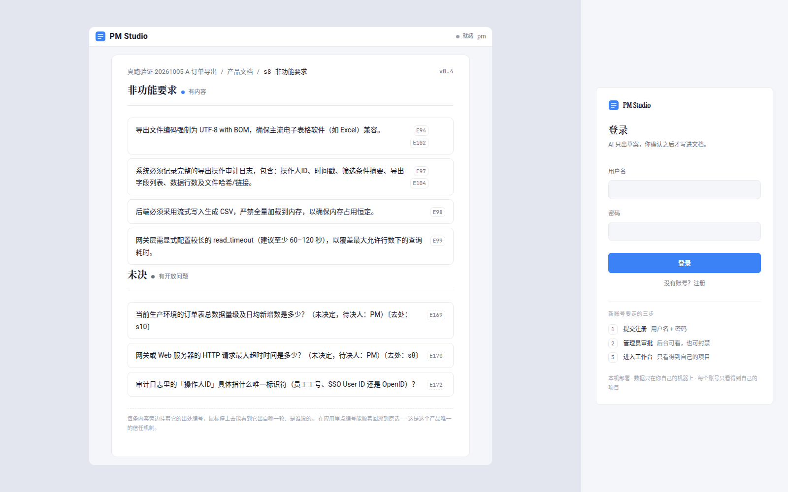
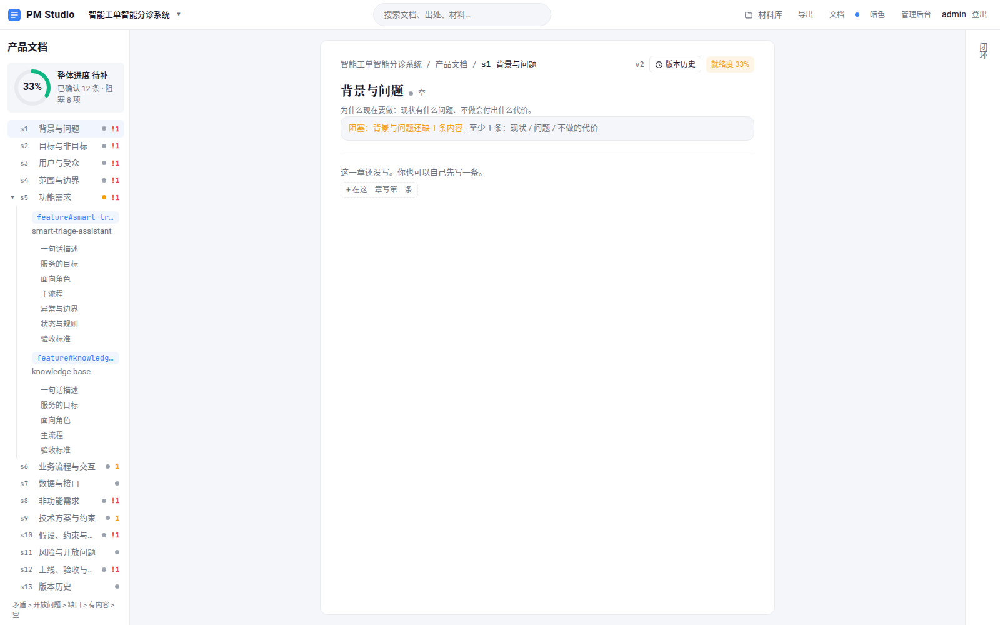
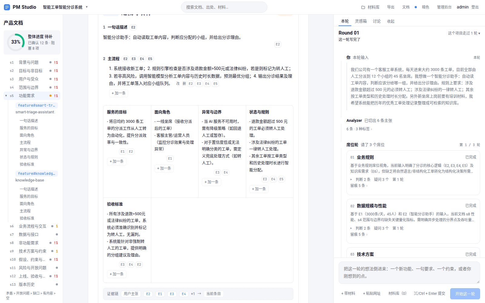
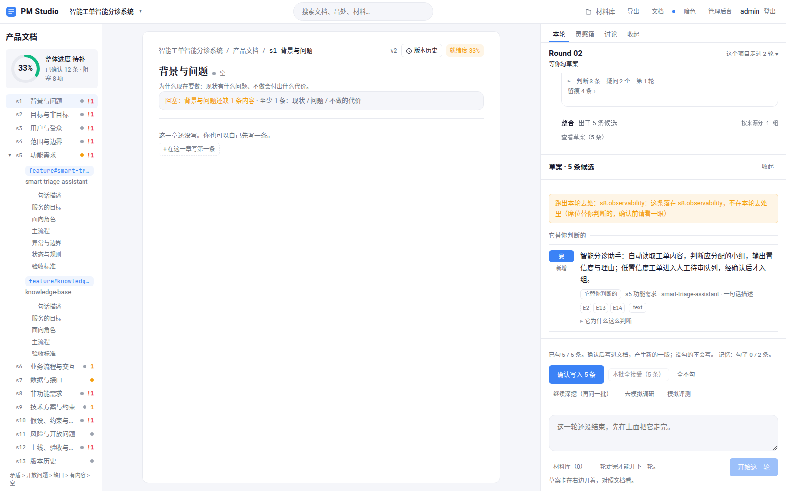
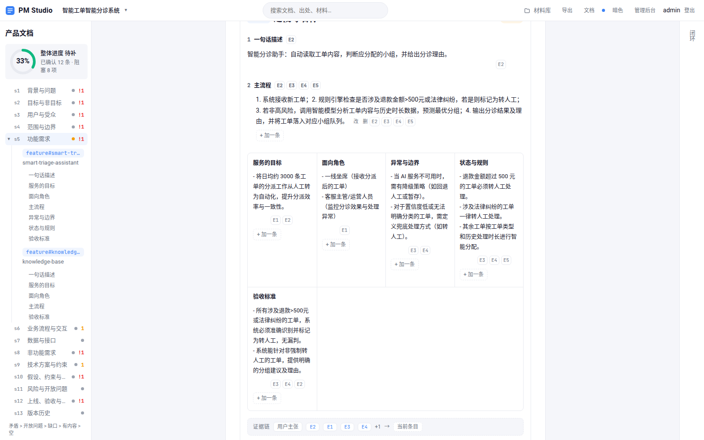
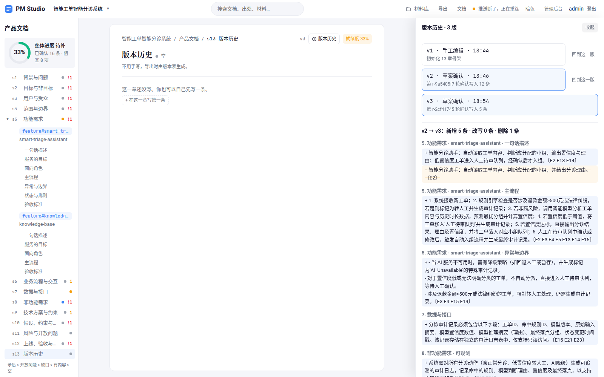
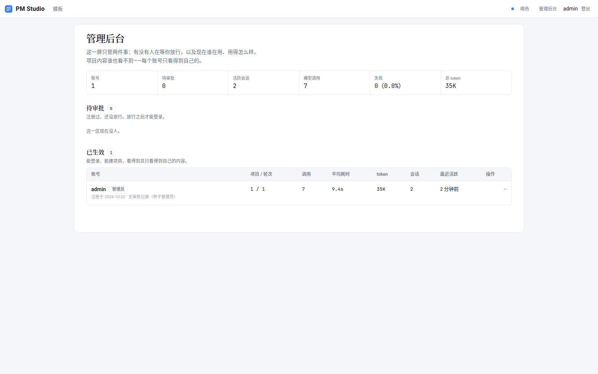
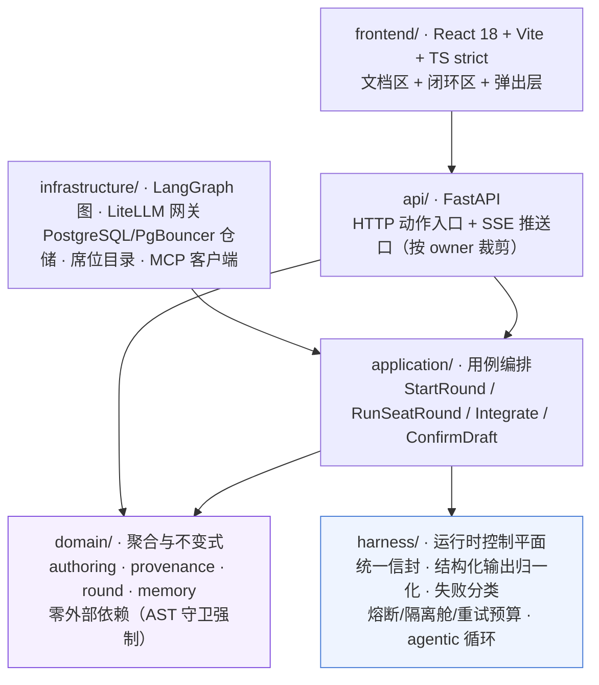

# PM Studio

> **AI 只出草案，人确认才写入。**
>
> 一个多智能体的产品文档工作台：把产品经理零散的想法，整理成结构化的产品文档。
> 领域专家席位（业务规则 / 数据规模 / 技术方案 / 权限……）各自出专业意见，
> 整合者组装成可勾选的草案；**每条内容都带出处编号**，可跳回原文；
> 每次确认产生一个版本，版本可 diff、可回退。

[](https://docs.python.org/3/)
[](https://react.dev/)
[](https://langchain-ai.github.io/langgraph/)
[-8A2BE2)](https://modelcontextprotocol.io/)

---

## 截图

| 登录 | 工作台（文档区当纸） |
|---|---|
|  |  |

**闭环区**——左边是你写的话，右边是系统怎么处理的：



上面这张图里能看到一次真实的轮次：Analyzer 切出 6 条主张 → 请了 3 个席位 →
每个席位各自给出「判断 / 疑问」并**带出处编号** → 整合者组装成草案。

**草案卡**——核心的信任机制：它替你判断的 / 它提议的**分开**，
每条带 E 编号与理由，越界的条目**显式标注**：



**写入后的文档**——证据编号是正文里看得见的小胶囊，可点回原文：



**版本历史与 diff**——一次改动 = 一版，版本只增不改：



**管理后台**——用量、失败率、会话：



---

## 快速开始

### 方式一：Docker（推荐）

**前置条件**——app 侧配置在 `backend/.env`（模板 `backend/.env.example`），
运维侧（PG 引导/角色/首管理员）在 `backend/.env.ops`（模板 `backend/.env.ops.example`）：

| 变量 | 必填 | 说明 |
|---|---|---|
| `PMSTUDIO_MODEL` | ✅ | LiteLLM 模型名，如 `openai/qwen3.7-flash` |
| `PMSTUDIO_API_KEY` | ✅ | 供应商密钥 |
| `PMSTUDIO_API_BASE` | 视供应商 | 非 OpenAI 官方端点时给 |
| `PMSTUDIO_DATABASE_URL` | ✅ | app 侧 URL，指向 PgBouncer `pgbouncer:6432` |
| `PMSTUDIO_MODEL_PARAMS` | 可选 | JSON，如关思考 `{"extra_body":{"enable_thinking":false}}` |
| `PMSTUDIO_MCP_SERVERS` | 可选 | MCP server 列表（JSON 数组），留空 = 不启用 |
| `PMSTUDIO_SECRET_KEY` | 多用户时 | 会话签名密钥 |

`backend/.env.ops` 提供 `PMSTUDIO_BOOTSTRAP_DATABASE_URL` / `PMSTUDIO_DIRECT_DATABASE_URL`、
两个 PG 角色口令与首管理员；compose 的 `db` 服务也读它。
compose 还会注入几个**容器专属**变量（`PMSTUDIO_FORWARDED_ALLOW_IPS` 等），**不用手写**。

```bash
cp backend/.env.example backend/.env
cp backend/.env.ops.example backend/.env.ops   # 改掉 change-me-* 与首管理员
docker compose build backend                    # 镜像必须用当前源码重建
docker compose up -d
# 打开 http://localhost（站点地址以 http:// 开头，Caddy 不会强制跳 https）
```

换域名：`PUBLIC_DOMAIN=example.com docker compose up -d`。

> **从旧 pgvector 镜像切过来必须空库**：新 db 是 ParadeDB 0.26.3-pg18
> （PGDATA `/var/lib/postgresql/18/docker`，pg_search 已预加载）。
> `docker compose down -v` 会删掉**本项目全部卷**（`pgdata`、`fastembed-cache`、
> `pgbouncer-auth`）；只想删旧库就先 `docker compose down`，再
> `docker volume rm <project>_pgdata`。旧数据不迁移。

> **镜像必须用当前源码重建**：先 `docker compose build backend`（或
> `docker compose up -d --build`）；复用旧的 `pmstudio-backend:local` 会跑旧代码。
> 启动参数由 `tests/architecture/test_container_assets.py` 钉住（含前端 COPY 路径、Caddy 占位符来源、
> `.dockerignore` 挡密钥）。首次 `docker compose up` 若起不来，先看 `.env` / `.env.ops`
> 的 key、口令与 URL 是否一致。

### 方式二：本地源码

```bash
# 先起 PG/PgBouncer 并 init，同时把 PgBouncer 发布到 loopback：
# 宿主进程解析不到 compose 的 `pgbouncer` 服务名，所以必须走 loopback override。
docker compose -f docker-compose.yml -f docker-compose.loopback.yml up -d --wait db pgbouncer

# 后端
cd backend && uv sync
cp .env.example .env && cp .env.ops.example .env.ops   # 改掉 change-me-* 与首管理员
# 把 .env 的 PMSTUDIO_DATABASE_URL 改成 @127.0.0.1:6432（不是 @pgbouncer:6432）
uv run python scripts/dev.py                            # http://127.0.0.1:8000

# 前端
cd frontend && npm install && npm run dev               # http://127.0.0.1:5173
```

### 方式三：一条脚本起两个（无 Docker）

```bash
scripts/dev_stack.sh          # 起（两个服务都健康才往下走）
scripts/dev_stack.sh --check  # 只核对与 compose 的配置键名是否一致
scripts/dev_stack.sh --stop   # 收
```

> **它和 compose 不是同一种形态**，只是**同一套环境变量键名**（那是"等价"的根据，
> `tests/architecture/test_container_assets.py` 做**双向**比对，两边各自独有的键都显式登记）：
> 本机跑 vite dev server、反代目标是 `127.0.0.1`；compose 跑 Caddy、反代目标是服务名 `backend`。
> 所以本机形态没有 `PMSTUDIO_WEB_ROOT`（vite 自己伺服），compose 形态没有 `PMSTUDIO_WEB_PORT`
> （Caddy 的端口由镜像 `EXPOSE` 固定）。

---

## 架构



**依赖方向单向，由机器强制**：`harness` 只许依赖自己 + `pydantic`/`litellm`/`pybreaker`，
`domain` 不许 import 任何外部包——`tests/architecture/` 里有 14 条守卫扫这件事，
其中 `guard_coverage.py` 用**合成违规输入**测守卫自己有没有效（"报绿的假守卫比没有守卫更坏"）。

### 一次轮次跑什么

```
POST /projects/{id}/rounds
  → LangGraph: start → analyze
  → [Analyzer]            claims          切分 + 定性（七种标签）+ 归位 + 席位编制
  → 复述卡（中断 1）      你可以改主张、换席位
POST /rounds/{id}/opening
  → LangGraph: opening → seat_round → integrate
  → [席位 ×N]             seat_review     并行且互不可见，各出「疑问 / 判断」
  → [Integrator]          integration     组装成题目 + 内容候选
  → 问卷（可选，中断 2）  有必须问你的才问；答案回来后**缩编重跑席位轮**
  → 草案卡（中断 3）      它替你判断的 / 它提议的，分开
POST /rounds/{id}/confirm
  → 唯一写入口 → 版本 +1
```

**一轮的模型调用次数与句数无关**，只与席位数和席位轮数有关（最多 3 轮）。

---

## 核心设计（四条不变式）

| 不变式 | 怎么落的 | 证据 |
|---|---|---|
| **AI 不写文档** | 编排层只产出"待写入清单"；确认端点是**唯一**写入口 | `tests/architecture/test_write_path.py`（白名单是空的） |
| **先有编号再有内容** | 每条内容带出处编号；无编号只能进"开放问题" | `domain/provenance/ledger.py` |
| **可追溯** | 顺着 `refs → derived_from` 回溯，必须到达一条用户输入或问卷答案 | `domain/services/traceability.py` |
| **失败必须是失败** | 模型失败不静默降级；空回包 / 非 JSON / 截断全部留痕 | `harness/model/normalize.py`、`harness/model/failure.py` |

---

## 技术栈

| 域 | 用了什么 |
|---|---|
| **Agent 框架与编排** | LangGraph 状态图 · 10 个领域化 Agent · fan-out/fan-in · 声明式基类 + 注册表 |
| **协议** | **MCP**（Model Context Protocol，只读侧 + 模型自主调）· Tool/Function Calling · SSE |
| **RAG** | 混合检索（PostgreSQL pg_search BM25 + pgvector + bge-small-zh）· 凸组合融合 · 文档解析（docx/xlsx/pdf/网页） |
| **记忆与上下文** | 五层记忆 · 跨轮记忆（出处强制 + 用户确认唯一写入口）· 上下文预算治理 |
| **LLM 工程** | LiteLLM 网关 · 结构化输出归一化（三档口径）· 失败分类权威表 · Prompt 工程 |
| **韧性与生产** | 熔断 + 隔离舱 + 重试预算 + 抖动退避 · argon2 异步隔离舱 · 三维登录限流 · 混沌工程 |
| **评测** | 真模型 eval（11 用例 + 12 条纯函数结构断言）· 检索质量验收（配对增量 + 符号检验） |
| **工程化** | FastAPI · PostgreSQL 18 + pgvector · PgBouncer · Redis · Docker · CI · DDD + 架构守卫 |
| **前端** | React 18 · Vite 6 · TypeScript strict · 零第三方 UI 依赖 · 自建设计系统 |

---

## 实测数据

以下是**本仓库真跑**的数字（模型 `qwen3.7-flash`，2 轮完整闭环）：

| 指标 | 数值 |
|---|---|
| 模型调用 | 14 次，**0 失败**，总耗时 121.5s，平均 8.7s |
| 席位 fan-out 并行 | 3 个席位**真并行**（时间戳重叠 4.93s / 5.83s） |
| 每轮调用构成 | Analyzer 1 + 席位 3（并行）+ 整合 1 + 归因 1 + 记忆 1 = 7 |
| 产出 | 2 轮 → 3 个版本（骨架 → 写入 12 条 → 再写入 5 条） |
| 导出 | Markdown 8,350 字节，每条带 `〔E1 E2 …〕` 出处标记 |

**检索侧**（`docs/plans/` 有完整实验记录）：

| 指标 | 数值 |
|---|---|
| 词法索引替换整句 LIKE（SQLite FTS5 时代实测；现为 pg_search BM25） | top1 命中 **34 → 134**，recall@5 **39 → 169**（184 查询） |
| 查询用 OR 不用 AND | recall@5 **45/45**（AND 39/45，LIKE 15/45） |
| 联网材料整页入库 | 混合命中 **29% → 71%** |
| 向量预算按"字数"而非"块数" | 语义覆盖 **41% → 66%** |
| 融合算法选型 | RRF → 凸组合（α·余弦 + (1−α)·饱和归一 BM25），真余弦保住分数幅度 |
| 冻结语料（pg_search + Robertson，2026-10-28） | 300/791：词面 r5 **.844**、改述 r5 **.857**、跨块 **4/15**；400/646 跨块 **7/15**（复现旧口径） |

**MCP 侧**（`scripts/mcp_probe.py` 真跑）：模型**自主**选中工具并据此作答

```
拿到 2 个工具：
  · mcp__demo__power      计算一个整数的正整数次方
  · mcp__demo__word_count 数一段文本里有多少个词

[第 1 轮] 模型要调 mcp__demo__power({"base": 3, "exponent": 17})
    mcp__demo__power → 129140163
[第 2 轮] 模型给出最终答复

最终答复：3 的 17 次方等于 129140163。依据：通过调用计算工具 `mcp__demo__power`…
```

---

## MCP 怎么用

把任意外部 MCP server 接进来，模型就能**自己决定**调它的哪个工具。

```bash
# backend/.env
PMSTUDIO_MCP_SERVERS='[{"name":"demo","transport":"stdio","command":"python3","args":["scripts/mcp_demo_server.py"]}]'
```

两种传输都支持（都是 MCP 协议规范定义的）：`stdio`（本地子进程，事实标准）
与 `http`（远程）。工具名会被加上 `mcp__<server>__` 前缀——**多 server 同名工具不会撞**。

```bash
cd backend && uv run python scripts/mcp_probe.py --builtin   # 内置演示 server
cd backend && uv run python scripts/mcp_probe.py --list      # 只列工具
```

> **边界**：MCP 在本项目里是**只读旁路**——不进主闭环、不进 API 层、不写库。
> 写侧要动"写入路径唯一"那条红线，本轮明确不做。

---

## 已知边界（如实说，不藏）

- **单用户本地应用**：backend 只经 PgBouncer（transaction mode）连 PG；4 workers
  负载门已过（100 HTTP + 20 轮内写，0 错误/超时/55P03/57014，HTTP p95 88ms）。
  跨 worker 的轮内 in-flight / 条件 claim 仍归 P3b-1。
- **无外部向量数据库**：词法 + 语义检索跑在 PostgreSQL 18 的 pg_search BM25 与
  pgvector/HNSW 上——零第二存储、可复现，代价是不适合百万级文档。
- **罕见词已由 Robertson BM25 处理**：IDF 对罕见词保留高权重，小语料负 IDF 钳到 0；
  旧 `xfail(strict=True)` 已删除。**排序债仍在**：钳制后 top1/MRR 低于旧 646/400 历史参考，
  见 `04-未决.md` §0.1 R15；不改阈值冒充通过。
- **SQLite 已删除**：运行时、测试、脚本都不再依赖 SQLite；旧 ETL 脚本与其测试已删，
  no-sqlite 守卫无白名单。

---

## 文档

| 文档 | 内容 |
|---|---|
| [`AGENTS.md`](AGENTS.md) | **给 AI 的上下文**：项目使命、架构地图、不变式、已知陷阱、验证阶梯 |
| [`DESIGN.md`](DESIGN.md) | 设计系统：排版、颜色、间距、动效的决策记录 |
| [`.codex/docs/设计/`](.codex/docs/设计/) | 七份设计文档：规格 / 编排与数据 / 案例与验收 / 未决 / DDD 架构 / 前端 / 记忆层 |
| [`docs/plans/`](docs/plans/) | 90 份实施计划与实测记录（含所有量化数据的出处） |
| [`docs/reports/agent-resume/`](docs/reports/agent-resume/) | 面向求职的分析报告：JD 对照、差距分析、落地蓝图、简历改写 |

---

## 开发

```bash
# 后端（PYTHONDONTWRITEBYTECODE / no:cacheprovider：不在磁盘上留 __pycache__ / .pytest_cache）
cd backend
uv sync
# 先导出 PMSTUDIO_TEST_DATABASE_URL / PMSTUDIO_TEST_DIRECT_DATABASE_URL（真 PG）
uv run pytest -q -p no:cacheprovider                                  # 全量测试
uv run pytest -m "not slow" -q -p no:cacheprovider                     # CI 用的（排掉要真模型的）
uv run ruff check --no-cache .

# 前端
cd frontend
npm install
npx tsc --noEmit
npx vitest run

# 检索验收（真 PG/pg_search + 真向量；300 当前口径 / 400 旧口径）
cd backend && uv run python scripts/retrieval_quality_bench.py --chunk-chars 300

# 混沌矩阵（真注入：上游 5xx / 慢响应 / Redis 强断 / 写锁 / 磁盘满）
cd backend && uv run python scripts/chaos_matrix.py

# 接口零差（后端 OpenAPI ↔ 前端 client.ts；默认用完即删的临时库，不碰真库）
cd backend && uv run python scripts/check_api_parity.py
```

**测试是真跑**：e2e 用真 PostgreSQL/PgBouncer、真用例、真席位目录，只有模型是脚本化的
（`ScriptedModelGateway`）。生产路径**不提供**"用假模型"的开关——
`tests/architecture/test_no_fakes_in_production.py` 盯着这件事。
