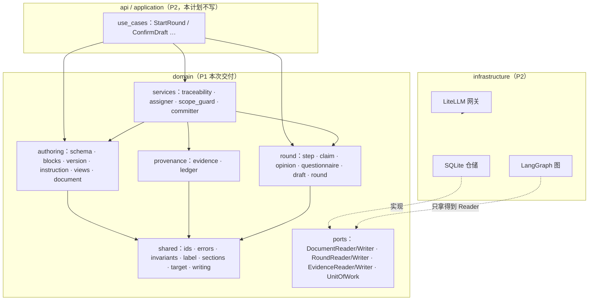
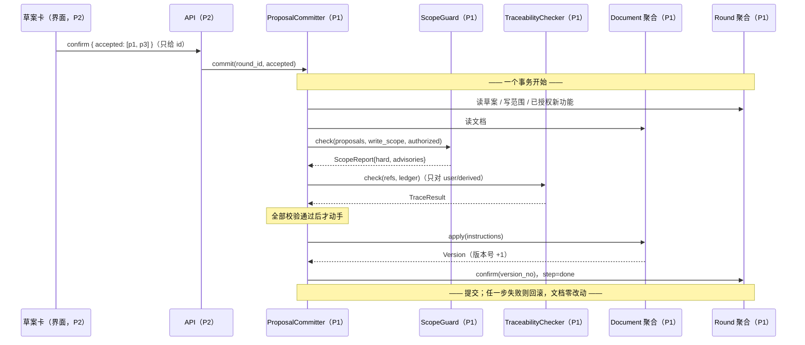

# P1 · 领域层 Implementation Plan

> **给执行者**：本计划用 `executing-plans` 逐任务执行（本会话内分批），每个任务一次提交。
> 步骤用 `- [ ]` 勾选跟踪。**不要**跳过"先让测试失败"那一步，它是本计划唯一的防伪手段。

**Goal:** 把产品文档的骨架、出处账本、一轮回合与四个领域服务做成**不依赖任何外部包**的纯
Python 领域层，让"AI 只能出草案、只能被人确认后写入、每条内容都能回溯到用户"这三件事
由代码保证，而不是由约定保证。

**Architecture:** DDD 三上下文（authoring / provenance / round）+ 共享词汇表（shared）
+ 跨上下文领域服务（services）。聚合各自守自己的不变量；写入路径全项目唯一
（`ProposalCommitter`），且由**能力拆分**（`DocumentReader` vs `DocumentWriter`）在结构上保证。
LangGraph、LiteLLM、SQLite 一律不进这一层。

**Tech Stack:** Python 3.13、pytest 9、ruff 0.7+、uv；P1 的领域层只用标准库。

**Spec:**
`.codex/docs/设计/01-规格.md`（骨架与功能清单）、`02-编排与数据.md`（流程与数据对象）、
`03-案例与验收.md`（两个案例 + 验收清单）、`05-DDD架构.md`（分层、聚合、端口、数据流）；
路线与纪律见 `docs/plans/2026-09-22-里程碑与真相源.md`。

## Global Constraints

- 技术栈：Python 3.13 + pytest + ruff；**P1 不引入任何第三方运行时依赖**。
- `domain/` **不 import 任何外部包**（fastapi / langgraph / litellm / sqlite3 都不行），
  由 `tests/architecture` 的扫 import 守卫强制。
- **写入路径唯一**：全项目只有 `pmstudio/domain/services/committer.py` 允许使用
  `DocumentWriter`，由能力导入白名单守卫强制。
- **domain 内部一律用绝对导入**（`from pmstudio.domain.round.round import Round`），
  不用 `from ..round import`；守卫靠这条约定才做得简单可靠。
- **假实现只许活在测试里**：`src/pmstudio/` 下不得出现 `fake/mock/stub/dummy` 标识符，
  由守卫扫描强制；生产路径不提供"用假模型"的开关。
- 三个上下文（authoring / provenance / round）**互不 import**，只能通过 `shared/` 与
  `services/` 协作；同一个不变量只在一个地方实现。
- 每个任务一次提交，消息前缀用 `feat:` / `test:` / `docs:` / `chore:`。
- 类名与字段名照抄 `05-DDD架构.md` 的"统一语言"一节，不要在代码里另起名字。

---

## 1. 现在要实现什么、边界在哪

**P1 只做一件事：把领域规则变成可执行的代码与测试。** 不碰模型、不碰网络、不碰数据库、不碰界面。

| 层 | P1 做 | P1 不做（谁做） |
|----|-------|----------------|
| 领域 | 13 章骨架、block 树、版本快照、出处账本、Round 回合、四个领域服务 | — |
| 应用 | 只定义仓储/事务**端口**（`domain/ports.py`） | 用例编排（P2） |
| 基础设施 | 只写**测试用**内存假仓储 | SQLite 仓储、UoW 实现、LiteLLM 网关（P2） |
| 编排 | 无 | LangGraph 图、席位、Integrator、Analyzer（P2） |
| 界面 | 无 | React（P2/P4） |

**为什么 P1 先做：** 三条 lane（A 领域 / B 编排 / C 界面）都依赖 P1 的签名。P1 完成前写编排，
等于把不变量散进图和提示词里，之后再也收不回来。

## 2. 影响面（改动落到哪、谁受影响）

| 模块 | 受影响 | 说明 |
|------|--------|------|
| `backend/`（新建） | 新增 | 本计划新开目录，此前仓库只有设计文档 |
| `domain/authoring` | 新增 | Document 聚合；**唯一能产生版本的地方** |
| `domain/provenance` | 新增 | EvidenceLedger；**唯一能分配出处编号的地方** |
| `domain/round` | 新增 | Round 聚合；**唯一能推进步骤与状态的地方** |
| `domain/services` | 新增 | 跨聚合逻辑：回溯、编号分配、写范围、写入 |
| `domain/ports.py` | 新增 | 三条 lane 之间的接口契约（P2 之前先冻结） |
| `tests/architecture` | 新增 | 四道结构性防线（无外部依赖 / 上下文隔离 / 唯一写路径 / 无假实现） |
| 设计文档 | 微调 | 见 §3，只改有矛盾或不够精确的地方，不新增文档 |
| P2 的编排层 | 被约束 | 编排层拿不到 `DocumentWriter`，它在结构上写不了文档 |
| P4 的界面 | 被约束 | 界面只能读 `Document.view()` 与 `Round` 的只读属性，不做业务判断 |

**数据流影响（P1 覆盖 `05-DDD架构.md` §13 数据流的哪几行）：**

| 数据流步骤 | P1 覆盖 |
|-----------|---------|
| 1 建轮 / 3 主张落账本 / 4 收开场卡修改 / 8 答案落账本 / 12 重试 | **部分**：领域方法齐全，调用方（用例）在 P2 |
| 2 / 5 / 6a 调模型、席位并行、整合组装 | 否（P2）；但 P1 冻结它们要填的结构：`Opinion` / `Questionnaire` / `Draft` |
| **6b 分配全局编号** | **是**（`EvidenceAssigner`） |
| **7 有题出问卷 / 无题出草案** | **是**（`Round.integrate` 的两个出口 + `Draft.grouped()`） |
| **9 到上限显式化** | **部分**：领域拒绝第 4 次席位轮（`SeatRoundLimitReached`），显式化动作在 P2 |
| **10 确认写入 + 版本 + 出处关联** | **是**（`ProposalCommitter`，一个事务） |
| 11 失败与原因 | **部分**：`Round.fail/resume`；`generation.failed` 事件在 P2 |

## 3. 核验：现有设计里被我找出问题的地方（需要你拍板）

我按 §5 的不变量矩阵逐条对过设计文档，下面 6 条要么自相矛盾、要么缺数据、要么会卡住 P2。
**每条都给了建议，默认按建议实现**；你要改哪条，改的是本计划 + 一行文档。

### 决策 1（重要）：写范围到底管多严？现有文档自相矛盾

- `02-编排与数据.md` §3① 说："逐条给 target……**这一列就是写范围**"，`checkpoint.md` 也写着
  "范围就是复述卡里'去处'的集合，写入端强制"。
- 但 `03-案例与验收.md` 案例 A：用户的输入只提到 s3 / s5 / s10，最后却写了 **s7（脱敏）**、
  **s8（性能上限）**、**s11（开放问题）**。按"严格等于去处集合"，这轮草案里有一半内容写不进去。
- 结论：**严格版规则走不通**。按它实现要么卡死案例 A，要么逼着席位把每个专业判断都变成问题
  （那就退化成问卷填写器，是你明确否掉的）。

**建议（默认按这个做）**：写范围分两级。

1. **硬约束（写入端拒绝，`OutOfScope`）**：不得新增未经授权的 feature 子树；不得写 13 章以外的
   章节（`Target` 构造时就会拒绝）。
2. **软约束（写入端不拒绝，但必须显式标注）**：提案落在本轮"去处 ∪ 已作答问题的 target"之外时，
   记进 `ScopeReport.advisories`，在草案卡顶部显示"涉及本轮没提到的章节：s7、s8"。

代价：AI 可以写用户没提到的章节。收益：用户**在草案卡上看得见**这件事，而不是被系统静默拒绝
（静默拒绝会让席位白干，用户永远看不到那些专业判断）。若你要严格版，改动只有一处：
把 `ScopeGuard` 的 rule 4 从 `advisories` 移进 `hard`（Task 10 有一行注释标出位置）。

### 决策 2：P0 拆成两半，P1 只带上自己需要的那半

原 P0 含 SQLite schema、仓储实现、UoW、ModelGateway 端口。**P1 一条都用不到**（领域层用假仓储）。

**建议**：P0 拆成 P0a（本计划 Task 0：目录、pyproject、pytest/ruff、四道守卫、领域端口）与
P0b（随 P2 计划：SQLite schema、仓储、UoW 实现、LiteLLM 网关）。理由：现在写存储层就是
在猜领域层的形状；等 P1 落地后再照 `view()` 与聚合真身设计表结构，返工更少。

### 决策 3：端口放哪？按 `05` 的目录图会违反依赖方向

`05-DDD架构.md` §8 的目录图把 `ports.py` 放在 `application/`，但 §5 又说"**领域**只声明接口"，
而且 `ProposalCommitter` 是领域服务、必须接收仓储端口。若端口在 `application/`，领域服务就得
import application，方向反了。

**建议**：`domain/ports.py` 放仓储与事务端口（`DocumentReader/Writer`、`RoundReader/Writer`、
`EvidenceReader/Writer`、`UnitOfWork`）；P2 再建 `application/ports.py` 放模型、席位、事件这些
应用侧端口。端口**只声明，不建桩**：P1 只有测试里的内存实现。

### 决策 4：跨上下文"只传 id"这条要精确一点，否则 `Document.apply` 没法写

`05` §1 说"跨上下文只传 id，不传对象"。但 `Document.apply(proposals)` 里的 `Proposal` 属于
round 上下文，照字面执行，`authoring` 就得 import `round`。

**建议**：改成"**可以传 `shared/` 里的值对象（`Target`、`EvidenceId`、`WriteOp` 等），
不能传对方的上下文实体**"。所以：

- `round` 里的是 `Proposal`（带来源、理由、是否新建功能），`authoring` 里的是 `WriteInstruction`
  （带 op / target / text / refs / kind）。**翻译发生在 `ProposalCommitter` 里**——它本来就是
  唯一同时读 Round 与 Document 的地方。
- 好处不只是守规矩：草案卡上的"它替你判断的"和文档里的"条目"本来就是两种东西，分开之后
  两者可以各自演化。

### 决策 5：草案必须带 block 类型，否则 `Document.apply` 不知道建什么块

文档 schema 里 block 有类型（`acceptance` / `nfr` / `decision` / `steps`…），但设计文档没说
**类型由谁定**。

**建议**：功能子树下的字段块，类型由**固定 schema 表**决定（`authoring/schema.py` 的
`FieldSpec.kind`，字段清单来自 `01-规格.md` §4）；章节级内容（没有字段名的那种）由
`Proposal.kind` 显式给出，缺省 `text`。章节级 block 的"哪种章节允许哪种类型"设计里没有依据，
**P1 不校验**，留到 P4 与门禁一起定（记进 §10 遗留）。

### 决策 6：小项，逐条列出（都建议照此实现）

| # | 问题 | 建议 |
|---|------|------|
| 6.1 | 事件名两处不一致：`02` 写 `run.updated`，`AGENTS.md` 写 `round.updated` | 统一为 `round.*`（与聚合名一致）；P1 只改文档，事件在 P2 实现 |
| 6.2 | `Round` 字段表（R1–R6）没有"席位编制"约束，`attest` 无法识别伪造/错配的席位包 | 新增 **R7**：席位轮只接受开场卡编制内的席位 |
| 6.3 | `04-未决.md` D3 建议 block id 用"短随机 id + 语义前缀" | P1 用**确定性 id**（`s5.b3`、`feat-order-export.one_liner`），可读、可测、rehydrate 稳定；真有碰撞需求再换 |
| 6.4 | 条目级修订规则没写 | **文档条目：原地替换 + 上一版快照留旧值；出处条目：新增 + `supersedes`**。载体不同，规则不同，别混用 |
| 6.5 | `05` §5 写 `EvidenceRepository.append/chain` | P1 用聚合整体读写：`EvidenceReader.get(project_id) -> EvidenceLedger` / `EvidenceWriter.save(ledger)`；`chain()` 是账本上的方法，与另两个仓储一致 |
| 6.6 | `Project` 聚合（F1 建项目）不在 P1 范围，但偏好区得有归宿 | P1 把偏好区放在 `Document` 里（不进 13 章正文，随版本快照一起存）；`Project` 推迟到 P2 |
| 6.7 | `Round.answer_sets` 需要能区分"答了"与"跳过" | 新增 `AnswerSet.skipped`；跳过的题 → `system_default` 提案 → s11 开放问题，**豁免写范围软约束** |
| 6.8 | 功能必填字段到底是哪几个，设计里只说"验收标准、异常与边界非空、能关联目标与角色" | 必填 = 名称 / 一句话描述 / 服务的目标 / 面向角色 / 异常与边界 / 验收标准，全部来自 `01-规格.md` §4 原话，集中在 `schema.py` 一张表里 |

## 4. 架构图

**依赖方向与守卫（P1 实际交付的部分）**



三条要点：**上下文之间没有箭头**（只通过 shared 与 services 协作）；**services 是唯一的跨上下文层**；
**infrastructure 依赖 domain，反过来不成立**。

**唯一写入路径（P1 做完之后的实际时序）**



**注意**：界面/API 只上传 `proposal_id` 列表，不接受提案内容——否则伪造一条提案就能绕过整条链。
由 `test_committer_bad_unknown_proposal` 守。

## 5. 不变量 × 测试用例矩阵（P1 的验收核心）

每个不变量至少一个正例（`test_<码>_ok_*`）与一个反例（`test_<码>_bad_*`），命名**必须**遵守这个
前缀约定：Task 12 有一个元测试扫全部测试名，缺一个就红。这就是"每条不变量都有正反例"这条
退出条件的机械化版本。

| 码 | 不变量 | 正例 | 反例 |
|----|--------|------|------|
| D1 | 13 章固定，不可增删重排 | `test_D1_ok_document_new_has_thirteen_sections` | `test_D1_bad_missing_section` / `test_D1_bad_unknown_section_in_target` |
| D2 | block id 永久稳定；删除留墓碑且编号不复用 | `test_D2_ok_entry_replace_keeps_block_id` | `test_D2_bad_removed_block_id_is_not_reused` |
| D3 | 只有 s5 能长 feature 子树，且需用户授权 | `test_D3_ok_feature_with_authorization` | `test_D3_bad_feature_without_authorization` / `test_D3_bad_feature_outside_s5` |
| D4 | 同一父节点下字段名唯一 | `test_D4_ok_two_fields_under_one_feature` | `test_D4_bad_duplicate_field_under_same_parent` |
| D5 | 被手改过的 block 不能被静默覆盖 | `test_D5_ok_add_to_untouched_single_value_field` | `test_D5_bad_replace_manually_edited_block` |
| D6 | 一次写入=一版；版本只增不改；回退产生新版本 | `test_D6_ok_apply_creates_one_version` / `test_D6_ok_rollback_creates_new_version` | `test_D6_bad_empty_apply` / `test_D6_bad_versions_are_immutable` |
| E1 | 编号全局唯一、只增、永不复用 | `test_E1_ok_numbers_grow` | `test_E1_bad_duplicate_eid` / `test_E1_bad_gap_is_not_reused_after_rehydrate` |
| E2 | 修订只能新增 + supersedes，不能改写历史 | `test_E2_ok_revise_appends_and_supersedes` | `test_E2_bad_evidence_is_frozen` |
| E3 | `agent_derived` 必带 `derived_from` 且指向已存在编号 | `test_E3_ok_derived_with_existing_basis` | `test_E3_bad_derived_without_basis` / `test_E3_bad_unknown_basis` / `test_E3_bad_self_derivation` |
| E4 | 可追溯（服务层校验，见 `05` §3.2 的 E4） | `test_E4_ok_chain_reaches_user_input` | `test_E4_bad_chain_ends_in_proposed` |
| R1 | 一轮绑定一次用户输入 | `test_R1_ok_start_binds_input` | `test_R1_bad_empty_input` / `test_R1_bad_input_is_read_only` |
| R2 | step 只能按序推进；waiting_on 非空不能推进 | `test_R2_ok_legal_path` | `test_R2_bad_backward_step` / `test_R2_bad_advance_while_waiting` |
| R3 | 席位轮最多 3 次 | `test_R3_ok_three_seat_rounds` | `test_R3_bad_fourth_seat_round` |
| R4 | 一批问卷最多 5 题 | `test_R4_ok_five_questions` | `test_R4_bad_six_questions` |
| R5 | 草案只能由整合产生，每条提案带 refs | `test_R5_ok_draft_from_integrate` | `test_R5_bad_draft_without_refs` / `test_R5_bad_draft_before_integrate` |
| R6 | 答案必须带 question_id 且只能答本轮问题 | `test_R6_ok_answer_set` | `test_R6_bad_unknown_question` / `test_R6_bad_answer_twice` |
| R7 | 席位轮只接受编制内的席位 | `test_R7_ok_attest_known_seat` | `test_R7_bad_attest_unknown_seat` |
| LB1 | 偏好不进正文（进偏好区） | `test_LB1_ok_preference_targets_preference_zone` | `test_LB1_bad_preference_targets_body` |
| LB2 | 猜测必须升格为假设（带失败后果与验证方式） | `test_LB2_ok_guess_with_assumption` | `test_LB2_bad_guess_without_assumption` |
| LB3 | 决定必须记决策者 | `test_LB3_ok_decision_with_decider` | `test_LB3_bad_decision_without_decider` |
| AG1 | 空意见不等于没意见（必须给依据） | `test_AG1_ok_empty_opinions_with_basis` | `test_AG1_bad_empty_basis` |
| GB1 | 先有编号再有内容 | `test_GB1_ok_entry_with_refs` | `test_GB1_bad_entry_without_refs` |
| — | AI 不写文档（全局第一条） | **结构性守卫**：`tests/architecture/test_write_path.py` 的白名单断言（不是 ok/bad 对） | 同左：同一个守卫，正例是全项目只有 committer 用写能力 |

## 6. 文件结构（P1 新增，全部在 `backend/` 下）

```
backend/
├── pyproject.toml                     依赖与工具配置（无运行时依赖）
├── .python-version                    3.13
├── src/pmstudio/
│   ├── __init__.py
│   └── domain/
│       ├── __init__.py
│       ├── ports.py                   仓储/事务端口（P1 只有测试里实现）
│       ├── shared/
│       │   ├── ids.py                 类型化标识符 + 出处编号编解码
│       │   ├── errors.py              全部领域错误（集中一处，否则上下文隔离会被破坏）
│       │   ├── invariants.py          D/E/R/LB/AG/GB 六组不变量码（元测试据此收）
│       │   ├── label.py               七种标签 + 分区（正文 / 偏好区）
│       │   ├── sections.py            13 章骨架词汇表（三上下文都要用）
│       │   ├── target.py              Target 及其 is_within（写范围判定）
│       │   └── writing.py             BlockKind / WriteOp
│       ├── authoring/
│       │   ├── schema.py              功能字段表（名 / 类型 / 多值 / 必填）
│       │   ├── blocks.py              Entry / Block / 字段名唯一检查
│       │   ├── version.py             Version / VersionTrigger / Snapshot
│       │   ├── instruction.py         WriteInstruction（authoring 侧的写入指令）
│       │   ├── views.py               DocumentView / SectionView / BlockView / Gap
│       │   └── document.py            Document 聚合（apply / rollback_to / view / gaps）
│       ├── provenance/
│       │   ├── evidence.py            Evidence / EvidenceKind / EvidenceSource + 形状校验
│       │   └── ledger.py              EvidenceLedger（record / revise / chain）
│       ├── round/
│       │   ├── step.py                Step / WaitingOn / 合法迁移表
│       │   ├── claim.py               Claim / Assumption
│       │   ├── opinion.py             Opinion / SeatReview
│       │   ├── questionnaire.py       Question / Questionnaire / Answer / AnswerSet
│       │   ├── draft.py               Proposal / Origin / Draft（三组投影）
│       │   └── round.py               Round 聚合
│       └── services/
│           ├── traceability.py        TraceabilityChecker（E4）
│           ├── assigner.py            EvidenceAssigner（主张与意见的编号分配）
│           ├── scope_guard.py         ScopeGuard（硬约束 + 软提示）
│           └── committer.py           ProposalCommitter（唯一写入路径）
└── tests/
    ├── __init__.py                   每个测试目录都有 __init__.py：
    ├── support/__init__.py           这样模块名统一是 tests.xxx.yyy，
    ├── support/fakes.py               内存仓储 + 假事务（只活在测试里）
    ├── architecture/
    │   ├── __init__.py
    │   ├── guards.py                  四个纯函数扫描器（可被自身测试）
    │   ├── test_domain_imports.py     无外部依赖 + 上下文隔离
    │   ├── test_write_path.py         唯一写入路径白名单
    │   └── test_no_fakes_in_production.py
    └── domain/                       （每个子目录同样带 __init__.py）
        ├── test_shared.py
        ├── test_invariant_matrix.py   Task 12：缺正例/反例即红
        ├── authoring/test_blocks_schema.py
        ├── authoring/test_document.py
        ├── provenance/test_ledger.py
        ├── round/test_claim_opinion.py
        ├── round/test_questionnaire_draft.py
        ├── round/test_round.py
        └── services/
            ├── test_traceability.py
            ├── test_assigner.py
            ├── test_scope_guard.py
            └── test_committer.py
```

一个文件一件事：**聚合只守自己的不变量**，跨聚合的判断全部落在 `services/`；错误类集中在
`shared/errors.py`（否则 `round` 要用 `authoring` 的错误类，就破坏上下文隔离了）。

---

## 7. 任务

### Task 0: 地基与四道防线（P0a）

**Files:**

- Create: `backend/pyproject.toml`
- Create: `backend/.python-version`
- Create: `backend/src/pmstudio/__init__.py`
- Create: `backend/src/pmstudio/domain/__init__.py`
- Create: `backend/src/pmstudio/domain/ports.py`
- Create: `backend/tests/__init__.py`
- Create: `backend/tests/support/__init__.py`
- Create: `backend/tests/architecture/__init__.py`
- Create: `backend/tests/domain/__init__.py`（后续任务的子目录各自再加一个 `__init__.py`）
- Create: `backend/tests/architecture/guards.py`
- Create: `backend/tests/architecture/test_domain_imports.py`
- Create: `backend/tests/architecture/test_write_path.py`
- Create: `backend/tests/architecture/test_no_fakes_in_production.py`
- Modify: `.codex/docs/设计/02-编排与数据.md`、`05-DDD架构.md`、`04-未决.md`、`.codex/docs/上下文/checkpoint.md`

**Interfaces:**

- Consumes: 无
- Produces:
  - `pmstudio.domain.ports.DocumentReader.get(project_id: ProjectId) -> Document` / `DocumentWriter.save(document) -> None`
  - `pmstudio.domain.ports.RoundReader.get(round_id: RoundId) -> Round` / `RoundWriter.save(round) -> None`
  - `pmstudio.domain.ports.EvidenceReader.get(project_id: ProjectId) -> EvidenceLedger` / `EvidenceWriter.save(ledger) -> None`
  - `pmstudio.domain.ports.UnitOfWork`（上下文管理器：`__exit__` 无异常即提交，有异常即回滚）
  - `tests.architecture.guards`：`top_level_imports` / `external_imports` / `foreign_context_imports` / `uses_symbol` / `forbidden_names` / `iter_sources`

- [ ] **Step 1: 写 pyproject 与目录占位**

`backend/pyproject.toml`：

```toml
[project]
name = "pmstudio"
version = "0.0.0"
description = "PM Studio —— 单用户产品文档工作台"
requires-python = ">=3.13"
dependencies = []

[dependency-groups]
dev = ["pytest>=8.3", "ruff>=0.7"]

[tool.uv]
package = false

[tool.pytest.ini_options]
pythonpath = ["src", "."]
testpaths = ["tests"]
addopts = "-q"

[tool.ruff]
line-length = 100
target-version = "py313"
src = ["src", "tests"]

[tool.ruff.lint]
select = ["E", "F", "I", "UP", "B"]

[tool.ruff.lint.isort]
known-first-party = ["pmstudio", "tests"]
```

`backend/.python-version`：一行 `3.13`。

所有 `__init__.py`（`backend/src/pmstudio/`、`backend/src/pmstudio/domain/`、`backend/tests/`
以及 `backend/tests/` 下每一层目录）都留空。测试目录建成包之后，模块名统一是 `tests.xxx.yyy`，
`from tests.support.fakes import …` 与 `from tests.architecture.guards import …` 才能稳定解析。
后续任务新建 `tests/domain/authoring/` 这类目录时，**同时**补一个空的 `__init__.py`。

`package = false` 的理由：P1 不需要安装 `pmstudio` 这个包，测试靠 `pythonpath = ["src"]` 导入。
等 P2 起服务时再决定是否真打包。

- [ ] **Step 2: 先写守卫测试（会红）**

`backend/tests/architecture/test_domain_imports.py`：

```python
import ast
from pathlib import Path

from tests.architecture.guards import DOMAIN, external_imports, foreign_context_imports, iter_sources


def test_guard_detects_external_import():
    assert external_imports("import sqlite3\n") == {"sqlite3"}


def test_guard_allows_stdlib_and_own_package():
    source = "import ast\nfrom pmstudio.domain.shared.ids import EvidenceId\n"
    assert external_imports(source) == set()


def test_guard_detects_foreign_context():
    source = "from pmstudio.domain.round.round import Round\n"
    assert foreign_context_imports(source, own="authoring") == {"round"}


def test_domain_has_no_external_imports():
    offenders = {
        str(path): sorted(mods)
        for path, source in iter_sources(DOMAIN)
        if (mods := external_imports(source))
    }
    assert offenders == {}


def test_domain_contexts_do_not_import_each_other():
    offenders: dict[str, list[str]] = {}
    for path, source in iter_sources(DOMAIN):
        rel = path.relative_to(DOMAIN)
        own = rel.parts[0] if rel.parts[0] in ("authoring", "provenance", "round") else None
        if own is None:
            continue
        foreign = foreign_context_imports(source, own=own)
        if foreign:
            offenders[str(rel)] = sorted(foreign)
    assert offenders == {}


def test_domain_uses_absolute_imports():
    """相对导入会让上下文守卫失效，所以 domain 内一律绝对导入。"""
    offenders = []
    for path, source in iter_sources(DOMAIN):
        for node in ast.walk(ast.parse(source)):
            if isinstance(node, ast.ImportFrom) and node.level:
                offenders.append(f"{path.name}:{node.lineno}")
    assert offenders == []
```

`backend/tests/architecture/test_write_path.py`：

```python
from tests.architecture.guards import SRC, iter_sources, uses_symbol

WRITE_CAPABILITY = "DocumentWriter"
# 白名单从一开始就是空的：每加一个都必须改这个常量，评审时一眼可见。
# Task 11 会把它改成 {"pmstudio/domain/services/committer.py"}。
ALLOWED: set[str] = set()


def test_guard_flags_import_site():
    source = "from pmstudio.domain.ports import DocumentWriter\n"
    assert uses_symbol(source, WRITE_CAPABILITY) is True


def test_guard_ignores_definition_site():
    source = "class DocumentWriter(Protocol):\n    ...\n"
    assert uses_symbol(source, WRITE_CAPABILITY) is False


def test_only_committer_can_use_the_document_write_capability():
    users = {
        path.relative_to(SRC).as_posix()
        for path, source in iter_sources(SRC)
        if uses_symbol(source, WRITE_CAPABILITY)
    }
    assert users == ALLOWED
```

`backend/tests/architecture/test_no_fakes_in_production.py`：

```python
from tests.architecture.guards import SRC, forbidden_names, iter_sources


def test_guard_flags_fake_names():
    assert forbidden_names("def make_fake_gateway():\n    ...\n") == {"make_fake_gateway"}


def test_production_code_has_no_fake_implementations():
    offenders = {
        path.relative_to(SRC).as_posix(): sorted(names)
        for path, source in iter_sources(SRC)
        if (names := forbidden_names(source))
    }
    assert offenders == {}
```

Run: `cd backend && uv run pytest tests/architecture -q`
Expected: FAIL —— `ModuleNotFoundError: No module named 'tests.architecture.guards'`

- [ ] **Step 3: 写扫描器与端口（让守卫变成真守卫）**

`backend/tests/architecture/guards.py`：

```python
"""结构性防线的纯函数实现。守卫自己能被测，才不会退化成永远通过。"""

import ast
import sys
from collections.abc import Iterator
from pathlib import Path

SRC = Path(__file__).resolve().parents[2] / "src"
DOMAIN = SRC / "pmstudio" / "domain"
CONTEXTS = ("authoring", "provenance", "round")
FORBIDDEN_STEMS = ("fake", "mock", "stub", "dummy")


def iter_sources(root: Path) -> Iterator[tuple[Path, str]]:
    for path in sorted(root.rglob("*.py")):
        yield path, path.read_text(encoding="utf-8")


def top_level_imports(source: str) -> set[str]:
    names: set[str] = set()
    for node in ast.walk(ast.parse(source)):
        if isinstance(node, ast.Import):
            names.update(alias.name.split(".")[0] for alias in node.names)
        elif isinstance(node, ast.ImportFrom) and node.module and not node.level:
            names.add(node.module.split(".")[0])
    return names


def external_imports(source: str) -> set[str]:
    allowed = set(sys.stdlib_module_names) | {"pmstudio"}
    return {name for name in top_level_imports(source) if name not in allowed}


def foreign_context_imports(source: str, *, own: str) -> set[str]:
    foreign: set[str] = set()
    for node in ast.walk(ast.parse(source)):
        modules: list[str] = []
        if isinstance(node, ast.Import):
            modules = [alias.name for alias in node.names]
        elif isinstance(node, ast.ImportFrom) and node.module and not node.level:
            modules = [node.module]
        for module in modules:
            parts = module.split(".")
            if len(parts) >= 3 and parts[:2] == ["pmstudio", "domain"]:
                if parts[2] in CONTEXTS and parts[2] != own:
                    foreign.add(parts[2])
    return foreign


def uses_symbol(source: str, symbol: str) -> bool:
    """只认“使用点”（导入 / 名字 / 注解 / 属性），不认定义点（class 语句本身）。"""
    for node in ast.walk(ast.parse(source)):
        if isinstance(node, ast.ImportFrom) and any(alias.name == symbol for alias in node.names):
            return True
        if isinstance(node, ast.Import) and any(alias.name == symbol for alias in node.names):
            return True
        if isinstance(node, ast.Name) and node.id == symbol:
            return True
        if isinstance(node, ast.Attribute) and node.attr == symbol:
            return True
    return False


def forbidden_names(source: str) -> set[str]:
    found: set[str] = set()
    for node in ast.walk(ast.parse(source)):
        candidates: list[str] = []
        if isinstance(node, ast.Name):
            candidates.append(node.id)
        elif isinstance(node, ast.Attribute):
            candidates.append(node.attr)
        elif isinstance(node, ast.arg):
            candidates.append(node.arg)
        elif isinstance(node, (ast.FunctionDef, ast.AsyncFunctionDef)):
            candidates.append(node.name)
            candidates.extend(arg.arg for arg in node.args.args)
        elif isinstance(node, ast.ClassDef):
            candidates.append(node.name)
        for name in candidates:
            if any(stem in name.lower() for stem in FORBIDDEN_STEMS):
                found.add(name)
    return found
```

`backend/src/pmstudio/domain/ports.py`：

```python
"""领域端口：只声明能力，不给实现。实现全在 infrastructure（P2）。"""

from types import TracebackType
from typing import TYPE_CHECKING, Protocol, runtime_checkable

from pmstudio.domain.shared.ids import ProjectId, RoundId

if TYPE_CHECKING:
    from pmstudio.domain.authoring.document import Document
    from pmstudio.domain.provenance.ledger import EvidenceLedger
    from pmstudio.domain.round.round import Round


@runtime_checkable
class DocumentReader(Protocol):
    def get(self, project_id: ProjectId) -> "Document": ...


@runtime_checkable
class DocumentWriter(Protocol):
    """写文档的能力被单独拆出来：编排层与界面只拿得到 Reader。"""

    def save(self, document: "Document") -> None: ...


@runtime_checkable
class RoundReader(Protocol):
    def get(self, round_id: RoundId) -> "Round": ...


@runtime_checkable
class RoundWriter(Protocol):
    def save(self, round_: "Round") -> None: ...


@runtime_checkable
class EvidenceReader(Protocol):
    def get(self, project_id: ProjectId) -> "EvidenceLedger": ...


@runtime_checkable
class EvidenceWriter(Protocol):
    def save(self, ledger: "EvidenceLedger") -> None: ...


@runtime_checkable
class UnitOfWork(Protocol):
    """一个用例一个事务：正常退出即提交，抛异常即回滚。"""

    def __enter__(self) -> "UnitOfWork": ...

    def __exit__(
        self,
        exc_type: type[BaseException] | None,
        exc: BaseException | None,
        tb: TracebackType | None,
    ) -> None: ...
```

Run: `cd backend && uv run pytest tests/architecture -q`
Expected: PASS（三个守卫文件全绿：`domain/` 下只有 `ports.py` 与 `__init__.py`；
写能力白名单此刻是空集，所以断言也通过）

- [ ] **Step 4: 把拍板结论写回设计文档（小改，不新增文档）**

按 §3 的结论，逐处改：

1. `02-编排与数据.md` §6 事件表：`run.updated` → `round.updated`；§4.6 "运行"段里 `run_id` 保留为
   外层标识，但把"轮"的术语统一成 `round`；§3① 的"这一列就是写范围"补一句：
   "**硬约束**只有两条：不得新增未授权 feature 子树、不得离开 13 章；其余越界以草案卡提示呈现。"
2. `05-DDD架构.md` §5 端口表：加一列"声明位置"，全部指向 `domain/ports.py`；把
   `EvidenceRepository.get/append/chain` 改成 `EvidenceReader.get(project_id) -> EvidenceLedger`
   / `EvidenceWriter.save(ledger)`；§8 目录图把 `ports.py` 从 `application/` 移到 `domain/`，
   并补 `shared/sections.py`、`shared/invariants.py`、`shared/writing.py`、`authoring/schema.py`、
   `authoring/instruction.py`、`authoring/views.py`；§3.1 `Project` 加注"P2 实现，偏好区在 Document 内"。
3. `05-DDD架构.md` §3.3 Round 不变量表加 **R7**：席位轮只接受开场卡编制内的席位；
   §3.1 Document 补一句"偏好区随文档版本化，但不在 13 章正文内"。
4. `04-未决.md`：把"假实现是否暴露给用户"从唯一未定移入 A 已定（答案：只在测试里）；
   把 §3 的决策 1–6.8 追加到 A 已定，注明"依据：P1 计划 2026-09-22-P1-领域层.md §3"。
5. `checkpoint.md`：更新"在做什么"为"P1 领域层执行中"，并把否掉的方案补一条
   "把写范围做成写入端硬拒绝（会让席位的专业判断整批白干，已改为提示）"。

- [ ] **Step 5: 提交**

```bash
cd /home/linsir365/projects/ai-pm
git add backend .codex/docs
git commit -m "chore: P1 地基与四道结构性防线（domain 端口 + 扫依赖/写路径/假实现守卫）"
```

---

### Task 1: 共享词汇表

**Files:**

- Create: `backend/src/pmstudio/domain/shared/__init__.py`（空）
- Create: `backend/src/pmstudio/domain/shared/ids.py`
- Create: `backend/src/pmstudio/domain/shared/invariants.py`
- Create: `backend/src/pmstudio/domain/shared/errors.py`
- Create: `backend/src/pmstudio/domain/shared/label.py`
- Create: `backend/src/pmstudio/domain/shared/sections.py`
- Create: `backend/src/pmstudio/domain/shared/writing.py`
- Create: `backend/src/pmstudio/domain/shared/target.py`
- Test: `backend/tests/domain/test_shared.py`

**Interfaces:**

- Consumes: 无
- Produces:
  - `ids.py`：`ProjectId` `DocumentId` `SectionId` `BlockId` `EntryId` `FeatureSlug` `EvidenceId`
    `RoundId` `FormId` `QuestionId` `ProposalId`；`evidence_id(seq) -> EvidenceId`、
    `evidence_seq(eid) -> int`
  - `invariants.py`：`DInvariant` `EInvariant` `RInvariant` `LabelInvariant` `AgentInvariant`
    `GlobalInvariant` 与 `ALL_INVARIANTS`
  - `errors.py`：`DomainError` `InvariantViolation(invariant=…)` `ShapeError` 与全部具体错误类
  - `label.py`：`Zone` `ClaimLabel` `BODY_LABELS` `zone_for(label)`
  - `sections.py`：`SectionSpec` `SECTIONS` `SECTION_IDS` `SECTION_TITLES` `FEATURE_HOME` `section_spec`
  - `writing.py`：`BlockKind` `WriteOp`
  - `target.py`：`Target`（`body()` / `feature_field()` / `preference()` / `is_within()` / `label()`）

- [ ] **Step 1: 写测试**

`backend/tests/domain/test_shared.py`：

```python
import pytest

from pmstudio.domain.shared.errors import FeatureNotAllowedHere, ShapeError, UnknownSection
from pmstudio.domain.shared.ids import evidence_id, evidence_seq
from pmstudio.domain.shared.invariants import DInvariant
from pmstudio.domain.shared.label import BODY_LABELS, ClaimLabel, Zone, zone_for
from pmstudio.domain.shared.sections import SECTION_IDS, section_spec
from pmstudio.domain.shared.target import Target


def test_evidence_id_roundtrip():
    assert evidence_seq(evidence_id(12)) == 12


def test_evidence_id_rejects_bad_format():
    with pytest.raises(ValueError):
        evidence_seq("X12")


def test_seven_labels_have_a_zone():
    assert {label: zone_for(label) for label in ClaimLabel} == {
        ClaimLabel.FACT: Zone.BODY,
        ClaimLabel.NEED: Zone.BODY,
        ClaimLabel.GOAL: Zone.BODY,
        ClaimLabel.CONSTRAINT: Zone.BODY,
        ClaimLabel.PREFERENCE: Zone.PREFERENCE,
        ClaimLabel.GUESS: Zone.BODY,
        ClaimLabel.DECISION: Zone.BODY,
    }
    assert ClaimLabel.PREFERENCE not in BODY_LABELS
    assert len(ClaimLabel) == 7


@pytest.mark.parametrize("section_id", SECTION_IDS)
def test_D1_ok_target_accepts_every_section(section_id):
    assert Target(section_id=section_id).section_id == section_id


def test_D1_bad_unknown_section_in_target():
    with pytest.raises(UnknownSection) as exc:
        Target(section_id="s14")
    assert exc.value.invariant == DInvariant.D1


def test_sections_have_titles_and_only_s5_grows_features():
    assert len(SECTION_IDS) == 13
    assert section_spec(SECTION_IDS[0]).title == "背景与问题"
    assert section_spec("s5").allows_features is True
    assert [s.section_id for s in (section_spec(s) for s in SECTION_IDS) if s.allows_features] == ["s5"]


def test_D3_bad_feature_outside_s5():
    with pytest.raises(FeatureNotAllowedHere) as exc:
        Target(section_id="s3", feature_slug="order-export")
    assert exc.value.invariant == DInvariant.D3


def test_shape_bad_field_without_feature():
    with pytest.raises(ShapeError):
        Target(section_id="s5", field="one_liner")


def test_target_is_within_supports_subtree_and_preference_zone():
    section_scope = Target(section_id="s5")
    feature_scope = Target(section_id="s5", feature_slug="order-export")
    assert Target(section_id="s5", feature_slug="order-export", field="one_liner").is_within(
        section_scope
    )
    assert Target(section_id="s5", feature_slug="order-export", field="one_liner").is_within(
        feature_scope
    )
    assert not Target(section_id="s8").is_within(section_scope)
    assert Target.preference().is_within(Target.preference())
    assert not Target.preference().is_within(section_scope)


def test_target_label_is_stable_for_ui():
    assert Target(section_id="s5", feature_slug="order-export", field="one_liner").label() == (
        "s5/order-export.one_liner"
    )
    assert Target(section_id="s8").label() == "s8"
    assert Target.preference().label() == "preference"
```

Run: `cd backend && uv run pytest tests/domain/test_shared.py -q`
Expected: FAIL —— `ModuleNotFoundError: No module named 'pmstudio.domain.shared'`

- [ ] **Step 2: 实现 ids / invariants / errors**

`backend/src/pmstudio/domain/shared/ids.py`：

```python
"""类型化标识符。运行时都是 str/int，靠标注防止把 block id 当 evidence id 用。"""

from typing import NewType

ProjectId = NewType("ProjectId", str)
DocumentId = NewType("DocumentId", str)
SectionId = NewType("SectionId", str)
BlockId = NewType("BlockId", str)
EntryId = NewType("EntryId", str)
FeatureSlug = NewType("FeatureSlug", str)
EvidenceId = NewType("EvidenceId", str)
RoundId = NewType("RoundId", str)
FormId = NewType("FormId", str)
QuestionId = NewType("QuestionId", str)
ProposalId = NewType("ProposalId", str)

EVIDENCE_PREFIX = "E"
PREFERENCE_AREA_ID = BlockId("preference-area")


def evidence_id(seq: int) -> EvidenceId:
    if seq < 1:
        raise ValueError(f"出处编号从 1 开始，收到 {seq}")
    return EvidenceId(f"{EVIDENCE_PREFIX}{seq}")


def evidence_seq(eid: EvidenceId | str) -> int:
    text = str(eid)
    if not text.startswith(EVIDENCE_PREFIX):
        raise ValueError(f"出处编号必须以 {EVIDENCE_PREFIX} 开头：{text}")
    tail = text[len(EVIDENCE_PREFIX) :]
    if not tail.isdigit():
        raise ValueError(f"出处编号格式非法：{text}")
    return int(tail)
```

`backend/src/pmstudio/domain/shared/invariants.py`：

```python
"""不变量码。每个码必须至少有一个正例与一个反例测试（见 test_invariant_matrix.py）。"""

from enum import StrEnum


class DInvariant(StrEnum):
    D1 = "D1"  # 十三章固定，不可增删重排
    D2 = "D2"  # block id 永久稳定；删除留墓碑，编号不复用
    D3 = "D3"  # 只有 s5 能长 feature 子树，且需用户授权
    D4 = "D4"  # 同一父节点下字段名唯一
    D5 = "D5"  # 被手改过的 block 不能被静默覆盖
    D6 = "D6"  # 一次写入=一版；版本只增不改；回退产生新版本


class EInvariant(StrEnum):
    E1 = "E1"  # 编号全局唯一、只增、永不复用
    E2 = "E2"  # 修订只能新增 + supersedes，不能改写历史
    E3 = "E3"  # agent_derived 必带 derived_from 且指向已存在编号
    E4 = "E4"  # 可追溯：链必须落到用户输入或问卷答案（服务层校验）


class RInvariant(StrEnum):
    R1 = "R1"  # 一轮绑定一次用户输入
    R2 = "R2"  # step 只能按序推进；waiting_on 非空不能推进
    R3 = "R3"  # 席位轮最多 3 次
    R4 = "R4"  # 一批问卷最多 5 题
    R5 = "R5"  # 草案只能由整合产生，每条提案必须带 refs
    R6 = "R6"  # 答案必须带 question_id，且只能答本轮的问题
    R7 = "R7"  # 席位轮只接受开场卡编制内的席位


class LabelInvariant(StrEnum):
    LB1 = "LB1"  # 偏好不进正文（进偏好区）
    LB2 = "LB2"  # 猜测必须升格为假设（带失败后果与验证方式）
    LB3 = "LB3"  # 决定必须记决策者


class AgentInvariant(StrEnum):
    AG1 = "AG1"  # 空意见不等于没意见：必须给依据


class GlobalInvariant(StrEnum):
    GB1 = "GB1"  # 先有编号再有内容


ALL_INVARIANTS: tuple[StrEnum, ...] = (
    *DInvariant,
    *EInvariant,
    *RInvariant,
    *LabelInvariant,
    *AgentInvariant,
    *GlobalInvariant,
)
```

`backend/src/pmstudio/domain/shared/errors.py`：全部错误集中在这里（一个类只出现一次，
不同上下文不互相 import 错误类）。

```python
"""领域错误。InvariantViolation 带 invariant 码，测试据此断言“是哪条规则拦下来的”。"""

from pmstudio.domain.shared.invariants import (
    AgentInvariant,
    DInvariant,
    EInvariant,
    GlobalInvariant,
    LabelInvariant,
    RInvariant,
)


class DomainError(Exception):
    def __init__(self, message: str, *, code: str = "domain_error", **details: object) -> None:
        super().__init__(message)
        self.message = message
        self.code = code
        self.details = details


class InvariantViolation(DomainError):
    def __init__(self, message: str, *, invariant: str, **details: object) -> None:
        super().__init__(message, code=f"invariant:{invariant}", **details)
        self.invariant = invariant


class ShapeError(DomainError):
    """结构或用法错误（不是不变量违规），比如 target 形状不对、条目不存在。"""

    def __init__(self, message: str, **details: object) -> None:
        super().__init__(message, code="shape_error", **details)


# —— authoring ——
class UnknownSection(InvariantViolation):
    def __init__(self, section_id: object) -> None:
        super().__init__(f"未知章节：{section_id}", invariant=DInvariant.D1, section_id=str(section_id))


class SectionSetViolation(InvariantViolation):
    def __init__(self, **details: object) -> None:
        super().__init__(
            "13 章骨架必须完整且不多不少", invariant=DInvariant.D1, **details
        )


class SectionOrderViolation(InvariantViolation):
    def __init__(self, **details: object) -> None:
        super().__init__("13 章顺序不可变", invariant=DInvariant.D1, **details)


class FeatureNotAllowedHere(InvariantViolation):
    def __init__(self, *, section_id: object, feature_slug: object) -> None:
        super().__init__(
            f"功能子树只能长在 s5，{section_id} 不行",
            invariant=DInvariant.D3,
            section_id=str(section_id),
            feature_slug=str(feature_slug),
        )


class FeatureRequiresUserNaming(InvariantViolation):
    def __init__(self, *, feature_slug: object) -> None:
        super().__init__(
            f"新功能 {feature_slug} 没有得到用户授权，席位不能自己开子树",
            invariant=DInvariant.D3,
            feature_slug=str(feature_slug),
        )


class FeatureAlreadyAuthorized(InvariantViolation):
    def __init__(self, *, feature_slug: object) -> None:
        super().__init__(
            f"功能 {feature_slug} 本轮已经授权过",
            invariant=DInvariant.D3,
            feature_slug=str(feature_slug),
        )


class DuplicateFieldName(InvariantViolation):
    def __init__(self, **details: object) -> None:
        super().__init__("同一父节点下字段名必须唯一", invariant=DInvariant.D4, **details)


class BlockManuallyEdited(InvariantViolation):
    def __init__(self, *, block_id: object) -> None:
        super().__init__(
            f"块 {block_id} 被手工改过，不能被静默覆盖",
            invariant=DInvariant.D5,
            block_id=str(block_id),
        )


class EmptyApply(InvariantViolation):
    def __init__(self) -> None:
        super().__init__("没有要写入的条目，不产生版本", invariant=DInvariant.D6)


class DuplicateBlockId(ShapeError):
    def __init__(self, **details: object) -> None:
        super().__init__("block id 在文档内必须唯一", **details)


class UnknownBlock(ShapeError):
    def __init__(self, block_id: object) -> None:
        super().__init__(f"找不到块 {block_id}", block_id=str(block_id))


class UnknownEntry(ShapeError):
    def __init__(self, entry_id: object) -> None:
        super().__init__(f"找不到条目 {entry_id}", entry_id=str(entry_id))


class UnknownVersion(ShapeError):
    def __init__(self, version_no: object) -> None:
        super().__init__(f"找不到版本 v{version_no}", version_no=str(version_no))


class UnknownFeatureField(ShapeError):
    def __init__(self, field: object) -> None:
        super().__init__(f"功能字段表里没有 {field}", field=str(field))


class TargetShapeError(ShapeError):
    pass


# —— provenance ——
class DuplicateEvidenceId(InvariantViolation):
    def __init__(self, *, eid: object) -> None:
        super().__init__(f"出处编号 {eid} 已存在", invariant=EInvariant.E1, eid=str(eid))


class UnknownEvidence(InvariantViolation):
    def __init__(self, *, eid: object) -> None:
        super().__init__(f"引用了不存在的出处编号 {eid}", invariant=EInvariant.E3, eid=str(eid))


class DerivedFromRequired(InvariantViolation):
    def __init__(self) -> None:
        super().__init__(
            "agent_derived 必须带 derived_from", invariant=EInvariant.E3
        )


class SelfDerivation(InvariantViolation):
    def __init__(self, *, eid: object) -> None:
        super().__init__(f"出处 {eid} 不能以自己为依据", invariant=EInvariant.E3, eid=str(eid))


class EvidenceSourceShape(ShapeError):
    pass


# —— round ——
class EmptyUserInput(InvariantViolation):
    def __init__(self) -> None:
        super().__init__("一轮必须绑定一次非空用户输入", invariant=RInvariant.R1)


class IllegalStepTransition(InvariantViolation):
    def __init__(self, *, current: object, target: object) -> None:
        super().__init__(
            f"步骤不能从 {current} 直接到 {target}",
            invariant=RInvariant.R2,
            current=str(current),
            target=str(target),
        )


class WaitingOnHuman(InvariantViolation):
    def __init__(self, *, waiting_on: object) -> None:
        super().__init__(
            f"正在等 {waiting_on} 的输入，不能推进",
            invariant=RInvariant.R2,
            waiting_on=str(waiting_on),
        )


class SeatRoundLimitReached(InvariantViolation):
    def __init__(self, *, limit: int) -> None:
        super().__init__(
            f"一轮最多 {limit} 次席位轮，到上限要把缺口显式化",
            invariant=RInvariant.R3,
            limit=limit,
        )


class TooManyQuestions(InvariantViolation):
    def __init__(self, *, count: int, limit: int) -> None:
        super().__init__(
            f"一批最多 {limit} 题，收到 {count} 题，超出的必须先降级成清单项",
            invariant=RInvariant.R4,
            count=count,
            limit=limit,
        )


class ProposalWithoutRefs(InvariantViolation):
    def __init__(self, *, proposal_id: object) -> None:
        super().__init__(
            f"提案 {proposal_id} 没有出处编号",
            invariant=RInvariant.R5,
            proposal_id=str(proposal_id),
        )


class UnknownQuestion(InvariantViolation):
    def __init__(self, *, question_id: object) -> None:
        super().__init__(
            f"本轮问卷里没有题目 {question_id}",
            invariant=RInvariant.R6,
            question_id=str(question_id),
        )


class NotAwaitingAnswers(InvariantViolation):
    def __init__(self, *, step: object) -> None:
        super().__init__(
            f"当前步骤 {step} 不在等问卷答案", invariant=RInvariant.R6, step=str(step)
        )


class AlreadyAnswered(InvariantViolation):
    def __init__(self, *, form_id: object) -> None:
        super().__init__(
            f"问卷 {form_id} 已经交过卷了",
            invariant=RInvariant.R6,
            form_id=str(form_id),
        )


class UnknownSeat(InvariantViolation):
    def __init__(self, *, seat_id: object) -> None:
        super().__init__(
            f"席位 {seat_id} 不在本轮编制里",
            invariant=RInvariant.R7,
            seat_id=str(seat_id),
        )


class LabelZoneViolation(InvariantViolation):
    """标签与去处对不上：偏好不能进正文，正文标签也不能塞进偏好区。"""

    def __init__(self, *, label: object, expected: object, actual: object) -> None:
        super().__init__(
            f"{label} 的出处置不对：应在 {expected}，实际是 {actual}",
            invariant=LabelInvariant.LB1,
            label=str(label),
            expected=str(expected),
            actual=str(actual),
        )


class GuessWithoutAssumption(InvariantViolation):
    def __init__(self, *, claim_id: object) -> None:
        super().__init__(
            f"猜测 {claim_id} 必须升格为假设（带失败后果与验证方式）",
            invariant=LabelInvariant.LB2,
            claim_id=str(claim_id),
        )


class DecisionWithoutDecider(InvariantViolation):
    def __init__(self, *, claim_id: object) -> None:
        super().__init__(
            f"决定 {claim_id} 必须记决策者",
            invariant=LabelInvariant.LB3,
            claim_id=str(claim_id),
        )


class EmptyBasis(InvariantViolation):
    def __init__(self, *, subject: object) -> None:
        super().__init__(
            f"{subject} 没有依据：必须写清读了什么、为什么没必要补充",
            invariant=AgentInvariant.AG1,
            subject=str(subject),
        )


class ContentWithoutEvidence(InvariantViolation):
    def __init__(self, *, what: object) -> None:
        super().__init__(
            f"{what} 没有出处编号：没有编号的内容只能进开放问题",
            invariant=GlobalInvariant.GB1,
            what=str(what),
        )


class DuplicateLocalId(ShapeError):
    def __init__(self, *, seat_id: object, local_id: object) -> None:
        super().__init__(
            f"席位 {seat_id} 交回的意见里 local_id {local_id} 重复",
            seat_id=str(seat_id),
            local_id=str(local_id),
        )


class DuplicateProposalId(ShapeError):
    def __init__(self, *, proposal_id: object) -> None:
        super().__init__(f"提案 id {proposal_id} 重复", proposal_id=str(proposal_id))


class DuplicateQuestionId(ShapeError):
    def __init__(self, *, question_id: object) -> None:
        super().__init__(f"题目 id {question_id} 重复", question_id=str(question_id))


# —— services ——
class UnknownProposal(ShapeError):
    def __init__(self, *, proposal_id: object) -> None:
        super().__init__(f"本轮草案里没有提案 {proposal_id}", proposal_id=str(proposal_id))


class NothingToCommit(ShapeError):
    def __init__(self) -> None:
        super().__init__("一条都没勾选，不产生版本")


class UntraceableContent(InvariantViolation):
    def __init__(self, *, proposal_id: object, reason: str) -> None:
        super().__init__(
            f"提案 {proposal_id} 回溯不到用户输入或问卷答案：{reason}",
            invariant=EInvariant.E4,
            proposal_id=str(proposal_id),
            reason=reason,
        )
```

- [ ] **Step 3: 实现 label / sections / writing / target**

`backend/src/pmstudio/domain/shared/label.py`：

```python
"""七种标签。标签决定处理方式：偏好的去处是偏好区，猜测要升格为假设。"""

from enum import StrEnum


class Zone(StrEnum):
    BODY = "body"
    PREFERENCE = "preference"


class ClaimLabel(StrEnum):
    FACT = "fact"
    NEED = "need"
    GOAL = "goal"
    CONSTRAINT = "constraint"
    PREFERENCE = "preference"
    GUESS = "guess"
    DECISION = "decision"


PREFERENCE_LABELS = frozenset({ClaimLabel.PREFERENCE})
BODY_LABELS = frozenset(set(ClaimLabel) - PREFERENCE_LABELS)


def zone_for(label: ClaimLabel) -> Zone:
    return Zone.PREFERENCE if label in PREFERENCE_LABELS else Zone.BODY
```

`backend/src/pmstudio/domain/shared/sections.py`：

```python
"""13 章骨架。三个上下文都要用这套 id 说话，所以放在 shared。"""

from dataclasses import dataclass

from pmstudio.domain.shared.errors import UnknownSection
from pmstudio.domain.shared.ids import SectionId


@dataclass(frozen=True, slots=True)
class SectionSpec:
    section_id: SectionId
    title: str
    allows_features: bool = False


SECTIONS: tuple[SectionSpec, ...] = (
    SectionSpec(SectionId("s1"), "背景与问题"),
    SectionSpec(SectionId("s2"), "目标与非目标"),
    SectionSpec(SectionId("s3"), "用户与受众"),
    SectionSpec(SectionId("s4"), "范围与边界"),
    SectionSpec(SectionId("s5"), "功能需求", allows_features=True),
    SectionSpec(SectionId("s6"), "业务流程与交互"),
    SectionSpec(SectionId("s7"), "数据与接口"),
    SectionSpec(SectionId("s8"), "非功能需求"),
    SectionSpec(SectionId("s9"), "技术方案与约束"),
    SectionSpec(SectionId("s10"), "假设、约束与依赖"),
    SectionSpec(SectionId("s11"), "风险与开放问题"),
    SectionSpec(SectionId("s12"), "上线、验收与迭代"),
    SectionSpec(SectionId("s13"), "版本历史"),
)

SECTION_IDS: tuple[SectionId, ...] = tuple(spec.section_id for spec in SECTIONS)
SECTION_TITLES: dict[SectionId, str] = {spec.section_id: spec.title for spec in SECTIONS}
SECTION_BY_ID: dict[SectionId, SectionSpec] = {spec.section_id: spec for spec in SECTIONS}
FEATURE_HOME = SectionId("s5")


def section_spec(section_id: SectionId | str) -> SectionSpec:
    spec = SECTION_BY_ID.get(SectionId(section_id))
    if spec is None:
        raise UnknownSection(section_id)
    return spec
```

`backend/src/pmstudio/domain/shared/writing.py`：

```python
"""block 类型与写入操作。两个上下文（草案 / 文档）共用这套词。"""

from enum import StrEnum


class BlockKind(StrEnum):
    SECTION = "section"
    FEATURE = "feature"
    FIELD = "field"
    TEXT = "text"
    BULLET_LIST = "bullet_list"
    TABLE = "table"
    STEPS = "steps"
    ACCEPTANCE = "acceptance"
    ENTITY = "entity"
    INTERFACE = "interface"
    NFR = "nfr"
    DECISION = "decision"
    ASSUMPTION = "assumption"
    CONSTRAINT = "constraint"
    DEPENDENCY = "dependency"
    RISK = "risk"
    QUESTION = "question"
    METRIC = "metric"


class WriteOp(StrEnum):
    ADD = "add"          # 字段块不存在就建；单值字段替换内容，多值字段追加
    REPLACE = "replace"  # 按 entry_id 改已有条目（条目 id 不变，旧值留在上一版快照）
    REMOVE = "remove"    # 按 entry_id 删条目；entry_id 是块 id 时整块留墓碑
```

`backend/src/pmstudio/domain/shared/target.py`：

```python
"""Target：内容要落到哪儿。它同时是写范围的判定单位。"""

from dataclasses import dataclass

from pmstudio.domain.shared.errors import (
    FeatureNotAllowedHere,
    TargetShapeError,
    UnknownSection,
)
from pmstudio.domain.shared.ids import FeatureSlug, SectionId
from pmstudio.domain.shared.label import Zone
from pmstudio.domain.shared.sections import FEATURE_HOME, SECTION_BY_ID


@dataclass(frozen=True, slots=True)
class Target:
    zone: Zone = Zone.BODY
    section_id: SectionId | None = None
    feature_slug: FeatureSlug | None = None
    field: str | None = None

    def __post_init__(self) -> None:
        if self.zone is Zone.PREFERENCE:
            if self.section_id is not None or self.feature_slug is not None or self.field is not None:
                raise TargetShapeError("偏好区 target 不带章节、功能与字段")
            return
        if self.section_id is None:
            raise TargetShapeError("正文 target 必须给 section_id")
        if self.section_id not in SECTION_BY_ID:
            raise UnknownSection(self.section_id)
        if self.feature_slug is not None:
            if self.section_id != FEATURE_HOME:
                raise FeatureNotAllowedHere(
                    section_id=self.section_id, feature_slug=self.feature_slug
                )
            if not str(self.feature_slug).strip():
                raise TargetShapeError("feature_slug 不能为空")
        if self.field is not None:
            if self.feature_slug is None:
                raise TargetShapeError("只有功能字段才带 field 名")
            if not self.field.strip():
                raise TargetShapeError("field 名不能为空")

    @classmethod
    def body(
        cls,
        section_id: SectionId | str,
        *,
        feature_slug: FeatureSlug | str | None = None,
        field: str | None = None,
    ) -> "Target":
        return cls(
            zone=Zone.BODY,
            section_id=SectionId(section_id),
            feature_slug=FeatureSlug(feature_slug) if feature_slug is not None else None,
            field=field,
        )

    @classmethod
    def feature_field(cls, feature_slug: FeatureSlug | str, field: str) -> "Target":
        return cls.body(FEATURE_HOME, feature_slug=feature_slug, field=field)

    @classmethod
    def preference(cls) -> "Target":
        return cls(zone=Zone.PREFERENCE)

    def is_within(self, scope: "Target") -> bool:
        """self 是否落在 scope 这棵子树里。用于判断“跑出本轮去处”。"""
        if self.zone is not scope.zone:
            return False
        if self.zone is Zone.PREFERENCE:
            return True
        if self.section_id != scope.section_id:
            return False
        if scope.feature_slug is not None and self.feature_slug != scope.feature_slug:
            return False
        if scope.field is not None and self.field != scope.field:
            return False
        return True

    def label(self) -> str:
        if self.zone is Zone.PREFERENCE:
            return "preference"
        text = str(self.section_id)
        if self.feature_slug is not None:
            text = f"{text}/{self.feature_slug}"
        if self.field is not None:
            text = f"{text}.{self.field}"
        return text
```

Run: `cd backend && uv run pytest tests/domain/test_shared.py -q`
Expected: PASS（16 个用例）

- [ ] **Step 4: 全量回归 + 守卫**

Run: `cd backend && uv run pytest -q && uv run ruff check .`
Expected: 全绿；ruff 无输出（无告警）

- [ ] **Step 5: 提交**

```bash
cd /home/linsir365/projects/ai-pm
git add backend
git commit -m "feat(domain): 共享词汇表（标识符 / 不变量码 / 错误 / 标签 / 13 章 / Target）"
```

---

### Task 2: 功能字段表与块结构

**Files:**

- Create: `backend/src/pmstudio/domain/authoring/__init__.py`（空）
- Create: `backend/src/pmstudio/domain/authoring/schema.py`
- Create: `backend/src/pmstudio/domain/authoring/blocks.py`
- Test: `backend/tests/domain/authoring/test_blocks_schema.py`

**Interfaces:**

- Consumes: `shared.ids`、`shared.errors`、`shared.invariants`、`shared.writing`
- Produces:
  - `schema.FieldSpec(name, title, kind, multiple, required)`；`FEATURE_FIELDS`
    （12 个字段，顺序即文档里的顺序）；`REQUIRED_FEATURE_FIELDS`；
    `FEATURE_FIELD_BY_NAME`；`field_spec(name) -> FieldSpec`
  - `blocks.Entry(entry_id, text, refs)`（`refs` 不得为空）
  - `blocks.Block(block_id, parent_id, kind, entries, field, feature_slug, manually_edited)`
    + `Block.section(...)` / `Block.feature_root(...)` / `Block.field_block(...)` /
    `Block.section_content(...)` / `with_entries(...)` / `entry(...)`
  - `blocks.assert_unique_fields(blocks) -> None`（D4）

- [ ] **Step 1: 写测试**

`backend/tests/domain/authoring/test_blocks_schema.py`：

```python
import pytest

from pmstudio.domain.authoring.blocks import Block, Entry, assert_unique_fields
from pmstudio.domain.authoring.schema import (
    FEATURE_FIELDS,
    REQUIRED_FEATURE_FIELDS,
    field_spec,
)
from pmstudio.domain.shared.errors import (
    ContentWithoutEvidence,
    DuplicateFieldName,
    UnknownFeatureField,
)
from pmstudio.domain.shared.ids import BlockId, EntryId, EvidenceId, FeatureSlug
from pmstudio.domain.shared.invariants import DInvariant, GlobalInvariant
from pmstudio.domain.shared.writing import BlockKind

REF = EvidenceId("E1")


def test_GB1_ok_entry_with_refs():
    entry = Entry(entry_id=EntryId("en1"), text="运营每天都要用", refs=(REF,))
    assert entry.refs == (REF,)


def test_GB1_bad_entry_without_refs():
    with pytest.raises(ContentWithoutEvidence) as exc:
        Entry(entry_id=EntryId("en1"), text="运营每天都要用", refs=())
    assert exc.value.invariant == GlobalInvariant.GB1


def test_D4_ok_two_fields_under_one_feature():
    root = Block.feature_root(block_id=BlockId("feat-order-export"), slug=FeatureSlug("order-export"))
    blocks = (
        root,
        Block.field_block(
            block_id=BlockId("feat-order-export.name"),
            parent_id=root.block_id,
            spec=field_spec("name"),
            feature_slug=FeatureSlug("order-export"),
        ),
        Block.field_block(
            block_id=BlockId("feat-order-export.priority"),
            parent_id=root.block_id,
            spec=field_spec("priority"),
            feature_slug=FeatureSlug("order-export"),
        ),
    )
    assert_unique_fields(blocks)


def test_D4_bad_duplicate_field_under_same_parent():
    root = Block.feature_root(block_id=BlockId("feat-order-export"), slug=FeatureSlug("order-export"))
    field = {
        "parent_id": root.block_id,
        "spec": field_spec("one_liner"),
        "feature_slug": FeatureSlug("order-export"),
    }
    blocks = (
        root,
        Block.field_block(block_id=BlockId("feat-order-export.one_liner"), **field),
        Block.field_block(block_id=BlockId("feat-order-export.one_liner~2"), **field),
    )
    with pytest.raises(DuplicateFieldName) as exc:
        assert_unique_fields(blocks)
    assert exc.value.invariant == DInvariant.D4


def test_schema_has_the_twelve_fields_from_the_spec():
    assert [spec.name for spec in FEATURE_FIELDS] == [
        "name",
        "one_liner",
        "priority",
        "goal",
        "audience",
        "user_story",
        "main_flow",
        "exceptions",
        "io",
        "rules",
        "acceptance",
        "dependencies",
    ]


def test_schema_marks_required_fields_and_multi_value_fields():
    assert {spec.name for spec in REQUIRED_FEATURE_FIELDS} == {
        "name",
        "one_liner",
        "goal",
        "audience",
        "exceptions",
        "acceptance",
    }
    assert field_spec("acceptance").multiple is True
    assert field_spec("acceptance").kind is BlockKind.ACCEPTANCE
    assert field_spec("one_liner").multiple is False


def test_unknown_field_name_is_rejected():
    with pytest.raises(UnknownFeatureField):
        field_spec("whatever")


def test_section_root_and_section_content_blocks():
    root = Block.section(section_id="s5")
    assert root.block_id == BlockId("s5")
    assert root.parent_id is None
    entry = Entry(entry_id=EntryId("en1"), text="内容", refs=(REF,))
    content = Block.section_content(
        block_id=BlockId("s5.b1"), section_id="s5", kind=BlockKind.NFR, entries=(entry,)
    )
    assert content.parent_id == BlockId("s5")
    assert content.entry(EntryId("en1")) == entry
    assert content.with_entries(()).entries == ()
```

Run: `cd backend && uv run pytest tests/domain/authoring/test_blocks_schema.py -q`
Expected: FAIL —— `ModuleNotFoundError: No module named 'pmstudio.domain.authoring'`

- [ ] **Step 2: 实现 schema.py**

```python
"""功能子树字段表：结构的唯一真相源（字段名 / 块类型 / 多值 / 必填）。

字段清单来自 `.codex/docs/设计/01-规格.md` §4；必填标记来自同节的合格标准
（“每个功能有验收标准、异常与边界非空、能关联目标与角色”）。
要改字段，只改这一张表。
"""

from dataclasses import dataclass

from pmstudio.domain.shared.errors import UnknownFeatureField
from pmstudio.domain.shared.writing import BlockKind


@dataclass(frozen=True, slots=True)
class FieldSpec:
    name: str
    title: str
    kind: BlockKind
    multiple: bool = False
    required: bool = False


FEATURE_FIELDS: tuple[FieldSpec, ...] = (
    FieldSpec("name", "名称", BlockKind.TEXT, required=True),
    FieldSpec("one_liner", "一句话描述", BlockKind.TEXT, required=True),
    FieldSpec("priority", "优先级", BlockKind.TEXT),
    FieldSpec("goal", "服务的目标", BlockKind.BULLET_LIST, multiple=True, required=True),
    FieldSpec("audience", "面向角色", BlockKind.BULLET_LIST, multiple=True, required=True),
    FieldSpec("user_story", "用户故事", BlockKind.TEXT),
    FieldSpec("main_flow", "主流程", BlockKind.STEPS, multiple=True),
    FieldSpec("exceptions", "异常与边界", BlockKind.BULLET_LIST, multiple=True, required=True),
    FieldSpec("io", "输入与输出", BlockKind.BULLET_LIST, multiple=True),
    FieldSpec("rules", "状态与规则", BlockKind.BULLET_LIST, multiple=True),
    FieldSpec("acceptance", "验收标准", BlockKind.ACCEPTANCE, multiple=True, required=True),
    FieldSpec("dependencies", "依赖", BlockKind.BULLET_LIST, multiple=True),
)

FEATURE_FIELD_BY_NAME: dict[str, FieldSpec] = {spec.name: spec for spec in FEATURE_FIELDS}
REQUIRED_FEATURE_FIELDS: tuple[FieldSpec, ...] = tuple(
    spec for spec in FEATURE_FIELDS if spec.required
)


def field_spec(name: str) -> FieldSpec:
    spec = FEATURE_FIELD_BY_NAME.get(name)
    if spec is None:
        raise UnknownFeatureField(name)
    return spec
```

- [ ] **Step 3: 实现 blocks.py**

```python
"""块与条目。条目是最小可引用单位：每条内容都带着自己的出处编号。"""

from collections.abc import Iterable
from dataclasses import dataclass, replace

from pmstudio.domain.authoring.schema import FieldSpec
from pmstudio.domain.shared.errors import (
    ContentWithoutEvidence,
    DuplicateFieldName,
    ShapeError,
)
from pmstudio.domain.shared.ids import BlockId, EntryId, EvidenceId, FeatureSlug, SectionId
from pmstudio.domain.shared.invariants import DInvariant
from pmstudio.domain.shared.writing import BlockKind


@dataclass(frozen=True, slots=True)
class Entry:
    entry_id: EntryId
    text: str
    refs: tuple[EvidenceId, ...] = ()

    def __post_init__(self) -> None:
        if not self.text.strip():
            raise ShapeError("条目内容不能为空", entry_id=str(self.entry_id))
        if not self.refs:
            raise ContentWithoutEvidence(what=f"条目 {self.entry_id}")


@dataclass(frozen=True, slots=True)
class Block:
    block_id: BlockId
    parent_id: BlockId | None
    kind: BlockKind
    entries: tuple[Entry, ...] = ()
    field: str | None = None
    feature_slug: FeatureSlug | None = None
    manually_edited: bool = False

    @classmethod
    def section(cls, section_id: SectionId | str) -> "Block":
        return cls(
            block_id=BlockId(str(section_id)), parent_id=None, kind=BlockKind.SECTION
        )

    @classmethod
    def feature_root(cls, *, block_id: BlockId, slug: FeatureSlug) -> "Block":
        return cls(
            block_id=block_id,
            parent_id=BlockId("s5"),
            kind=BlockKind.FEATURE,
            feature_slug=slug,
        )

    @classmethod
    def field_block(
        cls,
        *,
        block_id: BlockId,
        parent_id: BlockId,
        spec: FieldSpec,
        feature_slug: FeatureSlug,
    ) -> "Block":
        return cls(
            block_id=block_id,
            parent_id=parent_id,
            kind=spec.kind,
            field=spec.name,
            feature_slug=feature_slug,
        )

    @classmethod
    def section_content(
        cls,
        *,
        block_id: BlockId,
        section_id: SectionId | str,
        kind: BlockKind,
        entries: tuple[Entry, ...] = (),
    ) -> "Block":
        return cls(
            block_id=block_id,
            parent_id=BlockId(str(section_id)),
            kind=kind,
            entries=entries,
        )

    def with_entries(self, entries: Iterable[Entry]) -> "Block":
        return replace(self, entries=tuple(entries))

    def entry(self, entry_id: EntryId) -> Entry | None:
        for entry in self.entries:
            if entry.entry_id == entry_id:
                return entry
        return None


def assert_unique_fields(blocks: Iterable[Block]) -> None:
    """D4：同一父节点下字段名唯一（只有带字段名的块参与判定）。"""
    seen: dict[tuple[BlockId | None, str], BlockId] = {}
    for block in blocks:
        if block.field is None:
            continue
        key = (block.parent_id, block.field)
        if key in seen:
            raise DuplicateFieldName(
                invariant=DInvariant.D4,
                field=block.field,
                parent_id=str(block.parent_id),
                first=str(seen[key]),
                second=str(block.block_id),
            )
        seen[key] = block.block_id
```

Run: `cd backend && uv run pytest tests/domain/authoring/test_blocks_schema.py -q`
Expected: PASS（8 个用例）

- [ ] **Step 4: 全量回归 + 守卫**

Run: `cd backend && uv run pytest -q && uv run ruff check .`
Expected: 全绿；`domain/authoring/` 只有标准库与 `pmstudio.*` 导入，守卫不报

- [ ] **Step 5: 提交**

```bash
cd /home/linsir365/projects/ai-pm
git add backend
git commit -m "feat(domain): 功能字段表与块结构（字段唯一 / 条目必须带编号）"
```

---

### Task 3: Document 聚合（含版本快照）

**Files:**

- Create: `backend/src/pmstudio/domain/authoring/version.py`
- Create: `backend/src/pmstudio/domain/authoring/instruction.py`
- Create: `backend/src/pmstudio/domain/authoring/views.py`
- Create: `backend/src/pmstudio/domain/authoring/document.py`
- Test: `backend/tests/domain/authoring/test_document.py`

**Interfaces:**

- Consumes: Task 1 的 shared、Task 2 的 blocks/schema
- Produces:
  - `version.VersionTrigger`（`CONFIRM` / `MANUAL` / `ROLLBACK`）、`Snapshot(blocks, preference_entries)`、
    `Version(version_no, trigger, summary, changed_block_ids, created_at, snapshot)`
  - `instruction.WriteInstruction(instruction_id, entry_id, op, target, text, refs, kind)`
  - `views.Gap` / `BlockView` / `SectionView` / `DocumentView`
  - `document.Document`：`new(...)`、`blocks`、`preference_entries`、`tombstones`、`versions`、
    `current_version`、`version(no)`、`block(id)`、`features()`、`feature(slug)`、
    `field_block(slug, field)`、`gaps()`、`view()`、`apply(instructions, *, now, summary,
    trigger=CONFIRM, authorized_new_features=frozenset()) -> Version`、
    `rollback_to(version_no, *, now, summary) -> Version`

- [ ] **Step 1: 写测试**

`backend/tests/domain/authoring/test_document.py`：

```python
from dataclasses import FrozenInstanceError, replace
from datetime import datetime

import pytest

from pmstudio.domain.authoring.blocks import Block, Entry
from pmstudio.domain.authoring.document import Document
from pmstudio.domain.authoring.instruction import WriteInstruction
from pmstudio.domain.authoring.version import VersionTrigger
from pmstudio.domain.shared.errors import (
    BlockManuallyEdited,
    EmptyApply,
    FeatureRequiresUserNaming,
    SectionOrderViolation,
    SectionSetViolation,
    UnknownBlock,
)
from pmstudio.domain.shared.ids import (
    BlockId,
    DocumentId,
    EntryId,
    EvidenceId,
    FeatureSlug,
    ProjectId,
    SectionId,
)
from pmstudio.domain.shared.invariants import DInvariant
from pmstudio.domain.shared.target import Target
from pmstudio.domain.shared.writing import BlockKind, WriteOp

NOW = datetime(2026, 9, 22, 10, 0, 0)
REF = EvidenceId("E1")


def new_document() -> Document:
    return Document.new(
        document_id=DocumentId("doc1"),
        project_id=ProjectId("p1"),
        title="测试文档",
        now=NOW,
    )


def instruction(
    *,
    target: Target,
    entry_id: str = "en1",
    text: str = "一条内容",
    op: WriteOp = WriteOp.ADD,
    kind: BlockKind | None = None,
    refs: tuple[EvidenceId, ...] = (REF,),
) -> WriteInstruction:
    return WriteInstruction(
        instruction_id=f"i-{entry_id}",
        entry_id=EntryId(entry_id),
        op=op,
        target=target,
        text=text,
        refs=refs,
        kind=kind,
    )


def apply(document: Document, *instructions: WriteInstruction, authorized: tuple[str, ...] = ()):
    return document.apply(
        instructions,
        now=NOW,
        summary="测试写入",
        authorized_new_features=frozenset(FeatureSlug(slug) for slug in authorized),
    )


def test_D1_ok_document_new_has_thirteen_sections():
    document = new_document()
    view = document.view()
    assert [section.section_id for section in view.sections] == [f"s{i}" for i in range(1, 14)]
    assert view.version_no == 1
    assert document.current_version.trigger is VersionTrigger.MANUAL


def test_D1_bad_missing_section():
    template = new_document()
    blocks = tuple(block for block in template.blocks if block.block_id != BlockId("s7"))
    with pytest.raises(SectionSetViolation) as exc:
        Document(
            document_id=DocumentId("doc1"),
            project_id=ProjectId("p1"),
            title="t",
            blocks=blocks,
            versions=template.versions,
            created_at=NOW,
        )
    assert exc.value.invariant == DInvariant.D1


def test_D1_bad_section_order():
    template = new_document()
    blocks = list(template.blocks)
    blocks[2], blocks[3] = blocks[3], blocks[2]
    with pytest.raises(SectionOrderViolation) as exc:
        Document(
            document_id=DocumentId("doc1"),
            project_id=ProjectId("p1"),
            title="t",
            blocks=tuple(blocks),
            versions=template.versions,
            created_at=NOW,
        )
    assert exc.value.invariant == DInvariant.D1


def test_D2_ok_entry_replace_keeps_block_id():
    document = new_document()
    first = apply(document, instruction(target=Target.body("s1"), text="现状：人工导表"))
    block_id = first.changed_block_ids[0]
    second = apply(
        document,
        instruction(
            target=Target.body("s1"),
            entry_id="en1",
            text="现状：人工导表，每天一次",
            op=WriteOp.REPLACE,
        ),
    )
    assert second.changed_block_ids == (block_id,)
    assert document.block(block_id).entries[0].text == "现状：人工导表，每天一次"
    assert document.version(1).snapshot.blocks != document.blocks


def test_D2_bad_removed_block_id_is_not_reused():
    document = new_document()
    apply(document, instruction(target=Target.body("s1"), text="第一条"))
    removed = BlockId("s1.b1")
    apply(
        document,
        instruction(
            target=Target.body("s1"),
            entry_id="s1.b1",
            text="删掉这条",
            op=WriteOp.REMOVE,
        ),
    )
    assert [block.block_id for block in document.tombstones] == [removed]
    with pytest.raises(UnknownBlock):
        document.block(removed)
    version = apply(document, instruction(target=Target.body("s1"), entry_id="en2", text="第二条"))
    assert version.changed_block_ids == (BlockId("s1.b2"),)


def test_D3_ok_feature_with_authorization():
    document = new_document()
    target = Target.feature_field("order-export", "one_liner")
    version = apply(
        document, instruction(target=target, text="运营按时间导出订单"), authorized=("order-export",)
    )
    root = document.feature(FeatureSlug("order-export"))
    assert root is not None
    assert root.block_id == BlockId("feat-order-export")
    assert version.changed_block_ids == (
        BlockId("feat-order-export"),
        BlockId("feat-order-export.one_liner"),
    )


def test_D3_bad_feature_without_authorization():
    document = new_document()
    with pytest.raises(FeatureRequiresUserNaming) as exc:
        apply(document, instruction(target=Target.feature_field("order-export", "one_liner")))
    assert exc.value.invariant == DInvariant.D3
    assert document.features() == ()


def test_D5_ok_add_to_untouched_single_value_field():
    document = new_document()
    target = Target.feature_field("order-export", "one_liner")
    apply(document, instruction(target=target, entry_id="en1", text="第一版"), authorized=("order-export",))
    apply(document, instruction(target=target, entry_id="en2", text="第二版"), authorized=("order-export",))
    block = document.field_block(FeatureSlug("order-export"), "one_liner")
    assert block is not None
    assert [entry.text for entry in block.entries] == ["第二版"]


def test_D5_bad_replace_manually_edited_block():
    document = new_document()
    apply(document, instruction(target=Target.body("s1"), entry_id="en1", text="用户写的内容"))
    blocks = tuple(
        replace(block, manually_edited=True) if block.block_id == BlockId("s1.b1") else block
        for block in document.blocks
    )
    manually_edited = Document(
        document_id=document.document_id,
        project_id=document.project_id,
        title=document.title,
        blocks=blocks,
        versions=document.versions,
        created_at=NOW,
    )
    with pytest.raises(BlockManuallyEdited) as exc:
        apply(
            manually_edited,
            instruction(
                target=Target.body("s1"),
                entry_id="en1",
                text="AI 想覆盖",
                op=WriteOp.REPLACE,
            ),
        )
    assert exc.value.invariant == DInvariant.D5
    assert manually_edited.block(BlockId("s1.b1")).entries[0].text == "用户写的内容"


def test_D6_ok_apply_creates_one_version():
    document = new_document()
    apply(
        document,
        instruction(target=Target.body("s1"), entry_id="en1", text="现状"),
        instruction(target=Target.body("s2"), entry_id="en2", text="目标"),
    )
    assert [version.version_no for version in document.versions] == [1, 2]
    assert document.version(1).snapshot.blocks != document.blocks
    assert len(document.current_version.changed_block_ids) == 2


def test_D6_ok_rollback_creates_new_version():
    document = new_document()
    apply(document, instruction(target=Target.body("s1"), text="现状"))
    version = document.rollback_to(1, now=NOW, summary="回退到 v1")
    assert version.version_no == 3
    assert version.trigger is VersionTrigger.ROLLBACK
    assert document.view().sections[0].blocks == ()
    assert document.versions[-1] is version


def test_D6_bad_empty_apply():
    document = new_document()
    with pytest.raises(EmptyApply) as exc:
        apply(document)
    assert exc.value.invariant == DInvariant.D6


def test_D6_bad_versions_are_immutable():
    document = new_document()
    with pytest.raises(AttributeError):
        document.versions.append(object())  # type: ignore[attr-defined]
    with pytest.raises(FrozenInstanceError):
        document.current_version.summary = "改历史"  # type: ignore[misc]


def test_view_builds_tree_and_preference_area():
    document = new_document()
    apply(
        document,
        instruction(target=Target.body("s5"), entry_id="en1", text="本期不做定时导出"),
        instruction(target=Target.preference(), entry_id="en2", text="登录页太丑"),
        instruction(target=Target.feature_field("order-export", "acceptance"), entry_id="en3", text="5 万条内 60 秒", authorized=("order-export",)),
    )
    view = document.view()
    s5 = next(section for section in view.sections if section.section_id == "s5")
    assert [block.kind for block in s5.blocks] == [BlockKind.TEXT, BlockKind.FEATURE]
    feature = s5.blocks[1]
    assert [child.kind for child in feature.children] == [BlockKind.ACCEPTANCE]
    assert view.preference_entries[0].text == "登录页太丑"


def test_gaps_lists_missing_required_fields():
    document = new_document()
    apply(
        document,
        instruction(target=Target.feature_field("order-export", "name"), entry_id="en1", text="订单导出", authorized=("order-export",)),
    )
    gaps = document.gaps()
    assert [gap.field for gap in gaps] == ["one_liner", "goal", "audience", "exceptions", "acceptance"]
```

Run: `cd backend && uv run pytest tests/domain/authoring/test_document.py -q`
Expected: FAIL —— `ModuleNotFoundError: No module named 'pmstudio.domain.authoring.document'`

- [ ] **Step 2: 实现 version.py / instruction.py / views.py**

`backend/src/pmstudio/domain/authoring/version.py`：

```python
"""版本与快照。v1 存整棵树（块是 frozen，快照即是深拷贝）；diff 在展示时算。"""

from dataclasses import dataclass
from datetime import datetime
from enum import StrEnum

from pmstudio.domain.authoring.blocks import Block, Entry
from pmstudio.domain.shared.ids import BlockId


class VersionTrigger(StrEnum):
    CONFIRM = "confirm"    # 草案确认写入
    MANUAL = "manual"      # 建项目、将来的手工编辑
    ROLLBACK = "rollback"  # 回退产生的新版本


@dataclass(frozen=True, slots=True)
class Snapshot:
    blocks: tuple[Block, ...]
    preference_entries: tuple[Entry, ...] = ()


@dataclass(frozen=True, slots=True)
class Version:
    version_no: int
    trigger: VersionTrigger
    summary: str
    changed_block_ids: tuple[BlockId, ...]
    created_at: datetime
    snapshot: Snapshot
```

`backend/src/pmstudio/domain/authoring/instruction.py`：

```python
"""WriteInstruction：authoring 侧的写入指令。

Proposal（round 上下文，带来源与理由）在 ProposalCommitter 里翻译成这个形状——
两个上下文因此不必互相 import。
"""

from dataclasses import dataclass

from pmstudio.domain.shared.errors import ContentWithoutEvidence, ShapeError
from pmstudio.domain.shared.ids import EntryId, EvidenceId
from pmstudio.domain.shared.target import Target
from pmstudio.domain.shared.writing import BlockKind, WriteOp


@dataclass(frozen=True, slots=True)
class WriteInstruction:
    instruction_id: str
    entry_id: EntryId
    op: WriteOp
    target: Target
    text: str
    refs: tuple[EvidenceId, ...]
    kind: BlockKind | None = None

    def __post_init__(self) -> None:
        if not self.text.strip():
            raise ShapeError("写入指令的文本不能为空", instruction_id=self.instruction_id)
        if not self.refs:
            raise ContentWithoutEvidence(what=f"写入指令 {self.instruction_id}")
```

`backend/src/pmstudio/domain/authoring/views.py`：

```python
"""只读投影：界面只认这些结构，不认识聚合内部。"""

from dataclasses import dataclass

from pmstudio.domain.authoring.blocks import Entry
from pmstudio.domain.shared.ids import (
    BlockId,
    DocumentId,
    FeatureSlug,
    ProjectId,
    SectionId,
)
from pmstudio.domain.shared.writing import BlockKind


@dataclass(frozen=True, slots=True)
class Gap:
    feature_slug: FeatureSlug
    field: str
    title: str


@dataclass(frozen=True, slots=True)
class BlockView:
    block_id: BlockId
    kind: BlockKind
    entries: tuple[Entry, ...]
    children: tuple["BlockView", ...] = ()
    field: str | None = None
    feature_slug: FeatureSlug | None = None
    manually_edited: bool = False


@dataclass(frozen=True, slots=True)
class SectionView:
    section_id: SectionId
    title: str
    blocks: tuple[BlockView, ...]


@dataclass(frozen=True, slots=True)
class DocumentView:
    document_id: DocumentId
    project_id: ProjectId
    title: str
    version_no: int
    sections: tuple[SectionView, ...]
    preference_entries: tuple[Entry, ...] = ()
```

- [ ] **Step 3: 实现 document.py**

```python
"""Document 聚合：13 章骨架、block 树、版本快照、偏好区。

写入只走 apply()：先在候选状态上跑完全部指令，全部成功才换上——
所以任一条校验失败，文档一个字节都不会变。
"""

from dataclasses import replace
from datetime import datetime

from pmstudio.domain.authoring.blocks import Block, Entry, assert_unique_fields
from pmstudio.domain.authoring.instruction import WriteInstruction
from pmstudio.domain.authoring.schema import REQUIRED_FEATURE_FIELDS, field_spec
from pmstudio.domain.authoring.version import Snapshot, Version, VersionTrigger
from pmstudio.domain.authoring.views import BlockView, DocumentView, Gap, SectionView
from pmstudio.domain.shared.errors import (
    BlockManuallyEdited,
    DuplicateBlockId,
    EmptyApply,
    FeatureNotAllowedHere,
    FeatureRequiresUserNaming,
    SectionOrderViolation,
    SectionSetViolation,
    ShapeError,
    UnknownBlock,
    UnknownEntry,
    UnknownVersion,
)
from pmstudio.domain.shared.ids import (
    PREFERENCE_AREA_ID,
    BlockId,
    DocumentId,
    EntryId,
    FeatureSlug,
    ProjectId,
    SectionId,
)
from pmstudio.domain.shared.label import Zone
from pmstudio.domain.shared.sections import FEATURE_HOME, SECTIONS, SECTION_IDS
from pmstudio.domain.shared.target import Target
from pmstudio.domain.shared.writing import BlockKind, WriteOp


class Document:
    def __init__(
        self,
        *,
        document_id: DocumentId,
        project_id: ProjectId,
        title: str,
        blocks: tuple[Block, ...],
        versions: tuple[Version, ...],
        preference_entries: tuple[Entry, ...] = (),
        tombstones: tuple[Block, ...] = (),
        created_at: datetime,
    ) -> None:
        self._document_id = document_id
        self._project_id = project_id
        self._title = title
        self._blocks = tuple(blocks)
        self._preference_entries = tuple(preference_entries)
        self._versions = tuple(versions)
        self._tombstones = tuple(tombstones)
        self._created_at = created_at
        self._validate()

    @classmethod
    def new(
        cls,
        *,
        document_id: DocumentId,
        project_id: ProjectId,
        title: str,
        now: datetime,
    ) -> "Document":
        blocks = tuple(Block.section(spec.section_id) for spec in SECTIONS)
        version = Version(
            version_no=1,
            trigger=VersionTrigger.MANUAL,
            summary="初始化 13 章骨架",
            changed_block_ids=tuple(block.block_id for block in blocks),
            created_at=now,
            snapshot=Snapshot(blocks=blocks),
        )
        return cls(
            document_id=document_id,
            project_id=project_id,
            title=title,
            blocks=blocks,
            versions=(version,),
            created_at=now,
        )

    # —— 只读 ——
    @property
    def document_id(self) -> DocumentId:
        return self._document_id

    @property
    def project_id(self) -> ProjectId:
        return self._project_id

    @property
    def title(self) -> str:
        return self._title

    @property
    def blocks(self) -> tuple[Block, ...]:
        return self._blocks

    @property
    def preference_entries(self) -> tuple[Entry, ...]:
        return self._preference_entries

    @property
    def tombstones(self) -> tuple[Block, ...]:
        return self._tombstones

    @property
    def versions(self) -> tuple[Version, ...]:
        return self._versions

    @property
    def current_version(self) -> Version:
        return self._versions[-1]

    def version(self, version_no: int) -> Version:
        for version in self._versions:
            if version.version_no == version_no:
                return version
        raise UnknownVersion(version_no)

    def block(self, block_id: BlockId) -> Block:
        for block in self._blocks:
            if block.block_id == block_id:
                return block
        raise UnknownBlock(block_id)

    def features(self) -> tuple[Block, ...]:
        return tuple(block for block in self._blocks if block.kind is BlockKind.FEATURE)

    def feature(self, slug: FeatureSlug) -> Block | None:
        for block in self.features():
            if block.feature_slug == slug:
                return block
        return None

    def field_block(self, slug: FeatureSlug, field: str) -> Block | None:
        root = self.feature(slug)
        if root is None:
            return None
        return self._field_block(root.block_id, field)

    def gaps(self) -> tuple[Gap, ...]:
        gaps: list[Gap] = []
        for feature in self.features():
            for spec in REQUIRED_FEATURE_FIELDS:
                block = self._field_block(feature.block_id, spec.name)
                if block is None or not any(entry.text.strip() for entry in block.entries):
                    gaps.append(
                        Gap(
                            feature_slug=feature.feature_slug,
                            field=spec.name,
                            title=spec.title,
                        )
                    )
        return tuple(gaps)

    def view(self) -> DocumentView:
        children: dict[BlockId | None, list[Block]] = {}
        for block in self._blocks:
            children.setdefault(block.parent_id, []).append(block)

        def build(block: Block) -> BlockView:
            return BlockView(
                block_id=block.block_id,
                kind=block.kind,
                entries=block.entries,
                children=tuple(build(child) for child in children.get(block.block_id, ())),
                field=block.field,
                feature_slug=block.feature_slug,
                manually_edited=block.manually_edited,
            )

        sections = tuple(
            SectionView(
                section_id=spec.section_id,
                title=spec.title,
                blocks=tuple(build(block) for block in children.get(BlockId(spec.section_id), ())),
            )
            for spec in SECTIONS
        )
        return DocumentView(
            document_id=self._document_id,
            project_id=self._project_id,
            title=self._title,
            version_no=self.current_version.version_no,
            sections=sections,
            preference_entries=self._preference_entries,
        )

    # —— 写入 ——
    def apply(
        self,
        instructions: tuple[WriteInstruction, ...] | list[WriteInstruction],
        *,
        now: datetime,
        summary: str,
        trigger: VersionTrigger = VersionTrigger.CONFIRM,
        authorized_new_features: frozenset[FeatureSlug] = frozenset(),
    ) -> Version:
        instructions = tuple(instructions)
        if not instructions:
            raise EmptyApply()
        working = _WorkingTree(
            self._blocks,
            self._preference_entries,
            tombstone_ids=frozenset(block.block_id for block in self._tombstones),
        )
        for instruction in instructions:
            working.apply(instruction, authorized_new_features=authorized_new_features)
        version = Version(
            version_no=self.current_version.version_no + 1,
            trigger=trigger,
            summary=summary,
            changed_block_ids=working.changed_block_ids,
            created_at=now,
            snapshot=Snapshot(
                blocks=working.blocks, preference_entries=working.preference_entries
            ),
        )
        self._blocks = working.blocks
        self._preference_entries = working.preference_entries
        self._tombstones = self._tombstones + working.tombstones
        self._versions = self._versions + (version,)
        return version

    def rollback_to(self, version_no: int, *, now: datetime, summary: str) -> Version:
        target = self.version(version_no)
        before = _signature(self._blocks, self._preference_entries)
        self._blocks = target.snapshot.blocks
        self._preference_entries = target.snapshot.preference_entries
        after = _signature(self._blocks, self._preference_entries)
        changed = tuple(
            sorted(
                (BlockId(key) for key in set(before) | set(after) if before.get(key) != after.get(key)),
                key=str,
            )
        )
        version = Version(
            version_no=self.current_version.version_no + 1,
            trigger=VersionTrigger.ROLLBACK,
            summary=summary,
            changed_block_ids=changed,
            created_at=now,
            snapshot=Snapshot(blocks=self._blocks, preference_entries=self._preference_entries),
        )
        self._versions = self._versions + (version,)
        return version

    # —— 校验 ——
    def _field_block(self, parent_id: BlockId, field: str) -> Block | None:
        for block in self._blocks:
            if block.parent_id == parent_id and block.field == field:
                return block
        return None

    def _validate(self) -> None:
        ids = [block.block_id for block in self._blocks]
        ids += [block.block_id for block in self._tombstones]
        if len(set(ids)) != len(ids):
            raise DuplicateBlockId(block_ids=[str(value) for value in ids])
        if not self._versions:
            raise ShapeError("文档至少要有一个版本")
        roots = [block for block in self._blocks if block.kind is BlockKind.SECTION]
        root_ids = [str(block.block_id) for block in roots]
        expected = [str(section_id) for section_id in SECTION_IDS]
        if sorted(root_ids) != sorted(expected):
            raise SectionSetViolation(roots=root_ids)
        if root_ids != expected:
            raise SectionOrderViolation(roots=root_ids)
        by_id = {block.block_id: block for block in self._blocks}
        slugs = [block.feature_slug for block in self._blocks if block.kind is BlockKind.FEATURE]
        if len(set(slugs)) != len(slugs):
            raise ShapeError("同一文档里功能 slug 必须唯一", slugs=[str(slug) for slug in slugs])
        for block in self._blocks:
            if block.parent_id is not None and block.parent_id not in by_id:
                raise UnknownBlock(block.parent_id)
            if block.kind is BlockKind.FEATURE:
                if block.feature_slug is None:
                    raise ShapeError("功能根缺少 feature_slug", block_id=str(block.block_id))
                if block.parent_id != FEATURE_HOME:
                    raise FeatureNotAllowedHere(
                        section_id=block.parent_id, feature_slug=block.feature_slug
                    )
            if block.field is not None:
                parent = by_id.get(block.parent_id) if block.parent_id is not None else None
                if parent is None or parent.kind is not BlockKind.FEATURE:
                    raise ShapeError("字段块必须挂在功能根下", block_id=str(block.block_id))
                field_spec(block.field)
        self._assert_acyclic(by_id)
        assert_unique_fields(self._blocks)

    def _assert_acyclic(self, by_id: dict[BlockId, Block]) -> None:
        for block in self._blocks:
            seen: set[BlockId] = set()
            current = block.parent_id
            while current is not None:
                if current in seen:
                    raise ShapeError("block 树出现环", block_id=str(block.block_id))
                seen.add(current)
                parent = by_id.get(current)
                current = parent.parent_id if parent is not None else None


def _signature(
    blocks: tuple[Block, ...], preference_entries: tuple[Entry, ...]
) -> dict[str, object]:
    signature: dict[str, object] = {str(block.block_id): block.entries for block in blocks}
    signature[str(PREFERENCE_AREA_ID)] = preference_entries
    return signature


class _WorkingTree:
    """一次 apply 的候选状态。指令在这里跑完，Document 最后才整体换上。"""

    def __init__(
        self,
        blocks: tuple[Block, ...],
        preference_entries: tuple[Entry, ...],
        *,
        tombstone_ids: frozenset[BlockId],
    ) -> None:
        self._blocks: dict[BlockId, Block] = {block.block_id: block for block in blocks}
        self._order: list[BlockId] = [block.block_id for block in blocks]
        self._preferences: list[Entry] = list(preference_entries)
        self._tombstone_ids: set[BlockId] = set(tombstone_ids)
        self._new_tombstones: list[Block] = []
        self._changed: set[BlockId] = set()

    @property
    def blocks(self) -> tuple[Block, ...]:
        return tuple(self._blocks[key] for key in self._order if key in self._blocks)

    @property
    def preference_entries(self) -> tuple[Entry, ...]:
        return tuple(self._preferences)

    @property
    def tombstones(self) -> tuple[Block, ...]:
        return tuple(self._new_tombstones)

    @property
    def changed_block_ids(self) -> tuple[BlockId, ...]:
        return tuple(sorted(self._changed, key=str))

    def apply(
        self, instruction: WriteInstruction, *, authorized_new_features: frozenset[FeatureSlug]
    ) -> None:
        if instruction.target.zone is Zone.PREFERENCE:
            self._apply_preference(instruction)
        elif instruction.op is WriteOp.ADD:
            self._apply_add(instruction, authorized_new_features=authorized_new_features)
        elif instruction.op is WriteOp.REPLACE:
            self._apply_replace(instruction)
        else:
            self._apply_remove(instruction)

    # —— 偏好区 ——
    def _apply_preference(self, instruction: WriteInstruction) -> None:
        if instruction.op is WriteOp.ADD:
            self._preferences.append(
                Entry(
                    entry_id=instruction.entry_id,
                    text=instruction.text,
                    refs=instruction.refs,
                )
            )
            self._changed.add(PREFERENCE_AREA_ID)
            return
        for index, entry in enumerate(self._preferences):
            if entry.entry_id != instruction.entry_id:
                continue
            if instruction.op is WriteOp.REPLACE:
                self._preferences[index] = Entry(
                    entry_id=entry.entry_id, text=instruction.text, refs=instruction.refs
                )
            else:
                self._preferences.pop(index)
            self._changed.add(PREFERENCE_AREA_ID)
            return
        raise UnknownEntry(instruction.entry_id)

    # —— 正文 ——
    def _apply_add(
        self, instruction: WriteInstruction, *, authorized_new_features: frozenset[FeatureSlug]
    ) -> None:
        target = instruction.target
        if target.section_id is None:
            raise ShapeError("正文写入必须带章节", instruction_id=instruction.instruction_id)
        entry = Entry(
            entry_id=instruction.entry_id, text=instruction.text, refs=instruction.refs
        )
        if target.feature_slug is None and target.field is None:
            block_id = self._next_section_block_id(target.section_id)
            self._add(
                Block.section_content(
                    block_id=block_id,
                    section_id=target.section_id,
                    kind=instruction.kind or BlockKind.TEXT,
                    entries=(entry,),
                )
            )
            return
        parent_id = self._parent_for_write(
            target, authorized_new_features=authorized_new_features
        )
        parent = self._blocks[parent_id]
        multiple = True if target.field is None else field_spec(target.field).multiple
        if parent.manually_edited and not multiple:
            raise BlockManuallyEdited(block_id=parent.block_id)
        entries = parent.entries + (entry,) if multiple else (entry,)
        self._replace(parent.with_entries(entries))

    def _apply_replace(self, instruction: WriteInstruction) -> None:
        block_id, index = self._locate_entry(instruction.entry_id)
        block = self._blocks[block_id]
        if block.manually_edited:
            raise BlockManuallyEdited(block_id=block.block_id)
        entries = list(block.entries)
        entries[index] = Entry(
            entry_id=instruction.entry_id, text=instruction.text, refs=instruction.refs
        )
        self._replace(block.with_entries(entries))

    def _apply_remove(self, instruction: WriteInstruction) -> None:
        block_id = BlockId(str(instruction.entry_id))
        if block_id in self._blocks:
            self._tombstone(block_id)
            return
        found_block_id, index = self._locate_entry(instruction.entry_id)
        block = self._blocks[found_block_id]
        if block.manually_edited:
            raise BlockManuallyEdited(block_id=block.block_id)
        entries = list(block.entries)
        entries.pop(index)
        self._replace(block.with_entries(entries))

    def _parent_for_write(
        self, target: Target, *, authorized_new_features: frozenset[FeatureSlug]
    ) -> BlockId:
        if target.feature_slug is None:
            return BlockId(str(target.section_id))
        parent_id = self._feature_parent(
            target, authorized_new_features=authorized_new_features
        )
        if target.field is None:
            return parent_id
        spec = field_spec(target.field)
        existing = self._field_block(parent_id, target.field)
        if existing is not None:
            return existing.block_id
        block_id = self._free_id(BlockId(f"{parent_id}.{spec.name}"))
        self._add(
            Block.field_block(
                block_id=block_id,
                parent_id=parent_id,
                spec=spec,
                feature_slug=target.feature_slug,
            )
        )
        return block_id

    def _feature_parent(
        self, target: Target, *, authorized_new_features: frozenset[FeatureSlug]
    ) -> BlockId:
        slug = target.feature_slug
        assert slug is not None
        for block in self._blocks.values():
            if block.kind is BlockKind.FEATURE and block.feature_slug == slug:
                return block.block_id
        if slug not in authorized_new_features:
            raise FeatureRequiresUserNaming(feature_slug=slug)
        if target.section_id != FEATURE_HOME:
            raise FeatureNotAllowedHere(section_id=target.section_id, feature_slug=slug)
        block_id = self._free_id(BlockId(f"feat-{slug}"))
        self._add(Block.feature_root(block_id=block_id, slug=slug))
        return block_id

    def _field_block(self, parent_id: BlockId, field: str) -> Block | None:
        for block in self._blocks.values():
            if block.parent_id == parent_id and block.field == field:
                return block
        return None

    def _locate_entry(self, entry_id: EntryId) -> tuple[BlockId, int]:
        for key in self._order:
            block = self._blocks.get(key)
            if block is None:
                continue
            for index, entry in enumerate(block.entries):
                if entry.entry_id == entry_id:
                    return block.block_id, index
        raise UnknownEntry(entry_id)

    def _next_section_block_id(self, section_id: SectionId) -> BlockId:
        prefix = f"{section_id}.b"
        used = {str(key) for key in self._blocks}
        used |= {str(key) for key in self._tombstone_ids}
        number = 1
        while f"{prefix}{number}" in used:
            number += 1
        return BlockId(f"{prefix}{number}")

    def _free_id(self, base: BlockId) -> BlockId:
        if base not in self._blocks and base not in self._tombstone_ids:
            return base
        number = 2
        while BlockId(f"{base}~{number}") in self._blocks or BlockId(f"{base}~{number}") in self._tombstone_ids:
            number += 1
        return BlockId(f"{base}~{number}")

    def _add(self, block: Block) -> None:
        self._blocks[block.block_id] = block
        self._order.append(block.block_id)
        self._changed.add(block.block_id)

    def _replace(self, block: Block) -> None:
        self._blocks[block.block_id] = block
        self._changed.add(block.block_id)

    def _tombstone(self, block_id: BlockId) -> None:
        stack = [block_id]
        while stack:
            current = stack.pop()
            block = self._blocks.get(current)
            if block is None:
                continue
            children = [
                candidate.block_id
                for candidate in self._blocks.values()
                if candidate.parent_id == current
            ]
            self._tombstone_ids.add(current)
            self._new_tombstones.append(block)
            self._changed.add(current)
            del self._blocks[current]
            stack.extend(children)
```

Run: `cd backend && uv run pytest tests/domain/authoring/test_document.py -q`
Expected: PASS（13 个用例）

- [ ] **Step 4: 全量回归 + 守卫**

Run: `cd backend && uv run pytest -q && uv run ruff check .`
Expected: 全绿。若 ruff 报行太长，按提示断行（不要关规则）

- [ ] **Step 5: 提交**

```bash
cd /home/linsir365/projects/ai-pm
git add backend
git commit -m "feat(domain): Document 聚合（13 章骨架 / 版本快照 / 墓碑 / 写范围守卫点）"
```

---

### Task 4: 出处账本（EvidenceLedger）

**Files:**

- Create: `backend/src/pmstudio/domain/provenance/__init__.py`（空）
- Create: `backend/src/pmstudio/domain/provenance/evidence.py`
- Create: `backend/src/pmstudio/domain/provenance/ledger.py`
- Test: `backend/tests/domain/provenance/test_ledger.py`

**Interfaces:**

- Consumes: Task 1 的 shared
- Produces:
  - `evidence.EvidenceKind`（六类）、`evidence.TERMINAL_KINDS`（哪些算"落到人"）、
    `evidence.EvidenceSource`、`evidence.Evidence.build(...)`
  - `ledger.EvidenceLedger`：`empty(project_id)`、`rehydrate(project_id=…, evidences=…)`、
    `record(*, kind, text, source, now, eid=None, supersedes=None) -> EvidenceId`、
    `revise(eid, *, text, now, rationale=None) -> EvidenceId`、`get(eid)`、`chain(eid)`、
    `superseded_by(eid)`、`is_superseded(eid)`、`evidences()`、`__len__`、`project_id`

- [ ] **Step 1: 写测试**

`backend/tests/domain/provenance/test_ledger.py`：

```python
from dataclasses import FrozenInstanceError
from datetime import datetime

import pytest

from pmstudio.domain.provenance.evidence import Evidence, EvidenceKind, EvidenceSource
from pmstudio.domain.provenance.ledger import EvidenceLedger
from pmstudio.domain.shared.errors import (
    DerivedFromRequired,
    DuplicateEvidenceId,
    EvidenceSourceShape,
    SelfDerivation,
    UnknownEvidence,
)
from pmstudio.domain.shared.ids import EvidenceId, ProjectId, QuestionId, RoundId
from pmstudio.domain.shared.invariants import EInvariant

NOW = datetime(2026, 9, 22, 10, 0, 0)


def empty_ledger() -> EvidenceLedger:
    return EvidenceLedger.empty(ProjectId("p1"))


def record_user_input(
    ledger: EvidenceLedger, text: str = "运营每天都要用", *, eid: EvidenceId | None = None
) -> EvidenceId:
    return ledger.record(
        kind=EvidenceKind.USER_INPUT,
        text=text,
        source=EvidenceSource(round_id=RoundId("r1"), raw_span=text),
        now=NOW,
        eid=eid,
    )


def record_derived(
    ledger: EvidenceLedger, *, basis: tuple[EvidenceId, ...], text: str = "单次导出 60 秒内"
) -> EvidenceId:
    return ledger.record(
        kind=EvidenceKind.AGENT_DERIVED,
        text=text,
        source=EvidenceSource(
            seat_id="seat.data_scale",
            derived_from=basis,
            rationale="量级在 1 万级，同步实现可满足",
        ),
        now=NOW,
    )


def test_E1_ok_numbers_grow():
    ledger = empty_ledger()
    ids = [record_user_input(ledger, f"第{n}句") for n in (1, 2, 3)]
    assert ids == [EvidenceId("E1"), EvidenceId("E2"), EvidenceId("E3")]
    assert len(ledger) == 3


def test_E1_bad_duplicate_eid():
    ledger = empty_ledger()
    record_user_input(ledger, "第一句", eid=EvidenceId("E1"))
    with pytest.raises(DuplicateEvidenceId) as exc:
        record_user_input(ledger, "又一句", eid=EvidenceId("E1"))
    assert exc.value.invariant == EInvariant.E1


def test_E1_bad_gap_is_not_reused_after_rehydrate():
    evidences = tuple(
        Evidence.build(
            eid=EvidenceId(f"E{n}"),
            kind=EvidenceKind.USER_INPUT,
            text=f"第{n}句",
            source=EvidenceSource(round_id=RoundId("r1"), raw_span=f"第{n}句"),
            now=NOW,
        )
        for n in (1, 2, 5)
    )
    ledger = EvidenceLedger.rehydrate(project_id=ProjectId("p1"), evidences=evidences)
    assert record_user_input(ledger, "新的") == EvidenceId("E6")


def test_E2_ok_revise_appends_and_supersedes():
    ledger = empty_ledger()
    original = record_user_input(ledger, "量级几万")
    revised = ledger.revise(original, text="量级 3 万（用户订正）", now=NOW)
    assert revised == EvidenceId("E2")
    assert ledger.get(original).text == "量级几万"
    assert ledger.get(revised).supersedes == original
    assert ledger.superseded_by(original) == revised
    assert ledger.is_superseded(original) is True


def test_E2_bad_evidence_is_frozen():
    ledger = empty_ledger()
    original = record_user_input(ledger)
    with pytest.raises(FrozenInstanceError):
        ledger.get(original).text = "改历史"  # type: ignore[misc]
    assert not hasattr(ledger, "rewrite")


def test_E3_ok_derived_with_existing_basis():
    ledger = empty_ledger()
    basis = record_user_input(ledger)
    derived = record_derived(ledger, basis=(basis,))
    assert ledger.get(derived).source.derived_from == (basis,)


def test_E3_bad_derived_without_basis():
    ledger = empty_ledger()
    with pytest.raises(DerivedFromRequired) as exc:
        record_derived(ledger, basis=())
    assert exc.value.invariant == EInvariant.E3


def test_E3_bad_unknown_basis():
    ledger = empty_ledger()
    with pytest.raises(UnknownEvidence) as exc:
        record_derived(ledger, basis=(EvidenceId("E99"),))
    assert exc.value.invariant == EInvariant.E3


def test_E3_bad_self_derivation():
    ledger = empty_ledger()
    with pytest.raises(SelfDerivation) as exc:
        record_derived(ledger, basis=(EvidenceId("E1"),))
    assert exc.value.invariant == EInvariant.E3


@pytest.mark.parametrize(
    ("kind", "source"),
    [
        (EvidenceKind.CARD_ANSWER, EvidenceSource(round_id=RoundId("r1"))),
        (EvidenceKind.AGENT_PROPOSED, EvidenceSource(rationale="纯专业判断")),
        (EvidenceKind.SYSTEM_DEFAULT, EvidenceSource(round_id=RoundId("r1"))),
        (EvidenceKind.EXTERNAL, EvidenceSource()),
    ],
)
def test_source_shape_per_kind(kind: EvidenceKind, source: EvidenceSource):
    ledger = empty_ledger()
    with pytest.raises(EvidenceSourceShape):
        ledger.record(kind=kind, text="内容", source=source, now=NOW)


def test_card_answer_needs_question_id():
    ledger = empty_ledger()
    eid = ledger.record(
        kind=EvidenceKind.CARD_ANSWER,
        text="运营专员 + 主管",
        source=EvidenceSource(round_id=RoundId("r1"), question_id=QuestionId("q3")),
        now=NOW,
    )
    assert ledger.get(eid).source.question_id == QuestionId("q3")


def test_chain_walks_derived_from_and_dedups():
    ledger = empty_ledger()
    user = record_user_input(ledger)
    first = record_derived(ledger, basis=(user,), text="判断一")
    second = record_derived(ledger, basis=(user, first), text="判断二")
    chain = ledger.chain(second)
    assert [item.eid for item in chain] == [second, first, user]
```

Run: `cd backend && uv run pytest tests/domain/provenance/test_ledger.py -q`
Expected: FAIL —— `ModuleNotFoundError: No module named 'pmstudio.domain.provenance'`

- [ ] **Step 2: 实现 evidence.py**

```python
"""出处条目。六类来源，形状随 kind 变，形状不对直接拒收。"""

from dataclasses import dataclass
from datetime import datetime
from enum import StrEnum

from pmstudio.domain.shared.errors import (
    DerivedFromRequired,
    EvidenceSourceShape,
    ShapeError,
)
from pmstudio.domain.shared.ids import EvidenceId, QuestionId, RoundId


class EvidenceKind(StrEnum):
    USER_INPUT = "user_input"          # 用户在哪一轮说的（带原话片段）
    CARD_ANSWER = "card_answer"        # 用户答的哪道题
    AGENT_DERIVED = "agent_derived"    # 席位判断，有依据
    AGENT_PROPOSED = "agent_proposed"  # 席位判断，无依据
    SYSTEM_DEFAULT = "system_default"  # 系统按结构规则补的（如跳过的题落开放问题）
    EXTERNAL = "external"              # 外部材料（v1 留位，暂无生产者）


TERMINAL_KINDS: frozenset[EvidenceKind] = frozenset(
    {EvidenceKind.USER_INPUT, EvidenceKind.CARD_ANSWER}
)


@dataclass(frozen=True, slots=True)
class EvidenceSource:
    round_id: RoundId | None = None
    raw_span: str | None = None
    question_id: QuestionId | None = None
    seat_id: str | None = None
    derived_from: tuple[EvidenceId, ...] = ()
    rationale: str | None = None
    external_ref: str | None = None


def _require(value: object, message: str) -> None:
    if value is None or (isinstance(value, str) and not value.strip()):
        raise EvidenceSourceShape(message)


@dataclass(frozen=True, slots=True)
class Evidence:
    eid: EvidenceId
    kind: EvidenceKind
    text: str
    source: EvidenceSource
    created_at: datetime
    supersedes: EvidenceId | None = None

    @classmethod
    def build(
        cls,
        *,
        eid: EvidenceId,
        kind: EvidenceKind,
        text: str,
        source: EvidenceSource,
        now: datetime,
        supersedes: EvidenceId | None = None,
    ) -> "Evidence":
        if not text.strip():
            raise ShapeError("出处条目的文本不能为空", eid=str(eid))
        _validate_source(kind, source)
        return cls(
            eid=eid, kind=kind, text=text, source=source, created_at=now, supersedes=supersedes
        )


def _validate_source(kind: EvidenceKind, source: EvidenceSource) -> None:
    if kind is EvidenceKind.USER_INPUT:
        _require(source.round_id, "user_input 必须带 round_id")
        _require(source.raw_span, "user_input 必须带 raw_span（原话片段，供跳回）")
    elif kind is EvidenceKind.CARD_ANSWER:
        _require(source.round_id, "card_answer 必须带 round_id")
        _require(source.question_id, "card_answer 必须带 question_id")
    elif kind is EvidenceKind.AGENT_DERIVED:
        _require(source.seat_id, "agent_derived 必须带 seat_id")
        _require(source.rationale, "agent_derived 必须带 rationale（为什么这么判断）")
        if not source.derived_from:
            raise DerivedFromRequired()
    elif kind is EvidenceKind.AGENT_PROPOSED:
        _require(source.seat_id, "agent_proposed 必须带 seat_id")
        _require(source.rationale, "agent_proposed 必须写清这是纯专业判断")
    elif kind is EvidenceKind.SYSTEM_DEFAULT:
        _require(source.round_id, "system_default 必须带 round_id")
        _require(source.rationale, "system_default 必须写清依据的是哪条结构规则")
    else:
        _require(source.external_ref, "external 必须带 external_ref")
    if source.derived_from and kind is not EvidenceKind.AGENT_DERIVED:
        raise EvidenceSourceShape(f"{kind} 不能带 derived_from，只有 agent_derived 才带")
```

- [ ] **Step 3: 实现 ledger.py**

```python
"""出处账本：编号全局唯一、只增、永不复用。"""

from dataclasses import replace
from datetime import datetime

from pmstudio.domain.provenance.evidence import Evidence, EvidenceKind, EvidenceSource
from pmstudio.domain.shared.errors import (
    DuplicateEvidenceId,
    SelfDerivation,
    ShapeError,
    UnknownEvidence,
)
from pmstudio.domain.shared.ids import EvidenceId, ProjectId, evidence_id, evidence_seq


class EvidenceLedger:
    def __init__(self, *, project_id: ProjectId, evidences: tuple[Evidence, ...] = ()) -> None:
        self._project_id = project_id
        self._by_id: dict[EvidenceId, Evidence] = {}
        for evidence in evidences:
            if evidence.eid in self._by_id:
                raise DuplicateEvidenceId(eid=evidence.eid)
            self._by_id[evidence.eid] = evidence
        self._superseded_by: dict[EvidenceId, EvidenceId] = {}
        for evidence in evidences:
            if evidence.supersedes is None:
                continue
            if evidence.supersedes not in self._by_id:
                raise UnknownEvidence(eid=evidence.supersedes)
            if evidence.supersedes in self._superseded_by:
                raise ShapeError(
                    "同一旧编号被两条修订指向", supersedes=str(evidence.supersedes)
                )
            self._superseded_by[evidence.supersedes] = evidence.eid
        self._next_seq = 1 + max((evidence_seq(item) for item in evidences), default=0)

    @classmethod
    def empty(cls, project_id: ProjectId) -> "EvidenceLedger":
        return cls(project_id=project_id)

    @classmethod
    def rehydrate(cls, *, project_id: ProjectId, evidences: tuple[Evidence, ...]) -> "EvidenceLedger":
        return cls(project_id=project_id, evidences=evidences)

    @property
    def project_id(self) -> ProjectId:
        return self._project_id

    def __len__(self) -> int:
        return len(self._by_id)

    def evidences(self) -> tuple[Evidence, ...]:
        return tuple(
            sorted(self._by_id.values(), key=lambda item: evidence_seq(item.eid))
        )

    def record(
        self,
        *,
        kind: EvidenceKind,
        text: str,
        source: EvidenceSource,
        now: datetime,
        eid: EvidenceId | None = None,
        supersedes: EvidenceId | None = None,
    ) -> EvidenceId:
        if eid is None:
            eid = evidence_id(self._next_seq)
        if eid in self._by_id:
            raise DuplicateEvidenceId(eid=eid)
        for ref in source.derived_from:
            if ref == eid:
                raise SelfDerivation(eid=eid)
            if ref not in self._by_id:
                raise UnknownEvidence(eid=ref)
        if supersedes is not None:
            if supersedes not in self._by_id:
                raise UnknownEvidence(eid=supersedes)
            if supersedes in self._superseded_by:
                raise ShapeError("这条已经被修订过了", eid=str(supersedes))
        evidence = Evidence.build(
            eid=eid, kind=kind, text=text, source=source, now=now, supersedes=supersedes
        )
        self._by_id[eid] = evidence
        if supersedes is not None:
            self._superseded_by[supersedes] = eid
        self._next_seq = max(self._next_seq, evidence_seq(eid) + 1)
        return eid

    def revise(
        self,
        eid: EvidenceId,
        *,
        text: str,
        now: datetime,
        rationale: str | None = None,
    ) -> EvidenceId:
        old = self.get(eid)
        source = replace(old.source, rationale=rationale or f"修订 {eid}")
        return self.record(
            kind=old.kind, text=text, source=source, now=now, supersedes=eid
        )

    def get(self, eid: EvidenceId) -> Evidence:
        evidence = self._by_id.get(eid)
        if evidence is None:
            raise UnknownEvidence(eid=eid)
        return evidence

    def chain(self, eid: EvidenceId) -> tuple[Evidence, ...]:
        ordered: list[Evidence] = []
        seen: set[EvidenceId] = set()
        stack: list[Evidence] = [self.get(eid)]
        while stack:
            current = stack.pop()
            if current.eid in seen:
                continue
            seen.add(current.eid)
            ordered.append(current)
            stack.extend(self.get(ref) for ref in reversed(current.source.derived_from))
        return tuple(ordered)

    def superseded_by(self, eid: EvidenceId) -> EvidenceId | None:
        return self._superseded_by.get(eid)

    def is_superseded(self, eid: EvidenceId) -> bool:
        return eid in self._superseded_by
```

Run: `cd backend && uv run pytest tests/domain/provenance/test_ledger.py -q`
Expected: PASS（13 个用例，其中 parametrize 展开成 4 条）

- [ ] **Step 4: 全量回归 + 守卫**

Run: `cd backend && uv run pytest -q && uv run ruff check .`
Expected: 全绿

- [ ] **Step 5: 提交**

```bash
cd /home/linsir365/projects/ai-pm
git add backend
git commit -m "feat(domain): 出处账本（六类来源 / 编号只增不复用 / 修订靠 supersedes）"
```

---

### Task 5: 主张与席位意见（标签规则 + 空意见规则）

**Files:**

- Create: `backend/src/pmstudio/domain/round/__init__.py`（空）
- Create: `backend/src/pmstudio/domain/round/claim.py`
- Create: `backend/src/pmstudio/domain/round/opinion.py`
- Test: `backend/tests/domain/round/test_claim_opinion.py`

**Interfaces:**

- Consumes: Task 1 的 shared
- Produces:
  - `claim.Assumption(failure_consequence, verification)`、
    `claim.Claim(claim_id, text, label, target, raw_span, eid=None, assumption=None, decided_by=None)`
  - `opinion.OpinionForm`（`QUESTION` / `JUDGMENT`）、
    `opinion.Opinion(local_id, form, about, claim, because, evidence_refs=(), basis_note=None)`
    + `kind_if_judgment` 属性、`opinion.SeatReview(seat_id, basis, opinions=())`

- [ ] **Step 1: 写测试**

`backend/tests/domain/round/test_claim_opinion.py`：

```python
import pytest

from pmstudio.domain.provenance.evidence import EvidenceKind
from pmstudio.domain.round.claim import Assumption, Claim
from pmstudio.domain.round.opinion import Opinion, OpinionForm, SeatReview
from pmstudio.domain.shared.errors import (
    DecisionWithoutDecider,
    EmptyBasis,
    GuessWithoutAssumption,
    LabelZoneViolation,
    ShapeError,
)
from pmstudio.domain.shared.ids import EvidenceId
from pmstudio.domain.shared.invariants import AgentInvariant, LabelInvariant
from pmstudio.domain.shared.label import ClaimLabel
from pmstudio.domain.shared.target import Target


def claim(**overrides: object) -> Claim:
    payload = {
        "claim_id": "c1",
        "text": "要做一个订单导出功能",
        "label": ClaimLabel.NEED,
        "target": Target.body("s5"),
        "raw_span": "想做个订单导出的功能",
        "eid": EvidenceId("E1"),
    }
    payload.update(overrides)
    return Claim(**payload)  # type: ignore[arg-type]


def test_LB1_ok_preference_targets_preference_zone():
    item = claim(label=ClaimLabel.PREFERENCE, target=Target.preference(), raw_span="登录页太丑")
    assert item.target.label() == "preference"


def test_LB1_bad_preference_targets_body():
    with pytest.raises(LabelZoneViolation) as exc:
        claim(label=ClaimLabel.PREFERENCE, target=Target.body("s5"))
    assert exc.value.invariant == LabelInvariant.LB1


def test_LB2_ok_guess_with_assumption():
    item = claim(
        label=ClaimLabel.GUESS,
        target=Target.body("s10"),
        raw_span="数据量大概几万",
        assumption=Assumption(
            failure_consequence="若实际是百万级，同步导出会超时",
            verification="上线前用真实数据量压测一次",
        ),
    )
    assert item.assumption is not None


def test_LB2_bad_guess_without_assumption():
    with pytest.raises(GuessWithoutAssumption) as exc:
        claim(label=ClaimLabel.GUESS, target=Target.body("s10"))
    assert exc.value.invariant == LabelInvariant.LB2


def test_LB3_ok_decision_with_decider():
    item = claim(label=ClaimLabel.DECISION, target=Target.body("s9"), decided_by="PM")
    assert item.decided_by == "PM"


def test_LB3_bad_decision_without_decider():
    with pytest.raises(DecisionWithoutDecider) as exc:
        claim(label=ClaimLabel.DECISION, target=Target.body("s9"))
    assert exc.value.invariant == LabelInvariant.LB3


def test_claim_requires_raw_span():
    with pytest.raises(ShapeError):
        claim(raw_span="   ")


def test_only_guess_carries_assumption():
    with pytest.raises(ShapeError):
        claim(assumption=Assumption(failure_consequence="x", verification="y"))


def test_AG1_ok_empty_opinions_with_basis():
    review = SeatReview(seat_id="seat.data_scale", basis="读了 s5 与本轮 E1–E3，本领域无补充")
    assert review.opinions == ()


def test_AG1_bad_empty_basis():
    with pytest.raises(EmptyBasis) as exc:
        SeatReview(seat_id="seat.data_scale", basis="   ")
    assert exc.value.invariant == AgentInvariant.AG1


def test_AG1_bad_opinion_without_basis_note():
    with pytest.raises(EmptyBasis):
        Opinion(
            local_id="O1",
            form=OpinionForm.JUDGMENT,
            about="导出的性能上限",
            claim="单次导出 60 秒内",
            because="同类导出常见上限是 60 秒",
        )


def test_opinion_kind_hint_follows_basis():
    with_basis = Opinion(
        local_id="O1",
        form=OpinionForm.JUDGMENT,
        about="导出的性能上限",
        claim="单次导出 60 秒内",
        because="量级在 1 万级",
        evidence_refs=(EvidenceId("E4"),),
    )
    without_basis = Opinion(
        local_id="O2",
        form=OpinionForm.JUDGMENT,
        about="导出记录保留期",
        claim="保留 30 天",
        because="同类系统常见做法",
        basis_note="纯专业判断，无用户依据",
    )
    assert with_basis.kind_if_judgment is EvidenceKind.AGENT_DERIVED
    assert without_basis.kind_if_judgment is EvidenceKind.AGENT_PROPOSED
```

Run: `cd backend && uv run pytest tests/domain/round/test_claim_opinion.py -q`
Expected: FAIL —— `ModuleNotFoundError: No module named 'pmstudio.domain.round'`

- [ ] **Step 2: 实现 claim.py**

```python
"""主张：从用户输入切出来的原子条目。标签决定处理方式。"""

from dataclasses import dataclass

from pmstudio.domain.shared.errors import (
    DecisionWithoutDecider,
    GuessWithoutAssumption,
    LabelZoneViolation,
    ShapeError,
)
from pmstudio.domain.shared.ids import EvidenceId
from pmstudio.domain.shared.label import ClaimLabel, zone_for
from pmstudio.domain.shared.target import Target


@dataclass(frozen=True, slots=True)
class Assumption:
    """猜测升格成的假设：必须写清失败后果与怎么验证。"""

    failure_consequence: str
    verification: str

    def __post_init__(self) -> None:
        if not self.failure_consequence.strip():
            raise ShapeError("假设必须写失败后果")
        if not self.verification.strip():
            raise ShapeError("假设必须写验证方式")


@dataclass(frozen=True, slots=True)
class Claim:
    claim_id: str
    text: str
    label: ClaimLabel
    target: Target
    raw_span: str
    eid: EvidenceId | None = None
    assumption: Assumption | None = None
    decided_by: str | None = None

    def __post_init__(self) -> None:
        if not self.text.strip():
            raise ShapeError("主张内容不能为空", claim_id=self.claim_id)
        if not self.raw_span.strip():
            raise ShapeError(
                "主张必须带用户原话片段（raw_span），否则复述无法跳回原文",
                claim_id=self.claim_id,
            )
        expected = zone_for(self.label)
        if self.target.zone is not expected:
            raise LabelZoneViolation(
                label=self.label, expected=expected, actual=self.target.label()
            )
        if self.label is ClaimLabel.GUESS and self.assumption is None:
            raise GuessWithoutAssumption(claim_id=self.claim_id)
        if self.label is not ClaimLabel.GUESS and self.assumption is not None:
            raise ShapeError("只有猜测才带假设", claim_id=self.claim_id)
        if self.label is ClaimLabel.DECISION and not (self.decided_by or "").strip():
            raise DecisionWithoutDecider(claim_id=self.claim_id)
```

- [ ] **Step 3: 实现 opinion.py**

```python
"""席位意见。席位只出一件事：疑问或判断，各带依据与理由。"""

from dataclasses import dataclass
from enum import StrEnum

from pmstudio.domain.provenance.evidence import EvidenceKind
from pmstudio.domain.shared.errors import EmptyBasis, ShapeError
from pmstudio.domain.shared.ids import EvidenceId


class OpinionForm(StrEnum):
    QUESTION = "question"  # 我判断这里缺一个信息，而且只有用户能给
    JUDGMENT = "judgment"  # 我判断这里应该是什么，依据是什么


@dataclass(frozen=True, slots=True)
class Opinion:
    local_id: str
    form: OpinionForm
    about: str
    claim: str
    because: str
    evidence_refs: tuple[EvidenceId, ...] = ()
    basis_note: str | None = None

    def __post_init__(self) -> None:
        if not self.about.strip():
            raise ShapeError("意见必须写清是关于什么的", local_id=self.local_id)
        if not self.claim.strip():
            raise ShapeError("意见必须给出判断或疑问本身", local_id=self.local_id)
        if not self.because.strip():
            raise ShapeError("意见必须写理由（because）", local_id=self.local_id)
        if not self.evidence_refs and not (self.basis_note or "").strip():
            raise EmptyBasis(subject=f"意见 {self.local_id}")

    @property
    def kind_if_judgment(self) -> EvidenceKind:
        return (
            EvidenceKind.AGENT_DERIVED if self.evidence_refs else EvidenceKind.AGENT_PROPOSED
        )


@dataclass(frozen=True, slots=True)
class SeatReview:
    """一个席位交回的信息包（领域视角）。空意见允许，但必须说明为什么没有。"""

    seat_id: str
    basis: str
    opinions: tuple[Opinion, ...] = ()

    def __post_init__(self) -> None:
        if not self.basis.strip():
            raise EmptyBasis(subject=f"席位 {self.seat_id}")
```

Run: `cd backend && uv run pytest tests/domain/round/test_claim_opinion.py -q`
Expected: PASS（12 个用例）

- [ ] **Step 4: 全量回归 + 守卫**

Run: `cd backend && uv run pytest -q && uv run ruff check .`
Expected: 全绿

- [ ] **Step 5: 提交**

```bash
cd /home/linsir365/projects/ai-pm
git add backend
git commit -m "feat(domain): 主张与席位意见（七标签规则 / 空意见必须给依据）"
```

---

### Task 6: 问卷与草案的形状

**Files:**

- Create: `backend/src/pmstudio/domain/round/questionnaire.py`
- Create: `backend/src/pmstudio/domain/round/draft.py`
- Test: `backend/tests/domain/round/test_questionnaire_draft.py`

**Interfaces:**

- Consumes: Task 1 的 shared、Task 5 的 opinion（同上下文）
- Produces:
  - `questionnaire.MAX_QUESTIONS_PER_BATCH = 5`、`QuestionType`、`Option`、`Question`、
    `ListItem`、`Questionnaire(form_id, round_id, questions, list_items=())`、`Answer`、
    `AnswerSet(form_id, answers, skipped=(), answered_at=…)`
  - `draft.OriginType`（`USER` / `DERIVED` / `PROPOSED` / `SYSTEM_DEFAULT`）、
    `draft.Origin(type, refs, rationale=None)`、`draft.Proposal(proposal_id, entry_id, op,
    target, text, origin, kind=None)`、`draft.Draft(draft_id, round_id, proposals, gaps=())`
    + `Draft.grouped() -> tuple[tuple[str, tuple[Proposal, ...]], ...]`

- [ ] **Step 1: 写测试**

`backend/tests/domain/round/test_questionnaire_draft.py`：

```python
from datetime import datetime

import pytest

from pmstudio.domain.round.draft import Draft, Origin, OriginType, Proposal
from pmstudio.domain.round.questionnaire import (
    Answer,
    AnswerSet,
    ListItem,
    Option,
    Question,
    Questionnaire,
    QuestionType,
)
from pmstudio.domain.shared.errors import (
    ContentWithoutEvidence,
    DuplicateProposalId,
    DuplicateQuestionId,
    ProposalWithoutRefs,
    ShapeError,
    TooManyQuestions,
)
from pmstudio.domain.shared.ids import (
    DraftId,
    EntryId,
    EvidenceId,
    FormId,
    ProposalId,
    QuestionId,
    RoundId,
)
from pmstudio.domain.shared.invariants import RInvariant
from pmstudio.domain.shared.target import Target
from pmstudio.domain.shared.writing import BlockKind, WriteOp

NOW = datetime(2026, 9, 22, 10, 0, 0)
REF = EvidenceId("E1")
ROUND = RoundId("r1")


def question(index: int) -> Question:
    return Question(
        question_id=QuestionId(f"q{index}"),
        target=Target.body("s8"),
        type=QuestionType.SINGLE,
        title=f"第 {index} 题",
        why="量级决定同步还是异步",
        consequence_if_skipped="按同步导出实现，超时风险由 PM 承担",
        options=(Option("a", "少于 1 万"), Option("b", "1 万–10 万")),
        evidence_refs=(REF,),
        asked_by=("seat.data_scale",),
    )


def questionnaire(count: int) -> Questionnaire:
    return Questionnaire(
        form_id=FormId("f1"),
        round_id=ROUND,
        questions=tuple(question(index) for index in range(1, count + 1)),
    )


def proposal(proposal_id: str, origin: Origin, **overrides: object) -> Proposal:
    payload = {
        "proposal_id": ProposalId(proposal_id),
        "entry_id": EntryId(f"{proposal_id}-en"),
        "op": WriteOp.ADD,
        "target": Target.body("s5"),
        "text": "验收标准：5 万条内 60 秒可下载",
        "origin": origin,
        "kind": BlockKind.ACCEPTANCE,
    }
    payload.update(overrides)
    return Proposal(**payload)  # type: ignore[arg-type]


def test_R4_ok_five_questions():
    assert len(questionnaire(5).questions) == 5


def test_R4_bad_six_questions():
    with pytest.raises(TooManyQuestions) as exc:
        questionnaire(6)
    assert exc.value.invariant == RInvariant.R4
    assert exc.value.details["limit"] == 5


def test_question_needs_two_options_for_choice_type():
    with pytest.raises(ShapeError):
        Question(
            question_id=QuestionId("q1"),
            target=Target.body("s8"),
            type=QuestionType.SINGLE,
            title="标题",
            why="原因",
            consequence_if_skipped="后果",
            options=(Option("a", "只有一个"),),
        )


def test_free_text_question_has_no_options():
    item = Question(
        question_id=QuestionId("q1"),
        target=Target.body("s1"),
        type=QuestionType.TEXT,
        title="现状是什么样的？",
        why="背景要写事实",
        consequence_if_skipped="s1 缺口保留",
    )
    assert item.options == ()


def test_questionnaire_rejects_duplicate_question_ids():
    with pytest.raises(DuplicateQuestionId):
        Questionnaire(form_id=FormId("f1"), round_id=ROUND, questions=(question(1), question(1)))


def test_questionnaire_carries_downgraded_list_items():
    book = Questionnaire(
        form_id=FormId("f1"),
        round_id=ROUND,
        questions=(question(1),),
        list_items=(ListItem(text="导出记录保留多久？", target=Target.body("s8"), reason="超出本批上限"),),
    )
    assert book.list_items[0].reason == "超出本批上限"


def test_answer_set_cannot_answer_and_skip_same_question():
    with pytest.raises(ShapeError):
        AnswerSet(
            form_id=FormId("f1"),
            answers=(Answer(question_id=QuestionId("q1"), text="1 万–10 万"),),
            skipped=(QuestionId("q1"),),
            answered_at=NOW,
        )


def test_R5_bad_draft_without_refs():
    origin = Origin(type=OriginType.DERIVED, refs=(), rationale="有理由但没编号")
    with pytest.raises(ProposalWithoutRefs) as exc:
        proposal("p1", origin)
    assert exc.value.invariant == RInvariant.R5


def test_R5_bad_origin_without_refs():
    with pytest.raises(ContentWithoutEvidence):
        Origin(type=OriginType.USER, refs=())


def test_draft_groups_into_three_groups_and_keeps_system_badge():
    draft = Draft(
        draft_id=DraftId("d1"),
        round_id=ROUND,
        proposals=(
            proposal("p1", Origin(OriginType.USER, (EvidenceId("E1"),))),
            proposal("p2", Origin(OriginType.DERIVED, (EvidenceId("E9"),), "量级在 1 万级")),
            proposal(
                "p3",
                Origin(OriginType.SYSTEM_DEFAULT, (EvidenceId("E16"),), "跳过 Q5 的后果落此"),
            ),
            proposal("p4", Origin(OriginType.PROPOSED, (EvidenceId("E15"),))),
        ),
        gaps=("订单导出 · 验收标准",),
    )
    grouped = draft.grouped()
    assert [title for title, _ in grouped] == ["你说过的", "它替你判断的", "它提议的"]
    derived_group = dict(grouped)["它替你判断的"]
    assert [item.origin.type for item in derived_group] == [
        OriginType.DERIVED,
        OriginType.SYSTEM_DEFAULT,
    ]
    assert draft.gaps == ("订单导出 · 验收标准",)


def test_draft_rejects_duplicate_proposal_ids():
    origin = Origin(OriginType.USER, (EvidenceId("E1"),))
    with pytest.raises(DuplicateProposalId):
        Draft(
            draft_id=DraftId("d1"),
            round_id=ROUND,
            proposals=(proposal("p1", origin), proposal("p1", origin)),
        )
```

Run: `cd backend && uv run pytest tests/domain/round/test_questionnaire_draft.py -q`
Expected: FAIL —— `ModuleNotFoundError: No module named 'pmstudio.domain.round.questionnaire'`

- [ ] **Step 2: 实现 questionnaire.py**

```python
"""问卷：一批最多 5 题；超出的先降级成清单项。问卷不是必然环节。"""

from dataclasses import dataclass
from datetime import datetime
from enum import StrEnum

from pmstudio.domain.shared.errors import (
    DuplicateQuestionId,
    ShapeError,
    TooManyQuestions,
)
from pmstudio.domain.shared.ids import EvidenceId, FormId, QuestionId, RoundId
from pmstudio.domain.shared.target import Target

MAX_QUESTIONS_PER_BATCH = 5


class QuestionType(StrEnum):
    SINGLE = "single"
    MULTI = "multi"
    TEXT = "text"


@dataclass(frozen=True, slots=True)
class Option:
    option_id: str
    text: str

    def __post_init__(self) -> None:
        if not self.option_id.strip() or not self.text.strip():
            raise ShapeError("选项必须有 id 与文本")


@dataclass(frozen=True, slots=True)
class Question:
    question_id: QuestionId
    target: Target
    type: QuestionType
    title: str
    why: str
    consequence_if_skipped: str
    options: tuple[Option, ...] = ()
    evidence_refs: tuple[EvidenceId, ...] = ()
    asked_by: tuple[str, ...] = ()

    def __post_init__(self) -> None:
        for value, message in (
            (self.title, "题目必须写清问什么"),
            (self.why, "题目必须写为什么问"),
            (self.consequence_if_skipped, "题目必须写跳过的后果"),
        ):
            if not value.strip():
                raise ShapeError(message, question_id=str(self.question_id))
        if self.type is QuestionType.TEXT:
            if self.options:
                raise ShapeError("开放题不该有选项", question_id=str(self.question_id))
        elif len(self.options) < 2:
            raise ShapeError("选择题至少两个选项", question_id=str(self.question_id))


@dataclass(frozen=True, slots=True)
class ListItem:
    """超出本批上限的题降级成的清单项：记下来，但不挡这一轮。"""

    text: str
    target: Target
    reason: str


@dataclass(frozen=True, slots=True)
class Questionnaire:
    form_id: FormId
    round_id: RoundId
    questions: tuple[Question, ...]
    list_items: tuple[ListItem, ...] = ()

    def __post_init__(self) -> None:
        if not self.questions:
            raise ShapeError("问卷至少一题；没有必须问的就不要发问卷")
        if len(self.questions) > MAX_QUESTIONS_PER_BATCH:
            raise TooManyQuestions(
                count=len(self.questions), limit=MAX_QUESTIONS_PER_BATCH
            )
        ids = [item.question_id for item in self.questions]
        if len(set(ids)) != len(ids):
            repeated = next(item for item in ids if ids.count(item) > 1)
            raise DuplicateQuestionId(question_id=repeated)


@dataclass(frozen=True, slots=True)
class Answer:
    question_id: QuestionId
    text: str
    selected: tuple[str, ...] = ()


@dataclass(frozen=True, slots=True)
class AnswerSet:
    form_id: FormId
    answers: tuple[Answer, ...]
    answered_at: datetime
    skipped: tuple[QuestionId, ...] = ()

    def __post_init__(self) -> None:
        ids = [answer.question_id for answer in self.answers] + list(self.skipped)
        if len(set(ids)) != len(ids):
            raise ShapeError("同一题不能既答又跳，也不能答两次")
        if not ids:
            raise ShapeError("交卷至少要有答案或显式跳过")
```

- [ ] **Step 3: 实现 draft.py**

```python
"""草案：提案数组，按来源分三组展示。整合者产出，用户逐条要/不要。"""

from dataclasses import dataclass
from enum import StrEnum

from pmstudio.domain.shared.errors import (
    ContentWithoutEvidence,
    DuplicateProposalId,
    ProposalWithoutRefs,
    ShapeError,
)
from pmstudio.domain.shared.ids import DraftId, EntryId, EvidenceId, ProposalId, RoundId
from pmstudio.domain.shared.target import Target
from pmstudio.domain.shared.writing import BlockKind, WriteOp


class OriginType(StrEnum):
    USER = "user"                    # 你说过的
    DERIVED = "derived"              # 它替你判断的（带依据）
    PROPOSED = "proposed"            # 它提议的（无依据，默认不勾）
    SYSTEM_DEFAULT = "system_default"  # 系统按结构规则补的（如跳过的题）


@dataclass(frozen=True, slots=True)
class Origin:
    type: OriginType
    refs: tuple[EvidenceId, ...]
    rationale: str | None = None

    def __post_init__(self) -> None:
        if not self.refs:
            raise ContentWithoutEvidence(what=f"来源为 {self.type} 的提案")


@dataclass(frozen=True, slots=True)
class Proposal:
    proposal_id: ProposalId
    entry_id: EntryId
    op: WriteOp
    target: Target
    text: str
    origin: Origin
    kind: BlockKind | None = None

    def __post_init__(self) -> None:
        if not self.text.strip():
            raise ShapeError("提案文本不能为空", proposal_id=str(self.proposal_id))
        if not self.origin.refs:
            raise ProposalWithoutRefs(proposal_id=self.proposal_id)


@dataclass(frozen=True, slots=True)
class Draft:
    draft_id: DraftId
    round_id: RoundId
    proposals: tuple[Proposal, ...]
    gaps: tuple[str, ...] = ()

    def __post_init__(self) -> None:
        if not self.proposals:
            raise ShapeError("草案至少一条提案")
        ids = [item.proposal_id for item in self.proposals]
        if len(set(ids)) != len(ids):
            repeated = next(item for item in ids if ids.count(item) > 1)
            raise DuplicateProposalId(proposal_id=repeated)

    def grouped(self) -> tuple[tuple[str, tuple[Proposal, ...]], ...]:
        """卡片上的三组。system_default 归入"它替你判断的"，但保留自己的类型以便打标记。"""
        groups: list[tuple[str, tuple[Proposal, ...]]] = []
        for origin_type, title in (
            (OriginType.USER, "你说过的"),
            (OriginType.DERIVED, "它替你判断的"),
            (OriginType.PROPOSED, "它提议的"),
        ):
            if origin_type is OriginType.DERIVED:
                types = (OriginType.DERIVED, OriginType.SYSTEM_DEFAULT)
            else:
                types = (origin_type,)
            items = tuple(item for item in self.proposals if item.origin.type in types)
            if items:
                groups.append((title, items))
        return tuple(groups)
```

Run: `cd backend && uv run pytest tests/domain/round/test_questionnaire_draft.py -q`
Expected: PASS（10 个用例）

- [ ] **Step 4: 全量回归 + 守卫**

Run: `cd backend && uv run pytest -q && uv run ruff check .`
Expected: 全绿

- [ ] **Step 5: 提交**

```bash
cd /home/linsir365/projects/ai-pm
git add backend
git commit -m "feat(domain): 问卷与草案形状（一批最多 5 题 / 提案必须带编号 / 三组投影）"
```

---

### Task 7: Round 聚合（步骤、席位轮、答案回灌）

**Files:**

- Create: `backend/src/pmstudio/domain/round/step.py`
- Create: `backend/src/pmstudio/domain/round/round.py`
- Test: `backend/tests/domain/round/test_round.py`

**Interfaces:**

- Consumes: Task 4（出处）、Task 5（主张/意见）、Task 6（问卷/草案）
- Produces:
  - `step.Step`、`step.WaitingOn`、`step.LEGAL_ADVANCES`、`step.MAX_SEAT_ROUNDS = 3`
  - `round.Failure(at_step, waiting_on, reason)`、`round.Round`：
    `start(*, round_id, project_id, user_input, now)`、`advance(step)`、`attach_claims(claims)`、
    `submit_opening(*, seats)`、`attest(review)`、`integrate(*, questionnaire=None, draft=None)`、
    `submit_answers(answer_set)`、`confirm(version_no)`、`fail(reason)`、`resume()`、
    `authorize_new_feature(slug, *, basis)`；只读：`round_id` `project_id` `user_input` `step`
    `waiting_on` `claims` `seats` `seat_reviews` `opinions` `questionnaire` `answer_sets` `draft`
    `seat_round_count` `can_begin_seat_round` `authorized_new_features` `write_scope` `failure`
    `confirmed_version_no`

- [ ] **Step 1: 写测试**

`backend/tests/domain/round/test_round.py`：

```python
from datetime import datetime

import pytest

from pmstudio.domain.round.claim import Claim
from pmstudio.domain.round.draft import Draft, Origin, OriginType, Proposal
from pmstudio.domain.round.opinion import Opinion, OpinionForm, SeatReview
from pmstudio.domain.round.questionnaire import Answer, AnswerSet, Option, Question, Questionnaire, QuestionType
from pmstudio.domain.round.round import Round
from pmstudio.domain.round.step import Step, WaitingOn
from pmstudio.domain.shared.errors import (
    AlreadyAnswered,
    ContentWithoutEvidence,
    EmptyUserInput,
    FeatureAlreadyAuthorized,
    IllegalStepTransition,
    NotAwaitingAnswers,
    SeatRoundLimitReached,
    ShapeError,
    UnknownQuestion,
    UnknownSeat,
    WaitingOnHuman,
)
from pmstudio.domain.shared.ids import (
    DraftId,
    EntryId,
    EvidenceId,
    FeatureSlug,
    FormId,
    ProjectId,
    ProposalId,
    QuestionId,
    RoundId,
)
from pmstudio.domain.shared.invariants import RInvariant
from pmstudio.domain.shared.label import ClaimLabel
from pmstudio.domain.shared.target import Target
from pmstudio.domain.shared.writing import BlockKind, WriteOp

NOW = datetime(2026, 9, 22, 10, 0, 0)
REF = EvidenceId("E1")
SEAT = "seat.data_scale"


def claim() -> Claim:
    return Claim(
        claim_id="c1",
        text="要做订单导出功能",
        label=ClaimLabel.NEED,
        target=Target.body("s5"),
        raw_span="想做个订单导出的功能",
        eid=REF,
    )


def round_with_claims() -> Round:
    round_ = Round.start(
        round_id=RoundId("r1"),
        project_id=ProjectId("p1"),
        user_input="想做个订单导出的功能，数据量大概几万",
        now=NOW,
    )
    round_.attach_claims((claim(),))
    return round_


def round_with_seats() -> Round:
    round_ = round_with_claims()
    round_.submit_opening(seats=(SEAT,))
    return round_


def make_questionnaire(form_id: str = "f1", *, target: Target | None = None) -> Questionnaire:
    return Questionnaire(
        form_id=FormId(form_id),
        round_id=RoundId("r1"),
        questions=(
            Question(
                question_id=QuestionId("q1"),
                target=target or Target.body("s8"),
                type=QuestionType.SINGLE,
                title="单次导出最大行数？",
                why="量级决定同步还是异步",
                consequence_if_skipped="按同步实现，超时风险由 PM 承担",
                options=(Option("a", "少于 1 万"), Option("b", "1 万–10 万")),
                evidence_refs=(REF,),
                asked_by=(SEAT,),
            ),
        ),
    )


def make_draft() -> Draft:
    return Draft(
        draft_id=DraftId("d1"),
        round_id=RoundId("r1"),
        proposals=(
            Proposal(
                proposal_id=ProposalId("p1"),
                entry_id=EntryId("en1"),
                op=WriteOp.ADD,
                target=Target.body("s5"),
                text="验收标准：5 万条内 60 秒可下载",
                origin=Origin(OriginType.DERIVED, (REF,), "量级在 1 万级"),
                kind=BlockKind.ACCEPTANCE,
            ),
        ),
    )


def answer_round(round_: Round, form_id: str) -> None:
    """走完一次"出问卷 → 交卷 → 回到席位轮"，用来数席位轮次数。"""

    round_.integrate(questionnaire=make_questionnaire(form_id=form_id))
    round_.submit_answers(
        AnswerSet(
            form_id=FormId(form_id),
            answers=(Answer(QuestionId("q1"), "1 万–10 万"),),
            answered_at=NOW,
        )
    )


def test_R1_ok_start_binds_input():
    round_ = Round.start(
        round_id=RoundId("r1"),
        project_id=ProjectId("p1"),
        user_input="想做个订单导出的功能",
        now=NOW,
    )
    assert round_.user_input == "想做个订单导出的功能"
    assert round_.step is Step.STARTED
    assert round_.waiting_on is WaitingOn.NONE
    assert round_.seat_round_count == 0


def test_R1_bad_empty_input():
    with pytest.raises(EmptyUserInput) as exc:
        Round.start(round_id=RoundId("r1"), project_id=ProjectId("p1"), user_input="   ", now=NOW)
    assert exc.value.invariant == RInvariant.R1


def test_R1_bad_input_is_read_only():
    round_ = round_with_claims()
    with pytest.raises(AttributeError):
        round_.user_input = "改输入"  # type: ignore[misc]


def test_GB1_bad_claim_without_eid():
    round_ = Round.start(
        round_id=RoundId("r1"), project_id=ProjectId("p1"), user_input="想法", now=NOW
    )
    with pytest.raises(ContentWithoutEvidence):
        round_.attach_claims(
            (
                Claim(
                    claim_id="c1",
                    text="要做导出",
                    label=ClaimLabel.NEED,
                    target=Target.body("s5"),
                    raw_span="要做导出",
                ),
            )
        )


def test_R2_ok_legal_path():
    round_ = round_with_seats()
    assert round_.step is Step.SEATS_RUNNING
    assert round_.seat_round_count == 1
    round_.integrate(questionnaire=make_questionnaire())
    assert (round_.step, round_.waiting_on) == (Step.AWAITING_ANSWERS, WaitingOn.QUESTIONNAIRE)
    round_.submit_answers(
        AnswerSet(
            form_id=FormId("f1"),
            answers=(Answer(QuestionId("q1"), "1 万–10 万"),),
            answered_at=NOW,
        )
    )
    assert (round_.step, round_.waiting_on) == (Step.SEATS_RUNNING, WaitingOn.NONE)
    assert round_.seat_round_count == 2
    round_.integrate(draft=make_draft())
    assert (round_.step, round_.waiting_on) == (Step.AWAITING_CONFIRM, WaitingOn.DRAFT)
    round_.confirm(version_no=2)
    assert round_.step is Step.DONE
    assert round_.confirmed_version_no == 2


def test_R2_bad_backward_step():
    round_ = round_with_seats()
    with pytest.raises(IllegalStepTransition) as exc:
        round_.advance(Step.CLAIMS_READY)
    assert exc.value.invariant == RInvariant.R2


def test_R2_bad_advance_while_waiting():
    round_ = round_with_claims()
    with pytest.raises(WaitingOnHuman) as exc:
        round_.advance(Step.SEATS_RUNNING)
    assert exc.value.invariant == RInvariant.R2


def test_R3_ok_three_seat_rounds():
    round_ = round_with_seats()  # 第 1 次席位轮
    answer_round(round_, "f1")   # 第 2 次
    answer_round(round_, "f2")   # 第 3 次
    assert round_.seat_round_count == 3
    assert round_.can_begin_seat_round is False


def test_R3_bad_fourth_seat_round():
    round_ = round_with_seats()
    answer_round(round_, "f1")
    answer_round(round_, "f2")
    round_.integrate(questionnaire=make_questionnaire(form_id="f3"))
    with pytest.raises(SeatRoundLimitReached) as exc:
        round_.submit_answers(
            AnswerSet(
                form_id=FormId("f3"),
                answers=(Answer(QuestionId("q1"), "1 万–10 万"),),
                answered_at=NOW,
            )
        )
    assert exc.value.invariant == RInvariant.R3
    assert round_.step is Step.AWAITING_ANSWERS


def test_R5_ok_draft_from_integrate():
    round_ = round_with_seats()
    round_.integrate(draft=make_draft())
    assert round_.draft is not None
    assert round_.draft.grouped()[0][0] == "它替你判断的"


def test_R5_bad_draft_before_integrate():
    round_ = round_with_claims()
    with pytest.raises(IllegalStepTransition) as exc:
        round_.integrate(draft=make_draft())
    assert exc.value.invariant == RInvariant.R2
    with pytest.raises(ShapeError):
        round_with_seats().integrate()


def test_R6_ok_answer_set():
    round_ = round_with_seats()
    round_.integrate(questionnaire=make_questionnaire())
    round_.submit_answers(
        AnswerSet(
            form_id=FormId("f1"),
            answers=(Answer(QuestionId("q1"), "1 万–10 万"),),
            skipped=(),
            answered_at=NOW,
        )
    )
    assert len(round_.answer_sets) == 1


def test_R6_bad_unknown_question():
    round_ = round_with_seats()
    round_.integrate(questionnaire=make_questionnaire())
    with pytest.raises(UnknownQuestion) as exc:
        round_.submit_answers(
            AnswerSet(
                form_id=FormId("f1"),
                answers=(Answer(QuestionId("q99"), "随便答"),),
                answered_at=NOW,
            )
        )
    assert exc.value.invariant == RInvariant.R6


def test_R6_bad_answer_twice():
    round_ = round_with_seats()
    round_.integrate(questionnaire=make_questionnaire())
    answers = AnswerSet(
        form_id=FormId("f1"),
        answers=(Answer(QuestionId("q1"), "1 万–10 万"),),
        answered_at=NOW,
    )
    round_.submit_answers(answers)
    round_.integrate(questionnaire=make_questionnaire())
    with pytest.raises(AlreadyAnswered) as exc:
        round_.submit_answers(answers)
    assert exc.value.invariant == RInvariant.R6


def test_R6_bad_not_awaiting_answers():
    with pytest.raises(NotAwaitingAnswers) as exc:
        round_with_seats().submit_answers(
            AnswerSet(
                form_id=FormId("f1"),
                answers=(Answer(QuestionId("q1"), "x"),),
                answered_at=NOW,
            )
        )
    assert exc.value.invariant == RInvariant.R6


def test_R7_ok_attest_known_seat():
    round_ = round_with_seats()
    round_.attest(
        SeatReview(
            seat_id=SEAT,
            basis="读了 s5 与本轮 E1",
            opinions=(
                Opinion(
                    local_id="O1",
                    form=OpinionForm.JUDGMENT,
                    about="导出的性能上限",
                    claim="单次导出 60 秒内",
                    because="量级在 1 万级",
                    evidence_refs=(REF,),
                ),
            ),
        )
    )
    assert [opinion.local_id for opinion in round_.opinions] == ["O1"]


def test_R7_bad_attest_unknown_seat():
    round_ = round_with_seats()
    with pytest.raises(UnknownSeat) as exc:
        round_.attest(SeatReview(seat_id="seat.mystery", basis="读了 s5"))
    assert exc.value.invariant == RInvariant.R7


def test_write_scope_covers_claims_and_answered_questions():
    round_ = round_with_seats()
    assert round_.write_scope == frozenset({Target.body("s5")})
    round_.integrate(questionnaire=make_questionnaire())
    assert Target.body("s8") not in round_.write_scope
    round_.submit_answers(
        AnswerSet(
            form_id=FormId("f1"),
            answers=(Answer(QuestionId("q1"), "1 万–10 万"),),
            answered_at=NOW,
        )
    )
    assert Target.body("s8") in round_.write_scope


def test_fail_and_resume_restore_step_and_waiting():
    round_ = round_with_seats()
    round_.integrate(questionnaire=make_questionnaire())
    round_.fail("模型超时")
    assert round_.step is Step.FAILED
    assert round_.failure is not None
    round_.resume()
    assert round_.step is Step.AWAITING_ANSWERS
    assert round_.waiting_on is WaitingOn.QUESTIONNAIRE
    with pytest.raises(ShapeError):
        round_.resume()


def test_authorize_new_feature_twice_raises():
    round_ = round_with_seats()
    round_.authorize_new_feature(FeatureSlug("order-export"), basis=REF)
    assert round_.authorized_new_features == frozenset({FeatureSlug("order-export")})
    with pytest.raises(FeatureAlreadyAuthorized):
        round_.authorize_new_feature(FeatureSlug("order-export"), basis=REF)
```

Run: `cd backend && uv run pytest tests/domain/round/test_round.py -q`
Expected: FAIL —— `ModuleNotFoundError: No module named 'pmstudio.domain.round.round'`

- [ ] **Step 2: 实现 step.py**

```python
"""步骤与等待。谁在推进、在等谁，只能由这里的表说话。"""

from enum import StrEnum


class Step(StrEnum):
    STARTED = "started"
    CLAIMS_READY = "claims_ready"
    SEATS_RUNNING = "seats_running"
    AWAITING_ANSWERS = "awaiting_answers"
    AWAITING_CONFIRM = "awaiting_confirm"
    DONE = "done"
    FAILED = "failed"


class WaitingOn(StrEnum):
    NONE = "none"
    OPENING = "opening_card"
    QUESTIONNAIRE = "questionnaire"
    DRAFT = "draft_card"


LEGAL_ADVANCES: dict[Step, frozenset[Step]] = {
    Step.STARTED: frozenset({Step.CLAIMS_READY}),
    Step.CLAIMS_READY: frozenset({Step.SEATS_RUNNING}),
    Step.SEATS_RUNNING: frozenset({Step.AWAITING_ANSWERS, Step.AWAITING_CONFIRM}),
    Step.AWAITING_ANSWERS: frozenset({Step.SEATS_RUNNING}),
    Step.AWAITING_CONFIRM: frozenset({Step.DONE}),
    Step.DONE: frozenset(),
    Step.FAILED: frozenset(),
}

MAX_SEAT_ROUNDS = 3
```

- [ ] **Step 3: 实现 round.py**

```python
"""Round 聚合：一轮怎么推进，全在这里。LangGraph 的 state 只放 round_id 与 step。"""

from dataclasses import dataclass
from datetime import datetime

from pmstudio.domain.round.claim import Claim
from pmstudio.domain.round.draft import Draft
from pmstudio.domain.round.opinion import Opinion, SeatReview
from pmstudio.domain.round.questionnaire import AnswerSet, Questionnaire
from pmstudio.domain.round.step import LEGAL_ADVANCES, MAX_SEAT_ROUNDS, Step, WaitingOn
from pmstudio.domain.shared.errors import (
    AlreadyAnswered,
    ContentWithoutEvidence,
    EmptyUserInput,
    FeatureAlreadyAuthorized,
    IllegalStepTransition,
    NotAwaitingAnswers,
    SeatRoundLimitReached,
    ShapeError,
    UnknownQuestion,
    UnknownSeat,
    WaitingOnHuman,
)
from pmstudio.domain.shared.ids import EvidenceId, FeatureSlug, ProjectId, RoundId
from pmstudio.domain.shared.target import Target


@dataclass(frozen=True, slots=True)
class Failure:
    at_step: Step
    waiting_on: WaitingOn
    reason: str


class Round:
    def __init__(
        self,
        *,
        round_id: RoundId,
        project_id: ProjectId,
        user_input: str,
        created_at: datetime,
        step: Step = Step.STARTED,
        waiting_on: WaitingOn = WaitingOn.NONE,
        claims: tuple[Claim, ...] = (),
        seats: tuple[str, ...] = (),
        seat_reviews: tuple[SeatReview, ...] = (),
        questionnaire: Questionnaire | None = None,
        answer_sets: tuple[AnswerSet, ...] = (),
        draft: Draft | None = None,
        seat_round_count: int = 0,
        authorized_new_features: dict[FeatureSlug, EvidenceId] | None = None,
        failure: Failure | None = None,
        confirmed_version_no: int | None = None,
    ) -> None:
        self._round_id = round_id
        self._project_id = project_id
        self._user_input = user_input
        self._created_at = created_at
        self._step = step
        self._waiting_on = waiting_on
        self._claims = tuple(claims)
        self._seats = tuple(seats)
        self._seat_reviews = tuple(seat_reviews)
        self._questionnaire = questionnaire
        self._answer_sets = tuple(answer_sets)
        self._draft = draft
        self._seat_round_count = seat_round_count
        self._authorized = dict(authorized_new_features or {})
        self._failure = failure
        self._confirmed_version_no = confirmed_version_no

    @classmethod
    def start(
        cls, *, round_id: RoundId, project_id: ProjectId, user_input: str, now: datetime
    ) -> "Round":
        if not user_input.strip():
            raise EmptyUserInput()
        return cls(
            round_id=round_id, project_id=project_id, user_input=user_input, created_at=now
        )

    # —— 只读 ——
    @property
    def round_id(self) -> RoundId:
        return self._round_id

    @property
    def project_id(self) -> ProjectId:
        return self._project_id

    @property
    def user_input(self) -> str:
        return self._user_input

    @property
    def created_at(self) -> datetime:
        return self._created_at

    @property
    def step(self) -> Step:
        return self._step

    @property
    def waiting_on(self) -> WaitingOn:
        return self._waiting_on

    @property
    def claims(self) -> tuple[Claim, ...]:
        return self._claims

    @property
    def seats(self) -> tuple[str, ...]:
        return self._seats

    @property
    def seat_reviews(self) -> tuple[SeatReview, ...]:
        return self._seat_reviews

    @property
    def opinions(self) -> tuple[Opinion, ...]:
        return tuple(
            opinion for review in self._seat_reviews for opinion in review.opinions
        )

    @property
    def questionnaire(self) -> Questionnaire | None:
        return self._questionnaire

    @property
    def answer_sets(self) -> tuple[AnswerSet, ...]:
        return self._answer_sets

    @property
    def draft(self) -> Draft | None:
        return self._draft

    @property
    def seat_round_count(self) -> int:
        return self._seat_round_count

    @property
    def can_begin_seat_round(self) -> bool:
        return self._seat_round_count < MAX_SEAT_ROUNDS

    @property
    def authorized_new_features(self) -> frozenset[FeatureSlug]:
        return frozenset(self._authorized)

    @property
    def failure(self) -> Failure | None:
        return self._failure

    @property
    def confirmed_version_no(self) -> int | None:
        return self._confirmed_version_no

    @property
    def write_scope(self) -> frozenset[Target]:
        """本轮允许写的去处：主张的 target ∪ 已作答问题的 target。"""
        scope = {claim.target for claim in self._claims}
        if self._questionnaire is not None:
            answered = {
                answer.question_id
                for answer_set in self._answer_sets
                for answer in answer_set.answers
            }
            scope |= {
                question.target
                for question in self._questionnaire.questions
                if question.question_id in answered
            }
        return frozenset(scope)

    # —— 推进 ——
    def advance(self, target: Step) -> None:
        if self._waiting_on is not WaitingOn.NONE:
            raise WaitingOnHuman(waiting_on=self._waiting_on)
        if target not in LEGAL_ADVANCES[self._step]:
            raise IllegalStepTransition(current=self._step, target=target)
        self._step = target

    def attach_claims(self, claims: tuple[Claim, ...] | list[Claim]) -> None:
        claims = tuple(claims)
        if not claims:
            raise ShapeError("一轮至少要有一条主张")
        for item in claims:
            if item.eid is None:
                raise ContentWithoutEvidence(what=f"主张 {item.claim_id}")
        self._claims = claims
        self._advance_to(Step.CLAIMS_READY, waiting_on=WaitingOn.OPENING)

    def submit_opening(self, *, seats: tuple[str, ...] | list[str]) -> None:
        self._require_step(Step.CLAIMS_READY)
        self._require_waiting(WaitingOn.OPENING)
        unique_seats = tuple(dict.fromkeys(seats))
        if not unique_seats:
            raise ShapeError("席位编制不能为空")
        self._seats = unique_seats
        self._begin_seat_round()
        self._advance_to(Step.SEATS_RUNNING)

    def attest(self, review: SeatReview) -> None:
        self._require_step(Step.SEATS_RUNNING)
        if review.seat_id not in self._seats:
            raise UnknownSeat(seat_id=review.seat_id)
        self._seat_reviews = self._seat_reviews + (review,)

    def integrate(
        self, *, questionnaire: Questionnaire | None = None, draft: Draft | None = None
    ) -> None:
        self._require_step(Step.SEATS_RUNNING)
        if (questionnaire is None) == (draft is None):
            raise ShapeError("整合必须给出问卷或草案其中之一（问卷不是必然环节）")
        if questionnaire is not None:
            if questionnaire.round_id != self._round_id:
                raise ShapeError("问卷不属于本轮", form_id=str(questionnaire.form_id))
            self._questionnaire = questionnaire
            self._advance_to(Step.AWAITING_ANSWERS, waiting_on=WaitingOn.QUESTIONNAIRE)
            return
        assert draft is not None
        if draft.round_id != self._round_id:
            raise ShapeError("草案不属于本轮", draft_id=str(draft.draft_id))
        self._draft = draft
        self._advance_to(Step.AWAITING_CONFIRM, waiting_on=WaitingOn.DRAFT)

    def submit_answers(self, answer_set: AnswerSet) -> None:
        questionnaire = self._questionnaire
        if (
            self._step is not Step.AWAITING_ANSWERS
            or self._waiting_on is not WaitingOn.QUESTIONNAIRE
            or questionnaire is None
        ):
            raise NotAwaitingAnswers(step=self._step)
        if answer_set.form_id != questionnaire.form_id:
            raise UnknownQuestion(question_id=answer_set.form_id)
        if any(item.form_id == answer_set.form_id for item in self._answer_sets):
            raise AlreadyAnswered(form_id=answer_set.form_id)
        known = {question.question_id for question in questionnaire.questions}
        for question_id in [answer.question_id for answer in answer_set.answers] + list(
            answer_set.skipped
        ):
            if question_id not in known:
                raise UnknownQuestion(question_id=question_id)
        self._begin_seat_round()
        self._answer_sets = self._answer_sets + (answer_set,)
        self._advance_to(Step.SEATS_RUNNING)

    def confirm(self, version_no: int) -> None:
        self._require_step(Step.AWAITING_CONFIRM)
        self._require_waiting(WaitingOn.DRAFT)
        self._confirmed_version_no = version_no
        self._advance_to(Step.DONE)

    def authorize_new_feature(self, slug: FeatureSlug, *, basis: EvidenceId) -> None:
        if slug in self._authorized:
            raise FeatureAlreadyAuthorized(feature_slug=slug)
        self._authorized[slug] = basis

    def fail(self, reason: str) -> None:
        if self._step is Step.DONE:
            raise IllegalStepTransition(current=self._step, target=Step.FAILED)
        self._failure = Failure(at_step=self._step, waiting_on=self._waiting_on, reason=reason)
        self._waiting_on = WaitingOn.NONE
        self._step = Step.FAILED

    def resume(self) -> None:
        if self._step is not Step.FAILED or self._failure is None:
            raise ShapeError("没有可恢复的失败")
        self._step = self._failure.at_step
        self._waiting_on = self._failure.waiting_on
        self._failure = None

    # —— 内部 ——
    def _advance_to(self, target: Step, *, waiting_on: WaitingOn = WaitingOn.NONE) -> None:
        self._waiting_on = WaitingOn.NONE
        self.advance(target)
        self._waiting_on = waiting_on

    def _begin_seat_round(self) -> None:
        if not self.can_begin_seat_round:
            raise SeatRoundLimitReached(limit=MAX_SEAT_ROUNDS)
        self._seat_round_count += 1

    def _require_step(self, target: Step) -> None:
        if self._step is not target:
            raise IllegalStepTransition(current=self._step, target=target)

    def _require_waiting(self, target: WaitingOn) -> None:
        if self._waiting_on is not target:
            raise WaitingOnHuman(waiting_on=self._waiting_on)
```

Run: `cd backend && uv run pytest tests/domain/round/test_round.py -q`
Expected: PASS（20 个用例）

- [ ] **Step 4: 全量回归 + 守卫**

Run: `cd backend && uv run pytest -q && uv run ruff check .`
Expected: 全绿

- [ ] **Step 5: 提交**

```bash
cd /home/linsir365/projects/ai-pm
git add backend
git commit -m "feat(domain): Round 聚合（步骤表 / 席位轮上限 3 / 答案回灌 / 写范围）"
```

---

### Task 8: TraceabilityChecker（不可追溯就降级成提议）

**Files:**

- Create: `backend/src/pmstudio/domain/services/__init__.py`（空）
- Create: `backend/src/pmstudio/domain/services/traceability.py`
- Test: `backend/tests/domain/services/test_traceability.py`

**Interfaces:**

- Consumes: `provenance.EvidenceLedger`（任何满足 `EvidenceReader` 的对象）
- Produces: `traceability.TraceResult(traceable, roots, reason)`、
  `traceability.TraceabilityChecker.check(refs, *, ledger) -> TraceResult`（无状态，账本当参数传）

- [ ] **Step 1: 写测试**

`backend/tests/domain/services/test_traceability.py`：

```python
from datetime import datetime

import pytest

from pmstudio.domain.provenance.evidence import EvidenceKind, EvidenceSource
from pmstudio.domain.provenance.ledger import EvidenceLedger
from pmstudio.domain.services.traceability import TraceabilityChecker
from pmstudio.domain.shared.errors import UnknownEvidence
from pmstudio.domain.shared.ids import EvidenceId, ProjectId, RoundId

NOW = datetime(2026, 9, 22, 10, 0, 0)


def ledger_with_chain() -> tuple[EvidenceLedger, dict[str, EvidenceId]]:
    ledger = EvidenceLedger.empty(ProjectId("p1"))
    user = ledger.record(
        kind=EvidenceKind.USER_INPUT,
        text="数据量大概几万",
        source=EvidenceSource(round_id=RoundId("r1"), raw_span="数据量大概几万"),
        now=NOW,
    )
    derived = ledger.record(
        kind=EvidenceKind.AGENT_DERIVED,
        text="单次导出 60 秒内",
        source=EvidenceSource(
            seat_id="seat.data_scale", derived_from=(user,), rationale="量级在 1 万级"
        ),
        now=NOW,
    )
    proposed = ledger.record(
        kind=EvidenceKind.AGENT_PROPOSED,
        text="导出记录保留 30 天",
        source=EvidenceSource(seat_id="seat.rules", rationale="纯专业判断"),
        now=NOW,
    )
    return ledger, {"user": user, "derived": derived, "proposed": proposed}


def test_E4_ok_chain_reaches_user_input():
    ledger, ids = ledger_with_chain()
    result = TraceabilityChecker().check((ids["derived"],), ledger=ledger)
    assert result.traceable is True
    assert result.roots == (ids["user"],)
    assert result.reason == ""


def test_E4_bad_chain_ends_in_proposed():
    ledger, ids = ledger_with_chain()
    result = TraceabilityChecker().check((ids["proposed"],), ledger=ledger)
    assert result.traceable is False
    assert result.roots == ()
    assert "用户输入" in result.reason


def test_E4_bad_empty_refs():
    ledger, _ = ledger_with_chain()
    result = TraceabilityChecker().check((), ledger=ledger)
    assert result.traceable is False
    assert result.reason == "没有编号"


def test_E4_bad_unknown_ref_is_loud():
    ledger, _ = ledger_with_chain()
    with pytest.raises(UnknownEvidence):
        TraceabilityChecker().check((EvidenceId("E99"),), ledger=ledger)


def test_roots_are_deduped_and_keep_order():
    ledger, ids = ledger_with_chain()
    user = ids["user"]
    second_user = ledger.record(
        kind=EvidenceKind.USER_INPUT,
        text="运营每天都要用",
        source=EvidenceSource(round_id=RoundId("r1"), raw_span="运营每天都要用"),
        now=NOW,
    )
    first = ledger.record(
        kind=EvidenceKind.AGENT_DERIVED,
        text="导出要有权限控制",
        source=EvidenceSource(seat_id="seat.role", derived_from=(user,), rationale="含客户信息"),
        now=NOW,
    )
    combined = TraceabilityChecker().check((first, user, second_user), ledger=ledger)
    assert combined.traceable is True
    assert combined.roots == (user, second_user)
```

Run: `cd backend && uv run pytest tests/domain/services/test_traceability.py -q`
Expected: FAIL —— `ModuleNotFoundError: No module named 'pmstudio.domain.services'`

- [ ] **Step 2: 实现 traceability.py**

```python
"""可追溯不变式（E4）：顺着 refs → derived_from 必须落到用户输入或问卷答案。

落不到的**不是错误**，而是"提议"——它照样能进草案卡，只是默认不勾选。
"""

from collections.abc import Sequence
from dataclasses import dataclass

from pmstudio.domain.provenance.evidence import TERMINAL_KINDS
from pmstudio.domain.provenance.ledger import EvidenceLedger
from pmstudio.domain.shared.ids import EvidenceId


@dataclass(frozen=True, slots=True)
class TraceResult:
    traceable: bool
    roots: tuple[EvidenceId, ...]
    reason: str


class TraceabilityChecker:
    def check(
        self, refs: Sequence[EvidenceId], *, ledger: EvidenceLedger
    ) -> TraceResult:
        if not refs:
            return TraceResult(traceable=False, roots=(), reason="没有编号")
        roots: list[EvidenceId] = []
        for eid in refs:
            for evidence in ledger.chain(eid):
                if evidence.kind in TERMINAL_KINDS and evidence.eid not in roots:
                    roots.append(evidence.eid)
        if not roots:
            return TraceResult(
                traceable=False,
                roots=(),
                reason="链上没有用户输入或问卷答案（依据全是席位自己的判断）",
            )
        return TraceResult(traceable=True, roots=tuple(roots), reason="")
```

Run: `cd backend && uv run pytest tests/domain/services/test_traceability.py -q`
Expected: PASS（5 个用例）

- [ ] **Step 3: 全量回归 + 守卫**

Run: `cd backend && uv run pytest -q && uv run ruff check .`
Expected: 全绿。注意 `services/` 是唯一允许跨上下文的目录，守卫只拦 `authoring/provenance/round` 互相 import

- [ ] **Step 4: 提交**

```bash
cd /home/linsir365/projects/ai-pm
git add backend
git commit -m "feat(domain): TraceabilityChecker（可追溯链落到人；落不到只降级为提议）"
```

---

### Task 9: EvidenceAssigner（汇合点统一分配编号）

**Files:**

- Create: `backend/src/pmstudio/domain/services/assigner.py`
- Test: `backend/tests/domain/services/test_assigner.py`

**Interfaces:**

- Consumes: `provenance.EvidenceLedger`、`round.Claim`、`round.SeatReview`
- Produces:
  - `assigner.OpinionAssignment(seat_id, local_id, eid, kind)`
  - `assigner.EvidenceAssigner.assign_claims(claims, *, ledger, round_id, now) -> tuple[Claim, ...]`
    （返回带 `eid` 的主张）
  - `assigner.EvidenceAssigner.assign_opinions(reviews, *, ledger, round_id, now) -> tuple[OpinionAssignment, ...]`
    （**疑问不编号**，只有判断进账本）

- [ ] **Step 1: 写测试**

`backend/tests/domain/services/test_assigner.py`：

```python
from datetime import datetime

import pytest

from pmstudio.domain.provenance.evidence import EvidenceKind
from pmstudio.domain.provenance.ledger import EvidenceLedger
from pmstudio.domain.round.claim import Claim
from pmstudio.domain.round.opinion import Opinion, OpinionForm, SeatReview
from pmstudio.domain.services.assigner import EvidenceAssigner
from pmstudio.domain.shared.errors import DuplicateLocalId, UnknownEvidence
from pmstudio.domain.shared.ids import EvidenceId, ProjectId, RoundId
from pmstudio.domain.shared.label import ClaimLabel
from pmstudio.domain.shared.target import Target

NOW = datetime(2026, 9, 22, 10, 0, 0)
ROUND = RoundId("r1")


def new_ledger() -> EvidenceLedger:
    return EvidenceLedger.empty(ProjectId("p1"))


def test_assign_claims_records_user_input_with_raw_span():
    ledger = new_ledger()
    claims = (
        Claim(
            claim_id="c1",
            text="要做订单导出功能",
            label=ClaimLabel.NEED,
            target=Target.body("s5"),
            raw_span="想做个订单导出的功能",
        ),
        Claim(
            claim_id="c2",
            text="数据量大概几万",
            label=ClaimLabel.GUESS,
            target=Target.body("s10"),
            raw_span="数据量大概几万吧",
            assumption=_assumption(),
        ),
    )
    assigned = EvidenceAssigner().assign_claims(claims, ledger=ledger, round_id=ROUND, now=NOW)
    assert [item.eid for item in assigned] == [EvidenceId("E1"), EvidenceId("E2")]
    assert ledger.get(EvidenceId("E1")).kind is EvidenceKind.USER_INPUT
    assert ledger.get(EvidenceId("E1")).source.raw_span == "想做个订单导出的功能"
    assert claims[0].eid is None  # 原对象不被改动


def test_assign_opinions_numbers_only_judgments():
    ledger = new_ledger()
    user = ledger.record(
        kind=EvidenceKind.USER_INPUT,
        text="数据量大概几万",
        source=_user_source(),
        now=NOW,
    )
    review = SeatReview(
        seat_id="seat.data_scale",
        basis="读了 s5 与本轮 E1",
        opinions=(
            Opinion(
                local_id="O1",
                form=OpinionForm.QUESTION,
                about="量级",
                claim="量级决定同步还是异步，必须问用户",
                because="1 万以内可同步，10 万以上必须异步",
                evidence_refs=(user,),
            ),
            Opinion(
                local_id="O2",
                form=OpinionForm.JUDGMENT,
                about="性能上限",
                claim="单次导出 60 秒内",
                because="量级在 1 万级",
                evidence_refs=(user,),
            ),
        ),
    )
    assignments = EvidenceAssigner().assign_opinions(
        (review,), ledger=ledger, round_id=ROUND, now=NOW
    )
    assert [(item.local_id, item.eid, item.kind) for item in assignments] == [
        ("O2", EvidenceId("E2"), EvidenceKind.AGENT_DERIVED)
    ]
    assert ledger.get(EvidenceId("E2")).source.derived_from == (user,)


def test_assign_opinions_marks_proposed_without_basis():
    ledger = new_ledger()
    review = SeatReview(
        seat_id="seat.rules",
        basis="读了 s5",
        opinions=(
            Opinion(
                local_id="O3",
                form=OpinionForm.JUDGMENT,
                about="导出记录保留期",
                claim="导出记录保留 30 天",
                because="同类系统常见做法",
                basis_note="纯专业判断，无用户依据",
            ),
        ),
    )
    assignments = EvidenceAssigner().assign_opinions(
        (review,), ledger=ledger, round_id=ROUND, now=NOW
    )
    assert assignments[0].kind is EvidenceKind.AGENT_PROPOSED
    assert ledger.get(assignments[0].eid).source.derived_from == ()


def test_same_local_id_in_two_seats_is_fine():
    ledger = new_ledger()
    reviews = tuple(
        SeatReview(
            seat_id=seat_id,
            basis="读了 s5",
            opinions=(
                Opinion(
                    local_id="O1",
                    form=OpinionForm.JUDGMENT,
                    about=f"{seat_id} 的判断",
                    claim=f"{seat_id} 认为要加权限",
                    because="含客户信息",
                    basis_note="纯专业判断",
                ),
            ),
        )
        for seat_id in ("seat.role", "seat.rules")
    )
    assignments = EvidenceAssigner().assign_opinions(
        reviews, ledger=ledger, round_id=ROUND, now=NOW
    )
    assert len(assignments) == 2
    assert [item.eid for item in assignments] == [EvidenceId("E1"), EvidenceId("E2")]


def test_duplicate_local_id_in_same_seat_raises():
    ledger = new_ledger()
    opinion = Opinion(
        local_id="O1",
        form=OpinionForm.JUDGMENT,
        about="性能",
        claim="60 秒内",
        because="常见上限",
        basis_note="纯专业判断",
    )
    review = SeatReview(seat_id="seat.data_scale", basis="读了 s5", opinions=(opinion, opinion))
    with pytest.raises(DuplicateLocalId):
        EvidenceAssigner().assign_opinions((review,), ledger=ledger, round_id=ROUND, now=NOW)


def test_opinion_referencing_unknown_evidence_fails_loudly():
    ledger = new_ledger()
    review = SeatReview(
        seat_id="seat.data_scale",
        basis="读了 s5",
        opinions=(
            Opinion(
                local_id="O1",
                form=OpinionForm.JUDGMENT,
                about="性能",
                claim="60 秒内",
                because="依据 E9",
                evidence_refs=(EvidenceId("E9"),),
            ),
        ),
    )
    with pytest.raises(UnknownEvidence):
        EvidenceAssigner().assign_opinions((review,), ledger=ledger, round_id=ROUND, now=NOW)


def _assumption():
    from pmstudio.domain.round.claim import Assumption

    return Assumption(
        failure_consequence="若实际是百万级，同步导出会超时",
        verification="上线前用真实数据量压测一次",
    )


def _user_source():
    from pmstudio.domain.provenance.evidence import EvidenceSource

    return EvidenceSource(round_id=ROUND, raw_span="数据量大概几万")
```

Run: `cd backend && uv run pytest tests/domain/services/test_assigner.py -q`
Expected: FAIL —— `ModuleNotFoundError: No module named 'pmstudio.domain.services.assigner'`

- [ ] **Step 2: 实现 assigner.py**

```python
"""席位并行，编号必须由汇合点统一分配——这个汇合点就是它。

两条规则：只有"判断"进账本（"疑问"会变成题目，不占编号）；
同一席位内的 local_id 必须唯一，跨席位重名（都叫 O1）是正常的。
"""

from collections.abc import Sequence
from dataclasses import dataclass, replace
from datetime import datetime

from pmstudio.domain.provenance.evidence import EvidenceKind, EvidenceSource
from pmstudio.domain.provenance.ledger import EvidenceLedger
from pmstudio.domain.round.claim import Claim
from pmstudio.domain.round.opinion import OpinionForm, SeatReview
from pmstudio.domain.shared.errors import DuplicateLocalId
from pmstudio.domain.shared.ids import EvidenceId, RoundId


@dataclass(frozen=True, slots=True)
class OpinionAssignment:
    seat_id: str
    local_id: str
    eid: EvidenceId
    kind: EvidenceKind


class EvidenceAssigner:
    def assign_claims(
        self,
        claims: Sequence[Claim],
        *,
        ledger: EvidenceLedger,
        round_id: RoundId,
        now: datetime,
    ) -> tuple[Claim, ...]:
        assigned: list[Claim] = []
        for claim in claims:
            eid = ledger.record(
                kind=EvidenceKind.USER_INPUT,
                text=claim.text,
                source=EvidenceSource(round_id=round_id, raw_span=claim.raw_span),
                now=now,
            )
            assigned.append(replace(claim, eid=eid))
        return tuple(assigned)

    def assign_opinions(
        self,
        reviews: Sequence[SeatReview],
        *,
        ledger: EvidenceLedger,
        round_id: RoundId,
        now: datetime,
    ) -> tuple[OpinionAssignment, ...]:
        assignments: list[OpinionAssignment] = []
        for review in reviews:
            seen: set[str] = set()
            for opinion in review.opinions:
                if opinion.local_id in seen:
                    raise DuplicateLocalId(
                        seat_id=review.seat_id, local_id=opinion.local_id
                    )
                seen.add(opinion.local_id)
                if opinion.form is OpinionForm.QUESTION:
                    continue
                kind = opinion.kind_if_judgment
                eid = ledger.record(
                    kind=kind,
                    text=opinion.claim,
                    source=EvidenceSource(
                        seat_id=review.seat_id,
                        derived_from=opinion.evidence_refs,
                        rationale=opinion.because,
                    ),
                    now=now,
                )
                assignments.append(
                    OpinionAssignment(
                        seat_id=review.seat_id,
                        local_id=opinion.local_id,
                        eid=eid,
                        kind=kind,
                    )
                )
        return tuple(assignments)
```

Run: `cd backend && uv run pytest tests/domain/services/test_assigner.py -q`
Expected: PASS（6 个用例）

- [ ] **Step 3: 全量回归 + 守卫**

Run: `cd backend && uv run pytest -q && uv run ruff check .`
Expected: 全绿

- [ ] **Step 4: 提交**

```bash
cd /home/linsir365/projects/ai-pm
git add backend
git commit -m "feat(domain): EvidenceAssigner（汇合点统一编号；疑问不占编号）"
```

---

### Task 10: ScopeGuard（跑出本轮去处要看得见）

**Files:**

- Create: `backend/src/pmstudio/domain/services/scope_guard.py`
- Test: `backend/tests/domain/services/test_scope_guard.py`

**Interfaces:**

- Consumes: `round.Proposal`、`round.OriginType`、`shared.Target`
- Produces:
  - `scope_guard.ScopeViolation(proposal_id, target, code, message)`
  - `scope_guard.ScopeGuard.check(proposals, *, write_scope: frozenset[Target]) -> tuple[ScopeViolation, ...]`
    （只报"跑出本轮去处"，**不拒绝**；硬约束在 `Target` 与 `Document.apply`）
  - `scope_guard.OUTSIDE_ROUND_SCOPE = "outside_round_scope"`

> 若 §3 决策 1 被拍板成"严格版"：把 `check` 改成 `raise OutOfScope(...)` 就在这一处，
> 其余代码（包括 committer）不用改。

- [ ] **Step 1: 写测试**

`backend/tests/domain/services/test_scope_guard.py`：

```python
from pmstudio.domain.round.draft import Origin, OriginType, Proposal
from pmstudio.domain.services.scope_guard import OUTSIDE_ROUND_SCOPE, ScopeGuard
from pmstudio.domain.shared.ids import EntryId, EvidenceId, ProposalId
from pmstudio.domain.shared.target import Target
from pmstudio.domain.shared.writing import WriteOp

REF = EvidenceId("E1")


def proposal(target: Target, origin_type: OriginType = OriginType.DERIVED) -> Proposal:
    return Proposal(
        proposal_id=ProposalId(f"p-{target.label()}"),
        entry_id=EntryId("en1"),
        op=WriteOp.ADD,
        target=target,
        text="内容",
        origin=Origin(origin_type, (REF,), "理由"),
    )


def test_no_violation_when_inside_scope():
    scope = frozenset({Target.body("s5")})
    report = ScopeGuard().check((proposal(Target.body("s5")),), write_scope=scope)
    assert report == ()


def test_feature_field_inside_section_scope_is_ok():
    scope = frozenset({Target.body("s5")})
    report = ScopeGuard().check(
        (proposal(Target.feature_field("order-export", "acceptance")),), write_scope=scope
    )
    assert report == ()


def test_outside_scope_is_reported():
    scope = frozenset({Target.body("s5")})
    report = ScopeGuard().check((proposal(Target.body("s7")),), write_scope=scope)
    assert [item.code for item in report] == [OUTSIDE_ROUND_SCOPE]
    assert report[0].target == Target.body("s7")


def test_system_default_is_exempt():
    scope = frozenset({Target.body("s5")})
    report = ScopeGuard().check(
        (proposal(Target.body("s11"), OriginType.SYSTEM_DEFAULT),), write_scope=scope
    )
    assert report == ()


def test_preference_zone_needs_preference_claim():
    scope = frozenset({Target.body("s5")})
    report = ScopeGuard().check((proposal(Target.preference(), OriginType.USER),), write_scope=scope)
    assert [item.code for item in report] == [OUTSIDE_ROUND_SCOPE]
    report = ScopeGuard().check(
        (proposal(Target.preference(), OriginType.USER),),
        write_scope=frozenset({Target.preference()}),
    )
    assert report == ()
```

Run: `cd backend && uv run pytest tests/domain/services/test_scope_guard.py -q`
Expected: FAIL —— `ModuleNotFoundError: No module named 'pmstudio.domain.services.scope_guard'`

- [ ] **Step 2: 实现 scope_guard.py**

```python
"""写范围的两级设计（见 P1 计划 §3 决策 1）：

硬约束不在这里——不得新增未授权 feature 子树由 Document.apply 把关，
不得离开 13 章由 Target 构造把关。这里只负责一件事：让"跑出本轮去处"
在草案卡上看得见，而不是被系统静默拒绝。
"""

from collections.abc import Sequence
from dataclasses import dataclass

from pmstudio.domain.round.draft import OriginType, Proposal
from pmstudio.domain.shared.ids import ProposalId
from pmstudio.domain.shared.target import Target

OUTSIDE_ROUND_SCOPE = "outside_round_scope"


@dataclass(frozen=True, slots=True)
class ScopeViolation:
    proposal_id: ProposalId
    target: Target
    code: str
    message: str


class ScopeGuard:
    def check(
        self, proposals: Sequence[Proposal], *, write_scope: frozenset[Target]
    ) -> tuple[ScopeViolation, ...]:
        violations: list[ScopeViolation] = []
        for proposal in proposals:
            if proposal.origin.type is OriginType.SYSTEM_DEFAULT:
                continue
            if any(proposal.target.is_within(scope) for scope in write_scope):
                continue
            violations.append(
                ScopeViolation(
                    proposal_id=proposal.proposal_id,
                    target=proposal.target,
                    code=OUTSIDE_ROUND_SCOPE,
                    message=(
                        f"这条落在 {proposal.target.label()}，不在本轮去处里"
                        "（席位替你判断的，确认前请看一眼）"
                    ),
                )
            )
        return tuple(violations)
```

Run: `cd backend && uv run pytest tests/domain/services/test_scope_guard.py -q`
Expected: PASS（5 个用例）

- [ ] **Step 3: 全量回归 + 守卫**

Run: `cd backend && uv run pytest -q && uv run ruff check .`
Expected: 全绿

- [ ] **Step 4: 提交**

```bash
cd /home/linsir365/projects/ai-pm
git add backend
git commit -m "feat(domain): ScopeGuard（跑出本轮去处只提示不静默拒绝）"
```

---

### Task 11: ProposalCommitter（唯一写入路径 + 一个事务）

**Files:**

- Create: `backend/src/pmstudio/domain/services/committer.py`
- Create: `backend/tests/support/fakes.py`
- Test: `backend/tests/domain/services/test_committer.py`

**Interfaces:**

- Consumes: `ports.DocumentReader/DocumentWriter/RoundReader/RoundWriter/EvidenceReader/UnitOfWork`、
  `Document`、`Round`、`EvidenceLedger`、Task 8/9/10 的服务
- Produces:
  - `committer.CommitResult(version, written_block_ids, advisories)`
  - `committer.ProposalCommitter(...).commit(*, round_id, accepted: Sequence[ProposalId], now) -> CommitResult`
  - `tests.support.fakes`：`InMemoryDocumentRepository` / `InMemoryRoundRepository` /
    `InMemoryEvidenceRepository`（都带 `seed/saves/snapshot/restore`）、`FakeTransaction`、
    `FailingRoundWriter`

- [ ] **Step 1: 写假仓储与假事务（只活在测试里）**

`backend/tests/support/fakes.py`：

```python
"""内存假实现。**只许用在测试里**：生产路径由守卫禁止出现 fake/mock/stub 标识符。"""

from copy import deepcopy
from typing import Any

from pmstudio.domain.authoring.document import Document
from pmstudio.domain.provenance.ledger import EvidenceLedger
from pmstudio.domain.round.round import Round
from pmstudio.domain.shared.errors import ShapeError
from pmstudio.domain.shared.ids import ProjectId, RoundId


class _InMemoryRepository:
    def __init__(self, name: str) -> None:
        self._name = name
        self._items: dict[Any, Any] = {}
        self.saves = 0

    def __len__(self) -> int:
        return len(self._items)

    def snapshot(self) -> dict[Any, Any]:
        return deepcopy(self._items)

    def restore(self, snapshot: dict[Any, Any]) -> None:
        self._items = deepcopy(snapshot)


class InMemoryDocumentRepository(_InMemoryRepository):
    def __init__(self) -> None:
        super().__init__("document")

    def seed(self, document: Document) -> None:
        self._items[document.project_id] = deepcopy(document)

    def get(self, project_id: ProjectId) -> Document:
        document = self._items.get(project_id)
        if document is None:
            raise ShapeError("项目还没有文档", project_id=str(project_id))
        return deepcopy(document)

    def save(self, document: Document) -> None:
        self.saves += 1
        self._items[document.project_id] = deepcopy(document)


class InMemoryRoundRepository(_InMemoryRepository):
    def __init__(self) -> None:
        super().__init__("round")

    def seed(self, round_: Round) -> None:
        self._items[round_.round_id] = deepcopy(round_)

    def get(self, round_id: RoundId) -> Round:
        round_ = self._items.get(round_id)
        if round_ is None:
            raise ShapeError("找不到这一轮", round_id=str(round_id))
        return deepcopy(round_)

    def save(self, round_: Round) -> None:
        self.saves += 1
        self._items[round_.round_id] = deepcopy(round_)


class InMemoryEvidenceRepository(_InMemoryRepository):
    def __init__(self) -> None:
        super().__init__("evidence")

    def seed(self, ledger: EvidenceLedger) -> None:
        self._items[ledger.project_id] = deepcopy(ledger)

    def get(self, project_id: ProjectId) -> EvidenceLedger:
        ledger = self._items.get(project_id)
        if ledger is None:
            raise ShapeError("项目还没有出处账本", project_id=str(project_id))
        return deepcopy(ledger)

    def save(self, ledger: EvidenceLedger) -> None:
        self.saves += 1
        self._items[ledger.project_id] = deepcopy(ledger)


class FakeTransaction:
    """假 UnitOfWork：成功记一次提交；抛异常就把仓储恢复成进入事务前的样子。"""

    def __init__(self, *repositories: _InMemoryRepository) -> None:
        self._repositories = repositories
        self._snapshot: list[dict[Any, Any]] = []
        self.commits = 0
        self.rollbacks = 0

    def __enter__(self) -> "FakeTransaction":
        self._snapshot = [repository.snapshot() for repository in self._repositories]
        return self

    def __exit__(self, exc_type: object, exc: object, tb: object) -> bool:
        if exc_type is None:
            self.commits += 1
        else:
            for repository, snapshot in zip(self._repositories, self._snapshot, strict=True):
                repository.restore(snapshot)
            self.rollbacks += 1
        self._snapshot = []
        return False


class FailingRoundWriter:
    """写入轮状态时会炸的假实现，用来验证事务性。"""

    def __init__(self) -> None:
        self.saves = 0

    def save(self, round_: Round) -> None:
        self.saves += 1
        raise RuntimeError("模拟落库失败")
```

- [ ] **Step 2: 写测试**

`backend/tests/domain/services/test_committer.py`：

```python
from datetime import datetime

import pytest

from pmstudio.domain.authoring.document import Document
from pmstudio.domain.provenance.evidence import EvidenceKind, EvidenceSource
from pmstudio.domain.provenance.ledger import EvidenceLedger
from pmstudio.domain.round.claim import Claim
from pmstudio.domain.round.draft import Draft, Origin, OriginType, Proposal
from pmstudio.domain.round.round import Round
from pmstudio.domain.round.step import Step, WaitingOn
from pmstudio.domain.services.committer import ProposalCommitter
from pmstudio.domain.services.scope_guard import OUTSIDE_ROUND_SCOPE, ScopeGuard
from pmstudio.domain.services.traceability import TraceabilityChecker
from pmstudio.domain.shared.errors import (
    IllegalStepTransition,
    NothingToCommit,
    UnknownProposal,
    UntraceableContent,
)
from pmstudio.domain.shared.ids import (
    DocumentId,
    DraftId,
    EntryId,
    EvidenceId,
    ProjectId,
    ProposalId,
    RoundId,
)
from pmstudio.domain.shared.invariants import EInvariant
from pmstudio.domain.shared.label import ClaimLabel
from pmstudio.domain.shared.target import Target
from pmstudio.domain.shared.writing import BlockKind, WriteOp
from tests.support.fakes import (
    FailingRoundWriter,
    FakeTransaction,
    InMemoryDocumentRepository,
    InMemoryEvidenceRepository,
    InMemoryRoundRepository,
)

NOW = datetime(2026, 9, 22, 10, 0, 0)
PROJECT = ProjectId("p1")
ROUND_ID = RoundId("r1")
SEAT = "seat.data_scale"


class Fixture:
    def __init__(self, *, accepted_scope: str = "s5") -> None:
        self.documents = InMemoryDocumentRepository()
        self.rounds = InMemoryRoundRepository()
        self.evidences = InMemoryEvidenceRepository()
        self.transaction = FakeTransaction(self.documents, self.rounds, self.evidences)
        self.documents.seed(
            Document.new(
                document_id=DocumentId("doc1"), project_id=PROJECT, title="测试文档", now=NOW
            )
        )
        self.ledger = EvidenceLedger.empty(PROJECT)
        user = self.ledger.record(
            kind=EvidenceKind.USER_INPUT,
            text="数据量大概几万",
            source=EvidenceSource(round_id=ROUND_ID, raw_span="数据量大概几万"),
            now=NOW,
        )
        derived = self.ledger.record(
            kind=EvidenceKind.AGENT_DERIVED,
            text="单次导出 60 秒内",
            source=EvidenceSource(seat_id=SEAT, derived_from=(user,), rationale="量级在 1 万级"),
            now=NOW,
        )
        proposed = self.ledger.record(
            kind=EvidenceKind.AGENT_PROPOSED,
            text="导出记录保留 30 天",
            source=EvidenceSource(seat_id="seat.rules", rationale="纯专业判断"),
            now=NOW,
        )
        self.evidences.seed(self.ledger)
        self.round = self._round_with_draft(derived=derived, proposed=proposed)

    def _round_with_draft(self, *, derived: EvidenceId, proposed: EvidenceId) -> Round:
        round_ = Round.start(
            round_id=ROUND_ID, project_id=PROJECT, user_input="数据量大概几万", now=NOW
        )
        round_.attach_claims(
            (
                Claim(
                    claim_id="c1",
                    text="要做订单导出功能",
                    label=ClaimLabel.NEED,
                    target=Target.body("s5"),
                    raw_span="想做个订单导出的功能",
                    eid=derived,
                ),
            )
        )
        round_.submit_opening(seats=(SEAT,))
        return round_

    def proposals(
        self, *, with_out_of_scope: bool = False, untraceable: bool = False
    ) -> tuple[Proposal, ...]:
        if untraceable:
            return (
                Proposal(
                    proposal_id=ProposalId("p9"),
                    entry_id=EntryId("en9"),
                    op=WriteOp.ADD,
                    target=Target.body("s5"),
                    text="导出要有权限控制",
                    origin=Origin(OriginType.DERIVED, (EvidenceId("E3"),), "没有用户依据"),
                    kind=BlockKind.BULLET_LIST,
                ),
            )
        items = [
            Proposal(
                proposal_id=ProposalId("p1"),
                entry_id=EntryId("en1"),
                op=WriteOp.ADD,
                target=Target.body("s5"),
                text="验收标准：5 万条内 60 秒可下载",
                origin=Origin(OriginType.DERIVED, (EvidenceId("E2"),), "量级在 1 万级"),
                kind=BlockKind.ACCEPTANCE,
            )
        ]
        if with_out_of_scope:
            items.append(
                Proposal(
                    proposal_id=ProposalId("p2"),
                    entry_id=EntryId("en2"),
                    op=WriteOp.ADD,
                    target=Target.body("s8"),
                    text="单次导出 60 秒内完成",
                    origin=Origin(OriginType.PROPOSED, (EvidenceId("E3"),)),
                    kind=BlockKind.NFR,
                )
            )
        return tuple(items)

    def add_draft(
        self, *, with_out_of_scope: bool = False, untraceable: bool = False
    ) -> None:
        self.round.integrate(
            draft=Draft(
                draft_id=DraftId("d1"),
                round_id=ROUND_ID,
                proposals=self.proposals(
                    with_out_of_scope=with_out_of_scope, untraceable=untraceable
                ),
            )
        )
        self.rounds.seed(self.round)

    def committer(self, *, round_writer=None) -> ProposalCommitter:
        return ProposalCommitter(
            documents=self.documents,
            writer=self.documents,
            rounds=self.rounds,
            round_writer=round_writer or self.rounds,
            evidence=self.evidences,
            scope=ScopeGuard(),
            traceability=TraceabilityChecker(),
            uow=self.transaction,
        )


def test_commit_writes_entries_and_version_in_one_transaction():
    fixture = Fixture()
    fixture.add_draft()
    result = fixture.committer().commit(
        round_id=ROUND_ID, accepted=(ProposalId("p1"),), now=NOW
    )
    assert result.version.version_no == 2
    assert fixture.transaction.commits == 1
    assert fixture.transaction.rollbacks == 0
    assert fixture.documents.saves == 1
    assert fixture.rounds.saves == 1
    stored = fixture.documents.get(PROJECT)
    assert [entry.text for block in stored.blocks for entry in block.entries] == [
        "验收标准：5 万条内 60 秒可下载"
    ]
    assert fixture.rounds.get(ROUND_ID).confirmed_version_no == 2


def test_commit_reports_out_of_scope_as_advisory():
    fixture = Fixture()
    fixture.add_draft(with_out_of_scope=True)
    result = fixture.committer().commit(
        round_id=ROUND_ID, accepted=(ProposalId("p1"), ProposalId("p2")), now=NOW
    )
    assert [item.code for item in result.advisories] == [OUTSIDE_ROUND_SCOPE]
    assert result.advisories[0].target == Target.body("s8")
    assert len(fixture.documents.get(PROJECT).blocks) > 13


def test_commit_bad_unknown_proposal():
    fixture = Fixture()
    fixture.add_draft()
    with pytest.raises(UnknownProposal):
        fixture.committer().commit(
            round_id=ROUND_ID, accepted=(ProposalId("p-forged"),), now=NOW
        )
    assert fixture.documents.saves == 0
    assert fixture.transaction.rollbacks == 1


def test_commit_bad_nothing_accepted():
    fixture = Fixture()
    fixture.add_draft()
    with pytest.raises(NothingToCommit):
        fixture.committer().commit(round_id=ROUND_ID, accepted=(), now=NOW)
    assert fixture.documents.get(PROJECT).current_version.version_no == 1


def test_commit_bad_untraceable_derived_proposal_writes_nothing():
    fixture = Fixture()
    fixture.add_draft(untraceable=True)
    with pytest.raises(UntraceableContent) as exc:
        fixture.committer().commit(round_id=ROUND_ID, accepted=(ProposalId("p9"),), now=NOW)
    assert exc.value.invariant == EInvariant.E4
    assert fixture.documents.saves == 0
    assert fixture.documents.get(PROJECT).current_version.version_no == 1


def test_commit_ok_proposed_without_traceability_is_allowed():
    fixture = Fixture()
    fixture.add_draft(with_out_of_scope=True)
    result = fixture.committer().commit(
        round_id=ROUND_ID, accepted=(ProposalId("p2"),), now=NOW
    )
    assert result.version.version_no == 2


def test_commit_bad_round_write_failure_rolls_back_document():
    fixture = Fixture()
    fixture.add_draft()
    committer = fixture.committer(round_writer=FailingRoundWriter())
    with pytest.raises(RuntimeError):
        committer.commit(round_id=ROUND_ID, accepted=(ProposalId("p1"),), now=NOW)
    assert fixture.transaction.rollbacks == 1
    assert fixture.transaction.commits == 0
    assert fixture.documents.get(PROJECT).current_version.version_no == 1
    assert fixture.rounds.get(ROUND_ID).step.value != "done"


def test_commit_bad_round_is_not_awaiting_confirm():
    fixture = Fixture()
    fixture.add_draft()
    awaiting = fixture.rounds.get(ROUND_ID)
    # 直接构造一个"有草案但不在等确认"的轮，验证写入端会先拦下来
    stuck = Round(
        round_id=ROUND_ID,
        project_id=PROJECT,
        user_input=awaiting.user_input,
        created_at=NOW,
        step=Step.SEATS_RUNNING,
        waiting_on=WaitingOn.NONE,
        claims=awaiting.claims,
        seats=awaiting.seats,
        seat_round_count=1,
        draft=awaiting.draft,
    )
    fixture.rounds.seed(stuck)
    with pytest.raises(IllegalStepTransition):
        fixture.committer().commit(round_id=ROUND_ID, accepted=(ProposalId("p1"),), now=NOW)
    assert fixture.documents.get(PROJECT).current_version.version_no == 1
    assert fixture.transaction.rollbacks == 1
```

Run: `cd backend && uv run pytest tests/domain/services/test_committer.py -q`
Expected: FAIL —— `ModuleNotFoundError: No module named 'pmstudio.domain.services.committer'`

- [ ] **Step 3: 实现 committer.py**

```python
"""唯一写入路径。界面只传 proposal_id，提案内容以 Round 里存的那份为准。"""

from collections.abc import Sequence
from dataclasses import dataclass
from datetime import datetime

from pmstudio.domain.authoring.document import Document
from pmstudio.domain.authoring.instruction import WriteInstruction
from pmstudio.domain.authoring.version import Version
from pmstudio.domain.ports import (
    DocumentReader,
    DocumentWriter,
    EvidenceReader,
    RoundReader,
    RoundWriter,
    UnitOfWork,
)
from pmstudio.domain.provenance.ledger import EvidenceLedger
from pmstudio.domain.round.draft import OriginType, Proposal
from pmstudio.domain.round.round import Round
from pmstudio.domain.round.step import Step, WaitingOn
from pmstudio.domain.services.scope_guard import ScopeGuard, ScopeViolation
from pmstudio.domain.services.traceability import TraceabilityChecker
from pmstudio.domain.shared.errors import (
    IllegalStepTransition,
    NothingToCommit,
    UnknownProposal,
    UntraceableContent,
)
from pmstudio.domain.shared.ids import BlockId, ProposalId, RoundId

TRACEABLE_ORIGINS = (OriginType.USER, OriginType.DERIVED)


@dataclass(frozen=True, slots=True)
class CommitResult:
    version: Version
    written_block_ids: tuple[BlockId, ...]
    advisories: tuple[ScopeViolation, ...]


class ProposalCommitter:
    def __init__(
        self,
        *,
        documents: DocumentReader,
        writer: DocumentWriter,
        rounds: RoundReader,
        round_writer: RoundWriter,
        evidence: EvidenceReader,
        scope: ScopeGuard,
        traceability: TraceabilityChecker,
        uow: UnitOfWork,
    ) -> None:
        self._documents = documents
        self._writer = writer
        self._rounds = rounds
        self._round_writer = round_writer
        self._evidence = evidence
        self._scope = scope
        self._traceability = traceability
        self._uow = uow

    def commit(
        self, *, round_id: RoundId, accepted: Sequence[ProposalId], now: datetime
    ) -> CommitResult:
        with self._uow:
            round_ = self._rounds.get(round_id)
            # 写入端先自查前置条件：不要在写完文档之后才发现状态不对
            if round_.waiting_on is not WaitingOn.DRAFT:
                raise IllegalStepTransition(current=round_.step, target=Step.AWAITING_CONFIRM)
            proposals = self._resolve(round_, accepted)
            ledger = self._evidence.get(round_.project_id)
            for proposal in proposals:
                self._assert_traceable(proposal, ledger=ledger)
            advisories = self._scope.check(proposals, write_scope=round_.write_scope)
            document: Document = self._documents.get(round_.project_id)
            version = document.apply(
                tuple(self._to_instruction(proposal) for proposal in proposals),
                now=now,
                summary=f"第 {round_id} 轮确认写入 {len(proposals)} 条",
                authorized_new_features=round_.authorized_new_features,
            )
            self._writer.save(document)
            round_.confirm(version.version_no)
            self._round_writer.save(round_)
        return CommitResult(
            version=version,
            written_block_ids=version.changed_block_ids,
            advisories=advisories,
        )

    def _resolve(
        self, round_: Round, accepted: Sequence[ProposalId]
    ) -> tuple[Proposal, ...]:
        draft = round_.draft
        if draft is None:
            raise NothingToCommit()
        accepted = tuple(accepted)
        if not accepted:
            raise NothingToCommit()
        by_id = {proposal.proposal_id: proposal for proposal in draft.proposals}
        for proposal_id in accepted:
            if proposal_id not in by_id:
                raise UnknownProposal(proposal_id=proposal_id)
        return tuple(by_id[proposal_id] for proposal_id in accepted)

    def _assert_traceable(self, proposal: Proposal, *, ledger: EvidenceLedger) -> None:
        if proposal.origin.type not in TRACEABLE_ORIGINS:
            return  # proposed / system_default 已在草案卡上显式标注，勾选即为授权
        result = self._traceability.check(proposal.origin.refs, ledger=ledger)
        if not result.traceable:
            raise UntraceableContent(
                proposal_id=proposal.proposal_id, reason=result.reason
            )

    def _to_instruction(self, proposal: Proposal) -> WriteInstruction:
        return WriteInstruction(
            instruction_id=str(proposal.proposal_id),
            entry_id=proposal.entry_id,
            op=proposal.op,
            target=proposal.target,
            text=proposal.text,
            refs=proposal.origin.refs,
            kind=proposal.kind,
        )
```

Run: `cd backend && uv run pytest tests/domain/services/test_committer.py -q`
Expected: PASS（8 个用例）

- [ ] **Step 4: 全量回归 + 守卫（这一步是 P1 的关键验收）**

先把 `backend/tests/architecture/test_write_path.py` 里的 `ALLOWED` 从 `set()` 改成
`{"pmstudio/domain/services/committer.py"}`——这是本任务唯一允许放宽守卫的地方，
评审时看得见"写能力多了一个持有者"。

Run: `cd backend && uv run pytest -q && uv run ruff check .`
Expected: 全绿；且 `tests/architecture/test_write_path.py` 通过——它断言全项目只有
`pmstudio/domain/services/committer.py` 用了 `DocumentWriter`

- [ ] **Step 5: 提交**

```bash
cd /home/linsir365/projects/ai-pm
git add backend
git commit -m "feat(domain): ProposalCommitter（唯一写入路径 / 一个事务 / 全量校验后才写）"
```

---

### Task 12: 收口（不变量矩阵 + 案例 A 领域走查）

**Files:**

- Create: `backend/tests/domain/test_invariant_matrix.py`
- Create: `backend/tests/domain/test_case_a_walkthrough.py`
- Modify: `.codex/docs/上下文/checkpoint.md`、`docs/plans/2026-09-22-里程碑与真相源.md`

**Interfaces:**

- Consumes: 前面全部任务
- Produces: 无新代码接口；产出"P1 做完了"的可验证证据

- [ ] **Step 1: 写不变量矩阵测试**

`backend/tests/domain/test_invariant_matrix.py`：

```python
"""退出条件的机械化版本：每个不变量码都必须有正例与反例测试。"""

from pmstudio.domain.shared.invariants import ALL_INVARIANTS


def test_every_invariant_has_positive_and_negative_cases(request):
    names = [item.name for item in request.session.items]
    missing: list[str] = []
    for invariant in ALL_INVARIANTS:
        code = invariant.value
        if not any(name.startswith(f"test_{code}_ok_") for name in names):
            missing.append(f"{code} 缺正例：应有一个 test_{code}_ok_* ")
        if not any(name.startswith(f"test_{code}_bad_") for name in names):
            missing.append(f"{code} 缺反例：应有一个 test_{code}_bad_* ")
    assert missing == []


def test_matrix_covers_every_invariant_code():
    codes = {invariant.value for invariant in ALL_INVARIANTS}
    assert codes == {
        "D1", "D2", "D3", "D4", "D5", "D6",
        "E1", "E2", "E3", "E4",
        "R1", "R2", "R3", "R4", "R5", "R6", "R7",
        "LB1", "LB2", "LB3",
        "AG1", "GB1",
    }
```

Run: `cd backend && uv run pytest tests/domain/test_invariant_matrix.py -q`
Expected: PASS 且无 missing 输出。若有 missing，说明某个不变量缺正例或反例——**补测试，不要改这个测试**

- [ ] **Step 2: 写案例 A 的领域走查（不调模型）**

`backend/tests/domain/test_case_a_walkthrough.py`：

```python
"""把 03-案例与验收.md 案例 A 的领域部分走一遍：A2 → A9。

席位意见手写（模型在 P2 接），但**所有结构、状态迁移、编号、写入都走真代码**。
这是 P1 最强的一个测试：它证明领域层能表达真实案例，而不是只能通过玩具用例。
"""

from datetime import datetime

from pmstudio.domain.authoring.document import Document
from pmstudio.domain.provenance.evidence import EvidenceKind, EvidenceSource
from pmstudio.domain.provenance.ledger import EvidenceLedger
from pmstudio.domain.round.claim import Assumption, Claim
from pmstudio.domain.round.draft import Draft, Origin, OriginType, Proposal
from pmstudio.domain.round.opinion import Opinion, OpinionForm, SeatReview
from pmstudio.domain.round.questionnaire import (
    Answer,
    AnswerSet,
    Option,
    Question,
    Questionnaire,
    QuestionType,
)
from pmstudio.domain.round.round import Round
from pmstudio.domain.services.assigner import EvidenceAssigner
from pmstudio.domain.services.committer import ProposalCommitter
from pmstudio.domain.services.scope_guard import ScopeGuard
from pmstudio.domain.services.traceability import TraceabilityChecker
from pmstudio.domain.shared.ids import (
    DocumentId,
    DraftId,
    EntryId,
    EvidenceId,
    FeatureSlug,
    FormId,
    ProjectId,
    ProposalId,
    QuestionId,
    RoundId,
)
from pmstudio.domain.shared.label import ClaimLabel
from pmstudio.domain.shared.target import Target
from pmstudio.domain.shared.writing import BlockKind, WriteOp
from tests.support.fakes import (
    FakeTransaction,
    InMemoryDocumentRepository,
    InMemoryEvidenceRepository,
    InMemoryRoundRepository,
)

NOW = datetime(2026, 9, 22, 10, 0, 0)
PROJECT = ProjectId("p1")
ROUND_ID = RoundId("r1")
SEATS = (
    "seat.data_scale",
    "seat.role",
    "seat.frontend",
    "seat.business_rules",
)


def test_case_a_from_input_to_version_two():
    ledger = EvidenceLedger.empty(PROJECT)
    documents = InMemoryDocumentRepository()
    rounds = InMemoryRoundRepository()
    evidences = InMemoryEvidenceRepository()
    transaction = FakeTransaction(documents, rounds, evidences)
    documents.seed(
        Document.new(
            document_id=DocumentId("doc1"), project_id=PROJECT, title="订单导出", now=NOW
        )
    )
    assigner = EvidenceAssigner()

    # —— A2 主张（Analyzer 的产出，这里手写）——
    raw = (
        "想做个订单导出的功能，运营每天都要用，最好能按时间筛选，数据量大概几万吧。"
        "另外登录页太丑了，顺便改一下，支持微信登录。月底必须上线。"
    )
    claims = (
        Claim("c1", "要做一个订单导出功能", ClaimLabel.NEED, Target.body("s5"), raw),
        Claim("c2", "运营每天都要用", ClaimLabel.FACT, Target.body("s3"), raw),
        Claim("c3", "最好能按时间筛选", ClaimLabel.NEED, Target.body("s5"), raw),
        Claim(
            "c4",
            "数据量大概几万",
            ClaimLabel.GUESS,
            Target.body("s10"),
            raw,
            assumption=Assumption(
                failure_consequence="若实际是百万级，同步导出会超时",
                verification="上线前用真实数据量压测一次",
            ),
        ),
        Claim("c5", "登录页太丑", ClaimLabel.PREFERENCE, Target.preference(), raw),
        Claim("c6", "登录页要改一下", ClaimLabel.NEED, Target.body("s5"), raw),
        Claim("c7", "支持微信登录", ClaimLabel.NEED, Target.body("s5"), raw),
        Claim("c8", "月底必须上线", ClaimLabel.CONSTRAINT, Target.body("s10"), raw),
    )
    claims = assigner.assign_claims(claims, ledger=ledger, round_id=ROUND_ID, now=NOW)
    by_claim = {claim.claim_id: claim.eid for claim in claims}

    # —— 建轮 → 开场卡 → 席位轮 ——
    round_ = Round.start(round_id=ROUND_ID, project_id=PROJECT, user_input=raw, now=NOW)
    round_.attach_claims(claims)
    round_.submit_opening(seats=SEATS)
    # 用户点名了两个新功能，授权在这里落下
    round_.authorize_new_feature(FeatureSlug("order-export"), basis=by_claim["c1"])
    round_.authorize_new_feature(FeatureSlug("login-wechat"), basis=by_claim["c6"])

    reviews = (
        SeatReview(
            seat_id=SEATS[0],
            basis="读了 s5、s8 与本轮 E4",
            opinions=(
                Opinion(
                    "O1",
                    OpinionForm.QUESTION,
                    "导出的数据量级",
                    "量级是同步与异步的分界，必须问用户",
                    "1 万以内可同步，10 万以上必须异步，是两套实现",
                    evidence_refs=(by_claim["c4"],),
                ),
                Opinion(
                    "O2",
                    OpinionForm.JUDGMENT,
                    "导出的性能上限",
                    "单次导出应在 60 秒内完成",
                    "量级在 1 万级，同步实现可满足；同类导出常见上限 60 秒",
                    evidence_refs=(by_claim["c4"],),
                ),
            ),
        ),
        SeatReview(
            seat_id=SEATS[1],
            basis="读了 s5、s7 与本轮 E1",
            opinions=(
                Opinion(
                    "O1",
                    OpinionForm.QUESTION,
                    "谁可以导出",
                    "导出文件与页面可见范围未必相同，必须问用户",
                    "订单数据含客户信息，导出即数据外流",
                    evidence_refs=(by_claim["c1"],),
                ),
                Opinion(
                    "O2",
                    OpinionForm.JUDGMENT,
                    "导出文件的字段范围",
                    "导出文件只含订单号与金额",
                    "订单数据含客户信息，默认按最小可见处理",
                    evidence_refs=(by_claim["c1"],),
                ),
            ),
        ),
        SeatReview(
            seat_id=SEATS[2],
            basis="读了 s5 与本轮 E7",
            opinions=(
                Opinion(
                    "O1",
                    OpinionForm.QUESTION,
                    "微信登录覆盖哪些端",
                    "端不同，实现不同",
                    "PC 扫码与移动端授权是两条链路",
                    evidence_refs=(by_claim["c7"],),
                ),
            ),
        ),
        SeatReview(
            seat_id=SEATS[3],
            basis="读了 s5 与本轮 E3",
            opinions=(
                Opinion(
                    "O1",
                    OpinionForm.QUESTION,
                    "时间筛选按哪个时间",
                    "创建时间与支付时间语义不同，必须问用户",
                    "运营对账口径取决于这个",
                    evidence_refs=(by_claim["c3"],),
                ),
                Opinion(
                    "O2",
                    OpinionForm.JUDGMENT,
                    "导出记录保留期",
                    "导出记录保留 30 天",
                    "同类系统的常见做法",
                    basis_note="纯专业判断，无用户依据",
                ),
            ),
        ),
    )
    for review in reviews:
        round_.attest(review)
    assignments = assigner.assign_opinions(
        reviews, ledger=ledger, round_id=ROUND_ID, now=NOW
    )
    # 疑问不占编号：全场 5 条疑问，只有 3 条判断拿到编号
    assert len(assignments) == 3
    proposed_eid = next(
        item.eid for item in assignments if item.seat_id == SEATS[3] and item.local_id == "O2"
    )

    # —— A5/A6 整合 → 问卷（5 题，正好一批）——
    questions = (
        Question(
            QuestionId("q1"),
            Target.body("s8"),
            QuestionType.SINGLE,
            "单次导出的最大行数是多少？",
            "量级决定同步还是异步",
            "按同步实现，超时风险由 PM 承担",
            (Option("a", "少于 1 万"), Option("b", "1 万–10 万"), Option("c", "超过 10 万")),
            (by_claim["c4"],),
            (SEATS[0], SEATS[2]),
        ),
        Question(
            QuestionId("q2"),
            Target.body("s8"),
            QuestionType.SINGLE,
            "一次导出最多能等多久？",
            "决定同步还是后台任务",
            "按 60 秒上限实现",
            (Option("a", "10 秒内"), Option("b", "1 分钟内"), Option("c", "可以等几分钟")),
            (by_claim["c4"],),
            (SEATS[0],),
        ),
        Question(
            QuestionId("q3"),
            Target.body("s3"),
            QuestionType.SINGLE,
            "谁能执行导出？",
            "权限边界只有你能定",
            "按所有登录用户可导出实现",
            (Option("a", "运营专员"), Option("b", "运营专员 + 主管"), Option("c", "所有登录用户")),
            (by_claim["c1"],),
            (SEATS[1],),
        ),
        Question(
            QuestionId("q4"),
            Target.body("s5"),
            QuestionType.SINGLE,
            "时间筛选按哪个时间？",
            "两个时间语义不同",
            "按创建时间实现",
            (Option("a", "创建时间"), Option("b", "支付时间"), Option("c", "两个都要")),
            (by_claim["c3"],),
            (SEATS[3],),
        ),
        Question(
            QuestionId("q5"),
            Target.body("s5"),
            QuestionType.SINGLE,
            "微信登录要覆盖哪些端？",
            "端不同，实现不同",
            "记录成 s11 开放问题（待决人：PM）",
            (Option("a", "只 PC"), Option("b", "PC + 移动"), Option("c", "还没想好")),
            (by_claim["c7"],),
            (SEATS[2],),
        ),
    )
    round_.integrate(
        questionnaire=Questionnaire(form_id=FormId("f1"), round_id=ROUND_ID, questions=questions)
    )

    # —— A7 作答（Q5 跳过）+ 回灌 ——
    answer_refs = {
        "q1": _card_answer(ledger, "q1", "1 万–10 万"),
        "q2": _card_answer(ledger, "q2", "1 分钟内"),
        "q3": _card_answer(ledger, "q3", "运营专员 + 主管"),
        "q4": _card_answer(ledger, "q4", "创建时间"),
    }
    skipped_ref = ledger.record(
        kind=EvidenceKind.SYSTEM_DEFAULT,
        text="微信登录的覆盖端未决定（待决人：PM）",
        source=EvidenceSource(
            round_id=ROUND_ID, rationale="Q5 被跳过，按题面后果落成开放问题"
        ),
        now=NOW,
    )
    round_.submit_answers(
        AnswerSet(
            form_id=FormId("f1"),
            answers=tuple(
                Answer(QuestionId(question_id), text)
                for question_id, text in (
                    ("q1", "1 万–10 万"),
                    ("q2", "1 分钟内"),
                    ("q3", "运营专员 + 主管"),
                    ("q4", "创建时间"),
                )
            ),
            skipped=(QuestionId("q5"),),
            answered_at=NOW,
        )
    )
    assert round_.seat_round_count == 2
    # 答过的题把 s8 纳入了本轮写范围
    assert Target.body("s8") in round_.write_scope

    # —— 缩编席位轮：数据规模席确认 60 秒上限 ——
    round_.attest(
        SeatReview(
            seat_id=SEATS[0],
            basis="读了本轮 E16（1 万–10 万）与 E17（1 分钟内）",
            opinions=(
                Opinion(
                    "O3",
                    OpinionForm.JUDGMENT,
                    "导出的性能上限",
                    "同步导出，单次 60 秒内完成；超过 5 万条提示分批",
                    "用户答了 1 万–10 万且可等 1 分钟，同步实现够用",
                    evidence_refs=(answer_refs["q1"], answer_refs["q2"]),
                ),
            ),
        )
    )
    second_round = assigner.assign_opinions(
        (round_.seat_reviews[-1],), ledger=ledger, round_id=ROUND_ID, now=NOW
    )
    perf_eid = second_round[0].eid

    # —— 草案：三组 ——
    draft = Draft(
        draft_id=DraftId("d1"),
        round_id=ROUND_ID,
        proposals=(
            _proposal(
                "p1",
                "en1",
                WriteOp.ADD,
                Target.feature_field("order-export", "one_liner"),
                "运营按时间筛选并导出订单",
                OriginType.USER,
                (by_claim["c1"], by_claim["c3"]),
                BlockKind.TEXT,
            ),
            _proposal(
                "p2",
                "en2",
                WriteOp.ADD,
                Target.feature_field("order-export", "acceptance"),
                "5 万条以内 60 秒可下载",
                OriginType.DERIVED,
                (perf_eid, answer_refs["q1"]),
                BlockKind.ACCEPTANCE,
            ),
            _proposal(
                "p3",
                "en3",
                WriteOp.ADD,
                Target.feature_field("order-export", "exceptions"),
                "无导出权限的账号不显示导出入口",
                OriginType.DERIVED,
                (by_claim["c1"], answer_refs["q3"]),
                BlockKind.BULLET_LIST,
            ),
            _proposal(
                "p4",
                "en4",
                WriteOp.ADD,
                Target.body("s7", feature_slug=None),
                "导出文件只含订单号与金额，客户手机号不落盘",
                OriginType.DERIVED,
                (by_claim["c1"],),
                BlockKind.ENTITY,
            ),
            _proposal(
                "p5",
                "en5",
                WriteOp.ADD,
                Target.body("s10"),
                "月底必须上线（无缓冲）",
                OriginType.USER,
                (by_claim["c8"],),
                BlockKind.CONSTRAINT,
            ),
            _proposal(
                "p6",
                "en6",
                WriteOp.ADD,
                Target.body("s11"),
                "微信登录的覆盖端未决定（待决人：PM）",
                OriginType.SYSTEM_DEFAULT,
                (skipped_ref,),
                BlockKind.QUESTION,
            ),
            _proposal(
                "p7",
                "en7",
                WriteOp.ADD,
                Target.feature_field("order-export", "rules"),
                "导出记录保留 30 天",
                OriginType.PROPOSED,
                (proposed_eid,),
                BlockKind.BULLET_LIST,
            ),
        ),
        gaps=("订单导出 · 名称", "订单导出 · 服务的目标"),
    )
    round_.integrate(draft=draft)
    assert [title for title, _ in draft.grouped()] == ["你说过的", "它替你判断的", "它提议的"]

    # —— A8/A9 确认写入：提议那条不勾 ——
    rounds.seed(round_)
    evidences.seed(ledger)
    committer = ProposalCommitter(
        documents=documents,
        writer=documents,
        rounds=rounds,
        round_writer=rounds,
        evidence=evidences,
        scope=ScopeGuard(),
        traceability=TraceabilityChecker(),
        uow=transaction,
    )
    accepted = tuple(ProposalId(f"p{n}") for n in range(1, 7))
    result = committer.commit(round_id=ROUND_ID, accepted=accepted, now=NOW)

    assert result.version.version_no == 2
    assert transaction.commits == 1
    # p4（s7）跑出了本轮去处 → 提示，但没被拒绝
    assert [item.target.label() for item in result.advisories] == ["s7"]
    stored = documents.get(PROJECT)
    feature = stored.feature(FeatureSlug("order-export"))
    assert feature is not None
    assert stored.field_block(FeatureSlug("order-export"), "acceptance") is not None
    assert stored.field_block(FeatureSlug("order-export"), "rules") is None  # 提议那条没写进去
    assert [gap.field for gap in stored.gaps()] != []
    assert stored.current_version.trigger.value == "confirm"

    # —— 最重要的一条：进正文的每条内容都能回溯到人 ——
    checker = TraceabilityChecker()
    for block in stored.blocks:
        for entry in block.entries:
            assert entry.refs, f"{entry.entry_id} 没有编号"
            if entry.entry_id == EntryId("en6"):
                continue  # s11 开放问题来自跳过的题（system_default），本来就回溯不到人
            traced = checker.check(entry.refs, ledger=evidences.get(PROJECT))
            assert traced.traceable, f"{entry.entry_id} 回溯不到用户输入：{traced.reason}"


def _card_answer(ledger: EvidenceLedger, question_id: str, text: str) -> EvidenceId:
    return ledger.record(
        kind=EvidenceKind.CARD_ANSWER,
        text=text,
        source=EvidenceSource(round_id=ROUND_ID, question_id=QuestionId(question_id)),
        now=NOW,
    )


def _proposal(
    proposal_id: str,
    entry_id: str,
    op: WriteOp,
    target: Target,
    text: str,
    origin_type: OriginType,
    refs: tuple[EvidenceId, ...],
    kind: BlockKind,
) -> Proposal:
    return Proposal(
        proposal_id=ProposalId(proposal_id),
        entry_id=EntryId(entry_id),
        op=op,
        target=target,
        text=text,
        origin=Origin(origin_type, refs, "见草案卡"),
        kind=kind,
    )
```

Run: `cd backend && uv run pytest tests/domain/test_case_a_walkthrough.py -q`
Expected: PASS。它会抓到三类真实问题：写范围提示对不对、提案能不能落进正确的字段块、
**每条进正文的内容能不能回溯到人**

- [ ] **Step 3: 跑全量并把结论写回文档**

```bash
cd /home/linsir365/projects/ai-pm/backend
uv sync
uv run pytest -q
uv run ruff check .
```

Expected: 全绿。然后把结果写进：

1. `.codex/docs/上下文/checkpoint.md`：把"在做什么"改成"P1 领域层已完成（里程碑进度：P0a+P1 ✅）"，
   §8 下一步改成"P2 计划（application + infrastructure + API + 前端最小集）"。
2. `docs/plans/2026-09-22-里程碑与真相源.md`：P1 标题后加 `状态：✅ 完成（<日期>，提交 <短哈希>）`；
   把 P0 拆成 P0a（已完成）/ P0b（随 P2）的说明写进去，与 §3 决策 2 一致。

- [ ] **Step 4: 提交**

```bash
cd /home/linsir365/projects/ai-pm
git add backend .codex/docs docs
git commit -m "test(domain): 不变量矩阵 + 案例 A 领域走查；docs: P1 完成状态"
```

---

## 8. 退出条件（P1 做完了怎么判断）

```bash
cd /home/linsir365/projects/ai-pm/backend
uv sync                 # 首次需要联网装 pytest / ruff
uv run pytest -q        # 期望：全绿，且 test_invariant_matrix 没有任何 missing
uv run ruff check .     # 期望：无输出
```

三条手工验证（每条都必须给出实际输出，不许"我觉得应该是"）：

| 验证 | 命令 | 期望 |
|------|------|------|
| 唯一写入路径 | `rg -n "DocumentWriter" backend/src` | 只出现在 `domain/ports.py`（定义）与 `domain/services/committer.py`（使用） |
| domain 无外部依赖 | `rg -n "^import \\|^from " backend/src/pmstudio/domain` | 只有标准库与 `pmstudio.*` |
| 生产路径无假实现 | `rg -ni "fake\\|mock\\|stub\\|dummy" backend/src` | 无输出 |

**做完之后能做什么：**

1. P2 只需要写应用用例与基础设施，领域规则不用再想第二遍：席位返回什么形状、编号谁来分、
   什么时候能写、写进去要带什么，全部已经有签名和测试。
2. 编排层（LangGraph / 席位 / Integrator）**在结构上**拿不到 `DocumentWriter`——
   "AI 不能写文档"这条不再靠自觉。
3. 界面的数据来源固定成两样：`Document.view()` 与 `Round` 的只读属性。
4. 出现争议时（"这条为什么进不了文档"）能立刻定位到是哪条不变量、哪一行代码拦的
   （错误对象带 `invariant` 码）。

## 9. 自检记录（写作时的三条检查）

**1）Spec 覆盖**

| 规格里的条目 | P1 覆盖情况 |
|-------------|------------|
| F1 项目容器 / 13 章骨架 | 部分：`Document.new()` 建骨架；`Project` 聚合在 P2 |
| F2 文档视图 | 部分：`Document.view()` 提供树与偏好区；缺口标记的界面在 P4 |
| F3 版本历史与差异 | 部分：版本与快照齐；`diff` 在 P3/P4 |
| F4 输入入口 | 否（P2；`Round.start` 已就位） |
| F5 主张抽取 | 部分：`Claim` 的形状与七标签规则；切分本身是模型的事（P2） |
| F6 出处账本 | **是** |
| F7 开场卡 | 部分：`attach_claims` / `submit_opening`；卡片渲染在 P4 |
| F8 席位提名 | 否（P5；`SeatCatalog` 端口在 P2） |
| F9 席位执行 | 部分：`SeatReview` / `Opinion` 的形状与校验；调用在 P2 |
| F10 整合 | 部分：`Integrator` 的产出形状（问卷/草案）与编号分配 |
| F11 问卷作答 | 部分：`Questionnaire` / `AnswerSet` / `Round.submit_answers` |
| F12 草案卡 | **是**（`Draft.grouped()` 三组 + 提案逐条要/不要的单元） |
| F13 写入与版本 | **是** |
| F14 运行状态与 SSE | 否（P2；`Round.step/waiting_on` 已就位） |
| F15 失败与重试 | 部分：`Round.fail/resume`；`generation.failed` 在 P2 |
| F16 席位注册表 | 否（P5） |

**2）占位符扫描**：本计划没有 TBD / TODO / "类似上文" / "自行补充"。每个代码步骤都给了完整实现。

**3）类型一致性检查（逐项对过）**

- `Round.integrate(*, questionnaire=None, draft=None)` 在 Task 7 测试与 Task 11 committer 里用法一致。
- `Draft.grouped()` 返回 `tuple[tuple[str, tuple[Proposal, ...]], ...]`，Task 12 的走查按这个解包。
- `EvidenceAssigner.assign_claims/assign_opinions` 都返回元组，且都接收 `round_id` 与 `now`
  （`assign_opinions` 内部目前不用 `round_id`，但席位判断将来要回溯到轮，先保留参数）。
- `ScopeGuard.check(proposals, *, write_scope)` 与 committer 的调用点一致；`advisories` 类型是
  `tuple[ScopeViolation, ...]`，与 `CommitResult` 字段一致。
- `Document.apply(...)` 的 `authorized_new_features` 是 `frozenset[FeatureSlug]`，
  `Round.authorized_new_features` 返回同类型，committer 直接透传。
- 错误类名与 §5 的矩阵、各任务测试里 `pytest.raises(...)` 用的名字一一对应（`LabelZoneViolation`、
  `EmptyBasis(subject=...)`、`ContentWithoutEvidence` 等）。
- `Target` 的构造在测试里统一用 `Target.body(...)` / `Target.feature_field(...)` /
  `Target.preference()`，不直接写 `Target(zone=..., section_id=...)`。

## 10. 遗留与风险（诚实清单）

**本计划不做、也不建桩的：**

- `Project` 聚合、SQLite 仓储与 UoW 实现、LiteLLM 网关、SeatCatalog、事件总线、SSE、界面（P2–P4）。
- 章节级 block 的"哪种章节允许哪种类型"白名单（设计里没有依据，P4 与门禁一起定）。
- 门禁的 13 章合格标准（`01-规格.md` §4 的第二列）只有"必填字段非空"在 P1 落地（`Document.gaps()`）。
- 记忆层 / PROJECT.md 摘要（P6 留位）。

**已知风险：**

1. `Document.apply` 在整体换上之后会再跑一次 `_validate()`；触发它说明实现有 bug，此时状态已脏。
   v1 单用户可接受（进程内立刻失败），P2 接 SQLite 时用事务兜住。
2. `Version.snapshot` 存整棵树，版本多了存储会涨；v1 文档规模小，接受，之后可改增量。
3. `Round.attest` 不去重：同一席位在同一席位轮重复交回会被追加。重复检测交给编排层
   （只有它知道席位轮什么时候结束）；若 P2 发现这会导致重复内容，再把 `seat_round_index` 放进信息包。
4. 席位的**结构化输出 schema**（LLM 侧）在 P2 定义；P1 只固定了 Python 侧结构。P2 需要补一个
   "JSON schema ↔ Python 数据类"的一致性测试，否则模型输出的字段名会漂移。
5. P1 的席位意见全是手写样例（案例 A 走查里）。真实模型输出能不能填满 `SeatReview`
   还未知——这是 P2 的第一个真实风险点。
