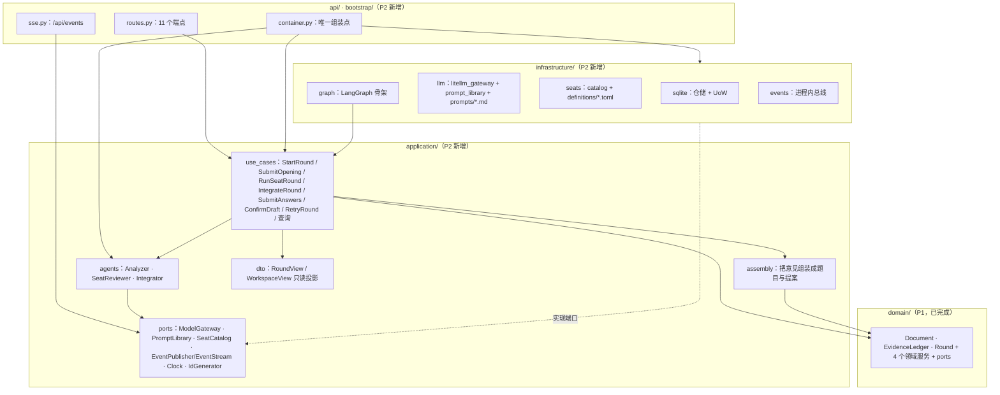
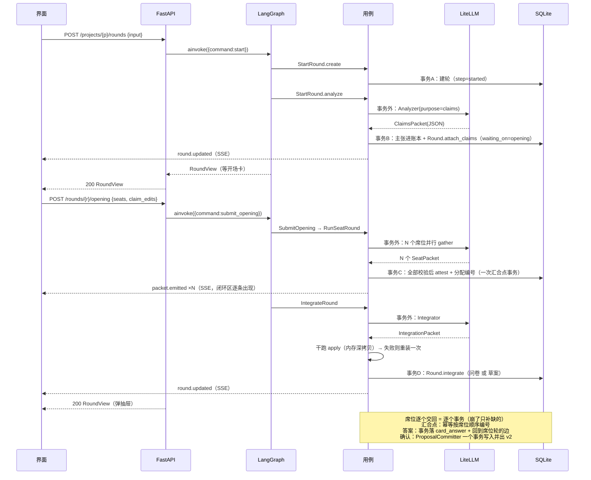

# P2 · 单轮闭环 Implementation Plan

> **For agentic workers:** REQUIRED SUB-SKILL: 用 `superpowers:subagent-driven-development`（推荐）
> 或 `superpowers:executing-plans` 逐任务执行本计划。步骤用 `- [ ]` 勾选跟踪。
> **不要**跳过"先让测试失败"那一步，它是本计划唯一的防伪手段。
> 计划存放位置按本仓既有约定放在 `docs/plans/`（不是 skill 默认的 `docs/superpowers/plans/`）。

**Goal:** 把 P1 的纯领域层接上真实世界：真实模型（LiteLLM）跑出主张 → 席位意见 → 问卷/草案 →
用户确认 → 写入 → 版本，落在 SQLite 上，用 FastAPI 暴露，用一个最小 React 界面在浏览器里
跑完一次完整迭代；并且"信息已经明确、不需要问用户"的路径也要跑通。

**Architecture:** 领域层（P1，已完成，只动 §3.1 的六处小改，其中一处是纯重构）保持纯 Python 不变；新增三层——
`application/`（用例 + 智能体 + 投影）、`infrastructure/`（SQLite 仓储 · LiteLLM 网关 · 席位目录 ·
LangGraph 图 · 进程内事件总线）、`api/`（FastAPI 路由 + SSE）。**LangGraph 是编排的实现技术，
不是真相源**：图的 state 只放 `{command, round_id, view}`，走哪一步由 `Round` 聚合的 `step` 决定。
智能体之间只传结构化信息包（pydantic 定义 → 生成的 JSON Schema 同时喂给提示词与 `response_format`），
席位只出专业意见，组装成文档形状是 Integrator 的活，写文档只有 `ProposalCommitter` 一条路。

**Tech Stack:** Python 3.13 · FastAPI 0.136 · pydantic 2.12 · LiteLLM（新装）· SQLite（stdlib）·
LangGraph 1.2 · pytest 9 + pytest-asyncio · React + Vite + TypeScript + vitest。

**Spec:** `.codex/docs/设计/01-规格.md`（要做什么）、`02-编排与数据.md`（怎么跑）、
`03-案例与验收.md`（怎么算对）、`05-DDD架构.md`（怎么实现）、`04-未决.md`（还没定的）；
路线与纪律见 `docs/plans/2026-09-22-里程碑与真相源.md`；领域层实况见
`docs/plans/2026-09-22-P1-领域层.md` 与 `backend/src/pmstudio/domain/`。

---

## Global Constraints

- 技术栈：Python 3.13 + FastAPI + pydantic v2 + LiteLLM + SQLite + pytest + ruff；
  前端 React + Vite + TypeScript。**不引入计划外的第三方依赖**（不加 langchain agent、
  不加 ORM、不加 sse-starlette、不加 PyYAML——席位目录用 stdlib `tomllib` 读 TOML）。
- `domain/` **不 import 任何外部包**（fastapi / langgraph / litellm / sqlite3 都不行），
  由 `tests/architecture/test_domain_imports.py` 强制；**P2 只允许在 domain 里动 §3.1 列的三处**。
- **写入路径唯一**：全项目只有 `pmstudio/domain/services/committer.py` 允许持有 `DocumentWriter`，
  由 `tests/architecture/test_write_path.py` 白名单强制（P2 新增仓储**不许** import `DocumentWriter`）。
- **依赖方向**：`api → application → domain`；`infrastructure` 实现端口、由 bootstrap 注入。
  `application`/`domain` 不得 import `infrastructure`/`api`；`infrastructure` 不得 import `api`。
  由 P2 新增的 `tests/architecture/test_layers.py` 扫 AST 强制。
- **假实现只许活在测试里**：`src/pmstudio/` 下不得出现 `fake/mock/stub/dummy` 标识符；
  生产路径不提供"用假模型"的开关、不写无密钥降级分支。由守卫扫描强制。
- **模型调用一律在事务外**：`UnitOfWork` 的 `with` 块里**不许出现 `await`**。
  由 `tests/architecture/test_no_await_in_uow.py` 扫 AST 强制（这条是 SQLite 单连接能安全用的前提）。
- **LangGraph 的 state 只放引用与本次命令**：白名单 `{command, round_id, view}`，
  由 `tests/architecture/test_graph_state.py` 断言。**不挂 checkpointer**（理由见 §3.7）。
- **图中的节点与路由器必须是 `async def`**。实测（§3.7 有证据）：同步可调用对象在这个 langgraph
  版本上会让图挂死（节点执行完不返回）。这条由 `tests/infrastructure/test_graph_shape.py` 兜。
- **事件只做通知与投影**：摘掉全部订阅者，流程照样跑完；事件在**事务提交之后**发布。
- **长步骤必须可续跑**（§3.7）：任何可能多次模型调用 / 外呼的节点，都要把中间成果**落成领域事实**，
  并且**幂等**——用同一个 `round_id` 重进不许产生第二份事实、不许重复编号。
  恢复只靠 `round_id` 与 `step`，不靠内存、不靠图快照；**不引入 checkpointer**。
- **上下文只有一个出口**：智能体读到的文档 / 主张 / 意见 / 答案文本，全部由
  `application/context.py` 产出（`agents/*` 不许自己 import `domain.authoring` 去读文档）。
  将来的 `PROJECT.md`（记忆层）只是这条渲染链上的一节，**不许持有唯一信息**。
- 每个任务一次提交，消息前缀用 `feat:` / `test:` / `docs:` / `chore:`。
- 类名与字段名照抄 `05-DDD架构.md` 的"统一语言"一节，不在代码里另起名字。
- **不留痕跑法**（作者要求：仓库里只出现源码与文档）：
  `cd backend && PYTHONDONTWRITEBYTECODE=1 python3 -m pytest -q -p no:cacheprovider`、
  `cd backend && python3 -m ruff check --no-cache .`。
  前端**不提交** `node_modules/`、`dist/`、`*.tsbuildinfo`（`.gitignore` 已覆盖，缺的补上）。

---

## 0. 开工前置（必须最先做，需要作者批一次网络）

当前环境实测（2026-09-22，本机）：

| 项 | 状态 |
|---|---|
| `python3` | 3.13.11 |
| `fastapi` / `uvicorn` / `pydantic` / `httpx` | 已装（0.136.1 / 0.47.0 / 2.12.4 / 有） |
| `langgraph` / `langchain-core` | 已装（1.2.11 / 1.6.0） |
| `pytest` / `ruff` | 已装（9.0.3 / 0.15.12） |
| **`litellm`** | **未装** |
| **`pytest-asyncio`** | **未装** |
| 网络 | **沙箱内 DNS 不通**：`uv pip install --dry-run litellm` → `dns error` |

**所以 Task 1 第一步就是装依赖，这一步会越出沙箱，需要作者批一次**：

```bash
cd /home/linsir365/projects/ai-pm/backend
uv add litellm 'fastapi>=0.136' 'uvicorn>=0.47' 'pydantic>=2.12'
uv add --dev pytest-asyncio httpx
```

装不上就不开工——不允许"先写代码，依赖以后再补"，那等于把 P2 的验收推迟成空头承诺。

---

## 1. 现在要实现什么、边界在哪

**P2 只做一件事：把主闭环打通给真人用。** 一轮从真实模型走完全程，人在三个点上做决定，
文档多一版。P2 **不做**的东西一律不动，缺的地方用"显式缺失清单"表达，不建桩、不做半成品。

| 层 | P2 做 | P2 不做（谁做） |
|----|-------|----------------|
| 领域 | 六处小改（§3.1）：`Question.kind`、`SeatReview.pass_index`+`current_reviews`、`Round.revise_claims`、`to_write_instruction` 重构、`EvidenceSource.local_id`+幂等编号、`Round.pending_seats` | 其余一律不碰 |
| 应用 | 8 个用例 + 3 个智能体（Analyzer / 席位 / Integrator）+ 组装规则 + 只读投影 | 讨论区、工具层、记忆层 |
| 基础设施 | SQLite 仓储与事务、LiteLLM 网关、席位目录（TOML）、LangGraph 图、进程内事件总线 | 索引层、回放、补偿逻辑 |
| API | 11 个 HTTP 端点 + 1 个 SSE 流 + 错误映射 | 鉴权（单用户）、多项目界面 |
| 界面 | 三栏壳 + 文档区（只读）+ 闭环区（状态与席位信息包）+ 两个抽屉（问卷 / 草案） | 版本历史与差异、依据角标跳转、章节缺口标记（P4） |
| 测试 | 每层单测 + 一次走 API 的假模型 e2e + 一次真模型手测 | 前端组件级测试（P4） |

**关于 `01-规格.md` 的功能清单**：F1–F16 是 v1 范围，本计划逐一落到任务（对照见 §9）。
其中 **F3 版本历史与差异** 按里程碑文件 `docs/plans/2026-09-22-里程碑与真相源.md` 排在 **P4**——
数据侧 P2 已经齐（每次写入一个版本、快照存整棵树），P2 只在版本条上显示当前版本号，
不提供差异视图。F17（手动编辑）/ F18（陌生人读者）/ F19（门禁、导出、讨论区、工具层、记忆维护）
按里程碑留在 P6。

**退出条件（可测）**：

1. 假模型 e2e：`输入 → 开场卡 → 席位 → 问卷 → 答卷（含跳过）→ 草案三组 → 确认 → v2` 全绿，
   且**无问卷路径**（信息明确）也全绿。
2. 真模型手测：浏览器里跑完一次完整迭代，文档多一版，证据是那一轮的 `round_id` 与版本号。
3. 守卫全绿：domain 无外部依赖、写入路径唯一、分层方向、图 state 白名单、UoW 内无 await。

---

## 2. 影响面（改动落到哪、谁受影响）

| 模块 | 影响 | 说明 |
|------|------|------|
| `domain/round/questionnaire.py` | 小改 | `Question.kind`（缺口 / 矛盾 / 待决），默认 `gap` |
| `domain/round/opinion.py` + `round/round.py` | 小改 | `SeatReview.pass_index`、`Round.current_reviews` |
| `domain/round/round.py` | 小改 | `Round.revise_claims(claims)`（复述卡的标签/去处纠正） |
| `application/` | 新增 | 端口、事件、三个智能体、装配规则、用例、投影 |
| `infrastructure/` | 新增 | SQLite、LiteLLM、席位目录、图、事件总线 |
| `api/` + `bootstrap/` | 新增 | FastAPI 应用、路由、SSE、容器与配置 |
| `frontend/` | 新增 | Vite + React 三栏工作台 |
| `.codex/docs/设计/02` | 微调 | 编号分配位置（§3.2）、`pass_index`、答案轮不做缩编（§3.3）、席位轮事务粒度与"重试只补未交回的席位"（§3.11）、偏好区与 `PROJECT.md` 的关系（§3.13） |
| `.codex/docs/设计/05` | 微调 | 目录图、端口清单、`§7 断点续传=领域事实+幂等重放`（不挂 checkpointer）、领域五处小改 |
| `.codex/docs/设计/04` | 微调 | 已定项移入；新增 P2 发现的未决（§10） |
| `AGENTS.md` | 微调 | 命令一节改成实际可跑的命令（uv / npm） |

**数据流影响（`05-DDD架构.md` §13 的 12 行，P2 全部落地）**：

| 步 | P2 落点 | 变化 |
|----|---------|------|
| 1 建轮 | `StartRound.create` + 图 `start` 节点 | — |
| 2 调 Analyzer | `StartRound.analyze`（**模型调用在事务外**） | — |
| 3 主张落账本 | 同一用例的第二个事务 | — |
| 4 开场卡修改 | `SubmitOpening` + `Round.revise_claims` | 新增 claim 纠正能力 |
| 5 席位并行 | `RunSeatRound`（节点内 `asyncio.gather`，每席位一个模型调用） | **每席位一个事务**（交回即落库）+ 汇合点幂等编号（§3.11） |
| 6 整合 + 编号 | **编号移到第 5 步的汇合点**；整合只组装形状 | **改动**（§3.2） |
| 7a/7b 出问卷或草案 | `IntegrateRound`（含干跑校验） | 新增干跑（§3.6） |
| 8 答案回灌 | `SubmitAnswers` → 图回到 `seat_round` | — |
| 9 到上限显式化 | `Round` 拒绝第 4 次席位轮；`IntegrateRound` 把缺口写进 `Draft.gaps` | — |
| 10 确认写入 | `ConfirmDraft` → `ProposalCommitter`（P1 已实现） | — |
| 11 失败与原因 | `Round.fail` + `generation.failed` | — |
| 12 重试 | `RetryRound` + 图入口按 `step` 重新路由 | — |

---

## 3. 核验：动手前必须先定的事（每条都给了建议，默认按建议实现）

我把 P1 的代码真身与五份设计文档逐条对过。下面 13 条要么是文档与代码对不上，要么是 P2 会
踩到的坑。**每条都只改一处**，改完同步设计文档。

### 3.1 领域六处小改（P2 唯一允许动的领域代码；④ 是纯重构，没有语义变化）

**① `Question.kind`**：`03-案例与验收.md` 案例 B 的 Q6 是矛盾题（⚠，两侧各带依据），
案例 A 的题是缺口题。现在两者在数据上完全一样（把"矛盾：…"写进 `why` 是**魔术字符串**，
界面没法可靠区分，等于把语义藏在自然语言里）。加一个受控字段：

```python
class QuestionKind(StrEnum):
    GAP = "gap"            # 缺一个只有用户知道的信息
    CONFLICT = "conflict"  # 与本轮输入或文档里的既有结论冲突
    DECISION = "decision"  # 需要用户拍一个口径（含"这是不是独立功能"）
```

`Question` 加 `kind: QuestionKind = QuestionKind.GAP`。默认值让 P1 的测试与调用点全不动。

**② `SeatReview.pass_index` + `Round.current_reviews`**：答案回灌后要**重新跑一次席位轮**
（`02` §2 要点 2）。但 `Round.seat_reviews` 是扁平数组，第二轮跑完就有 8 条（4 旧 + 4 新），
整合者会把**上一轮已经作废的判断**再组装一遍进草案（比如"量级必须问用户"这条已经答过了）。
根因是审查意见没标"属于第几次席位轮"。

改法：`SeatReview` 加 `pass_index: int = 1`，`Round.attest()` 用 `dataclasses.replace` 盖成
`self._seat_round_count`；`Round` 加只读属性 `current_reviews`（只返回当前这次席位轮的意见）。
整合者、闭环区只看 `current_reviews`；历史意见仍留在聚合里（`seat_reviews`），
而作废判断的痕迹在出处账本里（判断都记了编号）。

**③ `Round.revise_claims(claims)`**：开场卡允许改每条主张的**标签与去处**（`01-规格.md` §5：
"标签与去处可改"）。但 `attach_claims` 会推进到 `CLAIMS_READY`，在那里再调就会撞
`IllegalStepTransition`（合法迁移只有 `CLAIMS_READY → SEATS_RUNNING`）。

新方法只做原地替换，不推进步骤：`claim_id` 集合必须与现有完全一致、`eid` 不许变（用户改的是
性质与去处，不是"他说了什么"）：

```python
def revise_claims(self, claims: tuple[Claim, ...] | list[Claim]) -> None:
    """开场卡纠正：只改标签 / 去处 / 假设 / 决策者，不改文本与原话片段，也不改编号。"""
```

P2 **不支持**在卡片里改主张文本（`01-规格.md` §5 明确"卡片里不编辑内容"）：改文案要让用户
重新说一遍。这条写进 §10 遗留。

**④（重构，无语义变化）把 `ProposalCommitter._to_instruction` 提升为模块级公开函数
`to_write_instruction(proposal) -> WriteInstruction`**：P2 的"草案落卡前干跑一次 apply"（§3.6）
需要同一份 `Proposal → WriteInstruction` 翻译。放在一处，改一处改全部；committer 改为调用它。
现有测试只断言行为，不需要改。

**⑤ 幂等编号：`EvidenceSource` 加可选字段 `local_id`，`EvidenceAssigner.assign_opinions` 变幂等。**
这是"断点续传"（§3.7）能成立的关键一件：

```python
@dataclass(frozen=True, slots=True)
class EvidenceSource:
    round_id: RoundId | None = None
    raw_span: str | None = None
    question_id: QuestionId | None = None
    seat_id: str | None = None
    local_id: str | None = None   # 新增：这条出处来自哪个席位的哪条意见（形状：f"p{pass}:{O1}"）
    derived_from: tuple[EvidenceId, ...] = ()
    rationale: str | None = None
    external_ref: str | None = None
```

- 为什么带 `pass` 前缀：`local_id`（`O1`）只在**一个席位的一次交回**里唯一，第二轮又会有 `O1`。
  所以账本里存 `f"p{pass_index}:{local_id}"`，查找键是 `(seat_id, local_id)` 这**两个字段**。
- `EvidenceLedger` 加一个只读查找：`find_by_local(*, seat_id: str, local_id: str) -> Evidence | None`。
- `assign_opinions` 改成幂等：某条判断已经有编号 → **复用那个编号**（不新增、不占新号）；
  没有才 `record`。于是同一批意见被赋两次号也只产生一份事实（`E1` 那条"只增不复用"不受影响，
  这是"同一件事不写第二遍"，不是"复用废弃编号"）。
- 顺带解决另一个显示缺口：闭环区/草案卡想知道"这条判断是 E9"，现在从账本能精确反查
  （`source.seat_id + source.local_id`），不靠猜文本。

**⑥ 派生属性 `Round.pending_seats`**：当前这次席位轮里**还没交回**的席位。

```python
@property
def pending_seats(self) -> tuple[str, ...]:
    """这一轮还没交回意见的席位。崩了重进只补这些，不重跑已交回的。"""

    done = {review.seat_id for review in self.current_reviews}
    return tuple(seat for seat in self._seats if seat not in done)
```

不需要新字段：`current_reviews`（②新增）已经表达了"谁交回了"。

### 3.2 编号分配从"整合"移到"席位轮汇合点"（改 `02` §3④ + §13 第 6 行）

`02` §3④ 把"给内容候选分配全局编号"算在整合者头上。但整合者要产出**带真实编号**的内容候选与
题目（`03` 案例 A 的草案卡每条都挂着 `E9`–`E15`），而编号只能由汇合点统一分配——
`EvidenceAssigner` 的职责说明就是"席位并行，编号必须由汇合点统一分配"。若坚持在整合里分配，
就要先给整合者局部 id、再在应用层做一次"局部 id → 全局编号"的翻译，多一层映射多一个错源。

**改成**：席位轮交回、校验通过后，**在一个事务里**完成 `Round.attest` + `assign_opinions`
（判断进账本，疑问不占编号）。之后整合者拿到的意见已经带真实 `E` 编号，它只做四件事：
归并（同题合并）、组装（给 target 与形状）、判断出口（问还是写）、丢弃（与文档/历史重复）。
§13 数据流的"分配全局编号"随之从第 6 行移到第 5 行。

顺带的收益：整合者拿到的是编好号的意见，它的输出可以**直接引用** `E9` 这类编号
（`ProposalDraft.evidence_refs`），不用先发局部 id 再翻译。

> **一个已知的显示缺口**（记进 §10）：闭环区展示的席位意见带的是**它的依据编号**（输入侧），
> 不是"这条判断后来分到的编号"（输出侧）——因为 `OpinionAssignment`（`local_id → eid`）
> 目前没有任何地方保存。要显示"这条判断就是 E9"需要给 `EvidenceSource` 加 `local_id`
> 或另存一张分配表，P2 不做（`03-案例与验收.md` 验收第 10 条只要求"依据是哪些编号"）。

### 3.3 答案回灌：P2 全量重跑席位，**不做缩编**（`04-未决.md` C8 推迟到 P3）

`04` C8 建议"按答案的 `target` 反查受影响的席位"。但 `Opinion`（`02` §4.4 的信息包）
**没有 target**——按设计，target 是整合者给的形状，席位不该管。所以"按 target 反查席位"
在 v1 没有可用的机械依据，只能靠模型在自由文本里猜，那是本项目明令禁止的做法。

**P2 的做法**：答案回灌后重跑**全部**席位（就是流程图上回到③的那条边）。代价：答案轮成本
与首轮相同（约 5 个席位调用）。收益：不改 `Opinion` 的形状、不猜。缩编规则留 P3，
届时要么给 `Opinion` 加 `about_target`，要么让席位自己申报关联章节。

### 3.4 新功能授权必须有机械触发点（补 P1 留下的空档）

D3 要求"新建功能子树必须用户授权"（`Document.apply` 会拒 `FeatureRequiresUserNaming`），
`Round.authorize_new_feature` 也写好了——**但 P1 里没有任何调用点**。P2 必须补上，且只能是
下面两条路（都能机械判定，不靠模型自述）：

1. **用户原话点名**：Analyzer 归位时给主张一个文档里还不存在的 `feature_slug` → 这条主张的
   `eid` 就是授权依据：`round.authorize_new_feature(slug, basis=claim.eid)`。
   用户切出一条"我要做订单导出"，就等于授权建 `feature#order-export`。
2. **席位提议的新功能**：席位或整合者的提案指向一个未授权的 feature → **不许直接进草案**，
   降级成一道 `kind=decision` 的题，选项 id 固定为 `new_feature_yes` / `new_feature_no`。
   用户选 yes → 那道题答案的 `eid` 作为依据调 `authorize_new_feature`。

第 2 条正是 `03` 案例 B 的 Q7（"是订单导出的一部分，还是独立功能"），现在它是机械的了。

### 3.5 不建 `Project` 聚合：建项目 = 建文档

`05` §3.1 已经把 `Project` 聚合推迟到 P2，但 P2 其实不需要它：项目名可以用文档的 `title`，
偏好区已经在 `Document` 里随版本化，而"项目列表"就是文档列表。多建一个聚合就要多一套仓储、
多一个事务、多一处真相源。

**P2**：`POST /api/projects {title}` = 建 `Document.new()` + 空账本（一个事务）。
`ProjectSummaryView = {project_id, title, version_no, updated_at}`。
`Project` 聚合等真需要多项目/权限/成员时再说（记进 §10）。

### 3.6 草案落卡之前**先干跑一次 `apply`**（一举三得）

`02` §7 要求"校验不通过 → 打回整合者重装（一次）"，验收清单第 7 条要求"席位返回不可解析 →
整轮失败可重试，文档不发生任何写入"；草案卡顶部还要显示"写入后本章仍有 N 项必填缺口"。

这三件事可以一次做完：整合出提案后，**在内存里对文档的深拷贝跑一次 `Document.apply`**：

```python
probe = copy.deepcopy(document)
probe.apply(
    instructions,
    now=now,
    summary="干跑",
    authorized_new_features=round_.authorized_new_features,
)
gaps = probe.gaps()   # 写入之后还剩哪些必填字段是空的
```

- 校验通过 → `Draft.gaps` 用 `probe.gaps()` 的真实结果（不是估算）。
- 抛领域错误（未知字段 / 未授权功能 / 手改块…）→ 把错误原文塞进 `$validation_error`，
  **再请整合者重装一次**；第二次还错 → `Round.fail(reason)`，文档零改动。
- 干跑只动内存副本：`document` 是从仓储读出来的对象，`deepcopy` 之后动的不是它。

### 3.7 断点续传：进度是**领域事实**，不是图快照（所以不挂 checkpointer）

先把要扛住的场面列清楚（这是"断点续传"真正要解决的问题）：

| 场面 | 必须活下来的东西 |
|------|-----------------|
| 关页面 / HTTP 请求被取消 | 走到哪一步、已冻结的卡片、已交回的席位意见 |
| 进程崩了 / 重启 | 同上（内存里的东西全丢） |
| 模型调用失败 | 失败原因 + 从哪儿接着跑 |
| 第二天回来接着干 | 同第一条，加上"这一轮还没答的题" |

**这些全都有地方放**：`Round` 聚合（step / waiting_on / claims / seat_reviews / questionnaire /
answer_sets / draft）+ `EvidenceLedger`，都在 SQLite 里。缺的从来不是"存不下"，而是
**亚步骤的颗粒度**——如果一个节点里跑了 5 次模型调用、跑到第 4 次崩了，重进这个节点会不会把
前 3 次重跑？（§3.11 解决了这件事。）

**为什么仍然不挂 LangGraph 的 checkpointer**，两条理由，第二条是硬的：

1. **它存的东西我们不需要**。state 只有 `{command, round_id, view}`（§4.3），
   checkpoint 里于是只有"图跑到哪个节点"。而"跑到哪一步"已经由 `Round.step` 说了；
   两份记录一旦不一致（图回滚了、聚合没回滚），**谁对？** 这就是第二个真相源。
2. **它救不了真正会丢的东西**。业务状态不在图里（本项目的硬规矩：图与聚合不能都当真相源），
   所以 checkpointer 再全也救不回"3 个席位已交回"——那只能由**领域事实**救。

**所以"断点续传" = 领域事实 + 幂等重放**，三条规则（写进 `05` §7）：

1. 任何**长步骤**（可能多次模型调用 / 外呼）必须拆成能单独落库的**子事实**，崩了只补缺的那部分；
2. 每个节点必须**幂等**：用同一个 `round_id` 重进，不许产生第二份事实、不许重复编号；
3. 恢复只靠 `round_id` 与 `step` 路由，不靠内存、不靠图快照。

| checkpointer 常被用来解决的能力 | 我们靠什么 | 证据（计划里的测试） |
|---|---|---|
| `interrupt()` 暂停、答案到了再 resume | `Round.waiting_on` + 用同一 `round_id` 重入图 | Task 21 全闭环（问答两轮） |
| 重启后从上次节点续跑 | 入口按 `Round.step` 路由 + 节点幂等 | Task 21 `test_resume_after_process_restart` |
| 长节点崩了不重跑已完成的模型调用 | 每席位一个事务 + `Round.pending_seats` | Task 11 + Task 21 两条续传测试 |
| 防止重复写入 / 重复编号 | 幂等键 `(seat_id, pass_index, local_id)` | §3.1 ⑤ + Task 11 |

```
每次用户动作 = 一次 graph.ainvoke({command, round_id})
入口路由器（async）按 command.kind 与 Round.step 决定从哪个节点进
节点做一件事（调用例）→ 需要人做决定时把 waiting_on 设好 → 走到 END，HTTP 返回
```

**什么时候才该把 checkpointer 请回来**（先写清楚，免得以后争）：当某个节点的副作用
**本质上不可幂等**时（对外发消息、调有副作用的付费接口）。但那时正确的解法仍然是
**领域侧的去重键 / 发件箱**；checkpointer 只能当"节点级再执行日志"，并且必须满足
`05` §12.2 那条判据——**把它摘掉，流程照样能跑完**。

**漂移防线**：`tests/architecture/test_graph_state.py` 加
`assert getattr(compiled, "checkpointer", None) is None`——谁真要加，必须先改这条测试与本节。

**实测事实（本机，2026-09-22，langgraph 1.2.11）**，写进计划是为了让执行者别再试错：

| 写法 | 结果 |
|------|------|
| `Send` 导入点 | `from langgraph.types import Send`（`langgraph.graph` 里没有） |
| 纯同步节点 + 普通边 | 正常（`{'log': ['a','b']}`） |
| **`lambda` 路由器 / 同步条件入口** | **挂死**：节点跑完不返回，40s 超时；`asyncio.wait_for` 也拦不住 |
| `async def` 路由器 | 正常，1.6s 返回 |
| `Send` 扇出 3 席 → 汇合 | 正常：`['wa(...)','wb(...)','wc(...)','JOIN<...>']` |

结论：**节点与路由器一律 `async def`**（守卫兜住）；**并行席位用节点内的 `asyncio.gather`**，
不用 `Send`——gather 版让 `RunSeatRound` 是一个可直接单测的用例，图也保持"阶段骨架"的样子
（`Send` 需要在图 state 里多开一个只为扇出存在的通道）。

### 3.8 三栏宽度以 `DESIGN.md` 为准（`01` §5 的"70% / 30%"是同一件事的另一种说法）

`01` §5 写"文档区 70% / 闭环区 30%"，`DESIGN.md` 写"左导航 200px 固定 / 中间弹性 / 右栏 380px 固定"。
在 1440px 屏上分别是 864px（60%）与 860px——**是同一件事**。以 `DESIGN.md` 为准（它是视觉规范的
唯一真相源）：三栏 `200 / flex / 380`，文档区内部 `max-width: 34em`，行高 1.75。
抽屉从右侧滑出、**只覆盖闭环区**（答题时要能对照文档）。

### 3.9 前端测试只覆盖纯函数（组件级留给 P4）

前端要 TDD，但为 4 个组件搭 jsdom + testing-library 的成本换不来对应收益（P4 才做界面完整度）。
P2 给**纯函数**写 vitest：`api/payload.ts`（问卷/草案的提交载荷构造）与
`state/workspace.ts`（SSE 事件应用到状态）。组件靠 `tsc --noEmit` + 浏览器手测，
手测步骤写在 Task 28 里，逐步可复现。

### 3.10 模型回复的 `raw_span` 必须能在用户输入里逐字找到（严格）

`01-规格.md` §5 的合格标准："复述里必须包含至少一个只有读了文档才知道的信息"，
`Claim.raw_span` 的存在意义是"点编号跳回原文"。若模型改写了原话，跳转就跳不到东西。

**规则**：解析主张时，把 `raw_span` 与用户输入都做空白归一化，要求 `raw_span` 是输入的子串；
找不到 → 抛 `PacketParseError` → 整轮失败可重试。理由：这条**可机械判定**，失败原因对用户
是一句人话（"模型复述时改了原话，重试一次"）。若真模型上太脆，改进方向记在 §10。

### 3.11 席位轮：每席位一个事务（交回即落库），汇合点只做**幂等编号**

`05` §13 第 5 行本来写的就是"每席位一个事务"。我上一版把它改成"汇合点一个事务"，
理由是"整轮失败可重试，语义简单"。**现在改回来**：`断点续传`（§3.7）这条要求比"少几次事务"硬——
5 个席位里第 4 个崩了，前 3 个已经花掉的模型调用不该白花。

新规则三条：

1. **每个席位交回就落一次库**（一个事务：`Round.attest(该席位)`）；失败的那个席位不落库。
2. **一旦有席位失败 → `Round.fail(原因)`**（step=failed），文档零写入——"失败必须是失败"不变。
3. **重进 `seats_running` 只补没交回的席位**：缺哪些由 `Round.pending_seats`（派生属性，§3.1 ⑥）
   算出来；等席位齐了，汇合点**按席位顺序**分配编号（幂等，§3.1 ⑤）。

代价与收益都摆出来：

- 代价：一轮席位多几次 SQLite 小事务（本地文件，可忽略）；崩在中间会留下"半轮意见"
  （A 已交回、B 没有）——**这不是脏数据，是真实进度**，界面照实显示 A=已完成 / B=待启动。
- 收益：崩溃后重跑成本从"N 个席位"降到"缺的那几个"；用户看到的是"这一轮做到哪了"，
  而不是"全没了"。

`02` §7 的措辞同步改成："席位返回不可解析 → 该席位失败 → 整轮失败可重试；
**重试只补未交回的席位**（已交回的不重跑、不重复编号）。"

### 3.13 偏好区住哪：`Document` 是真相源，未来的 `PROJECT.md` 是投影

作者问："偏好区难道不写入 `PROJECT.md` 吗？"——**写进去，但不是住在里面**。三句话讲清：

1. **真相源**：偏好首先是一条**用户说过的话**（账本里 `kind=user_input`、`label=preference`），
   然后在文档里有一个**结构化、随版本化的家**：`Document.preference_entries`
   （P1 决策 6.6 已定，`01-规格.md` §4 的 block 树把它排除在 13 章之外）。
   它必须能被追溯（有编号）、能被版本化（能回退）、能被单独取出来（`DocumentView.preference_entries`
   与 13 章正文分开两个字段）。
2. **`PROJECT.md`（= 设计里的"项目简报"，记忆层，P6）是渲染出来的投影**。
   它会有"偏好"一节，但它**不许持有唯一信息**——每一行都要能指回编号或文档字段；
   指不回去，说明真相源漏了东西，先补真相源。理由很直白：`PROJECT.md` 是智能体反复
   核验、合并、重写出来的摘要（你可能要求它压到 100 行），**摘要不能当真相源**
   （一改就丢、无法追溯、无法回退）。
3. **交付物里没有偏好区**：导出给工程师的文档默认不含偏好（`04-未决.md` D5 已定），
   这也是把它放在 `Document` 里但**不放进 13 章**的原因——一个字段就能切出去。

P2 因此只有三件事要做，都已在计划里：

- **读**：席位与整合者拿到的上下文里必须含偏好区（`render_document` 已经单独渲染成
  "## 偏好区（不进正文）"，且它是**唯一**的上下文入口，见 Global Constraints 与 Task 1 的新守卫）；
- **写**：`target.zone = preference` 的提案走既有写入路径，落到 `preference_entries`（Task 8 已覆盖）；
- **看**：文档区末尾单独一栏渲染偏好区，并标明"不进正文 / 不进交付"（Task 23）。

将来 `PROJECT.md` 落地时，它只是 **render 链上的一节**（`render_briefing()` + `render_document()`
组合成必读上下文），**不是新的真相源**——所以 P2 要守住的只有一条：上下文只许由
`application/context.py` 产出，智能体不许自己去读文档。

### 3.12 冲突题就是普通题目，不引入第二种卡片

作者已拍板（"都矛盾了，不发问卷，干嘛 debater"、"矛盾和缺失信息不都是提问吗；直接放一起"）。
所以：**一批问卷里同时装缺口题与矛盾题**，矛盾题用 `kind=conflict` 标出来，界面在 P4 给它加 ⚠ 样式。
P2 先保证数据在（`why` 写清两侧立场、`evidence_refs` 挂两侧依据）。

---

## 4. 架构与数据流

### 4.1 分层（P2 完成后的实况）



要点：**bootstrap 是唯一的组装点**（`container.py`）；application 只认识端口；
infrastructure 反过来实现端口；`graph` 属于 infrastructure，它只调 use_cases，不碰仓储。

### 4.2 一次完整迭代（谁在什么时候开事务、发什么事件）



### 4.3 状态机（`Round.step` 与图节点的对应）

```
start（建轮）─→ started
analyze ──→ claims_ready ──[开场卡：人]──→ seats_running
seats_running ──[RunSeatRound]──→ seats_running（原地，交回意见）
            └─[IntegrateRound]──→ awaiting_answers（问卷）或 awaiting_confirm（草案）
awaiting_answers ──[SubmitAnswers]──→ seats_running（回到席位轮）
awaiting_confirm ──[ConfirmDraft]──→ done
任意步骤失败 ──→ failed ──[RetryRound：resume + 按 step 路由]──→ 原步骤
```

图的入口路由表（**唯一一处写"命令 → 入口节点"的地方**）：

| 命令 | 前置 step | 入口节点 | 出口 |
|------|-----------|---------|------|
| `start` | — | `start` → `analyze` | 等开场卡（END） |
| `submit_opening` | `claims_ready` | `opening` → `seat_round` → `integrate` | 等问卷 / 等草案卡（END） |
| `submit_answers` | `awaiting_answers` | `answers` → `seat_round` → `integrate` | 等问卷 / 等草案卡（END） |
| `confirm` | `awaiting_confirm` | `commit` | `done`（END） |
| `retry` | 任意（失败先 `resume`；没失败就是"继续"） | `resume` →（按当前 step 路由） | 同该 step 的出口 |

---

## 5. 接口契约冻结表（P2 期间不许改；要改先改这张表 + 设计文档）

### 5.1 应用端口（`application/ports.py`）

| 端口 | 方法 | 实现 |
|------|------|------|
| `Clock` | `now() -> datetime`（**带时区 UTC**） | `bootstrap/container.py` 的 `SystemClock` |
| `IdGenerator` | `new(prefix: str) -> str` | `bootstrap/container.py` 的 `UuidIdGenerator` |
| `ModelGateway` | `async complete(request: ModelRequest) -> ModelReply` | `infrastructure/llm/litellm_gateway.py` |
| `PromptLibrary` | `render(name: str, **slots: str) -> str` | `infrastructure/llm/prompt_library.py`（`string.Template`，槽位写 `$name`） |
| `SeatCatalog` | `all()` / `nominate(user_input)` / `by_id(seat_id)` | `infrastructure/seats/catalog.py`（TOML） |
| `EventPublisher` | `publish(event: Event) -> None` | `infrastructure/events/in_process.py` |
| `EventStream` | `subscribe() -> AsyncIterator[Event]` | 同上（**能力拆开**：用例只拿 Publisher，API 只拿 Stream） |
| `WorkspaceIndex` | `summary(project_id)` / `list_summaries()` / `latest_round_id(project_id)` | `infrastructure/sqlite/repositories.py`（只读查询投影，Task 13 引入） |
| `ProjectFactory` | `create(*, project_id, title, now) -> DocumentId` | `infrastructure/sqlite/project_factory.py`（**只造空骨架**，Task 19 引入） |

值对象（也放 `application/ports.py`）：`ModelMessage(role, content)`、
`ModelRequest(purpose, messages, schema_name, response_schema, metadata)`、
`ModelReply(text, model, usage)`、`SeatDefinition(seat_id, title, focus, trigger_keywords, always_on)`。
`ModelRequest.metadata` 不是装饰——它是测试替身与日志的抓手（`{"seat_id": ..., "purpose": ...}`）。

`Event`（`application/events.py`）：`name`、`project_id`、`occurred_at`、`seq=0`、
`round_id | None`、`payload`。**`seq` 由事件总线在 publish 时用 `dataclasses.replace` 盖上**，
调用方一律传默认值 0（编号是投递侧的事，不是业务的事）。四个事件名常量：
`round.updated` / `packet.emitted` / `doc.changed` / `generation.failed`。

### 5.2 HTTP 端点

| 方法 | 路径 | 请求体 | 响应 |
|------|------|--------|------|
| POST | `/api/projects` | `{title}` | `{project_id, title, version_no}` |
| GET | `/api/projects` | — | `[{project_id, title, version_no, updated_at}]` |
| GET | `/api/projects/{project_id}/workspace` | — | `{project, document, round \| null}` |
| GET | `/api/projects/{project_id}/document` | — | `DocumentView` |
| POST | `/api/projects/{project_id}/rounds` | `{input}` | `RoundView`（`waiting_on=opening_card`） |
| GET | `/api/rounds/{round_id}` | — | `RoundView` |
| POST | `/api/rounds/{round_id}/opening` | `{seats, claim_edits}` | `RoundView` |
| POST | `/api/rounds/{round_id}/answers` | `{form_id, answers:[{question_id, text, selected}], skipped}` | `RoundView` |
| POST | `/api/rounds/{round_id}/confirm` | `{accepted:[proposal_id]}` | `{version_no, round}`（写范围提示在 `round.advisories` 里） |
| POST | `/api/rounds/{round_id}/retry` | `{}` | `RoundView`（语义：**继续这一轮**——失败先 resume，没失败就按当前 step 接着跑，已交回的席位不重跑） |
| GET | `/api/events` | — | SSE：`event: <name>` + `data: <Event JSON>` |
| GET | `/api/health` | — | `{status:"ok", model:"<配置的模型>"}` |

错误映射（`api/errors.py` 一处实现）：`DomainError.code` 以 `invariant:` 开头 → **409**；
`ShapeError` → **422**；`UnknownProject` / `UnknownRound` → **404**；
`PacketParseError` / `ModelCallFailed` → **502**；其余 → **500**。
响应体统一 `{code, message, details}`（`details` 直接透 `DomainError.details`）。

### 5.3 SQLite 表

```sql
PRAGMA journal_mode = WAL;
PRAGMA foreign_keys = ON;
-- user_version = 1（P2 建库版本）

CREATE TABLE IF NOT EXISTS documents (
  project_id         TEXT PRIMARY KEY,
  document_id        TEXT NOT NULL,
  title              TEXT NOT NULL,
  blocks             TEXT NOT NULL,   -- JSON：Block[]（当前树）
  preference_entries TEXT NOT NULL,   -- JSON：Entry[]
  tombstones         TEXT NOT NULL,   -- JSON：Block[]
  created_at         TEXT NOT NULL,   -- ISO8601 带时区
  updated_at         TEXT NOT NULL
);

CREATE TABLE IF NOT EXISTS document_versions (   -- 只增，不重写整棵树
  project_id        TEXT NOT NULL REFERENCES documents(project_id) ON DELETE CASCADE,
  version_no        INTEGER NOT NULL,
  trigger           TEXT NOT NULL,
  summary           TEXT NOT NULL,
  changed_block_ids TEXT NOT NULL,   -- JSON：string[]
  snapshot          TEXT NOT NULL,   -- JSON：{blocks, preference_entries}
  created_at        TEXT NOT NULL,
  PRIMARY KEY (project_id, version_no)
);

CREATE TABLE IF NOT EXISTS rounds (
  round_id   TEXT PRIMARY KEY,
  project_id TEXT NOT NULL,
  step       TEXT NOT NULL,
  waiting_on TEXT NOT NULL,
  payload    TEXT NOT NULL,   -- JSON：Round 聚合
  created_at TEXT NOT NULL,
  updated_at TEXT NOT NULL
);
CREATE INDEX IF NOT EXISTS idx_rounds_project ON rounds(project_id, created_at);

CREATE TABLE IF NOT EXISTS evidence_ledgers (
  project_id TEXT PRIMARY KEY REFERENCES documents(project_id) ON DELETE CASCADE,
  payload    TEXT NOT NULL,   -- JSON：Evidence[]
  updated_at TEXT NOT NULL
);
```

不建 `events` 表：事件只做通知，v1 不做回放（`05` §12.2 已定）。

### 5.4 智能体报文的 JSON Schema（唯一真相源是 pydantic 模型）

`application/agents/schemas.py` 里的 pydantic 模型**同时**做三件事：生成喂给模型的
`response_schema`、在提示词里内联展示、解析模型回复。三处一致由测试兜（Task 5）。

| 模型 | 关键字段 |
|------|---------|
| `ClaimsPacket` | `basis: str`、`claims: [ClaimDraft]`（≥1） |
| `ClaimDraft` | `text`、`raw_span`、`label`（七种标签）、`zone`、`section_id?`、`feature_slug?`、`field?`、`assumption?`、`decided_by?` |
| `SeatPacket` | `basis: str`、`opinions: [OpinionDraft]` |
| `OpinionDraft` | `local_id`、`form: question\|judgment`、`about`、`claim`、`because`、`evidence_refs: [E#]`、`basis_note?` |
| `IntegrationPacket` | `questions: [QuestionDraft]`（≤5）、`list_items: [ListItemDraft]`、`proposals: [ProposalDraft]` |
| `QuestionDraft` | `kind: gap\|conflict\|decision`、`title`、`why`、`consequence_if_skipped`、`target`、`type`、`options?`、`evidence_refs`、`asked_by` |
| `ProposalDraft` | `op: add\|replace\|remove`、`target`、`text`、`origin_type`、`evidence_refs`、`rationale?`、`kind?`、`entry_id?` |
| `TargetDraft` | `zone: body\|preference`、`section_id?`、`feature_slug?`、`field?` |

**编号由应用生成，不由模型给**：`question_id = q1..q5`、`proposal_id = p01..pNN`、
`entry_id = f"{round_id}#{n:02d}"`（只有 `replace`/`remove` 用模型给的既有 entry id）。

### 5.5 提示词槽位（`$name` 语法）

| 提示词文件 | 槽位 |
|-----------|------|
| `analyzer.md` | `$document_state` `$user_input` `$labels` `$sections` `$schema_json` |
| `seat_review.md` | `$seat_title` `$seat_focus` `$document_state` `$claims` `$opinions_so_far` `$answered` `$schema_json`（席位 id 不进提示词，它走 `ModelRequest.metadata`） |
| `integrator.md` | `$document_state` `$claims` `$opinions` `$answered` `$skipped` `$entry_ids` `$limits` `$schema_json` `$validation_error` |

Task 5 的一致性测试扫这三份文件：模板里出现的每个 `$slot` 必须在表里、表里的每个槽位必须被
调用点提供、`$validation_error` 首次调用传空串。模板里**不要**出现裸 `$`（`string.Template`
会当作占位符）。

---

## 6. 文件结构（P2 新增）

```
backend/
├── pyproject.toml                      新增依赖（litellm / fastapi / uvicorn / pydantic；dev: pytest-asyncio / httpx）
└── src/pmstudio/
    ├── domain/                         P1 原样 + 六处小改（§3.1）
    ├── application/
    │   ├── __init__.py
    │   ├── ports.py                    七个端口 + 四个值对象
    │   ├── events.py                   Event + 四个事件名常量
    │   ├── errors.py                   PacketParseError / ModelCallFailed / UnknownProject / UnknownRound
    │   ├── context.py                  渲染器：文档 / 主张 / 意见 / 答案 / 既有 entry id → 提示词上下文
    │   ├── dto.py                      RoundView / WorkspaceView / ProjectSummaryView + 投影函数
    │   ├── assembly.py                 组装：题目 / 提案 / 新功能转题 / 跳题→system_default / 清单项降级
    │   ├── use_cases.py                8 个用例（一个类一个用例）
    │   └── agents/
    │       ├── __init__.py
    │       ├── schemas.py              pydantic 报文模型（JSON Schema 的唯一真相源）
    │       ├── analyzer.py             ClaimAnalyzer：主张
    │       ├── seat.py                 SeatReviewer：席位专业意见
    │       └── integrator.py           Integrator：整合成一包题目 + 提案
    ├── infrastructure/
    │   ├── __init__.py
    │   ├── sqlite/
    │   │   ├── __init__.py
    │   │   ├── schema.sql              建表语句（§5.3）
    │   │   ├── serialization.py        领域对象 ↔ JSON（往返测试兜）
    │   │   ├── repositories.py         四个仓储（Document / Round / Evidence）
    │   │   ├── unit_of_work.py         BEGIN IMMEDIATE / COMMIT / ROLLBACK
    │   │   └── database.py             连接工厂 + 建库 + 迁移
    │   ├── llm/
    │   │   ├── __init__.py
    │   │   ├── prompt_library.py       FilePromptLibrary（读 prompts/*.md）
    │   │   ├── litellm_gateway.py      LiteLLMGateway（acompletion + JSON 校验 + 失败转译）
    │   │   └── prompts/
    │   │       ├── analyzer.md
    │   │       ├── seat_review.md
    │   │       └── integrator.md
    │   ├── seats/
    │   │   ├── __init__.py
    │   │   ├── catalog.py              TomlSeatCatalog（读 definitions/*.toml）
    │   │   └── definitions/            5 个通用席位 + 触发组（每个一份 .toml）
    │   ├── events/
    │   │   ├── __init__.py
    │   │   └── in_process.py           InProcessEventBus（publish + subscribe）
    │   └── graph/
    │       ├── __init__.py
    │       └── graph.py                RoundState / build_graph / RoundRunner
    ├── api/
    │   ├── __init__.py
    │   ├── app.py                      create_app(container) + 生命周期
    │   ├── routes.py                   11 个端点
    │   ├── schemas.py                  请求/响应 pydantic 模型（对外契约）
    │   ├── sse.py                      SSE 响应（含心跳）
    │   └── errors.py                   领域错误 → HTTP 的映射
    └── bootstrap/
        ├── __init__.py
        ├── settings.py                 Settings.from_env（缺模型配置就报错，不做降级）
        └── container.py                Container：唯一组装点 + SystemClock / UuidIdGenerator

backend/tests/
├── support/
│   ├── fakes.py                      P1 已有（内存仓储 + 假事务）
│   ├── scripted_gateway.py           按 purpose/metadata 返回预置 JSON 的假网关（只活在测试里）
│   └── builders.py                   造 Round / Document / 报文的测试构造器
├── architecture/
│   ├── test_layers.py                分层依赖方向
│   ├── test_graph_state.py           图 state 白名单
│   └── test_no_await_in_uow.py       UoW 内不得 await
├── application/                      agents / assembly / dto / use_cases 的单测（假端口）
├── infrastructure/                   sqlite 往返 / llm 解析 / seats 目录 / events / graph
├── api/                              TestClient 路由与错误映射 + OpenAPI 契约冻结
└── e2e/test_closed_loop.py           假模型走完两条路径（有问卷 / 无问卷）

frontend/
├── package.json  vite.config.ts  tsconfig.json  index.html
└── src/
    ├── main.tsx  App.tsx
    ├── styles/tokens.css  styles/app.css
    ├── api/types.ts  api/client.ts  api/payload.ts  api/payload.test.ts
    ├── state/workspace.ts  state/workspace.test.ts  state/useEvents.ts
    └── components/  DocumentPane · SectionNav · BlockTree · EvidenceChip · VersionBar
                     LoopPane · SeatPacketCard · RoundStatus · InputBox
                     QuestionnaireDrawer · DraftDrawer
```

一个文件一件事：**用例不写领域规则**（规则在 P1 的聚合与领域服务里）、
**智能体不碰仓储**（只吃上下文文本、吐结构化报文）、**基础设施不做业务判断**。

---

## 7. 任务

> 记号约定：`Run:` 后面是**必须真的执行**的命令；`Expected:` 是必须看到的输出特征。
> 每个任务一次提交，TDD 顺序不许颠倒。测试用例写错时可以改测试，但**必须在汇报里说明
> "是测试错了、错在哪"**，不许为了变绿而放宽断言。

### Task 1: P2 地基 —— 依赖、分层守卫、UoW 无 await 守卫

**Files:**
- Modify: `backend/pyproject.toml`
- Modify: `backend/tests/architecture/guards.py`
- Create: `backend/tests/architecture/test_layers.py`
- Create: `backend/tests/architecture/test_no_await_in_uow.py`

**Interfaces:**
- Consumes: P1 的 `tests.architecture.guards.SRC` / `iter_sources`
- Produces:
  - `tests.architecture.guards.LAYER_ROOTS: dict[str, str]`
  - `tests.architecture.guards.ALLOWED_LAYER_IMPORTS: dict[str, frozenset[str]]`
  - `tests.architecture.guards.layer_of(path: Path, *, root: Path = SRC) -> str | None`
  - `tests.architecture.guards.runtime_modules(source: str) -> set[str]`（跳过 `if TYPE_CHECKING:` 块）
  - `tests.architecture.guards.imported_layers(source: str) -> set[str]`
  - `tests.architecture.guards.await_inside_uow(source: str) -> list[int]`

- [ ] **Step 1: 装依赖（需要作者批一次网络）**

Run:
```bash
cd /home/linsir365/projects/ai-pm/backend
uv add litellm 'fastapi>=0.136' 'uvicorn>=0.47' 'pydantic>=2.12'
uv add --dev pytest-asyncio httpx
```

Expected: `pyproject.toml` 的 `dependencies` 出现 `litellm` / `fastapi` / `uvicorn` / `pydantic`；
`dependency-groups.dev` 出现 `pytest-asyncio` / `httpx`。跑 `python3 -c "import litellm"` 不报错。

装不上就**停在这里**告诉作者，不许跳过依赖继续写代码。

- [ ] **Step 2: 写两个守卫测试（会红）**

先在 `backend/pyproject.toml` 的 `[tool.pytest.ini_options]` 里加一行（异步测试靠它）：

```toml
asyncio_mode = "auto"
```

`backend/tests/architecture/test_layers.py`：

```python
from tests.architecture.guards import (
    ALLOWED_LAYER_IMPORTS,
    SRC,
    imported_layers,
    iter_sources,
    layer_of,
    runtime_modules,
)


def test_guard_detects_layer_dependency():
    source = "from pmstudio.infrastructure.sqlite.repositories import SqliteDocumentRepository\n"
    assert imported_layers(source) == {"infrastructure"}


def test_guard_skips_type_checking_imports():
    source = (
        "from typing import TYPE_CHECKING\n"
        "if TYPE_CHECKING:\n"
        "    from pmstudio.bootstrap.container import Container\n"
    )
    assert imported_layers(source) == set()


def test_guard_ignores_outward_stdlib_and_third_party():
    source = "import sqlite3\nfrom fastapi import FastAPI\n"
    assert imported_layers(source) == set()


def test_layers_only_depend_inward():
    offenders: dict[str, list[str]] = {}
    for path, source in iter_sources(SRC):
        layer = layer_of(path)
        if layer is None:
            continue
        bad = sorted(imported_layers(source) - ALLOWED_LAYER_IMPORTS[layer])
        if bad:
            offenders[path.relative_to(SRC).as_posix()] = bad
    assert offenders == {}


def test_agents_never_read_the_document_directly():
    """智能体只许吃 `application/context.py` 渲染出来的文本（§3.13）。

    否则"必读上下文"就散在各处，将来 `PROJECT.md` 接进来时一定会漏读一半。
    """

    agents = SRC / "pmstudio" / "application" / "agents"
    offenders = {
        path.name: sorted(module for module in runtime_modules(source) if ".authoring" in module)
        for path, source in iter_sources(agents)
        if any(".authoring" in module for module in runtime_modules(source))
    }
    assert offenders == {}
```

`backend/tests/architecture/test_no_await_in_uow.py`：

```python
from tests.architecture.guards import SRC, await_inside_uow, iter_sources

APPLICATION = SRC / "pmstudio" / "application"


def test_guard_flags_await_inside_uow():
    source = "async def run(uow):\n    with uow:\n        await thing()\n"
    assert await_inside_uow(source) == [3]


def test_guard_allows_await_outside_uow():
    source = "async def run(uow):\n    await thing()\n    with uow:\n        save()\n"
    assert await_inside_uow(source) == []


def test_application_never_awaits_inside_a_uow():
    """约定：用例里 UnitOfWork 的变量名必须叫 `uow`——模型调用一律在事务外。"""

    offenders = {
        path.relative_to(SRC).as_posix(): await_inside_uow(source)
        for path, source in iter_sources(APPLICATION)
        if await_inside_uow(source)
    }
    assert offenders == {}
```

- [ ] **Step 3: 跑测试确认它红**

Run: `cd backend && PYTHONDONTWRITEBYTECODE=1 python3 -m pytest tests/architecture -q -p no:cacheprovider`
Expected: FAIL —— `ImportError: cannot import name 'ALLOWED_LAYER_IMPORTS'`。

- [ ] **Step 4: 在 guards.py 里实现三个扫描器**

追加到 `backend/tests/architecture/guards.py` 末尾：

```python
LAYER_ROOTS: dict[str, str] = {
    "domain": "pmstudio.domain",
    "application": "pmstudio.application",
    "infrastructure": "pmstudio.infrastructure",
    "api": "pmstudio.api",
    "bootstrap": "pmstudio.bootstrap",
}

# 依赖只许朝内指。api 运行期不 import bootstrap（Container 只在 TYPE_CHECKING 里出现，
# 否则 app.py 与 container.py 会成环）。bootstrap 是组装点，谁都可以调。
ALLOWED_LAYER_IMPORTS: dict[str, frozenset[str]] = {
    "domain": frozenset({"domain"}),
    "application": frozenset({"application", "domain"}),
    "infrastructure": frozenset({"infrastructure", "application", "domain"}),
    "api": frozenset({"api", "application", "domain"}),
    "bootstrap": frozenset({"bootstrap", "api", "application", "infrastructure", "domain"}),
}


def layer_of(path: Path, *, root: Path = SRC) -> str | None:
    """这份源码属于哪一层；不在五个层里就返回 None（比如 tests/ 或根目录文件）。"""

    parts = path.relative_to(root).parts
    if len(parts) < 3 or parts[0] != "pmstudio":
        return None
    return parts[1] if parts[1] in LAYER_ROOTS else None


def _type_checking_spans(tree: ast.AST) -> list[tuple[int, int]]:
    spans: list[tuple[int, int]] = []
    for node in ast.walk(tree):
        if not isinstance(node, ast.If):
            continue
        test = node.test
        is_type_checking = (isinstance(test, ast.Name) and test.id == "TYPE_CHECKING") or (
            isinstance(test, ast.Attribute) and test.attr == "TYPE_CHECKING"
        )
        if not is_type_checking:
            continue
        last = max(
            (getattr(inner, "end_lineno", inner.lineno) or inner.lineno) for inner in node.body
        )
        spans.append((node.lineno, last))
    return spans


def _inside(line: int, spans: list[tuple[int, int]]) -> bool:
    return any(start <= line <= end for start, end in spans)


def runtime_modules(source: str) -> set[str]:
    """运行期真正会执行的 import 的完整模块名（`if TYPE_CHECKING:` 里的不算）。"""

    tree = ast.parse(source)
    spans = _type_checking_spans(tree)
    modules: set[str] = set()
    for node in ast.walk(tree):
        if isinstance(node, ast.Import):
            modules.update(
                alias.name for alias in node.names if not _inside(node.lineno, spans)
            )
        elif isinstance(node, ast.ImportFrom) and node.module and not node.level:
            if not _inside(node.lineno, spans):
                modules.add(node.module)
    return modules


def imported_layers(source: str) -> set[str]:
    layers: set[str] = set()
    for module in runtime_modules(source):
        for layer, root in LAYER_ROOTS.items():
            if module == root or module.startswith(root + "."):
                layers.add(layer)
    return layers


def await_inside_uow(source: str) -> list[int]:
    """返回"在名字叫 uow 的 with 块里出现 await / async for / async with"的行号。

    这是"模型调用一律在事务外"的机械版本：SQLite 单连接能在事件循环里安全使用，
    前提正是没有任何事务跨越 await。
    """

    found: list[int] = []
    for node in ast.walk(ast.parse(source)):
        if not isinstance(node, ast.With):
            continue
        if not any(
            isinstance(item.context_expr, ast.Name) and item.context_expr.id == "uow"
            for item in node.items
        ):
            continue
        for inner in ast.walk(node):
            if isinstance(inner, (ast.Await, ast.AsyncWith, ast.AsyncFor)):
                found.append(inner.lineno)
    return sorted(found)
```

- [ ] **Step 5: 跑测试确认它绿，并跑 ruff**

Run:
```bash
cd backend
PYTHONDONTWRITEBYTECODE=1 python3 -m pytest -q -p no:cacheprovider
python3 -m ruff check --no-cache .
```
Expected: `145 passed`（P1 的 141 + 新增 7 减掉重复，具体数字以实际为准，但必须是全绿）、
`All checks passed!`

- [ ] **Step 6: 提交**

```bash
git add backend/pyproject.toml backend/uv.lock backend/tests/architecture
git commit -m "chore(p2): 装 fastapi/litellm/langgraph 依赖；加分层与 UoW 无 await 两道守卫"
```

---

### Task 2: 应用端口、事件与应用错误

**Files:**
- Create: `backend/src/pmstudio/application/__init__.py`（空）
- Create: `backend/src/pmstudio/application/ports.py`
- Create: `backend/src/pmstudio/application/events.py`
- Create: `backend/src/pmstudio/application/errors.py`
- Create: `backend/tests/application/__init__.py`（空）
- Test: `backend/tests/application/test_ports_events_errors.py`

**Interfaces:**
- Consumes: 无（只依赖标准库）
- Produces: `Clock` / `IdGenerator` / `ModelGateway` / `PromptLibrary` / `SeatCatalog` /
  `EventPublisher` / `EventStream` 七个端口；`ModelMessage` / `ModelRequest` / `ModelReply` /
  `SeatDefinition` 四个值对象；`Event` 与四个事件名常量；`ApplicationError` /
  `PacketParseError` / `ModelCallFailed` / `UnknownProject` / `UnknownRound`

- [ ] **Step 1: 写测试（会红）**

`backend/tests/application/test_ports_events_errors.py`：

```python
from dataclasses import FrozenInstanceError
from datetime import UTC, datetime

import pytest

from pmstudio.application.errors import (
    ApplicationError,
    ModelCallFailed,
    PacketParseError,
    UnknownProject,
    UnknownRound,
)
from pmstudio.application.events import (
    DOC_CHANGED,
    EVENT_NAMES,
    GENERATION_FAILED,
    PACKET_EMITTED,
    ROUND_UPDATED,
    Event,
)
from pmstudio.application.ports import (
    Clock,
    EventPublisher,
    EventStream,
    IdGenerator,
    ModelGateway,
    ModelMessage,
    ModelReply,
    ModelRequest,
    PromptLibrary,
    SeatCatalog,
    SeatDefinition,
)

NOW = datetime(2026, 9, 22, 10, 0, tzinfo=UTC)


def test_event_vocabulary_is_exactly_four():
    assert EVENT_NAMES == {ROUND_UPDATED, PACKET_EMITTED, DOC_CHANGED, GENERATION_FAILED}
    assert ROUND_UPDATED == "round.updated"
    assert PACKET_EMITTED == "packet.emitted"
    assert DOC_CHANGED == "doc.changed"
    assert GENERATION_FAILED == "generation.failed"


def test_event_rejects_unknown_name():
    with pytest.raises(ValueError, match="未定义的事件名"):
        Event(name="doc.updated", project_id="p1", occurred_at=NOW, seq=1)


def test_event_is_frozen_and_carries_round_and_payload():
    event = Event(
        name=ROUND_UPDATED,
        project_id="p1",
        round_id="r1",
        payload={"step": "seats_running"},
        occurred_at=NOW,
        seq=7,
    )
    assert event.payload["step"] == "seats_running"
    with pytest.raises(FrozenInstanceError):
        event.seq = 8  # type: ignore[misc]


def test_model_request_carries_purpose_schema_and_metadata():
    request = ModelRequest(
        purpose="seat_review",
        messages=(ModelMessage(role="user", content="…"),),
        schema_name="SeatPacket",
        response_schema={"type": "object"},
        metadata={"seat_id": "seat.data_scale"},
    )
    assert request.metadata["seat_id"] == "seat.data_scale"
    assert request.response_schema == {"type": "object"}


def test_ports_are_structurally_checkable():
    class _Clock:
        def now(self) -> datetime:
            return NOW

    class _Ids:
        def new(self, prefix: str) -> str:
            return f"{prefix}-1"

    class _Gateway:
        async def complete(self, request: ModelRequest) -> ModelReply:
            return ModelReply(text="{}", model="test")

    class _Prompts:
        def render(self, name: str, **slots: str) -> str:
            return name

    class _Catalog:
        def all(self) -> tuple[SeatDefinition, ...]:
            return ()

        def nominate(self, *, user_input: str) -> tuple[SeatDefinition, ...]:
            return ()

        def by_id(self, seat_id: str) -> SeatDefinition:
            raise KeyError(seat_id)

    class _Publisher:
        def publish(self, event: Event) -> None:
            return None

    class _Stream:
        def subscribe(self):  # type: ignore[no-untyped-def]
            return None

    assert isinstance(_Clock(), Clock)
    assert isinstance(_Ids(), IdGenerator)
    assert isinstance(_Gateway(), ModelGateway)
    assert isinstance(_Prompts(), PromptLibrary)
    assert isinstance(_Catalog(), SeatCatalog)
    assert isinstance(_Publisher(), EventPublisher)
    assert isinstance(_Stream(), EventStream)


def test_application_errors_carry_machine_readable_codes():
    parse = PacketParseError("席位输出的 JSON 缺 opinions 字段", purpose="seat_review")
    assert isinstance(parse, ApplicationError)
    assert parse.code == "model_packet_unparsable"
    assert parse.details["purpose"] == "seat_review"
    assert ModelCallFailed("超时", purpose="claims").code == "model_call_failed"
    assert UnknownProject("p9").code == "unknown_project"
    assert UnknownRound("r9").code == "unknown_round"
    assert UnknownRound("r9").details["round_id"] == "r9"
```

- [ ] **Step 2: 跑测试确认它红**

Run: `cd backend && PYTHONDONTWRITEBYTECODE=1 python3 -m pytest tests/application -q -p no:cacheprovider`
Expected: FAIL —— `ModuleNotFoundError: No module named 'pmstudio.application'`。

- [ ] **Step 3: 写实现**

`backend/src/pmstudio/application/events.py`：

```python
"""四个 v1 事件。事件只做通知与投影：摘掉全部订阅者，流程照样跑完。"""

from collections.abc import Mapping
from dataclasses import dataclass, field
from datetime import datetime

ROUND_UPDATED = "round.updated"
PACKET_EMITTED = "packet.emitted"
DOC_CHANGED = "doc.changed"
GENERATION_FAILED = "generation.failed"

EVENT_NAMES = frozenset({ROUND_UPDATED, PACKET_EMITTED, DOC_CHANGED, GENERATION_FAILED})


@dataclass(frozen=True, slots=True)
class Event:
    name: str
    project_id: str
    occurred_at: datetime
    seq: int = 0  # 由事件总线在 publish 时盖真序号；业务侧一律用默认值
    round_id: str | None = None
    payload: Mapping[str, object] = field(default_factory=dict)

    def __post_init__(self) -> None:
        if self.name not in EVENT_NAMES:
            raise ValueError(f"未定义的事件名：{self.name}")
        if self.seq < 0:
            raise ValueError(f"事件序号不能是负数：{self.seq}")
```

`backend/src/pmstudio/application/errors.py`：

```python
"""应用层错误。领域错误在 pmstudio.domain.shared.errors，两者不许互相继承。"""


class ApplicationError(Exception):
    def __init__(self, message: str, *, code: str = "application_error", **details: object) -> None:
        super().__init__(message)
        self.message = message
        self.code = code
        self.details = details


class PacketParseError(ApplicationError):
    """模型返回的报文过不了 schema 或语义校验——失败必须是失败，不许静默降级。"""

    def __init__(self, message: str, *, purpose: str, **details: object) -> None:
        super().__init__(message, code="model_packet_unparsable", purpose=purpose, **details)
        self.purpose = purpose


class ModelCallFailed(ApplicationError):
    """网关调用本身失败（超时 / 鉴权 / 供应商错误）。"""

    def __init__(self, message: str, *, purpose: str, **details: object) -> None:
        super().__init__(message, code="model_call_failed", purpose=purpose, **details)
        self.purpose = purpose


class UnknownProject(ApplicationError):
    def __init__(self, project_id: object) -> None:
        super().__init__(
            f"项目不存在：{project_id}", code="unknown_project", project_id=str(project_id)
        )


class UnknownRound(ApplicationError):
    def __init__(self, round_id: object) -> None:
        super().__init__(
            f"找不到这一轮：{round_id}", code="unknown_round", round_id=str(round_id)
        )
```

`backend/src/pmstudio/application/ports.py`：

```python
"""应用端口：只声明能力，实现在 infrastructure，由 bootstrap 注入。"""

from collections.abc import AsyncIterator, Mapping
from dataclasses import dataclass, field
from datetime import datetime
from typing import Protocol, runtime_checkable

from pmstudio.application.events import Event


@dataclass(frozen=True, slots=True)
class ModelMessage:
    role: str
    content: str


@dataclass(frozen=True, slots=True)
class ModelRequest:
    purpose: str
    messages: tuple[ModelMessage, ...]
    schema_name: str
    response_schema: Mapping[str, object]
    metadata: Mapping[str, str] = field(default_factory=dict)


@dataclass(frozen=True, slots=True)
class ModelReply:
    text: str
    model: str
    usage: Mapping[str, object] = field(default_factory=dict)


@dataclass(frozen=True, slots=True)
class SeatDefinition:
    seat_id: str
    title: str
    focus: str
    trigger_keywords: tuple[str, ...] = ()
    always_on: bool = False


@runtime_checkable
class Clock(Protocol):
    def now(self) -> datetime: ...


@runtime_checkable
class IdGenerator(Protocol):
    def new(self, prefix: str) -> str: ...


@runtime_checkable
class ModelGateway(Protocol):
    async def complete(self, request: ModelRequest) -> ModelReply: ...


@runtime_checkable
class PromptLibrary(Protocol):
    def render(self, name: str, **slots: str) -> str: ...


@runtime_checkable
class SeatCatalog(Protocol):
    def all(self) -> tuple[SeatDefinition, ...]: ...
    def nominate(self, *, user_input: str) -> tuple[SeatDefinition, ...]: ...
    def by_id(self, seat_id: str) -> SeatDefinition: ...


@runtime_checkable
class EventPublisher(Protocol):
    def publish(self, event: Event) -> None: ...


@runtime_checkable
class EventStream(Protocol):
    def subscribe(self) -> AsyncIterator[Event]: ...
```

`backend/src/pmstudio/application/__init__.py` 与 `backend/tests/application/__init__.py` 留空。

- [ ] **Step 4: 跑测试确认它绿**

Run: `cd backend && PYTHONDONTWRITEBYTECODE=1 python3 -m pytest tests/application -q -p no:cacheprovider`
Expected: `6 passed`。

- [ ] **Step 5: 提交**

```bash
git add backend/src/pmstudio/application backend/tests/application
git commit -m "feat(application): 端口、四个事件与应用错误（含结构性可检查断言）"
```

---

### Task 3: 领域六处小改（P2 唯一动 domain 的地方）

**Files:**
- Modify: `backend/src/pmstudio/domain/round/questionnaire.py`（`QuestionKind` + `Question.kind`）
- Modify: `backend/src/pmstudio/domain/round/opinion.py`（`SeatReview.pass_index`）
- Modify: `backend/src/pmstudio/domain/round/round.py`（`attest` 盖 pass / `current_reviews` / `revise_claims`）
- Modify: `backend/tests/domain/round/test_round.py`、`test_claim_opinion.py`、`test_questionnaire_draft.py`
- Modify: `.codex/docs/设计/02-编排与数据.md`、`05-DDD架构.md`

**Interfaces:**
- Consumes: P1 的 `Question` / `SeatReview` / `Round`
- Produces:
  - `pmstudio.domain.round.questionnaire.QuestionKind`（`GAP` / `CONFLICT` / `DECISION`）
  - `Question.kind: QuestionKind = QuestionKind.GAP`
  - `SeatReview.pass_index: int = 1`
  - `Round.current_reviews -> tuple[SeatReview, ...]`（只含当前这次席位轮）
  - `Round.revise_claims(claims)`（开场卡纠正，不推进 step）

- [ ] **Step 1: 写三个测试（会红）**

追加到 `backend/tests/domain/round/test_questionnaire_draft.py`：

```python
def test_question_kind_defaults_to_gap():
    question = Question(
        question_id=QuestionId("q1"),
        target=Target.body("s8"),
        type=QuestionType.SINGLE,
        title="单次导出最大行数？",
        why="量级决定同步还是异步",
        consequence_if_skipped="按同步实现，超时风险由 PM 承担",
        options=(Option("a", "少于 1 万"), Option("b", "1 万–10 万")),
    )
    assert question.kind is QuestionKind.GAP


def test_question_kind_conflict_is_preserved():
    question = Question(
        question_id=QuestionId("q6"),
        target=Target.body("s4"),
        type=QuestionType.SINGLE,
        title="你上轮定过"不做定时导出"，这轮要"每天定时导出"，改哪个？",
        why="本轮输入与 s4 的既有非目标冲突",
        consequence_if_skipped="维持原文，两处结论并存到交付",
        options=(Option("change_scope", "改非目标，本版做"), Option("keep", "维持不做")),
        kind=QuestionKind.CONFLICT,
    )
    assert question.kind is QuestionKind.CONFLICT


def test_question_bad_unknown_kind_is_rejected():
    with pytest.raises(ShapeError):
        Question(
            question_id=QuestionId("q1"),
            target=Target.body("s8"),
            type=QuestionType.TEXT,
            title="t",
            why="w",
            consequence_if_skipped="c",
            kind="debate",  # type: ignore[arg-type]
        )
```

（领域层不 import pydantic，所以非法 `kind` 的守卫写在 `Question.__post_init__` 里：
`if not isinstance(self.kind, QuestionKind): raise ShapeError(...)`。`StrEnum` 对裸字符串**不会**
自己报错，这条守卫是真需要的。测试文件顶部需要补 `QuestionKind` 与 `ShapeError` 的 import。）

追加到 `backend/tests/domain/round/test_claim_opinion.py`：

```python
def test_seat_review_pass_index_defaults_to_one():
    review = SeatReview(seat_id="seat.data_scale", basis="读了 s5 与本轮 E1–E8")
    assert review.pass_index == 1


def test_seat_review_bad_pass_index_must_be_positive():
    with pytest.raises(ShapeError):
        SeatReview(seat_id="seat.data_scale", basis="读了 s5", pass_index=0)
```

追加到 `backend/tests/domain/round/test_round.py`：

```python
def test_R3_ok_current_reviews_isolates_seat_pass():
    round_ = round_with_seats()  # 第 1 次席位轮
    round_.attest(SeatReview(seat_id=SEAT, basis="读了 s5 与 E1"))
    answer_round(round_, "f1")  # 交卷 → 第 2 次席位轮
    round_.attest(SeatReview(seat_id=SEAT, basis="读了 q1 的答案"))

    assert [review.pass_index for review in round_.seat_reviews] == [1, 2]
    assert len(round_.current_reviews) == 1
    assert round_.current_reviews[0].basis == "读了 q1 的答案"


def test_opening_ok_revise_claims_changes_label_and_target():
    round_ = round_with_claims()
    revised = replace(
        claim(), label=ClaimLabel.GOAL, target=Target.body("s2"), eid=REF
    )
    round_.revise_claims((revised,))
    assert round_.claims[0].label is ClaimLabel.GOAL
    assert round_.claims[0].target == Target.body("s2")
    assert round_.step is Step.CLAIMS_READY
    assert round_.waiting_on is WaitingOn.OPENING


def test_opening_bad_revise_claims_must_cover_the_same_ids():
    round_ = round_with_claims()
    with pytest.raises(ShapeError):
        round_.revise_claims(())


def test_opening_bad_revise_claims_cannot_change_eid_or_text():
    round_ = round_with_claims()
    with pytest.raises(ShapeError):
        round_.revise_claims((replace(claim(), eid=EvidenceId("E99")),))
    with pytest.raises(ShapeError):
        round_.revise_claims((replace(claim(), text="换个说法"),))


def test_opening_bad_revise_claims_after_seat_round_started():
    round_ = round_with_seats()
    with pytest.raises(IllegalStepTransition):
        round_.revise_claims((claim(),))
```

（`test_round.py` 顶部需要补 `from dataclasses import replace`。）

同一个文件里再加"断点续传"要用的那条派生属性：

```python
def test_R3_ok_pending_seats_shrinks_as_seats_attest():
    round_ = round_with_claims()
    round_.submit_opening(seats=(SEAT, "seat.permissions"))

    assert round_.pending_seats == (SEAT, "seat.permissions")

    round_.attest(SeatReview(seat_id=SEAT, basis="读了 s5 与 E1"))

    assert round_.pending_seats == ("seat.permissions",)
    assert len(round_.current_reviews) == 1  # 已交回的那条还在，重进不会重跑
```

再加幂等编号的测试（新建 `backend/tests/domain/services/test_assigner_idempotent.py`，
或追加进已有的 `test_assigner.py`——**追加进已有文件**，别再开一个）：

```python
def test_assign_opinions_is_idempotent_under_retry():
    """同一批意见被赋两次号：第二次复用第一次的编号，账本不增长（§3.1 ⑤）。"""

    ledger = EvidenceLedger.empty(ProjectId("p1"))
    user = ledger.record(
        kind=EvidenceKind.USER_INPUT,
        text="要做订单导出",
        source=EvidenceSource(round_id=RoundId("r1"), raw_span="想做个订单导出"),
        now=NOW,
    )
    review = SeatReview(
        seat_id="seat.data_scale",
        basis="读了 s5 与 E1",
        opinions=(
            Opinion(
                local_id="O1",
                form=OpinionForm.JUDGMENT,
                about="性能上限",
                claim="60 秒内完成",
                because="同类做法",
                evidence_refs=(user,),
            ),
        ),
    )
    assigner = EvidenceAssigner()

    first = assigner.assign_opinions(
        (review,), ledger=ledger, round_id=RoundId("r1"), now=NOW
    )
    ledger_size = len(ledger)
    second = assigner.assign_opinions(
        (review,), ledger=ledger, round_id=RoundId("r1"), now=NOW
    )

    assert [str(item.eid) for item in first] == [str(item.eid) for item in second]
    assert len(ledger) == ledger_size
    assert ledger.find_by_local(seat_id="seat.data_scale", local_id="p1:O1") is not None
```

- [ ] **Step 2: 跑测试确认它红**

Run:
```bash
cd backend && PYTHONDONTWRITEBYTECODE=1 python3 -m pytest tests/domain/round -q -p no:cacheprovider
```
Expected: FAIL —— `ImportError: cannot import name 'QuestionKind'`。

- [ ] **Step 3: 实现**

`questionnaire.py` 在 `QuestionType` 附近加：

```python
class QuestionKind(StrEnum):
    GAP = "gap"  # 缺一个只有用户知道的信息
    CONFLICT = "conflict"  # 与本轮输入或文档里的既有结论冲突
    DECISION = "decision"  # 需要用户拍一个口径（含"这是不是独立功能"）
```

`Question` 加字段与校验（放在 `question_id` 之后，保持必填字段在前）：

```python
@dataclass(frozen=True, slots=True)
class Question:
    question_id: QuestionId
    target: Target
    type: QuestionType
    title: str
    why: str
    consequence_if_skipped: str
    options: tuple[Option, ...] = ()
    evidence_refs: tuple[EvidenceId, ...] = ()
    asked_by: tuple[str, ...] = ()
    kind: QuestionKind = QuestionKind.GAP

    def __post_init__(self) -> None:
        if not isinstance(self.kind, QuestionKind):
            raise ShapeError("题目类型必须是 gap / conflict / decision", question_id=str(self.question_id))
        # …以下保持原样（title/why/consequence 非空、选项数量、TEXT 不许带选项）
```

`opinion.py`：

```python
@dataclass(frozen=True, slots=True)
class SeatReview:
    seat_id: str
    basis: str
    opinions: tuple[Opinion, ...] = ()
    pass_index: int = 1

    def __post_init__(self) -> None:
        if not self.basis.strip():
            raise EmptyBasis(subject=f"席位 {self.seat_id}")
        if self.pass_index < 1:
            raise ShapeError("席位轮序号从 1 开始", seat_id=self.seat_id)
```

`round.py`：顶部 `from dataclasses import dataclass, replace`，把 `attest` 改成盖序号，并加两个方法：

```python
    def attest(self, review: SeatReview) -> None:
        self._require_step(Step.SEATS_RUNNING)
        if review.seat_id not in self._seats:
            raise UnknownSeat(seat_id=review.seat_id)
        self._seat_reviews = self._seat_reviews + (replace(review, pass_index=self._seat_round_count),)

    @property
    def current_reviews(self) -> tuple[SeatReview, ...]:
        """当前这次席位轮交回的意见。整合者与闭环区只看这个，历史意见留在 seat_reviews。"""

        return tuple(
            review for review in self._seat_reviews if review.pass_index == self._seat_round_count
        )

    def revise_claims(self, claims: tuple[Claim, ...] | list[Claim]) -> None:
        """开场卡纠正：只改标签 / 去处 / 假设 / 决策者，不改文本、原话片段与编号。"""

        self._require_step(Step.CLAIMS_READY)
        self._require_waiting(WaitingOn.OPENING)
        revised = tuple(claims)
        ids = [item.claim_id for item in revised]
        if len(set(ids)) != len(ids):
            raise ShapeError("同一主张不能在复述卡里出现两次", claim_ids=ids)
        before = {item.claim_id: item for item in self._claims}
        if set(ids) != set(before):
            raise ShapeError(
                "纠正必须覆盖且只覆盖原有主张",
                before=sorted(before),
                after=sorted(ids),
            )
        for item in revised:
            old = before[item.claim_id]
            if item.eid != old.eid:
                raise ShapeError("纠正标签与去处不能改出处编号", claim_id=item.claim_id)
            if item.text != old.text or item.raw_span != old.raw_span:
                raise ShapeError(
                    "卡片里不能改内容（改文案请重新输入一轮）", claim_id=item.claim_id
                )
        self._claims = revised
```

`round.py` 再加派生属性（不新增字段）：

```python
    @property
    def pending_seats(self) -> tuple[str, ...]:
        """这一轮还没交回意见的席位。崩了重进只补这些，不重跑已交回的（§3.11）。"""

        done = {review.seat_id for review in self.current_reviews}
        return tuple(seat for seat in self._seats if seat not in done)
```

`provenance/evidence.py` 的 `EvidenceSource` 加一个可选字段（放在 `seat_id` 后面）：

```python
    local_id: str | None = None
```

注意：`agent_derived` 的 `derived_from` 校验、`local_id` 的形状校验都**不在这一层**做
（这一层只管"形状随 kind 变"那几条既有规矩）；`local_id` 的值由 `EvidenceAssigner` 负责
规范化成 `f"p{pass_index}:{local_id}"`。

`provenance/ledger.py` 加一个只读查找：

```python
    def find_by_local(self, *, seat_id: str, local_id: str) -> Evidence | None:
        """按"哪个席位的哪条意见"找已记的出处——幂等重放的依据。"""

        for evidence in self._by_id.values():
            source = evidence.source
            if source.seat_id == seat_id and source.local_id == local_id:
                return evidence
        return None
```

`services/assigner.py` 的 `assign_opinions` 改成幂等（其余不动）：

```python
            for opinion in review.opinions:
                if opinion.local_id in seen:
                    raise DuplicateLocalId(seat_id=review.seat_id, local_id=opinion.local_id)
                seen.add(opinion.local_id)
                if opinion.form is OpinionForm.QUESTION:
                    continue
                key = f"p{review.pass_index}:{opinion.local_id}"
                existing = ledger.find_by_local(seat_id=review.seat_id, local_id=key)
                if existing is not None:  # 幂等：重试时复用第一次的编号
                    assignments.append(
                        OpinionAssignment(
                            seat_id=review.seat_id,
                            local_id=opinion.local_id,
                            eid=existing.eid,
                            kind=existing.kind,
                        )
                    )
                    continue
                kind = opinion.kind_if_judgment
                eid = ledger.record(
                    kind=kind,
                    text=opinion.claim,
                    source=EvidenceSource(
                        seat_id=review.seat_id,
                        local_id=key,
                        derived_from=opinion.evidence_refs,
                        rationale=opinion.because,
                    ),
                    now=now,
                )
                assignments.append(
                    OpinionAssignment(
                        seat_id=review.seat_id,
                        local_id=opinion.local_id,
                        eid=eid,
                        kind=kind,
                    )
                )
```

（`assign_opinions` 拿到的 `reviews` 必须是**已经被 `Round.attest` 盖过 `pass_index` 的那一份**
——见 Task 11 的实现：attest 之后回读 `round_.current_reviews` 再赋号。）

- [ ] **Step 4: 跑测试确认它绿**

Run:
```bash
cd backend
PYTHONDONTWRITEBYTECODE=1 python3 -m pytest -q -p no:cacheprovider
python3 -m ruff check --no-cache .
```
Expected: 全绿（P1 的 141 条一条都不许红）、`All checks passed!`

- [ ] **Step 5: 同步设计文档**

`.codex/docs/设计/02-编排与数据.md`：

1. §3④ 的第 3 条"编号"改成"**转交**：把带编号的意见交给整合者（编号在席位轮汇合点已经分配）"；
2. §4.6 的问卷字段说明补一句"题目带 `kind`：缺口 / 矛盾 / 待决"；
3. 席位轮一节补一句"`SeatReview` 带 `pass_index`，整合者只看当前这一次席位轮的意见"。

`.codex/docs/设计/05-DDD架构.md` §3.3 的 `Round` 字段表补 `seat_reviews[]（带 pass_index）`、
方法表补 `revise_claims`。

- [ ] **Step 6: 提交**

```bash
git add backend/src/pmstudio/domain backend/tests/domain .codex/docs/设计
git commit -m "feat(domain): 题目 kind / 席位轮 pass_index+current_reviews / 复述卡纠正"
```

---

### Task 4: 上下文渲染器 + 智能体报文的 pydantic 模型

**Files:**
- Create: `backend/src/pmstudio/application/context.py`
- Create: `backend/src/pmstudio/application/agents/__init__.py`（空）
- Create: `backend/src/pmstudio/application/agents/schemas.py`
- Test: `backend/tests/application/test_context.py`、`backend/tests/application/test_agent_schemas.py`

**Interfaces:**
- Consumes: `DocumentView` / `Document` / `Claim` / `SeatReview` / `Round`（domain 只读投影）
- Produces:
  - `context.render_document(view: DocumentView) -> str`
  - `context.render_claims(claims: Sequence[Claim]) -> str`
  - `context.render_reviews(reviews: Sequence[SeatReview], *, titles: Mapping[str, str]) -> str`
  - `context.render_answers(round_: Round) -> str`（返回两段：已答 / 跳过，用 `--` 分隔）
  - `context.render_existing_entries(document: Document) -> str`
  - `context.LABELS_TEXT: str`、`context.SECTIONS_TEXT: str`（由领域常量生成，不手抄）
  - `schemas.ClaimsPacket` / `SeatPacket` / `IntegrationPacket`（+ 各自的 Draft 子模型）
  - `schemas.parse_packet(text: str, model: type[T], *, purpose: str) -> T`

- [ ] **Step 1: 写测试（会红）**

`backend/tests/application/test_context.py`：

```python
from datetime import datetime

from pmstudio.application import context
from pmstudio.domain.authoring.document import Document
from pmstudio.domain.authoring.instruction import WriteInstruction
from pmstudio.domain.provenance.evidence import EvidenceKind, EvidenceSource
from pmstudio.domain.provenance.ledger import EvidenceLedger
from pmstudio.domain.round.claim import Claim
from pmstudio.domain.round.opinion import Opinion, OpinionForm, SeatReview
from pmstudio.domain.round.round import Round
from pmstudio.domain.shared.ids import (
    DocumentId,
    EvidenceId,
    FeatureSlug,
    ProjectId,
    RoundId,
)
from pmstudio.domain.shared.label import ClaimLabel
from pmstudio.domain.shared.target import Target
from pmstudio.domain.shared.writing import BlockKind, WriteOp

NOW = datetime(2026, 9, 22, 10, 0)
PROJECT = ProjectId("p1")


def document_with_one_feature() -> Document:
    document = Document.new(
        document_id=DocumentId("doc1"), project_id=PROJECT, title="订单中台", now=NOW
    )
    document.apply(
        [
            WriteInstruction(
                instruction_id="i1",
                entry_id="en1",  # type: ignore[arg-type]
                op=WriteOp.ADD,
                target=Target.feature_field(FeatureSlug("order-export"), "one_liner"),
                text="把订单导出成表格",
                refs=(EvidenceId("E1"),),
                kind=BlockKind.TEXT,
            )
        ],
        now=NOW,
        summary="干跑",
        authorized_new_features=frozenset({FeatureSlug("order-export")}),
    )
    return document


def test_render_document_lists_thirteen_sections_and_marks_empty_ones():
    text = context.render_document(document_with_one_feature().view())
    assert text.count("## ") == 13
    assert "## s1 背景与问题" in text
    assert "（空）" in text
    assert "feature#order-export" in text
    assert "把订单导出成表格" in text
    assert "E1" in text


def test_render_claims_keeps_numbers_labels_targets_and_raw_span():
    claim = Claim(
        claim_id="c1",
        text="要做一个订单导出功能",
        label=ClaimLabel.NEED,
        target=Target.body("s5"),
        raw_span="想做个订单导出的功能",
        eid=EvidenceId("E1"),
    )
    text = context.render_claims((claim,))
    assert "[E1]" in text
    assert "需求" in text
    assert "s5" in text
    assert "想做个订单导出的功能" in text


def test_render_reviews_shows_forms_basis_and_refs():
    review = SeatReview(
        seat_id="seat.data_scale",
        basis="读了 s5 与 E1",
        opinions=(
            Opinion(
                local_id="O1",
                form=OpinionForm.QUESTION,
                about="导出的数据量级",
                claim="量级决定同步还是异步，必须问用户",
                because="1 万以内可同步，10 万以上必须异步",
                evidence_refs=(EvidenceId("E1"),),
            ),
            Opinion(
                local_id="O2",
                form=OpinionForm.JUDGMENT,
                about="导出的性能上限",
                claim="单次导出应在 60 秒内完成",
                because="量级在 1 万级，同步实现可满足",
                evidence_refs=(EvidenceId("E1"),),
            ),
        ),
        pass_index=2,
    )
    text = context.render_reviews((review,), titles={"seat.data_scale": "数据规模与性能"})
    assert "数据规模与性能" in text
    assert "疑问" in text and "判断" in text
    assert "O2" in text
    assert "读了 s5 与 E1" in text


def test_render_existing_entries_lists_entry_ids_for_rewrites():
    text = context.render_existing_entries(document_with_one_feature())
    assert "en1" in text
    assert "把订单导出成表格" in text


def test_render_answers_separates_answered_and_skipped():
    round_ = Round.start(
        round_id=RoundId("r1"), project_id=PROJECT, user_input="想做个订单导出", now=NOW
    )
    round_.attach_claims(
        (
            Claim(
                claim_id="c1",
                text="要做一个订单导出功能",
                label=ClaimLabel.NEED,
                target=Target.body("s5"),
                raw_span="想做个订单导出",
                eid=EvidenceId("E1"),
            ),
        )
    )
    round_.submit_opening(seats=("seat.data_scale",))
    # 出题 → 交卷（一答一跳到下一轮席位）
    from pmstudio.domain.round.questionnaire import (
        Answer,
        AnswerSet,
        Option,
        Question,
        Questionnaire,
        QuestionType,
    )
    from pmstudio.domain.shared.ids import FormId, QuestionId

    questionnaire = Questionnaire(
        form_id=FormId("f1"),
        round_id=RoundId("r1"),
        questions=(
            Question(
                question_id=QuestionId("q1"),
                target=Target.body("s8"),
                type=QuestionType.SINGLE,
                title="单次导出最大行数？",
                why="量级决定同步还是异步",
                consequence_if_skipped="按同步实现",
                options=(Option("a", "少于 1 万"), Option("b", "1 万–10 万")),
            ),
            Question(
                question_id=QuestionId("q2"),
                target=Target.body("s3"),
                type=QuestionType.SINGLE,
                title="谁能导出？",
                why="决定权限口径",
                consequence_if_skipped="默认只有运营专员",
                options=(Option("a", "运营专员"), Option("b", "运营 + 主管")),
            ),
        ),
    )
    round_.integrate(questionnaire=questionnaire)
    round_.submit_answers(
        AnswerSet(
            form_id=FormId("f1"),
            answers=(Answer(QuestionId("q1"), "1 万–10 万", ("b",)),),
            skipped=(QuestionId("q2"),),
            answered_at=NOW,
        )
    )
    text = context.render_answers(round_)
    answered, _, skipped = text.partition("--")
    assert "1 万–10 万" in answered
    assert "q1" in answered
    assert "q2" in skipped
    assert "默认只有运营专员" in skipped  # 跳过后果要带给整合者


def test_labels_and_sections_text_come_from_domain_constants():
    assert "猜测" in context.LABELS_TEXT
    assert "s5 功能需求" in context.SECTIONS_TEXT
```

`backend/tests/application/test_agent_schemas.py`：

```python
import json

import pytest

from pmstudio.application.agents import schemas
from pmstudio.application.errors import PacketParseError


def test_claims_packet_schema_is_generated_with_required_fields():
    schema = schemas.ClaimsPacket.model_json_schema()
    assert set(schema["required"]) == {"basis", "claims"}
    claim_props = schema["$defs"]["ClaimDraft"]["properties"]
    assert {"text", "raw_span", "label", "zone"} <= set(claim_props)
    assert "fact" in claim_props["label"]["enum"]


def test_seat_packet_requires_form_enum():
    schema = schemas.SeatPacket.model_json_schema()
    form = schema["$defs"]["OpinionDraft"]["properties"]["form"]
    assert form["enum"] == ["question", "judgment"]


def test_integration_packet_caps_questions_at_twelve():
    schema = schemas.IntegrationPacket.model_json_schema()
    assert schema["properties"]["questions"]["maxItems"] == 12


def test_parse_packet_returns_model_instance():
    text = json.dumps(
        {"basis": "读了全文档", "claims": [
            {"text": "要做订单导出", "raw_span": "想做个订单导出", "label": "need",
             "zone": "body", "section_id": "s5"}]},
        ensure_ascii=False,
    )
    packet = schemas.parse_packet(text, schemas.ClaimsPacket, purpose="claims")
    assert packet.claims[0].label == "need"


def test_parse_packet_bad_not_json_is_a_packet_error():
    with pytest.raises(PacketParseError) as exc:
        schemas.parse_packet("这不是 JSON", schemas.ClaimsPacket, purpose="claims")
    assert exc.value.code == "model_packet_unparsable"
    assert exc.value.details["purpose"] == "claims"


def test_parse_packet_bad_missing_field_is_a_packet_error():
    with pytest.raises(PacketParseError):
        schemas.parse_packet('{"claims": []}', schemas.ClaimsPacket, purpose="claims")
```

- [ ] **Step 2: 跑测试确认它红**

Run: `cd backend && PYTHONDONTWRITEBYTECODE=1 python3 -m pytest tests/application -q -p no:cacheprovider`
Expected: FAIL —— `ModuleNotFoundError: No module named 'pmstudio.application.context'`。

- [ ] **Step 3: 写 `context.py`**

```python
"""把领域现状渲染成提示词上下文。纯函数，无 IO，无模型——这样它可被单测钉住。

席位与整合者拿到的是**全文渲染**（作者要求：不读全文档怎么确保信息读全）。
文档真变大以后的索引层在设计里留位（P6），P2 不做。
"""

from collections.abc import Mapping, Sequence

from pmstudio.domain.authoring.blocks import Block, Entry
from pmstudio.domain.authoring.document import Document
from pmstudio.domain.authoring.views import BlockView, DocumentView
from pmstudio.domain.round.claim import Claim
from pmstudio.domain.round.opinion import OpinionForm, SeatReview
from pmstudio.domain.round.round import Round
from pmstudio.domain.shared.label import ClaimLabel
from pmstudio.domain.shared.sections import SECTIONS

LABEL_MEANINGS: dict[ClaimLabel, str] = {
    ClaimLabel.FACT: "事实：已经是这样的事（如"运营每天都要用"）",
    ClaimLabel.NEED: "需求：要做出来的能力",
    ClaimLabel.GOAL: "目标：要达成的结果",
    ClaimLabel.CONSTRAINT: "约束：不可协商的限制（时间、合规、预算）",
    ClaimLabel.PREFERENCE: "偏好：个人口味，不进正文，进偏好区",
    ClaimLabel.GUESS: "猜测：没有把握的判断，必须升格为假设（写失败后果与验证方式）",
    ClaimLabel.DECISION: "决定：已经拍板的事，必须写清谁拍的",
}

LABELS_TEXT = "\n".join(f"- {label.value}：{meaning}" for label, meaning in LABEL_MEANINGS.items())
SECTIONS_TEXT = "\n".join(f"- {spec.section_id} {spec.title}" for spec in SECTIONS)


def _entry_line(entry: Entry) -> str:
    refs = " ".join(str(eid) for eid in entry.refs)
    return f"[{entry.entry_id}] {entry.text}（{refs}）"


def _block_lines(block: BlockView, *, indent: str = "  ") -> list[str]:
    lines: list[str] = []
    if block.feature_slug is not None and block.kind.value == "feature":
        lines.append(f"{indent}- feature#{block.feature_slug}")
    elif block.field is not None:
        lines.append(f"{indent}- {block.field}：")
    for entry in block.entries:
        lines.append(f"{indent}  · {_entry_line(entry)}")
    for child in block.children:
        lines.extend(_block_lines(child, indent=indent + "  "))
    return lines


def render_document(view: DocumentView) -> str:
    lines: list[str] = [f"# {view.title}（v{view.version_no}）"]
    for section in view.sections:
        lines.append(f"## {section.section_id} {section.title}")
        body: list[str] = []
        for block in section.blocks:
            body.extend(_block_lines(block))
        lines.extend(body or ["（空）"])
    if view.preference_entries:
        lines.append("## 偏好区（不进正文）")
        lines.extend(f"- {_entry_line(entry)}" for entry in view.preference_entries)
    return "\n".join(lines)


def render_claims(claims: Sequence[Claim]) -> str:
    lines: list[str] = []
    for claim in claims:
        eid = str(claim.eid) if claim.eid is not None else "（无编号）"
        lines.append(
            f"- [{eid}] {claim.label.value} · {claim.target.label()} · {claim.text}"
        )
        lines.append(f"  原话：「{claim.raw_span}」")
        if claim.assumption is not None:
            lines.append(
                f"  假设：失败后果={claim.assumption.failure_consequence}；"
                f"验证={claim.assumption.verification}"
            )
        if claim.decided_by:
            lines.append(f"  决策者：{claim.decided_by}")
    return "\n".join(lines) or "（没有主张）"


def render_reviews(reviews: Sequence[SeatReview], *, titles: Mapping[str, str]) -> str:
    blocks: list[str] = []
    for review in reviews:
        title = titles.get(review.seat_id, review.seat_id)
        lines = [f"### {review.seat_id}（{title}）", f"依据：{review.basis}"]
        if not review.opinions:
            lines.append("- （没有需要补充的意见）")
        for opinion in review.opinions:
            form = "疑问" if opinion.form is OpinionForm.QUESTION else "判断"
            refs = " ".join(str(eid) for eid in opinion.evidence_refs)
            lines.append(f"- [{form}] [{opinion.local_id}] 关于{opinion.about}")
            lines.append(f"  结论：{opinion.claim}")
            lines.append(f"  理由：{opinion.because}")
            lines.append(f"  依据：{refs or opinion.basis_note or '（无依据）'}")
        blocks.append("\n".join(lines))
    return "\n\n".join(blocks) or "（没有席位意见）"


def render_answers(round_: Round) -> str:
    questionnaire = round_.questionnaire
    if questionnaire is None:
        return "--\n（本轮没问过问题）"
    by_id = {question.question_id: question for question in questionnaire.questions}
    answered_lines: list[str] = []
    skipped_lines: list[str] = []
    for answer_set in round_.answer_sets:
        for answer in answer_set.answers:
            question = by_id.get(answer.question_id)
            title = question.title if question else str(answer.question_id)
            chosen = "、".join(answer.selected)
            free = answer.text.strip()
            detail = " / ".join(part for part in (chosen, free) if part)
            answered_lines.append(f"- {answer.question_id} {title} → {detail or '（空答）'}")
        for question_id in answer_set.skipped:
            question = by_id.get(question_id)
            if question is None:
                skipped_lines.append(f"- {question_id}（原题已不在）")
                continue
            skipped_lines.append(
                f"- {question_id} {question.title}（跳过后果：{question.consequence_if_skipped}）"
            )
    answered = "\n".join(answered_lines) or "（这一轮还没有答过题）"
    skipped = "\n".join(skipped_lines) or "（没有跳过的题）"
    return f"{answered}\n--\n{skipped}"


def render_existing_entries(document: Document) -> str:
    """给整合者看的既有条目清单：要改 / 要删旧内容时得用它给的 entry id。"""

    lines: list[str] = []
    for block in document.blocks:
        for entry in block.entries:
            lines.append(f"- [{entry.entry_id}] {entry.text}")
    for entry in document.preference_entries:
        lines.append(f"- [{entry.entry_id}] （偏好区）{entry.text}")
    return "\n".join(lines) or "（文档现在没有任何条目）"
```

（`_block_lines` 里用 `block.kind.value == "feature"` 而不是 import `BlockKind`：避免把
`writing.BlockKind` 的形状判断散在渲染器里——真要用请 import `BlockKind` 后比较枚举成员，
两种都行，但**只选一种**并保持全文件一致。`Block` 的 import 只用于类型标注，
若 ruff 报 `F401` 就删掉它。）

- [ ] **Step 4: 写 `agents/schemas.py`**

```python
"""智能体之间唯一的通信形状。它就是 JSON Schema 的唯一真相源：
同一份模型既生成给模型的 response_schema、写进提示词，也用来解析回复。"""

import json
from typing import Literal, TypeVar

from pydantic import BaseModel, Field, ValidationError

from pmstudio.application.errors import PacketParseError

Label = Literal["fact", "need", "goal", "constraint", "preference", "guess", "decision"]
Zone = Literal["body", "preference"]


class AssumptionDraft(BaseModel):
    failure_consequence: str
    verification: str


class ClaimDraft(BaseModel):
    text: str
    raw_span: str = Field(description="逐字摘自用户输入，用来跳回原文")
    label: Label
    zone: Zone = "body"
    section_id: str | None = None
    feature_slug: str | None = None
    field: str | None = None
    assumption: AssumptionDraft | None = None
    decided_by: str | None = None


class ClaimsPacket(BaseModel):
    basis: str = Field(description="你读了哪些章节与编号才切出这些主张")
    claims: list[ClaimDraft] = Field(min_length=1, max_length=12)


class OpinionDraft(BaseModel):
    local_id: str = Field(description="本席位内唯一，如 O1")
    form: Literal["question", "judgment"]
    about: str
    claim: str
    because: str
    evidence_refs: list[str] = Field(default_factory=list, description="只能引用已存在的编号，如 E4")
    basis_note: str | None = Field(default=None, description="没有可引用编号时说明为什么")


class SeatPacket(BaseModel):
    basis: str
    opinions: list[OpinionDraft] = Field(default_factory=list, max_length=8)


class TargetDraft(BaseModel):
    zone: Zone = "body"
    section_id: str | None = None
    feature_slug: str | None = None
    field: str | None = None


class OptionDraft(BaseModel):
    option_id: str
    text: str


class QuestionDraft(BaseModel):
    kind: Literal["gap", "conflict", "decision"] = "gap"
    title: str
    why: str
    consequence_if_skipped: str
    target: TargetDraft
    type: Literal["single", "multi", "text"] = "single"
    options: list[OptionDraft] = Field(default_factory=list)
    evidence_refs: list[str] = Field(default_factory=list)
    asked_by: list[str] = Field(default_factory=list, description="提出这条问题的席位 id")


class ListItemDraft(BaseModel):
    text: str
    target: TargetDraft
    reason: str


class ProposalDraft(BaseModel):
    op: Literal["add", "replace", "remove"] = "add"
    target: TargetDraft
    text: str
    origin_type: Literal["user", "derived", "proposed", "system_default"] = "derived"
    evidence_refs: list[str] = Field(min_length=1)
    rationale: str | None = None
    kind: str | None = Field(default=None, description="章节级内容才给：text/acceptance/nfr/...")
    entry_id: str | None = Field(default=None, description="replace/remove 必填，用既有条目清单里的 id")


class IntegrationPacket(BaseModel):
    questions: list[QuestionDraft] = Field(default_factory=list, max_length=12)
    list_items: list[ListItemDraft] = Field(default_factory=list, max_length=20)
    proposals: list[ProposalDraft] = Field(default_factory=list, max_length=30)


T = TypeVar("T", bound=BaseModel)


def parse_packet(text: str, model: type[T], *, purpose: str) -> T:
    try:
        payload = json.loads(text)
    except json.JSONDecodeError as error:
        raise PacketParseError(
            f"模型返回的不是合法 JSON：{error.msg}", purpose=purpose, offset=error.pos
        ) from error
    try:
        return model.model_validate(payload)
    except ValidationError as error:
        raise PacketParseError(
            "模型返回的报文过不了 schema", purpose=purpose, errors=error.errors()
        ) from error
```

- [ ] **Step 5: 跑测试确认它绿**

Run:
```bash
cd backend
PYTHONDONTWRITEBYTECODE=1 python3 -m pytest tests/application -q -p no:cacheprovider
python3 -m ruff check --no-cache .
```
Expected: 全绿 + `All checks passed!`

- [ ] **Step 6: 提交**

```bash
git add backend/src/pmstudio/application backend/tests/application
git commit -m "feat(application): 上下文渲染器 + 智能体报文 schema（JSON Schema 唯一真相源）"
```

---

### Task 5: 测试替身 + Analyzer（主张切分与定性）

**Files:**
- Create: `backend/tests/support/doubles.py`（`ScriptedModelGateway` / `RecordingPrompts` / `FixedClock` / `SeqIds`）
- Create: `backend/tests/support/builders.py`（造文档 / 账本 / 轮 / 席位定义）
- Create: `backend/src/pmstudio/application/agents/analyzer.py`
- Test: `backend/tests/application/test_analyzer.py`

**Interfaces:**
- Consumes: `ModelGateway` / `PromptLibrary` / `SeatDefinition`（Task 2）、`schemas`（Task 4）、
  `context.LABELS_TEXT` / `context.SECTIONS_TEXT`（Task 4）
- Produces:
  - `agents.analyzer.ClaimAnalyzer(model=..., prompts=...)`
    - `PURPOSE = "claims"`、`PROMPT = "analyzer"`、`PROMPT_SLOTS: tuple[str, ...]`
    - `async analyze(*, user_input: str, document_state: str) -> tuple[Claim, ...]`
  - `agents.analyzer.claims_from_packet(packet, *, user_input) -> tuple[Claim, ...]`（纯函数）
  - `schemas.target_of(draft: TargetDraft) -> Target`（Task 8 也要用）
  - `tests.support.doubles.ScriptedModelGateway` / `RecordingPrompts` / `FixedClock` / `SeqIds`

- [ ] **Step 1: 先写两个测试替身**

`backend/tests/support/doubles.py`：

```python
"""测试替身。**只许在测试里 import**（生产路径由 test_no_fakes_in_production 守卫）。"""

from collections.abc import Mapping
from datetime import UTC, datetime

from pmstudio.application.errors import ModelCallFailed
from pmstudio.application.ports import ModelReply, ModelRequest

SCRIPTED_MODEL = "scripted"


class ScriptedModelGateway:
    """按 purpose（席位再看 metadata.seat_id）返回预置 JSON 的假网关。

    脚本里没有对应回复时**直接失败**——不返回空串。理由见 learnings L2：
    空返回会被下游当成"该专家没有意见"，静默缺掉一整个专业面。

    同一个 purpose 可以给一串回复（`{"integration": [第一次, 第二次]}`），
    用来测"第一次过不了校验 → 重装一次"这类路径；用完就一直用最后一条。
    """

    def __init__(
        self,
        *,
        replies: Mapping[str, str | Sequence[str]],
        seat_replies: Mapping[str, str | Sequence[str]] | None = None,
    ) -> None:
        self._replies = {key: _script(value) for key, value in replies.items()}
        self._seat_replies = {
            key: _script(value) for key, value in (seat_replies or {}).items()
        }
        self.requests: list[ModelRequest] = []

    @property
    def purposes(self) -> list[str]:
        return [request.purpose for request in self.requests]

    async def complete(self, request: ModelRequest) -> ModelReply:
        self.requests.append(request)
        if request.purpose == "seat_review":
            seat_id = request.metadata.get("seat_id", "")
            script = self._seat_replies.get(seat_id)
            if script is None:
                raise ModelCallFailed(f"脚本里没有席位 {seat_id} 的回复", purpose="seat_review")
            return ModelReply(text=_next(script), model=SCRIPTED_MODEL)
        script = self._replies.get(request.purpose)
        if script is None:
            raise ModelCallFailed(f"脚本里没有 {request.purpose} 的回复", purpose=request.purpose)
        return ModelReply(text=_next(script), model=SCRIPTED_MODEL)


def _script(value: str | Sequence[str]) -> list[str]:
    return [value] if isinstance(value, str) else list(value)


def _next(script: list[str]) -> str:
    return script.pop(0) if len(script) > 1 else script[0]


class RecordingPrompts:
    """提示词库替身：记录每次 render 的槽位，返回可读的拼接文本。"""

    def __init__(self) -> None:
        self.calls: list[tuple[str, dict[str, str]]] = []

    def render(self, name: str, **slots: str) -> str:
        self.calls.append((name, dict(slots)))
        body = "\n".join(f"{key}={value}" for key, value in sorted(slots.items()))
        return f"{name}\n{body}"


class FixedClock:
    def __init__(self, moment: datetime | None = None) -> None:
        self._moment = moment or datetime(2026, 9, 22, 10, 0, tzinfo=UTC)

    def now(self) -> datetime:
        return self._moment


class SeqIds:
    """可预期的 id 生成器：r1 / r2 / f1 …"""

    def __init__(self) -> None:
        self._counters: dict[str, int] = {}

    def new(self, prefix: str) -> str:
        self._counters[prefix] = self._counters.get(prefix, 0) + 1
        return f"{prefix}{self._counters[prefix]}"
```

`backend/tests/support/builders.py`：

```python
"""造领域对象的测试构造器。只造对象，不做断言。"""

from datetime import UTC, datetime

from pmstudio.application.ports import SeatDefinition
from pmstudio.domain.authoring.document import Document
from pmstudio.domain.provenance.evidence import EvidenceKind, EvidenceSource
from pmstudio.domain.provenance.ledger import EvidenceLedger
from pmstudio.domain.round.claim import Claim
from pmstudio.domain.round.round import Round
from pmstudio.domain.shared.ids import DocumentId, EvidenceId, ProjectId, RoundId
from pmstudio.domain.shared.label import ClaimLabel
from pmstudio.domain.shared.target import Target

NOW = datetime(2026, 9, 22, 10, 0, tzinfo=UTC)
PROJECT = ProjectId("p1")
ROUND_ID = RoundId("r1")
SEAT = "seat.data_scale"


def make_document(*, title: str = "订单中台") -> Document:
    return Document.new(
        document_id=DocumentId("doc1"), project_id=PROJECT, title=title, now=NOW
    )


def seed_user_input(ledger: EvidenceLedger, claims: tuple[Claim, ...]) -> tuple[Claim, ...]:
    """把主张写进账本并盖编号——等价于 EvidenceAssigner.assign_claims 的结果。"""

    assigned: list[Claim] = []
    for claim in claims:
        eid = ledger.record(
            kind=EvidenceKind.USER_INPUT,
            text=claim.text,
            source=EvidenceSource(round_id=ROUND_ID, raw_span=claim.raw_span),
            now=NOW,
        )
        assigned.append(replace(claim, eid=eid))  # type: ignore[arg-type]
    return tuple(assigned)


def make_claim(
    *,
    text: str = "要做一个订单导出功能",
    raw_span: str = "想做个订单导出的功能",
    label: ClaimLabel = ClaimLabel.NEED,
    target: Target | None = None,
    eid: EvidenceId | None = None,
) -> Claim:
    return Claim(
        claim_id="c1",
        text=text,
        label=label,
        target=target or Target.body("s5"),
        raw_span=raw_span,
        eid=eid,
    )


def make_round(*, seats: tuple[str, ...] = (SEAT,)) -> Round:
    round_ = Round.start(
        round_id=ROUND_ID, project_id=PROJECT, user_input="想做个订单导出的功能", now=NOW
    )
    round_.attach_claims((make_claim(eid=EvidenceId("E1")),))
    round_.submit_opening(seats=seats)
    return round_


def make_seat(seat_id: str = SEAT, *, title: str = "数据规模与性能") -> SeatDefinition:
    return SeatDefinition(
        seat_id=seat_id, title=title, focus="量级、性能上限与同步异步的分界"
    )
```

（`builders.py` 顶部要 `from dataclasses import replace`。）

- [ ] **Step 2: 写 Analyzer 测试（会红）**

`backend/tests/application/test_analyzer.py`：

```python
import json

import pytest

from pmstudio.application.agents.analyzer import ClaimAnalyzer, claims_from_packet
from pmstudio.application.agents.schemas import ClaimsPacket
from pmstudio.application.errors import PacketParseError
from pmstudio.domain.shared.label import ClaimLabel
from pmstudio.domain.shared.target import Target
from tests.support.doubles import RecordingPrompts, ScriptedModelGateway

INPUT = "想做个订单导出的功能，运营每天都要用，数据量大概几万。登录页太丑了。下个月必须上线。"

CLAIMS_REPLY = json.dumps(
    {
        "basis": "读了 s1–s13 全文（当前为空文档）与本轮输入",
        "claims": [
            {
                "text": "要做一个订单导出功能",
                "raw_span": "想做个订单导出的功能",
                "label": "need",
                "zone": "body",
                "section_id": "s5",
            },
            {
                "text": "数据量大概几万",
                "raw_span": "数据量大概几万",
                "label": "guess",
                "zone": "body",
                "section_id": "s10",
                "assumption": {
                    "failure_consequence": "若实际是百万级，同步导出会超时",
                    "verification": "上线后看导出耗时分布",
                },
            },
            {
                "text": "登录页太丑",
                "raw_span": "登录页太丑了",
                "label": "preference",
                "zone": "preference",
            },
        ],
    },
    ensure_ascii=False,
)


async def test_analyzer_returns_claims_with_labels_targets_and_no_eids():
    gateway = ScriptedModelGateway(replies={"claims": CLAIMS_REPLY})
    prompts = RecordingPrompts()
    analyzer = ClaimAnalyzer(model=gateway, prompts=prompts)

    claims = await analyzer.analyze(user_input=INPUT, document_state="# 订单中台（v1）")

    assert [claim.label for claim in claims] == [
        ClaimLabel.NEED,
        ClaimLabel.GUESS,
        ClaimLabel.PREFERENCE,
    ]
    assert [claim.claim_id for claim in claims] == ["c1", "c2", "c3"]
    assert claims[0].target == Target.body("s5")
    assert claims[1].assumption is not None
    assert claims[2].target == Target.preference()
    assert all(claim.eid is None for claim in claims)  # 编号由汇合点分配


async def test_analyzer_sends_purpose_schema_and_all_prompt_slots():
    gateway = ScriptedModelGateway(replies={"claims": CLAIMS_REPLY})
    prompts = RecordingPrompts()
    analyzer = ClaimAnalyzer(model=gateway, prompts=prompts)

    await analyzer.analyze(user_input=INPUT, document_state="# 文档")

    assert gateway.requests[0].purpose == "claims"
    assert gateway.requests[0].schema_name == "ClaimsPacket"
    assert gateway.requests[0].response_schema["title"] == "ClaimsPacket"
    name, slots = prompts.calls[0]
    assert name == "analyzer"
    assert tuple(sorted(slots)) == tuple(sorted(ClaimAnalyzer.PROMPT_SLOTS))
    assert "猜测" in slots["labels"]
    assert "s5 功能需求" in slots["sections"]


async def test_analyzer_bad_raw_span_must_appear_in_input():
    reply = json.dumps(
        {
            "basis": "读了文档",
            "claims": [
                {
                    "text": "要做订单导出",
                    "raw_span": "帮我搞个导出吧",  # 用户没这么说过
                    "label": "need",
                    "zone": "body",
                    "section_id": "s5",
                }
            ],
        },
        ensure_ascii=False,
    )
    gateway = ScriptedModelGateway(replies={"claims": reply})
    analyzer = ClaimAnalyzer(model=gateway, prompts=RecordingPrompts())

    with pytest.raises(PacketParseError) as exc:
        await analyzer.analyze(user_input=INPUT, document_state="# 文档")
    assert "原话片段" in exc.value.message
    assert exc.value.details["purpose"] == "claims"


async def test_analyzer_bad_preference_target_may_not_carry_section():
    reply = json.dumps(
        {
            "basis": "读了文档",
            "claims": [
                {
                    "text": "登录页太丑",
                    "raw_span": "登录页太丑了",
                    "label": "preference",
                    "zone": "preference",
                    "section_id": "s3",
                }
            ],
        },
        ensure_ascii=False,
    )
    gateway = ScriptedModelGateway(replies={"claims": reply})
    analyzer = ClaimAnalyzer(model=gateway, prompts=RecordingPrompts())

    with pytest.raises(PacketParseError):
        await analyzer.analyze(user_input=INPUT, document_state="# 文档")


def test_claims_from_packet_requires_at_least_one_claim():
    with pytest.raises(Exception):
        ClaimsPacket.model_validate({"basis": "读了文档", "claims": []})
```

- [ ] **Step 3: 跑测试确认它红**

Run: `cd backend && PYTHONDONTWRITEBYTECODE=1 python3 -m pytest tests/application/test_analyzer.py -q -p no:cacheprovider`
Expected: FAIL —— `ModuleNotFoundError: No module named 'pmstudio.application.agents.analyzer'`。

- [ ] **Step 4: 加 `target_of`，再写 `analyzer.py`**

在 `backend/src/pmstudio/application/agents/schemas.py` 末尾加：

```python
from pmstudio.domain.shared.errors import ShapeError
from pmstudio.domain.shared.ids import FeatureSlug, SectionId
from pmstudio.domain.shared.sections import FEATURE_HOME
from pmstudio.domain.shared.target import Target


def target_of(draft: TargetDraft) -> Target:
    """线形状 → Target。形状不对时抛领域错误；调用方负责转成 PacketParseError。"""

    if draft.zone == "preference":
        if any((draft.section_id, draft.feature_slug, draft.field)):
            raise ShapeError("偏好区的 target 不带章节、功能与字段")
        return Target.preference()
    section = SectionId(draft.section_id) if draft.section_id else FEATURE_HOME
    if draft.field is not None:
        if draft.feature_slug is None:
            raise ShapeError("字段名必须和 feature_slug 一起给")
        return Target.feature_field(FeatureSlug(draft.feature_slug), draft.field)
    if draft.feature_slug is not None:
        return Target.body(section, feature_slug=FeatureSlug(draft.feature_slug))
    return Target.body(section)
```

`backend/src/pmstudio/application/agents/analyzer.py`：

```python
"""Analyzer：把一段用户输入切分成带标签与去处的主张。"""

import json

from pmstudio.application.agents import schemas
from pmstudio.application.context import LABELS_TEXT, SECTIONS_TEXT
from pmstudio.application.errors import PacketParseError
from pmstudio.application.ports import ModelGateway, ModelMessage, ModelRequest, PromptLibrary
from pmstudio.domain.round.claim import Assumption, Claim
from pmstudio.domain.shared.errors import DomainError
from pmstudio.domain.shared.label import ClaimLabel

PURPOSE = "claims"


class ClaimAnalyzer:
    PURPOSE = PURPOSE
    PROMPT = "analyzer"
    PROMPT_SLOTS = ("document_state", "user_input", "labels", "sections", "schema_json")

    def __init__(self, *, model: ModelGateway, prompts: PromptLibrary) -> None:
        self._model = model
        self._prompts = prompts

    async def analyze(self, *, user_input: str, document_state: str) -> tuple[Claim, ...]:
        schema = schemas.ClaimsPacket.model_json_schema()
        prompt = self._prompts.render(
            self.PROMPT,
            document_state=document_state,
            user_input=user_input,
            labels=LABELS_TEXT,
            sections=SECTIONS_TEXT,
            schema_json=json.dumps(schema, ensure_ascii=False),
        )
        reply = await self._model.complete(
            ModelRequest(
                purpose=self.PURPOSE,
                messages=(ModelMessage(role="user", content=prompt),),
                schema_name="ClaimsPacket",
                response_schema=schema,
            )
        )
        packet = schemas.parse_packet(reply.text, schemas.ClaimsPacket, purpose=self.PURPOSE)
        return claims_from_packet(packet, user_input=user_input)


def normalize(text: str) -> str:
    """空白归一化：模型抄原话时常用不同的换行与空格。"""

    return " ".join(text.split())


def claims_from_packet(packet: schemas.ClaimsPacket, *, user_input: str) -> tuple[Claim, ...]:
    haystack = normalize(user_input)
    claims: list[Claim] = []
    for index, draft in enumerate(packet.claims, start=1):
        claim_id = f"c{index}"
        if normalize(draft.raw_span) not in haystack:
            raise PacketParseError(
                "主张里的原话片段在用户输入里找不到（复述必须能跳回原文）",
                purpose=PURPOSE,
                claim_id=claim_id,
                raw_span=draft.raw_span,
            )
        try:
            claims.append(
                Claim(
                    claim_id=claim_id,
                    text=draft.text.strip(),
                    label=ClaimLabel(draft.label),
                    target=schemas.target_of(draft),
                    raw_span=draft.raw_span,
                    assumption=(
                        Assumption(
                            failure_consequence=draft.assumption.failure_consequence,
                            verification=draft.assumption.verification,
                        )
                        if draft.assumption is not None
                        else None
                    ),
                    decided_by=draft.decided_by,
                )
            )
        except DomainError as error:
            raise PacketParseError(
                f"主张 {claim_id} 过不了领域校验：{error.message}",
                purpose=PURPOSE,
                claim_id=claim_id,
                domain_code=error.code,
            ) from error
    return tuple(claims)
```

（`Claim` 的 `target` 只接受 `Target`；`ClaimLabel(draft.label)` 对未知标签抛 `ValueError`——
它在 pydantic 那层已经被 `Literal` 挡住，所以这里不必额外兜。）

- [ ] **Step 5: 跑测试确认它绿**

Run:
```bash
cd backend
PYTHONDONTWRITEBYTECODE=1 python3 -m pytest tests/application -q -p no:cacheprovider
python3 -m ruff check --no-cache .
```
Expected: 全绿 + `All checks passed!`

- [ ] **Step 6: 提交**

```bash
git add backend/src/pmstudio/application backend/tests
git commit -m "feat(application): Analyzer（切分定性归位）+ 测试替身与构造器"
```

---

### Task 6: 席位智能体（只出专业意见）

**Files:**
- Create: `backend/src/pmstudio/application/agents/seat.py`
- Test: `backend/tests/application/test_seat_agent.py`

**Interfaces:**
- Consumes: `SeatDefinition`、`schemas.SeatPacket`、`context.render_*`
- Produces: `agents.seat.SeatReviewer(model=..., prompts=...)`
  - `PURPOSE = "seat_review"`、`PROMPT = "seat_review"`、`PROMPT_SLOTS: tuple[str, ...]`
  - `async review(*, seat: SeatDefinition, document_state: str, claims: str, opinions_so_far: str,
    answered: str, known_eids: frozenset[EvidenceId]) -> SeatReview`
  - `agents.seat.review_from_packet(packet, *, seat_id: str, known_eids) -> SeatReview`（纯函数）

- [ ] **Step 1: 写测试（会红）**

`backend/tests/application/test_seat_agent.py`：

```python
import json

import pytest

from pmstudio.application.agents.seat import SeatReviewer
from pmstudio.application.errors import PacketParseError
from pmstudio.domain.round.opinion import OpinionForm
from pmstudio.domain.shared.ids import EvidenceId
from tests.support.doubles import RecordingPrompts, ScriptedModelGateway

SEAT_REPLY = json.dumps(
    {
        "basis": "读了 s1–s13 全文与 E1–E4",
        "opinions": [
            {
                "local_id": "O1",
                "form": "question",
                "about": "导出的数据量级",
                "claim": "量级是同步与异步的分界，只有用户能给",
                "because": "1 万以内可同步，10 万以上必须异步，是两套实现",
                "evidence_refs": ["E4"],
            },
            {
                "local_id": "O2",
                "form": "judgment",
                "about": "导出的性能上限",
                "claim": "单次导出应在 60 秒内完成",
                "because": "量级在 1 万级，同步实现可满足",
                "evidence_refs": ["E4"],
            },
            {
                "local_id": "O3",
                "form": "judgment",
                "about": "导出记录保留时长",
                "claim": "导出记录保留 30 天",
                "because": "同类工具的常见做法，纯专业判断",
                "basis_note": "没有可引用的编号，这是经验判断",
            },
        ],
    },
    ensure_ascii=False,
)


async def test_seat_reviewer_returns_opinions_with_forms_and_refs():
    gateway = ScriptedModelGateway(replies={}, seat_replies={"seat.data_scale": SEAT_REPLY})
    prompts = RecordingPrompts()
    reviewer = SeatReviewer(model=gateway, prompts=prompts)
    seat = make_seat()

    review = await reviewer.review(
        seat=seat,
        document_state="# 文档",
        claims="- [E1] 需求 · s5 · 要做一个订单导出功能",
        opinions_so_far="（这是第一次席位轮）",
        answered="（这一轮还没有答过题）",
        known_eids=frozenset({EvidenceId("E1"), EvidenceId("E4")}),
    )

    assert review.seat_id == "seat.data_scale"
    assert review.basis.startswith("读了 s1–s13")
    assert [opinion.form for opinion in review.opinions] == [
        OpinionForm.QUESTION,
        OpinionForm.JUDGMENT,
        OpinionForm.JUDGMENT,
    ]
    assert review.opinions[1].evidence_refs == (EvidenceId("E4"),)
    assert review.opinions[2].basis_note is not None
    assert review.pass_index == 1  # 由 Round.attest 盖真序号


async def test_seat_reviewer_passes_seat_metadata_and_all_slots():
    gateway = ScriptedModelGateway(replies={}, seat_replies={"seat.data_scale": SEAT_REPLY})
    prompts = RecordingPrompts()
    reviewer = SeatReviewer(model=gateway, prompts=prompts)

    await reviewer.review(
        seat=make_seat(),
        document_state="# 文档",
        claims="…",
        opinions_so_far="…",
        answered="…",
        known_eids=frozenset(),
    )

    request = gateway.requests[0]
    assert request.purpose == "seat_review"
    assert request.metadata["seat_id"] == "seat.data_scale"
    name, slots = prompts.calls[0]
    assert name == "seat_review"
    assert tuple(sorted(slots)) == tuple(sorted(SeatReviewer.PROMPT_SLOTS))
    assert slots["seat_title"] == "数据规模与性能"


async def test_seat_reviewer_bad_unknown_evidence_ref_is_rejected():
    reply = json.dumps(
        {
            "basis": "读了文档",
            "opinions": [
                {
                    "local_id": "O1",
                    "form": "judgment",
                    "about": "性能上限",
                    "claim": "60 秒内完成",
                    "because": "同类做法",
                    "evidence_refs": ["E99"],  # 账本里没有这个编号
                }
            ],
        },
        ensure_ascii=False,
    )
    gateway = ScriptedModelGateway(replies={}, seat_replies={"seat.data_scale": reply})
    reviewer = SeatReviewer(model=gateway, prompts=RecordingPrompts())

    with pytest.raises(PacketParseError) as exc:
        await reviewer.review(
            seat=make_seat(),
            document_state="# 文档",
            claims="…",
            opinions_so_far="…",
            answered="…",
            known_eids=frozenset({EvidenceId("E1")}),
        )
    assert "E99" in exc.value.message


async def test_seat_reviewer_empty_opinions_still_needs_basis():
    reply = json.dumps({"basis": "读了全文，本领域没有需要补的", "opinions": []}, ensure_ascii=False)
    gateway = ScriptedModelGateway(replies={}, seat_replies={"seat.data_scale": reply})
    reviewer = SeatReviewer(model=gateway, prompts=RecordingPrompts())

    review = await reviewer.review(
        seat=make_seat(),
        document_state="# 文档",
        claims="…",
        opinions_so_far="…",
        answered="…",
        known_eids=frozenset(),
    )
    assert review.opinions == ()
    assert "本领域没有需要补的" in review.basis
```

（测试文件顶部补 `from tests.support.builders import make_seat`。）

- [ ] **Step 2: 跑测试确认它红**

Run: `cd backend && PYTHONDONTWRITEBYTECODE=1 python3 -m pytest tests/application/test_seat_agent.py -q -p no:cacheprovider`
Expected: FAIL —— 模块不存在。

- [ ] **Step 3: 写实现**

`backend/src/pmstudio/application/agents/seat.py`：

```python
"""席位：以本领域的专业眼光出意见——只有疑问与判断两种形态。

它不决定这些意见最后写进哪个字段、也不决定要不要问用户；那是 Integrator 的活。
"""

import json

from pmstudio.application.agents import schemas
from pmstudio.application.errors import PacketParseError
from pmstudio.application.ports import (
    ModelGateway,
    ModelMessage,
    ModelRequest,
    PromptLibrary,
    SeatDefinition,
)
from pmstudio.domain.round.opinion import Opinion, OpinionForm, SeatReview
from pmstudio.domain.shared.ids import EvidenceId

PURPOSE = "seat_review"


class SeatReviewer:
    PURPOSE = PURPOSE
    PROMPT = "seat_review"
    PROMPT_SLOTS = (
        "seat_title",
        "seat_focus",
        "document_state",
        "claims",
        "opinions_so_far",
        "answered",
        "schema_json",
    )

    def __init__(self, *, model: ModelGateway, prompts: PromptLibrary) -> None:
        self._model = model
        self._prompts = prompts

    async def review(
        self,
        *,
        seat: SeatDefinition,
        document_state: str,
        claims: str,
        opinions_so_far: str,
        answered: str,
        known_eids: frozenset[EvidenceId],
    ) -> SeatReview:
        schema = schemas.SeatPacket.model_json_schema()
        prompt = self._prompts.render(
            self.PROMPT,
            seat_title=seat.title,
            seat_focus=seat.focus,
            document_state=document_state,
            claims=claims,
            opinions_so_far=opinions_so_far,
            answered=answered,
            schema_json=json.dumps(schema, ensure_ascii=False),
        )
        reply = await self._model.complete(
            ModelRequest(
                purpose=self.PURPOSE,
                messages=(ModelMessage(role="user", content=prompt),),
                schema_name="SeatPacket",
                response_schema=schema,
                metadata={"seat_id": seat.seat_id},
            )
        )
        packet = schemas.parse_packet(reply.text, schemas.SeatPacket, purpose=self.PURPOSE)
        return review_from_packet(packet, seat_id=seat.seat_id, known_eids=known_eids)


def review_from_packet(
    packet: schemas.SeatPacket, *, seat_id: str, known_eids: frozenset[EvidenceId]
) -> SeatReview:
    opinions: list[Opinion] = []
    seen: set[str] = set()
    for index, draft in enumerate(packet.opinions, start=1):
        local_id = draft.local_id.strip() or f"O{index}"
        if local_id in seen:
            raise PacketParseError(
                f"同一席位里 local_id 重复：{local_id}", purpose=PURPOSE, seat_id=seat_id
            )
        seen.add(local_id)
        refs = tuple(EvidenceId(ref) for ref in draft.evidence_refs)
        unknown = [str(ref) for ref in refs if ref not in known_eids]
        if unknown:
            raise PacketParseError(
                f"意见引用了不存在的编号：{'、'.join(unknown)}",
                purpose=PURPOSE,
                seat_id=seat_id,
                local_id=local_id,
            )
        opinions.append(
            Opinion(
                local_id=local_id,
                form=OpinionForm(draft.form),
                about=draft.about,
                claim=draft.claim,
                because=draft.because,
                evidence_refs=refs,
                basis_note=draft.basis_note,
            )
        )
    return SeatReview(seat_id=seat_id, basis=packet.basis, opinions=tuple(opinions))
```

- [ ] **Step 4: 跑测试确认它绿**

Run: `cd backend && PYTHONDONTWRITEBYTECODE=1 python3 -m pytest tests/application -q -p no:cacheprovider`
Expected: 全绿。

- [ ] **Step 5: 提交**

```bash
git add backend/src/pmstudio/application backend/tests
git commit -m "feat(application): 席位智能体（疑问/判断 + 依据校验）"
```

---

### Task 7: Integrator（把散的意见变成一包题目与提案）

**Files:**
- Create: `backend/src/pmstudio/application/agents/integrator.py`
- Test: `backend/tests/application/test_integrator.py`

**Interfaces:**
- Consumes: `schemas.IntegrationPacket`、`PromptLibrary`、`ModelGateway`
- Produces: `agents.integrator.Integrator(model=..., prompts=...)`
  - `PURPOSE = "integration"`、`PROMPT = "integrator"`、`PROMPT_SLOTS: tuple[str, ...]`
  - `LIMITS_TEXT: str`（模块常量，写死"一批最多 5 题""不许新建功能子树"这类硬规矩）
  - `async integrate(*, document_state, claims, opinions, answered, skipped, entry_ids,
    validation_error: str = "") -> IntegrationPacket`

- [ ] **Step 1: 写测试（会红）**

`backend/tests/application/test_integrator.py`：

```python
import json

import pytest

from pmstudio.application.agents.integrator import Integrator
from pmstudio.application.errors import PacketParseError
from tests.support.doubles import RecordingPrompts, ScriptedModelGateway

INTEGRATION_REPLY = json.dumps(
    {
        "questions": [
            {
                "kind": "gap",
                "title": "单次导出的最大行数是多少？",
                "why": "量级决定同步还是异步，只有用户知道",
                "consequence_if_skipped": "按同步实现，超时风险由 PM 承担",
                "target": {"zone": "body", "section_id": "s8"},
                "type": "single",
                "options": [
                    {"option_id": "a", "text": "少于 1 万"},
                    {"option_id": "b", "text": "1 万–10 万"},
                ],
                "evidence_refs": ["E4"],
                "asked_by": ["seat.data_scale"],
            }
        ],
        "list_items": [],
        "proposals": [
            {
                "op": "add",
                "target": {
                    "zone": "body",
                    "section_id": "s5",
                    "feature_slug": "order-export",
                    "field": "acceptance",
                },
                "text": "5 万条以内 60 秒可下载",
                "origin_type": "derived",
                "evidence_refs": ["E4", "E9"],
                "rationale": "量级在 1 万级，同步实现可满足",
                "kind": "acceptance",
            }
        ],
    },
    ensure_ascii=False,
)


async def test_integrator_returns_parsed_packet_and_all_slots():
    gateway = ScriptedModelGateway(replies={"integration": INTEGRATION_REPLY})
    prompts = RecordingPrompts()
    integrator = Integrator(model=gateway, prompts=prompts)

    packet = await integrator.integrate(
        document_state="# 文档",
        claims="- [E1] 需求 · s5 · 要做一个订单导出功能",
        opinions="### seat.data_scale（数据规模与性能）…",
        answered="（还没有答过题）",
        skipped="（没有跳过的题）",
        entry_ids="（文档现在没有任何条目）",
    )

    assert packet.questions[0].kind == "gap"
    assert packet.proposals[0].target.field == "acceptance"
    request = gateway.requests[0]
    assert request.purpose == "integration"
    assert request.schema_name == "IntegrationPacket"
    name, slots = prompts.calls[0]
    assert name == "integrator"
    assert tuple(sorted(slots)) == tuple(sorted(Integrator.PROMPT_SLOTS))
    assert slots["validation_error"] == ""  # 第一次不给错误
    assert "最多 5" in slots["limits"]
    assert "功能子树" in slots["limits"]


async def test_integrator_passes_validation_error_on_repair():
    gateway = ScriptedModelGateway(replies={"integration": INTEGRATION_REPLY})
    prompts = RecordingPrompts()
    integrator = Integrator(model=gateway, prompts=prompts)

    await integrator.integrate(
        document_state="# 文档",
        claims="…",
        opinions="…",
        answered="…",
        skipped="…",
        entry_ids="…",
        validation_error="未知字段：exceptionss",
    )

    assert "未知字段：exceptionss" in prompts.calls[0][1]["validation_error"]


async def test_integrator_bad_missing_proposal_refs_is_a_packet_error():
    reply = json.dumps(
        {
            "questions": [],
            "list_items": [],
            "proposals": [
                {"op": "add", "target": {"zone": "body", "section_id": "s5"}, "text": "x",
                 "origin_type": "derived", "evidence_refs": []}
            ],
        },
        ensure_ascii=False,
    )
    gateway = ScriptedModelGateway(replies={"integration": reply})
    integrator = Integrator(model=gateway, prompts=RecordingPrompts())

    with pytest.raises(PacketParseError):
        await integrator.integrate(
            document_state="# 文档",
            claims="…",
            opinions="…",
            answered="…",
            skipped="…",
            entry_ids="…",
        )
```

- [ ] **Step 2: 跑测试确认它红**

Run: `cd backend && PYTHONDONTWRITEBYTECODE=1 python3 -m pytest tests/application/test_integrator.py -q -p no:cacheprovider`
Expected: FAIL —— 模块不存在。

- [ ] **Step 3: 写实现**

`backend/src/pmstudio/application/agents/integrator.py`：

```python
"""Integrator：把席位的专业意见组装成"能进文档的内容候选"与"能问人的题目"。

它不产生新的专业判断——只决定一件事：这条意见是问，还是写；以及写成什么形状。
"""

import json

from pmstudio.application.agents import schemas
from pmstudio.application.ports import ModelGateway, ModelMessage, ModelRequest, PromptLibrary

PURPOSE = "integration"

LIMITS_TEXT = "\n".join(
    [
        "- 一批最多 5 道题；多出来的放进 list_items（本轮不挡交付）",
        "- 每条提案必须带 evidence_refs，只能引用清单里已有的编号（如 E9）",
        "- 不许新建功能子树：席位想建新功能时，出一道具，kind=decision，"
        "选项 id 用 new_feature_yes / new_feature_no",
        "- target 必须落在 13 章内；功能字段只能落在 s5 的既有功能下（feature_slug + field）",
        "- 与文档已有内容或历史答案重复的不要再提",
        "- 与文档既有结论冲突时出一道具，kind=conflict，why 里写清两侧立场",
        "- 每条内容候选一句一件事；不确定的别写进提案，去出题",
    ]
)


class Integrator:
    PURPOSE = PURPOSE
    PROMPT = "integrator"
    PROMPT_SLOTS = (
        "document_state",
        "claims",
        "opinions",
        "answered",
        "skipped",
        "entry_ids",
        "limits",
        "schema_json",
        "validation_error",
    )

    def __init__(self, *, model: ModelGateway, prompts: PromptLibrary) -> None:
        self._model = model
        self._prompts = prompts

    async def integrate(
        self,
        *,
        document_state: str,
        claims: str,
        opinions: str,
        answered: str,
        skipped: str,
        entry_ids: str,
        validation_error: str = "",
    ) -> schemas.IntegrationPacket:
        schema = schemas.IntegrationPacket.model_json_schema()
        prompt = self._prompts.render(
            self.PROMPT,
            document_state=document_state,
            claims=claims,
            opinions=opinions,
            answered=answered,
            skipped=skipped,
            entry_ids=entry_ids,
            limits=LIMITS_TEXT,
            schema_json=json.dumps(schema, ensure_ascii=False),
            validation_error=validation_error,
        )
        reply = await self._model.complete(
            ModelRequest(
                purpose=self.PURPOSE,
                messages=(ModelMessage(role="user", content=prompt),),
                schema_name="IntegrationPacket",
                response_schema=schema,
            )
        )
        return schemas.parse_packet(
            reply.text, schemas.IntegrationPacket, purpose=self.PURPOSE
        )
```

- [ ] **Step 4: 跑测试确认它绿**

Run: `cd backend && PYTHONDONTWRITEBYTECODE=1 python3 -m pytest tests/application -q -p no:cacheprovider`
Expected: 全绿。

- [ ] **Step 5: 提交**

```bash
git add backend/src/pmstudio/application backend/tests
git commit -m "feat(application): Integrator（组装题目与内容候选的报文）"
```

---

### Task 8: 组装规则（编号、形状、限额、降级、机械去重、新功能转题）

**Files:**
- Create: `backend/src/pmstudio/application/assembly.py`
- Modify: `backend/tests/support/builders.py`（加 `document_with_feature()`）
- Test: `backend/tests/application/test_assembly.py`

**Interfaces:**
- Consumes: `schemas.IntegrationPacket`、`Round` / `Document` / `EvidenceLedger`、`ScopeGuard` 不需要
- Produces:
  - `assembly.Assembly(questions: tuple[Question, ...], list_items: tuple[ListItem, ...], proposals: tuple[Proposal, ...])`
  - `assembly.assemble(packet, *, round_, document, ledger) -> Assembly`
  - `assembly.questionnaire_of(round_id, form_id, questions, list_items) -> Questionnaire | None`
  - `assembly.draft_of(round_id, draft_id, proposals, gaps) -> Draft | None`
  - `assembly.open_question_proposals(round_, *, system_defaults, start_index) -> tuple[Proposal, ...]`
  - 常量 `assembly.NEW_FEATURE_YES = "new_feature_yes"` / `assembly.NEW_FEATURE_NO = "new_feature_no"`

- [ ] **Step 1: 写测试（会红）**

先在 `backend/tests/support/builders.py` 末尾加一个构造器：

```python
def document_with_feature(*, one_liner: str = "把订单导出成表格") -> Document:
    document = make_document()
    document.apply(
        [
            WriteInstruction(
                instruction_id="i1",
                entry_id=EntryId("en-bootstrap"),
                op=WriteOp.ADD,
                target=Target.feature_field(FeatureSlug("order-export"), "one_liner"),
                text=one_liner,
                refs=(EvidenceId("E1"),),
                kind=BlockKind.TEXT,
            )
        ],
        now=NOW,
        summary="干跑",
        authorized_new_features=frozenset({FeatureSlug("order-export")}),
    )
    return document
```

`backend/tests/application/test_assembly.py`：

```python
import pytest

from pmstudio.application import assembly
from pmstudio.application.agents import schemas
from pmstudio.application.errors import PacketParseError
from pmstudio.domain.provenance.evidence import EvidenceKind, EvidenceSource
from pmstudio.domain.provenance.ledger import EvidenceLedger
from pmstudio.domain.round.draft import OriginType
from pmstudio.domain.round.questionnaire import (
    AnswerSet,
    Option,
    Question,
    Questionnaire,
    QuestionKind,
    QuestionType,
)
from pmstudio.domain.shared.ids import (
    EvidenceId,
    FormId,
    ProjectId,
    QuestionId,
)
from pmstudio.domain.shared.target import Target
from pmstudio.domain.shared.writing import WriteOp
from tests.support.builders import (
    NOW,
    ROUND_ID,
    SEAT,
    document_with_feature,
    make_document,
    make_round,
)

PROJECT = ProjectId("p1")


def ledger_with_two_entries() -> EvidenceLedger:
    """E1 用户输入 + E2 席位判断（判断带 seat_id，用它可以验出新功能题是谁问的）。"""

    ledger = EvidenceLedger.empty(PROJECT)
    e1 = ledger.record(
        kind=EvidenceKind.USER_INPUT,
        text="要做一个订单导出功能",
        source=EvidenceSource(round_id=ROUND_ID, raw_span="想做个订单导出的功能"),
        now=NOW,
    )
    ledger.record(
        kind=EvidenceKind.AGENT_DERIVED,
        text="单次导出应在 60 秒内完成",
        source=EvidenceSource(seat_id=SEAT, derived_from=(e1,), rationale="量级在 1 万级"),
        now=NOW,
    )
    return ledger


def packet(**overrides: object) -> schemas.IntegrationPacket:
    payload: dict[str, object] = {"questions": [], "list_items": [], "proposals": []}
    payload.update(overrides)
    return schemas.IntegrationPacket.model_validate(payload)


def proposal_draft(*, field: str = "acceptance", text: str = "5 万条内 60 秒可下载") -> dict:
    return {
        "op": "add",
        "target": {"zone": "body", "section_id": "s5", "feature_slug": "order-export", "field": field},
        "text": text,
        "origin_type": "derived",
        "evidence_refs": ["E1", "E2"],
        "rationale": "量级在 1 万级",
    }


def test_assemble_assigns_ids_and_field_kind():
    ledger = ledger_with_two_entries()
    result = assembly.assemble(
        packet(proposals=[proposal_draft()]),
        round_=make_round(),
        document=document_with_feature(),
        ledger=ledger,
    )

    proposal = result.proposals[0]
    assert str(proposal.proposal_id) == "p01"
    assert str(proposal.entry_id) == f"{ROUND_ID}#01"
    assert proposal.op is WriteOp.ADD
    assert proposal.kind.value == "acceptance"  # 字段类型查 schema 表，不信任模型给的
    assert proposal.origin.refs == (EvidenceId("E1"), EvidenceId("E4"))


def test_assemble_creates_feature_subtree_only_when_authorized():
    ledger = ledger_with_two_entries()
    # round_ 没有授权 order-export（它只在 claims 里），这份提案必须降级成一道题
    result = assembly.assemble(
        packet(proposals=[proposal_draft()]),
        round_=make_round(),
        document=make_document(),  # 空文档：既没有功能，也没有授权
        ledger=ledger,
    )

    assert result.proposals == ()
    assert len(result.questions) == 1
    question = result.questions[0]
    assert question.kind is QuestionKind.DECISION
    assert question.type is QuestionType.SINGLE
    assert [option.option_id for option in question.options] == [
        assembly.NEW_FEATURE_YES,
        assembly.NEW_FEATURE_NO,
    ]
    assert str(question.target.feature_slug) == "order-export"
    assert question.asked_by == (SEAT,)


def test_assemble_keeps_first_five_questions_and_degrades_the_rest():
    ledger = ledger_with_two_entries()
    drafts = [
        {
            "kind": "gap",
            "title": f"问题 {index}？",
            "why": "只有用户知道",
            "consequence_if_skipped": "先按默认处理",
            "target": {"zone": "body", "section_id": "s8"},
            "type": "single",
            "options": [{"option_id": "a", "text": "甲"}, {"option_id": "b", "text": "乙"}],
            "evidence_refs": ["E1"],
            "asked_by": ["seat.data_scale"],
        }
        for index in range(1, 8)
    ]
    result = assembly.assemble(
        packet(questions=drafts),
        round_=make_round(),
        document=document_with_feature(),
        ledger=ledger,
    )

    assert [str(question.question_id) for question in result.questions] == ["q1", "q2", "q3", "q4", "q5"]
    assert len(result.list_items) == 2
    assert result.list_items[0].reason.startswith("本批只问 5 题")


def test_assemble_rejects_unknown_evidence_refs():
    ledger = ledger_with_two_entries()
    bad = proposal_draft()
    bad["evidence_refs"] = ["E77"]
    with pytest.raises(PacketParseError) as exc:
        assembly.assemble(
            packet(proposals=[bad]),
            round_=make_round(),
            document=document_with_feature(),
            ledger=ledger,
        )
    assert "E77" in exc.value.message


def test_assemble_replace_requires_existing_entry_id():
    ledger = ledger_with_two_entries()
    bad = proposal_draft()
    bad["op"] = "replace"
    bad["entry_id"] = "不存在的条目"
    with pytest.raises(PacketParseError):
        assembly.assemble(
            packet(proposals=[bad]),
            round_=make_round(),
            document=document_with_feature(),
            ledger=ledger,
        )


def test_assemble_replace_accepts_real_entry_id():
    ledger = ledger_with_two_entries()
    ok = proposal_draft(text="把订单导出成表格（可筛选）")
    ok["op"] = "replace"
    ok["entry_id"] = "en-bootstrap"
    result = assembly.assemble(
        packet(proposals=[ok]),
        round_=make_round(),
        document=document_with_feature(),
        ledger=ledger,
    )
    assert result.proposals[0].op is WriteOp.REPLACE
    assert str(result.proposals[0].entry_id) == "en-bootstrap"


def test_assemble_drops_proposal_that_duplicates_the_document():
    ledger = ledger_with_two_entries()
    duplicate = proposal_draft(field="one_liner", text="把订单导出成表格")
    duplicate["kind"] = "text"
    result = assembly.assemble(
        packet(proposals=[duplicate]),
        round_=make_round(),
        document=document_with_feature(),
        ledger=ledger,
    )
    assert result.proposals == ()
    assert result.questions == ()


def test_questionnaire_of_returns_none_without_questions():
    assert assembly.questionnaire_of(ROUND_ID, FormId("f1"), (), ()) is None


def round_after_skipping_a_question():
    """走一遍"出问卷 → 跳过那道题"，回到席位轮。"""

    round_ = make_round()
    round_.integrate(
        questionnaire=Questionnaire(
            form_id=FormId("f1"),
            round_id=ROUND_ID,
            questions=(
                Question(
                    question_id=QuestionId("q1"),
                    target=Target.body("s3"),
                    type=QuestionType.SINGLE,
                    title="谁能执行导出？",
                    why="决定权限口径",
                    consequence_if_skipped="默认只有运营专员",
                    options=(Option("a", "运营专员"), Option("b", "运营 + 主管")),
                ),
            ),
        )
    )
    round_.submit_answers(
        AnswerSet(
            form_id=FormId("f1"),
            answers=(),
            skipped=(QuestionId("q1"),),
            answered_at=NOW,
        )
    )
    return round_


def test_open_question_proposals_use_system_default_evidence_and_s11():
    proposals = assembly.open_question_proposals(
        round_after_skipping_a_question(),
        system_defaults={QuestionId("q1"): EvidenceId("E9")},
        start_index=3,
    )

    assert len(proposals) == 1
    proposal = proposals[0]
    assert proposal.origin.type is OriginType.SYSTEM_DEFAULT
    assert proposal.origin.refs == (EvidenceId("E9"),)
    assert str(proposal.target.section_id) == "s11"
    assert str(proposal.proposal_id) == "p03"
    assert str(proposal.entry_id) == f"{ROUND_ID}#open03"
    assert proposal.kind.value == "question"
    assert "谁能执行导出？" in proposal.text
    assert "默认只有运营专员" in proposal.text


def test_open_question_proposals_bad_missing_system_default_eid():
    with pytest.raises(PacketParseError) as exc:
        assembly.open_question_proposals(
            round_after_skipping_a_question(), system_defaults={}, start_index=1
        )
    assert exc.value.details["question_id"] == "q1"
```

- [ ] **Step 2: 跑测试确认它红**

Run: `cd backend && PYTHONDONTWRITEBYTECODE=1 python3 -m pytest tests/application/test_assembly.py -q -p no:cacheprovider`
Expected: FAIL —— `ModuleNotFoundError: No module named 'pmstudio.application.assembly'`。

- [ ] **Step 3: 写实现**

`backend/src/pmstudio/application/assembly.py`：

```python
"""组装：把 Integrator 的报文变成"能进文档的内容"和"能问人的题目"。

这一层只做机械的事：编号、形状、限额、降级、机械去重、结构兜底。
专业判断不在这一层（那是席位与整合者的事），文档规则不在这一层（那是 Document 的事）。
"""

from collections.abc import Mapping, Sequence
from dataclasses import dataclass, replace

from pmstudio.application.agents import schemas
from pmstudio.application.errors import PacketParseError
from pmstudio.domain.authoring.document import Document
from pmstudio.domain.authoring.schema import field_spec
from pmstudio.domain.provenance.ledger import EvidenceLedger
from pmstudio.domain.round.draft import Draft, Origin, OriginType, Proposal
from pmstudio.domain.round.questionnaire import (
    MAX_QUESTIONS_PER_BATCH,
    ListItem,
    Option,
    Question,
    QuestionKind,
    Questionnaire,
    QuestionType,
)
from pmstudio.domain.round.round import Round
from pmstudio.domain.shared.errors import DomainError
from pmstudio.domain.shared.ids import (
    DraftId,
    EntryId,
    EvidenceId,
    FeatureSlug,
    FormId,
    ProposalId,
    QuestionId,
    RoundId,
)
from pmstudio.domain.shared.sections import FEATURE_HOME
from pmstudio.domain.shared.target import Target
from pmstudio.domain.shared.writing import BlockKind, WriteOp

PURPOSE = "integration"

NEW_FEATURE_YES = "new_feature_yes"
NEW_FEATURE_NO = "new_feature_no"

OPEN_QUESTION_HOME = "s11"
UNKNOWN_ENTRY = "要改的条目不存在"


@dataclass(frozen=True, slots=True)
class Assembly:
    questions: tuple[Question, ...]
    list_items: tuple[ListItem, ...]
    proposals: tuple[Proposal, ...]


def normalize(text: str) -> str:
    return " ".join(text.split()).casefold()


def assemble(
    packet: schemas.IntegrationPacket,
    *,
    round_: Round,
    document: Document,
    ledger: EvidenceLedger,
) -> Assembly:
    known = frozenset(evidence.eid for evidence in ledger.evidences())
    existing_features = frozenset(
        block.feature_slug for block in document.features() if block.feature_slug is not None
    )
    authorized = round_.authorized_new_features
    existing = _existing_content(document)

    proposals: list[Proposal] = []
    feature_questions: list[Question] = []
    pending_features: dict[str, list[str]] = {}

    for index, draft in enumerate(packet.proposals, start=1):
        target = _target(draft.target)
        refs = _refs(draft.evidence_refs, known=known)
        slug = str(target.feature_slug) if target.feature_slug is not None else None
        if slug is not None and slug not in existing_features and slug not in authorized:
            pending_features.setdefault(slug, []).extend(_asking_seats(refs, ledger=ledger))
            continue
        if (target.label(), normalize(draft.text)) in existing:
            continue
        proposals.append(
            _proposal(
                draft, target=target, refs=refs, index=index, round_id=round_.round_id,
                document=document,
            )
        )

    for slug, seats in pending_features.items():
        feature_questions.append(
            Question(
                question_id=QuestionId("q0"),  # 占位，收口时统一重编
                target=Target.body(FEATURE_HOME, feature_slug=FeatureSlug(slug)),
                type=QuestionType.SINGLE,
                title=f"「{slug}」是一个独立功能，还是现有功能的一部分？",
                why="新建功能子树会改变文档结构，只有用户能拍板（席位不许自己建）",
                consequence_if_skipped="先按"不新建"处理，这条能力记进开放性清单",
                options=(
                    Option(NEW_FEATURE_YES, "是独立功能（新建一棵功能子树）"),
                    Option(NEW_FEATURE_NO, "不是，属于现有功能的一部分"),
                ),
                kind=QuestionKind.DECISION,
                asked_by=tuple(sorted(set(seats))),
            )
        )

    ordered = feature_questions + [_question(item, known=known) for item in packet.questions]
    kept = [
        replace(question, question_id=QuestionId(f"q{index}"))
        for index, question in enumerate(ordered[:MAX_QUESTIONS_PER_BATCH], start=1)
    ]
    list_items = list(_list_item(item) for item in packet.list_items)
    list_items += [
        ListItem(text=item.title, target=item.target, reason="本批只问 5 题，这条留到下一轮")
        for item in ordered[MAX_QUESTIONS_PER_BATCH:]
    ]
    return Assembly(questions=tuple(kept), list_items=tuple(list_items), proposals=tuple(proposals))


def questionnaire_of(
    round_id: RoundId,
    form_id: FormId,
    questions: Sequence[Question],
    list_items: Sequence[ListItem],
) -> Questionnaire | None:
    if not questions:
        return None
    return Questionnaire(
        form_id=form_id,
        round_id=round_id,
        questions=tuple(questions),
        list_items=tuple(list_items),
    )


def draft_of(
    round_id: RoundId,
    draft_id: DraftId,
    proposals: Sequence[Proposal],
    gaps: Sequence[str],
) -> Draft | None:
    if not proposals:
        return None
    return Draft(
        draft_id=draft_id, round_id=round_id, proposals=tuple(proposals), gaps=tuple(gaps)
    )


def open_question_proposals(
    round_: Round,
    *,
    system_defaults: Mapping[QuestionId, EvidenceId],
    start_index: int,
) -> tuple[Proposal, ...]:
    """跳过的题按题面写明的后果落成 s11 开放问题（`02` §5）。"""

    questionnaire = round_.questionnaire
    if questionnaire is None:
        return ()
    by_id = {question.question_id: question for question in questionnaire.questions}
    seen: set[QuestionId] = set()
    pairs: list[tuple[Question, EvidenceId]] = []
    for answer_set in round_.answer_sets:
        for question_id in answer_set.skipped:
            question = by_id.get(question_id)
            eid = system_defaults.get(question_id)
            if question is None or question_id in seen:
                continue
            if eid is None:
                raise PacketParseError(
                    "跳过的题缺少 system_default 出处编号",
                    purpose=PURPOSE,
                    question_id=str(question_id),
                )
            seen.add(question_id)
            pairs.append((question, eid))

    proposals: list[Proposal] = []
    for offset, (question, eid) in enumerate(pairs):
        index = start_index + offset
        proposals.append(
            Proposal(
                proposal_id=ProposalId(f"p{index:02d}"),
                entry_id=EntryId(f"{round_.round_id}#open{index:02d}"),
                op=WriteOp.ADD,
                target=Target.body(OPEN_QUESTION_HOME),
                text=(
                    f"{question.title}（未决定，待决人：PM；"
                    f"跳过后果：{question.consequence_if_skipped}）"
                ),
                origin=Origin(OriginType.SYSTEM_DEFAULT, (eid,), "跳过的题按题面后果落开放问题"),
                kind=BlockKind.QUESTION,
            )
        )
    return tuple(proposals)


# —— 内部 ——


def _target(draft: schemas.TargetDraft) -> Target:
    try:
        return schemas.target_of(draft)
    except DomainError as error:
        raise PacketParseError(f"去处不合法：{error.message}", purpose=PURPOSE) from error


def _refs(raw: Sequence[str], *, known: frozenset[EvidenceId]) -> tuple[EvidenceId, ...]:
    refs = tuple(EvidenceId(item) for item in raw)
    if not refs:
        raise PacketParseError("提案必须带 evidence_refs", purpose=PURPOSE)
    unknown = [str(ref) for ref in refs if ref not in known]
    if unknown:
        raise PacketParseError(
            f"引用了不存在的编号：{'、'.join(unknown)}", purpose=PURPOSE
        )
    return refs


def _asking_seats(refs: Sequence[EvidenceId], *, ledger: EvidenceLedger) -> list[str]:
    seats: list[str] = []
    for ref in refs:
        seat_id = ledger.get(ref).source.seat_id
        if seat_id and seat_id not in seats:
            seats.append(seat_id)
    return seats


def _kind_for(target: Target, name: str | None) -> BlockKind:
    try:
        if target.field is not None:
            return field_spec(target.field).kind
        return BlockKind(name) if name else BlockKind.TEXT
    except (DomainError, ValueError) as error:
        raise PacketParseError(
            f"给不出 block 类型：{error}", purpose=PURPOSE, field=target.field, kind=name
        ) from error


def _proposal(
    draft: schemas.ProposalDraft,
    *,
    target: Target,
    refs: tuple[EvidenceId, ...],
    index: int,
    round_id: RoundId,
    document: Document,
) -> Proposal:
    try:
        op = WriteOp(draft.op)
    except ValueError as error:
        raise PacketParseError(f"未知写入操作：{draft.op}", purpose=PURPOSE) from error
    if op is WriteOp.ADD:
        entry_id = EntryId(f"{round_id}#{index:02d}")
    else:
        if not draft.entry_id:
            raise PacketParseError(
                f"{draft.op} 必须给 entry_id（用既有条目清单里的 id）", purpose=PURPOSE
            )
        if not _entry_exists(document, draft.entry_id):
            raise PacketParseError(
                f"{UNKNOWN_ENTRY}：{draft.entry_id}", purpose=PURPOSE, entry_id=draft.entry_id
            )
        entry_id = EntryId(draft.entry_id)
    try:
        return Proposal(
            proposal_id=ProposalId(f"p{index:02d}"),
            entry_id=entry_id,
            op=op,
            target=target,
            text=draft.text.strip(),
            origin=Origin(
                type=OriginType(draft.origin_type),
                refs=refs,
                rationale=draft.rationale,
            ),
            kind=_kind_for(target, draft.kind),
        )
    except DomainError as error:
        raise PacketParseError(
            f"提案过不了领域校验：{error.message}", purpose=PURPOSE, proposal_index=index
        ) from error


def _question(draft: schemas.QuestionDraft, *, known: frozenset[EvidenceId]) -> Question:
    target = _target(draft.target)
    refs = tuple(EvidenceId(item) for item in draft.evidence_refs)
    unknown = [str(ref) for ref in refs if ref not in known]
    if unknown:
        raise PacketParseError(
            f"题目的依据编号不存在：{'、'.join(unknown)}", purpose=PURPOSE
        )
    try:
        return Question(
            question_id=QuestionId("q0"),
            target=target,
            type=QuestionType(draft.type),
            title=draft.title,
            why=draft.why,
            consequence_if_skipped=draft.consequence_if_skipped,
            options=tuple(Option(item.option_id, item.text) for item in draft.options),
            evidence_refs=refs,
            asked_by=tuple(draft.asked_by),
            kind=QuestionKind(draft.kind),
        )
    except DomainError as error:
        raise PacketParseError(
            f"题目过不了领域校验：{error.message}", purpose=PURPOSE, title=draft.title
        ) from error


def _list_item(draft: schemas.ListItemDraft) -> ListItem:
    return ListItem(text=draft.text, target=_target(draft.target), reason=draft.reason)


def _entry_exists(document: Document, entry_id: str) -> bool:
    for block in document.blocks:
        if any(str(entry.entry_id) == entry_id for entry in block.entries):
            return True
    return any(str(entry.entry_id) == entry_id for entry in document.preference_entries)


def _existing_content(document: Document) -> set[tuple[str, str]]:
    by_id = {block.block_id: block for block in document.blocks}
    keys: set[tuple[str, str]] = set()
    for block in document.blocks:
        if block.field is not None:
            parent = by_id.get(block.parent_id) if block.parent_id is not None else None
            slug = parent.feature_slug if parent is not None else None
            label = f"{FEATURE_HOME}/{slug}.{block.field}" if slug else str(block.block_id)
        elif block.kind is BlockKind.FEATURE:
            label = f"{FEATURE_HOME}/{block.feature_slug}"
        elif block.parent_id is not None:
            label = str(block.parent_id)
        else:
            continue
        keys.update((label, normalize(entry.text)) for entry in block.entries)
    keys.update(("preference", normalize(entry.text)) for entry in document.preference_entries)
    return keys
```

（`_existing_content` 的键必须与 `Target.label()` 同形，否则去重会永远不命中——
`test_assemble_drops_proposal_that_duplicates_the_document` 就是钉这一点的测试。）

- [ ] **Step 4: 跑测试确认它绿**

Run:
```bash
cd backend
PYTHONDONTWRITEBYTECODE=1 python3 -m pytest tests/application -q -p no:cacheprovider
python3 -m ruff check --no-cache .
```
Expected: 全绿 + `All checks passed!`

- [ ] **Step 5: 提交**

```bash
git add backend/src/pmstudio/application backend/tests
git commit -m "feat(application): 组装规则（编号/形状/限额/降级/去重/新功能转题）"
```

---

### Task 9: 只读投影（`RoundView` / `WorkspaceView`）

**Files:**
- Create: `backend/src/pmstudio/application/dto.py`
- Test: `backend/tests/application/test_dto.py`

**Interfaces:**
- Consumes: `Round` / `Draft` / `SeatReview` / `ScopeGuard` / `DocumentView`
- Produces:
  - `dto.ClaimView` / `OpinionView` / `SeatPacketView` / `QuestionView` / `ProposalView` /
    `DraftView` / `RoundView` / `ProjectSummaryView` / `WorkspaceView` / `SeatSuggestionView`
  - `dto.round_view(round_, *, seat_titles={}, catalog=None, ledger=None) -> RoundView`
    （`catalog` 算开场卡的席位提名 `nominated_seats`；`ledger` 反查"这条判断拿到的编号"
    `OpinionView.eid`——两个都不传就退化成只有 `seats` 与 `eid=None`）
  - `dto.workspace_view(*, project, document, round_, seat_titles={}, catalog=None, ledger=None) -> WorkspaceView`

- [ ] **Step 1: 写测试（会红）**

`backend/tests/application/test_dto.py`：

```python
from pmstudio.application import dto
from pmstudio.domain.round.draft import Draft, Origin, OriginType, Proposal
from pmstudio.domain.round.opinion import Opinion, OpinionForm, SeatReview
from pmstudio.domain.round.questionnaire import Option, Question, Questionnaire, QuestionType
from pmstudio.domain.round.round import Round
from pmstudio.domain.shared.ids import (
    DraftId,
    EntryId,
    EvidenceId,
    FormId,
    ProposalId,
    QuestionId,
)
from pmstudio.domain.shared.target import Target
from pmstudio.domain.shared.writing import BlockKind, WriteOp
from pmstudio.domain.round.round import Round
from pmstudio.domain.shared.ids import ProjectId
from tests.support.builders import (
    NOW,
    ROUND_ID,
    SEAT,
    make_claim,
    make_round,
    make_seat,
)


def make_draft(*, out_of_scope: bool = False) -> Draft:
    proposals = [
        Proposal(
            proposal_id=ProposalId("p01"),
            entry_id=EntryId("r1#01"),
            op=WriteOp.ADD,
            target=Target.body("s5"),
            text="登录页提供微信扫码入口",
            origin=Origin(OriginType.USER, (EvidenceId("E1"),)),
            kind=BlockKind.TEXT,
        ),
        Proposal(
            proposal_id=ProposalId("p02"),
            entry_id=EntryId("r1#02"),
            op=WriteOp.ADD,
            target=Target.body("s8") if out_of_scope else Target.body("s5"),
            text="单次导出 60 秒内完成",
            origin=Origin(OriginType.DERIVED, (EvidenceId("E9"),), "同类导出的常见上限"),
            kind=BlockKind.NFR,
        ),
        Proposal(
            proposal_id=ProposalId("p03"),
            entry_id=EntryId("r1#03"),
            op=WriteOp.ADD,
            target=Target.body("s5"),
            text="导出记录保留 30 天",
            origin=Origin(OriginType.PROPOSED, (EvidenceId("E10"),)),
            kind=BlockKind.TEXT,
        ),
    ]
    return Draft(draft_id=DraftId("d1"), round_id=ROUND_ID, proposals=tuple(proposals))


def test_round_view_reports_step_waiting_claims_and_seats():
    view = dto.round_view(make_round(), seat_titles={SEAT: "数据规模与性能"})
    assert view.step == "seats_running"
    assert view.waiting_on == "none"
    assert view.claims[0].eid == "E1"
    assert view.claims[0].label == "need"
    assert view.claims[0].target_label == "s5"
    assert view.seats == (SEAT,)


def test_round_view_suggests_seats_for_the_opening_card():
    """F8：开局要按输入提名席位，并写清为什么请它（理由用席位的 focus）。"""

    class _Catalog:
        def all(self):
            return (make_seat(),)

        def nominate(self, *, user_input: str):
            return (make_seat(),) if "导出" in user_input else ()

        def by_id(self, seat_id: str):
            return make_seat()

    round_ = Round.start(
        round_id=ROUND_ID,
        project_id=ProjectId("p1"),
        user_input="想做个订单导出的功能",
        now=NOW,
    )
    round_.attach_claims((make_claim(eid=EvidenceId("E1")),))

    view = dto.round_view(round_, catalog=_Catalog())

    assert view.nominated_seats[0].seat_id == SEAT
    assert view.nominated_seats[0].title == "数据规模与性能"
    assert view.nominated_seats[0].focus  # 提名理由


def test_round_view_lists_every_seat_with_status_pending_or_completed():
    round_ = make_round(seats=(SEAT, "seat.permissions"))
    round_.attest(
        SeatReview(
            seat_id=SEAT,
            basis="读了 s5 与 E1",
            opinions=(
                Opinion(
                    local_id="O1",
                    form=OpinionForm.QUESTION,
                    about="量级",
                    claim="量级必须问用户",
                    because="1 万是同步与异步的分界",
                    evidence_refs=(EvidenceId("E1"),),
                ),
                Opinion(
                    local_id="O2",
                    form=OpinionForm.JUDGMENT,
                    about="性能上限",
                    claim="60 秒内完成",
                    because="同类做法",
                    evidence_refs=(EvidenceId("E1"),),
                ),
            ),
        )
    )
    view = dto.round_view(round_, seat_titles={SEAT: "数据规模与性能"})

    by_id = {packet.seat_id: packet for packet in view.seat_packets}
    assert by_id[SEAT].status == "completed"
    assert by_id[SEAT].judgment_count == 1
    assert by_id[SEAT].question_count == 1
    assert by_id["seat.permissions"].status == "pending"
    assert by_id["seat.permissions"].title == "seat.permissions"  # 没有标题时退回 id


def test_round_view_groups_draft_proposals_in_three_groups():
    round_ = make_round()
    round_.integrate(draft=make_draft())
    view = dto.round_view(round_)

    assert view.draft is not None
    titles = [title for title, _ in view.draft.groups]
    assert titles == ["你说过的", "它替你判断的", "它提议的"]
    derived = dict(view.draft.groups)["它替你判断的"]
    assert derived[0].rationale == "同类导出的常见上限"
    assert derived[0].eids == ("E9",)


def test_round_view_marks_out_of_scope_proposals_and_top_advisories():
    round_ = make_round()
    round_.integrate(draft=make_draft(out_of_scope=True))
    view = dto.round_view(round_)

    assert view.advisories  # 顶部提示
    assert "s8" in view.advisories[0]
    warnings = {proposal.proposal_id: proposal.warning for proposal in view.draft.proposals}
    assert warnings["p02"] is not None
    assert warnings["p01"] is None


def test_round_view_exposes_question_kind_options_and_consequence():
    round_ = make_round()
    round_.integrate(
        questionnaire=Questionnaire(
            form_id=FormId("f1"),
            round_id=ROUND_ID,
            questions=(
                Question(
                    question_id=QuestionId("q1"),
                    target=Target.body("s8"),
                    type=QuestionType.SINGLE,
                    title="单次导出最大行数？",
                    why="量级决定同步还是异步",
                    consequence_if_skipped="按同步实现",
                    options=(Option("a", "少于 1 万"), Option("b", "1 万–10 万")),
                    evidence_refs=(EvidenceId("E1"),),
                    asked_by=(SEAT,),
                ),
            ),
        )
    )
    view = dto.round_view(round_)

    assert view.waiting_on == "questionnaire"
    assert view.questions[0].kind == "gap"
    assert view.questions[0].options == (("a", "少于 1 万"), ("b", "1 万–10 万"))
    assert view.questions[0].asked_by == (SEAT,)
    assert view.questions[0].consequence_if_skipped == "按同步实现"


def test_round_view_surfaces_failure_reason_and_resume_point():
    round_ = make_round()
    round_.fail("席位 seat.permissions 返回的报文过不了 schema")
    view = dto.round_view(round_)
    assert view.step == "failed"
    assert "seat.permissions" in view.failure_reason


def test_workspace_view_carries_project_document_and_round():
    from pmstudio.domain.authoring.document import Document
    from pmstudio.domain.shared.ids import DocumentId, ProjectId

    document = Document.new(
        document_id=DocumentId("doc1"), project_id=ProjectId("p1"), title="订单中台", now=NOW
    )
    project = dto.ProjectSummaryView(
        project_id="p1", title="订单中台", version_no=1, updated_at=NOW
    )
    view = dto.workspace_view(project=project, document=document.view(), round_=make_round())
    assert view.project.title == "订单中台"
    assert view.document.version_no == 1
    assert view.round is not None
```

- [ ] **Step 2: 跑测试确认它红**

Run: `cd backend && PYTHONDONTWRITEBYTECODE=1 python3 -m pytest tests/application/test_dto.py -q -p no:cacheprovider`
Expected: FAIL —— `ModuleNotFoundError: No module named 'pmstudio.application.dto'`。

- [ ] **Step 3: 写实现**

```python
"""只读投影：界面只认这些结构，不认识聚合内部。这里不做任何业务判断——
"要不要出问卷""能不能写"全由领域决定，这里只是把领域的结论摆出来。"""

from collections.abc import Mapping
from dataclasses import dataclass
from datetime import datetime

from pmstudio.application.ports import SeatCatalog
from pmstudio.domain.authoring.views import DocumentView
from pmstudio.domain.provenance.ledger import EvidenceLedger
from pmstudio.domain.round.draft import Draft, Proposal
from pmstudio.domain.round.opinion import OpinionForm
from pmstudio.domain.round.round import Round
from pmstudio.domain.services.scope_guard import ScopeGuard

SEAT_COMPLETED = "completed"
SEAT_PENDING = "pending"


@dataclass(frozen=True, slots=True)
class SeatSuggestionView:
    """开场卡上的一个席位提名：为什么请它 = 它的 focus。"""

    seat_id: str
    title: str
    focus: str


@dataclass(frozen=True, slots=True)
class ClaimView:
    claim_id: str
    eid: str
    text: str
    label: str
    target_label: str
    raw_span: str
    assumption_note: str | None = None


@dataclass(frozen=True, slots=True)
class OpinionView:
    local_id: str
    form: str
    about: str
    claim: str
    because: str
    eids: tuple[str, ...]
    basis_note: str | None = None
    eid: str | None = None  # 这条判断自己拿到的编号（账本按 seat_id+local_id 反查，§3.1 ⑤）


@dataclass(frozen=True, slots=True)
class SeatPacketView:
    seat_id: str
    title: str
    status: str
    pass_index: int
    basis: str
    opinions: tuple[OpinionView, ...]
    judgment_count: int
    question_count: int


@dataclass(frozen=True, slots=True)
class QuestionView:
    question_id: str
    kind: str
    type: str
    title: str
    why: str
    target_label: str
    options: tuple[tuple[str, str], ...]
    consequence_if_skipped: str
    eids: tuple[str, ...]
    asked_by: tuple[str, ...]


@dataclass(frozen=True, slots=True)
class ProposalView:
    proposal_id: str
    entry_id: str
    op: str
    target_label: str
    text: str
    origin_type: str
    eids: tuple[str, ...]
    rationale: str | None
    kind: str | None
    warning: str | None = None


@dataclass(frozen=True, slots=True)
class DraftView:
    draft_id: str
    groups: tuple[tuple[str, tuple[ProposalView, ...]], ...]
    proposals: tuple[ProposalView, ...]
    gaps: tuple[str, ...]


@dataclass(frozen=True, slots=True)
class RoundView:
    round_id: str
    project_id: str
    user_input: str
    step: str
    waiting_on: str
    seat_round_count: int
    seats: tuple[str, ...]
    nominated_seats: tuple[SeatSuggestionView, ...]
    claims: tuple[ClaimView, ...]
    seat_packets: tuple[SeatPacketView, ...]
    questions: tuple[QuestionView, ...]
    list_items: tuple[str, ...]
    draft: DraftView | None
    advisories: tuple[str, ...]
    failure_reason: str | None
    confirmed_version_no: int | None


@dataclass(frozen=True, slots=True)
class ProjectSummaryView:
    project_id: str
    title: str
    version_no: int
    updated_at: datetime


@dataclass(frozen=True, slots=True)
class WorkspaceView:
    project: ProjectSummaryView
    document: DocumentView
    round: RoundView | None


def round_view(
    round_: Round,
    *,
    seat_titles: Mapping[str, str] = {},
    catalog: SeatCatalog | None = None,
    ledger: EvidenceLedger | None = None,
) -> RoundView:
    warnings: dict[str, str] = {}
    advisories: tuple[str, ...] = ()
    draft_view: DraftView | None = None
    if round_.draft is not None:
        violations = ScopeGuard().check(
            round_.draft.proposals, write_scope=round_.write_scope
        )
        warnings = {str(item.proposal_id): item.message for item in violations}
        advisories = tuple(f"{item.target.label()}：{item.message}" for item in violations)
        draft_view = _draft_view(round_.draft, warnings=warnings)
    return RoundView(
        round_id=str(round_.round_id),
        project_id=str(round_.project_id),
        user_input=round_.user_input,
        step=str(round_.step),
        waiting_on=str(round_.waiting_on),
        seat_round_count=round_.seat_round_count,
        seats=tuple(round_.seats),
        nominated_seats=_suggestions(round_, catalog=catalog, seat_titles=seat_titles),
        claims=tuple(_claim_view(claim) for claim in round_.claims),
        seat_packets=_seat_packets(round_, seat_titles=seat_titles, ledger=ledger),
        questions=_question_views(round_),
        list_items=tuple(
            item.text for item in (round_.questionnaire.list_items if round_.questionnaire else ())
        ),
        draft=draft_view,
        advisories=advisories,
        failure_reason=round_.failure.reason if round_.failure is not None else None,
        confirmed_version_no=round_.confirmed_version_no,
    )


def workspace_view(
    *,
    project: ProjectSummaryView,
    document: DocumentView,
    round_: Round | None,
    seat_titles: Mapping[str, str] = {},
    catalog: SeatCatalog | None = None,
) -> WorkspaceView:
    return WorkspaceView(
        project=project,
        document=document,
        round=(
            None
            if round_ is None
            else round_view(round_, seat_titles=seat_titles, catalog=catalog)
        ),
    )


def _suggestions(
    round_: Round, *, catalog: SeatCatalog | None, seat_titles: Mapping[str, str]
) -> tuple[SeatSuggestionView, ...]:
    """开场卡要的就是"提名了谁 + 为什么请它"（F8）。"""

    if catalog is not None and not round_.seats:
        return tuple(
            SeatSuggestionView(seat_id=seat.seat_id, title=seat.title, focus=seat.focus)
            for seat in catalog.nominate(user_input=round_.user_input)
        )
    return tuple(
        SeatSuggestionView(
            seat_id=seat_id,
            title=seat_titles.get(seat_id, seat_id),
            focus=catalog.by_id(seat_id).focus if catalog is not None else "",
        )
        for seat_id in round_.seats
    )


def _claim_view(claim) -> ClaimView:  # type: ignore[no-untyped-def]
    note = None
    if claim.assumption is not None:
        note = (
            f"失败后果：{claim.assumption.failure_consequence}；"
            f"验证：{claim.assumption.verification}"
        )
    return ClaimView(
        claim_id=claim.claim_id,
        eid=str(claim.eid),
        text=claim.text,
        label=claim.label.value,
        target_label=claim.target.label(),
        raw_span=claim.raw_span,
        assumption_note=note,
    )


def _seat_packets(
    round_: Round, *, seat_titles: Mapping[str, str], ledger: EvidenceLedger | None = None
) -> tuple[SeatPacketView, ...]:
    by_seat = {review.seat_id: review for review in round_.current_reviews}
    packets: list[SeatPacketView] = []
    for seat_id in round_.seats:
        review = by_seat.get(seat_id)
        opinions = (
            tuple(
                OpinionView(
                    local_id=opinion.local_id,
                    form=opinion.form.value,
                    about=opinion.about,
                    claim=opinion.claim,
                    because=opinion.because,
                    eids=tuple(str(eid) for eid in opinion.evidence_refs),
                    basis_note=opinion.basis_note,
                    eid=_eid_for(review, opinion, ledger=ledger),
                )
                for opinion in review.opinions
            )
            if review is not None
            else ()
        )
        packets.append(
            SeatPacketView(
                seat_id=seat_id,
                title=seat_titles.get(seat_id, seat_id),
                status=SEAT_COMPLETED if review is not None else SEAT_PENDING,
                pass_index=review.pass_index if review is not None else round_.seat_round_count,
                basis=review.basis if review is not None else "",
                opinions=opinions,
                judgment_count=sum(
                    1 for opinion in opinions if opinion.form == OpinionForm.JUDGMENT.value
                ),
                question_count=sum(
                    1 for opinion in opinions if opinion.form == OpinionForm.QUESTION.value
                ),
            )
        )
    return tuple(packets)


def _eid_for(review, opinion, *, ledger: EvidenceLedger | None) -> str | None:
    """判断自己拿到的编号：按 (seat_id, f"p{pass}:{local_id}") 从账本反查（§3.1 ⑤）。"""

    if ledger is None or review is None:
        return None
    evidence = ledger.find_by_local(
        seat_id=review.seat_id, local_id=f"p{review.pass_index}:{opinion.local_id}"
    )
    return None if evidence is None else str(evidence.eid)


def _question_views(round_: Round) -> tuple[QuestionView, ...]:
    questionnaire = round_.questionnaire
    if questionnaire is None:
        return ()
    return tuple(
        QuestionView(
            question_id=str(question.question_id),
            kind=question.kind.value,
            type=question.type.value,
            title=question.title,
            why=question.why,
            target_label=question.target.label(),
            options=tuple((option.option_id, option.text) for option in question.options),
            consequence_if_skipped=question.consequence_if_skipped,
            eids=tuple(str(eid) for eid in question.evidence_refs),
            asked_by=tuple(question.asked_by),
        )
        for question in questionnaire.questions
    )


def _proposal_view(proposal: Proposal, *, warning: str | None) -> ProposalView:
    return ProposalView(
        proposal_id=str(proposal.proposal_id),
        entry_id=str(proposal.entry_id),
        op=proposal.op.value,
        target_label=proposal.target.label(),
        text=proposal.text,
        origin_type=proposal.origin.type.value,
        eids=tuple(str(eid) for eid in proposal.origin.refs),
        rationale=proposal.origin.rationale,
        kind=proposal.kind.value if proposal.kind is not None else None,
        warning=warning,
    )


def _draft_view(draft: Draft, *, warnings: Mapping[str, str]) -> DraftView:
    proposals = tuple(
        _proposal_view(proposal, warning=warnings.get(str(proposal.proposal_id)))
        for proposal in draft.proposals
    )
    by_id = {item.proposal_id: item for item in proposals}
    groups = tuple(
        (title, tuple(by_id[str(proposal.proposal_id)] for proposal in items))
        for title, items in draft.grouped()
    )
    return DraftView(
        draft_id=str(draft.draft_id),
        groups=groups,
        proposals=proposals,
        gaps=tuple(draft.gaps),
    )
```

（三组的分组标题**只在 `Draft.grouped()` 里定义**，投影直接透传，不另建一份常量——
双真相源在本项目是明令禁止的。）

- [ ] **Step 4: 跑测试确认它绿**

Run:
```bash
cd backend
PYTHONDONTWRITEBYTECODE=1 python3 -m pytest tests/application -q -p no:cacheprovider
python3 -m ruff check --no-cache .
```
Expected: 全绿 + `All checks passed!`

- [ ] **Step 5: 提交**

```bash
git add backend/src/pmstudio/application backend/tests
git commit -m "feat(application): RoundView/WorkspaceView 只读投影（含写范围提示）"
```

---

### Task 10: `StartRound` 用例（建轮 + Analyzer + 主张落账本 + 新功能授权）

**Files:**
- Modify: `backend/tests/support/doubles.py`（加 `RecordingPublisher` / `StaticSeatCatalog`）
- Create: `backend/tests/support/harness.py`
- Create: `backend/src/pmstudio/application/use_cases.py`
- Test: `backend/tests/application/test_start_round.py`

**Interfaces:**
- Consumes: `DocumentReader` / `RoundReader`+`RoundWriter` / `EvidenceReader`+`EvidenceWriter` /
  `UnitOfWork`（P1 的 `domain/ports.py`）、`ClaimAnalyzer`、`EvidenceAssigner`、
  `Clock` / `IdGenerator` / `EventPublisher`
- Produces:
  - `use_cases.StartRound`
    - `async create(*, project_id: ProjectId, user_input: str) -> RoundId`（事务 A：建轮，step=started）
    - `async analyze(*, round_id: RoundId) -> None`（模型调用在事务外；事务 B：主张进账本 + `attach_claims`）
  - `use_cases.authorize_named_features(round_, claims, *, document) -> None`
  - `use_cases._publish(...)` / `use_cases.fail_round(...)`（Task 11–13 复用）
  - `tests.support.harness.Harness`（内存夹具：真领域 + 真用例 + 假端口）

- [ ] **Step 1: 给测试替身补两个实现**

追加到 `backend/tests/support/doubles.py`：

```python
class RecordingPublisher:
    """记录事件的事件发布器替身。"""

    def __init__(self) -> None:
        self.published: list[Event] = []

    @property
    def names(self) -> list[str]:
        return [event.name for event in self.published]

    def publish(self, event: Event) -> None:
        self.published.append(event)


class StaticSeatCatalog:
    """固定席位目录替身（真实现从 TOML 读，见 Task 16）。"""

    def __init__(self, seats: Sequence[SeatDefinition]) -> None:
        self._seats = tuple(seats)

    def all(self) -> tuple[SeatDefinition, ...]:
        return self._seats

    def nominate(self, *, user_input: str) -> tuple[SeatDefinition, ...]:
        return self._seats

    def by_id(self, seat_id: str) -> SeatDefinition:
        for seat in self._seats:
            if seat.seat_id == seat_id:
                return seat
        raise KeyError(seat_id)

    def titles(self) -> dict[str, str]:
        return {seat.seat_id: seat.title for seat in self._seats}
```

（`doubles.py` 顶部补 `from collections.abc import Mapping, Sequence`、
`from pmstudio.application.events import Event`、
`from pmstudio.application.ports import ModelReply, ModelRequest, SeatDefinition`。）

- [ ] **Step 2: 写内存夹具**

`backend/tests/support/harness.py`：

```python
"""把用例装起来的内存夹具：真领域 + 真用例 + 假端口（模型、事件、时钟、id）。

只活在测试里。它的存在是为了让每个用例的测试只写"这一步做了什么"。
"""

from collections.abc import Mapping, Sequence

from pmstudio.application.agents.analyzer import ClaimAnalyzer
from pmstudio.application.agents.integrator import Integrator
from pmstudio.application.agents.seat import SeatReviewer
from pmstudio.application.ports import SeatDefinition
from pmstudio.domain.provenance.ledger import EvidenceLedger
from pmstudio.domain.services.assigner import EvidenceAssigner
from pmstudio.domain.shared.ids import ProjectId
from tests.support.builders import PROJECT, make_document, make_seat
from tests.support.doubles import (
    FixedClock,
    RecordingPrompts,
    RecordingPublisher,
    ScriptedModelGateway,
    SeqIds,
    StaticSeatCatalog,
)
from tests.support.fakes import (
    FakeTransaction,
    InMemoryDocumentRepository,
    InMemoryEvidenceRepository,
    InMemoryRoundRepository,
)


class Harness:
    def __init__(
        self,
        *,
        replies: Mapping[str, str] | None = None,
        seat_replies: Mapping[str, str] | None = None,
        seats: Sequence[SeatDefinition] | None = None,
    ) -> None:
        self.documents = InMemoryDocumentRepository()
        self.rounds = InMemoryRoundRepository()
        self.evidences = InMemoryEvidenceRepository()
        self.uow = FakeTransaction(self.documents, self.rounds, self.evidences)
        self.gateway = ScriptedModelGateway(
            replies=replies or {}, seat_replies=seat_replies or {}
        )
        self.prompts = RecordingPrompts()
        self.clock = FixedClock()
        self.ids = SeqIds()
        self.events = RecordingPublisher()
        self.seats = StaticSeatCatalog(tuple(seats) if seats else (make_seat(),))
        self.analyzer = ClaimAnalyzer(model=self.gateway, prompts=self.prompts)
        self.reviewer = SeatReviewer(model=self.gateway, prompts=self.prompts)
        self.integrator = Integrator(model=self.gateway, prompts=self.prompts)
        self.assigner = EvidenceAssigner()

    def seed_project(self, *, title: str = "订单中台") -> ProjectId:
        self.documents.seed(make_document(title=title))
        self.evidences.seed(EvidenceLedger.empty(PROJECT))
        return PROJECT

    def seat_titles(self) -> dict[str, str]:
        return self.seats.titles()

    def start_round(self):  # type: ignore[no-untyped-def]
        from pmstudio.application.use_cases import StartRound

        return StartRound(
            documents=self.documents,
            rounds=self.rounds,
            round_writer=self.rounds,
            evidence=self.evidences,
            evidence_writer=self.evidences,
            uow=self.uow,
            analyzer=self.analyzer,
            assigner=self.assigner,
            clock=self.clock,
            ids=self.ids,
            events=self.events,
        )
```

- [ ] **Step 3: 写 `StartRound` 测试（会红）**

`backend/tests/application/test_start_round.py`：

```python
import json

import pytest

from pmstudio.application.errors import ModelCallFailed, PacketParseError
from pmstudio.application.events import GENERATION_FAILED, ROUND_UPDATED
from pmstudio.domain.round.step import Step, WaitingOn
from pmstudio.domain.shared.ids import FeatureSlug
from tests.support.builders import PROJECT
from tests.support.harness import Harness

INPUT = "想做个订单导出的功能，运营每天都要用，数据量大概几万。"


def claims_reply(*, feature_slug: str | None = None) -> str:
    claim: dict[str, object] = {
        "text": "要做一个订单导出功能",
        "raw_span": "想做个订单导出的功能",
        "label": "need",
        "zone": "body",
        "section_id": "s5",
    }
    if feature_slug is not None:
        claim["feature_slug"] = feature_slug
    second: dict[str, object] = {
        "text": "数据量大概几万",
        "raw_span": "数据量大概几万",
        "label": "guess",
        "zone": "body",
        "section_id": "s10",
        "assumption": {
            "failure_consequence": "若实际是百万级，同步导出会超时",
            "verification": "上线后看导出耗时分布",
        },
    }
    return json.dumps(
        {"basis": "读了 s1–s13 全文（空文档）与本轮输入", "claims": [claim, second]},
        ensure_ascii=False,
    )


async def test_start_round_records_claims_with_eids_in_two_transactions():
    harness = Harness(replies={"claims": claims_reply()})
    harness.seed_project()
    use_case = harness.start_round()

    round_id = await use_case.create(project_id=PROJECT, user_input=INPUT)
    await use_case.analyze(round_id=round_id)

    round_ = harness.rounds.get(round_id)
    assert round_.step is Step.CLAIMS_READY
    assert round_.waiting_on is WaitingOn.OPENING
    assert [str(claim.eid) for claim in round_.claims] == ["E1", "E2"]
    assert round_.claims[1].label.value == "guess"
    assert len(harness.evidences.get(PROJECT)) == 2
    assert harness.uow.commits == 2  # 建轮一个事务、落主张一个事务；模型调用不在事务里
    assert harness.events.names == [ROUND_UPDATED, ROUND_UPDATED]


async def test_start_round_authorizes_feature_the_user_named():
    harness = Harness(replies={"claims": claims_reply(feature_slug="order-export")})
    harness.seed_project()
    use_case = harness.start_round()

    round_id = await use_case.create(project_id=PROJECT, user_input=INPUT)
    await use_case.analyze(round_id=round_id)

    round_ = harness.rounds.get(round_id)
    assert round_.authorized_new_features == frozenset({FeatureSlug("order-export")})


async def test_start_round_bad_model_failure_marks_round_failed_and_writes_nothing():
    harness = Harness(replies={})  # 脚本里没有 claims 的回复
    harness.seed_project()
    use_case = harness.start_round()

    round_id = await use_case.create(project_id=PROJECT, user_input=INPUT)
    with pytest.raises(ModelCallFailed):
        await use_case.analyze(round_id=round_id)

    round_ = harness.rounds.get(round_id)
    assert round_.step is Step.FAILED
    assert "脚本里没有" in round_.failure.reason
    assert len(harness.evidences.get(PROJECT)) == 0  # 账本零写入
    assert harness.events.names[-1] == GENERATION_FAILED


async def test_start_round_bad_unparsable_claims_mark_the_round_failed():
    harness = Harness(replies={"claims": '{"claims": []}'})
    harness.seed_project()
    use_case = harness.start_round()

    round_id = await use_case.create(project_id=PROJECT, user_input=INPUT)
    with pytest.raises(PacketParseError):
        await use_case.analyze(round_id=round_id)

    assert harness.rounds.get(round_id).step is Step.FAILED
```

- [ ] **Step 4: 跑测试确认它红**

Run: `cd backend && PYTHONDONTWRITEBYTECODE=1 python3 -m pytest tests/application/test_start_round.py -q -p no:cacheprovider`
Expected: FAIL —— `ModuleNotFoundError: No module named 'pmstudio.application.use_cases'`。

- [ ] **Step 5: 写实现**

`backend/src/pmstudio/application/use_cases.py`：

```python
"""一个用例一个入口。

两条铁律：**模型调用一律在事务外**（`uow` 里不许 `await`，由守卫强制）；
**用例不写领域规则**（规则在聚合与领域服务里，用例只负责编排与事务边界）。
"""

from collections.abc import Sequence

from pmstudio.application.agents.analyzer import ClaimAnalyzer
from pmstudio.application.context import render_document
from pmstudio.application.errors import ApplicationError
from pmstudio.application.events import GENERATION_FAILED, ROUND_UPDATED, Event
from pmstudio.application.ports import Clock, EventPublisher, IdGenerator
from pmstudio.domain.authoring.document import Document
from pmstudio.domain.ports import (
    DocumentReader,
    EvidenceReader,
    EvidenceWriter,
    RoundReader,
    RoundWriter,
    UnitOfWork,
)
from pmstudio.domain.round.claim import Claim
from pmstudio.domain.round.round import Round
from pmstudio.domain.services.assigner import EvidenceAssigner
from pmstudio.domain.shared.errors import ShapeError
from pmstudio.domain.shared.ids import ProjectId, RoundId


class StartRound:
    """建轮 → Analyzer 切分定性归位。

    分两步不是洁癖：模型调用必须能在"轮已经存在"之后失败，
    这样重试（`RetryRound`）才能从 started 或 claims_ready 接着跑。
    """

    def __init__(
        self,
        *,
        documents: DocumentReader,
        rounds: RoundReader,
        round_writer: RoundWriter,
        evidence: EvidenceReader,
        evidence_writer: EvidenceWriter,
        uow: UnitOfWork,
        analyzer: ClaimAnalyzer,
        assigner: EvidenceAssigner,
        clock: Clock,
        ids: IdGenerator,
        events: EventPublisher,
    ) -> None:
        self._documents = documents
        self._rounds = rounds
        self._round_writer = round_writer
        self._evidence = evidence
        self._evidence_writer = evidence_writer
        self._uow = uow
        self._analyzer = analyzer
        self._assigner = assigner
        self._clock = clock
        self._ids = ids
        self._events = events

    async def create(self, *, project_id: ProjectId, user_input: str) -> RoundId:
        with self._uow:
            self._documents.get(project_id)  # 项目不存在就地失败
            round_id = RoundId(self._ids.new("r"))
            round_ = Round.start(
                round_id=round_id,
                project_id=project_id,
                user_input=user_input,
                now=self._clock.now(),
            )
            self._round_writer.save(round_)
        _publish(self._events, self._clock, round_)
        return round_id

    async def analyze(self, *, round_id: RoundId) -> None:
        with self._uow:
            round_ = self._rounds.get(round_id)
            document = self._documents.get(round_.project_id)
            user_input = round_.user_input
        document_state = render_document(document.view())
        try:
            claims = await self._analyzer.analyze(
                user_input=user_input, document_state=document_state
            )
        except ApplicationError as error:
            fail_round(
                rounds=self._rounds,
                round_writer=self._round_writer,
                uow=self._uow,
                events=self._events,
                clock=self._clock,
                round_id=round_id,
                reason=error.message,
            )
            raise
        with self._uow:
            round_ = self._rounds.get(round_id)
            document = self._documents.get(round_.project_id)
            ledger = self._evidence.get(round_.project_id)
            assigned = self._assigner.assign_claims(
                claims, ledger=ledger, round_id=round_id, now=self._clock.now()
            )
            round_.attach_claims(assigned)
            authorize_named_features(round_, assigned, document=document)
            self._evidence_writer.save(ledger)
            self._round_writer.save(round_)
        _publish(self._events, self._clock, round_)


# —— 用例之间共用的小工具 ——


def authorize_named_features(
    round_: Round, claims: Sequence[Claim], *, document: Document
) -> None:
    """用户原话点名的功能才算授权（D3 的第一条路径，见计划 §3.4）。"""

    existing = {block.feature_slug for block in document.features()}
    for claim in claims:
        slug = claim.target.feature_slug
        if slug is None or slug in existing or slug in round_.authorized_new_features:
            continue
        if claim.eid is None:
            raise ShapeError("主张还没有编号，谈不上授权", claim_id=claim.claim_id)
        round_.authorize_new_feature(slug, basis=claim.eid)


def _publish(
    events: EventPublisher,
    clock: Clock,
    round_: Round,
    *,
    name: str = ROUND_UPDATED,
    payload: dict[str, object] | None = None,
) -> None:
    events.publish(
        Event(
            name=name,
            project_id=str(round_.project_id),
            round_id=str(round_.round_id),
            payload=payload
            or {
                "step": str(round_.step),
                "waiting_on": str(round_.waiting_on),
                "seat_round_count": round_.seat_round_count,
            },
            occurred_at=clock.now(),
        )
    )


def fail_round(
    *,
    rounds: RoundReader,
    round_writer: RoundWriter,
    uow: UnitOfWork,
    events: EventPublisher,
    clock: Clock,
    round_id: RoundId,
    reason: str,
) -> None:
    """整轮失败：记原因、发 generation.failed。**不改文档、不落半截意见。**"""

    with uow:
        round_ = rounds.get(round_id)
        round_.fail(reason)
        round_writer.save(round_)
    events.publish(
        Event(
            name=GENERATION_FAILED,
            project_id=str(round_.project_id),
            round_id=str(round_id),
            payload={"reason": reason, "at_step": str(round_.failure.at_step)},
            occurred_at=clock.now(),
        )
    )
```

- [ ] **Step 6: 跑测试确认它绿**

Run:
```bash
cd backend
PYTHONDONTWRITEBYTECODE=1 python3 -m pytest tests/application -q -p no:cacheprovider
python3 -m ruff check --no-cache .
```
Expected: 全绿 + `All checks passed!`

- [ ] **Step 7: 提交**

```bash
git add backend/src/pmstudio/application backend/tests
git commit -m "feat(application): StartRound（建轮 + 主张落账本 + 新功能授权）与内存夹具"
```

---

### Task 11: `SubmitOpening` + `RunSeatRound`（并行席位 + 汇合点编号）

**Files:**
- Modify: `backend/src/pmstudio/application/use_cases.py`（加两个用例 + `ClaimEdit`）
- Modify: `backend/tests/support/harness.py`（加 `submit_opening()` / `run_seat_round()`）
- Test: `backend/tests/application/test_seat_round.py`

**Interfaces:**
- Consumes: `SeatReviewer`、`SeatCatalog`、`EvidenceAssigner`、`render_reviews` / `render_claims` / `render_answers`
- Produces:
  - `use_cases.ClaimEdit(claim_id: str, label: str, target: Target)`
  - `use_cases.SubmitOpening`：`async __call__(*, round_id, seats, claim_edits=()) -> None`
  - `use_cases.RunSeatRound`：`async __call__(*, round_id) -> None`
    （**只补 `Round.pending_seats`**；每交回一个席位就落一次库；任一失败 → 整轮 failed、文档零写入；
    席位齐了才在汇合点**幂等**分配编号）

- [ ] **Step 1: 写测试（会红）**

````python
# backend/tests/application/test_seat_round.py
import json

import pytest

from pmstudio.application.events import PACKET_EMITTED
from pmstudio.application.errors import ModelCallFailed
from pmstudio.domain.round.step import Step, WaitingOn
from pmstudio.domain.shared.errors import ShapeError
from pmstudio.domain.shared.ids import EvidenceId
from pmstudio.domain.shared.target import Target
from tests.support.builders import PROJECT, SEAT, make_seat
from tests.support.harness import Harness

SECOND_SEAT = "seat.permissions"

SEAT_REPLY = json.dumps(
    {
        "basis": "读了 s1–s13 全文与 E1–E2",
        "opinions": [
            {
                "local_id": "O1",
                "form": "judgment",
                "about": "导出的性能上限",
                "claim": "单次导出应在 60 秒内完成",
                "because": "量级在 1 万级，同步实现可满足",
                "evidence_refs": ["E1"],
            }
        ],
    },
    ensure_ascii=False,
)


async def started_round(harness: Harness):
    """建轮 + 落主张，停在开场卡（用真正的 StartRound，不手搓状态）。"""

    use_case = harness.start_round()
    round_id = await use_case.create(project_id=PROJECT, user_input="想做个订单导出的功能")
    await use_case.analyze(round_id=round_id)
    return round_id


def claims_reply() -> str:
    return json.dumps(
        {
            "basis": "读了空文档",
            "claims": [
                {
                    "text": "要做一个订单导出功能",
                    "raw_span": "想做个订单导出的功能",
                    "label": "need",
                    "zone": "body",
                    "section_id": "s5",
                }
            ],
        },
        ensure_ascii=False,
    )


async def test_submit_opening_applies_claim_edits_and_starts_the_seat_round():
    harness = Harness(replies={"claims": claims_reply()})
    harness.seed_project()
    round_id = await started_round(harness)

    await harness.submit_opening()(
        round_id=round_id,
        seats=(SEAT,),
        claim_edits=(ClaimEdit(claim_id="c1", label="goal", target=Target.body("s2")),),
    )

    round_ = harness.rounds.get(round_id)
    assert round_.claims[0].label.value == "goal"
    assert round_.claims[0].target == Target.body("s2")
    assert round_.seats == (SEAT,)
    assert round_.step is Step.SEATS_RUNNING
    assert round_.seat_round_count == 1


async def test_submit_opening_bad_unknown_claim_id_is_rejected():
    harness = Harness(replies={"claims": claims_reply()})
    harness.seed_project()
    round_id = await started_round(harness)

    with pytest.raises(ShapeError):
        await harness.submit_opening()(
            round_id=round_id,
            seats=(SEAT,),
            claim_edits=(ClaimEdit(claim_id="c9", label="need", target=Target.body("s5")),),
        )


async def test_run_seat_round_attests_and_numbers_judgments_only():
    harness = Harness(
        replies={"claims": claims_reply(), "integration": "{}"},
        seat_replies={SEAT: SEAT_REPLY},
    )
    harness.seed_project()
    round_id = await started_round(harness)
    await harness.submit_opening()(round_id=round_id, seats=(SEAT,))

    await harness.run_seat_round()(round_id=round_id)

    round_ = harness.rounds.get(round_id)
    assert len(round_.current_reviews) == 1
    ledger = harness.evidences.get(PROJECT)
    judgments = [
        evidence for evidence in ledger.evidences() if evidence.source.seat_id == SEAT
    ]
    assert len(judgments) == 1  # 判断占编号；疑问不占
    assert judgments[0].eid == EvidenceId("E2")  # E1 是那条主张，判断从 E2 起
    assert harness.uow.commits == 4  # 建轮 / 落主张 / 收开场卡 / 席位落库（读取不开事务）


async def test_run_seat_round_emits_one_packet_event_per_seat():
    harness = Harness(
        replies={"claims": claims_reply()}, seat_replies={SEAT: SEAT_REPLY}
    )
    harness.seed_project()
    round_id = await started_round(harness)
    await harness.submit_opening()(round_id=round_id, seats=(SEAT,))

    await harness.run_seat_round()(round_id=round_id)

    packets = [event for event in harness.events.published if event.name == PACKET_EMITTED]
    assert len(packets) == 1
    assert packets[0].payload["seat_id"] == SEAT
    assert packets[0].payload["opinions"][0]["claim"] == "单次导出应在 60 秒内完成"
    assert packets[0].payload["opinions"][0]["eids"] == ["E1"]  # 依据编号（输入侧）


async def test_run_seat_round_only_refills_seats_that_have_not_reported():
    """断点续传：A 已交回、B 崩了 → 重进只叫 B，A 不重跑、编号也不重复（§3.11）。"""

    harness = Harness(
        replies={"claims": claims_reply()},
        seat_replies={SEAT: SEAT_REPLY},  # 只给 A 配脚本 → B 会失败
        seats=(make_seat(), make_seat(SECOND_SEAT, title="权限与角色")),
    )
    harness.seed_project()
    round_id = await started_round(harness)
    await harness.submit_opening()(round_id=round_id, seats=(SEAT, SECOND_SEAT))
    with pytest.raises(ModelCallFailed):
        await harness.run_seat_round()(round_id=round_id)

    round_ = harness.rounds.get(round_id)
    assert round_.pending_seats == (SECOND_SEAT,)  # A 的意见已经落库了

    await harness.retry_round()(round_id=round_id)  # 失败 → resume，回到 seats_running
    harness.gateway._seat_replies[SECOND_SEAT] = [SEAT_REPLY]  # 补上 B 的脚本
    await harness.run_seat_round()(round_id=round_id)

    seat_requests = [
        request.metadata["seat_id"]
        for request in harness.gateway.requests
        if request.purpose == "seat_review"
    ]
    assert seat_requests == [SEAT, SECOND_SEAT, SECOND_SEAT]  # A 只被叫过一次
    judgment_eids = [
        str(evidence.eid)
        for evidence in harness.evidences.get(PROJECT).evidences()
        if evidence.source.seat_id is not None
    ]
    assert len(judgment_eids) == len(set(judgment_eids))  # 编号没被重复占用


async def test_run_seat_round_bad_one_seat_failure_fails_the_round_but_keeps_what_came_back():
    """失败必须是失败（整轮 failed、文档零写入），但**已交回的意见不丢**（§3.11）。"""

    harness = Harness(
        replies={"claims": claims_reply()},
        seat_replies={SEAT: SEAT_REPLY},  # 只给一个席位配脚本
        seats=(make_seat(), make_seat(SECOND_SEAT, title="权限与角色")),
    )
    harness.seed_project()
    round_id = await started_round(harness)
    await harness.submit_opening()(round_id=round_id, seats=(SEAT, SECOND_SEAT))

    with pytest.raises(ModelCallFailed):
        await harness.run_seat_round()(round_id=round_id)

    round_ = harness.rounds.get(round_id)
    assert round_.step is Step.FAILED
    assert SECOND_SEAT in round_.failure.reason
    assert len(round_.seat_reviews) == 1  # A 交回了，留着
    assert round_.pending_seats == (SECOND_SEAT,)
    # 汇合点还没到 → 判断还没占编号，账本里只有那条主张
    assert harness.evidences.get(PROJECT).evidences()[-1].eid == EvidenceId("E1")
````

（测试文件顶部补 `from pmstudio.application.use_cases import ClaimEdit`。）

- [ ] **Step 2: 跑测试确认它红**

Run: `cd backend && PYTHONDONTWRITEBYTECODE=1 python3 -m pytest tests/application/test_seat_round.py -q -p no:cacheprovider`
Expected: FAIL —— `ImportError: cannot import name 'ClaimEdit'`。

- [ ] **Step 3: 写实现（追加到 `use_cases.py`）**

```python

@dataclass(frozen=True, slots=True)
class ClaimEdit:
    """开场卡上的一处纠正：只改标签与去处（内容归文档，卡片不改内容）。"""

    claim_id: str
    label: str
    target: Target


class SubmitOpening:
    def __init__(
        self,
        *,
        rounds: RoundReader,
        round_writer: RoundWriter,
        uow: UnitOfWork,
        clock: Clock,
        events: EventPublisher,
    ) -> None:
        self._rounds = rounds
        self._round_writer = round_writer
        self._uow = uow
        self._clock = clock
        self._events = events

    async def __call__(
        self,
        *,
        round_id: RoundId,
        seats: Sequence[str],
        claim_edits: Sequence[ClaimEdit] = (),
    ) -> None:
        with self._uow:
            round_ = self._rounds.get(round_id)
            if claim_edits:
                round_.revise_claims(_apply_claim_edits(round_, claim_edits))
            round_.submit_opening(seats=tuple(seats))
            self._round_writer.save(round_)
        _publish(self._events, self._clock, round_)


def _apply_claim_edits(round_: Round, edits: Sequence[ClaimEdit]) -> tuple[Claim, ...]:
    edits_by_id = {edit.claim_id: edit for edit in edits}
    claims: list[Claim] = []
    for claim in round_.claims:
        edit = edits_by_id.pop(claim.claim_id, None)
        if edit is None:
            claims.append(claim)
            continue
        try:
            label = ClaimLabel(edit.label)
        except ValueError as error:
            raise ShapeError(
                f"未知标签：{edit.label}", claim_id=claim.claim_id
            ) from error
        claims.append(replace(claim, label=label, target=edit.target))
    if edits_by_id:
        raise ShapeError("纠正里出现了不存在的 claim_id", claim_ids=sorted(edits_by_id))
    return tuple(claims)


class RunSeatRound:
    """并行调各席位 → 一次汇合点事务。

    模型调用各自独立（一个席位失败不影响别的席位被调用），但**落库只有一个事务**：
    全部解析成功才 attest + 分配编号；任一失败 → 整轮失败、零落库、可重试。
    """

    def __init__(
        self,
        *,
        rounds: RoundReader,
        round_writer: RoundWriter,
        documents: DocumentReader,
        evidence: EvidenceReader,
        evidence_writer: EvidenceWriter,
        uow: UnitOfWork,
        reviewer: SeatReviewer,
        catalog: SeatCatalog,
        assigner: EvidenceAssigner,
        clock: Clock,
        events: EventPublisher,
    ) -> None:
        self._rounds = rounds
        self._round_writer = round_writer
        self._documents = documents
        self._evidence = evidence
        self._evidence_writer = evidence_writer
        self._uow = uow
        self._reviewer = reviewer
        self._catalog = catalog
        self._assigner = assigner
        self._clock = clock
        self._events = events

    async def __call__(self, *, round_id: RoundId) -> None:
        # 读取阶段不开事务：模型调用绝不能包在事务里。
        round_ = self._rounds.get(round_id)
        document = self._documents.get(round_.project_id)
        ledger = self._evidence.get(round_.project_id)
        pending = tuple(self._catalog.by_id(seat_id) for seat_id in round_.pending_seats)
        titles = {seat.seat_id: seat.title for seat in self._catalog.all()}
        document_state = render_document(document.view())
        claims_text = render_claims(round_.claims)
        answered_text = render_answers(round_)
        previous = render_reviews(round_.seat_reviews, titles=titles)
        known_eids = frozenset(evidence.eid for evidence in ledger.evidences())

        # 只补没交回的席位；每交回一个就落一次库（崩了不白跑，见 §3.11）
        results = await asyncio.gather(
            *(
                self._review_one(
                    round_id=round_id,
                    seat=seat,
                    document_state=document_state,
                    claims=claims_text,
                    opinions_so_far=previous,
                    answered=answered_text,
                    known_eids=known_eids,
                )
                for seat in pending
            ),
            return_exceptions=True,
        )
        failures = [
            (seat, result)
            for seat, result in zip(pending, results, strict=True)
            if isinstance(result, BaseException)
        ]
        if failures:
            reason = "；".join(
                f"{seat.seat_id}：{getattr(error, 'message', str(error))}"
                for seat, error in failures
            )
            fail_round(
                rounds=self._rounds,
                round_writer=self._round_writer,
                uow=self._uow,
                events=self._events,
                clock=self._clock,
                round_id=round_id,
                reason=f"席位失败：{reason}",
            )
            raise failures[0][1]

        # 汇合点：席位齐了才编号（按席位顺序，且幂等——重进这里不会重复占号）
        round_ = self._rounds.get(round_id)
        if round_.pending_seats:
            # 兜底：理论到不了（每个交回都在下面落了库）。真到了就留着下次继续，不硬编。
            _publish(self._events, self._clock, round_)
            return
        with self._uow:
            ledger = self._evidence.get(round_.project_id)
            assignments = self._assigner.assign_opinions(
                round_.current_reviews,
                ledger=ledger,
                round_id=round_id,
                now=self._clock.now(),
            )
            self._evidence_writer.save(ledger)

        _publish(self._events, self._clock, round_)

    async def _review_one(
        self,
        *,
        round_id: RoundId,
        seat: SeatDefinition,
        document_state: str,
        claims: str,
        opinions_so_far: str,
        answered: str,
        known_eids: frozenset[EvidenceId],
    ):
        """一个席位：调模型（在事务外）→ 交回就落库。`with uow` 里没有 await（守卫会拦）。"""

        review = await self._reviewer.review(
            seat=seat,
            document_state=document_state,
            claims=claims,
            opinions_so_far=opinions_so_far,
            answered=answered,
            known_eids=known_eids,
        )
        with self._uow:
            round_ = self._rounds.get(round_id)
            round_.attest(review)
            self._round_writer.save(round_)
            pass_index = round_.seat_round_count
        # 逐席位发事件：闭环区立刻能看到这个席位的发言（号码在汇合点才有，所以 eid 先空着）
        self._events.publish(
            Event(
                name=PACKET_EMITTED,
                project_id=str(round_.project_id),
                round_id=str(round_id),
                payload={
                    "seat_id": review.seat_id,
                    "pass_index": pass_index,
                    "basis": review.basis,
                    "opinions": [
                        {
                            "local_id": opinion.local_id,
                            "form": opinion.form.value,
                            "about": opinion.about,
                            "claim": opinion.claim,
                            "because": opinion.because,
                            "eids": [str(eid) for eid in opinion.evidence_refs],
                            "eid": None,
                        }
                        for opinion in review.opinions
                    ],
                },
                occurred_at=self._clock.now(),
            )
        )
        return review
```

（`use_cases.py` 顶部补 `import asyncio`、`from dataclasses import dataclass, replace`、
`from pmstudio.application.agents.seat import SeatReviewer`、
`from pmstudio.application.context import render_answers, render_claims, render_reviews`、
`from pmstudio.application.events import PACKET_EMITTED`、`SeatCatalog`、
`from pmstudio.domain.shared.label import ClaimLabel`、`from pmstudio.domain.shared.target import Target`。）

- [ ] **Step 4: 给夹具加两个方法**

`tests/support/harness.py` 里追加：

```python
    def submit_opening(self):  # type: ignore[no-untyped-def]
        from pmstudio.application.use_cases import SubmitOpening

        return SubmitOpening(
            rounds=self.rounds,
            round_writer=self.rounds,
            uow=self.uow,
            clock=self.clock,
            events=self.events,
        )

    def run_seat_round(self):  # type: ignore[no-untyped-def]
        from pmstudio.application.use_cases import RunSeatRound

        return RunSeatRound(
            rounds=self.rounds,
            round_writer=self.rounds,
            documents=self.documents,
            evidence=self.evidences,
            evidence_writer=self.evidences,
            uow=self.uow,
            reviewer=self.reviewer,
            catalog=self.seats,
            assigner=self.assigner,
            clock=self.clock,
            events=self.events,
        )
```

- [ ] **Step 5: 跑测试确认它绿**

Run:
```bash
cd backend
PYTHONDONTWRITEBYTECODE=1 python3 -m pytest tests/application -q -p no:cacheprovider
python3 -m ruff check --no-cache .
```
Expected: 全绿 + `All checks passed!`

- [ ] **Step 6: 提交**

```bash
git add backend/src/pmstudio/application backend/tests
git commit -m "feat(application): SubmitOpening + RunSeatRound（并行席位 / 汇合点编号 / 整轮失败零落库）"
```

---

### Task 12: `IntegrateRound` + `SubmitAnswers`（干跑校验 / 重装一次 / 答案回灌）

**Files:**
- Modify: `backend/src/pmstudio/domain/services/committer.py`（§3.1 ④ 的公开函数 + 调用点）
- Modify: `backend/src/pmstudio/application/use_cases.py`
- Modify: `backend/tests/support/harness.py`
- Test: `backend/tests/application/test_integrate_answers.py`

**Interfaces:**
- Consumes: `Integrator`（Task 7）、`assembly`（Task 8）、`to_write_instruction`、`Render*`
- Produces:
  - `use_cases.AnswerInput(question_id: str, text: str = "", selected: tuple[str, ...] = ())`
  - `use_cases.IntegrateRound`：`async __call__(*, round_id) -> None`
    （整合 → 干跑 → 失败重装一次 → 一个事务里 `round.integrate(问卷或草案)`）
  - `use_cases.SubmitAnswers`：`async __call__(*, round_id, form_id, answers, skipped=()) -> None`
  - `use_cases.dry_run(document, proposals, *, round_, now_for_apply) -> tuple[str, ...]`（P4 门禁要用）
  - `domain.services.committer.to_write_instruction(proposal) -> WriteInstruction`

- [ ] **Step 1: 先把 `Proposal → WriteInstruction` 提到模块级**

Run: `cd backend && PYTHONDONTWRITEBYTECODE=1 python3 -m pytest tests/domain -q -p no:cacheprovider`
Expected: 141 条全绿（改之前先确认基线）。

把 `committer.py` 里的 `_to_instruction` 改成模块级函数，`commit()` 里改调它：

```python
def to_write_instruction(proposal: Proposal) -> WriteInstruction:
    """Proposal（round 上下文）→ WriteInstruction（authoring 上下文）。

    两个上下文因此不必互相 import；这也是"草案落卡前干跑"与"确认写入"共用的唯一翻译。
    （计划 P2 §3.1 ④）
    """

    return WriteInstruction(
        instruction_id=str(proposal.proposal_id),
        entry_id=proposal.entry_id,
        op=proposal.op,
        target=proposal.target,
        text=proposal.text,
        refs=proposal.origin.refs,
        kind=proposal.kind,
    )
```

确认改完仍然全绿：

Run: `cd backend && PYTHONDONTWRITEBYTECODE=1 python3 -m pytest tests/domain -q -p no:cacheprovider`
Expected: 141 条全绿（行为没变）。

- [ ] **Step 2: 写测试（会红）**

````python
# backend/tests/application/test_integrate_answers.py
import json

import pytest

from pmstudio.application.errors import PacketParseError
from pmstudio.domain.round.step import Step, WaitingOn
from pmstudio.domain.shared.ids import EvidenceId, FeatureSlug
from pmstudio.domain.shared.target import Target
from tests.support.builders import PROJECT, SEAT
from tests.support.harness import Harness

CLAIMS_REPLY = json.dumps(
    {
        "basis": "读了空文档",
        "claims": [
            {
                "text": "要做一个订单导出功能",
                "raw_span": "想做个订单导出的功能",
                "label": "need",
                "zone": "body",
                "section_id": "s5",
            }
        ],
    },
    ensure_ascii=False,
)

SEAT_REPLY = json.dumps(
    {
        "basis": "读了 s1–s13 与 E1",
        "opinions": [
            {
                "local_id": "O1",
                "form": "question",
                "about": "导出的数据量级",
                "claim": "量级决定同步还是异步，必须问用户",
                "because": "1 万以内可同步，10 万以上必须异步",
                "evidence_refs": ["E1"],
            },
            {
                "local_id": "O2",
                "form": "judgment",
                "about": "导出的性能上限",
                "claim": "单次导出应在 60 秒内完成",
                "because": "同类导出的常见上限",
                "evidence_refs": ["E1"],
            },
        ],
    },
    ensure_ascii=False,
)


def question_draft() -> dict:
    return {
        "kind": "gap",
        "title": "单次导出的最大行数是多少？",
        "why": "量级决定同步还是异步",
        "consequence_if_skipped": "按同步实现，超时风险由 PM 承担",
        "target": {"zone": "body", "section_id": "s8"},
        "type": "single",
        "options": [
            {"option_id": "a", "text": "少于 1 万"},
            {"option_id": "b", "text": "1 万–10 万"},
        ],
        "evidence_refs": ["E1"],
        "asked_by": [SEAT],
    }


def questionnaire_packet() -> str:
    return json.dumps(
        {"questions": [question_draft()], "list_items": [], "proposals": []},
        ensure_ascii=False,
    )


def draft_packet(*, field: str = "exceptions") -> str:
    return json.dumps(
        {
            "questions": [],
            "list_items": [],
            "proposals": [
                {
                    "op": "add",
                    "target": {
                        "zone": "body",
                        "section_id": "s5",
                        "feature_slug": "order-export",
                        "field": field,
                    },
                    "text": "无导出权限的用户不显示导出入口",
                    "origin_type": "derived",
                    "evidence_refs": ["E1"],
                    "rationale": "订单含客户信息",
                }
            ],
        },
        ensure_ascii=False,
    )


async def round_in_seat_pass(harness: Harness):
    harness.seed_project()
    start = harness.start_round()
    round_id = await start.create(project_id=PROJECT, user_input="想做个订单导出的功能")
    await start.analyze(round_id=round_id)
    await harness.submit_opening()(round_id=round_id, seats=(SEAT,))
    await harness.run_seat_round()(round_id=round_id)
    return round_id


async def test_integrate_round_asks_when_there_are_questions():
    harness = Harness(
        replies={"claims": CLAIMS_REPLY, "integration": questionnaire_packet()},
        seat_replies={SEAT: SEAT_REPLY},
    )
    round_id = await round_in_seat_pass(harness)

    await harness.integrate_round()(round_id=round_id)

    round_ = harness.rounds.get(round_id)
    assert round_.step is Step.AWAITING_ANSWERS
    assert round_.waiting_on is WaitingOn.QUESTIONNAIRE
    assert str(round_.questionnaire.questions[0].question_id) == "q1"
    assert round_.draft is None


async def test_integrate_round_writes_draft_when_nothing_to_ask():
    harness = Harness(
        replies={"claims": CLAIMS_REPLY, "integration": draft_packet()},
        seat_replies={SEAT: SEAT_REPLY},
    )
    round_id = await round_in_seat_pass(harness)
    # 用户在原话里点名了 order-export（模拟授权已经落地）
    round_ = harness.rounds.get(round_id)
    round_.authorize_new_feature(FeatureSlug("order-export"), basis=EvidenceId("E1"))
    harness.rounds.save(round_)

    await harness.integrate_round()(round_id=round_id)

    round_ = harness.rounds.get(round_id)
    assert round_.step is Step.AWAITING_CONFIRM
    assert round_.waiting_on is WaitingOn.DRAFT
    assert round_.draft is not None
    assert round_.draft.proposals[0].kind.value == "bullet_list"  # 字段类型查 schema 表
    assert round_.draft.proposals[0].entry_id == f"{round_id}#01"


async def test_integrate_round_repairs_once_when_validation_fails():
    bad = draft_packet(field="exceptionss")  # schema 表里没有这个字段
    harness = Harness(
        replies={"claims": CLAIMS_REPLY, "integration": [bad, draft_packet()]},
        seat_replies={SEAT: SEAT_REPLY},
    )
    round_id = await round_in_seat_pass(harness)
    round_ = harness.rounds.get(round_id)
    round_.authorize_new_feature(FeatureSlug("order-export"), basis=EvidenceId("E1"))
    harness.rounds.save(round_)

    await harness.integrate_round()(round_id=round_id)

    integration_calls = [
        call for call in harness.prompts.calls if call[0] == "integrator"
    ]
    assert len(integration_calls) == 2
    assert integration_calls[0][1]["validation_error"] == ""
    assert "exceptionss" in integration_calls[1][1]["validation_error"]
    assert harness.rounds.get(round_id).step is Step.AWAITING_CONFIRM


async def test_integrate_round_bad_two_failures_fail_the_round():
    bad = draft_packet(field="exceptionss")
    harness = Harness(
        replies={"claims": CLAIMS_REPLY, "integration": [bad, bad]},
        seat_replies={SEAT: SEAT_REPLY},
    )
    round_id = await round_in_seat_pass(harness)
    round_ = harness.rounds.get(round_id)
    round_.authorize_new_feature(FeatureSlug("order-export"), basis=EvidenceId("E1"))
    harness.rounds.save(round_)

    with pytest.raises(PacketParseError):
        await harness.integrate_round()(round_id=round_id)

    round_ = harness.rounds.get(round_id)
    assert round_.step is Step.FAILED
    assert round_.draft is None  # 零落库


async def test_integrate_round_turns_skipped_questions_into_open_questions():
    harness = Harness(
        replies={
            "claims": CLAIMS_REPLY,
            "integration": [questionnaire_packet(), draft_packet()],
        },
        seat_replies={SEAT: SEAT_REPLY},
    )
    round_id = await round_in_seat_pass(harness)
    round_ = harness.rounds.get(round_id)
    round_.authorize_new_feature(FeatureSlug("order-export"), basis=EvidenceId("E1"))
    harness.rounds.save(round_)
    await harness.integrate_round()(round_id=round_id)  # 出问卷
    await harness.submit_answers()(
        round_id=round_id, form_id="f1", answers=(), skipped=("q1",)
    )  # 跳过
    await harness.run_seat_round()(round_id=round_id)  # 回席位轮

    await harness.integrate_round()(round_id=round_id)

    draft = harness.rounds.get(round_id).draft
    open_questions = [
        proposal for proposal in draft.proposals if proposal.origin.type.value == "system_default"
    ]
    assert len(open_questions) == 1
    assert "单次导出的最大行数是多少？" in open_questions[0].text
    assert "按同步实现，超时风险由 PM 承担" in open_questions[0].text  # 后果取题面原句
    assert str(open_questions[0].target.section_id) == "s11"
    assert isinstance(draft.gaps, tuple)  # 干跑给出的真实缺口


async def test_submit_answers_records_card_answer_and_returns_to_seat_round():
    harness = Harness(
        replies={"claims": CLAIMS_REPLY, "integration": questionnaire_packet()},
        seat_replies={SEAT: SEAT_REPLY},
    )
    round_id = await round_in_seat_pass(harness)
    await harness.integrate_round()(round_id=round_id)

    await harness.submit_answers()(
        round_id=round_id,
        form_id="f1",
        answers=(AnswerInput(question_id="q1", selected=("b",), text="大概是这个量级"),),
        skipped=(),
    )

    round_ = harness.rounds.get(round_id)
    assert round_.step is Step.SEATS_RUNNING
    assert round_.seat_round_count == 2
    ledger = harness.evidences.get(PROJECT)
    answers = [
        evidence
        for evidence in ledger.evidences()
        if evidence.kind.value == "card_answer"
    ]
    assert len(answers) == 1
    assert answers[0].source.question_id is not None
    assert "1 万–10 万" in answers[0].text
    assert "大概是这个量级" in answers[0].text


async def test_submit_answers_authorizes_new_feature_when_user_says_yes():
    decision = {
        "kind": "decision",
        "title": "「order-export」是一个独立功能吗？",
        "why": "新建功能子树会改变文档结构",
        "consequence_if_skipped": "先按不新建处理",
        "target": {"zone": "body", "section_id": "s5", "feature_slug": "order-export"},
        "type": "single",
        "options": [
            {"option_id": "new_feature_yes", "text": "是独立功能"},
            {"option_id": "new_feature_no", "text": "不是"},
        ],
        "evidence_refs": ["E1"],
        "asked_by": [SEAT],
    }
    harness = Harness(
        replies={
            "claims": CLAIMS_REPLY,
            "integration": json.dumps(
                {"questions": [decision], "list_items": [], "proposals": []},
                ensure_ascii=False,
            ),
        },
        seat_replies={SEAT: SEAT_REPLY},
    )
    round_id = await round_in_seat_pass(harness)
    await harness.integrate_round()(round_id=round_id)

    await harness.submit_answers()(
        round_id=round_id,
        form_id="f1",
        answers=(AnswerInput(question_id="q1", selected=("new_feature_yes",)),),
    )

    round_ = harness.rounds.get(round_id)
    assert round_.authorized_new_features == frozenset({FeatureSlug("order-export")})
````

（测试文件顶部补 `from pmstudio.application.use_cases import AnswerInput`。）

- [ ] **Step 3: 跑测试确认它红**

Run: `cd backend && PYTHONDONTWRITEBYTECODE=1 python3 -m pytest tests/application/test_integrate_answers.py -q -p no:cacheprovider`
Expected: FAIL —— `ImportError: cannot import name 'AnswerInput'`。

- [ ] **Step 4: 写实现（追加到 `use_cases.py`）**

```python
MAX_INTEGRATION_ATTEMPTS = 2


class IntegrateRound:
    """整合 → 干跑 →（失败就重装一次）→ 一个事务里出问卷或草案。"""

    def __init__(
        self,
        *,
        rounds: RoundReader,
        round_writer: RoundWriter,
        documents: DocumentReader,
        evidence: EvidenceReader,
        evidence_writer: EvidenceWriter,
        uow: UnitOfWork,
        integrator: Integrator,
        catalog: SeatCatalog,
        clock: Clock,
        ids: IdGenerator,
        events: EventPublisher,
    ) -> None:
        self._rounds = rounds
        self._round_writer = round_writer
        self._documents = documents
        self._evidence = evidence
        self._evidence_writer = evidence_writer
        self._uow = uow
        self._integrator = integrator
        self._catalog = catalog
        self._clock = clock
        self._ids = ids
        self._events = events

    async def __call__(self, *, round_id: RoundId) -> None:
        result, gaps, validation_error = await self._integrate_with_repair(round_id=round_id)

        with self._uow:
            round_ = self._rounds.get(round_id)
            ledger = self._evidence.get(round_.project_id)
            now = self._clock.now()
            proposals = list(result.proposals)
            system_defaults: dict[QuestionId, EvidenceId] = {}
            if round_.questionnaire is not None:
                by_id = {q.question_id: q for q in round_.questionnaire.questions}
                for answer_set in round_.answer_sets:
                    for question_id in answer_set.skipped:
                        question = by_id.get(question_id)
                        if question is None or question_id in system_defaults:
                            continue
                        system_defaults[question_id] = ledger.record(
                            kind=EvidenceKind.SYSTEM_DEFAULT,
                            text=f"{question.title}（跳过，未决定）",
                            source=EvidenceSource(
                                round_id=round_id,
                                rationale="跳过的题按题面写明的后果落成开放问题",
                            ),
                            now=now,
                        )
            proposals += list(
                open_question_proposals(
                    round_, system_defaults=system_defaults, start_index=len(proposals) + 1
                )
            )
            questionnaire = (
                questionnaire_of(
                    round_id,
                    FormId(self._ids.new("f")),
                    result.questions,
                    result.list_items,
                )
                if result.questions
                else None
            )
            if questionnaire is not None:
                round_.integrate(questionnaire=questionnaire)
            else:
                draft = draft_of(
                    round_id, DraftId(self._ids.new("d")), proposals, gaps
                )
                if draft is None:
                    raise ShapeError("整合既没有给出题目也没有给出提案")
                round_.integrate(draft=draft)
            self._evidence_writer.save(ledger)
            self._round_writer.save(round_)
        _publish(self._events, self._clock, round_)

    async def _integrate_with_repair(self, *, round_id: RoundId):
        validation_error = ""
        titles = {seat.seat_id: seat.title for seat in self._catalog.all()}
        for attempt in range(1, MAX_INTEGRATION_ATTEMPTS + 1):
            round_ = self._rounds.get(round_id)
            document = self._documents.get(round_.project_id)
            ledger = self._evidence.get(round_.project_id)
            answered, _, skipped = render_answers(round_).partition("--")
            try:
                packet = await self._integrator.integrate(
                    document_state=render_document(document.view()),
                    claims=render_claims(round_.claims),
                    opinions=render_reviews(round_.current_reviews, titles=titles),
                    answered=answered,
                    skipped=skipped,
                    entry_ids=render_existing_entries(document),
                    validation_error=validation_error,
                )
            except ApplicationError as error:
                self._fail(round_id, error.message)
                raise
            try:
                assembled = assemble(packet, round_=round_, document=document, ledger=ledger)
                gaps = dry_run(
                    document, assembled.proposals, round_=round_, now=self._clock.now()
                )
            except (PacketParseError, DomainError) as error:
                message = getattr(error, "message", str(error))
                if attempt == MAX_INTEGRATION_ATTEMPTS:
                    self._fail(round_id, f"整合两次都过不了校验：{message}")
                    raise PacketParseError(
                        f"整合两次都过不了校验：{message}", purpose="integration"
                    ) from error
                validation_error = message
                continue
            return assembled, gaps, validation_error
        raise AssertionError("不可能走到这里")

    def _fail(self, round_id: RoundId, reason: str) -> None:
        fail_round(
            rounds=self._rounds,
            round_writer=self._round_writer,
            uow=self._uow,
            events=self._events,
            clock=self._clock,
            round_id=round_id,
            reason=reason,
        )


def dry_run(
    document: Document,
    proposals: Sequence[Proposal],
    *,
    round_: Round,
    now: datetime,
) -> tuple[str, ...]:
    """在内存深拷贝上跑一次 apply：预校验 + 算出"写入后还剩哪些必填缺口"。

    真是唯一真相源：干跑用的是 `Document.apply` 本尊，不是第二套规则。
    """

    probe = deepcopy(document)
    if proposals:
        probe.apply(
            tuple(to_write_instruction(proposal) for proposal in proposals),
            now=now,
            summary="干跑：不落库",
            authorized_new_features=round_.authorized_new_features,
        )
    return tuple(f"{gap.feature_slug}·{gap.title} 仍然为空" for gap in probe.gaps())


@dataclass(frozen=True, slots=True)
class AnswerInput:
    question_id: str
    text: str = ""
    selected: tuple[str, ...] = ()


class SubmitAnswers:
    """答案落账本（card_answer + question_id）→ 回到席位轮。

    答案**不是**被消费掉就完：它进账本，图接着回到席位轮重新判断（`02` §2 要点 2）。
    """

    def __init__(
        self,
        *,
        rounds: RoundReader,
        round_writer: RoundWriter,
        evidence: EvidenceReader,
        evidence_writer: EvidenceWriter,
        uow: UnitOfWork,
        clock: Clock,
        events: EventPublisher,
    ) -> None:
        self._rounds = rounds
        self._round_writer = round_writer
        self._evidence = evidence
        self._evidence_writer = evidence_writer
        self._uow = uow
        self._clock = clock
        self._events = events

    async def __call__(
        self,
        *,
        round_id: RoundId,
        form_id: str,
        answers: Sequence[AnswerInput],
        skipped: Sequence[str] = (),
    ) -> None:
        with self._uow:
            round_ = self._rounds.get(round_id)
            ledger = self._evidence.get(round_.project_id)
            questionnaire = round_.questionnaire
            if questionnaire is None:
                raise NotAwaitingAnswers(step=round_.step)
            by_id = {str(question.question_id): question for question in questionnaire.questions}
            now = self._clock.now()
            answer_set = AnswerSet(
                form_id=FormId(form_id),
                answers=tuple(
                    Answer(
                        question_id=QuestionId(item.question_id),
                        text=item.text,
                        selected=tuple(item.selected),
                    )
                    for item in answers
                ),
                answered_at=now,
                skipped=tuple(QuestionId(item) for item in skipped),
            )
            round_.submit_answers(answer_set)  # 先让领域把关（R6）
            for answer in answer_set.answers:
                question = by_id[str(answer.question_id)]
                eid = ledger.record(
                    kind=EvidenceKind.CARD_ANSWER,
                    text=_answer_text(question, answer),
                    source=EvidenceSource(
                        round_id=round_id, question_id=answer.question_id
                    ),
                    now=now,
                )
                slug = question.target.feature_slug
                if (
                    question.kind is QuestionKind.DECISION
                    and slug is not None
                    and NEW_FEATURE_YES in answer.selected
                    and slug not in round_.authorized_new_features
                ):
                    round_.authorize_new_feature(slug, basis=eid)
            self._evidence_writer.save(ledger)
            self._round_writer.save(round_)
        _publish(self._events, self._clock, round_)


def _answer_text(question: Question, answer: Answer) -> str:
    chosen = "、".join(
        option.text for option in question.options if option.option_id in answer.selected
    )
    head = f"{question.title} → {chosen or answer.text.strip() or '（空答）'}"
    note = answer.text.strip()
    return f"{head}；备注：{note}" if chosen and note else head
```

（`use_cases.py` 顶部补：`from copy import deepcopy`、`from datetime import datetime`、
`from pmstudio.application.agents.integrator import Integrator`、
`from pmstudio.application.assembly import (NEW_FEATURE_YES, assemble, draft_of, open_question_proposals, questionnaire_of)`、
`from pmstudio.application.context import render_existing_entries`、`PacketParseError`、
`from pmstudio.application.ports import SeatCatalog`、
`from pmstudio.domain.provenance.evidence import EvidenceKind, EvidenceSource`、
`from pmstudio.domain.round.draft import Proposal`、
`from pmstudio.domain.round.questionnaire import Answer, AnswerSet, Question, QuestionKind`、
`from pmstudio.domain.services.committer import to_write_instruction`、
`from pmstudio.domain.shared.errors import DomainError, NotAwaitingAnswers`、
`QuestionId` / `EvidenceId` / `FormId` / `DraftId`。）

- [ ] **Step 5: 给夹具加两个方法**

```python
    def integrate_round(self):  # type: ignore[no-untyped-def]
        from pmstudio.application.use_cases import IntegrateRound

        return IntegrateRound(
            rounds=self.rounds,
            round_writer=self.rounds,
            documents=self.documents,
            evidence=self.evidences,
            evidence_writer=self.evidences,
            uow=self.uow,
            integrator=self.integrator,
            catalog=self.seats,
            clock=self.clock,
            ids=self.ids,
            events=self.events,
        )

    def submit_answers(self):  # type: ignore[no-untyped-def]
        from pmstudio.application.use_cases import SubmitAnswers

        return SubmitAnswers(
            rounds=self.rounds,
            round_writer=self.rounds,
            evidence=self.evidences,
            evidence_writer=self.evidences,
            uow=self.uow,
            clock=self.clock,
            events=self.events,
        )
```

- [ ] **Step 6: 跑测试确认它绿**

Run:
```bash
cd backend
PYTHONDONTWRITEBYTECODE=1 python3 -m pytest -q -p no:cacheprovider
python3 -m ruff check --no-cache .
```
Expected: 全绿 + `All checks passed!`

- [ ] **Step 7: 提交**

```bash
git add backend/src backend/tests
git commit -m "feat(application): IntegrateRound（干跑+重装一次）+ SubmitAnswers（card_answer 落账）"
```

---

### Task 13: `ConfirmDraft` + `RetryRound` + 查询用例 + `WorkspaceIndex` 端口

**Files:**
- Modify: `backend/src/pmstudio/application/ports.py`（加 `WorkspaceIndex`）
- Modify: `backend/src/pmstudio/application/use_cases.py`
- Modify: `backend/tests/support/doubles.py`（加 `StaticWorkspaceIndex`）
- Modify: `backend/tests/support/harness.py`
- Test: `backend/tests/application/test_confirm_and_queries.py`

**Interfaces:**
- Consumes: `ProposalCommitter`（P1，唯一写入路径）、`round_view` / `workspace_view`
- Produces:
  - `ports.WorkspaceIndex`：`summary(project_id) -> ProjectSummaryView`、
    `list_summaries() -> tuple[ProjectSummaryView, ...]`、
    `latest_round_id(project_id) -> RoundId | None`
  - `use_cases.ConfirmDraft`：`async __call__(*, round_id, accepted) -> CommitResult`
  - `use_cases.RetryRound`：`async __call__(*, round_id) -> None`
  - `use_cases.GetWorkspace` / `use_cases.ListProjects` / `use_cases.GetRound` /
    `use_cases.GetDocument`

- [ ] **Step 1: 写测试（会红）**

````python
# backend/tests/application/test_confirm_and_queries.py
import json

import pytest

from pmstudio.application.events import DOC_CHANGED, ROUND_UPDATED
from pmstudio.domain.round.step import Step, WaitingOn
from pmstudio.domain.shared.errors import IllegalStepTransition
from tests.support.builders import PROJECT, SEAT
from tests.support.harness import Harness

CLAIMS_REPLY = json.dumps(
    {
        "basis": "读了空文档",
        "claims": [
            {
                "text": "要做一个订单导出功能",
                "raw_span": "想做个订单导出的功能",
                "label": "need",
                "zone": "body",
                "section_id": "s5",
                "feature_slug": "order-export",  # 用户点名 → 授权
            }
        ],
    },
    ensure_ascii=False,
)

SEAT_REPLY = json.dumps(
    {
        "basis": "读了 s1–s13 与 E1",
        "opinions": [
            {
                "local_id": "O1",
                "form": "judgment",
                "about": "异常与边界",
                "claim": "无导出权限的用户不显示导出入口",
                "because": "订单含客户信息",
                "evidence_refs": ["E1"],
            }
        ],
    },
    ensure_ascii=False,
)

DRAFT_REPLY = json.dumps(
    {
        "questions": [],
        "list_items": [],
        "proposals": [
            {
                "op": "add",
                "target": {
                    "zone": "body",
                    "section_id": "s5",
                    "feature_slug": "order-export",
                    "field": "exceptions",
                },
                "text": "无导出权限的用户不显示导出入口",
                "origin_type": "derived",
                "evidence_refs": ["E1"],
                "rationale": "订单含客户信息",
            }
        ],
    },
    ensure_ascii=False,
)


async def round_awaiting_confirm(harness: Harness):
    harness.seed_project()
    start = harness.start_round()
    round_id = await start.create(project_id=PROJECT, user_input="想做个订单导出的功能")
    await start.analyze(round_id=round_id)
    await harness.submit_opening()(round_id=round_id, seats=(SEAT,))
    await harness.run_seat_round()(round_id=round_id)
    await harness.integrate_round()(round_id=round_id)
    return round_id


def confirmable_harness() -> Harness:
    return Harness(
        replies={
            "claims": CLAIMS_REPLY,
            "integration": DRAFT_REPLY,
        },
        seat_replies={SEAT: SEAT_REPLY},
    )


async def test_confirm_draft_writes_document_and_bumps_version():
    harness = confirmable_harness()
    round_id = await round_awaiting_confirm(harness)

    result = await harness.confirm_draft()(round_id=round_id, accepted=("p01",))

    assert result.version.version_no == 2  # v1 是建项目时的空骨架
    round_ = harness.rounds.get(round_id)
    assert round_.step is Step.DONE
    assert round_.confirmed_version_no == 2
    document = harness.documents.get(PROJECT)
    feature = document.feature(FeatureSlug("order-export"))
    assert feature is not None
    assert document.field_block(FeatureSlug("order-export"), "exceptions") is not None
    assert DOC_CHANGED in harness.events.names
    assert harness.events.names[-2:] == [DOC_CHANGED, ROUND_UPDATED]


async def test_confirm_draft_bad_second_confirm_is_rejected_and_writes_nothing():
    harness = confirmable_harness()
    round_id = await round_awaiting_confirm(harness)
    await harness.confirm_draft()(round_id=round_id, accepted=("p01",))
    versions_before = len(harness.documents.get(PROJECT).versions)

    with pytest.raises(IllegalStepTransition):
        await harness.confirm_draft()(round_id=round_id, accepted=("p01",))

    assert len(harness.documents.get(PROJECT).versions) == versions_before


async def test_retry_round_resumes_from_failed_step():
    harness = Harness(replies={})  # 没有 claims 脚本 → 第一次就失败
    harness.seed_project()
    start = harness.start_round()
    round_id = await start.create(project_id=PROJECT, user_input="想做个订单导出的功能")
    with pytest.raises(Exception):
        await start.analyze(round_id=round_id)
    assert harness.rounds.get(round_id).step is Step.FAILED

    await harness.retry_round()(round_id=round_id)

    round_ = harness.rounds.get(round_id)
    assert round_.step is Step.STARTED  # 恢复到失败发生的那一步
    assert round_.failure is None
    assert harness.uow.rollbacks == 0


async def test_retry_round_on_a_healthy_round_is_a_noop():
    """"继续"这个动作对没失败的轮是无害的——关页面/进程崩了以后轮就停在 seats_running，
    它不是 failed，但同样要能接着跑（§3.7）。"""

    harness = confirmable_harness()
    harness.seed_project()
    start = harness.start_round()
    round_id = await start.create(project_id=PROJECT, user_input="想做个订单导出的功能")
    before = harness.rounds.get(round_id)

    await harness.retry_round()(round_id=round_id)

    after = harness.rounds.get(round_id)
    assert after.step is before.step
    assert after.waiting_on is before.waiting_on


async def test_get_workspace_returns_document_and_latest_round():
    harness = confirmable_harness()
    round_id = await round_awaiting_confirm(harness)
    harness.index.set_latest_round("p1", round_id)  # 真实现由 SQL 查最新一轮（Task 14）

    view = await harness.get_workspace()(project_id=PROJECT)

    assert view.project.title == "订单中台"
    assert view.project.version_no == 1
    assert view.document.version_no == 1
    assert view.round is not None
    assert view.round.round_id == str(round_id)
    assert view.round.waiting_on == "draft_card"
    assert view.round.draft is not None


async def test_get_workspace_without_round_returns_none():
    harness = confirmable_harness()
    harness.seed_project()
    view = await harness.get_workspace()(project_id=PROJECT)
    assert view.round is None


async def test_list_projects_returns_summaries():
    harness = confirmable_harness()
    harness.seed_project()
    summaries = await harness.list_projects()()
    assert [item.project_id for item in summaries] == ["p1"]
    assert summaries[0].title == "订单中台"
````

（测试文件顶部补 `from pmstudio.domain.shared.ids import FeatureSlug`。）

- [ ] **Step 2: 跑测试确认它红**

Run: `cd backend && PYTHONDONTWRITEBYTECODE=1 python3 -m pytest tests/application/test_confirm_and_queries.py -q -p no:cacheprovider`
Expected: FAIL —— `AttributeError: 'Harness' object has no attribute 'confirm_draft'`。

- [ ] **Step 3: 加端口**

在 `application/ports.py` 末尾加（`ProjectSummaryView` 只用于类型标注，放 `TYPE_CHECKING` 里
避免 application 内部循环 import）：

```python
if TYPE_CHECKING:
    from pmstudio.application.dto import ProjectSummaryView


@runtime_checkable
class WorkspaceIndex(Protocol):
    """只读查询投影：项目摘要、项目列表、某项目最新一轮。

    它不是第二份真相源——数据仍来自 documents / rounds 两张表，这里只是查询入口，
    因为 `DocumentReader` / `RoundReader` 是聚合入口，不该长出"列全部项目"这种查询。
    """

    def summary(self, project_id: ProjectId) -> "ProjectSummaryView": ...
    def list_summaries(self) -> tuple["ProjectSummaryView", ...]: ...
    def latest_round_id(self, project_id: ProjectId) -> RoundId | None: ...
```

（`ports.py` 顶部补 `from typing import TYPE_CHECKING`。）

- [ ] **Step 4: 写实现（追加到 `use_cases.py`）**

```python
class ConfirmDraft:
    """唯一写入路径的入口。编排层、席位、整合者都拿不到 `DocumentWriter`。"""

    def __init__(
        self,
        *,
        committer: ProposalCommitter,
        rounds: RoundReader,
        clock: Clock,
        events: EventPublisher,
    ) -> None:
        self._committer = committer
        self._rounds = rounds
        self._clock = clock
        self._events = events

    async def __call__(self, *, round_id: RoundId, accepted: Sequence[str]) -> CommitResult:
        result = self._committer.commit(
            round_id=round_id,
            accepted=tuple(ProposalId(item) for item in accepted),
            now=self._clock.now(),
        )
        round_ = self._rounds.get(round_id)
        self._events.publish(
            Event(
                name=DOC_CHANGED,
                project_id=str(round_.project_id),
                round_id=str(round_id),
                payload={
                    "version_no": result.version.version_no,
                    "written_block_ids": [str(block_id) for block_id in result.written_block_ids],
                    "summary": result.version.summary,
                },
                occurred_at=self._clock.now(),
            )
        )
        _publish(self._events, self._clock, round_)
        return result


class RetryRound:
    """**继续这一轮**：失败就先 `resume`；没失败就直接接着跑。

    为什么允许对"没失败"的轮调用：关页面 / 进程崩了以后，轮停在 `seats_running`，
    它不是 failed 状态，但同样需要接着跑（§3.7）。两种场面收在一个动作里，
    界面就只有一个"继续"按钮。
    """

    def __init__(
        self,
        *,
        rounds: RoundReader,
        round_writer: RoundWriter,
        uow: UnitOfWork,
        clock: Clock,
        events: EventPublisher,
    ) -> None:
        self._rounds = rounds
        self._round_writer = round_writer
        self._uow = uow
        self._clock = clock
        self._events = events

    async def __call__(self, *, round_id: RoundId) -> None:
        with self._uow:
            round_ = self._rounds.get(round_id)
            if round_.step is Step.FAILED:
                round_.resume()
                self._round_writer.save(round_)
        _publish(self._events, self._clock, round_)


class GetWorkspace:
    def __init__(
        self,
        *,
        documents: DocumentReader,
        rounds: RoundReader,
        evidence: EvidenceReader,
        index: WorkspaceIndex,
        catalog: SeatCatalog,
    ) -> None:
        self._documents = documents
        self._rounds = rounds
        self._evidence = evidence
        self._index = index
        self._catalog = catalog

    async def __call__(self, *, project_id: ProjectId) -> WorkspaceView:
        document = self._documents.get(project_id)
        round_id = self._index.latest_round_id(project_id)
        titles = {seat.seat_id: seat.title for seat in self._catalog.all()}
        round_ = None if round_id is None else self._rounds.get(round_id)
        ledger = None if round_ is None else self._evidence.get(project_id)
        return workspace_view(
            project=self._index.summary(project_id),
            document=document.view(),
            round_=round_,
            seat_titles=titles,
            catalog=self._catalog,
            ledger=ledger,
        )


class ListProjects:
    def __init__(self, *, index: WorkspaceIndex) -> None:
        self._index = index

    async def __call__(self) -> tuple[ProjectSummaryView, ...]:
        return self._index.list_summaries()


class GetRound:
    def __init__(
        self, *, rounds: RoundReader, evidence: EvidenceReader, catalog: SeatCatalog
    ) -> None:
        self._rounds = rounds
        self._evidence = evidence
        self._catalog = catalog

    async def __call__(self, *, round_id: RoundId) -> RoundView:
        titles = {seat.seat_id: seat.title for seat in self._catalog.all()}
        round_ = self._rounds.get(round_id)
        return round_view(
            round_,
            seat_titles=titles,
            catalog=self._catalog,
            ledger=self._evidence.get(round_.project_id),
        )


class GetDocument:
    def __init__(self, *, documents: DocumentReader) -> None:
        self._documents = documents

    async def __call__(self, *, project_id: ProjectId) -> DocumentView:
        return self._documents.get(project_id).view()
```

（`use_cases.py` 顶部补 `from pmstudio.application.dto import (ProjectSummaryView, RoundView, round_view, workspace_view)`、
`from pmstudio.application.events import DOC_CHANGED`、
`from pmstudio.application.ports import WorkspaceIndex`、
`from pmstudio.domain.authoring.views import DocumentView`、
`from pmstudio.domain.services.committer import CommitResult, ProposalCommitter`、
`from pmstudio.domain.round.step import Step`、`ProposalId`。）

- [ ] **Step 5: 给夹具加查询替身与方法**

追加到 `tests/support/doubles.py`：

```python
class StaticWorkspaceIndex:
    """查询投影替身：表里只有本夹具造过的项目（真实现见 Task 14）。"""

    def __init__(self) -> None:
        self._summaries: dict[str, ProjectSummaryView] = {}
        self._latest: dict[str, RoundId] = {}

    def set_summary(self, summary: ProjectSummaryView) -> None:
        self._summaries[summary.project_id] = summary

    def set_latest_round(self, project_id: str, round_id: RoundId) -> None:
        self._latest[project_id] = round_id

    def summary(self, project_id: ProjectId) -> ProjectSummaryView:
        return self._summaries[str(project_id)]

    def list_summaries(self) -> tuple[ProjectSummaryView, ...]:
        return tuple(self._summaries.values())

    def latest_round_id(self, project_id: ProjectId) -> RoundId | None:
        return self._latest.get(str(project_id))
```

（配 `from pmstudio.application.dto import ProjectSummaryView`、
`from pmstudio.domain.shared.ids import ProjectId, RoundId`。）

`harness.py` 里加：`self.index = StaticWorkspaceIndex()`、`seed_project()` 里顺手
`self.index.set_summary(self._summary())`，并加四个方法：

```python
    def confirm_draft(self):  # type: ignore[no-untyped-def]
        from pmstudio.application.use_cases import ConfirmDraft
        from pmstudio.domain.services.committer import ProposalCommitter
        from pmstudio.domain.services.scope_guard import ScopeGuard
        from pmstudio.domain.services.traceability import TraceabilityChecker

        committer = ProposalCommitter(
            documents=self.documents,
            writer=self.documents,
            rounds=self.rounds,
            round_writer=self.rounds,
            evidence=self.evidences,
            scope=ScopeGuard(),
            traceability=TraceabilityChecker(),
            uow=self.uow,
        )
        return ConfirmDraft(
            committer=committer,
            rounds=self.rounds,
            clock=self.clock,
            events=self.events,
        )

    def retry_round(self):  # type: ignore[no-untyped-def]
        from pmstudio.application.use_cases import RetryRound

        return RetryRound(
            rounds=self.rounds,
            round_writer=self.rounds,
            uow=self.uow,
            clock=self.clock,
            events=self.events,
        )

    def get_workspace(self):  # type: ignore[no-untyped-def]
        from pmstudio.application.use_cases import GetWorkspace

        return GetWorkspace(
            documents=self.documents,
            rounds=self.rounds,
            evidence=self.evidences,
            index=self.index,
            catalog=self.seats,
        )

    def list_projects(self):  # type: ignore[no-untyped-def]
        from pmstudio.application.use_cases import ListProjects

        return ListProjects(index=self.index)
```

（`WorkspaceIndex.latest_round_id` 在夹具里要跟着轮的推进更新：让 `Harness` 提供一个
`self.note_round(round_id)` 在 `start_round().create` 之后调用；为了不让测试变脆，
`GetWorkspace` 的测试直接用 `harness.index.set_latest_round(...)` 显式设置。
真实现由 SQL 查询给出，见 Task 14。）

- [ ] **Step 6: 跑测试确认它绿**

Run:
```bash
cd backend
PYTHONDONTWRITEBYTECODE=1 python3 -m pytest -q -p no:cacheprovider
python3 -m ruff check --no-cache .
```
Expected: 全绿 + `All checks passed!`

- [ ] **Step 7: 提交**

```bash
git add backend/src backend/tests
git commit -m "feat(application): ConfirmDraft/RetryRound/查询用例 + WorkspaceIndex 端口"
```

---

### Task 14: SQLite（序列化 / 仓储 / 事务）

**Files:**
- Create: `backend/src/pmstudio/infrastructure/__init__.py`（空）
- Create: `backend/src/pmstudio/infrastructure/sqlite/__init__.py`（空）
- Create: `backend/src/pmstudio/infrastructure/sqlite/schema.sql`（照抄 §5.3）
- Create: `backend/src/pmstudio/infrastructure/sqlite/serialization.py`
- Create: `backend/src/pmstudio/infrastructure/sqlite/database.py`
- Create: `backend/src/pmstudio/infrastructure/sqlite/unit_of_work.py`
- Create: `backend/src/pmstudio/infrastructure/sqlite/repositories.py`
- Create: `backend/tests/infrastructure/__init__.py`（空）
- Create: `backend/tests/infrastructure/test_sqlite_repositories.py`

**Interfaces:**
- Consumes: 领域聚合与值对象；`application.dto.ProjectSummaryView` / `ports.WorkspaceIndex`
- Produces:
  - `serialization.document_to_row(document) -> dict` / `document_from_row(row, versions) -> Document`
  - `serialization.ledger_to_json(ledger) -> list[dict]` / `ledger_from_json(project_id, items) -> EvidenceLedger`
  - `serialization.round_to_payload(round_) -> dict` / `round_from_payload(payload, row) -> Round`
  - `database.connect(db_path: Path) -> sqlite3.Connection`（建库 + 建表 + WAL）
  - `unit_of_work.SqliteUnitOfWork(connection)`（`BEGIN IMMEDIATE` / commit / rollback）
  - `repositories.SqliteDocumentRepository`（DocumentReader+DocumentWriter+WorkspaceIndex 的一部分）
  - `repositories.SqliteRoundRepository`（RoundReader+RoundWriter）
  - `repositories.SqliteEvidenceRepository`（EvidenceReader+EvidenceWriter）
  - `repositories.SqliteWorkspaceIndex`（WorkspaceIndex）

- [ ] **Step 1: 写序列化 + 仓储的往返测试（会红）**

```python
# backend/tests/infrastructure/test_sqlite_repositories.py
from datetime import UTC, datetime

import pytest

from pmstudio.application.dto import ProjectSummaryView
from pmstudio.application.errors import UnknownProject, UnknownRound
from pmstudio.infrastructure.sqlite import database
from pmstudio.infrastructure.sqlite.repositories import (
    SqliteDocumentRepository,
    SqliteEvidenceRepository,
    SqliteRoundRepository,
    SqliteWorkspaceIndex,
)
from pmstudio.infrastructure.sqlite.unit_of_work import SqliteUnitOfWork
from pmstudio.domain.provenance.evidence import EvidenceKind, EvidenceSource
from pmstudio.domain.provenance.ledger import EvidenceLedger
from pmstudio.domain.round.round import Round
from pmstudio.domain.shared.ids import DocumentId, ProjectId, RoundId
from tests.support.builders import NOW, PROJECT, make_document, make_round


@pytest.fixture()
def repos(tmp_path):
    connection = database.connect(tmp_path / "pmstudio.db")
    yield (
        SqliteDocumentRepository(connection),
        SqliteRoundRepository(connection),
        SqliteEvidenceRepository(connection),
        SqliteWorkspaceIndex(connection),
        SqliteUnitOfWork(connection),
    )
    connection.close()


def test_document_round_trips_blocks_versions_and_tombstones(repos):
    documents, _, _, _, uow = repos
    document = make_document()
    with uow:
        documents.save(document)

    loaded = documents.get(PROJECT)

    assert loaded.title == document.title
    assert [str(block.block_id) for block in loaded.blocks] == [
        str(block.block_id) for block in document.blocks
    ]
    assert loaded.current_version.version_no == document.current_version.version_no
    assert loaded.current_version.trigger is document.current_version.trigger
    assert loaded.view().sections == document.view().sections
    assert loaded.preference_entries == document.preference_entries


def test_document_versions_are_append_only(repos):
    documents, _, _, index, uow = repos
    document = make_document()
    with uow:
        documents.save(document)
    with uow:
        loaded = documents.get(PROJECT)
        loaded.apply(
            [
                WriteInstruction(
                    instruction_id="i9",
                    entry_id=EntryId("r1#99"),
                    op=WriteOp.ADD,
                    target=Target.body("s1"),
                    text="背景：运营每天手工导表",
                    refs=(EvidenceId("E1"),),
                    kind=BlockKind.TEXT,
                )
            ],
            now=NOW,
            summary="第二版",
        )
        documents.save(loaded)

    rows = documents.version_rows(PROJECT)
    assert [row["version_no"] for row in rows] == [1, 2]
    assert rows[0]["summary"] == "初始化 13 章骨架"  # 旧版本行没有被改写


def test_round_round_trips_every_field(repos):
    _, rounds, _, _, uow = repos
    round_ = make_round()
    with uow:
        rounds.save(round_)

    loaded = rounds.get(RoundId("r1"))

    assert loaded.step is round_.step
    assert loaded.waiting_on is round_.waiting_on
    assert loaded.user_input == round_.user_input
    assert loaded.seats == round_.seats
    assert [str(claim.eid) for claim in loaded.claims] == [
        str(claim.eid) for claim in round_.claims
    ]
    assert loaded.claims[0].target == round_.claims[0].target
    assert loaded.claims[0].label is round_.claims[0].label
    assert loaded.created_at == round_.created_at
    assert loaded.seat_round_count == round_.seat_round_count


def test_ledger_round_trips_and_keeps_next_number(repos):
    _, _, evidences, _, uow = repos
    ledger = EvidenceLedger.empty(PROJECT)
    first = ledger.record(
        kind=EvidenceKind.USER_INPUT,
        text="要做订单导出",
        source=EvidenceSource(round_id=RoundId("r1"), raw_span="想做个订单导出"),
        now=NOW,
    )
    with uow:
        evidences.save(ledger)

    loaded = evidences.get(PROJECT)
    second = loaded.record(
        kind=EvidenceKind.USER_INPUT,
        text="数据量几万",
        source=EvidenceSource(round_id=RoundId("r1"), raw_span="数据量大概几万"),
        now=NOW,
    )

    assert str(first) == "E1"
    assert str(second) == "E2"  # 重水合以后编号接着长，不复用
    assert loaded.get(first).text == "要做订单导出"


def test_workspace_index_reports_summary_and_latest_round(repos):
    documents, rounds, _, index, uow = repos
    with uow:
        documents.save(make_document())
        rounds.save(make_round())

    summary = index.summary(PROJECT)
    assert summary.title == "订单中台"
    assert summary.version_no == 1
    assert index.latest_round_id(PROJECT) == RoundId("r1")
    assert [item.project_id for item in index.list_summaries()] == ["p1"]


def test_repositories_bad_unknown_ids(repos):
    documents, rounds, evidences, _, _ = repos
    with pytest.raises(UnknownProject):
        documents.get(ProjectId("p9"))
    with pytest.raises(UnknownProject):
        evidences.get(ProjectId("p9"))
    with pytest.raises(UnknownRound):
        rounds.get(RoundId("r9"))


def test_unit_of_work_rolls_back_on_exception(repos):
    documents, _, _, _, uow = repos
    with pytest.raises(RuntimeError):
        with uow:
            documents.save(make_document())
            raise RuntimeError("模拟写一半炸了")

    with pytest.raises(UnknownProject):
        documents.get(PROJECT)  # 回滚干净：库里没有这个项目


def test_summary_updated_at_comes_from_the_database(repos):
    documents, _, _, index, uow = repos
    with uow:
        documents.save(make_document())
    summary = index.summary(PROJECT)
    assert isinstance(summary.updated_at, datetime)
    assert summary.updated_at.tzinfo == UTC
```

（测试文件顶部补 `from pmstudio.domain.authoring.instruction import WriteInstruction`、
`from pmstudio.domain.shared.ids import EntryId, EvidenceId`、
`from pmstudio.domain.shared.target import Target`、`from pmstudio.domain.shared.writing import BlockKind, WriteOp`。
`documents.version_rows(project_id)` 是仓储上给测试与排查用的只读辅助方法。）

- [ ] **Step 2: 跑测试确认它红**

Run: `cd backend && PYTHONDONTWRITEBYTECODE=1 python3 -m pytest tests/infrastructure -q -p no:cacheprovider`
Expected: FAIL —— `ModuleNotFoundError: No module named 'pmstudio.infrastructure'`。

- [ ] **Step 3: 写 `schema.sql` / `database.py` / `unit_of_work.py`**

`schema.sql` 照抄 §5.3 的四张表（`documents` / `document_versions` / `rounds` /
`evidence_ledgers`），一个字都别改。

`database.py`：

```python
"""SQLite 连接：建库、建表、WAL。单用户单进程，一个连接就够。"""

import sqlite3
from pathlib import Path

SCHEMA_PATH = Path(__file__).with_name("schema.sql")
USER_VERSION = 1


def connect(db_path: Path) -> sqlite3.Connection:
    db_path.parent.mkdir(parents=True, exist_ok=True)
    connection = sqlite3.connect(db_path, isolation_level=None, check_same_thread=False)
    connection.row_factory = sqlite3.Row
    connection.execute("PRAGMA journal_mode = WAL")
    connection.execute("PRAGMA foreign_keys = ON")
    connection.executescript(SCHEMA_PATH.read_text(encoding="utf-8"))
    connection.execute(f"PRAGMA user_version = {USER_VERSION}")
    return connection
```

`unit_of_work.py`：

```python
"""一个用例一个事务：正常退出提交，抛异常回滚。

`isolation_level=None` 意味着 autocommit，事务由这里显式开——
所以**读操作不开事务**，写入必须包在 `with uow:` 里。
"""

import sqlite3
from types import TracebackType


class SqliteUnitOfWork:
    def __init__(self, connection: sqlite3.Connection) -> None:
        self._connection = connection

    def __enter__(self) -> "SqliteUnitOfWork":
        self._connection.execute("BEGIN IMMEDIATE")
        return self

    def __exit__(
        self,
        exc_type: type[BaseException] | None,
        exc: BaseException | None,
        tb: TracebackType | None,
    ) -> bool:
        if exc_type is None:
            self._connection.execute("COMMIT")
        else:
            self._connection.execute("ROLLBACK")
        return False
```

- [ ] **Step 4: 写 `serialization.py`**

一个对象两个函数，成对出现。**字段映射表**（左边是领域字段，右边是 JSON 里的键，
名字一致时直接同名；枚举一律存 `value`，`datetime` 一律 `isoformat()`）：

| 对象 | 字段 | JSON 形状 |
|------|------|----------|
| `Target` | zone / section_id / feature_slug / field | `{"zone": "body", "section_id": "s5", "feature_slug": null, "field": null}` |
| `Entry` | entry_id / text / refs | `{"entry_id": ..., "text": ..., "refs": ["E1"]}` |
| `Block` | block_id / parent_id / kind / entries / field / feature_slug / manually_edited | 同名 + 枚举 value |
| `Version` | version_no / trigger / summary / changed_block_ids / created_at / snapshot | `snapshot` 展开成 `{"blocks": [...], "preference_entries": [...]}` |
| `EvidenceSource` | round_id / raw_span / question_id / seat_id / derived_from / rationale / external_ref | 同名，`derived_from` 是字符串数组 |
| `Evidence` | eid / kind / text / source / created_at / supersedes | 同名 |
| `Assumption` | failure_consequence / verification | 同名 |
| `Claim` | claim_id / text / label / target / raw_span / eid / assumption / decided_by | 同名 |
| `Opinion` | local_id / form / about / claim / because / evidence_refs / basis_note | 同名 |
| `SeatReview` | seat_id / basis / opinions / pass_index | 同名 |
| `Option` | option_id / text | 同名 |
| `Question` | question_id / target / type / kind / title / why / consequence_if_skipped / options / evidence_refs / asked_by | 同名 |
| `ListItem` | text / target / reason | 同名 |
| `Questionnaire` | form_id / round_id / questions / list_items | 同名 |
| `Answer` | question_id / text / selected | 同名 |
| `AnswerSet` | form_id / answers / answered_at / skipped | 同名，`skipped` 是字符串数组 |
| `Origin` | type / refs / rationale | 同名 |
| `Proposal` | proposal_id / entry_id / op / target / text / origin / kind | 同名 |
| `Draft` | draft_id / round_id / proposals / gaps | 同名 |
| `Failure` | at_step / waiting_on / reason | 同名 |

骨架（把上面的表逐行填进 `_*_to_json` / `_*_from_json` 里，一个都不许漏）：

```python
"""领域对象 ↔ JSON。往返测试是这一层的验收方式。

清一色的手写映射，故意不用反射：反射在枚举 / NewType / 可选字段上会静默出错，
而这里的错会直接变成"文档读出来少了一个字段"。
"""

from datetime import datetime

from pmstudio.domain.authoring.blocks import Block, Entry
from pmstudio.domain.authoring.document import Document
from pmstudio.domain.authoring.version import Snapshot, Version, VersionTrigger
from pmstudio.domain.provenance.evidence import Evidence, EvidenceSource
from pmstudio.domain.provenance.ledger import EvidenceLedger
from pmstudio.domain.round.claim import Assumption, Claim
from pmstudio.domain.round.draft import Draft, Origin, OriginType, Proposal
from pmstudio.domain.round.opinion import Opinion, OpinionForm, SeatReview
from pmstudio.domain.round.questionnaire import (
    Answer,
    AnswerSet,
    ListItem,
    Option,
    Question,
    Questionnaire,
    QuestionKind,
    QuestionType,
)
from pmstudio.domain.round.round import Failure, Round
from pmstudio.domain.round.step import Step, WaitingOn
from pmstudio.domain.shared.evidence_kind import EvidenceKind
from pmstudio.domain.shared.ids import (
    BlockId,
    DocumentId,
    DraftId,
    EntryId,
    EvidenceId,
    FeatureSlug,
    FormId,
    ProjectId,
    ProposalId,
    QuestionId,
    RoundId,
    SectionId,
)
from pmstudio.domain.shared.label import ClaimLabel, Zone
from pmstudio.domain.shared.target import Target
from pmstudio.domain.shared.writing import BlockKind, WriteOp


def _when(value: datetime) -> str:
    return value.isoformat()


def _unwhen(value: str) -> datetime:
    return datetime.fromisoformat(value)


def _refs(values: tuple[EvidenceId, ...]) -> list[str]:
    return [str(value) for value in values]


def target_to_json(target: Target) -> dict:
    return {
        "zone": target.zone.value,
        "section_id": None if target.section_id is None else str(target.section_id),
        "feature_slug": None if target.feature_slug is None else str(target.feature_slug),
        "field": target.field,
    }


def target_from_json(data: dict) -> Target:
    return Target(
        zone=Zone(data["zone"]),
        section_id=None if data["section_id"] is None else SectionId(data["section_id"]),
        feature_slug=(
            None if data["feature_slug"] is None else FeatureSlug(data["feature_slug"])
        ),
        field=data["field"],
    )


def entry_to_json(entry: Entry) -> dict:
    return {"entry_id": str(entry.entry_id), "text": entry.text, "refs": _refs(entry.refs)}


def entry_from_json(data: dict) -> Entry:
    return Entry(
        entry_id=EntryId(data["entry_id"]),
        text=data["text"],
        refs=tuple(EvidenceId(item) for item in data["refs"]),
    )


def block_to_json(block: Block) -> dict:
    return {
        "block_id": str(block.block_id),
        "parent_id": None if block.parent_id is None else str(block.parent_id),
        "kind": block.kind.value,
        "entries": [entry_to_json(entry) for entry in block.entries],
        "field": block.field,
        "feature_slug": (
            None if block.feature_slug is None else str(block.feature_slug)
        ),
        "manually_edited": block.manually_edited,
    }


def block_from_json(data: dict) -> Block:
    return Block(
        block_id=BlockId(data["block_id"]),
        parent_id=None if data["parent_id"] is None else BlockId(data["parent_id"]),
        kind=BlockKind(data["kind"]),
        entries=tuple(entry_from_json(item) for item in data["entries"]),
        field=data["field"],
        feature_slug=(
            None if data["feature_slug"] is None else FeatureSlug(data["feature_slug"])
        ),
        manually_edited=data["manually_edited"],
    )


def _snapshot_to_json(snapshot: Snapshot) -> dict:
    return {
        "blocks": [block_to_json(block) for block in snapshot.blocks],
        "preference_entries": [
            entry_to_json(entry) for entry in snapshot.preference_entries
        ],
    }


def _snapshot_from_json(data: dict) -> Snapshot:
    return Snapshot(
        blocks=tuple(block_from_json(item) for item in data["blocks"]),
        preference_entries=tuple(
            entry_from_json(item) for item in data["preference_entries"]
        ),
    )


def version_to_row(project_id: ProjectId, version: Version) -> dict:
    return {
        "project_id": str(project_id),
        "version_no": version.version_no,
        "trigger": version.trigger.value,
        "summary": version.summary,
        "changed_block_ids": [str(item) for item in version.changed_block_ids],
        "snapshot": _snapshot_to_json(version.snapshot),
        "created_at": _when(version.created_at),
    }


def version_from_row(row: dict) -> Version:
    return Version(
        version_no=row["version_no"],
        trigger=VersionTrigger(row["trigger"]),
        summary=row["summary"],
        changed_block_ids=tuple(BlockId(item) for item in row["changed_block_ids"]),
        created_at=_unwhen(row["created_at"]),
        snapshot=_snapshot_from_json(row["snapshot"]),
    )


def document_to_row(document: Document, *, now: datetime) -> dict:
    return {
        "project_id": str(document.project_id),
        "document_id": str(document.document_id),
        "title": document.title,
        "blocks": [block_to_json(block) for block in document.blocks],
        "preference_entries": [
            entry_to_json(entry) for entry in document.preference_entries
        ],
        "tombstones": [block_to_json(block) for block in document.tombstones],
        "created_at": _when(document.current_version.created_at),
        "updated_at": _when(now),
    }


def document_from_row(row: dict, versions: tuple[Version, ...]) -> Document:
    return Document(
        document_id=DocumentId(row["document_id"]),
        project_id=ProjectId(row["project_id"]),
        title=row["title"],
        blocks=tuple(block_from_json(item) for item in row["blocks"]),
        preference_entries=tuple(
            entry_from_json(item) for item in row["preference_entries"]
        ),
        tombstones=tuple(block_from_json(item) for item in row["tombstones"]),
        versions=versions,
        created_at=_unwhen(row["created_at"]),
    )
```

（`Evidence` / `Claim` / `Opinion` / `SeatReview` / `Question` / `AnswerSet` / `Proposal` /
`Draft` / `Failure` / `Round` 的 `*_to_json` / `*_from_json` 照**上面那张字段映射表**
一对一写，风格与已给的一致。`round_to_payload(round_)` 返回
`{"user_input", "claims", "seats", "seat_reviews", "questionnaire", "answer_sets", "draft",
"seat_round_count", "authorized_new_features", "failure", "confirmed_version_no"}`；
`round_from_payload(payload, *, round_id, project_id, created_at, step, waiting_on)` 逆着来。）

- [ ] **Step 5: 写 `repositories.py`**

```python
"""SQLite 仓储。实现 domain 的六个端口 + application 的 WorkspaceIndex。

注意：这个文件**不许 import `DocumentWriter`**（那是写入能力的白名单成员，
只有 `domain/services/committer.py` 能引用它）。这里的 `save()` 只是同名方法，
结构化满足 `DocumentWriter` 协议由 `tests/infrastructure/test_repositories_shape.py` 断言。
"""

import json
import sqlite3
from datetime import UTC, datetime

from pmstudio.application.dto import ProjectSummaryView
from pmstudio.application.errors import UnknownProject, UnknownRound
from pmstudio.domain.authoring.document import Document
from pmstudio.domain.provenance.ledger import EvidenceLedger
from pmstudio.domain.round.round import Round
from pmstudio.domain.round.step import Step, WaitingOn
from pmstudio.domain.shared.ids import ProjectId, RoundId
from pmstudio.infrastructure.sqlite import serialization as ser


class SqliteDocumentRepository:
    def __init__(self, connection: sqlite3.Connection) -> None:
        self._connection = connection

    def get(self, project_id: ProjectId) -> Document:
        row = self._row(project_id)
        versions = tuple(
            ser.version_from_row(dict(item)) for item in self.version_rows(project_id)
        )
        return ser.document_from_row(dict(row), versions)

    def save(self, document: Document) -> None:
        now = datetime.now(UTC)
        row = ser.document_to_row(document, now=now)
        self._connection.execute(
            """
            INSERT INTO documents (project_id, document_id, title, blocks,
                                   preference_entries, tombstones, created_at, updated_at)
            VALUES (:project_id, :document_id, :title, :blocks, :preference_entries,
                    :tombstones, :created_at, :updated_at)
            ON CONFLICT(project_id) DO UPDATE SET
                title = excluded.title,
                blocks = excluded.blocks,
                preference_entries = excluded.preference_entries,
                tombstones = excluded.tombstones,
                updated_at = excluded.updated_at
            """,
            {
                **row,
                "blocks": json.dumps(row["blocks"], ensure_ascii=False),
                "preference_entries": json.dumps(
                    row["preference_entries"], ensure_ascii=False
                ),
                "tombstones": json.dumps(row["tombstones"], ensure_ascii=False),
            },
        )
        for version in document.versions:
            payload = ser.version_to_row(document.project_id, version)
            self._connection.execute(
                """
                INSERT OR IGNORE INTO document_versions
                    (project_id, version_no, trigger, summary, changed_block_ids,
                     snapshot, created_at)
                VALUES (:project_id, :version_no, :trigger, :summary, :changed_block_ids,
                        :snapshot, :created_at)
                """,
                {
                    **payload,
                    "changed_block_ids": json.dumps(
                        payload["changed_block_ids"], ensure_ascii=False
                    ),
                    "snapshot": json.dumps(payload["snapshot"], ensure_ascii=False),
                },
            )

    def version_rows(self, project_id: ProjectId) -> list[sqlite3.Row]:
        return list(
            self._connection.execute(
                "SELECT * FROM document_versions WHERE project_id = ? ORDER BY version_no",
                (str(project_id),),
            )
        )

    def _row(self, project_id: ProjectId) -> sqlite3.Row:
        row = self._connection.execute(
            "SELECT * FROM documents WHERE project_id = ?", (str(project_id),)
        ).fetchone()
        if row is None:
            raise UnknownProject(project_id)
        return row
```

（`SqliteRoundRepository` / `SqliteEvidenceRepository` / `SqliteWorkspaceIndex` 同风格：
`rounds` 表一读一写，`payload` 走 `serialization`；`evidence_ledgers` 一读一写；
`SqliteWorkspaceIndex.summary()` 直接用 SQL 取 `documents.title` +
`MAX(document_versions.version_no)` + `documents.updated_at`，
`latest_round_id()` 用 `ORDER BY created_at DESC LIMIT 1`。
三个 `save/get` 都要在找不到时抛 `UnknownProject` / `UnknownRound`。
`summary()` 里 `updated_at` 用 `datetime.fromisoformat` 解回来，必须是带时区的。）

- [ ] **Step 6: 跑测试确认它绿**

Run:
```bash
cd backend
PYTHONDONTWRITEBYTECODE=1 python3 -m pytest -q -p no:cacheprovider
python3 -m ruff check --no-cache .
```
Expected: 全绿 + `All checks passed!`

- [ ] **Step 7: 提交**

```bash
git add backend/src/pmstudio/infrastructure backend/tests/infrastructure
git commit -m "feat(infrastructure): SQLite 序列化、四个仓储与事务（往返测试）"
```

---

### Task 15: LiteLLM 网关 + 三份提示词

**Files:**
- Create: `backend/src/pmstudio/infrastructure/llm/__init__.py`（空）
- Create: `backend/src/pmstudio/infrastructure/llm/prompt_library.py`
- Create: `backend/src/pmstudio/infrastructure/llm/litellm_gateway.py`
- Create: `backend/src/pmstudio/infrastructure/llm/prompts/{analyzer,seat_review,integrator}.md`
- Test: `backend/tests/infrastructure/test_llm.py`

**Interfaces:**
- Consumes: `ModelGateway` / `PromptLibrary` 端口、`ModelCallFailed`
- Produces:
  - `prompt_library.FilePromptLibrary(directory: Path)`：`render(name, **slots) -> str`
  - `litellm_gateway.LiteLLMGateway(model=..., api_key=..., api_base=...)`：
    `async complete(request: ModelRequest) -> ModelReply`
  - 三份提示词文件（下文给全文）

- [ ] **Step 1: 写测试（会红）**

````python
# backend/tests/infrastructure/test_llm.py
import re
from pathlib import Path

import pytest

from pmstudio.application.agents.analyzer import ClaimAnalyzer
from pmstudio.application.agents.integrator import Integrator
from pmstudio.application.agents.seat import SeatReviewer
from pmstudio.application.errors import ModelCallFailed
from pmstudio.application.ports import ModelMessage, ModelRequest
from pmstudio.infrastructure.llm.litellm_gateway import LiteLLMGateway
from pmstudio.infrastructure.llm.prompt_library import FilePromptLibrary

PROMPTS = (
    Path(__file__).resolve().parents[2] / "src" / "pmstudio" / "infrastructure" / "llm" / "prompts"
)


def test_prompt_library_renders_slots_and_reports_missing():
    library = FilePromptLibrary(PROMPTS)
    text = library.render("analyzer", document_state="# 文档", user_input="想做个导出")
    assert "# 文档" in text
    assert "想做个导出" in text
    with pytest.raises(KeyError):
        library.render("analyzer")  # 少给槽位要炸，不许静默留空


def test_prompt_library_rejects_unknown_prompt_name():
    library = FilePromptLibrary(PROMPTS)
    with pytest.raises(FileNotFoundError):
        library.render("nope")


def test_every_prompt_placeholder_is_declared_by_its_agent():
    """提示词文件与智能体声明的槽位必须一一对应（防漂移的机械手段）。"""

    expected = {
        "analyzer": ClaimAnalyzer.PROMPT_SLOTS,
        "seat_review": SeatReviewer.PROMPT_SLOTS,
        "integrator": Integrator.PROMPT_SLOTS,
    }
    for name, slots in expected.items():
        text = (PROMPTS / f"{name}.md").read_text(encoding="utf-8")
        found = set(re.findall(r"\$([a-z_]+)", text))
        assert found == set(slots), f"{name}.md 的槽位与智能体声明不一致"


def test_prompts_do_not_ask_for_chain_of_thought():
    """提示词不许要求模型输出推理过程（界面只展示结构化产出，不展示思维链）。"""

    for name in ("analyzer", "seat_review", "integrator"):
        text = (PROMPTS / f"{name}.md").read_text(encoding="utf-8")
        assert "思维链" not in text
        assert "一步步思考" not in text


async def test_gateway_passes_model_key_base_and_schema(monkeypatch):
    captured: dict = {}

    async def scripted_acompletion(**kwargs):
        captured.update(kwargs)

        class _Message:
            content = '{"ok": true}'

        class _Choice:
            message = _Message()

        class _Response:
            choices = [_Choice()]
            model = "provider-model"
            usage = {"total_tokens": 12}

        return _Response()

    monkeypatch.setattr(
        "pmstudio.infrastructure.llm.litellm_gateway.acompletion", scripted_acompletion
    )
    gateway = LiteLLMGateway(model="openai/gpt-4o-mini", api_key="k", api_base="http://x")
    reply = await gateway.complete(
        ModelRequest(
            purpose="claims",
            messages=(ModelMessage(role="user", content="你好"),),
            schema_name="ClaimsPacket",
            response_schema={"type": "object"},
        )
    )

    assert reply.text == '{"ok": true}'
    assert captured["model"] == "openai/gpt-4o-mini"
    assert captured["api_key"] == "k"
    assert captured["api_base"] == "http://x"
    assert captured["response_format"]["type"] == "json_schema"
    assert captured["response_format"]["json_schema"]["name"] == "ClaimsPacket"
    assert captured["messages"] == [{"role": "user", "content": "你好"}]


async def test_gateway_strips_markdown_fence_around_json(monkeypatch):
    async def fenced(**kwargs):
        class _Message:
            content = '```json\n{"ok": true}\n```'

        class _Choice:
            message = _Message()

        class _Response:
            choices = [_Choice()]
            model = "m"
            usage = {}

        return _Response()

    monkeypatch.setattr("pmstudio.infrastructure.llm.litellm_gateway.acompletion", fenced)
    gateway = LiteLLMGateway(model="m", api_key="k", api_base=None)
    reply = await gateway.complete(
        ModelRequest(
            purpose="claims",
            messages=(ModelMessage(role="user", content="x"),),
            schema_name="ClaimsPacket",
            response_schema={"type": "object"},
        )
    )
    assert reply.text == '{"ok": true}'


async def test_gateway_turns_provider_errors_into_model_call_failed(monkeypatch):
    async def boom(**kwargs):
        raise RuntimeError("connection reset")

    monkeypatch.setattr("pmstudio.infrastructure.llm.litellm_gateway.acompletion", boom)
    gateway = LiteLLMGateway(model="m", api_key="k", api_base=None)

    with pytest.raises(ModelCallFailed) as exc:
        await gateway.complete(
            ModelRequest(
                purpose="seat_review",
                messages=(ModelMessage(role="user", content="x"),),
                schema_name="SeatPacket",
                response_schema={"type": "object"},
            )
        )
    assert exc.value.details["purpose"] == "seat_review"
    assert "connection reset" in exc.value.details["cause"]


async def test_gateway_rejects_content_that_is_not_json(monkeypatch):
    async def prose(**kwargs):
        class _Message:
            content = "我觉得这个功能应该……"

        class _Choice:
            message = _Message()

        class _Response:
            choices = [_Choice()]
            model = "m"
            usage = {}

        return _Response()

    monkeypatch.setattr("pmstudio.infrastructure.llm.litellm_gateway.acompletion", prose)
    gateway = LiteLLMGateway(model="m", api_key="k", api_base=None)

    with pytest.raises(ModelCallFailed) as exc:
        await gateway.complete(
            ModelRequest(
                purpose="claims",
                messages=(ModelMessage(role="user", content="x"),),
                schema_name="ClaimsPacket",
                response_schema={"type": "object"},
            )
        )
    assert "JSON" in exc.value.message
````

- [ ] **Step 2: 跑测试确认它红**

Run: `cd backend && PYTHONDONTWRITEBYTECODE=1 python3 -m pytest tests/infrastructure/test_llm.py -q -p no:cacheprovider`
Expected: FAIL —— 模块不存在。

- [ ] **Step 3: 写 `prompt_library.py` 与 `litellm_gateway.py`**

```python
# prompt_library.py
"""提示词库：从目录读 .md，用 `$slot` 语法填槽。少给槽位就报错，不许静默留空。"""

from pathlib import Path
from string import Template


class FilePromptLibrary:
    def __init__(self, directory: Path) -> None:
        self._directory = Path(directory)
        self._cache: dict[str, str] = {}

    def render(self, name: str, **slots: str) -> str:
        path = self._directory / f"{name}.md"
        if name not in self._cache:
            if not path.is_file():
                raise FileNotFoundError(path)
            self._cache[name] = path.read_text(encoding="utf-8")
        return Template(self._cache[name]).substitute(**slots)
```

```python
# litellm_gateway.py
"""LiteLLM 网关：唯一碰网络的地方。

供应商错误、空内容、不是 JSON 的内容都在这里被翻译成 `ModelCallFailed`——
失败必须是失败，不静默返回空串（learnings L2）。
"""

import json

from litellm import acompletion

from pmstudio.application.errors import ModelCallFailed
from pmstudio.application.ports import ModelReply, ModelRequest


class LiteLLMGateway:
    def __init__(
        self, *, model: str, api_key: str | None = None, api_base: str | None = None
    ) -> None:
        self._model = model
        self._api_key = api_key
        self._api_base = api_base

    async def complete(self, request: ModelRequest) -> ModelReply:
        kwargs: dict[str, object] = {
            "model": self._model,
            "messages": [
                {"role": message.role, "content": message.content}
                for message in request.messages
            ],
            "response_format": {
                "type": "json_schema",
                "json_schema": {
                    "name": request.schema_name,
                    "schema": dict(request.response_schema),
                },
            },
        }
        if self._api_key:
            kwargs["api_key"] = self._api_key
        if self._api_base:
            kwargs["api_base"] = self._api_base
        try:
            response = await acompletion(**kwargs)
        except Exception as error:  # noqa: BLE001 —— 供应商异常类型太多，统一转译
            raise ModelCallFailed(
                f"模型调用失败：{type(error).__name__}",
                purpose=request.purpose,
                cause=str(error),
                model=self._model,
            ) from error
        raw = (response.choices[0].message.content or "").strip()
        if not raw:
            raise ModelCallFailed(
                "模型返回了空内容", purpose=request.purpose, model=self._model
            )
        text = strip_fence(raw)
        if request.response_schema and not _is_json(text):
            raise ModelCallFailed(
                "模型没有按约定返回 JSON（结构化输出契约被破坏）",
                purpose=request.purpose,
                model=self._model,
                head=text[:120],
            )
        return ModelReply(
            text=text,
            model=getattr(response, "model", self._model),
            usage=dict(getattr(response, "usage", {}) or {}),
        )


def strip_fence(text: str) -> str:
    """模型经常把 JSON 包在 ```json 围栏里——围栏剥掉，别让下游在围栏上炸。"""

    body = text.strip()
    if body.startswith("```"):
        body = body.split("\n", 1)[1] if "\n" in body else ""
        body = body.rsplit("```", 1)[0]
    return body.strip()


def _is_json(text: str) -> bool:
    try:
        json.loads(text)
    except json.JSONDecodeError:
        return False
    return True
```

- [ ] **Step 4: 写三份提示词**

`prompts/analyzer.md`：

```markdown
你是产品文档工作台的"主张分析席位"。用户刚给了一段零散输入。你的活是把它切成原子主张，
每条定一个标签、指出它该落到哪一章（必要时到哪个功能的哪个字段）。

## 当前文档
$document_state

## 本轮用户输入（原话）
$user_input

## 七种标签（只能从这里选）
$labels

## 十三章骨架（section_id 只能从这里选）
$sections

## 硬规矩
1. 切分：一条主张只讲一件事；不要替他合并成一句总结。
2. raw_span 必须逐字摘自上面的用户输入（可以跨标点，但不许改写、不许补字）。
   它的用途是让人点编号跳回原话；改写过的片段会跳不到东西，整轮会被判失败。
3. 标签：偏好不进正文（zone=preference）；猜测必须同时给 assumption（失败后果 + 怎么验证）；
   决定必须给 decided_by。
4. 归位：功能相关的内容落到 s5，并给 feature_slug（小写连字符，如 order-export）——
   用户点名的新功能也给，它会被当作新建子树的授权。不指向具体功能字段的章节级内容，
   只给 section_id。
5. 不要发明用户没说的功能；不要替用户做业务口径决定；拿不准的用 guess 标出来。
6. 输出必须符合下面的 JSON Schema，除了这个 JSON 不要输出任何别的东西。

## 输出 JSON Schema
$schema_json
```

`prompts/seat_review.md`：

```markdown
你是领域专家席位「$seat_title」（$seat_focus）。
你只做一件事：以本领域的专业眼光，对本轮输入与文档现状给出**专业意见**。

## 当前文档
$document_state

## 本轮主张（带编号）
$claims

## 之前的席位意见（历史，只作背景）
$opinions_so_far

## 用户已经答过的题
$answered

## 意见只有两种形态
- question：我判断这里缺一个信息，**而且这个信息只有用户能给**。
- judgment：我判断这里应该是什么，依据是什么。

## 硬规矩
1. 每条意见都要给 because（一句话理由）。
2. judgment 必须带 evidence_refs（只能引用上面出现过的编号，如 E4）。没有可引用的编号时，
   要么把 form 改成 question，要么用 basis_note 说明为什么这是纯经验判断。
3. 不许新建功能子树；不许把模糊变精确（"要快"→"60 秒"必须作为 question 提出）；
   不许替用户拍业务口径。
4. 本领域确实没什么要补的：返回空的 opinions，并在 basis 里写清你读了什么、为什么没必要补。
   （空意见不等于没意见，必须给 basis。）
5. 每条意见一句一件事；本席位最多 5 条判断。
6. 输出必须符合下面的 JSON Schema，除了这个 JSON 不要输出任何别的东西。

## 输出 JSON Schema
$schema_json
```

`prompts/integrator.md`：

```markdown
你是"整合席位"。席位给的是散的专业意见，你负责把它变成**能进文档的内容候选**与
**能直接问用户的题目**。你不产生新的专业判断。

## 当前文档
$document_state

## 本轮主张（带编号）
$claims

## 本次席位轮交回的意见（带编号；编号就是这条判断的出处）
$opinions

## 用户已答
$answered

## 用户跳过（按题面后果落成 s11 开放问题，不用你写提案）
$skipped

## 文档里已有的条目（要改 / 要删旧内容时用它给的 entry id）
$entry_ids

## 硬规矩
$limits

## 上一次的校验错误（第一次为空）
$validation_error

## 输出 JSON Schema
$schema_json
```

- [ ] **Step 5: 跑测试确认它绿**

Run:
```bash
cd backend
PYTHONDONTWRITEBYTECODE=1 python3 -m pytest -q -p no:cacheprovider
python3 -m ruff check --no-cache .
```
Expected: 全绿 + `All checks passed!`（`test_every_prompt_placeholder_is_declared_by_its_agent`
红了就说明提示词与智能体声明的槽位不一致——改代码或改提示词，别改那条测试）。

- [ ] **Step 6: 提交**

```bash
git add backend/src/pmstudio/infrastructure/llm backend/tests/infrastructure
git commit -m "feat(infrastructure): LiteLLM 网关、提示词库与三份提示词（含槽位一致性测试）"
```

---

### Task 16: 席位目录（TOML）+ 提名

**Files:**
- Create: `backend/src/pmstudio/infrastructure/seats/__init__.py`（空）
- Create: `backend/src/pmstudio/infrastructure/seats/catalog.py`
- Create: `backend/src/pmstudio/infrastructure/seats/definitions/{data_scale,permissions,business_rules,frontend_interaction,tech_approach,export_import,notification}.toml`
- Test: `backend/tests/infrastructure/test_seat_catalog.py`

**Interfaces:**
- Consumes: `SeatCatalog` 端口、`SeatDefinition`
- Produces: `catalog.TomlSeatCatalog(directory: Path)`（`all()` / `nominate(*, user_input)` / `by_id()` / `order`）

- [ ] **Step 1: 写测试（会红）**

```python
# backend/tests/infrastructure/test_seat_catalog.py
from pathlib import Path

import pytest

from pmstudio.infrastructure.seats.catalog import TomlSeatCatalog

DEFINITIONS = (
    Path(__file__).resolve().parents[2]
    / "src" / "pmstudio" / "infrastructure" / "seats" / "definitions"
)


def test_catalog_reads_every_definition():
    catalog = TomlSeatCatalog(DEFINITIONS)
    seats = catalog.all()
    assert len(seats) == 7
    assert {seat.seat_id for seat in seats} >= {
        "seat.data_scale",
        "seat.permissions",
        "seat.business_rules",
        "seat.frontend_interaction",
        "seat.tech_approach",
    }
    assert all(seat.title and seat.focus for seat in seats)


def test_catalog_nominates_always_on_plus_keyword_hits():
    catalog = TomlSeatCatalog(DEFINITIONS)

    ids = {
        seat.seat_id
        for seat in catalog.nominate(
            user_input="想做个订单导出，导出成 Excel，运营每天都要用"
        )
    }

    assert "seat.data_scale" in ids  # 通用组（always_on）
    assert "seat.export_import" in ids  # 触发词命中"导出"
    assert "seat.notification" not in ids  # 没提到通知


def test_catalog_nominate_keeps_declaration_order_and_no_duplicates():
    catalog = TomlSeatCatalog(DEFINITIONS)
    ids = [seat.seat_id for seat in catalog.nominate(user_input="导出导出，报表也要导出")]
    assert len(ids) == len(set(ids))
    assert ids == sorted(ids, key=catalog.order.index)


def test_catalog_by_id_returns_definition_and_raises_on_unknown():
    catalog = TomlSeatCatalog(DEFINITIONS)
    assert catalog.by_id("seat.data_scale").title == "数据规模与性能"
    with pytest.raises(KeyError):
        catalog.by_id("seat.nope")
```

- [ ] **Step 2: 跑测试确认它红**

Run: `cd backend && PYTHONDONTWRITEBYTECODE=1 python3 -m pytest tests/infrastructure/test_seat_catalog.py -q -p no:cacheprovider`
Expected: FAIL —— 模块与目录都不存在。

- [ ] **Step 3: 写目录实现**

```python
# catalog.py
"""席位目录：v1 的静态只读配置，用 TOML 读（stdlib tomllib，不加依赖）。

提名规则（`04-未决.md` C1 的建议版）：通用组（always_on）每次都在；触发组按关键词命中。
用户可以在开场卡上删掉任何一个。
"""

import tomllib
from pathlib import Path

from pmstudio.application.ports import SeatDefinition


class TomlSeatCatalog:
    def __init__(self, directory: Path) -> None:
        self._directory = Path(directory)
        self._seats: list[SeatDefinition] = []
        for path in sorted(self._directory.glob("*.toml")):
            data = tomllib.loads(path.read_text(encoding="utf-8"))
            self._seats.append(
                SeatDefinition(
                    seat_id=data["seat_id"],
                    title=data["title"],
                    focus=data["focus"],
                    trigger_keywords=tuple(data.get("trigger_keywords", ())),
                    always_on=bool(data.get("always_on", False)),
                )
            )
        self.order: list[str] = [seat.seat_id for seat in self._seats]

    def all(self) -> tuple[SeatDefinition, ...]:
        return tuple(self._seats)

    def nominate(self, *, user_input: str) -> tuple[SeatDefinition, ...]:
        return tuple(
            seat
            for seat in self._seats
            if seat.always_on
            or any(keyword in user_input for keyword in seat.trigger_keywords)
        )

    def by_id(self, seat_id: str) -> SeatDefinition:
        for seat in self._seats:
            if seat.seat_id == seat_id:
                return seat
        raise KeyError(seat_id)
```

- [ ] **Step 4: 写七份定义**

```toml
# data_scale.toml —— 其余四份通用组照这个格式写
seat_id = "seat.data_scale"
title = "数据规模与性能"
focus = "量级、耗时上限、同步与异步的分界、分页与批处理"
always_on = true
trigger_keywords = []
```

通用组（`always_on = true`，`trigger_keywords = []`）：

| 文件 | seat_id | title | focus |
|------|---------|-------|-------|
| `permissions.toml` | `seat.permissions` | 权限与角色 | 谁能看、谁能做、数据外流口径、审计留痕 |
| `business_rules.toml` | `seat.business_rules` | 业务规则 | 状态流转、筛选口径、边界条件、异常处理 |
| `frontend_interaction.toml` | `seat.frontend_interaction` | 前端交互 | 入口、反馈、加载与失败态、多端覆盖 |
| `tech_approach.toml` | `seat.tech_approach` | 技术方案 | 需求与方案的区分、依赖引入成本、可运维性、备选方案 |

触发组：

```toml
# export_import.toml
seat_id = "seat.export_import"
title = "导出与导入"
focus = "导出范围、格式、大文件、脱敏、幂等与重复导入"
always_on = false
trigger_keywords = ["导出", "导入", "Excel", "excel", "CSV", "csv", "报表", "下载"]
```

```toml
# notification.toml
seat_id = "seat.notification"
title = "通知与触达"
focus = "触达渠道、频率、模板、退订与失败重试"
always_on = false
trigger_keywords = ["通知", "提醒", "短信", "邮件", "推送", "订阅"]
```

- [ ] **Step 5: 跑测试确认它绿**

Run: `cd backend && PYTHONDONTWRITEBYTECODE=1 python3 -m pytest -q -p no:cacheprovider`
Expected: 全绿。

- [ ] **Step 6: 提交**

```bash
git add backend/src/pmstudio/infrastructure/seats backend/tests/infrastructure
git commit -m "feat(infrastructure): 席位目录（TOML，通用组+触发组）与提名"
```

---

### Task 17: 进程内事件总线

**Files:**
- Create: `backend/src/pmstudio/infrastructure/events/__init__.py`（空）
- Create: `backend/src/pmstudio/infrastructure/events/in_process.py`
- Test: `backend/tests/infrastructure/test_event_bus.py`

**Interfaces:**
- Produces: `in_process.InProcessEventBus(queue_size=256)`
  - `publish(event: Event) -> None`（盖 `seq` 后投给所有订阅者；**绝不阻塞发布方**）
  - `subscribe() -> AsyncIterator[Event]`（订阅者退出时自动注销）
  - `subscriber_count`（只读，给测试与排查用）

- [ ] **Step 1: 写测试（会红）**

```python
# backend/tests/infrastructure/test_event_bus.py
import asyncio
from datetime import UTC, datetime

from pmstudio.application.events import ROUND_UPDATED, Event
from pmstudio.infrastructure.events.in_process import InProcessEventBus

NOW = datetime(2026, 9, 22, 10, 0, tzinfo=UTC)


def make_event() -> Event:
    return Event(name=ROUND_UPDATED, project_id="p1", occurred_at=NOW)


async def test_bus_stamps_sequence_and_delivers_in_order():
    bus = InProcessEventBus()

    async def reader() -> list[Event]:
        seen: list[Event] = []
        async for event in bus.subscribe():
            seen.append(event)
            if len(seen) == 2:
                return seen
        return seen

    task = asyncio.create_task(reader())
    await asyncio.sleep(0)  # 让订阅者先注册
    bus.publish(make_event())
    bus.publish(make_event())

    events = await asyncio.wait_for(task, timeout=1)
    assert [event.seq for event in events] == [1, 2]


async def test_bus_delivers_to_every_subscriber():
    bus = InProcessEventBus()
    first: list[Event] = []
    second: list[Event] = []

    async def reader(sink: list[Event]) -> None:
        async for event in bus.subscribe():
            sink.append(event)
            return

    tasks = [asyncio.create_task(reader(first)), asyncio.create_task(reader(second))]
    await asyncio.sleep(0)
    bus.publish(make_event())
    await asyncio.wait_for(asyncio.gather(*tasks), timeout=1)

    assert len(first) == 1
    assert len(second) == 1


async def test_bus_unsubscribes_when_reader_stops():
    bus = InProcessEventBus()

    async def reader() -> None:
        async for _ in bus.subscribe():
            return

    await asyncio.wait_for(reader(), timeout=1)
    await asyncio.sleep(0)
    assert bus.subscriber_count == 0


async def test_publish_never_blocks_when_a_subscriber_is_silent():
    """摘掉订阅者流程照样跑完：慢订阅者不许拖住发布方。"""

    bus = InProcessEventBus(queue_size=2)

    async def reader() -> None:
        async for _ in bus.subscribe():
            await asyncio.sleep(0)

    task = asyncio.create_task(reader())
    await asyncio.sleep(0)
    for _ in range(5):  # 塞爆队列也不许抛异常
        bus.publish(make_event())

    task.cancel()
```

- [ ] **Step 2: 跑测试确认它红**

Run: `cd backend && PYTHONDONTWRITEBYTECODE=1 python3 -m pytest tests/infrastructure/test_event_bus.py -q -p no:cacheprovider`
Expected: FAIL —— 模块不存在。

- [ ] **Step 3: 写实现**

```python
"""进程内事件总线：只做通知与投影。

- 事件在事务提交后发布（用例负责）；
- 总线给事件盖 `seq`（投递侧的事）；
- 订阅者队列满了丢最旧的并记 warning——绝不阻塞发布方，
  因为"摘掉所有订阅者流程照样跑完"是设计里的硬规矩（`05` §12.2）。
"""

import asyncio
import logging
from collections.abc import AsyncIterator
from dataclasses import replace

from pmstudio.application.events import Event

logger = logging.getLogger(__name__)

DEFAULT_QUEUE_SIZE = 256


class InProcessEventBus:
    def __init__(self, *, queue_size: int = DEFAULT_QUEUE_SIZE) -> None:
        self._queue_size = queue_size
        self._subscribers: list[asyncio.Queue[Event]] = []
        self._seq = 0

    @property
    def subscriber_count(self) -> int:
        return len(self._subscribers)

    def publish(self, event: Event) -> None:
        self._seq += 1
        stamped = replace(event, seq=self._seq)
        for queue in list(self._subscribers):
            if queue.full():
                logger.warning("事件订阅者队列已满，丢弃最旧事件：%s", stamped.name)
                queue.get_nowait()
            queue.put_nowait(stamped)

    async def subscribe(self) -> AsyncIterator[Event]:
        queue: asyncio.Queue[Event] = asyncio.Queue(maxsize=self._queue_size)
        self._subscribers.append(queue)
        try:
            while True:
                yield await queue.get()
        finally:
            self._subscribers.remove(queue)
```

- [ ] **Step 4: 跑测试确认它绿**

Run: `cd backend && PYTHONDONTWRITEBYTECODE=1 python3 -m pytest -q -p no:cacheprovider`
Expected: 全绿。

- [ ] **Step 5: 提交**

```bash
git add backend/src/pmstudio/infrastructure/events backend/tests/infrastructure
git commit -m "feat(infrastructure): 进程内事件总线（盖序号 / 非阻塞投递 / 自动注销）"
```

---

### Task 18: LangGraph 骨架 + `RoundRunner` + state 白名单守卫

**Files:**
- Modify: `projects/ai-pm/docs/plans/2026-09-22-P2-单轮闭环.md`（§5.2 的 confirm 响应改成 `{version_no, round}`）
- Create: `backend/src/pmstudio/infrastructure/graph/__init__.py`（空）
- Create: `backend/src/pmstudio/infrastructure/graph/graph.py`
- Create: `backend/tests/architecture/test_graph_state.py`
- Test: `backend/tests/infrastructure/test_graph.py`

**Interfaces:**
- Consumes: 全部用例
- Produces:
  - `graph.RoundCommand(kind, project_id, round_id, user_input, seats, claim_edits, answers, skipped, form_id, accepted)`
  - `graph.RoundState`（**只有三个键**：`command` / `round_id` / `view`）
  - `graph.RoundRunner(...).run(command: RoundCommand) -> RoundView`
  - `graph.build_graph(runner) -> CompiledGraph`（**所有节点与路由器都是 `async def`**）

- [ ] **Step 1: 写守卫测试（会红）**

```python
# backend/tests/architecture/test_graph_state.py
import inspect

from pmstudio.infrastructure.graph.graph import RoundCommand, RoundRunner, RoundState, build_graph


def test_graph_state_whitelist_is_exactly_three_keys():
    """图的 state 只放引用与本次命令——真相源永远是 Round 聚合（`05` §7）。"""

    assert set(RoundState.__annotations__) == {"command", "round_id", "view"}


def test_round_command_holds_no_business_state():
    """命令只带本次动作的参数，不带聚合字段。"""

    fields = set(RoundCommand.__dataclass_fields__)
    assert fields == {
        "kind",
        "project_id",
        "round_id",
        "user_input",
        "seats",
        "claim_edits",
        "answers",
        "skipped",
        "form_id",
        "accepted",
    }


def test_every_graph_node_and_router_is_async():
    """实测：同步的节点 / 路由器在 langgraph 1.2.11 上会让图挂死（计划 §3.7）。"""

    assert inspect.iscoroutinefunction(RoundRunner.node_start)
    assert inspect.iscoroutinefunction(RoundRunner.node_analyze)
    assert inspect.iscoroutinefunction(RoundRunner.node_opening)
    assert inspect.iscoroutinefunction(RoundRunner.node_seat_round)
    assert inspect.iscoroutinefunction(RoundRunner.node_integrate)
    assert inspect.iscoroutinefunction(RoundRunner.node_answers)
    assert inspect.iscoroutinefunction(RoundRunner.node_commit)
    assert inspect.iscoroutinefunction(RoundRunner.node_resume)
    assert inspect.iscoroutinefunction(RoundRunner.route_by_command)
    assert inspect.iscoroutinefunction(RoundRunner.route_after_resume)
```

- [ ] **Step 2: 写图的集成测试（会红）**

````python
# backend/tests/infrastructure/test_graph.py
import json

import pytest

from pmstudio.application.errors import ModelCallFailed
from pmstudio.infrastructure.graph.graph import RoundCommand
from tests.support.harness import Harness

CLAIMS_REPLY = json.dumps(
    {
        "basis": "读了空文档",
        "claims": [
            {
                "text": "要做一个订单导出功能",
                "raw_span": "想做个订单导出的功能",
                "label": "need",
                "zone": "body",
                "section_id": "s5",
                "feature_slug": "order-export",
            }
        ],
    },
    ensure_ascii=False,
)

SEAT_REPLY = json.dumps(
    {
        "basis": "读了 s1–s13 与 E1",
        "opinions": [
            {
                "local_id": "O1",
                "form": "judgment",
                "about": "异常与边界",
                "claim": "无导出权限的用户不显示导出入口",
                "because": "订单含客户信息",
                "evidence_refs": ["E1"],
            }
        ],
    },
    ensure_ascii=False,
)

QUESTION_REPLY = json.dumps(
    {
        "questions": [
            {
                "kind": "gap",
                "title": "单次导出的最大行数是多少？",
                "why": "量级决定同步还是异步",
                "consequence_if_skipped": "按同步实现",
                "target": {"zone": "body", "section_id": "s8"},
                "type": "single",
                "options": [
                    {"option_id": "a", "text": "少于 1 万"},
                    {"option_id": "b", "text": "1 万–10 万"},
                ],
                "evidence_refs": ["E1"],
                "asked_by": ["seat.data_scale"],
            }
        ],
        "list_items": [],
        "proposals": [],
    },
    ensure_ascii=False,
)

DRAFT_REPLY = json.dumps(
    {
        "questions": [],
        "list_items": [],
        "proposals": [
            {
                "op": "add",
                "target": {
                    "zone": "body",
                    "section_id": "s5",
                    "feature_slug": "order-export",
                    "field": "exceptions",
                },
                "text": "无导出权限的用户不显示导出入口",
                "origin_type": "derived",
                "evidence_refs": ["E1"],
                "rationale": "订单含客户信息",
            }
        ],
    },
    ensure_ascii=False,
)


def harness_for_question_path() -> Harness:
    return Harness(
        replies={"claims": CLAIMS_REPLY, "integration": QUESTION_REPLY},
        seat_replies={"seat.data_scale": SEAT_REPLY},
    )


def harness_for_draft_path() -> Harness:
    return Harness(
        replies={"claims": CLAIMS_REPLY, "integration": DRAFT_REPLY},
        seat_replies={"seat.data_scale": SEAT_REPLY},
    )


async def test_graph_start_stops_at_the_opening_card():
    harness = harness_for_question_path()
    harness.seed_project()

    view = await harness.runner().run(
        RoundCommand(kind="start", project_id="p1", user_input="想做个订单导出的功能")
    )

    assert view.waiting_on == "opening_card"
    assert view.step == "claims_ready"
    assert [claim.eid for claim in view.claims] == ["E1"]


async def test_graph_opening_runs_seats_and_stops_at_the_questionnaire():
    harness = harness_for_question_path()
    harness.seed_project()
    runner = harness.runner()
    view = await runner.run(
        RoundCommand(kind="start", project_id="p1", user_input="想做个订单导出的功能")
    )

    view = await runner.run(
        RoundCommand(kind="submit_opening", round_id=view.round_id, seats=("seat.data_scale",))
    )

    assert view.waiting_on == "questionnaire"
    assert view.questions[0].title == "单次导出的最大行数是多少？"
    assert view.seat_packets[0].status == "completed"


async def test_graph_answers_loop_back_to_seats_and_produce_a_draft():
    harness = Harness(
        replies={
            "claims": CLAIMS_REPLY,
            "integration": [QUESTION_REPLY, DRAFT_REPLY],
        },
        seat_replies={"seat.data_scale": SEAT_REPLY},
    )
    harness.seed_project()
    runner = harness.runner()
    view = await runner.run(
        RoundCommand(kind="start", project_id="p1", user_input="想做个订单导出的功能")
    )
    view = await runner.run(
        RoundCommand(kind="submit_opening", round_id=view.round_id, seats=("seat.data_scale",))
    )

    from pmstudio.application.use_cases import AnswerInput

    view = await runner.run(
        RoundCommand(
            kind="submit_answers",
            round_id=view.round_id,
            form_id=view.questions[0].question_id.replace("q", "f") or "f1",
            answers=(AnswerInput(question_id="q1", selected=("b",)),),
        )
    )

    assert view.waiting_on == "draft_card"
    assert view.seat_round_count == 2
    assert view.draft is not None
    assert view.draft.groups[-1][0] == "它替你判断的"


async def test_graph_confirm_writes_the_document():
    harness = harness_for_draft_path()
    harness.seed_project()
    runner = harness.runner()
    view = await runner.run(
        RoundCommand(kind="start", project_id="p1", user_input="想做个订单导出的功能")
    )
    view = await runner.run(
        RoundCommand(kind="submit_opening", round_id=view.round_id, seats=("seat.data_scale",))
    )
    accepted = tuple(proposal.proposal_id for proposal in view.draft.proposals)

    view = await runner.run(
        RoundCommand(kind="confirm", round_id=view.round_id, accepted=accepted)
    )

    assert view.step == "done"
    assert view.confirmed_version_no == 2


async def test_graph_retry_routes_back_to_the_failed_step():
    harness = Harness(replies={}, seat_replies={})  # 什么都不脚本化 → 第一步就失败
    harness.seed_project()
    runner = harness.runner()
    with pytest.raises(ModelCallFailed):
        await runner.run(
            RoundCommand(kind="start", project_id="p1", user_input="想做个订单导出的功能")
        )

    with pytest.raises(ModelCallFailed):
        await runner.run(RoundCommand(kind="retry", round_id="r1"))  # 恢复后重跑 analyze，还是失败

    assert harness.rounds.get("r1").step.value == "failed"


def test_graph_has_no_checkpointer():
    """§3.7：进度只认 `Round`，不认图快照。真要加 checkpointer，
    必须先改这条测试与那一节——不允许悄悄多开一份"走到哪了"。"""

    harness = harness_for_draft_path()
    harness.seed_project()
    assert getattr(harness.runner().graph, "checkpointer", None) is None
````

（`form_id` 在测试里用 `view.questions[0].question_id.replace("q", "f")` 拼出来是**错的做法**：
题目 id 与表单 id 是两回事。正确答案：`RoundView` 要带上 `form_id` 字段（Task 9 的投影漏了，
**在本任务 Step 3 补上**），测试改成 `form_id=view.form_id`。这条同时说明：
端到端测试会逼出投影缺字段，别绕着它写。）

- [ ] **Step 3: 补投影字段 + 写图**

`application/dto.py`：`RoundView` 加 `form_id: str | None`，`round_view()` 里填
`None if round_.questionnaire is None else str(round_.questionnaire.form_id)`。

`infrastructure/graph/graph.py`：

```python
"""LangGraph 骨架。**它是编排的实现技术，不是真相源。**

- state 只放 `{command, round_id, view}`：走哪一步由 Round 聚合的 `step` 决定；
- 不挂 checkpointer（否则图与聚合会成为两个真相源）；
- 每次用户动作 = 一次 `ainvoke`，入口按命令与 `step` 路由；
- 节点与路由器**必须 async**（同步版本在这个 langgraph 上会挂死，见计划 §3.7）。
"""

from dataclasses import dataclass, field
from typing import Any, TypedDict

from langgraph.graph import END, StateGraph
from langgraph.graph.state import CompiledStateGraph

from pmstudio.application.dto import RoundView, round_view
from pmstudio.application.use_cases import (
    AnswerInput,
    ClaimEdit,
    ConfirmDraft,
    GetRound,
    IntegrateRound,
    RetryRound,
    RunSeatRound,
    StartRound,
    SubmitAnswers,
    SubmitOpening,
)
from pmstudio.domain.round.step import Step
from pmstudio.domain.shared.ids import ProjectId, RoundId


@dataclass(frozen=True, slots=True)
class RoundCommand:
    kind: str  # start | submit_opening | submit_answers | confirm | retry
    project_id: str | None = None
    round_id: str | None = None
    user_input: str = ""
    seats: tuple[str, ...] = ()
    claim_edits: tuple[ClaimEdit, ...] = ()
    answers: tuple[AnswerInput, ...] = ()
    skipped: tuple[str, ...] = ()
    form_id: str = ""
    accepted: tuple[str, ...] = ()


class RoundState(TypedDict, total=False):
    """**只放引用与本次命令**（白名单由 tests/architecture/test_graph_state.py 钉住）。"""

    command: RoundCommand
    round_id: str
    view: RoundView | None


NODES = (
    "start",
    "analyze",
    "opening",
    "seat_round",
    "integrate",
    "answers",
    "commit",
    "resume",
)

RESUME_ROUTES: dict[str, str] = {
    Step.STARTED.value: "analyze",
    Step.CLAIMS_READY.value: END,
    Step.SEATS_RUNNING.value: "seat_round",
    Step.AWAITING_ANSWERS.value: END,
    Step.AWAITING_CONFIRM.value: END,
    Step.DONE.value: END,
}


class RoundRunner:
    def __init__(
        self,
        *,
        start_round: StartRound,
        submit_opening: SubmitOpening,
        run_seat_round: RunSeatRound,
        integrate_round: IntegrateRound,
        submit_answers: SubmitAnswers,
        confirm_draft: ConfirmDraft,
        retry_round: RetryRound,
        get_round: GetRound,
    ) -> None:
        self._start_round = start_round
        self._submit_opening = submit_opening
        self._run_seat_round = run_seat_round
        self._integrate_round = integrate_round
        self._submit_answers = submit_answers
        self._confirm_draft = confirm_draft
        self._retry_round = retry_round
        self._get_round = get_round
        self._graph = build_graph(self)

    async def run(self, command: RoundCommand) -> RoundView:
        final: dict[str, Any] = await self._graph.ainvoke(
            {"command": command, "round_id": command.round_id or "", "view": None}
        )
        view = final.get("view")
        if view is None:
            # 走到这里说明图停在"等人"的边上（例如 retry 后本来就是 claims_ready）——
            # 那就把这一轮现在的投影读回来给界面，而不是报错。
            round_id = final.get("round_id") or command.round_id
            if not round_id:
                raise RuntimeError("这次调用既没有 round_id，也没有产生新的一轮")
            view = await self._get_round(round_id=RoundId(round_id))
        return view

    @property
    def graph(self):
        """编译后的图。给测试与排查用（守卫要断言它没挂 checkpointer，见 §3.7）。"""

        return self._graph

    # —— 节点与路由器：一律 async def ——
    async def node_start(self, state: RoundState) -> dict[str, Any]:
        command = state["command"]
        round_id = await self._start_round.create(
            project_id=ProjectId(command.project_id or ""), user_input=command.user_input
        )
        return {"round_id": str(round_id)}

    async def node_analyze(self, state: RoundState) -> dict[str, Any]:
        round_id = RoundId(_round_id(state))
        await self._start_round.analyze(round_id=round_id)
        return {"view": await self._get_round(round_id=round_id)}

    async def node_opening(self, state: RoundState) -> dict[str, Any]:
        command = state["command"]
        round_id = RoundId(_round_id(state))
        await self._submit_opening(
            round_id=round_id, seats=command.seats, claim_edits=command.claim_edits
        )
        return {}

    async def node_seat_round(self, state: RoundState) -> dict[str, Any]:
        await self._run_seat_round(round_id=RoundId(_round_id(state)))
        return {}

    async def node_integrate(self, state: RoundState) -> dict[str, Any]:
        round_id = RoundId(_round_id(state))
        await self._integrate_round(round_id=round_id)
        return {"view": await self._get_round(round_id=round_id)}

    async def node_answers(self, state: RoundState) -> dict[str, Any]:
        command = state["command"]
        await self._submit_answers(
            round_id=RoundId(_round_id(state)),
            form_id=command.form_id,
            answers=command.answers,
            skipped=command.skipped,
        )
        return {}

    async def node_commit(self, state: RoundState) -> dict[str, Any]:
        command = state["command"]
        round_id = RoundId(_round_id(state))
        await self._confirm_draft(round_id=round_id, accepted=command.accepted)
        return {"view": await self._get_round(round_id=round_id)}

    async def node_resume(self, state: RoundState) -> dict[str, Any]:
        await self._retry_round(round_id=RoundId(_round_id(state)))
        return {}

    async def route_by_command(self, state: RoundState) -> str:
        kind = state["command"].kind
        routes = {
            "start": "start",
            "submit_opening": "opening",
            "submit_answers": "answers",
            "confirm": "commit",
            "retry": "resume",
        }
        if kind not in routes:
            raise ValueError(f"未知命令：{kind}")
        return routes[kind]

    async def route_after_resume(self, state: RoundState) -> str:
        view = await self._get_round(round_id=RoundId(_round_id(state)))
        return RESUME_ROUTES[view.step]


def _round_id(state: RoundState) -> str:
    round_id = state.get("round_id") or state["command"].round_id
    if not round_id:
        raise ValueError("这次调用没有 round_id")
    return round_id


def build_graph(runner: RoundRunner) -> CompiledStateGraph:
    graph = StateGraph(RoundState)
    graph.add_node("start", runner.node_start)
    graph.add_node("analyze", runner.node_analyze)
    graph.add_node("opening", runner.node_opening)
    graph.add_node("seat_round", runner.node_seat_round)
    graph.add_node("integrate", runner.node_integrate)
    graph.add_node("answers", runner.node_answers)
    graph.add_node("commit", runner.node_commit)
    graph.add_node("resume", runner.node_resume)

    graph.set_conditional_entry_point(
        runner.route_by_command,
        {
            "start": "start",
            "opening": "opening",
            "answers": "answers",
            "commit": "commit",
            "resume": "resume",
        },
    )
    graph.add_edge("start", "analyze")
    graph.add_edge("analyze", END)
    graph.add_edge("opening", "seat_round")
    graph.add_edge("seat_round", "integrate")
    graph.add_edge("integrate", END)
    graph.add_edge("answers", "seat_round")
    graph.add_edge("commit", END)
    graph.add_conditional_edges("resume", runner.route_after_resume, RESUME_ROUTES)
    return graph.compile()
```

（`field` 在 import 里若用不到就删掉——ruff 的 `F401` 会抓。`CompiledStateGraph`
的导入路径若与安装版本不符（`from langgraph.graph.state import CompiledStateGraph`），
把它退成 `Any` 并在注释里写明本机版本 1.2.11；这是一个纯标注问题，不许为了它引入依赖。）

- [ ] **Step 4: 给夹具加 `runner()`**

```python
    def runner(self):  # type: ignore[no-untyped-def]
        from pmstudio.application.use_cases import ConfirmDraft, GetRound
        from pmstudio.infrastructure.graph.graph import RoundRunner

        return RoundRunner(
            start_round=self.start_round(),
            submit_opening=self.submit_opening(),
            run_seat_round=self.run_seat_round(),
            integrate_round=self.integrate_round(),
            submit_answers=self.submit_answers(),
            confirm_draft=self.confirm_draft(),
            retry_round=self.retry_round(),
            get_round=GetRound(rounds=self.rounds, evidence=self.evidences, catalog=self.seats),
        )
```

- [ ] **Step 5: 跑测试确认它绿**

Run:
```bash
cd backend
PYTHONDONTWRITEBYTECODE=1 python3 -m pytest -q -p no:cacheprovider
python3 -m ruff check --no-cache .
```
Expected: 全绿 + `All checks passed!`。若图挂住不动（无输出、不返回），
**第一件事是确认节点与路由器都是 `async def`**（这是本机实测的坑，别去改图结构）。

- [ ] **Step 6: 提交**

```bash
git add backend/src/pmstudio/infrastructure/graph backend/tests
git commit -m "feat(infrastructure): LangGraph 骨架 + RoundRunner（state 白名单 / 全 async / 无 checkpointer）"
```

---

### Task 19: FastAPI（路由 / SSE / 错误映射 / 契约冻结）

**Files:**
- Modify: `backend/src/pmstudio/application/ports.py`（加 `ProjectFactory`）
- Modify: `backend/src/pmstudio/application/use_cases.py`（加 `CreateProject`）
- Create: `backend/src/pmstudio/infrastructure/sqlite/project_factory.py`
- Create: `backend/src/pmstudio/api/{__init__.py,app.py,schemas.py,routes.py,sse.py,errors.py}`
- Modify: `backend/tests/support/doubles.py`（`RecordingPublisher` → 加 `subscribe`）
- Modify: `backend/tests/support/harness.py`（加 `api_services()` / `create_project()`）
- Create: `backend/tests/api/{__init__.py,test_routes.py,test_sse.py,test_openapi_contract.py}`

**Interfaces:**
- Consumes: 全部用例 + `EventStream`
- Produces:
  - `ports.ProjectFactory`：`create(*, project_id, title, now) -> DocumentId`（**只造空骨架**）
  - `use_cases.CreateProject`：`async __call__(*, title) -> ProjectSummaryView`
  - `api.app.ApiServices` / `api.app.create_app(services) -> FastAPI`
  - 路由与 §5.2 表一一对应；错误映射按 §5.2 的段

- [ ] **Step 1: 写接口测试（会红）**

````python
# backend/tests/api/test_routes.py
import json

import pytest
from fastapi.testclient import TestClient

from pmstudio.api.app import ApiServices, create_app
from tests.support.harness import Harness

CLAIMS_REPLY = json.dumps(
    {
        "basis": "读了空文档",
        "claims": [
            {
                "text": "要做一个订单导出功能",
                "raw_span": "想做个订单导出的功能",
                "label": "need",
                "zone": "body",
                "section_id": "s5",
                "feature_slug": "order-export",
            }
        ],
    },
    ensure_ascii=False,
)

QUESTION_REPLY = json.dumps(
    {
        "questions": [
            {
                "kind": "gap",
                "title": "单次导出的最大行数是多少？",
                "why": "量级决定同步还是异步",
                "consequence_if_skipped": "按同步实现",
                "target": {"zone": "body", "section_id": "s8"},
                "type": "single",
                "options": [
                    {"option_id": "a", "text": "少于 1 万"},
                    {"option_id": "b", "text": "1 万–10 万"},
                ],
                "evidence_refs": ["E1"],
                "asked_by": ["seat.data_scale"],
            }
        ],
        "list_items": [],
        "proposals": [],
    },
    ensure_ascii=False,
)


@pytest.fixture()
def client():
    harness = Harness(
        replies={"claims": CLAIMS_REPLY, "integration": QUESTION_REPLY},
        seat_replies={},
    )
    app = create_app(_services(harness))
    with TestClient(app) as test_client:
        test_client.harness = harness  # type: ignore[attr-defined]
        yield test_client


def _services(harness: Harness) -> ApiServices:
    return harness.api_services(model_name="openai/gpt-4o-mini")


def test_health_reports_model(client):
    response = client.get("/api/health")
    assert response.status_code == 200
    assert response.json() == {"status": "ok", "model": "openai/gpt-4o-mini"}


def test_create_project_then_workspace(client):
    created = client.post("/api/projects", json={"title": "订单中台"})
    assert created.status_code == 201
    assert created.json()["title"] == "订单中台"
    project_id = created.json()["project_id"]

    workspace = client.get(f"/api/projects/{project_id}/workspace")

    assert workspace.status_code == 200
    body = workspace.json()
    assert body["project"]["title"] == "订单中台"
    assert [section["section_id"] for section in body["document"]["sections"]] == [
        f"s{index}" for index in range(1, 14)
    ]
    assert body["round"] is None
    assert client.get("/api/projects").json()[0]["project_id"] == project_id


def test_full_loop_over_http(client):
    project_id = client.post("/api/projects", json={"title": "订单中台"}).json()["project_id"]

    started = client.post(
        f"/api/projects/{project_id}/rounds", json={"input": "想做个订单导出的功能"}
    )
    assert started.status_code == 200
    round_id = started.json()["round_id"]
    assert started.json()["waiting_on"] == "opening_card"

    opened = client.post(
        f"/api/rounds/{round_id}/opening",
        json={"seats": ["seat.data_scale"], "claim_edits": []},
    )
    assert opened.status_code == 200
    assert opened.json()["waiting_on"] == "questionnaire"
    assert opened.json()["form_id"] == "f1"


def test_confirm_response_shape(client):
    """没走到草案卡时确认要被状态机挡住（409），这是"AI 不能自己写"的直接体现。"""

    project_id = client.post("/api/projects", json={"title": "订单中台"}).json()["project_id"]
    round_id = client.post(
        f"/api/projects/{project_id}/rounds", json={"input": "想做个订单导出的功能"}
    ).json()["round_id"]

    response = client.post(f"/api/rounds/{round_id}/confirm", json={"accepted": ["p01"]})

    assert response.status_code == 409
    assert response.json()["code"].startswith("invariant:")


def test_unknown_round_is_404(client):
    response = client.get("/api/rounds/r404")
    assert response.status_code == 404
    assert response.json()["code"] == "unknown_round"


def test_bad_body_is_422(client):
    response = client.post("/api/projects", json={"title": ""})
    assert response.status_code == 422


def test_model_failure_is_502(client):
    client.harness.gateway._replies.clear()  # type: ignore[attr-defined]
    project_id = client.post("/api/projects", json={"title": "订单中台"}).json()["project_id"]

    response = client.post(
        f"/api/projects/{project_id}/rounds", json={"input": "想做个订单导出的功能"}
    )

    assert response.status_code == 502
    assert response.json()["code"] == "model_call_failed"


def test_round_view_exposes_discussion_stream_data(client):
    project_id = client.post("/api/projects", json={"title": "订单中台"}).json()["project_id"]
    round_id = client.post(
        f"/api/projects/{project_id}/rounds", json={"input": "想做个订单导出的功能"}
    ).json()["round_id"]

    body = client.get(f"/api/rounds/{round_id}").json()

    assert body["claims"][0]["eid"] == "E1"
    assert body["claims"][0]["label"] == "need"
    assert body["seat_packets"][0]["status"] == "pending"
````

`backend/tests/api/test_sse.py`：

```python
import asyncio
from datetime import UTC, datetime

from pmstudio.api.sse import event_stream
from pmstudio.application.events import PACKET_EMITTED, Event

NOW = datetime(2026, 9, 22, 10, 0, tzinfo=UTC)


class StubStream:
    def __init__(self, events: list[Event]) -> None:
        self._events = events

    async def _iterate(self):
        for event in self._events:
            yield event

    def subscribe(self):
        return self._iterate()


async def test_event_stream_formats_named_sse_frames():
    stream = StubStream(
        [
            Event(
                name=PACKET_EMITTED,
                project_id="p1",
                round_id="r1",
                payload={"seat_id": "seat.data_scale"},
                occurred_at=NOW,
                seq=3,
            )
        ]
    )

    chunks = [chunk async for chunk in event_stream(stream, heartbeat_seconds=5)]

    assert chunks[0].startswith("event: packet.emitted\ndata: ")
    assert '"seat_id": "seat.data_scale"' in chunks[0]
    assert chunks[0].endswith("\n\n")


async def test_event_stream_sends_heartbeat_when_idle():
    stream = StubStream([])

    async def next_chunk():
        async for chunk in event_stream(stream, heartbeat_seconds=0.01):
            return chunk
        return ""

    assert await asyncio.wait_for(next_chunk(), timeout=1) == ": ping\n\n"
```

`backend/tests/api/test_openapi_contract.py`：

```python
from pmstudio.api.app import ApiServices, create_app
from tests.support.harness import Harness

EXPECTED_PATHS = {
    "/api/health",
    "/api/events",
    "/api/projects",
    "/api/projects/{project_id}/workspace",
    "/api/projects/{project_id}/document",
    "/api/projects/{project_id}/rounds",
    "/api/rounds/{round_id}",
    "/api/rounds/{round_id}/opening",
    "/api/rounds/{round_id}/answers",
    "/api/rounds/{round_id}/confirm",
    "/api/rounds/{round_id}/retry",
}


def test_openapi_paths_are_frozen():
    """契约冻结：路径少一条、多一条都要改这条测试 + §5.2 表（双处同步是故意的）。"""

    harness = Harness(replies={}, seat_replies={})
    schema = create_app(harness.api_services(model_name="m")).openapi()
    assert set(schema["paths"]) == EXPECTED_PATHS
```

- [ ] **Step 2: 跑测试确认它红**

Run: `cd backend && PYTHONDONTWRITEBYTECODE=1 python3 -m pytest tests/api -q -p no:cacheprovider`
Expected: FAIL —— `ModuleNotFoundError: No module named 'pmstudio.api'`。

- [ ] **Step 3: 加 `ProjectFactory` 端口与 `CreateProject` 用例**

`application/ports.py`：

```python
@runtime_checkable
class ProjectFactory(Protocol):
    """建项目：造一份 13 章空骨架文档 + 空账本并落库。

    它与 `DocumentWriter` 是两回事：它**只能造空文档**，改已有文档仍然只有
    `ProposalCommitter` 一条路（`AI 不写文档` 这条不变式靠这个划分保住）。
    """

    def create(
        self, *, project_id: ProjectId, title: str, now: datetime
    ) -> "DocumentId": ...
```

（`ProjectId` / `DocumentId` 从 `pmstudio.domain.shared.ids` import；`datetime` 已 import。）

`infrastructure/sqlite/project_factory.py`：

```python
"""建项目：空骨架 + 空账本，一个事务。"""

import sqlite3
from datetime import datetime

from pmstudio.domain.authoring.document import Document
from pmstudio.domain.provenance.ledger import EvidenceLedger
from pmstudio.domain.shared.ids import DocumentId, ProjectId
from pmstudio.infrastructure.sqlite.repositories import (
    SqliteDocumentRepository,
    SqliteEvidenceRepository,
)
from pmstudio.infrastructure.sqlite.unit_of_work import SqliteUnitOfWork


class SqliteProjectFactory:
    def __init__(self, connection: sqlite3.Connection, *, ids) -> None:  # type: ignore[no-untyped-def]
        self._connection = connection
        self._ids = ids

    def create(self, *, project_id: ProjectId, title: str, now: datetime) -> DocumentId:
        document_id = DocumentId(self._ids.new("doc"))
        documents = SqliteDocumentRepository(self._connection)
        evidences = SqliteEvidenceRepository(self._connection)
        with SqliteUnitOfWork(self._connection):
            documents.save(
                Document.new(
                    document_id=document_id,
                    project_id=project_id,
                    title=title,
                    now=now,
                )
            )
            evidences.save(EvidenceLedger.empty(project_id))
        return document_id
```

`use_cases.py`：

```python
class CreateProject:
    """建项目 = 建一份空骨架文档（§3.5：v1 不建 Project 聚合）。"""

    def __init__(
        self,
        *,
        factory: ProjectFactory,
        index: WorkspaceIndex,
        clock: Clock,
        ids: IdGenerator,
    ) -> None:
        self._factory = factory
        self._index = index
        self._clock = clock
        self._ids = ids

    async def __call__(self, *, title: str) -> ProjectSummaryView:
        project_id = ProjectId(self._ids.new("p"))
        self._factory.create(project_id=project_id, title=title, now=self._clock.now())
        return self._index.summary(project_id)
```

- [ ] **Step 4: 写 api 的六个文件**

`api/errors.py`：

```python
"""领域/应用错误 → HTTP 状态码。只有这一处做这个映射。"""

from pmstudio.application.errors import ApplicationError, ModelCallFailed, PacketParseError
from pmstudio.domain.shared.errors import DomainError, ShapeError

KIND_STATUS = {
    "unknown_project": 404,
    "unknown_round": 404,
    "model_call_failed": 502,
    "model_packet_unparsable": 502,
}


def status_for(error: DomainError | ApplicationError) -> int:
    if error.code in KIND_STATUS:
        return KIND_STATUS[error.code]
    if isinstance(error, (PacketParseError, ModelCallFailed)):
        return 502
    if isinstance(error, ShapeError):
        return 422
    if isinstance(error, DomainError) and error.code.startswith("invariant:"):
        return 409
    return 500


def body_for(error: DomainError | ApplicationError) -> dict[str, object]:
    return {"code": error.code, "message": error.message, "details": error.details}
```

（`DomainError.details` 里可能有非 JSON 可序列化的对象——`jsonable_encoder` 在 app 层统一处理。）

`api/sse.py`：

```python
"""SSE：只推事件，不做业务。心跳保证连接不被中间层掐掉。"""

import asyncio
import json
from collections.abc import AsyncIterator
from dataclasses import asdict, is_dataclass
from datetime import datetime
from enum import Enum

from pmstudio.application.ports import EventStream

DEFAULT_HEARTBEAT_SECONDS = 15.0


def as_json(value: object) -> object:
    if is_dataclass(value) and not isinstance(value, type):
        return {key: as_json(item) for key, item in asdict(value).items()}
    if isinstance(value, dict):
        return {str(key): as_json(item) for key, item in value.items()}
    if isinstance(value, (list, tuple, set, frozenset)):
        return [as_json(item) for item in value]
    if isinstance(value, datetime):
        return value.isoformat()
    if isinstance(value, Enum):
        return value.value
    return value


async def event_stream(
    stream: EventStream, *, heartbeat_seconds: float = DEFAULT_HEARTBEAT_SECONDS
) -> AsyncIterator[str]:
    iterator = stream.subscribe()
    while True:
        try:
            event = await asyncio.wait_for(anext(iterator), timeout=heartbeat_seconds)
        except TimeoutError:
            yield ": ping\n\n"
            continue
        except StopAsyncIteration:
            return
        payload = json.dumps(as_json(event), ensure_ascii=False)
        yield f"event: {event.name}\ndata: {payload}\n\n"
```

`api/schemas.py`：请求体模型（用 pydantic，字段与 §5.2 表一致）

```python
from typing import Literal

from pydantic import BaseModel, Field


class CreateProjectRequest(BaseModel):
    title: str = Field(min_length=1, max_length=80)


class TargetRequest(BaseModel):
    zone: Literal["body", "preference"] = "body"
    section_id: str | None = None
    feature_slug: str | None = None
    field: str | None = None


class ClaimEditRequest(BaseModel):
    claim_id: str
    label: str
    target: TargetRequest


class StartRoundRequest(BaseModel):
    input: str = Field(min_length=1)


class OpeningRequest(BaseModel):
    seats: list[str] = Field(min_length=1)
    claim_edits: list[ClaimEditRequest] = Field(default_factory=list)


class AnswerRequest(BaseModel):
    question_id: str
    text: str = ""
    selected: list[str] = Field(default_factory=list)


class AnswersRequest(BaseModel):
    form_id: str
    answers: list[AnswerRequest] = Field(default_factory=list)
    skipped: list[str] = Field(default_factory=list)


class ConfirmRequest(BaseModel):
    accepted: list[str] = Field(default_factory=list)
```

`api/app.py`：

```python
"""FastAPI 应用：唯一职责是把 HTTP 变成用例调用，把错误变成状态码。"""

from dataclasses import dataclass

from fastapi import FastAPI, Request
from fastapi.responses import JSONResponse

from pmstudio.api import routes
from pmstudio.api.errors import body_for, status_for
from pmstudio.application.errors import ApplicationError
from pmstudio.application.ports import EventStream
from pmstudio.application.use_cases import (
    CreateProject,
    GetDocument,
    GetRound,
    GetWorkspace,
    ListProjects,
)
from pmstudio.domain.shared.errors import DomainError
from pmstudio.infrastructure.graph.graph import RoundRunner


@dataclass(frozen=True, slots=True)
class ApiServices:
    runner: RoundRunner
    create_project: CreateProject
    workspace: GetWorkspace
    list_projects: ListProjects
    get_round: GetRound
    get_document: GetDocument
    stream: EventStream
    model_name: str


def create_app(services: ApiServices) -> FastAPI:
    app = FastAPI(title="PM Studio", version="0.2.0")
    app.state.services = services
    app.include_router(routes.router, prefix="/api")

    @app.exception_handler(DomainError)
    @app.exception_handler(ApplicationError)
    async def _handle(request: Request, error: Exception) -> JSONResponse:
        assert isinstance(error, (DomainError, ApplicationError))
        return JSONResponse(status_code=status_for(error), content=body_for(error))

    return app


def services_of(app: FastAPI) -> ApiServices:
    return app.state.services
```

`api/routes.py`：11 个端点全部写在下面（每个都很短：解析请求 → 调用例 → 序列化返回）。

```python
from fastapi import APIRouter, Request
from fastapi.responses import StreamingResponse

from pmstudio.api.app import services_of
from pmstudio.api.schemas import (
    AnswersRequest,
    ConfirmRequest,
    CreateProjectRequest,
    OpeningRequest,
    StartRoundRequest,
)
from pmstudio.api.sse import as_json, event_stream
from pmstudio.application.use_cases import (
    AnswerInput,
    ClaimEdit,
)
from pmstudio.domain.shared.ids import ProjectId, RoundId
from pmstudio.domain.shared.target import Target
from pmstudio.infrastructure.graph.graph import RoundCommand

router = APIRouter()


@router.get("/health")
async def health(request: Request) -> dict[str, str]:
    return {"status": "ok", "model": services_of(request.app).model_name}


@router.post("/projects", status_code=201)
async def create_project(request: Request, body: CreateProjectRequest):
    summary = await services_of(request.app).create_project(title=body.title)
    return as_json(summary)


@router.get("/projects")
async def list_projects(request: Request):
    return as_json(await services_of(request.app).list_projects())


@router.get("/projects/{project_id}/workspace")
async def get_workspace(request: Request, project_id: str):
    view = await services_of(request.app).workspace(project_id=ProjectId(project_id))
    return as_json(view)


@router.get("/projects/{project_id}/document")
async def get_document(request: Request, project_id: str):
    view = await services_of(request.app).get_document(project_id=ProjectId(project_id))
    return as_json(view)


@router.post("/projects/{project_id}/rounds")
async def start_round(request: Request, project_id: str, body: StartRoundRequest):
    view = await services_of(request.app).runner.run(
        RoundCommand(kind="start", project_id=project_id, user_input=body.input)
    )
    return as_json(view)


@router.get("/rounds/{round_id}")
async def get_round(request: Request, round_id: str):
    view = await services_of(request.app).get_round(round_id=RoundId(round_id))
    return as_json(view)


@router.post("/rounds/{round_id}/opening")
async def submit_opening(request: Request, round_id: str, body: OpeningRequest):
    edits = tuple(
        ClaimEdit(
            claim_id=item.claim_id,
            label=item.label,
            target=Target(
                zone=item.target.zone,
                section_id=item.target.section_id,
                feature_slug=item.target.feature_slug,
                field=item.target.field,
            ),
        )
        for item in body.claim_edits
    )
    view = await services_of(request.app).runner.run(
        RoundCommand(
            kind="submit_opening",
            round_id=round_id,
            seats=tuple(body.seats),
            claim_edits=edits,
        )
    )
    return as_json(view)


@router.post("/rounds/{round_id}/answers")
async def submit_answers(request: Request, round_id: str, body: AnswersRequest):
    view = await services_of(request.app).runner.run(
        RoundCommand(
            kind="submit_answers",
            round_id=round_id,
            form_id=body.form_id,
            answers=tuple(
                AnswerInput(
                    question_id=item.question_id,
                    text=item.text,
                    selected=tuple(item.selected),
                )
                for item in body.answers
            ),
            skipped=tuple(body.skipped),
        )
    )
    return as_json(view)


@router.post("/rounds/{round_id}/confirm")
async def confirm(request: Request, round_id: str, body: ConfirmRequest):
    view = await services_of(request.app).runner.run(
        RoundCommand(kind="confirm", round_id=round_id, accepted=tuple(body.accepted))
    )
    return as_json({"version_no": view.confirmed_version_no, "round": view})


@router.post("/rounds/{round_id}/retry")
async def retry(request: Request, round_id: str):
    view = await services_of(request.app).runner.run(
        RoundCommand(kind="retry", round_id=round_id)
    )
    return as_json(view)


@router.get("/events")
async def events(request: Request) -> StreamingResponse:
    stream = services_of(request.app).stream
    return StreamingResponse(
        event_stream(stream),
        media_type="text/event-stream",
        headers={"Cache-Control": "no-cache", "X-Accel-Buffering": "no"},
    )
```

（`Target(zone=item.target.zone, ...)` 里 `zone` 是字符串而 `Target.zone` 要 `Zone` 枚举——
`Zone` 是 `StrEnum`，字符串比较能过，但 `Target.__post_init__` 用 `is` 比较 `Zone.PREFERENCE`，
所以**必须显式 `Zone(item.target.zone)`**。这是本任务最容易踩的一处，
`test_full_loop_over_http` 里加一条带 `claim_edits` 的请求就能抓到它。）

- [ ] **Step 5: 夹具支持 API 服务**

`tests/support/doubles.py`：给 `RecordingPublisher` 加订阅能力（改名不必，加方法即可）：

```python
    async def subscribe(self):  # type: ignore[no-untyped-def]
        queue: asyncio.Queue[Event] = asyncio.Queue()
        self._subscribers.append(queue)
        try:
            while True:
                yield await queue.get()
        finally:
            self._subscribers.remove(queue)
```

（`__init__` 里加 `self._subscribers: list[asyncio.Queue[Event]] = []`，
`publish` 里把事件投进每个队列。）

`tests/support/harness.py`：

```python
    def create_project(self):  # type: ignore[no-untyped-def]
        from pmstudio.application.use_cases import CreateProject
        from pmstudio.infrastructure.sqlite.project_factory import SqliteProjectFactory

        return CreateProject(
            factory=self.factory, index=self.index, clock=self.clock, ids=self.ids
        )

    def get_round(self):  # type: ignore[no-untyped-def]
        from pmstudio.application.use_cases import GetRound

        return GetRound(rounds=self.rounds, evidence=self.evidences, catalog=self.seats)

    def get_document(self):  # type: ignore[no-untyped-def]
        from pmstudio.application.use_cases import GetDocument

        return GetDocument(documents=self.documents)

    def api_services(self, *, model_name: str):  # type: ignore[no-untyped-def]
        from pmstudio.api.app import ApiServices

        return ApiServices(
            runner=self.runner(),
            create_project=self.create_project(),
            workspace=self.get_workspace(),
            list_projects=self.list_projects(),
            get_round=self.get_round(),
            get_document=self.get_document(),
            stream=self.events,
            model_name=model_name,
        )
```

夹具要有 `self.factory`：`Harness.__init__` 里加
`self.factory = InMemoryProjectFactory(self.documents, self.evidences, self.index, self.ids)`
（注意 `self.index` 要先建好），并在文件里加一个内存版 `ProjectFactory`：

```python
class InMemoryProjectFactory:
    """只造空骨架（与 SqliteProjectFactory 同语义），供 API 测试用。"""

    def __init__(self, documents, evidences, index, ids) -> None:  # type: ignore[no-untyped-def]
        self._documents = documents
        self._evidences = evidences
        self._index = index
        self._ids = ids

    def create(self, *, project_id, title, now):  # type: ignore[no-untyped-def]
        document_id = DocumentId(self._ids.new("doc"))
        self._documents.seed(
            Document.new(
                document_id=document_id, project_id=project_id, title=title, now=now
            )
        )
        self._evidences.seed(EvidenceLedger.empty(project_id))
        self._index.set_summary(
            ProjectSummaryView(
                project_id=str(project_id), title=title, version_no=1, updated_at=now
            )
        )
        return document_id
```

（`InMemoryProjectFactory.create` 里直接 `seed` 跳过了事务——它只在测试里用；
真实现走 `SqliteUnitOfWork`。这一点要在代码注释里写明，免得有人以为生产也这样。）

- [ ] **Step 6: 跑测试确认它绿**

Run:
```bash
cd backend
PYTHONDONTWRITEBYTECODE=1 python3 -m pytest -q -p no:cacheprovider
python3 -m ruff check --no-cache .
```
Expected: 全绿 + `All checks passed!`

- [ ] **Step 7: 提交**

```bash
git add backend/src/pmstudio/api backend/src/pmstudio/application \
        backend/src/pmstudio/infrastructure backend/tests
git commit -m "feat(api): FastAPI 路由/SSE/错误映射/契约冻结 + 建项目用例"
```

---

### Task 20: bootstrap（配置 + 容器）+ 真的能起服务

**Files:**
- Create: `backend/src/pmstudio/bootstrap/{__init__.py,settings.py,container.py}`
- Test: `backend/tests/bootstrap/{__init__.py,test_settings.py,test_container.py}`

**Interfaces:**
- Produces:
  - `settings.Settings.from_env(env: Mapping[str, str]) -> Settings`（缺模型配置直接抛 `ConfigError`）
  - `settings.Settings`：`db_path: Path` / `model: str` / `api_key: str | None` / `api_base: str | None`
  - `container.Container`：`settings` / `app: FastAPI`（`app` 是给 uvicorn 的）
  - `container.build_container(settings) -> Container`

- [ ] **Step 1: 写测试（会红）**

```python
# backend/tests/bootstrap/test_settings.py
from pathlib import Path

import pytest

from pmstudio.bootstrap.settings import ConfigError, Settings


def test_settings_read_model_key_and_db_path(tmp_path):
    settings = Settings.from_env(
        {
            "PMSTUDIO_MODEL": "openai/gpt-4o-mini",
            "PMSTUDIO_API_KEY": "sk-test",
            "PMSTUDIO_API_BASE": "https://example.invalid/v1",
            "PMSTUDIO_DB": str(tmp_path / "pmstudio.db"),
        },
        default_db=tmp_path / "default.db",
    )
    assert settings.model == "openai/gpt-4o-mini"
    assert settings.api_key == "sk-test"
    assert settings.api_base == "https://example.invalid/v1"
    assert settings.db_path == tmp_path / "pmstudio.db"


def test_settings_default_db_path_is_used(tmp_path):
    settings = Settings.from_env(
        {"PMSTUDIO_MODEL": "m", "PMSTUDIO_API_KEY": "k"}, default_db=tmp_path / "d.db"
    )
    assert settings.db_path == tmp_path / "d.db"


def test_settings_bad_missing_model_is_a_hard_error(tmp_path):
    """没有模型配置就直接失败——生产路径不提供"用假模型"的降级分支。"""

    with pytest.raises(ConfigError, match="PMSTUDIO_MODEL"):
        Settings.from_env({"PMSTUDIO_API_KEY": "k"}, default_db=tmp_path / "d.db")


def test_settings_bad_missing_key_is_a_hard_error(tmp_path):
    with pytest.raises(ConfigError, match="PMSTUDIO_API_KEY"):
        Settings.from_env({"PMSTUDIO_MODEL": "m"}, default_db=tmp_path / "d.db")
```

```python
# backend/tests/bootstrap/test_container.py
import pytest
from fastapi.testclient import TestClient

from pmstudio.bootstrap.container import build_container
from pmstudio.bootstrap.settings import Settings


def test_container_wires_everything_and_serves_health(tmp_path):
    settings = Settings(
        db_path=tmp_path / "pmstudio.db",
        model="openai/gpt-4o-mini",
        api_key="sk-test",
        api_base=None,
    )

    container = build_container(settings)

    with TestClient(container.app) as client:
        assert client.get("/api/health").json() == {
            "status": "ok",
            "model": "openai/gpt-4o-mini",
        }
        created = client.post("/api/projects", json={"title": "订单中台"})
        assert created.status_code == 201


def test_container_creates_the_database_file(tmp_path):
    settings = Settings(
        db_path=tmp_path / "nested" / "pmstudio.db", model="m", api_key="k", api_base=None
    )
    build_container(settings)
    assert (tmp_path / "nested" / "pmstudio.db").exists()


def test_container_has_no_fake_model_switch(tmp_path):
    """生产容器里不许有"用假模型 / 无密钥降级"的开关。"""

    settings = Settings(db_path=tmp_path / "p.db", model="m", api_key="k", api_base=None)
    container = build_container(settings)
    with pytest.raises(AttributeError):
        container.use_fake_model  # type: ignore[attr-defined]
```

- [ ] **Step 2: 跑测试确认它红**

Run: `cd backend && PYTHONDONTWRITEBYTECODE=1 python3 -m pytest tests/bootstrap -q -p no:cacheprovider`
Expected: FAIL —— 模块不存在。

- [ ] **Step 3: 写 `settings.py`**

```python
"""配置只从环境变量读。缺模型配置就报错——不写"无密钥降级"分支。"""

import os
from collections.abc import Mapping
from dataclasses import dataclass
from pathlib import Path

MODEL_ENV = "PMSTUDIO_MODEL"
KEY_ENV = "PMSTUDIO_API_KEY"
BASE_ENV = "PMSTUDIO_API_BASE"
DB_ENV = "PMSTUDIO_DB"


class ConfigError(RuntimeError):
    pass


@dataclass(frozen=True, slots=True)
class Settings:
    db_path: Path
    model: str
    api_key: str | None
    api_base: str | None

    @classmethod
    def from_env(
        cls, env: Mapping[str, str] | None = None, *, default_db: Path | None = None
    ) -> "Settings":
        source = dict(os.environ if env is None else env)
        model = source.get(MODEL_ENV, "").strip()
        if not model:
            raise ConfigError(
                f"没有配置模型：请设置 {MODEL_ENV}（LiteLLM 的模型名，如 openai/gpt-4o-mini）"
            )
        api_key = source.get(KEY_ENV, "").strip()
        if not api_key:
            raise ConfigError(f"没有配置密钥：请设置 {KEY_ENV}")
        db_path = Path(
            source.get(DB_ENV, "").strip()
            or str(default_db or Path.home() / ".pmstudio" / "pmstudio.db")
        )
        return cls(
            db_path=db_path,
            model=model,
            api_key=api_key,
            api_base=source.get(BASE_ENV, "").strip() or None,
        )
```

- [ ] **Step 4: 写 `container.py`**

```python
"""唯一组装点。infrastructure 在这里被注入到 application，别处不许 new 实现。"""

import uuid
from datetime import UTC, datetime

from fastapi import FastAPI

from pmstudio.api.app import ApiServices, create_app
from pmstudio.application.agents.analyzer import ClaimAnalyzer
from pmstudio.application.agents.integrator import Integrator
from pmstudio.application.agents.seat import SeatReviewer
from pmstudio.application.use_cases import (
    ConfirmDraft,
    CreateProject,
    GetDocument,
    GetRound,
    GetWorkspace,
    IntegrateRound,
    ListProjects,
    RetryRound,
    RunSeatRound,
    StartRound,
    SubmitAnswers,
    SubmitOpening,
)
from pmstudio.bootstrap.settings import Settings
from pmstudio.domain.services.assigner import EvidenceAssigner
from pmstudio.domain.services.committer import ProposalCommitter
from pmstudio.domain.services.scope_guard import ScopeGuard
from pmstudio.domain.services.traceability import TraceabilityChecker
from pmstudio.infrastructure.events.in_process import InProcessEventBus
from pmstudio.infrastructure.graph.graph import RoundRunner
from pmstudio.infrastructure.llm.litellm_gateway import LiteLLMGateway
from pmstudio.infrastructure.llm.prompt_library import FilePromptLibrary
from pmstudio.infrastructure.seats.catalog import TomlSeatCatalog
from pmstudio.infrastructure.sqlite import database
from pmstudio.infrastructure.sqlite.project_factory import SqliteProjectFactory
from pmstudio.infrastructure.sqlite.repositories import (
    SqliteDocumentRepository,
    SqliteEvidenceRepository,
    SqliteRoundRepository,
    SqliteWorkspaceIndex,
)
from pmstudio.infrastructure.sqlite.unit_of_work import SqliteUnitOfWork

PACKAGE_ROOT = Path(__file__).resolve().parents[1]
PROMPTS_DIR = PACKAGE_ROOT / "infrastructure" / "llm" / "prompts"
SEATS_DIR = PACKAGE_ROOT / "infrastructure" / "seats" / "definitions"


class SystemClock:
    def now(self) -> datetime:
        return datetime.now(UTC)


class UuidIdGenerator:
    def new(self, prefix: str) -> str:
        return f"{prefix}-{uuid.uuid4().hex[:8]}"


class Container:
    def __init__(self, *, settings: Settings, app: FastAPI) -> None:
        self.settings = settings
        self.app = app


def build_container(settings: Settings) -> Container:
    connection = database.connect(settings.db_path)
    clock = SystemClock()
    ids = UuidIdGenerator()
    bus = InProcessEventBus()

    documents = SqliteDocumentRepository(connection)
    rounds = SqliteRoundRepository(connection)
    evidences = SqliteEvidenceRepository(connection)
    index = SqliteWorkspaceIndex(connection)
    uow = SqliteUnitOfWork(connection)

    prompts = FilePromptLibrary(PROMPTS_DIR)
    gateway = LiteLLMGateway(
        model=settings.model, api_key=settings.api_key, api_base=settings.api_base
    )
    catalog = TomlSeatCatalog(SEATS_DIR)
    assigner = EvidenceAssigner()
    analyzer = ClaimAnalyzer(model=gateway, prompts=prompts)
    reviewer = SeatReviewer(model=gateway, prompts=prompts)
    integrator = Integrator(model=gateway, prompts=prompts)
    factory = SqliteProjectFactory(connection, ids=ids)

    start_round = StartRound(
        documents=documents, rounds=rounds, round_writer=rounds,
        evidence=evidences, evidence_writer=evidences, uow=uow,
        analyzer=analyzer, assigner=assigner, clock=clock, ids=ids, events=bus,
    )
    submit_opening = SubmitOpening(
        rounds=rounds, round_writer=rounds, uow=uow, clock=clock, events=bus
    )
    run_seat_round = RunSeatRound(
        rounds=rounds, round_writer=rounds, documents=documents,
        evidence=evidences, evidence_writer=evidences, uow=uow,
        reviewer=reviewer, catalog=catalog, assigner=assigner, clock=clock, events=bus,
    )
    integrate_round = IntegrateRound(
        rounds=rounds, round_writer=rounds, documents=documents,
        evidence=evidences, evidence_writer=evidences, uow=uow,
        integrator=integrator, catalog=catalog, clock=clock, ids=ids, events=bus,
    )
    submit_answers = SubmitAnswers(
        rounds=rounds, round_writer=rounds, evidence=evidences,
        evidence_writer=evidences, uow=uow, clock=clock, events=bus,
    )
    committer = ProposalCommitter(
        documents=documents, writer=documents, rounds=rounds, round_writer=rounds,
        evidence=evidences, scope=ScopeGuard(), traceability=TraceabilityChecker(), uow=uow,
    )
    confirm_draft = ConfirmDraft(
        committer=committer, rounds=rounds, clock=clock, events=bus
    )
    retry_round = RetryRound(
        rounds=rounds, round_writer=rounds, uow=uow, clock=clock, events=bus
    )
    get_round = GetRound(rounds=rounds, evidence=evidences, catalog=catalog)
    runner = RoundRunner(
        start_round=start_round, submit_opening=submit_opening,
        run_seat_round=run_seat_round, integrate_round=integrate_round,
        submit_answers=submit_answers, confirm_draft=confirm_draft,
        retry_round=retry_round, get_round=get_round,
    )
    services = ApiServices(
        runner=runner,
        create_project=CreateProject(factory=factory, index=index, clock=clock, ids=ids),
        workspace=GetWorkspace(
            documents=documents, rounds=rounds, index=index, catalog=catalog
        ),
        list_projects=ListProjects(index=index),
        get_round=get_round,
        get_document=GetDocument(documents=documents),
        stream=bus,
        model_name=settings.model,
    )
    return Container(settings=settings, app=create_app(services))
```

（`container.py` 顶部补 `from pathlib import Path`。）

- [ ] **Step 5: 跑测试确认它绿，并确认能起服务**

Run:
```bash
cd backend
PYTHONDONTWRITEBYTECODE=1 python3 -m pytest -q -p no:cacheprovider
python3 -m ruff check --no-cache .
```
Expected: 全绿 + `All checks passed!`

`container.py` 末尾加一个给 uvicorn 用的工厂函数（少了它 `--factory` 就不成立）：

```python
def build_app() -> FastAPI:
    """`uvicorn pmstudio.bootstrap.container:build_app --factory` 的入口。"""

    return build_container(Settings.from_env()).app
```

再手动确认服务真能起（这一步**不写进测试**，因为要真的读环境变量）：

```bash
cd backend
PMSTUDIO_MODEL=openai/gpt-4o-mini PMSTUDIO_API_KEY=sk-xxx PMSTUDIO_DB=/tmp/pmstudio.db \
  PYTHONDONTWRITEBYTECODE=1 python3 -m uvicorn pmstudio.bootstrap.container:build_app \
  --factory --reload
```

Expected: `Uvicorn running on http://127.0.0.1:8000`，且 `curl -s localhost:8000/api/health`
返回带模型名的 JSON。

- [ ] **Step 6: 提交**

```bash
git add backend/src/pmstudio/bootstrap backend/tests/bootstrap
git commit -m "feat(bootstrap): 配置（缺模型即失败）+ 容器（唯一组装点）+ uvicorn 工厂"
```

---

### Task 21: 端到端闭环测试（真 SQLite + 脚本化模型：两条路径 + 断点续传）

**Files:**
- Create: `backend/tests/e2e/__init__.py`（空）
- Create: `backend/tests/e2e/conftest.py`
- Create: `backend/tests/e2e/test_closed_loop.py`

**Interfaces:**
- Consumes: `create_app` / `ApiServices`、真 SQLite 仓储、`ScriptedModelGateway`（**只活在测试里**）
- Produces: 两条端到端路径的证据（有问卷 / 无问卷），以及"AI 不写文档"的端到端断言

- [ ] **Step 1: 写 e2e 夹具**

`backend/tests/e2e/conftest.py`：

```python
"""端到端夹具：真 SQLite、真用例、真图；只有模型是脚本化的。

脚本化模型是**测试专用**：生产容器里没有"用假模型"的开关
（`tests/bootstrap/test_container.py` 与架构守卫都在钉这一点）。
"""

from pathlib import Path

import pytest
from fastapi.testclient import TestClient

from pmstudio.api.app import ApiServices, create_app
from pmstudio.application.agents.analyzer import ClaimAnalyzer
from pmstudio.application.agents.integrator import Integrator
from pmstudio.application.agents.seat import SeatReviewer
from pmstudio.application.use_cases import (
    ConfirmDraft,
    CreateProject,
    GetDocument,
    GetRound,
    GetWorkspace,
    IntegrateRound,
    ListProjects,
    RetryRound,
    RunSeatRound,
    StartRound,
    SubmitAnswers,
    SubmitOpening,
)
from pmstudio.bootstrap.container import SystemClock, UuidIdGenerator
from pmstudio.domain.services.assigner import EvidenceAssigner
from pmstudio.domain.services.committer import ProposalCommitter
from pmstudio.domain.services.scope_guard import ScopeGuard
from pmstudio.domain.services.traceability import TraceabilityChecker
from pmstudio.infrastructure.events.in_process import InProcessEventBus
from pmstudio.infrastructure.graph.graph import RoundRunner
from pmstudio.infrastructure.seats.catalog import TomlSeatCatalog
from pmstudio.infrastructure.sqlite import database
from pmstudio.infrastructure.sqlite.project_factory import SqliteProjectFactory
from pmstudio.infrastructure.sqlite.repositories import (
    SqliteDocumentRepository,
    SqliteEvidenceRepository,
    SqliteRoundRepository,
    SqliteWorkspaceIndex,
)
from pmstudio.infrastructure.sqlite.unit_of_work import SqliteUnitOfWork
from tests.support.doubles import RecordingPrompts, ScriptedModelGateway

PROJECT_SRC = Path(__file__).resolve().parents[2] / "src" / "pmstudio"


def build_e2e_app(tmp_path: Path, *, replies, seat_replies) -> TestClient:
    connection = database.connect(tmp_path / "pmstudio.db")
    clock = SystemClock()
    ids = UuidIdGenerator()
    bus = InProcessEventBus()
    documents = SqliteDocumentRepository(connection)
    rounds = SqliteRoundRepository(connection)
    evidences = SqliteEvidenceRepository(connection)
    index = SqliteWorkspaceIndex(connection)
    uow = SqliteUnitOfWork(connection)
    catalog = TomlSeatCatalog(PROJECT_SRC / "infrastructure" / "seats" / "definitions")
    prompts = RecordingPrompts()
    gateway = ScriptedModelGateway(replies=replies, seat_replies=seat_replies)
    analyzer = ClaimAnalyzer(model=gateway, prompts=prompts)
    reviewer = SeatReviewer(model=gateway, prompts=prompts)
    integrator = Integrator(model=gateway, prompts=prompts)
    assigner = EvidenceAssigner()
    factory = SqliteProjectFactory(connection, ids=ids)
    start_round = StartRound(
        documents=documents, rounds=rounds, round_writer=rounds, evidence=evidences,
        evidence_writer=evidences, uow=uow, analyzer=analyzer, assigner=assigner,
        clock=clock, ids=ids, events=bus,
    )
    submit_opening = SubmitOpening(
        rounds=rounds, round_writer=rounds, uow=uow, clock=clock, events=bus
    )
    run_seat_round = RunSeatRound(
        rounds=rounds, round_writer=rounds, documents=documents, evidence=evidences,
        evidence_writer=evidences, uow=uow, reviewer=reviewer, catalog=catalog,
        assigner=assigner, clock=clock, events=bus,
    )
    integrate_round = IntegrateRound(
        rounds=rounds, round_writer=rounds, documents=documents, evidence=evidences,
        evidence_writer=evidences, uow=uow, integrator=integrator, catalog=catalog,
        clock=clock, ids=ids, events=bus,
    )
    submit_answers = SubmitAnswers(
        rounds=rounds, round_writer=rounds, evidence=evidences, evidence_writer=evidences,
        uow=uow, clock=clock, events=bus,
    )
    committer = ProposalCommitter(
        documents=documents, writer=documents, rounds=rounds, round_writer=rounds,
        evidence=evidences, scope=ScopeGuard(), traceability=TraceabilityChecker(), uow=uow,
    )
    get_round = GetRound(rounds=rounds, evidence=evidences, catalog=catalog)
    runner = RoundRunner(
        start_round=start_round, submit_opening=submit_opening,
        run_seat_round=run_seat_round, integrate_round=integrate_round,
        submit_answers=submit_answers,
        confirm_draft=ConfirmDraft(
            committer=committer, rounds=rounds, clock=clock, events=bus
        ),
        retry_round=RetryRound(
            rounds=rounds, round_writer=rounds, uow=uow, clock=clock, events=bus
        ),
        get_round=get_round,
    )
    services = ApiServices(
        runner=runner,
        create_project=CreateProject(factory=factory, index=index, clock=clock, ids=ids),
        workspace=GetWorkspace(
            documents=documents, rounds=rounds, index=index, catalog=catalog
        ),
        list_projects=ListProjects(index=index),
        get_round=get_round,
        get_document=GetDocument(documents=documents),
        stream=bus,
        model_name="scripted",
    )
    return TestClient(create_app(services))


@pytest.fixture()
def make_client(tmp_path):
    def _make(*, replies, seat_replies):
        return build_e2e_app(tmp_path, replies=replies, seat_replies=seat_replies)

    return _make
```

- [ ] **Step 2: 写两条路径（会红）**

````python
# backend/tests/e2e/test_closed_loop.py
import json

CLAIMS_REPLY = json.dumps(
    {
        "basis": "读了 s1–s13 全文（空文档）与本轮输入",
        "claims": [
            {
                "text": "要做一个订单导出功能",
                "raw_span": "想做个订单导出的功能",
                "label": "need",
                "zone": "body",
                "section_id": "s5",
                "feature_slug": "order-export",
            },
            {
                "text": "数据量大概几万",
                "raw_span": "数据量大概几万",
                "label": "guess",
                "zone": "body",
                "section_id": "s10",
                "assumption": {
                    "failure_consequence": "若实际是百万级，同步导出会超时",
                    "verification": "上线后看导出耗时分布",
                },
            },
            {
                "text": "登录页太丑",
                "raw_span": "登录页太丑了",
                "label": "preference",
                "zone": "preference",
            },
        ],
    },
    ensure_ascii=False,
)

SEAT_REPLY = json.dumps(
    {
        "basis": "读了 s1–s13 与 E1–E3",
        "opinions": [
            {
                "local_id": "O1",
                "form": "question",
                "about": "导出的数据量级",
                "claim": "量级决定同步还是异步，必须问用户",
                "because": "1 万以内可同步，10 万以上必须异步",
                "evidence_refs": ["E2"],
            },
            {
                "local_id": "O2",
                "form": "judgment",
                "about": "异常与边界",
                "claim": "无导出权限的用户不显示导出入口",
                "because": "订单含客户信息，导出即数据外流",
                "evidence_refs": ["E1"],
            },
            {
                "local_id": "O3",
                "form": "judgment",
                "about": "导出记录保留时长",
                "claim": "导出记录保留 30 天",
                "because": "同类工具的常见做法（纯经验判断）",
                "basis_note": "没有可引用的编号",
            },
        ],
    },
    ensure_ascii=False,
)

QUESTION_REPLY = json.dumps(
    {
        "questions": [
            {
                "kind": "gap",
                "title": "单次导出的最大行数是多少？",
                "why": "量级决定同步还是异步",
                "consequence_if_skipped": "按同步实现，超时风险由 PM 承担",
                "target": {"zone": "body", "section_id": "s8"},
                "type": "single",
                "options": [
                    {"option_id": "a", "text": "少于 1 万"},
                    {"option_id": "b", "text": "1 万–10 万"},
                    {"option_id": "c", "text": "超过 10 万"},
                ],
                "evidence_refs": ["E2"],
                "asked_by": ["seat.data_scale"],
            }
        ],
        "list_items": [],
        "proposals": [
            {
                "op": "add",
                "target": {
                    "zone": "body", "section_id": "s5",
                    "feature_slug": "order-export", "field": "exceptions",
                },
                "text": "无导出权限的用户不显示导出入口",
                "origin_type": "derived",
                "evidence_refs": ["E1"],
                "rationale": "订单含客户信息",
            },
            {
                "op": "add",
                "target": {"zone": "preference"},
                "text": "登录页配色偏好（与正文无关）",
                "origin_type": "user",
                "evidence_refs": ["E3"],
            },
        ],
    },
    ensure_ascii=False,
)

DRAFT_REPLY = json.dumps(
    {
        "questions": [],
        "list_items": [],
        "proposals": [
            {
                "op": "add",
                "target": {
                    "zone": "body", "section_id": "s5",
                    "feature_slug": "order-export", "field": "acceptance",
                },
                "text": "AC-1 5 万条以内 60 秒可下载",
                "origin_type": "derived",
                "evidence_refs": ["E2", "E5"],
                "rationale": "量级在 1 万级，同步实现可满足",
            },
            {
                "op": "add",
                "target": {
                    "zone": "body", "section_id": "s5",
                    "feature_slug": "order-export", "field": "exceptions",
                },
                "text": "无导出权限的用户不显示导出入口",
                "origin_type": "derived",
                "evidence_refs": ["E1"],
                "rationale": "订单含客户信息",
            },
            {
                "op": "add",
                "target": {"zone": "body", "section_id": "s8"},
                "text": "单次导出 60 秒内完成",
                "origin_type": "derived",
                "evidence_refs": ["E2", "E6"],
                "rationale": "同类导出的常见上限",
                "kind": "nfr",
            },
            {
                "op": "add",
                "target": {"zone": "body", "section_id": "s5", "feature_slug": "order-export",
                           "field": "rules"},
                "text": "导出记录保留 30 天",
                "origin_type": "proposed",
                "evidence_refs": ["E7"],
                "rationale": "纯专业判断，没有依据",
            },
        ],
    },
    ensure_ascii=False,
)


def test_loop_with_questionnaire_and_a_skipped_question(make_client):
    client = make_client(
        replies={
            "claims": CLAIMS_REPLY,
            "integration": [QUESTION_REPLY, DRAFT_REPLY],
        },
        seat_replies={"seat.data_scale": SEAT_REPLY, "seat.permissions": SEAT_REPLY},
    )
    project_id = client.post("/api/projects", json={"title": "订单中台"}).json()["project_id"]

    started = client.post(
        f"/api/projects/{project_id}/rounds",
        json={"input": "想做个订单导出的功能，数据量大概几万。登录页太丑了。"},
    ).json()
    assert started["waiting_on"] == "opening_card"
    assert [claim["eid"] for claim in started["claims"]] == ["E1", "E2", "E3"]

    opened = client.post(
        f"/api/rounds/{started['round_id']}/opening",
        json={
            "seats": ["seat.data_scale", "seat.permissions"],
            "claim_edits": [
                {"claim_id": "c1", "label": "need", "target": {"zone": "body", "section_id": "s5",
                                                               "feature_slug": "order-export"}}
            ],
        },
    ).json()
    assert opened["waiting_on"] == "questionnaire"
    assert [packet["status"] for packet in opened["seat_packets"]] == [
        "completed",
        "completed",
    ]
    assert opened["questions"][0]["kind"] == "gap"
    assert opened["questions"][0]["options"][1] == ["b", "1 万–10 万"]

    answered = client.post(
        f"/api/rounds/{started['round_id']}/answers",
        json={
            "form_id": opened["form_id"],
            "answers": [{"question_id": "q1", "selected": ["b"], "text": ""}],
            "skipped": [],
        },
    ).json()

    assert answered["waiting_on"] == "draft_card"
    assert answered["seat_round_count"] == 2  # 答案回来重新跑过席位轮
    groups = dict(answered["draft"]["groups"])
    assert set(groups) == {"你说过的", "它替你判断的", "它提议的"}
    proposed = groups["它提议的"]
    assert len(proposed) == 1
    assert proposed[0]["rationale"] is not None

    accepted = [proposal["proposal_id"] for proposal in answered["draft"]["proposals"]
                if proposal["origin_type"] != "proposed"]
    confirmed = client.post(
        f"/api/rounds/{started['round_id']}/confirm", json={"accepted": accepted}
    ).json()

    assert confirmed["version_no"] == 2
    workspace = client.get(f"/api/projects/{project_id}/workspace").json()
    feature = next(
        block
        for section in workspace["document"]["sections"]
        if section["section_id"] == "s5"
        for block in section["blocks"]
    )
    assert feature["feature_slug"] == "order-export"
    fields = {child["field"] for child in feature["children"]}
    assert {"acceptance", "exceptions"} <= fields
    assert workspace["project"]["version_no"] == 2
    # 提议那条没被采纳 → 文档里没有它
    rules = [child for child in feature["children"] if child["field"] == "rules"]
    assert not rules


def test_loop_without_questionnaire_goes_straight_to_draft(make_client):
    client = make_client(
        replies={"claims": CLAIMS_REPLY, "integration": DRAFT_REPLY},
        seat_replies={"seat.data_scale": SEAT_REPLY},
    )
    project_id = client.post("/api/projects", json={"title": "订单中台"}).json()["project_id"]
    started = client.post(
        f"/api/projects/{project_id}/rounds", json={"input": "想做个订单导出的功能"}
    ).json()

    opened = client.post(
        f"/api/rounds/{started['round_id']}/opening",
        json={"seats": ["seat.data_scale"], "claim_edits": []},
    ).json()

    assert opened["waiting_on"] == "draft_card"  # 没有必须问的 → 整段跳过问卷
    assert opened["questions"] == []
    assert opened["draft"] is not None


def test_ai_cannot_write_the_document_until_confirm(make_client):
    client = make_client(
        replies={"claims": CLAIMS_REPLY, "integration": [QUESTION_REPLY, DRAFT_REPLY]},
        seat_replies={"seat.data_scale": SEAT_REPLY},
    )
    project_id = client.post("/api/projects", json={"title": "订单中台"}).json()["project_id"]
    started = client.post(
        f"/api/projects/{project_id}/rounds", json={"input": "想做个订单导出的功能"}
    ).json()
    client.post(
        f"/api/rounds/{started['round_id']}/opening",
        json={"seats": ["seat.data_scale"], "claim_edits": []},
    )

    document = client.get(f"/api/projects/{project_id}/document").json()

    assert document["version_no"] == 1  # 全程没确认 → 版本没动
    assert all(not section["blocks"] for section in document["sections"])


def test_seat_with_no_opinions_is_allowed_when_basis_is_given(make_client):
    """空意见不等于没意见：basis 非空就允许（learnings L2 的反面）。"""

    client = make_client(
        replies={"claims": CLAIMS_REPLY},
        seat_replies={
            "seat.data_scale": '{"basis": "读了全文，本领域没有要补的", "opinions": []}'
        },
    )
    project_id = client.post("/api/projects", json={"title": "订单中台"}).json()["project_id"]
    started = client.post(
        f"/api/projects/{project_id}/rounds", json={"input": "想做个订单导出的功能"}
    ).json()

    opened = client.post(
        f"/api/rounds/{started['round_id']}/opening",
        json={"seats": ["seat.data_scale"], "claim_edits": []},
    )

    assert opened.status_code == 200
    assert opened.json()["seat_packets"][0]["judgment_count"] == 0


def test_unparsable_seat_packet_fails_the_round_and_writes_nothing(make_client):
    client = make_client(
        replies={"claims": CLAIMS_REPLY},
        seat_replies={"seat.data_scale": "我建议先问问用户"},  # 不是 JSON
    )
    project_id = client.post("/api/projects", json={"title": "订单中台"}).json()["project_id"]
    started = client.post(
        f"/api/projects/{project_id}/rounds", json={"input": "想做个订单导出的功能"}
    ).json()

    response = client.post(
        f"/api/rounds/{started['round_id']}/opening",
        json={"seats": ["seat.data_scale"], "claim_edits": []},
    )

    assert response.status_code == 502
    assert client.get(f"/api/rounds/{started['round_id']}").json()["step"] == "failed"
    assert client.get(f"/api/projects/{project_id}/document").json()["version_no"] == 1
````

- [ ] **Step 3: 跑测试确认它红，再修正到绿**

Run: `cd backend && PYTHONDONTWRITEBYTECODE=1 python3 -m pytest tests/e2e -q -p no:cacheprovider`
Expected: 先 FAIL（模块不存在 / 引用不存在），补齐后全绿。

- [ ] **Step 3b: 断点续传的两条端到端测试（新建 `backend/tests/e2e/test_resume.py`）**

````python
"""断点续传的端到端证据：**换一个进程**（重建容器）接着跑，不重跑、不重复、只多一版。

`build_e2e_app(tmp_path, ...)` 用同一个 db 文件建两次 = 进程重启（内存里什么都没留下）。
"""

import json

from tests.e2e.test_closed_loop import CLAIMS_REPLY, DRAFT_REPLY, SEAT_REPLY

FIRST_SEAT = "seat.data_scale"
SECOND_SEAT = "seat.permissions"

OPENING = {"seats": [FIRST_SEAT, SECOND_SEAT], "claim_edits": []}


def _opening_body(**overrides):
    body = dict(OPENING)
    body.update(overrides)
    return body


def test_resume_after_process_restart_without_redoing_finished_seats(make_client):
    """第一段：A 交回、B 崩（进程在席位轮中途死掉）。第二段：换进程，只补 B，跑完。"""

    # —— 进程 1：只有 A 的脚本，跑起来就"崩"（B 的模型调用失败）
    first = make_client(
        replies={"claims": CLAIMS_REPLY, "integration": DRAFT_REPLY},
        seat_replies={FIRST_SEAT: SEAT_REPLY},
    )
    project_id = first.post("/api/projects", json={"title": "订单中台"}).json()["project_id"]
    started = first.post(
        f"/api/projects/{project_id}/rounds", json={"input": "想做个订单导出的功能"}
    ).json()
    crashed = first.post(
        f"/api/rounds/{started['round_id']}/opening", json=_opening_body()
    )
    assert crashed.status_code == 502

    round_ = first.get(f"/api/rounds/{started['round_id']}").json()
    assert round_["step"] == "failed"
    assert [packet["status"] for packet in round_["seat_packets"]] == [
        "completed",
        "pending",
    ]  # A 交回的东西还在

    # —— 进程 2：同一个 db 文件，B 的脚本补上了；用"继续"接着跑
    second = make_client(
        replies={"claims": CLAIMS_REPLY, "integration": DRAFT_REPLY},
        seat_replies={FIRST_SEAT: SEAT_REPLY, SECOND_SEAT: SEAT_REPLY},
    )
    resumed = second.post(f"/api/rounds/{started['round_id']}/retry")
    assert resumed.status_code == 200
    body = resumed.json()

    assert body["waiting_on"] == "draft_card"
    assert [packet["status"] for packet in body["seat_packets"]] == [
        "completed",
        "completed",
    ]
    assert body["seat_round_count"] == 1  # 仍然是同一轮席位（没有偷偷重开一轮）

    # 判断自己拿到的编号：不重不漏（`OpinionView.eid` 由账本按 seat_id+local_id 反查而来）
    eids = [
        opinion["eid"]
        for packet in body["seat_packets"]
        for opinion in packet["opinions"]
        if opinion["eid"] is not None
    ]
    assert eids  # 两个席位各交回了一条判断
    assert len(eids) == len(set(eids))

    accepted = [
        proposal["proposal_id"]
        for proposal in body["draft"]["proposals"]
        if proposal["origin_type"] != "proposed"
    ]
    confirmed = second.post(
        f"/api/rounds/{started['round_id']}/confirm", json={"accepted": accepted}
    ).json()

    assert confirmed["version_no"] == 2  # 只多一版
    document = second.get(f"/api/projects/{project_id}/document").json()
    assert document["version_no"] == 2


def test_resume_after_a_crash_between_join_and_reporting(make_client):
    """更狠的一刀：席位全交回、编号也分配了，但还没走到整合就重启。

    重进时必须**复用**已分配的编号，不许重号、不许覆盖（§3.1 ⑤ 幂等）。
    """

    client = make_client(
        replies={"claims": CLAIMS_REPLY},  # 故意不给 integration 脚本 → 整合那步必失败
        seat_replies={FIRST_SEAT: SEAT_REPLY, SECOND_SEAT: SEAT_REPLY},
    )
    project_id = client.post("/api/projects", json={"title": "订单中台"}).json()["project_id"]
    started = client.post(
        f"/api/projects/{project_id}/rounds", json={"input": "想做个订单导出的功能"}
    ).json()
    failed = client.post(f"/api/rounds/{started['round_id']}/opening", json=_opening_body())
    assert failed.status_code == 502  # 席位齐了、编号也分了，整合失败

    before = client.get(f"/api/rounds/{started['round_id']}").json()

    # 换进程，补上整合脚本，继续
    second = make_client(
        replies={"claims": CLAIMS_REPLY, "integration": DRAFT_REPLY},
        seat_replies={FIRST_SEAT: SEAT_REPLY, SECOND_SEAT: SEAT_REPLY},
    )
    resumed = second.post(f"/api/rounds/{started['round_id']}/retry")

    assert resumed.status_code == 200
    after = resumed.json()
    assert after["waiting_on"] == "draft_card"
    eids_before = sorted(
        opinion["eid"]
        for packet in before["seat_packets"]
        for opinion in packet["opinions"]
        if opinion["eid"] is not None
    )
    eids_after = sorted(
        opinion["eid"]
        for packet in after["seat_packets"]
        for opinion in packet["opinions"]
        if opinion["eid"] is not None
    )
    assert eids_before == eids_after  # 编号被复用，没有重号
````

（这份测试只断言"席位的**依据**编号"不重复——判断自己拿到的编号要等 Task 9 加
`RoundView` 的账本反查之后才好断言；P2 先靠 `tests/domain/services/test_assigner.py`
里的幂等单测（Task 3 ⑤）钉住"同一批意见不会被赋两次号"。若你在 Task 14 之后想加更强的断言，
再加一条"账本行数在重进前后不变"的检查，**别改上面这两条**。）

- [ ] **Step 4: 全量回归 + 提交**

Run:
```bash
cd backend
PYTHONDONTWRITEBYTECODE=1 python3 -m pytest -q -p no:cacheprovider
python3 -m ruff check --no-cache .
```
Expected: 全绿 + `All checks passed!`

```bash
git add backend/tests/e2e
git commit -m "test(e2e): 两条闭环路径（有问卷/无问卷）+ 未确认不写文档 + 席位失败零落库"
```

---

## 8. 界面最小集（Task 22–25）

> 界面三件事：**文档区占主导**、**闭环区看发言**、**抽屉做题**。视觉规范以 `DESIGN.md`
> 为唯一真相源（色板、字号阶梯、阅读参数、动效上限）。组件不做组件级测试（§3.9），
> 只给**纯函数**写 vitest，组件靠 `tsc --noEmit` + Task 26 的手测步骤验收。
>
> **给写代码的人**：四个任务里给出的 TSX 是**真实代码**（照抄即可）；只给了职责与结构的
> 那几个组件（`SectionNav` / `DocumentPane` / `VersionBar` / `RoundStatus` /
> `SeatPacketCard` / `InputBox` / 两个抽屉），按"职责 + 硬约束"实现，视觉细节照 `DESIGN.md`，
> 文件与组件名照每个任务的 `Files` 清单。**不许**在组件里做业务判断
> （什么状态显示什么、能不能提交，全由后端 DTO 决定）。

### Task 22: 前端地基（Vite + React + TS + tokens + 三栏壳）

**Files:**
- Create: `frontend/package.json`、`frontend/vite.config.ts`、`frontend/tsconfig.json`、
  `frontend/index.html`
- Create: `frontend/src/main.tsx`、`frontend/src/App.tsx`
- Create: `frontend/src/styles/tokens.css`、`frontend/src/styles/app.css`
- Create: `frontend/src/api/types.ts`、`frontend/src/api/client.ts`
- Modify: `.gitignore`（确认 `node_modules/`、`dist/`、`*.tsbuildinfo` 已忽略）

- [ ] **Step 1: 写依赖与配置**

```json
{
  "name": "pmstudio-frontend",
  "private": true,
  "type": "module",
  "scripts": {
    "dev": "vite",
    "build": "tsc --noEmit && vite build",
    "typecheck": "tsc --noEmit",
    "test": "vitest run"
  },
  "dependencies": { "react": "^18.3.1", "react-dom": "^18.3.1" },
  "devDependencies": {
    "@types/react": "^18.3.12",
    "@types/react-dom": "^18.3.1",
    "@vitejs/plugin-react": "^4.3.4",
    "typescript": "^5.7.2",
    "vite": "^6.0.5",
    "vitest": "^2.1.8"
  }
}
```

`vite.config.ts`（开发时把 `/api` 代理到后端，省掉 CORS 配置）：

```ts
import react from "@vitejs/plugin-react";
import { defineConfig } from "vite";

export default defineConfig({
  plugins: [react()],
  server: {
    port: 5173,
    proxy: { "/api": { target: "http://127.0.0.1:8000", changeOrigin: true } },
  },
  test: { environment: "node" },
});
```

`tsconfig.json`：`strict: true`、`jsx: "react-jsx"`、`moduleResolution: "bundler"`、
`noUncheckedIndexedAccess: true`、`include: ["src"]`。

- [ ] **Step 2: 写 tokens（照 `DESIGN.md` 抄，一个值都不许改）**

```css
/* tokens.css */
:root {
  --ink: #1b1a17;
  --paper: #fcfbf8;
  --app-bg: #f3f2ee;
  --surface: #ffffff;
  --border: #e3e0d8;
  --primary: #2f5d50;
  --gap: #b4690e;
  --conflict: #a93b2c;
  --open: #5a6470;
  --empty: #9a958b;

  --font-ui: Geist, system-ui, "PingFang SC", "Microsoft YaHei", sans-serif;
  --font-doc: "Noto Serif SC", "Instrument Serif", serif;
  --font-mono: "JetBrains Mono", ui-monospace, monospace;

  --step-1: 12px; --step-2: 13px; --step-3: 14px; --step-4: 16px;
  --step-5: 20px; --step-6: 26px; --step-7: 34px;

  --space-1: 4px; --space-2: 8px; --space-3: 12px; --space-4: 16px;
  --space-5: 24px; --space-6: 32px; --space-7: 48px;

  --radius-tag: 4px; --radius-input: 6px; --radius-card: 8px;
  --ease-out: cubic-bezier(0.22, 1, 0.36, 1);
  --dur-micro: 80ms; --dur-short: 160ms; --dur-mid: 240ms;
}

[data-theme="dark"] {
  --ink: #e9e7e1; --paper: #1d1c20; --app-bg: #17161a;
  --surface: #22212a; --border: #2f2e36; --primary: #7fb3a1;
}
```

`app.css` 里定三栏骨架（`200px / 1fr / 380px`）与文档区阅读参数
（`max-width: 34em`、`line-height: 1.75`、章节间距 `2.5em`）。

- [ ] **Step 3: 写 `types.ts` 与 `client.ts`**

`types.ts` **手写**（后端 DTO 的形状，字段名照抄 §5.2 与 Task 9 的投影）：

```ts
export type WaitingOn = "none" | "opening_card" | "questionnaire" | "draft_card";
export type Step =
  | "started" | "claims_ready" | "seats_running"
  | "awaiting_answers" | "awaiting_confirm" | "done" | "failed";

export interface Entry { entry_id: string; text: string; refs: string[] }
export interface BlockView {
  block_id: string; kind: string; entries: Entry[]; children: BlockView[];
  field: string | null; feature_slug: string | null; manually_edited: boolean;
}
export interface SectionView { section_id: string; title: string; blocks: BlockView[] }
export interface DocumentView {
  document_id: string; project_id: string; title: string; version_no: number;
  sections: SectionView[]; preference_entries: Entry[];
}
export interface ClaimView {
  claim_id: string; eid: string; text: string; label: string;
  target_label: string; raw_span: string; assumption_note: string | null;
}
export interface OpinionView {
  local_id: string; form: "question" | "judgment"; about: string; claim: string;
  because: string; eids: string[]; basis_note: string | null;
}
export interface SeatPacketView {
  seat_id: string; title: string; status: "completed" | "pending";
  pass_index: number; basis: string; opinions: OpinionView[];
  judgment_count: number; question_count: number;
}
export interface QuestionView {
  question_id: string; kind: "gap" | "conflict" | "decision"; type: string;
  title: string; why: string; target_label: string;
  options: [string, string][]; consequence_if_skipped: string;
  eids: string[]; asked_by: string[];
}
export interface ProposalView {
  proposal_id: string; entry_id: string; op: string; target_label: string;
  text: string; origin_type: "user" | "derived" | "proposed" | "system_default";
  eids: string[]; rationale: string | null; kind: string | null;
  warning: string | null;
}
export interface DraftView {
  draft_id: string; groups: [string, ProposalView[]][];
  proposals: ProposalView[]; gaps: string[];
}
export interface RoundView {
  round_id: string; project_id: string; user_input: string; step: Step;
  waiting_on: WaitingOn; seat_round_count: number; seats: string[];
  claims: ClaimView[]; seat_packets: SeatPacketView[]; questions: QuestionView[];
  nominated_seats: { seat_id: string; title: string; focus: string }[];
  list_items: string[]; draft: DraftView | null; advisories: string[];
  failure_reason: string | null; confirmed_version_no: number | null;
  form_id: string | null;
}
export interface ProjectSummaryView {
  project_id: string; title: string; version_no: number; updated_at: string;
}
export interface WorkspaceView {
  project: ProjectSummaryView; document: DocumentView; round: RoundView | null;
}
export interface WorkspaceEvent {
  name: string; project_id: string; round_id: string | null;
  payload: Record<string, unknown>; occurred_at: string; seq: number;
}
```

`client.ts`：

```ts
import type {
  ProjectSummaryView, RoundView, WorkspaceView,
} from "./types";

const BASE = "/api";

async function request<T>(path: string, init?: RequestInit): Promise<T> {
  const response = await fetch(`${BASE}${path}`, {
    ...init,
    headers: { "Content-Type": "application/json", ...(init?.headers ?? {}) },
  });
  if (!response.ok) {
    const body = await response.json().catch(() => ({}));
    throw new ApiError(
      body.code ?? "http_error",
      body.message ?? `请求失败（${response.status}）`,
      body.details ?? {},
    );
  }
  return (await response.json()) as T;
}

export class ApiError extends Error {
  constructor(
    public code: string,
    message: string,
    public details: Record<string, unknown>,
  ) {
    super(message);
  }
}

export const api = {
  listProjects: () => request<ProjectSummaryView[]>("/projects"),
  createProject: (title: string) =>
    request<ProjectSummaryView>("/projects", {
      method: "POST", body: JSON.stringify({ title }),
    }),
  workspace: (projectId: string) =>
    request<WorkspaceView>(`/projects/${projectId}/workspace`),
  startRound: (projectId: string, input: string) =>
    request<RoundView>(`/projects/${projectId}/rounds`, {
      method: "POST", body: JSON.stringify({ input }),
    }),
  submitOpening: (
    roundId: string,
    body: { seats: string[]; claim_edits: unknown[] },
  ) =>
    request<RoundView>(`/rounds/${roundId}/opening`, {
      method: "POST", body: JSON.stringify(body),
    }),
  submitAnswers: (roundId: string, body: unknown) =>
    request<RoundView>(`/rounds/${roundId}/answers`, {
      method: "POST", body: JSON.stringify(body),
    }),
  confirm: (roundId: string, accepted: string[]) =>
    request<{ version_no: number; round: RoundView }>(`/rounds/${roundId}/confirm`, {
      method: "POST", body: JSON.stringify({ accepted }),
    }),
  retry: (roundId: string) =>
    request<RoundView>(`/rounds/${roundId}/retry`, { method: "POST", body: "{}" }),
};
```

- [ ] **Step 4: 写壳（`App.tsx` 三栏 + 状态位）**

```tsx
// App.tsx 骨架：三栏 + 输入区 + 版本条；数据来自 workspace 与 SSE 归约后的状态。
// reduce / initialState 来自 Task 24 的 ./state/workspace（Task 22 先按这里写，Task 24 补齐实现）。
import { useCallback, useReducer } from "react";
import { initialState, reduce } from "./state/workspace";

type PendingAction = null | "start" | "opening" | "answers" | "confirm";

export default function App() {
  const [workspace, setWorkspace] = useState<WorkspaceView | null>(null);
  const [pending, setPending] = useState<PendingAction>(null);
  const [answers, setAnswers] = useState<Record<string, AnswerDraft>>({});
  const [accepted, setAccepted] = useState<Set<string>>(new Set());
  const [state, dispatch] = useReducer(reduce, initialState);
  const onEvent = useCallback(
    (event: WorkspaceEvent) => dispatch({ type: "event", event }),
    [],
  );

  // …加载 workspace、订阅 /api/events、把事件丢给 reducer

  return (
    <div className="shell">
      <SectionNav document={workspace?.document ?? null} />
      <DocumentPane document={workspace?.document ?? null} />
      <LoopPane
        round={workspace?.round ?? null}
        pending={pending}
        onSubmit={(input) => run(() => api.startRound(projectId, input))}
      />
      <VersionBar project={workspace?.project ?? null} />
      {workspace?.round?.waiting_on === "questionnaire" && (
        <QuestionnaireDrawer
          round={workspace.round}
          answers={answers}
          onChange={setAnswers}
          onSubmit={() => run(() => api.submitAnswers(roundId, buildAnswers(round, answers)))}
        />
      )}
      {workspace?.round?.waiting_on === "draft_card" && (
        <DraftDrawer
          round={workspace.round}
          accepted={accepted}
          onToggle={toggleAccepted}
          onSubmit={() => run(() => api.confirm(roundId, [...accepted]))}
        />
      )}
    </div>
  );
}
```

（`App.tsx` 里"提交成功 → 重读 workspace"这条主线不能省：`doc.changed` 只把
`state.documentStale` 置 true，真正重读文档的地方在 `App`；**事件只做通知**（`05` §12.2），
别让 reducer 自己去拼文档。）

- [ ] **Step 5: 跑类型检查**

Run:
```bash
cd frontend && npm install && npx tsc --noEmit
```
Expected: 无输出（`npm install` 需要网络，作者批一次）。

- [ ] **Step 6: 提交**

```bash
git add frontend .gitignore
git commit -m "feat(frontend): Vite+React+TS 地基、设计令牌、三栏壳与 API 客户端"
```

---

### Task 23: 文档区（主导面）

**Files:**
- Create: `frontend/src/components/{SectionNav,DocumentPane,BlockTree,EvidenceChip,VersionBar}.tsx`
- Create: `frontend/src/document/status.ts`（纯函数：章节状态）
- Test: `frontend/src/document/status.test.ts`

**Interfaces:**
- Produces:
  - `status.sectionStatus(section, round) -> "empty" | "filled" | "gap" | "open"`
  - `<EvidenceChip eids={["E9"]} />`（等宽胶囊，`title` 里带该编号的文本——P4 才做跳转）
  - `<DocumentPane document={...} />`：13 章按序渲染，章节标题用衬线字体，正文限宽 34em

- [ ] **Step 1: 写状态纯函数的测试（会红）**

```ts
// status.test.ts
import { describe, expect, it } from "vitest";
import { sectionStatus } from "./status";

const filled = { section_id: "s1", title: "背景与问题", blocks: [{}] };
const empty = { section_id: "s9", title: "技术方案与约束", blocks: [] };

describe("sectionStatus", () => {
  it("没有内容也没有开放问题 → empty", () => {
    expect(sectionStatus(empty, null)).toBe("empty");
  });
  it("有内容 → filled", () => {
    expect(sectionStatus(filled, null)).toBe("filled");
  });
  it("本轮草案里有落在这章的提案 → gap（还要你再确认一次）", () => {
    const round = {
      draft: {
        proposals: [
          { proposal_id: "p1", target_label: "s9", warning: null },
        ],
      },
    } as never;
    expect(sectionStatus(empty, round)).toBe("gap");
  });
  it("本轮有落在这一章的开放问题 → open", () => {
    const round = {
      questions: [{ question_id: "q1", target_label: "s9", kind: "gap" }],
    } as never;
    expect(sectionStatus(empty, round)).toBe("open");
  });
  it("矛盾题优先于缺口题", () => {
    const round = {
      questions: [
        { question_id: "q1", target_label: "s4", kind: "gap" },
        { question_id: "q2", target_label: "s4", kind: "conflict" },
      ],
    } as never;
    expect(sectionStatus({ ...empty, section_id: "s4" }, round)).toBe("conflict");
  });
});
```

`status.ts` 的优先级：`conflict` > `open` > `gap` > `filled` > `empty`
（四个状态色与 `DESIGN.md` 的语义色一一对应；**颜色只在这里映射一次**）。

- [ ] **Step 2: 写组件**

```tsx
// EvidenceChip.tsx —— 产品唯一的信任机制（DESIGN.md R3），别把它藏进 tooltip
export function EvidenceChip({ eids }: { eids: string[] }) {
  if (eids.length === 0) return null;
  return (
    <span className="chips">
      {eids.map((eid) => (
        <span className="chip" key={eid} title={`出处 ${eid}`}>{eid}</span>
      ))}
    </span>
  );
}
```

```tsx
// BlockTree.tsx —— 递归渲染 block 树：功能子树有层级，字段块带字段名，条目带出处编号
export function BlockTree({ block }: { block: BlockView }) {
  if (block.kind === "feature") {
    return (
      <div className="feature">
        <div className="feature-title">feature#{block.feature_slug}</div>
        {block.children.map((child) => (
          <BlockTree block={child} key={child.block_id} />
        ))}
      </div>
    );
  }
  return (
    <div className={`block block-${block.kind}`}>
      {block.field && <div className="field-name">{block.field}</div>}
      <ul className="entries">
        {block.entries.map((entry) => (
          <li key={entry.entry_id}>
            <span>{entry.text}</span>
            <EvidenceChip eids={entry.refs} />
          </li>
        ))}
      </ul>
      {block.children.map((child) => (
        <BlockTree block={child} key={child.block_id} />
      ))}
    </div>
  );
}
```

`SectionNav.tsx` 是 200px 的固定栏：每章一行，行尾一个状态点（颜色取自
`sectionStatus`），点它滚动到该章。`DocumentPane.tsx` 遍历 `document.sections`，
标题用 `--font-doc`，正文限宽 34em；`VersionBar.tsx` 显示
`v{version_no} · {sections 里有内容的章数} 章有内容`。

**文档区末尾还要单独渲染偏好区**（§3.13）：`document.preference_entries` 非空时，在 13 章之后
加一节「偏好区（不进正文 / 不进交付）」，同样挂出处胶囊，视觉上与正文分开
（用 `--empty` 系的中性色、小一号字），让用户一眼看出"我的口味被记在这儿了，
它不会出现在给工程师的文档里"。

- [ ] **Step 3: 跑测试与类型检查**

Run:
```bash
cd frontend && npm run test && npm run typecheck
```
Expected: vitest 5 passed；tsc 无输出。

- [ ] **Step 4: 提交**

```bash
git add frontend/src
git commit -m "feat(frontend): 文档区（章节导航/block 树/出处胶囊/版本条）+ 章节状态纯函数"
```

---

### Task 24: 闭环区 + SSE（看发言的地方）

**Files:**
- Create: `frontend/src/state/workspace.ts`（纯函数 reducer）
- Create: `frontend/src/state/useEvents.ts`（EventSource 订阅 + 重连）
- Create: `frontend/src/components/{LoopPane,SeatPacketCard,RoundStatus,InputBox}.tsx`
- Test: `frontend/src/state/workspace.test.ts`

**Interfaces:**
- Produces:
  - `workspace.reduce(state, action) -> State`，action 有三种：
    `{type:"loaded", workspace}`、`{type:"round", round}`、`{type:"event", event}`
  - `useEvents(onEvent: (event: WorkspaceEvent) => void): {connected: boolean}`
  - `<LoopPane round pending onSubmit />`：席位包逐条列出（判断几条、疑问几个、依据哪些编号），
    整合结果在下面（题目/草案分组）；**不展示思维链**

- [ ] **Step 1: 写 reducer 测试（会红）**

```ts
// workspace.test.ts
import { describe, expect, it } from "vitest";
import { initialState, reduce } from "./workspace";

const round = { round_id: "r1", step: "seats_running", seat_packets: [] } as never;

describe("reduce", () => {
  it("loaded 覆盖整个工作区并记下项目 id", () => {
    const state = reduce(initialState, {
      type: "loaded",
      workspace: { project: { project_id: "p1" }, document: {}, round } as never,
    });
    expect(state.projectId).toBe("p1");
    expect(state.round?.round_id).toBe("r1");
  });

  it("round 动作只换这一轮（提交后的响应）", () => {
    const state = reduce(
      { ...initialState, projectId: "p1" },
      { type: "round", round: { ...round, waiting_on: "draft_card" } as never },
    );
    expect(state.round?.waiting_on).toBe("draft_card");
  });

  it("packet.emitted 让对应席位从等待变成已完成（闭环区逐条出现）", () => {
    const base = reduce(
      { ...initialState, projectId: "p1" },
      {
        type: "loaded",
        workspace: {
          project: { project_id: "p1" },
          document: {},
          round: {
            ...round,
            seat_packets: [
              { seat_id: "seat.data_scale", status: "pending", opinions: [] },
            ],
          },
        } as never,
      },
    );

    const state = reduce(base, {
      type: "event",
      event: {
        name: "packet.emitted",
        project_id: "p1",
        round_id: "r1",
        payload: {
          seat_id: "seat.data_scale",
          basis: "读了 s5 与 E1",
          opinions: [
            {
              local_id: "O1", form: "judgment", about: "性能上限",
              claim: "60 秒内完成", because: "同类做法",
              eids: ["E1"], eid: "E2",
            },
          ],
        },
        occurred_at: "2026-09-22T10:00:00+00:00",
        seq: 4,
      } as never,
    });

    const packet = state.round!.seat_packets[0]!;
    expect(packet.status).toBe("completed");
    expect(packet.opinions[0]!.claim).toBe("60 秒内完成");
  });

  it("别的项目的事件不影响当前工作区", () => {
    const base = { ...initialState, projectId: "p1", round: round };
    const state = reduce(base, {
      type: "event",
      event: { name: "round.updated", project_id: "p2", round_id: "r9", payload: {}, seq: 5 } as never,
    });
    expect(state).toBe(base);
  });

  it("doc.changed 只记一个"该刷新文档"的信号，不自己改文档", () => {
    const state = reduce(
      { ...initialState, projectId: "p1", round: round },
      {
        type: "event",
        event: { name: "doc.changed", project_id: "p1", round_id: "r1", payload: { version_no: 2 }, seq: 6 } as never,
      },
    );
    expect(state.documentStale).toBe(true);
    expect(state.round).toBe(round); // 没被事件顺手改掉
  });
});
```

- [ ] **Step 2: 写 reducer 与订阅**

```ts
// workspace.ts
import type { RoundView, SeatPacketView, WorkspaceEvent, WorkspaceView } from "../api/types";

export interface State {
  projectId: string | null;
  project: WorkspaceView["project"] | null;
  document: WorkspaceView["document"] | null;
  round: RoundView | null;
  documentStale: boolean;
}

export const initialState: State = {
  projectId: null, project: null, document: null, round: null, documentStale: false,
};

export type Action =
  | { type: "loaded"; workspace: WorkspaceView }
  | { type: "round"; round: RoundView }
  | { type: "event"; event: WorkspaceEvent };

export function reduce(state: State, action: Action): State {
  if (action.type === "loaded") {
    return {
      projectId: action.workspace.project.project_id,
      project: action.workspace.project,
      document: action.workspace.document,
      round: action.workspace.round,
      documentStale: false,
    };
  }
  if (action.type === "round") {
    return { ...state, round: action.round, documentStale: state.documentStale };
  }
  const { event } = action;
  if (event.project_id !== state.projectId) return state;
  if (event.name === "doc.changed") return { ...state, documentStale: true };
  if (event.name === "packet.emitted") return { ...state, round: applyPacket(state.round, event) };
  return state; // round.updated / generation.failed 只提醒界面重读（由调用方决定何时重读）
}

function applyPacket(round: RoundView | null, event: WorkspaceEvent): RoundView | null {
  if (round === null) return round;
  const payload = event.payload as {
    seat_id: string; basis: string; opinions: SeatPacketView["opinions"];
  };
  const packets = round.seat_packets.map((packet) =>
    packet.seat_id === payload.seat_id
      ? {
          ...packet,
          status: "completed" as const,
          basis: payload.basis,
          opinions: payload.opinions,
          judgment_count: payload.opinions.filter((item) => item.form === "judgment").length,
          question_count: payload.opinions.filter((item) => item.form === "question").length,
        }
      : packet,
  );
  return { ...round, seat_packets: packets };
}
```

```ts
// useEvents.ts —— EventSource 自带的自动重连够用；这里只负责把事件翻译成 action
export function useEvents(onEvent: (event: WorkspaceEvent) => void): { connected: boolean } {
  const [connected, setConnected] = useState(false);
  useEffect(() => {
    const names = ["round.updated", "packet.emitted", "doc.changed", "generation.failed"];
    const source = new EventSource("/api/events");
    const handler = (raw: MessageEvent) => onEvent(JSON.parse(raw.data) as WorkspaceEvent);
    source.onopen = () => setConnected(true);
    source.onerror = () => setConnected(false);
    names.forEach((name) => source.addEventListener(name, handler as EventListener));
    return () => {
      names.forEach((name) => source.removeEventListener(name, handler as EventListener));
      source.close();
    };
  }, [onEvent]);
  return { connected };
}
```

（`onEvent` 必须是稳定引用，否则会反复重连——在 `App.tsx` 里用
`useCallback((event) => dispatch({ type: "event", event }), [])`。这条很容易漏，
表现为"事件反复重连、闭环区闪"，P2 的手测步骤会覆盖它。）

- [ ] **Step 3: 写闭环区组件**

目录结构（`LoopPane` 直接把三块摆开，不做花活）：

```
RoundStatus   状态行：step 的中文人话 + 在等谁 + 席位轮第几次 + 失败原因 + [重试]
SeatPacketCard 一个席位一张：标题、status、basis、每条意见（形态标签 + 内容 + 理由 + 依据编码）
InputBox      底部输入区：一个 textarea + [开始这一轮]；pending 时禁用并显示"席位在跑"
```

要点只有三条：

1. **只展示结构化产出**：意见的 `about` / `claim` / `because` / `eids`；**没有思维链**。
2. `status === "pending"` 的席位显示"待启动"，`pending` 动作进行中显示"进行中"
   （由 `App.tsx` 的 `pending` 状态覆盖），完成后由 `packet.emitted` 变成"已完成"。
3. 草案/问卷**不在闭环区展开**——它们在抽屉里；闭环区只显示"整合：出了 3 题 / 出了 8 条候选"
   这样的一行摘要（数字从 `round.questions.length` 与 `round.draft.proposals.length` 来）。

- [ ] **Step 4: 跑测试与类型检查**

Run:
```bash
cd frontend && npm run test && npm run typecheck
```
Expected: vitest 全绿（含 Task 23 的 5 条）、tsc 无输出。

- [ ] **Step 5: 提交**

```bash
git add frontend/src
git commit -m "feat(frontend): 闭环区（席位信息包/状态/输入）+ SSE 归约"
```

---

### Task 25: 抽屉（问卷 / 草案）

**Files:**
- Create: `frontend/src/api/payload.ts`（纯函数：把界面状态变成请求体）
- Create: `frontend/src/components/{QuestionnaireDrawer,DraftDrawer}.tsx`
- Test: `frontend/src/api/payload.test.ts`

**Interfaces:**
- Produces:
  - `payload.buildAnswers(round, drafts) -> {form_id, answers, skipped}`
    （**部分作答 + 显式跳过**：没答也没跳的题按"跳过"提交，后果由题面写明）
  - `payload.defaultAccepted(draft) -> string[]`（默认勾选：你说过的 + 它替你判断的；
    **它提议的默认不勾**）
  - `payload.buildClaimEdits(round, edits)`（复述卡上改过的标签/去处）

- [ ] **Step 1: 写测试（会红）**

```ts
// payload.test.ts
import { describe, expect, it } from "vitest";
import { buildAnswers, buildClaimEdits, defaultAccepted } from "./payload";

const round = {
  form_id: "f1",
  claims: [
    { claim_id: "c1", label: "need", target_label: "s5" },
    { claim_id: "c2", label: "guess", target_label: "s10" },
  ],
  questions: [
    { question_id: "q1", kind: "gap" },
    { question_id: "q2", kind: "gap" },
    { question_id: "q3", kind: "gap" },
  ],
  draft: {
    proposals: [
      { proposal_id: "p01", origin_type: "user" },
      { proposal_id: "p02", origin_type: "derived" },
      { proposal_id: "p03", origin_type: "proposed" },
      { proposal_id: "p04", origin_type: "system_default" },
    ],
  },
} as never;

describe("buildAnswers", () => {
  it("答了的进 answers，没答的进 skipped（跳过后果由题面写清）", () => {
    const body = buildAnswers(round, {
      q1: { selected: ["b"], text: "差不多这个量级" },
      q3: { selected: [], text: "", skipped: true },
    });
    expect(body.form_id).toBe("f1");
    expect(body.answers).toEqual([
      { question_id: "q1", selected: ["b"], text: "差不多这个量级" },
    ]);
    expect(body.skipped.sort()).toEqual(["q2", "q3"]);
  });

  it("交了空卷也要有表单项（至少一条答案或跳过）", () => {
    const body = buildAnswers(round, {});
    expect(body.answers).toEqual([]);
    expect(body.skipped).toEqual(["q1", "q2", "q3"]);
  });
});

describe("defaultAccepted", () => {
  it("提议组默认不勾，其余默认勾上", () => {
    expect(defaultAccepted(round.draft)).toEqual(["p01", "p02", "p04"]);
  });
});

describe("buildClaimEdits", () => {
  it("只提交改过的条目", () => {
    const edits = buildClaimEdits(round, { c2: { label: "fact", target_label: "s3" } });
    expect(edits).toEqual([
      { claim_id: "c2", label: "fact", target: { zone: "body", section_id: "s3" } },
    ]);
  });
});
```

- [ ] **Step 2: 写 `payload.ts`**

```ts
import type { ClaimView, DraftView, QuestionView, RoundView } from "./types";

export interface AnswerDraft { selected: string[]; text: string; skipped?: boolean }

export function buildAnswers(round: RoundView, drafts: Record<string, AnswerDraft>) {
  const answers = round.questions
    .filter((question) => {
      const draft = drafts[question.question_id];
      return draft !== undefined && !draft.skipped &&
        (draft.selected.length > 0 || draft.text.trim() !== "");
    })
    .map((question) => {
      const draft = drafts[question.question_id]!;
      return {
        question_id: question.question_id,
        selected: draft.selected,
        text: draft.text.trim(),
      };
    });
  const touched = new Set(answers.map((item) => item.question_id));
  const skipped = round.questions
    .map((question: QuestionView) => question.question_id)
    .filter((questionId) => !touched.has(questionId));
  return { form_id: round.form_id ?? "", answers, skipped };
}

export function defaultAccepted(draft: DraftView): string[] {
  return draft.proposals
    .filter((proposal) => proposal.origin_type !== "proposed")
    .map((proposal) => proposal.proposal_id);
}

export function buildClaimEdits(
  round: RoundView,
  edits: Record<string, { label: string; target_label: string }>,
) {
  return round.claims
    .filter((claim: ClaimView) => edits[claim.claim_id] !== undefined)
    .map((claim: ClaimView) => {
      const edit = edits[claim.claim_id]!;
      return {
        claim_id: claim.claim_id,
        label: edit.label,
        target: { zone: "body", section_id: edit.target_label },
      };
    });
}
```

（`buildClaimEdits` 目前只能给出章节级 target；要改到功能字段（`feature_slug` + `field`）
就得让复述卡上能选功能——P2 先只做章节级（复述卡上"去处"下拉列 13 章），
功能字段级留给 P4，记进 §10。）

- [ ] **Step 3: 写两个抽屉**

```
QuestionnaireDrawer（从右侧滑出，只覆盖闭环区，宽 380px）
├── 头部：问卷 · N 题；kind=conflict 的题加 ⚠ 与冲突色
├── 每题：题面 / why / target_label / 选项（单选或复选）/ 自由补充输入
│        题面下方一行灰色小字：跳过后果：<consequence_if_skipped>
├── 底部：[交卷]（未答的按跳过提交，按钮上写清"未答的 2 题将记入开放问题"）
│        与 [全部跳过]

DraftDrawer
├── 顶部：advisories 有几条就显示几条（"涉及本轮没提到的章节：s8"）
├── 三组：你说过的 / 它替你判断的 / 它提议的
│        每条：[要] [不要] + 文本 + 出处胶囊 + 推导理由（derived 才有，可展开）
│        proposed 组标"纯专业判断，没有依据，默认不勾"
├── 缺口：draft.gaps 非空时显示"写入后这些必填项仍然为空：…"
└── 底部：[确认写入] + 已选 N 条
```

两条硬约束（`01-规格.md` §5）：**抽屉里不能编辑内容**（只有要/不要）；
**抽屉提交后冻结**（提交中禁用按钮，成功后随 `round.updated` 收起）。

- [ ] **Step 4: 跑测试与类型检查**

Run:
```bash
cd frontend && npm run test && npm run typecheck
```
Expected: vitest 全绿、tsc 无输出。

- [ ] **Step 5: 提交**

```bash
git add frontend/src
git commit -m "feat(frontend): 问卷与草案抽屉 + 提交载荷纯函数"
```

---

### Task 26: 真模型联调（P2 的退出条件）+ 文档同步

**Files:**
- Create: `backend/scripts/smoke.py`（可选但有价值：不依赖浏览器跑一次真模型闭环）
- Modify: `.codex/docs/设计/02-编排与数据.md`、`05-DDD架构.md`、`04-未决.md`
- Modify: `.codex/docs/上下文/checkpoint.md`、`AGENTS.md`（命令一节改成实际可跑的）

**Interfaces:** 无新代码接口；本任务只产出**证据**与**文档同步**。

- [ ] **Step 1: 起后端（真实模型）**

```bash
cd backend
PMSTUDIO_MODEL=<你的模型，例如 deepseek/deepseek-chat 或 openai/gpt-4o-mini> \
PMSTUDIO_API_KEY=<你的 key> \
PMSTUDIO_API_BASE=<可选，OpenAI 兼容网关的 base_url> \
PMSTUDIO_DB=/tmp/pmstudio-p2.db \
PYTHONDONTWRITEBYTECODE=1 python3 -m uvicorn pmstudio.bootstrap.container:build_app \
  --factory --reload --port 8000
```

Expected: 起在 8000、日志无异常；`curl -s localhost:8000/api/health` 返回
`{"status":"ok","model":"<你的模型>"}`。

**缺 key 或模型名就必须起不来**（`ConfigError`）——这是设计要求的失败方式，不是 bug。
顺手确认一下：把 `PMSTUDIO_API_KEY` 去掉再起一次，看它报错。

- [ ] **Step 2: 起前端**

```bash
cd frontend && npm run dev
```

Expected: 5173 起来、页面能打开、控制台没有 CORS 报错（走 Vite 代理）。

- [ ] **Step 3: 手测（逐步照做，一步都不许跳）**

1. 建项目：标题填「订单中台」→ 文档区出现 13 章、全部标"空"。
2. 输入框粘这段（**故意混三类东西**）：
   > 想做个订单导出的功能，运营每天都要用，最好能按时间筛选，数据量大概几万。
   > 另外登录页太丑了，顺便改一下，支持微信登录。月底必须上线。
3. 点「开始这一轮」，等 10–40 秒（真模型）。**期望**开场卡：
   - 复述列出全部主张，每条带标签与去处；
   - 至少一条带"猜测 → 假设"或"偏好不进正文"这类**只有读了文档才知道**的处理；
   - 底部一行写清"本轮将改动 s3 / s5 / s10"；
   - 席位编制默认选中若干席位，每个席位写清为什么请它。
4. 故意改一条（比如把「数据量大概几万」的标签从"猜测"改成"事实"），再确认。
   这一步在验"用户能纠正标签与去处"。
5. 确认后等席位并行。**期望**：闭环区**逐条**出现席位发言（判断几条、疑问几个、依据哪些编号）；
   全部交回后弹问卷抽屉（若模型认为信息已经够，则直接弹草案卡——两种都算通过）。
6. 问卷里**答一半、跳过一题**，交卷。**期望**：
   - 抽屉收起，闭环区接着出现第二轮席位发言（答案回来重跑过席位轮）；
   - 跳过的题在草案卡缺口行里出现，确认后落到 s11 开放问题。
7. 草案卡：三组齐全（你说过的 / 它替你判断的 / 它提议的）；每条带出处编号；
   derived 那条能展开看理由；proposed 那条默认**没勾**。
8. 确认写入。**期望**：文档新增内容、版本 v1 → v2、闭环区显示这一轮结束；
   刷新页面后文档、版本号、这一轮的状态都还在。
9. 再跑一轮"信息明确"的路径：输入一句只包含一件已经很清楚的事，比如
   「把文档标题改成订单中台（订单生产）」。**期望**：模型没有必须问的，
   **整段跳过问卷**直接出草案卡——这是退出条件里的第二条。

把每一步的 `round_id`、版本号、以及人话结论抄进最终汇报。

- [ ] **Step 4（可选）: 冒烟脚本**

`backend/scripts/smoke.py`：用真模型跑一次
`建项目 → 输入 → 开场卡 → 席位 →（问卷）→ 草案 → 确认`，
每步把 `step / waiting_on / 数量` 打成一行日志，退出码非 0 表示失败。
它**不是**测试（不进 CI），是给作者一条"不打开浏览器也能确认链路通"的命令。

Run: `cd backend && PMSTUDIO_MODEL=… PMSTUDIO_API_KEY=… python3 scripts/smoke.py`
Expected: 最后一行 `OK version=2 round=r1`。

- [ ] **Step 5: 同步文档（一处一改，别复制粘贴）**

1. `.codex/docs/设计/02-编排与数据.md`：§3④ 编号位置（汇合点）与"编号幂等"、
   §4.6 题目 `kind`、**§7 失败与重试改成"整轮失败可重试；重试只补未交回的席位"**、
   §4.6/§4.1 补偏好区的去处（`Document.preference_entries`）与它不进交付物这条。
2. `.codex/docs/设计/05-DDD架构.md`：§5 端口表补 `ProjectFactory` / `WorkspaceIndex`、
   **§7 改成"断点续传 = 领域事实 + 幂等重放"（不挂 checkpointer，附三条规则）**、
   §8 目录图补本次实况、`EvidenceSource` 补 `local_id`。
   （同一次提交里也改 `01-规格.md` §4：补一句"偏好区随 `Document` 版本化、不进 13 章、
   不进交付物；将来的 `PROJECT.md` 只渲染它，不持有它"。）
3. `.codex/docs/设计/04-未决.md`：已定的移进 A 节；§10.3 的遗留逐条抄进 C/D 节。
4. `.codex/docs/上下文/checkpoint.md`：P2 完成状态、真模型证据（round_id + version_no）、
   下一步（P3）。
5. `AGENTS.md`：命令一节改成实际可跑的（`uv run` / `npm run dev` / 两条不留痕命令）；
   "当前范围"从"只打通主闭环（待做）"改成"主闭环已通，P3 做恢复与循环"。

- [ ] **Step 6: 最终验证 + 提交**

```bash
cd backend
PYTHONDONTWRITEBYTECODE=1 python3 -m pytest -q -p no:cacheprovider
python3 -m ruff check --no-cache .
cd ../frontend && npm run test && npm run typecheck
cd .. && git status --short   # 不许出现 __pycache__ / node_modules / dist / *.db
```

Expected: 全绿；`git status` 里只有源码与文档。

```bash
git add -A
git commit -m "docs: P2 完成——同步设计文档、checkpoint、AGENTS 命令与真模型证据"
```

---

## 9. 验收与证据（P2 的退出条件，逐条可查）

| # | 退出条件 | 怎么验 | 证据长什么样 |
|---|---------|--------|-------------|
| 1 | 假模型 e2e 全闭环（有问卷） | `pytest tests/e2e -q` | 全绿；用例名 `test_loop_with_questionnaire_and_a_skipped_question` |
| 2 | 假模型 e2e 无问卷路径 | 同上 | `test_loop_without_questionnaire_goes_straight_to_draft` 全绿 |
| 3 | AI 不写文档 | 同上 | `test_ai_cannot_write_the_document_until_confirm`：未确认时 `version_no == 1`、各章无 blocks |
| 4 | 席位失败零落库 | 同上 | `test_unparsable_seat_packet_fails_the_round_and_writes_nothing`：502 + `step=failed` + 版本没动 |
| 5 | 真模型在浏览器跑通一次 | Task 26 Step 3 | 你抄下来的 `round_id`、`version_no=2`、确认前后的文档差异 |
| 5b | **断点续传**：换一个进程接着跑 | `pytest tests/e2e -q`（`test_resume_after_process_restart`） | 重启后继续跑完、已交回的席位没重跑、编号不重复、文档只多一版 |
| 6 | 守卫全绿 | `pytest tests/architecture -q` | domain 无外部依赖 / 写入路径唯一 / 分层方向 / 图 state 白名单 / UoW 无 await |
| 7 | 仓库不留痕 | `git status --short` | 只有源码与文档；无 `__pycache__` / `node_modules` / `dist` / `*.db` |

**汇报格式**（作者明确要求：不许说"应该能跑通"，要给命令与实际输出）：

1. 逐文件讲解：每个新文件干什么、关键函数签名、它依赖谁；
2. 数据流：一次 `POST /opening` 从 HTTP 到 SQLite 写盘，经过哪些函数、开几次事务、发什么事件；
3. 数据契约：`RoundCommand` / 报文 schema / SSE 事件 / 四张表，各自的不变量是什么；
4. 发现的问题：计划与实现的偏差、被迫改测试的地方（说明"测试错在哪"）、
   任何"看起来能跑但其实是侥幸"的地方。

---

## 10. 风险、已知取舍与遗留

### 10.1 已知取舍（P2 有意不做，不是漏了）

| 项 | 现状 | 为什么可以接受 | 什么时候必须解决 |
|----|------|---------------|-----------------|
| 答案轮全量重跑席位 | 成本 ≈ 首轮 | 没有机械依据做缩编（`Opinion` 无 target） | P3（给 `Opinion` 加锚点，或让席位申报章节） |
| ~~判断拿到哪个编号在刷新后看不到~~ | **已解决**：账本记 `(seat_id, local_id)`，可精确反查 | §3.1 ⑤ | — |
| 复述卡只能改标签与章节级去处 | 改不到功能字段 | "卡片不改内容"这条规矩优先 | P4（复述卡的功能选择器） |
| 一轮内第二次问卷会覆盖第一次的 `questionnaire` | `write_scope` 会少一批已答题的 target | 只影响软提示（advisories 多一条），不影响写不写 | P3（`Round` 改成 `questionnaires[]`） |
| 干跑用深拷贝整棵文档 | 文档大时慢 | 单用户、文档规模小 | 文档真变大时（与索引层一起） |
| 席位"进行中"由界面推断 | `RoundView` 只有 `completed` / `pending` | 完成事件是准的，进行中只是视觉 | P4 |
| 前端没有 openapi-typescript 生成 | `types.ts` 手写 | `test_openapi_contract.py` 钉住了路径 | 接口开始频繁变动时 |

### 10.2 风险与缓解

| 风险 | 触发条件 | 缓解 |
|------|---------|------|
| 真模型不按 JSON 输出 | 提示词与 `response_format` 都要求了，但供应商实现差异大 | 网关把"不是 JSON"变成 `ModelCallFailed`（整轮失败可重试），不静默降级 |
| `raw_span` 严格校验导致频繁失败 | 模型习惯改写原话 | 失败原因写成人话（"模型复述时改了原话"）；真太脆就放宽成归一化模糊匹配，记进 `04-未决` |
| 席位包太啰嗦 | 提示词约束不够 | `SeatPacket.opinions` 上限 8 + 每席位判断上限 5；超了整轮失败而不是截断 |
| SQLite 单连接在并发下打架 | 两个窗口同时提交 | 单用户 + `BEGIN IMMEDIATE`；冲突报 `database is locked`，界面显示失败原因并要求重试 |
| 文档变大后提示词爆掉 | 一轮一轮攒内容 | 到那天再加索引层（设计里留位）；**先不做**——作者明确要求先打通主闭环 |
| 前端事件流泄漏（重连风暴） | `onEvent` 不是稳定引用 | Task 24 的注释点明了；手测覆盖"闭环区不闪" |

### 10.3 遗留（逐条抄进 `.codex/docs/设计/04-未决.md`）

1. **缩编规则**（C8）：答案回来哪些席位要重跑——需要给 `Opinion` 加可机械匹配的锚点。
2. ~~判断与编号的对应~~ **P2 已做**（`EvidenceSource.local_id` + `OpinionView.eid` 反查，§3.1 ⑤）；
   剩余的是界面上的跳转（P4）。
3. **多问卷**：`Round.questionnaire` 单值 → `questionnaires[]`（`write_scope` 与 R6 一起改）。
4. **复述卡的功能字段选择器**（现在只能改到章节级）。
5. **卡片改文本**：`01-规格.md` §5 明确不做；真要做先解决"卡片改的与文档改的谁优先"。
6. **前端组件级测试**（jsdom + testing-library）与 `openapi-typescript` 生成。
7. **`raw_span` 严格匹配的实战反馈**：真模型上失败率如何，需不需要放宽。
8. **`Project` 聚合**：多项目 / 权限 / 成员出现时再建（现在项目 = 文档）。
9. **复述的合格标准目前不可机械判定**：`01-规格.md` §5 要求"复述里必须包含至少一个
   只有读了文档才知道的信息"。P2 只做到两件可机械验的事——`raw_span` 必须能在原话里找到、
   席位意见必须给 `basis`——"是否真的读了文档"靠提示词约束 + 人看。要么给它一个可判的判据
   （例如"复述里至少引用了一个既有编号"），要么承认它是人工检查项。

---

## 附：执行顺序与并行建议

- **必须串行**：Task 1 → 2 → 3 → 4 → 5 → 6 → 7 → 8 → 9 → 10 → 11 → 12 → 13。
- **可从 Task 14 起并行**（三条 lane，互不改同一文件）：
  - lane 存储：Task 14 → 20；
  - lane 模型与席位：Task 15 → 16 → 17；
  - lane 图与 API：Task 18 → 19（依赖前两条的实体名，但接口已在 §5 冻结，可先写测试）。
- **Task 21 收口**（依赖 14–20）；**前端 22–25 可与 21 并行**；**Task 26 最后**，
  它要真人 + 真 key。
- 每个任务一次提交。执行者若发现计划与代码真身冲突，**以设计文档为准、回来改计划**，
  并把冲突写进最终汇报（别默默绕过）。
