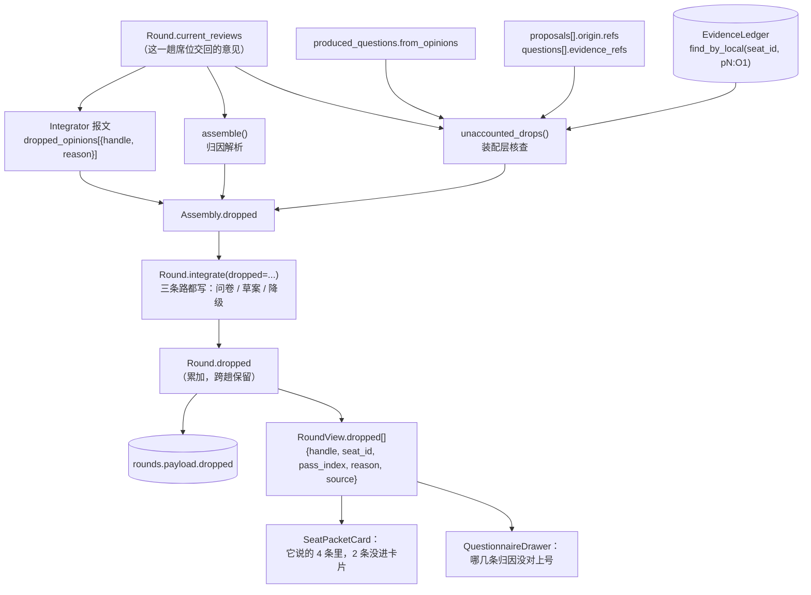
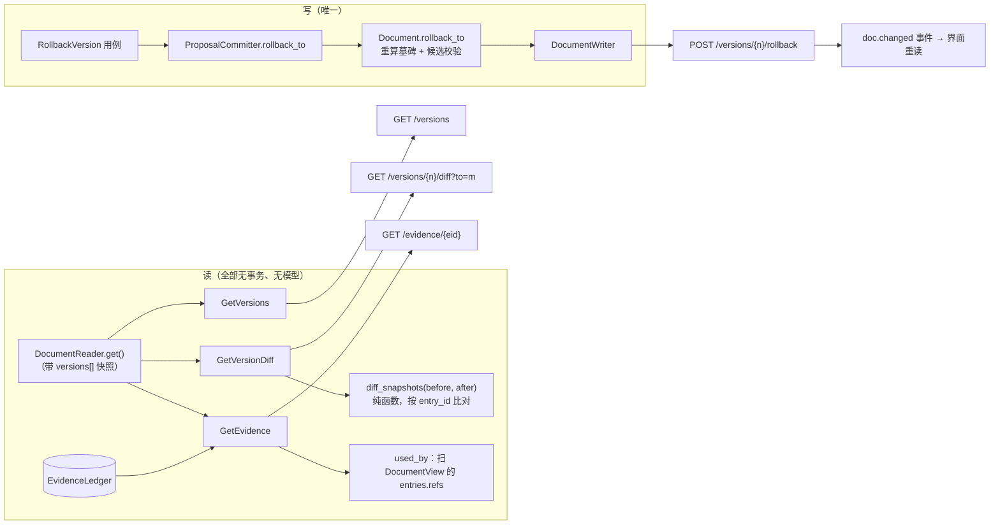

# P5b 执行计划 · 信任三件套（意见留痕 / 版本 diff 与回退 / 跨轮编号）

> **给执行的 agent：** 严格按任务顺序做，每个任务先写红测试、再实现、再跑绿、再提交。
> 除非测试本身写错（要说明错在哪），**不许改测试来迁就实现**。
> 本计划里有三处**旧断言按设计换形状**（`Questionnaire.dropped`、`RoundView.dropped_attributions`、
> `Assembly.dropped`），那是因为契约本身在变——每一处都在任务里点明"旧断言为什么必须换"，
> 不许顺手改其它断言。
> 上游方案：`docs/plans/2026-09-24-P5-方案-把项目补扎实.md` §4（信任三件套，已拍板）。
> 上一阶段：`docs/plans/2026-09-24-P5a-交付闭环-就绪度与导出.md`（已完成，10 个任务）。

**Goal：** 让"凭什么信它"这句话有东西可查：每条没进卡片的意见留着原因、每一版改了什么能对着看、
回退真的能用、任何一个出处编号都能查到原话并跳回去。

**Architecture：**
- **留痕**：`Round.dropped` 是一条**唯一通道**，三个来源都往它写（`integrator` 模型申报 /
  `assembly` 归因对不上 / `unaccounted` 装配层核出来"根本没交代"）。装配层不再只是"转手报文的搬运工"——
  它要能回答"这条意见去哪了"，这是"信任"里唯一不靠模型自觉的一半。
- **版本**：diff 是**纯函数**（`domain/authoring/diff.py::diff_snapshots`），按稳定 `entry_id` 比对，
  不用文本相似度；回退**只走** `ProposalCommitter`（写路径白名单里唯一持有 `DocumentWriter` 的类）。
- **出处**：查询是**只读扫描**（账本 + 文档投影），把"这条编号现在被谁用着"一次算清，
  不做索引层（等文档真长大再说）。

**Tech Stack：** Python 3.13 + FastAPI + SQLite + LiteLLM；React 18 + Vite + TS strict。

**Spec：** `.codex/docs/设计/01-规格.md` F1/F3/F5/§7、`02-编排与数据.md` §4.6/§5、
`06-前端.md` §2.2、`04-未决.md` C5/C8/D5/F1/F5、`05-DDD架构.md` §1（分层）、§4（写路径）。

## Global Constraints

- 测试：`cd backend && PYTHONDONTWRITEBYTECODE=1 python3 -m pytest -q -p no:cacheprovider`
  （注意：`pyproject.toml` 里已有 `addopts = "-q"`，再叠一个 `-q` 会把统计行也吞掉；
  要看条数就加 `-o addopts=""`）
- Lint：`cd backend && python3 -m ruff check --no-cache .`
- 前端：`cd frontend && npx tsc --noEmit && npx vitest run`
- 结构守卫必须全绿：`tests/architecture/`（分层、写路径白名单只有 `committer.py`、
  无 fake、UoW 里不许 await、graph state 白名单、domain 不许 import application）
- **唯一写路径**：`DocumentWriter` 只许 `domain/services/committer.py` 持有。
  本计划新增的**回退**也必须从 `ProposalCommitter` 走（它已有 `apply_manual` 这个先例）；
  查询、diff、留痕一律不持有写入能力。
- **模型调用一律在事务外**；本计划新增的用例**一次模型都不调**。
- 老 payload 兼容：新字段读回给默认值，老行不许炸（`questionnaire_from_json` / `round_from_payload`
  都是这么做的）。
- 端点白名单冻结在 `tests/api/test_openapi_contract.py`（现在 14 个，本计划加到 18 个，
  改这条测试必须同时改本节 §2.3 表）。
- 不留生成物：跑完 `git status --short` 只能剩预期改动；见到 `__pycache__` / `*.db` 就清。
- 中文注释与提交信息，一次提交一个任务。

**基线（2026-09-24 实测，动手前请自己再跑一遍）**：后端 `398 passed`（`-o addopts=""` 口径），
`ruff` All checks passed；前端 `tsc` 干净、`vitest` `85 passed`；工作区干净，HEAD `d9482e7`。

---

## 0. 现状核对（对着代码，不对着印象）

| 设计里写的 | 代码里的事实（文件:行） | 差在哪 |
|---|---|---|
| `02` §4.6 / `04` C5：`Round.dropped: [{handle, reason, source}]` | **没有这个字段**。只有 `Questionnaire.dropped: tuple[str,...]`，装的是"归因对不上"的裸字符串（`domain/round/questionnaire.py:96`） | 缺：模型申报的丢弃没有入口；缺：草案路径下这些留痕**直接丢掉**（见下一条） |
| `02` §④：丢弃要留痕 | 留痕只在**出问卷**那条路上被消费：`questionnaire_of(..., dropped=assembled.dropped)`（`use_cases.py:547`）；走草案那条路它根本没被用到 | **真洞**：信息明确的一轮（不出问卷）里，归因对不上的留痕全部消失 |
| `04` C5 后半：报文加 `dropped_opinions` | `IntegrationPacket` 只有 `questions / list_items / proposals`（`agents/schemas.py:118`） | 模型没有"我丢了哪条、为什么"的写法，只能默默丢 |
| `01` F1/F3：版本历史与差异、回退产生新版本 | `document_versions` 表在存整棵树；`Document.rollback_to()` 已实现**且有一条测试**（只覆盖"回退到 v1"）；界面只显示当前版本号 | 缺用例、缺端点、缺 diff；**且回退在"删过东西之后再回退"这个场景会写出读不回来的文档**（见 §0.1） |
| `04` D6 / `01` F3：一次改动一版 | `VersionTrigger.ROLLBACK` 存在，没人调用 | 同上 |
| `04` F5 / `06` §2.2：跨轮编号跳转 | `api/evidence.ts` 只建"本轮"索引；`EvidenceChip` 查不到就 `disabled`，文案是"不在这一轮里（跨轮编号要等查询端点 P4）" | 缺端点；缺历史轮查看能力 |
| `06` §2.2：点编号滚到引用它的内容 | `EntryList` 的条目 `<li className="entry">` **没有 id**（`EntryList.tsx:121`）；`jump.ts` 只找 `[data-eid]` | 缺锚点：`used_by` 拿到了 entry_id 也滚不过去 |
| `02` §4.6：`Round.dropped` 用来"查为什么这条没进卡片" | DTO 只有 `RoundView.dropped_attributions: tuple[str,...]` | 形状不对：没有原因、没有席位、没有第几趟 |
| `04` C8：`Round.active_seats` | 没有 | **P5c 的事，本计划不碰**（这里只登记，免得日后混淆） |

### 0.1 两个必须先说的新发现（本计划的直接产物）

**发现 1（真 bug，回退会让项目打不开）**：`Document.rollback_to()` 恢复旧快照时**不动墓碑**，
而 `_validate()` 要求"活着的块 id"与"墓碑 id"**不能重叠**（`document.py:313-318`）。
所以"建了一个功能 → 删掉它 → 回退到功能还在的那一版"会写出一个**读不回来的文档**：
落库时没事（`rollback_to` 不跑校验），下次 `SqliteDocumentRepository.get()` 重建聚合时抛
`DuplicateBlockId`——整个项目打不开。已实测复现（P5b 之前这段代码没人从界面调过，
所以一直没暴露；本计划把它接上界面，必须先把洞补好）：

```bash
cd backend && PYTHONDONTWRITEBYTECODE=1 python3 - <<'PY'
import sys; sys.path.insert(0, "src"); sys.path.insert(0, ".")
from pmstudio.domain.authoring.document import Document
from pmstudio.domain.authoring.instruction import WriteInstruction
from pmstudio.domain.shared.ids import DocumentId, EntryId, EvidenceId, FeatureSlug
from pmstudio.domain.shared.target import Target
from pmstudio.domain.shared.writing import BlockKind, WriteOp
from tests.support.builders import NOW, PROJECT

doc = Document.new(document_id=DocumentId("doc1"), project_id=PROJECT, title="订单中台", now=NOW)
doc.apply([WriteInstruction(instruction_id="i1", entry_id=EntryId("en1"), op=WriteOp.ADD,
    target=Target.body("s5", feature_slug="order-export"), text="订单导出",
    refs=(EvidenceId("E1"),), kind=BlockKind.TEXT)],
    now=NOW, summary="建功能", authorized_new_features=frozenset({FeatureSlug("order-export")}))
doc.apply([WriteInstruction(instruction_id="i2", entry_id=EntryId("feat-order-export"),
    op=WriteOp.REMOVE, target=Target.body("s5", feature_slug="order-export"), text="删功能",
    refs=(EvidenceId("E1"),))], now=NOW, summary="删功能")
doc.rollback_to(2, now=NOW, summary="回到功能还在的那一版")
Document(document_id=doc.document_id, project_id=doc.project_id, title=doc.title,
         blocks=doc.blocks, versions=doc.versions, preference_entries=doc.preference_entries,
         tombstones=doc.tombstones, created_at=doc.current_version.created_at)
PY
```

现状输出（这就是"红"）：

```
DuplicateBlockId: block id 在文档内必须唯一
{'block_ids': [..., 'feat-order-export', 'feat-order-export']}
```

**发现 2（真洞，留痕只在问卷那条路活着）**：`assembly.Assembly.dropped` 只在
`questionnaire_of(..., dropped=...)` 里被消费；信息明确、直接出草案的一轮里它是死的。
后果：用户过两天问"这条意见为什么没写进文档"，那一轮的回答是"没有记录"。

---

## 1. 执行范围

**做（三个面，都在"主闭环"之内，不加新角色、不加新卡片）**

1. **意见留痕一条通道**：`Round.dropped`（三个来源）→ 落库 → DTO → 闭环区每个席位包下面一行。
2. **版本三件**：列版本、看差异（纯函数）、回到某一版（走 `ProposalCommitter`）。
3. **出处查询**：按编号查处方（原话、链条、被谁引用）→ 前端查不到就查后端 → 切到那一轮或滚到那条内容。

**顺手必须修的（不修就是埋雷）**

4. `Document.rollback_to` 的墓碑冲突（§0.1 发现 1）+ 回退前跑一次候选校验。
5. `EntryList` 的条目锚点（`id="entry-<entry_id>"`），否则 `used_by` 落不了地。

**不做（列出来，免得又变成半成品）**

| 不做 | 理由 |
|---|---|
| `Round.active_seats` / C8 缩编 / F16 席位 TOML 补 `sections`·`fields` | 那是 P5c，且要先有网关超时才能真跑验证 |
| 网关超时 / 放弃这一轮 / 模型留样 / eval | P5c |
| block 移动与重排的 diff（"这块从 s7 挪到 s6"） | 现在没有任何写入路径会移动块；先不做，免得做出一套没消费者的比较 |
| 索引层 / 全局搜索（F6） | 还是"文档真长大了再说"；本计划的查询是 O(n) 扫描，单项目几千条以内够用 |
| 历史轮次列表与选择器（F4） | 只做"点编号跳到那一轮 + 回到最新"，不做轮次浏览器 |
| 版本对比的并排 diff 视图 / 高亮算法 | 用"新增 / 删除 / 改写（前后两行）"的分组列表，不做行级 diff |

---

## 2. 契约总表（改哪个文件、长什么样）

### 2.1 域（domain）

| 文件 | 变更 |
|---|---|
| `domain/round/round.py` | 新增 `DropSource`（`integrator` / `assembly` / `unaccounted`）、`DroppedItem{handle, reason, source, seat_id, pass_index}`；`Round.dropped` 只读属性；`Round.integrate(..., dropped=())` 把这一趟的留痕**累加**进聚合 |
| `domain/round/questionnaire.py` | **删掉** `Questionnaire.dropped`（同一件事只留 `Round.dropped` 一条通道；T2 先派生兼容，T9 收口） |
| `domain/authoring/diff.py`（新） | `EntrySnapshotView` / `ChangedEntry` / `DiffGroup` / `diff_snapshots(before, after) -> tuple[DiffGroup, ...]`（纯函数，无 IO、无模型） |
| `domain/authoring/document.py` | `rollback_to()`：恢复快照后**重算墓碑**（活着的块不再算墓碑）+ 候选状态先过 `_validate`，与 `apply()` 同一条规矩 |
| `domain/services/committer.py` | 新增 `ProposalCommitter.rollback_to(project_id=, version_no=, now=, summary=) -> CommitResult`（唯一写路径不变） |

### 2.2 应用（application）

| 文件 | 变更 |
|---|---|
| `application/agents/schemas.py` | `DroppedOpinionDraft{handle, reason}`；`IntegrationPacket.dropped_opinions`（上限 30） |
| `application/agents/integrator.py` + `infrastructure/llm/prompts/integrator.md` | 加一条硬规矩："你没采用的席位意见写进 `dropped_opinions`，一条都不许默默丢掉" |
| `application/assembly.py` | `Assembly.dropped: tuple[DroppedItem, ...]`（原 `tuple[str,...]`）；`_dropped_from_packet()`；归因对不上 → `source=assembly`；新增 `unaccounted_drops()`（配 `seat_entry_handle`） |
| `application/use_cases.py` | `IntegrateRound`：算出"这一趟被交代过的 handle 与编号"，把三个来源合成一个 `dropped`，**问卷路与草案路都写**；新增 `GetVersions` / `GetVersionDiff` / `RollbackVersion` / `GetEvidence` |
| `application/dto.py` | `DroppedView`、`RoundView.dropped`（T2 起 `dropped_attributions` 由它派生，T9 删掉）；`VersionSummaryView`、`DiffView`/`DiffGroupView`/`EntrySnapshotView`/`ChangedEntryView`、`RollbackResult`、`EvidenceLookupView`/`ChainItemView` + 各自的构造函数 |
| `application/deliverable.py` | `_summarize` 提升为公开 `summarize_line`（出处查询的 `summary` 复用同一个压缩规则，不再写第二份）；`KIND_LABELS` / `TRIGGER_LABELS` 直接被 DTO 复用（中文名真相源仍在后端） |
| `application/errors.py` | 新增 `UnknownEvidenceId`（`code="unknown_evidence"`） |

### 2.3 API / 基础设施

| 位置 | 变更 |
|---|---|
| `api/routes.py` | 新增 4 个端点：`GET /projects/{id}/versions`、`GET /projects/{id}/versions/{n}/diff?to={m}`、`POST /projects/{id}/versions/{n}/rollback`、`GET /projects/{id}/evidence/{eid}`（14 → 18） |
| `api/app.py` | `ApiServices` 加 `get_versions` / `get_version_diff` / `rollback_version` / `get_evidence` |
| `api/errors.py` | `CODE_STATUS` 加两条：`unknown_version → 404`、`unknown_evidence → 404`（`UnknownVersion` 现在继承 `ShapeError`，报的是 422；读一个不存在的版本是"资源不在"，404 才对） |
| `bootstrap/container.py` + `tests/support/harness.py` | 组装四个新用例（两处都要加，否则 API 测试与真实现不一致） |
| `infrastructure/sqlite/serialization.py` | `round_to_payload` / `round_from_payload` 往返 `dropped`（老 payload 没有这个键 → 空元组）；**兼容读老问卷的 `dropped` 键**，迁移成 `Round.dropped` 里的 `assembly` 条目 |
| `tests/api/test_openapi_contract.py` | 端点白名单 14 → 18 |

### 2.4 前端（frontend）

| 文件 | 变更 |
|---|---|
| `api/types.ts` | `RoundView.dropped[]`、`VersionSummaryView`、`DiffView`、`RollbackResult`、`EvidenceLookupView` |
| `api/client.ts` | `versions()` / `versionDiff()` / `rollbackVersion()` / `evidence()`（HTTP 出口仍然只有这一个文件） |
| `document/versions.ts`（新） | 纯函数：`versionLabel` / `triggerText` / `diffCounts` / `diffHeadline`（+ 测试） |
| `document/dropped.ts`（新） | 纯函数：`dropsFor(packet, dropped)` / `unplacedDrops(dropped, packets)` / `dropHeadline(...)`（+ 测试） |
| `document/structure.ts` | `sectionOfEntry(doc, entryId): string \| null`（点 `used_by` 要知道切哪一章；跟现有 `listFeatures` 一样只换摆法） |
| `components/VersionDrawer.tsx`（新） | 版本列表 + 选两个看差异 + 「回到这一版」（二次确认） |
| `components/VersionBar.tsx` | 「就差 N 项」后面加一个可点的「版本历史」，打开抽屉 |
| `components/SeatPacketCard.tsx` | 每个席位包底部一行"它说的 N 条里，M 条没进卡片（原因：…）" |
| `components/QuestionnaireDrawer.tsx` | 归因那行灰字改成读 `round.dropped` 里 `source === "assembly"` 的条目 |
| `components/EntryList.tsx` | 条目加锚点 `id={"entry-" + entry.entry_id}` |
| `components/LoopColumn.tsx` | 历史轮横幅（"正在看 r-xxxx（历史）· 回到最新一轮"）+ 只读时不出动作 |
| `App.tsx` | `shown = historyRound ?? round`；`onJump` 改成"先本地、再端点、能跳轮就跳轮、能滚条目就滚条目" |
| `state/useWorkspaceData.ts` | `viewRound(roundId)` / `backToLatest()` / `rollback(versionNo)` / `notify(message)` |

---

## 3. 数据流与架构（动手前先看懂这两张图）

### 3.1 意见留痕：三个来源，一条通道



判定规则（写死在装配层，**不问模型**）：

| 情况 | 判定 | `source` | 触发条件 |
|---|---|---|---|
| 模型在 `dropped_opinions` 里申报了 | 记它给的原因 | `integrator` | handle 出现在报文里 |
| 题目的 `from_opinions` 指向不存在的席位条目 | 记"归因对不上号" | `assembly` | 这一趟没有这条 `seat.x:ON` |
| 一条意见**既没被引用、也没被申报** | 记"整合既没说丢掉它，也没交代它落到哪儿" | `unaccounted` | 见下面的"算被交代过"三条 |

**算"被交代过"的三条**（三条都不满足才报 `unaccounted`，这是把假阳性压到最低的边界）：

1. 它的地址出现在某道题的 `from_opinions` 里（题问出来了，或降级落进了 s11）；
2. 它自己的出处编号（**只有判断有编号**，疑问没有）出现在某条提案的 `refs` 或某道题的
   `evidence_refs` 里；
3. 模型在 `dropped_opinions` 里申报过它。

外加一条**结构性豁免**：整合失败走降级出口时，这一趟所有**疑问**都会被原样落进 s11
（`degraded_question_proposals`），所以它们算交代过；没落地的**判断**仍然会报——
这正是"整合失败等于这一趟白跑"的可视化。

### 3.2 版本与出处：三条只读路径 + 一条写入路径



三条读路径的耗时都是 O(文档条目 + 账本条目)；单项目几千条以内是毫秒级，
**这一版不建索引**（建了就是第二份真相源，等真的慢再说）。

---

## 4. 要你拍板的五件事

| # | 问题 | 我的建议 | 代价 / 反面 |
|---|---|---|---|
| 1 | 留痕要不要包含**自动核查"根本没交代"**（`unaccounted`），还是只记模型自己申报的 + 归因对不上？ | **要**（三个来源都做）。否则"信任"变成"信任模型会老实交代"，而 P4 的真跑已经证明它不会 | 会多出一类行；边界只有三条（上面 §3.1），且原因文案统一，扫一眼就知道是不是整合没交代 |
| 2 | `RoundView.dropped` 取代 `dropped_attributions`、`Questionnaire.dropped`？ | **取代**（T2 先派生、T9 收口删旧字段）。理由：同一件事两份记录，迟早对不上 | 一次 DTO 破坏性变更——前端在同仓，跟着改；旧库里的问卷 `dropped` 键**兼容读**，不丢历史 |
| 3 | 回退要不要限制时机（比如"这一轮还没结束不许回退"）？ | **不限制**。回退是人主动按两次按钮的动作；回退后旧草案若已失效，确认写入会失败且**零写入**（`Document.apply` 先在候选状态上跑完才替换） | 用户可能在"等确认"时回退，然后发现草案的某条改不动了——这是真实情况，界面会在失败里说清原因，不静默 |
| 4 | diff 的粒度 | 按 `entry_id` 分**新增 / 删除 / 改写**（改写显示前后两行 + 双方编号）；不做块移动 / 重排检测；偏好区单列一组 | 少一个"这块挪了位置"的能力；但现在没有任何写入路径会移动块，做了也没东西可测 |
| 5 | `unknown_version` / `unknown_evidence` 返回什么 | **404**（在 `CODE_STATUS` 加两条映射），错误码分别是 `unknown_version` / `unknown_evidence` | 现在的 `UnknownVersion` 继承 `ShapeError` → 422。改映射会影响"用不存在的版本号调端点"这一类请求的状态码，正是我们想改的那一类 |

---

## 5. 任务分解（T1–T12，一步一提交）

依赖顺序：T1 → T2 → T3（留痕一条线）；T4 → T5 → T6（版本一条线）；T7 → T8（出处一条线）；
T9 / T10 / T11（前端：版本抽屉 / 留痕显示 / 跨轮跳转）；T12 收尾。
后端全部做完（T1–T8）再动前端，界面永远对着已经能跑的后端写。

### Task 1：域 · 留痕这条通道（`DroppedItem` + `Round.dropped`）

只**新增**字段，不动老契约，所以这一个提交之后所有老测试都该绿。

**Files:**
- Modify: `backend/src/pmstudio/domain/round/round.py`
- Modify: `backend/src/pmstudio/infrastructure/sqlite/serialization.py`（`round_to_payload` / `round_from_payload`）
- Test: `backend/tests/domain/round/test_round.py`
- Test: `backend/tests/infrastructure/test_sqlite_repositories.py`

**Interfaces:**
- Produces：`DropSource`（`INTEGRATOR` / `ASSEMBLY` / `UNACCOUNTED`）
- Produces：`DroppedItem(handle: str, reason: str, source: DropSource, seat_id: str | None, pass_index: int)`
- Produces：`Round.dropped -> tuple[DroppedItem, ...]`、`Round.integrate(..., dropped: tuple[DroppedItem, ...] | list[DroppedItem] = ())`

- [x] **Step 1：写红测试（域）**

```python
# tests/domain/round/test_round.py（追加）
from pmstudio.domain.round.round import DropSource, DroppedItem  # 与既有 import 合并


def test_dropped_items_are_recorded_on_the_round():
    """留痕落进聚合：`04` C5 要的"这条为什么没进卡片"要能过两天再查。"""

    round_ = round_with_seats()
    round_.integrate(
        questionnaire=make_questionnaire(),
        dropped=(
            DroppedItem(
                handle="seat.data_scale:O1",
                reason="与文档已有内容重复",
                source=DropSource.INTEGRATOR,
                seat_id="seat.data_scale",
                pass_index=1,
            ),
        ),
    )
    assert [(item.handle, item.reason, item.source) for item in round_.dropped] == [
        ("seat.data_scale:O1", "与文档已有内容重复", DropSource.INTEGRATOR)
    ]


def test_round_without_dropped_items_is_empty():
    assert make_round().dropped == ()


@pytest.mark.parametrize(
    "override",
    [
        {"handle": "   "},
        {"reason": "  "},
        {"pass_index": 0},
    ],
)
def test_dropped_item_requires_handle_reason_and_pass(override):
    base = {
        "handle": "seat.x:O1",
        "reason": "重复",
        "source": DropSource.INTEGRATOR,
        "seat_id": None,
        "pass_index": 1,
    }
    with pytest.raises(ShapeError):
        DroppedItem(**{**base, **override})
```

- [x] **Step 2：跑测试确认红**

Run: `cd backend && PYTHONDONTWRITEBYTECODE=1 python3 -m pytest tests/domain/round/test_round.py -q -p no:cacheprovider`
Expected: FAIL —— `ImportError: cannot import name 'DropSource'`

- [x] **Step 3：实现（域）**

```python
# domain/round/round.py（顶部加 from enum import StrEnum；其余追加在 SeatNomination 之后）
class DropSource(StrEnum):
    """留痕是谁发现的。"""

    INTEGRATOR = "integrator"    # 模型在报文里申报的（原因它自己写）
    ASSEMBLY = "assembly"        # 装配层算出来的：归因对不上号
    UNACCOUNTED = "unaccounted"  # 装配层核出来的：既没说丢、也没交代落到哪儿


@dataclass(frozen=True, slots=True)
class DroppedItem:
    """一条"没进卡片"的留痕。

    `handle` 是**席位条目地址**（`seat.data_scale:O2`），不是出处编号——疑问根本没有编号。
    形状**故意不校验**：模型写歪的地址正是要留痕的东西，写歪就抛错等于"写歪了就不留痕"。

    为什么带 `pass_index`：同一轮里席位会跑好几趟（答案回来再跑一次），而 `local_id`
    每趟都从 O1 重新开始；只有加上趟数，界面才知道这行该挂在哪个席位包下面。
    """

    handle: str
    reason: str
    source: DropSource
    seat_id: str | None
    pass_index: int

    def __post_init__(self) -> None:
        if not self.handle.strip():
            raise ShapeError("留痕必须写清是哪一条席位意见（handle）")
        if not self.reason.strip():
            raise ShapeError("留痕必须写清原因", handle=self.handle)
        if self.pass_index < 1:
            raise ShapeError("留痕必须说明属于哪一趟席位轮", handle=self.handle)
```

构造函数加一个入参、属性、以及 `integrate` 里的累加：

```python
# Round.__init__ 参数表加一行
        dropped: tuple[DroppedItem, ...] = (),
# __init__ 体里加一行
        self._dropped = tuple(dropped)

# 只读区加
    @property
    def dropped(self) -> tuple[DroppedItem, ...]:
        """本条通道：`integrator` 申报 / `assembly` 归因对不上 / `unaccounted` 没交代去处。

        跨趟累加：一趟席位轮一条命，历史留痕不覆盖。
        """

        return self._dropped

# integrate 改成
    def integrate(
        self,
        *,
        questionnaire: Questionnaire | None = None,
        draft: Draft | None = None,
        dropped: tuple[DroppedItem, ...] | list[DroppedItem] = (),
    ) -> None:
        self._require_step(Step.SEATS_RUNNING)
        if (questionnaire is None) == (draft is None):
            raise ShapeError("整合必须给出问卷或草案其中之一（问卷不是必然环节）")
        self._dropped = self._dropped + tuple(dropped)
        # …以下原样不动
```

- [x] **Step 4：跑测试确认绿**

Run: `cd backend && PYTHONDONTWRITEBYTECODE=1 python3 -m pytest tests/domain/round -q -p no:cacheprovider`
Expected: PASS

- [x] **Step 5：写红测试（落库往返 + 老 payload 兼容）**

```python
# tests/infrastructure/test_sqlite_repositories.py（追加）
from pmstudio.domain.round.round import DropSource, DroppedItem  # 与既有 import 合并


def test_round_dropped_items_round_trip(repos):
    """留痕要跟着轮次落库、读回来一条不差。"""

    _, rounds, _, _, uow = repos
    round_ = make_round()
    round_.integrate(
        questionnaire=Questionnaire(
            form_id=FormId("f1"),
            round_id=round_.round_id,
            questions=(
                Question(
                    question_id=QuestionId("q1"),
                    target=Target.body("s8"),
                    type=QuestionType.TEXT,
                    title="单次导出的最大行数是多少？",
                    why="量级决定同步还是异步",
                    consequence_if_skipped="按同步实现",
                ),
            ),
        ),
        dropped=(
            DroppedItem(
                handle="seat.nope:O1",
                reason="归因对不上号：这一轮没有这条席位条目",
                source=DropSource.ASSEMBLY,
                seat_id=None,
                pass_index=1,
            ),
            DroppedItem(
                handle="seat.data_scale:O2",
                reason="与文档已有内容重复",
                source=DropSource.INTEGRATOR,
                seat_id="seat.data_scale",
                pass_index=1,
            ),
        ),
    )
    with uow:
        rounds.save(round_)

    loaded = rounds.get(round_.round_id)
    assert [
        (item.handle, item.reason, item.source, item.seat_id, item.pass_index)
        for item in loaded.dropped
    ] == [
        ("seat.nope:O1", "归因对不上号：这一轮没有这条席位条目",
         DropSource.ASSEMBLY, None, 1),
        ("seat.data_scale:O2", "与文档已有内容重复",
         DropSource.INTEGRATOR, "seat.data_scale", 1),
    ]


def test_round_payload_without_dropped_key_still_loads():
    """老行里没有 `dropped` 键：读成空元组，不炸（与 nominated_seats 同一条规矩）。"""

    round_ = make_round()
    payload = serialization.round_to_payload(round_)
    payload.pop("dropped")

    loaded = serialization.round_from_payload(
        payload,
        round_id=round_.round_id,
        project_id=round_.project_id,
        created_at=round_.created_at,
        step=round_.step,
        waiting_on=round_.waiting_on,
    )
    assert loaded.dropped == ()
```

- [x] **Step 6：跑测试确认红**

Run: `cd backend && PYTHONDONTWRITEBYTECODE=1 python3 -m pytest tests/infrastructure/test_sqlite_repositories.py -q -p no:cacheprovider`
Expected: FAIL —— `loaded.dropped` 是 `()`

- [x] **Step 7：实现（序列化）**

```python
# serialization.round_to_payload 的返回字典里加一项（放在 "failure" 之前）
        "dropped": [
            {
                "handle": item.handle,
                "reason": item.reason,
                "source": item.source.value,
                "seat_id": item.seat_id,
                "pass_index": item.pass_index,
            }
            for item in round_.dropped
        ],

# serialization.round_from_payload 的构造里加一项
        dropped=tuple(
            DroppedItem(
                handle=item["handle"],
                reason=item["reason"],
                source=DropSource(item["source"]),
                seat_id=item.get("seat_id"),
                pass_index=int(item.get("pass_index", 1)),
            )
            for item in payload.get("dropped", ())
        ),
```

（`serialization.py` 顶部要 `from pmstudio.domain.round.round import DropSource, DroppedItem, Round` 这类 import 合并进既有那一行。）

- [x] **Step 8：跑测试确认绿 + 全量回归**

Run: `cd backend && PYTHONDONTWRITEBYTECODE=1 python3 -m pytest -q -p no:cacheprovider && python3 -m ruff check --no-cache .`
Expected: PASS（398 + 新增 5 条），ruff `All checks passed!`

- [x] **Step 9：提交**

```bash
cd /home/linsir365/projects/ai-pm
git add backend/src/pmstudio/domain/round/round.py \
        backend/src/pmstudio/infrastructure/sqlite/serialization.py \
        backend/tests/domain/round/test_round.py \
        backend/tests/infrastructure/test_sqlite_repositories.py
git commit -m "feat(round): 留痕通道 Round.dropped（含趟数、来源与原因，P5b Task 1）"
```

---

### Task 2：装配 · 三个来源合成一条留痕通道

这一个任务只碰**纯函数与报文形状**：`Assembly.dropped` 从裸字符串变成 `DroppedItem`，
报文加 `dropped_opinions`。**旧断言按设计换形状的两处在这里**（下面点明为什么）。

**Files:**
- Modify: `backend/src/pmstudio/application/agents/schemas.py`
- Modify: `backend/src/pmstudio/application/agents/integrator.py`（`LIMITS_TEXT` 加一条硬规矩）
- Modify: `backend/src/pmstudio/infrastructure/llm/prompts/integrator.md`（同一句话进提示词）
- Modify: `backend/src/pmstudio/application/assembly.py`
- Test: `backend/tests/application/test_assembly.py`
- Test: `backend/tests/application/test_agent_schemas.py`

**Interfaces:**
- Produces：`schemas.DroppedOpinionDraft`、`schemas.IntegrationPacket.dropped_opinions`
- Produces：`assembly.dropped_from_packet(packet, *, reviews, pass_index) -> tuple[DroppedItem, ...]`
- Produces：`assembly.unaccounted_drops(reviews, *, ledger, accounted_handles, accounted_eids, declared) -> tuple[DroppedItem, ...]`
- Produces：`Assembly.dropped: tuple[DroppedItem, ...]`

- [x] **Step 1：写红测试（报文形状）**

```python
# tests/application/test_agent_schemas.py（追加）
def test_integration_packet_accepts_dropped_opinions():
    packet = schemas.parse_packet(
        json.dumps(
            {
                "questions": [],
                "list_items": [],
                "proposals": [],
                "dropped_opinions": [
                    {"handle": "seat.data_scale:O2", "reason": "与文档已有内容重复"},
                ],
            },
            ensure_ascii=False,
        ),
        schemas.IntegrationPacket,
        purpose="integration",
    )
    assert packet.dropped_opinions[0].handle == "seat.data_scale:O2"


def test_dropped_opinion_without_reason_is_rejected():
    with pytest.raises(PacketParseError):
        schemas.parse_packet(
            json.dumps(
                {
                    "questions": [],
                    "list_items": [],
                    "proposals": [],
                    "dropped_opinions": [{"handle": "seat.x:O1", "reason": ""}],
                },
                ensure_ascii=False,
            ),
            schemas.IntegrationPacket,
            purpose="integration",
        )
```

- [x] **Step 2：跑测试确认红**

Run: `cd backend && PYTHONDONTWRITEBYTECODE=1 python3 -m pytest tests/application/test_agent_schemas.py -q -p no:cacheprovider`
Expected: FAIL —— `dropped_opinions` 被 pydantic 忽略，`AttributeError`

- [x] **Step 3：实现（报文 + 提示词）**

```python
# application/agents/schemas.py
class DroppedOpinionDraft(BaseModel):
    """模型自己申报的丢弃：一条都不许默默丢掉（`04` C5 后半）。"""

    handle: str = Field(min_length=1, description="席位条目地址，如 seat.business_rules:O1")
    reason: str = Field(min_length=1, description="一句话：为什么这条意见没有进卡片")


class IntegrationPacket(BaseModel):
    questions: list[QuestionDraft] = Field(default_factory=list, max_length=12)
    list_items: list[ListItemDraft] = Field(default_factory=list, max_length=20)
    proposals: list[ProposalDraft] = Field(default_factory=list, max_length=30)
    dropped_opinions: list[DroppedOpinionDraft] = Field(
        default_factory=list,
        max_length=30,
        description="你没采用的席位意见：给出地址与原因；**一条都不许默默丢掉**",
    )
```

```python
# application/agents/integrator.py 的 LIMITS_TEXT 里加两行（放在最后一条之前）
    "- 你没采用的席位意见**必须**写进 dropped_opinions（handle + 一句话原因）；",
    "  一条都不许默默丢掉——事后再问「这条为什么没进文档」时，只有这段留痕答得上来",
```

```markdown
<!-- infrastructure/llm/prompts/integrator.md：在"输出要求"那一节加同一条 -->
- `dropped_opinions`：你没采用的席位意见要逐条给出（`handle` 是席位条目地址，如
  `seat.data_scale:O2`；`reason` 一句话）。**一条都不许默默丢掉。**
```

- [x] **Step 4：写红测试（装配三个来源）**

```python
# tests/application/test_assembly.py（改 + 追加）
from pmstudio.domain.round.round import DropSource  # 与既有 import 合并


def ledger_with_own_eid_for_the_judgment() -> EvidenceLedger:
    """E1 用户输入 + E2 席位判断，且判断带 `local_id`（这样 find_by_local 反查得到它）。

    形状照抄真实写法：`local_id=f"p{pass}:{O1}"`——汇合点的幂等编号键。
    """

    ledger = EvidenceLedger.empty(PROJECT)
    e1 = ledger.record(
        kind=EvidenceKind.USER_INPUT,
        text="导出要快",
        source=EvidenceSource(round_id=ROUND_ID, raw_span="导出要快一点"),
        now=NOW,
    )
    ledger.record(
        kind=EvidenceKind.AGENT_DERIVED,
        text="单次导出应在 60 秒内完成",
        source=EvidenceSource(seat_id=SEAT, local_id="p1:O2", derived_from=(e1,)),
        now=NOW,
    )
    return ledger


def test_packet_declared_drops_land_in_the_channel():
    """模型申报的丢弃：原因照抄、席位按地址前缀解析；写歪了也留痕，只是认不出席位。"""

    declared = schemas.IntegrationPacket(
        dropped_opinions=[
            {"handle": f"{SEAT}:O2", "reason": "与文档已有内容重复"},
            {"handle": "查不到:O9", "reason": "写歪了地址"},
        ]
    )
    drops = assembly.dropped_from_packet(
        declared,
        reviews=round_with_two_seats_attested().current_reviews,  # 本文件已有的夹具
        pass_index=1,
    )

    assert [(item.handle, item.reason, item.source, item.seat_id) for item in drops] == [
        (f"{SEAT}:O2", "与文档已有内容重复", DropSource.INTEGRATOR, SEAT),
        ("查不到:O9", "写歪了地址", DropSource.INTEGRATOR, None),
    ]


def test_unaccounted_opinion_is_reported():
    """整合既没说丢、也没交代去处 → 装配层替它留痕（"信任"里不靠模型自觉的那一半）。"""

    drops = assembly.unaccounted_drops(
        round_with_two_seats_attested().current_reviews,
        ledger=ledger_with_own_eid_for_the_judgment(),
        accounted_handles=frozenset(),
        accounted_eids=frozenset(),
        declared=frozenset(),
    )
    assert [(item.handle, item.source) for item in drops] == [
        (f"{SEAT}:O1", DropSource.UNACCOUNTED),
        (f"{SEAT}:O2", DropSource.UNACCOUNTED),
        (f"{SECOND_SEAT}:O1", DropSource.UNACCOUNTED),
    ]


def test_opinion_cited_by_a_question_is_not_reported():
    drops = assembly.unaccounted_drops(
        round_with_two_seats_attested().current_reviews,
        ledger=ledger_with_own_eid_for_the_judgment(),
        accounted_handles=frozenset({f"{SEAT}:O1", f"{SEAT}:O2", f"{SECOND_SEAT}:O1"}),
        accounted_eids=frozenset(),
        declared=frozenset(),
    )
    assert drops == ()


def test_judgment_referenced_by_a_proposal_is_not_reported():
    """判断自己的编号被引用就算交代过——哪怕题目没写 from_opinions。"""

    drops = assembly.unaccounted_drops(
        round_with_two_seats_attested().current_reviews,
        ledger=ledger_with_own_eid_for_the_judgment(),
        accounted_handles=frozenset({f"{SEAT}:O1", f"{SECOND_SEAT}:O1"}),
        accounted_eids=frozenset({EvidenceId("E2")}),  # ← 那条判断自己的编号
        declared=frozenset(),
    )
    assert drops == ()


def test_declared_opinion_is_not_reported_twice():
    """模型申报过的，不许再报一条"没交代"（同一件事只留一次痕）。"""

    drops = assembly.unaccounted_drops(
        round_with_two_seats_attested().current_reviews,
        ledger=ledger_with_own_eid_for_the_judgment(),
        accounted_handles=frozenset(),
        accounted_eids=frozenset(),
        declared=frozenset({f"{SEAT}:O1", f"{SEAT}:O2", f"{SECOND_SEAT}:O1"}),
    )
    assert drops == ()
```

**两处旧断言必须换形状**（契约变了，不是测试写错）：

```python
# 旧：assert result.dropped == ("seat.nope:O1", f"{SECOND_SEAT}:O9")
# 新：留痕现在带原因与来源，形状由 `DroppedItem` 决定
    assert [(item.handle, item.source) for item in result.dropped] == [
        ("seat.nope:O1", DropSource.ASSEMBLY),
        (f"{SECOND_SEAT}:O9", DropSource.ASSEMBLY),
    ]
# 旧：assert result.dropped == ()
# 新：
    assert result.dropped == ()
```

- [x] **Step 5：跑测试确认红**

Run: `cd backend && PYTHONDONTWRITEBYTECODE=1 python3 -m pytest tests/application/test_assembly.py -q -p no:cacheprovider`
Expected: FAIL —— `cannot import name 'unaccounted_drops'`

- [x] **Step 6：实现（装配）**

```python
# application/assembly.py
from pmstudio.domain.round.round import DropSource, DroppedItem, Round  # 合并进既有 import


@dataclass(frozen=True, slots=True)
class Assembly:
    questions: tuple[Question, ...]
    list_items: tuple[ListItem, ...]
    proposals: tuple[Proposal, ...]
    #: 这一趟没进卡片的意见（三个来源合成一条通道，见 `04` C5）
    dropped: tuple[DroppedItem, ...] = ()
    degrade_reason: str | None = None


def _seat_of_handle(handle: str, *, seats: frozenset[str]) -> str | None:
    """从席位条目地址里解析席位（解析不到就留 None——留痕照样留，不猜）。"""

    if ":" not in handle:
        return None
    seat_id = handle.split(":", 1)[0].strip()
    return seat_id if seat_id in seats else None


def dropped_from_packet(
    packet: schemas.IntegrationPacket,
    *,
    reviews: Sequence[SeatReview],
    pass_index: int,
) -> tuple[DroppedItem, ...]:
    """模型申报的丢弃：原因它自己写；席位解析不出来也照收（留痕比归类重要）。"""

    seats = frozenset(review.seat_id for review in reviews)
    return tuple(
        DroppedItem(
            handle=item.handle,
            reason=item.reason,
            source=DropSource.INTEGRATOR,
            seat_id=_seat_of_handle(item.handle, seats=seats),
            pass_index=pass_index,
        )
        for item in packet.dropped_opinions
    )


def unaccounted_drops(
    reviews: Sequence[SeatReview],
    *,
    ledger: EvidenceLedger,
    accounted_handles: frozenset[str],
    accounted_eids: frozenset[EvidenceId],
    declared: frozenset[str],
) -> tuple[DroppedItem, ...]:
    """装配层的核查：这条意见**既没被引用、也没被申报** → 留一条痕。

    假阳性压到最低的三条边界（任一条成立就算"交代过"）：
    1. 地址出现在某道题的 `from_opinions` 里；
    2. 它自己的出处编号（只有判断有）出现在某条提案或某道题的引用里；
    3. 模型在 `dropped_opinions` 里申报过。
    """

    items: list[DroppedItem] = []
    for review in reviews:
        for opinion in review.opinions:
            handle = seat_entry_handle(review.seat_id, opinion.local_id)
            if handle in accounted_handles or handle in declared:
                continue
            own = ledger.find_by_local(
                seat_id=review.seat_id,
                local_id=f"p{review.pass_index}:{opinion.local_id}",
            )
            if own is not None and own.eid in accounted_eids:
                continue
            items.append(
                DroppedItem(
                    handle=handle,
                    reason="整合既没说丢掉它，也没交代它落到了哪儿",
                    source=DropSource.UNACCOUNTED,
                    seat_id=review.seat_id,
                    pass_index=review.pass_index,
                )
            )
    return tuple(items)
```

`assemble()` 里三处小改：

```python
    pass_index = round_.seat_round_count
    dropped: list[DroppedItem] = []
    ordered = feature_questions + [
        _question(
            item, known=known, ledger=ledger, reviews=round_.current_reviews,
            pass_index=pass_index, dropped=dropped,
        )
        for item in packet.questions
    ]
    # （其余行原样不动：kept / list_items 的构造）
    return Assembly(
        questions=tuple(kept),
        list_items=tuple(list_items),
        proposals=tuple(proposals),
        dropped=tuple(dropped)
        + dropped_from_packet(packet, reviews=round_.current_reviews, pass_index=pass_index),
    )
```

`_question(...)` 的签名多一个 `pass_index: int`、`dropped` 类型从 `list[str]` 换成
`list[DroppedItem]`（留痕要知道自己属于哪一趟），归因对不上的那一支：

```python
    for raw in draft.from_opinions:
        handle = raw.strip()
        seat_id = by_handle.get(handle)
        if seat_id is None:
            dropped.append(
                DroppedItem(
                    handle=handle,
                    reason="归因对不上号：这一轮没有这条席位条目",
                    source=DropSource.ASSEMBLY,
                    seat_id=_seat_of_handle(handle, seats=frozenset(by_handle.values())),
                    pass_index=pass_index,
                )
            )
        elif seat_id not in seats:
            seats.append(seat_id)
```

同时 `questionnaire_of(...)` 的 `dropped` 形参保留（老测试还在用），但 `IntegrateRound`
不再往里塞东西——那一步挪到 `Round.dropped`（Task 3）。

- [x] **Step 7：跑测试确认绿**

Run: `cd backend && PYTHONDONTWRITEBYTECODE=1 python3 -m pytest tests/application -q -p no:cacheprovider`
Expected: PASS

- [x] **Step 8：提交**

```bash
cd /home/linsir365/projects/ai-pm
git add backend/src/pmstudio/application/agents/schemas.py \
        backend/src/pmstudio/application/agents/integrator.py \
        backend/src/pmstudio/infrastructure/llm/prompts/integrator.md \
        backend/src/pmstudio/application/assembly.py \
        backend/tests/application/test_assembly.py \
        backend/tests/application/test_agent_schemas.py
git commit -m "feat(assembly): 丢弃留痕三个来源合成一条通道（P5b Task 2）"
```

---

### Task 3：整合 · 两条路都写留痕 + 出入 DTO

修 §0.1 发现 2（草案路径丢留痕），并把留痕送到界面。

**Files:**
- Modify: `backend/src/pmstudio/application/use_cases.py`（`IntegrateRound.__call__`）
- Modify: `backend/src/pmstudio/application/dto.py`（`DroppedView`、`RoundView.dropped`）
- Test: `backend/tests/application/test_dropped_trace.py`（新建）
- Test: `backend/tests/application/test_dto.py`（一处旧断言按设计换形状）

**Interfaces:**
- Consumes：`Assembly.dropped`、`unaccounted_drops`
- Produces：`dto.DroppedView(handle, seat_id, pass_index, reason, source)`、`RoundView.dropped`
- Produces：`Round.integrate(dropped=...)` 在**问卷路 / 草案路 / 降级路**都被调用

- [x] **Step 1：写红测试（用例级，四条）**

```python
# tests/application/test_dropped_trace.py（新建）
"""留痕通道的端到端：报文申报、归因对不上、没交代去向，三条都要留得下来。

这一组测试针对的是真踩过的洞：留痕只在"出问卷"那条路上被写进轮次，
信息明确、直接出草案的一轮里全部消失（P5b §0.1 发现 2）。
"""

import json

from pmstudio.domain.round.round import DropSource
from tests.support.builders import PROJECT, SEAT
from tests.support.harness import Harness


CLAIMS_REPLY = json.dumps(
    {
        "basis": "读了空文档",
        "claims": [
            {
                "text": "导出要快",
                "raw_span": "导出要快一点",
                "label": "constraint",
                "zone": "body",
                "section_id": "s8",
            }
        ],
        "seats": [{"seat_id": SEAT, "why": "导出要评估数据量与耗时"}],
    },
    ensure_ascii=False,
)

# 一条疑问（不进账本、没有编号）+ 一条判断（进账本，拿到 E2）
SEAT_REPLY = json.dumps(
    {
        "basis": "读了 s1–s13 与 E1",
        "opinions": [
            {
                "local_id": "O1",
                "form": "question",
                "about": "导出的数据量级",
                "claim": "量级决定同步还是异步，必须问用户",
                "because": "1 万以内可同步，10 万以上必须异步",
                "evidence_refs": ["E1"],
            },
            {
                "local_id": "O2",
                "form": "judgment",
                "about": "导出的性能上限",
                "claim": "单次导出应在 60 秒内完成",
                "because": "同类导出的常见上限",
                "evidence_refs": ["E1"],
            },
        ],
    },
    ensure_ascii=False,
)


def draft_reply(*, refs, dropped):
    """"直接出草案"的整合报文：命题只引用 refs，丢弃只申报 dropped。"""

    return json.dumps(
        {
            "questions": [],
            "list_items": [],
            "dropped_opinions": dropped,
            "proposals": [
                {
                    "op": "add",
                    "target": {"zone": "body", "section_id": "s8"},
                    "text": "单次导出应在 60 秒内完成",
                    "origin_type": "derived",
                    "evidence_refs": refs,
                    "rationale": "同类导出的常见上限",
                }
            ],
        },
        ensure_ascii=False,
    )


async def run_to_integrated(harness: Harness):
    """走一遍：建轮 → 抽主张 → 交席位编制 → 跑席位 → 整合。"""

    harness.seed_project()
    start = harness.start_round()
    round_id = await start.create(project_id=PROJECT, user_input="导出要快一点")
    await start.analyze(round_id=round_id)
    await harness.submit_opening()(round_id=round_id, seats=(SEAT,))
    await harness.run_seat_round()(round_id=round_id)
    await harness.integrate_round()(round_id=round_id)
    return round_id


def harness_with(*, integration: str) -> Harness:
    return Harness(
        replies={"claims": CLAIMS_REPLY, "integration": integration},
        seat_replies={SEAT: SEAT_REPLY},
    )


async def test_draft_path_keeps_the_drop_trace():
    """不出问卷的那条路：模型申报的丢弃必须留在轮次上（旧实现这里全丢）。"""

    harness = harness_with(
        integration=draft_reply(
            refs=["E2"],  # 命题引用了那条判断 → 它在"被交代"那一边
            dropped=[{"handle": f"{SEAT}:O1", "reason": "与文档已有内容重复"}],
        )
    )
    round_id = await run_to_integrated(harness)

    round_ = harness.rounds.get(round_id)
    assert round_.draft is not None  # 确认走的确实是"出草案"那条路
    assert [(item.handle, item.reason, item.source) for item in round_.dropped] == [
        (f"{SEAT}:O1", "与文档已有内容重复", DropSource.INTEGRATOR)
    ]


async def test_unaccounted_opinion_is_reported_in_the_round():
    """整合一条也没引用 → 两条都报"没交代去向"（不靠模型自觉）。"""

    harness = harness_with(integration=draft_reply(refs=["E1"], dropped=[]))
    round_id = await run_to_integrated(harness)

    round_ = harness.rounds.get(round_id)
    assert {item.handle for item in round_.dropped} == {f"{SEAT}:O1", f"{SEAT}:O2"}
    assert {item.source for item in round_.dropped} == {DropSource.UNACCOUNTED}


async def test_judgment_accounted_by_a_proposal_still_leaves_the_question_reported():
    """判断被引用（引用它自己的编号 E2）就算交代过；疑问没人提 → 只有它报。"""

    harness = harness_with(integration=draft_reply(refs=["E2"], dropped=[]))
    round_id = await run_to_integrated(harness)

    round_ = harness.rounds.get(round_id)
    assert [(item.handle, item.source) for item in round_.dropped] == [
        (f"{SEAT}:O1", DropSource.UNACCOUNTED)
    ]


async def test_degraded_questions_count_as_accounted_but_judgments_do_not():
    """整合失败时，疑问原样落 s11（算交代过），没落地的判断仍然报"没交代"。"""

    # 报文故意引用不存在的编号（E9）：两次都过不了校验 → 走降级出口
    harness = harness_with(integration=draft_reply(refs=["E9"], dropped=[]))
    round_id = await run_to_integrated(harness)

    round_ = harness.rounds.get(round_id)
    assert [(item.handle, item.source) for item in round_.dropped] == [
        (f"{SEAT}:O2", DropSource.UNACCOUNTED)
    ]
```

**一处旧断言按设计换形状（在 `tests/application/test_dto.py`）**：

```python
# 旧名字与旧形状：test_round_view_exposes_dropped_attributions
#   （读 Questionnaire.dropped、里面是裸字符串）
# 新：留痕投影带地址、席位、趟数、原因、来源；旧字段由新通道派生
def test_round_view_exposes_dropped_channel():
    round_ = make_round()
    round_.integrate(
        questionnaire=Questionnaire(
            form_id=FormId("f1"),
            round_id=ROUND_ID,
            questions=(
                Question(
                    question_id=QuestionId("q1"),
                    target=Target.body("s8"),
                    type=QuestionType.TEXT,
                    title="单次导出最大行数？",
                    why="量级决定同步还是异步",
                    consequence_if_skipped="按同步实现",
                ),
            ),
        ),
        dropped=(
            DroppedItem(
                handle="seat.nope:O1",
                reason="归因对不上号：这一轮没有这条席位条目",
                source=DropSource.ASSEMBLY,
                seat_id=None,
                pass_index=1,
            ),
        ),
    )

    view = dto.round_view(round_)
    assert [(item.handle, item.seat_id, item.pass_index, item.source) for item in view.dropped] == [
        ("seat.nope:O1", None, 1, "assembly")
    ]
    assert view.dropped_attributions == ("seat.nope:O1",)
    assert dto.round_view(make_round()).dropped == ()
```

- [x] **Step 2：跑测试确认红**

Run: `cd backend && PYTHONDONTWRITEBYTECODE=1 python3 -m pytest tests/application/test_dropped_trace.py tests/application/test_dto.py -q -p no:cacheprovider`
Expected: FAIL —— `RoundView` 没有 `dropped` 字段；草案路的留痕是空元组

- [x] **Step 3：实现（用例接线）**

```python
# application/use_cases.py::IntegrateRound.__call__（只改这一段，其余不动）
    async def __call__(self, *, round_id: RoundId) -> None:
        assembled, gaps = await self._integrate_with_repair(round_id=round_id)

        with self._uow:
            round_ = self._rounds.get(round_id)
            ledger = self._evidence.get(round_.project_id)
            now = self._clock.now()
            proposals = list(assembled.proposals)
            # 降级前的那批题：它们（无论最后是问出来、还是落进 s11）都算"交代过"了
            produced_questions = assembled.questions
            ...（原样：degrade / system_defaults / questions 降级 / questionnaire_or_draft）

            accounted_handles = frozenset(
                handle
                for question in produced_questions
                for handle in question.from_opinions
            )
            if assembled.degrade_reason is not None:
                # 整合失败时，这一趟的疑问会被原样落进 s11：算交代过
                accounted_handles |= frozenset(
                    seat_entry_handle(seat_id, opinion.local_id)
                    for seat_id, opinion in seat_questions(round_.current_reviews)
                )
            accounted_eids = frozenset(
                eid for proposal in proposals for eid in proposal.origin.refs
            ) | frozenset(
                eid for question in produced_questions for eid in question.evidence_refs
            )
            dropped = assembled.dropped + unaccounted_drops(
                round_.current_reviews,
                ledger=ledger,
                accounted_handles=accounted_handles,
                accounted_eids=accounted_eids,
                declared=frozenset(
                    item.handle
                    for item in assembled.dropped
                    if item.source is DropSource.INTEGRATOR
                ),
            )
            if questionnaire is not None:
                round_.integrate(questionnaire=questionnaire, dropped=dropped)
            else:
                round_.integrate(draft=draft, dropped=dropped)
```

（`questionnaire_of(...)` 调用里那次 `dropped=assembled.dropped` 删掉——它现在是 `DroppedItem`，
不再是字符串；字符串通道由 `Test 9` 正式退休。）

- [x] **Step 4：实现（DTO）**

```python
# application/dto.py
from pmstudio.domain.round.round import DropSource, Round  # 合并进既有 import


@dataclass(frozen=True, slots=True)
class DroppedView:
    handle: str
    seat_id: str | None
    pass_index: int
    reason: str
    source: str


# RoundView 加字段（放在 seat_packets 之后）
    dropped: tuple[DroppedView, ...]


def round_view(...) -> RoundView:
    # （函数签名与前半段原样不动）
    return RoundView(
        # （其余字段原样不动）
        dropped=tuple(
            DroppedView(
                handle=item.handle,
                seat_id=item.seat_id,
                pass_index=item.pass_index,
                reason=item.reason,
                source=item.source.value,
            )
            for item in round_.dropped
        ),
        # 这个字段 Task 9 退休；在此之前它是新通道的派生视图，不是第二份真相源
        dropped_attributions=tuple(
            item.handle for item in round_.dropped if item.source is DropSource.ASSEMBLY
        ),
    )
```

- [x] **Step 5：跑测试确认绿**

Run: `cd backend && PYTHONDONTWRITEBYTECODE=1 python3 -m pytest -q -p no:cacheprovider && python3 -m ruff check --no-cache .`
Expected: PASS

- [x] **Step 6：提交**

```bash
cd /home/linsir365/projects/ai-pm
git add backend/src/pmstudio/application/use_cases.py \
        backend/src/pmstudio/application/dto.py \
        backend/tests/application/test_dropped_trace.py \
        backend/tests/application/test_dto.py
git commit -m "feat(round): 两条路都留痕，留痕进出投影（P5b Task 3）"
```

---

### Task 4：域 · 版本差异（纯函数）

**Files:**
- Create: `backend/src/pmstudio/domain/authoring/diff.py`
- Test: `backend/tests/domain/authoring/test_diff.py`

**Interfaces:**
- Produces：`EntrySnapshotView(entry_id, text, refs)`、`ChangedEntry(before, after)`、
  `DiffGroup(target_label, added, removed, changed)`、`diff_snapshots(before, after) -> tuple[DiffGroup, ...]`

- [x] **Step 1：写红测试**

```python
# tests/domain/authoring/test_diff.py（新建）
"""版本差异：按 entry_id 比对。entry_id 稳定（原地替换 + 快照留旧值），
所以不需要文本相似度——这是当初"永久稳定 id"决定现在的红利。"""

from pmstudio.domain.authoring.diff import diff_snapshots
from pmstudio.domain.authoring.instruction import WriteInstruction
from pmstudio.domain.shared.ids import EntryId, EvidenceId
from pmstudio.domain.shared.target import Target
from pmstudio.domain.shared.writing import WriteOp
from tests.support.builders import NOW, document_with_feature


def instruction(*, target, entry_id, text, op=WriteOp.ADD, refs=(EvidenceId("E1"),)):
    """本文件自己用的写入指令（与 test_document.py 的同名助手形状一致）。"""

    return WriteInstruction(
        instruction_id=f"i-{entry_id}",
        entry_id=EntryId(entry_id),
        op=op,
        target=target,
        text=text,
        refs=refs,
    )


def entry_id_of(document, field: str) -> str:
    """按字段名找它的第一条条目 id（diff 的比对单位是 entry_id）。"""

    for block in document.blocks:
        if block.field == field and block.entries:
            return str(block.entries[0].entry_id)
    raise AssertionError(f"没有 {field} 条目")


def test_changed_entry_is_reported_with_before_and_after():
    document = document_with_feature(one_liner="把订单导出成表格")
    before = document.current_version.snapshot
    document.apply(
        [
            instruction(
                target=Target.feature_field("order-export", "one_liner"),
                text="按筛选条件把订单导成表格",
                entry_id=entry_id_of(document, "one_liner"),
                op=WriteOp.REPLACE,
                refs=(EvidenceId("E1"), EvidenceId("E9")),
            )
        ],
        now=NOW,
        summary="改一句话描述",
    )
    groups = diff_snapshots(before, document.current_version.snapshot)

    assert [group.target_label for group in groups] == ["5. 功能需求 · order-export · 一句话描述"]
    assert groups[0].added == ()
    assert groups[0].removed == ()
    assert [item.before.text for item in groups[0].changed] == ["把订单导出成表格"]
    assert [item.after.text for item in groups[0].changed] == ["按筛选条件把订单导成表格"]
    assert groups[0].changed[0].after.refs == (EvidenceId("E1"), EvidenceId("E9"))


def test_added_entry_is_grouped_under_its_field():
    document = document_with_feature()
    before = document.current_version.snapshot
    document.apply(
        [
            instruction(
                target=Target.feature_field("order-export", "acceptance"),
                entry_id="en-ac1",
                text="5 万条以内 60 秒可下载",
            )
        ],
        now=NOW,
        summary="加验收标准",
    )

    groups = diff_snapshots(before, document.current_version.snapshot)

    assert [(group.target_label, [item.text for item in group.added]) for group in groups] == [
        ("5. 功能需求 · order-export · 验收标准", ["5 万条以内 60 秒可下载"])
    ]


def test_removed_entry_shows_up_in_the_reverse_direction():
    """删一条：正向看是"删除"，反向看就是"新增"（两个方向都要能算）。"""

    document = document_with_feature()
    entry_id = entry_id_of(document, "one_liner")
    document.apply(
        [
            instruction(
                target=Target.feature_field("order-export", "one_liner"),
                entry_id=entry_id,
                text="删掉一句话描述",
                op=WriteOp.REMOVE,
            )
        ],
        now=NOW,
        summary="删一条",
    )

    groups = diff_snapshots(document.version(2).snapshot, document.current_version.snapshot)
    backward = diff_snapshots(document.current_version.snapshot, document.version(2).snapshot)

    assert [group.target_label for group in groups] == [
        "5. 功能需求 · order-export · 一句话描述"
    ]
    assert [item.entry_id for item in groups[0].removed] == [EntryId(entry_id)]
    assert [item.entry_id for item in backward[0].added] == [EntryId(entry_id)]


def test_unchanged_snapshots_produce_no_groups():
    document = document_with_feature()
    same = document.current_version.snapshot
    assert diff_snapshots(same, same) == ()


def test_labels_cover_sections_slots_features_and_preference():
    """四种去处都有中文标签，界面不再自己抄一份名字。"""

    document = document_with_feature()
    document.apply(
        [
            instruction(target=Target.body("s1"), entry_id="en-s1", text="运营每天手工导表"),
            instruction(
                target=Target.body("s8", field="performance"),
                entry_id="en-perf",
                text="5 万条 60 秒",
            ),
            instruction(target=Target.preference(), entry_id="en-pref", text="登录页太丑"),
            instruction(
                target=Target.feature_field("order-export", "name"),
                entry_id="en-name",
                text="订单导出",
            ),
        ],
        now=NOW,
        summary="铺四个去处",
    )

    groups = diff_snapshots(document.version(2).snapshot, document.current_version.snapshot)

    assert [group.target_label for group in groups] == [
        "1. 背景与问题",
        "5. 功能需求 · 订单导出 · 名称",   # 名称字段有内容时，功能名就用它的文本
        "8. 非功能需求 · 性能",
        "偏好区（不进交付物）",
    ]


def test_diff_is_deterministic():
    """同一对快照，调多少次都是同一个结果（权威的前提是确定性）。"""

    document = document_with_feature()
    before = document.version(1).snapshot
    after = document.current_version.snapshot
    forward = diff_snapshots(before, after)
    backward = diff_snapshots(after, before)

    assert [item.text for group in forward for item in group.added] == [
        item.text for group in backward for item in group.removed
    ]
    assert diff_snapshots(before, after) == forward
```

- [x] **Step 2：跑测试确认红**

Run: `cd backend && PYTHONDONTWRITEBYTECODE=1 python3 -m pytest tests/domain/authoring/test_diff.py -q -p no:cacheprovider`
Expected: FAIL —— `No module named 'pmstudio.domain.authoring.diff'`

- [x] **Step 3：实现**

```python
# domain/authoring/diff.py（新建）
"""版本差异：纯函数，按 entry_id 比对。

只读 `Snapshot`，不碰聚合、不碰 IO、不调模型——同一对快照永远算出同一个结果。
块的移动 / 重排不在这一版的范围（没有写入路径会移动块，做了也没有东西可测）。
"""

from collections.abc import Mapping, Sequence
from dataclasses import dataclass

from pmstudio.domain.authoring.blocks import Block, Entry
from pmstudio.domain.authoring.schema import field_spec
from pmstudio.domain.authoring.version import Snapshot
from pmstudio.domain.shared.ids import BlockId, EntryId, EvidenceId, FeatureSlug
from pmstudio.domain.shared.sections import (
    SECTION_BY_ID,
    SECTIONS,
    section_slot,
)
from pmstudio.domain.shared.writing import BlockKind

PREFERENCE_LABEL = "偏好区（不进交付物）"
_SECTION_INDEX = {spec.section_id: index for index, spec in enumerate(SECTIONS, start=1)}


@dataclass(frozen=True, slots=True)
class EntrySnapshotView:
    entry_id: EntryId
    text: str
    refs: tuple[EvidenceId, ...]


@dataclass(frozen=True, slots=True)
class ChangedEntry:
    before: EntrySnapshotView
    after: EntrySnapshotView


@dataclass(frozen=True, slots=True)
class DiffGroup:
    target_label: str
    added: tuple[EntrySnapshotView, ...] = ()
    removed: tuple[EntrySnapshotView, ...] = ()
    changed: tuple[ChangedEntry, ...] = ()


def _view(entry: Entry) -> EntrySnapshotView:
    return EntrySnapshotView(entry_id=entry.entry_id, text=entry.text, refs=entry.refs)


def _differs(before: Entry, after: Entry) -> bool:
    return before.text != after.text or before.refs != after.refs


def diff_snapshots(before: Snapshot, after: Snapshot) -> tuple[DiffGroup, ...]:
    """两个快照之间：新增 / 删除 / 改写，按去处分组。"""

    left = _marks(before)
    right = _marks(after)
    groups: list[DiffGroup] = []
    for label in sorted({*left, *right}, key=_order_key):
        old = left.get(label, {})
        new = right.get(label, {})
        added = tuple(_view(new[key]) for key in sorted(new, key=str) if key not in old)
        removed = tuple(_view(old[key]) for key in sorted(old, key=str) if key not in new)
        changed = tuple(
            ChangedEntry(before=_view(old[key]), after=_view(new[key]))
            for key in sorted(old, key=str)
            if key in new and _differs(old[key], new[key])
        )
        if added or removed or changed:
            groups.append(
                DiffGroup(target_label=label, added=added, removed=removed, changed=changed)
            )
    return tuple(groups)


def _marks(snapshot: Snapshot) -> dict[str, dict[EntryId, Entry]]:
    """快照 → {去处标签: {entry_id: 条目}}。"""

    by_id = {block.block_id: block for block in snapshot.blocks}
    names = _feature_names(by_id=by_id)
    marks: dict[str, dict[EntryId, Entry]] = {}
    for block in snapshot.blocks:
        if not block.entries:
            continue
        marks.setdefault(_label(block, by_id=by_id, names=names), {}).update(
            {entry.entry_id: entry for entry in block.entries}
        )
    if snapshot.preference_entries:
        marks[PREFERENCE_LABEL] = {
            entry.entry_id: entry for entry in snapshot.preference_entries
        }
    return marks


def _feature_names(*, by_id: Mapping[BlockId, Block]) -> dict[FeatureSlug, str]:
    """功能的中文名：取「名称」字段的第一条（没写就回落 slug，不替它编）。"""

    names: dict[FeatureSlug, str] = {}
    for block in by_id.values():
        if block.kind is not BlockKind.FEATURE or block.feature_slug is None:
            continue
        for child in by_id.values():
            if child.parent_id == block.block_id and child.field == "name" and child.entries:
                names[block.feature_slug] = child.entries[0].text
                break
    return names


def _label(
    block: Block, *, by_id: Mapping[BlockId, Block], names: Mapping[FeatureSlug, str]
) -> str:
    if block.parent_id is None:
        # 章节根自己就挂内容（章节级内容落在 `sN` 这个块上），它也参与 diff
        return _section_label(str(block.block_id))
    parent = by_id.get(block.parent_id)
    if block.kind is BlockKind.FEATURE and block.feature_slug is not None:
        return f"{_section_label(str(block.parent_id))} · {_feature_name(block, names)}"
    if block.feature_slug is not None:
        # 功能字段：章节要从**功能根**往上找（字段块的 parent 是功能根，不是 s5）
        root = _feature_root(block, by_id=by_id)
        section_id = str(root.parent_id) if root.parent_id is not None else str(root.block_id)
        title = field_spec(block.field).title if block.field is not None else ""
        return f"{_section_label(section_id)} · {_feature_name(root, names)} · {title}"
    section_id = str(block.parent_id)
    if block.field is not None:
        slot = section_slot(section_id, block.field)
        if slot is not None:
            return f"{_section_label(section_id)} · {slot.title}"
    if parent is not None and parent.kind is BlockKind.SECTION:
        return _section_label(section_id)
    return f"{_section_label(section_id)} · {block.block_id}"


def _feature_root(block: Block, *, by_id: Mapping[BlockId, Block]) -> Block:
    current = block
    while current.parent_id is not None:
        parent = by_id.get(current.parent_id)
        if parent is None or parent.kind is BlockKind.FEATURE:
            return parent if parent is not None else current
        current = parent
    return current


def _feature_name(block: Block, names: Mapping[FeatureSlug, str]) -> str:
    if block.feature_slug is None:
        return str(block.block_id)
    return names.get(block.feature_slug, str(block.feature_slug))


def _section_label(section_id: str) -> str:
    spec = SECTION_BY_ID.get(section_id)  # type: ignore[arg-type]
    if spec is None:
        return section_id
    return f"{_SECTION_INDEX[spec.section_id]}. {spec.title}"


def _order_key(label: str) -> tuple[int, str]:
    if label == PREFERENCE_LABEL:
        return (len(SECTIONS) + 1, label)
    head = label.split(".", 1)[0]
    return (int(head) if head.isdigit() else len(SECTIONS), label)
```

- [x] **Step 4：跑测试确认绿**

Run: `cd backend && PYTHONDONTWRITEBYTECODE=1 python3 -m pytest tests/domain/authoring/test_diff.py -q -p no:cacheprovider`
Expected: PASS

- [x] **Step 5：提交**

```bash
cd /home/linsir365/projects/ai-pm
git add backend/src/pmstudio/domain/authoring/diff.py \
        backend/tests/domain/authoring/test_diff.py
git commit -m "feat(diff): 版本差异纯函数，按 entry_id 比对（P5b Task 4）"
```

---

### Task 5：域 · 回退的两处修补（先把雷拆了再接界面）

§0.1 发现 1 就是这个任务的由头：`rollback_to` 不重算墓碑、也不跑候选校验。
**先写红测试**（红的样子是 `DuplicateBlockId`），再修。

**Files:**
- Modify: `backend/src/pmstudio/domain/authoring/document.py`（`rollback_to`）
- Test: `backend/tests/domain/authoring/test_document.py`（追加两条）

**Interfaces:**
- 契约不变：`Document.rollback_to(version_no, *, now, summary) -> Version`（`trigger=rollback`）
- 不变式补齐：回退后的文档**必须**能重新构造（等于能落库再读回来）

- [x] **Step 1：写红测试**

```python
# tests/domain/authoring/test_document.py（追加）
def test_D6_rollback_after_delete_keeps_document_readable():
    """删过东西再回退：活着的块不许与墓碑撞 id。

    落库时不会炸（rollback_to 当时不跑校验），但下次 get() 重建聚合会抛 DuplicateBlockId
    ——整个项目打不开。这条测试就是钉死这一点。
    """

    document = new_document()
    apply(
        document,
        instruction(
            target=Target.feature_field("order-export", "name"),
            entry_id="en-name",
            text="订单导出",
        ),
        authorized=("order-export",),
    )
    apply(
        document,
        instruction(
            target=Target.body("s5", feature_slug="order-export"),
            entry_id="feat-order-export",
            text="删功能",
            op=WriteOp.REMOVE,
        ),
    )

    document.rollback_to(2, now=NOW, summary="回到功能还在的那一版")

    # 重新构造一次聚合——`SqliteDocumentRepository.get()` 做的正是这件事
    reread = Document(
        document_id=document.document_id,
        project_id=document.project_id,
        title=document.title,
        blocks=document.blocks,
        versions=document.versions,
        preference_entries=document.preference_entries,
        tombstones=document.tombstones,
        created_at=document.current_version.created_at,
    )
    assert any(str(block.block_id) == "feat-order-export" for block in reread.blocks)
    assert [str(block.block_id) for block in reread.tombstones] == []
    assert reread.current_version.trigger is VersionTrigger.ROLLBACK


def test_D6_rollback_keeps_tombstones_for_ids_that_stay_deleted():
    """回退到更早的一版：那时删掉的块仍然是墓碑——它的 id 不许被重新用。"""

    document = new_document()
    apply(
        document,
        instruction(
            target=Target.body("s5", feature_slug="order-export"),
            entry_id="en-name",
            text="订单导出",
        ),
        authorized=("order-export",),
    )
    apply(
        document,
        instruction(
            target=Target.body("s5", feature_slug="order-export"),
            entry_id="feat-order-export",
            text="删功能",
            op=WriteOp.REMOVE,
        ),
    )

    document.rollback_to(1, now=NOW, summary="回到空骨架")

    assert [str(block.block_id) for block in document.tombstones] == ["feat-order-export"]
```

- [x] **Step 2：跑测试确认红**

Run: `cd backend && PYTHONDONTWRITEBYTECODE=1 python3 -m pytest tests/domain/authoring/test_document.py -q -p no:cacheprovider`
Expected: FAIL 第一条 —— `DuplicateBlockId: block id 在文档内必须唯一`（第二条现在就过，留着防回归）

- [x] **Step 3：实现**

```python
# domain/authoring/document.py::rollback_to（整段替换）
    def rollback_to(self, version_no: int, *, now: datetime, summary: str) -> Version:
        """回到某一版：产生**新**一版，旧版本一个都不删（D6）。

        两处必须一起做，否则会写出"落库没事、读回来炸"的文档（P5b §0.1 发现 1）：

        1. **重算墓碑**：活过来的块不能再算墓碑——`_validate` 要求"活块 id"与"墓碑 id"
           不重叠，重叠的话下次重建聚合就抛 DuplicateBlockId，整个项目打不开；
        2. **候选状态先过校验**：与 `apply()` 同一条规矩，坏状态不许落进聚合。
        """

        target = self.version(version_no)
        restored = target.snapshot.blocks
        preference_entries = target.snapshot.preference_entries
        alive = {block.block_id for block in restored}
        tombstones = tuple(
            block for block in self._tombstones if block.block_id not in alive
        )
        Document(
            document_id=self._document_id,
            project_id=self._project_id,
            title=self._title,
            blocks=restored,
            versions=self._versions,
            preference_entries=preference_entries,
            tombstones=tombstones,
            created_at=self._created_at,
        )
        before = _signature(self._blocks, self._preference_entries)
        self._blocks = restored
        self._preference_entries = preference_entries
        self._tombstones = tombstones
        after = _signature(self._blocks, self._preference_entries)
        changed = tuple(
            sorted(
                (
                    BlockId(key)
                    for key in set(before) | set(after)
                    if before.get(key) != after.get(key)
                ),
                key=str,
            )
        )
        version = Version(
            version_no=self.current_version.version_no + 1,
            trigger=VersionTrigger.ROLLBACK,
            summary=summary,
            changed_block_ids=changed,
            created_at=now,
            snapshot=Snapshot(blocks=self._blocks, preference_entries=self._preference_entries),
        )
        self._versions = self._versions + (version,)
        return version
```

- [x] **Step 4：跑测试确认绿 + 全量回归**

Run: `cd backend && PYTHONDONTWRITEBYTECODE=1 python3 -m pytest -q -p no:cacheprovider && python3 -m ruff check --no-cache .`
Expected: PASS

- [x] **Step 5：提交**

```bash
cd /home/linsir365/projects/ai-pm
git add backend/src/pmstudio/domain/authoring/document.py \
        backend/tests/domain/authoring/test_document.py
git commit -m "fix(document): 回退重算墓碑并先过校验，修'回退后读不回来'（P5b Task 5）"
```

---

### Task 6：应用 · 版本三件用例（列表 / 差异 / 回退）

**Files:**
- Modify: `backend/src/pmstudio/domain/services/committer.py`（`rollback_to`）
- Modify: `backend/src/pmstudio/application/dto.py`（版本相关 DTO + 构造函数）
- Modify: `backend/src/pmstudio/application/use_cases.py`（`GetVersions` / `GetVersionDiff` / `RollbackVersion`）
- Modify: `backend/src/pmstudio/application/deliverable.py`（`_summarize` → 公开 `summarize_line`）
- Modify: `backend/tests/support/harness.py`（三个用例工厂，供本文件与 API 测试共用）
- Test: `backend/tests/application/test_versions.py`（新建）

**Interfaces:**
- Produces：`ProposalCommitter.rollback_to(*, project_id, version_no, now, summary) -> CommitResult`
- Produces：`dto.VersionSummaryView(version_no, trigger, trigger_label, summary, created_at, changed_block_ids)`
- Produces：`dto.VersionListView(versions, current)`、`dto.DiffView` / `DiffGroupView` / `EntrySnapshotView` / `ChangedEntryView`
- Produces：`dto.RollbackResult(version_no, document)`
- Produces：`GetVersions.__call__(project_id=)`、`GetVersionDiff.__call__(project_id=, from_version_no=, to_version_no=)`、
  `RollbackVersion.__call__(project_id=, version_no=)`

- [x] **Step 1：写红测试**

```python
# tests/application/test_versions.py（新建）
"""版本三件（`01` F1/F3、`04` D6）：列得出来、比得清楚、回得去，而且回退也走唯一写路径。"""

import pytest

from pmstudio.application.events import DOC_CHANGED
from pmstudio.domain.shared.errors import UnknownVersion
from tests.support.builders import PROJECT, document_with_feature
from tests.support.harness import Harness


@pytest.fixture()
def world():
    harness = Harness(replies={}, seat_replies={})
    harness.seed_project()
    harness.documents.seed(document_with_feature())
    return harness


async def test_list_versions_comes_from_the_aggregate(world):
    views = await world.get_versions()(project_id=PROJECT)
    assert [view.version_no for view in views] == [1, 2]
    assert views[0].summary == "初始化 13 章骨架"
    assert views[0].trigger_label == "手工编辑"
    assert views[1].trigger == "confirm"


async def test_diff_between_two_versions_names_the_target(world):
    view = await world.get_version_diff()(
        project_id=PROJECT, from_version_no=1, to_version_no=2
    )
    assert (view.from_version_no, view.to_version_no) == (1, 2)
    assert [(group.target_label, len(group.added)) for group in view.groups] == [
        ("5. 功能需求 · order-export · 一句话描述", 1)
    ]
    assert view.groups[0].added[0].refs == ("E1",)


async def test_diff_of_an_unknown_version_is_an_error(world):
    with pytest.raises(UnknownVersion):
        await world.get_version_diff()(
            project_id=PROJECT, from_version_no=1, to_version_no=99
        )


async def test_rollback_creates_a_new_version_and_publishes_doc_changed(world):
    result = await world.rollback_version()(project_id=PROJECT, version_no=1)

    assert result.version_no == 3
    assert result.document.sections[4].blocks == ()  # 回到空骨架
    assert world.events.names == [DOC_CHANGED]
    versions = await world.get_versions()(project_id=PROJECT)
    assert [view.trigger for view in versions] == ["manual", "confirm", "rollback"]
    # 版本只增不改：v2 的快照还在
    assert versions[1].summary == "干跑"


async def test_rollback_to_an_unknown_version_is_an_error(world):
    with pytest.raises(UnknownVersion):
        await world.rollback_version()(project_id=PROJECT, version_no=42)
    assert world.documents.saves == 0  # seed 不算 save：失败不写盘
```

- [x] **Step 2：跑测试确认红**

Run: `cd backend && PYTHONDONTWRITEBYTECODE=1 python3 -m pytest tests/application/test_versions.py -q -p no:cacheprovider`
Expected: FAIL —— `AttributeError: 'Harness' object has no attribute 'get_versions'`

- [x] **Step 3：实现（committer + DTO）**

```python
# domain/services/committer.py（加在 apply_manual 之后）
    def rollback_to(
        self, *, project_id: ProjectId, version_no: int, now: datetime, summary: str
    ) -> CommitResult:
        """回到某一版：产生**新**一版（`trigger=rollback`），旧版本一个都不删。

        与手改一样，落盘仍然只经过这一个文件里的 `DocumentWriter`
        （守卫 `test_write_path.py` 盯着白名单）；编排层、AI 都拿不到这条路径。
        """

        with self._uow:
            document: Document = self._documents.get(project_id)
            version = document.rollback_to(version_no, now=now, summary=summary)
            self._writer.save(document)
        return CommitResult(
            version=version, written_block_ids=version.changed_block_ids, advisories=()
        )
```

```python
# application/deliverable.py：把私有压缩函数提升成公开的（出处查询要用同一套规则）
def summarize_line(text: str) -> str:
    """一句话摘要（章节/出处附录/出处查询共用同一条压缩规则）。"""

    flat = " ".join(text.split())
    return flat if len(flat) <= SUMMARY_LIMIT else f"{flat[:SUMMARY_LIMIT]}…"


_summarize = summarize_line  # 兼容旧调用点，等它们改完再删
```

```python
# application/dto.py（追加；TRIGGER_LABELS 从 deliverable 引入，中文名真相源仍在后端）
from pmstudio.application.deliverable import TRIGGER_LABELS, summarize_line
from pmstudio.domain.authoring.version import Version


@dataclass(frozen=True, slots=True)
class VersionSummaryView:
    version_no: int
    trigger: str
    trigger_label: str
    summary: str
    created_at: datetime
    changed_block_ids: tuple[str, ...]


@dataclass(frozen=True, slots=True)
class VersionListView:
    versions: tuple[VersionSummaryView, ...]
    current: int


@dataclass(frozen=True, slots=True)
class EntrySnapshotView:
    entry_id: str
    text: str
    refs: tuple[str, ...]


@dataclass(frozen=True, slots=True)
class ChangedEntryView:
    before: EntrySnapshotView
    after: EntrySnapshotView


@dataclass(frozen=True, slots=True)
class DiffGroupView:
    target_label: str
    added: tuple[EntrySnapshotView, ...]
    removed: tuple[EntrySnapshotView, ...]
    changed: tuple[ChangedEntryView, ...]


@dataclass(frozen=True, slots=True)
class DiffView:
    from_version_no: int
    to_version_no: int
    groups: tuple[DiffGroupView, ...]


@dataclass(frozen=True, slots=True)
class RollbackResult:
    version_no: int
    document: DocumentView


def version_summary_view(version: Version) -> VersionSummaryView:
    return VersionSummaryView(
        version_no=version.version_no,
        trigger=version.trigger.value,
        trigger_label=TRIGGER_LABELS[version.trigger],
        summary=version.summary,
        created_at=version.created_at,
        changed_block_ids=tuple(str(item) for item in version.changed_block_ids),
    )


def _entry_snapshot_view(item) -> EntrySnapshotView:  # type: ignore[no-untyped-def]
    return EntrySnapshotView(
        entry_id=str(item.entry_id), text=item.text, refs=tuple(str(ref) for ref in item.refs)
    )


def diff_view(before: Version, after: Version) -> DiffView:
    """两个版本 → 界面要的形状（分组、前后对照、编号照抄）。"""

    return DiffView(
        from_version_no=before.version_no,
        to_version_no=after.version_no,
        groups=tuple(
            DiffGroupView(
                target_label=group.target_label,
                added=tuple(_entry_snapshot_view(item) for item in group.added),
                removed=tuple(_entry_snapshot_view(item) for item in group.removed),
                changed=tuple(
                    ChangedEntryView(
                        before=_entry_snapshot_view(item.before),
                        after=_entry_snapshot_view(item.after),
                    )
                    for item in group.changed
                ),
            )
            for group in diff_snapshots(before.snapshot, after.snapshot)
        ),
    )
```

（`dto.py` 还要 `from pmstudio.domain.authoring.diff import diff_snapshots`。）

- [x] **Step 4：实现（用例）**

```python
# application/use_cases.py（加在 ExportMarkdown 之后）
class GetVersions:
    """列版本。读聚合里的 `versions`（快照也一起读出来，单项目几百版以内没问题）。"""

    def __init__(self, *, documents: DocumentReader) -> None:
        self._documents = documents

    async def __call__(self, *, project_id: ProjectId) -> VersionListView:
        document: Document = self._documents.get(project_id)
        return VersionListView(
            versions=tuple(version_summary_view(item) for item in document.versions),
            current=document.current_version.version_no,
        )


class GetVersionDiff:
    """两个版本的差异——纯函数算，这一层只负责把两个版本取出来。"""

    def __init__(self, *, documents: DocumentReader) -> None:
        self._documents = documents

    async def __call__(
        self, *, project_id: ProjectId, from_version_no: int, to_version_no: int
    ) -> DiffView:
        document: Document = self._documents.get(project_id)
        # 版本号不存在 → UnknownVersion → 404（api/errors.py 的映射）
        before = document.version(from_version_no)
        after = document.version(to_version_no)
        return diff_view(before, after)


class RollbackVersion:
    """回到某一版：写入只经过 `ProposalCommitter`，写完推 `doc.changed` 让界面重读。"""

    def __init__(
        self,
        *,
        committer: ProposalCommitter,
        documents: DocumentReader,
        clock: Clock,
        events: EventPublisher,
    ) -> None:
        self._committer = committer
        self._documents = documents
        self._clock = clock
        self._events = events

    async def __call__(self, *, project_id: ProjectId, version_no: int) -> RollbackResult:
        result: CommitResult = self._committer.rollback_to(
            project_id=project_id, version_no=version_no, now=self._clock.now(),
            summary=f"回到 v{version_no}",
        )
        view = self._documents.get(project_id).view()
        self._events.publish(
            Event(
                name=DOC_CHANGED,
                project_id=str(project_id),
                payload={
                    "version_no": result.version.version_no,
                    "written_block_ids": [str(item) for item in result.written_block_ids],
                    "summary": result.version.summary,
                },
                occurred_at=self._clock.now(),
            )
        )
        return RollbackResult(version_no=result.version.version_no, document=view)
```

- [x] **Step 5：实现（测试夹具工厂）**

```python
# tests/support/harness.py（加三个工厂；api_services 里 T8 会用到）
    def get_versions(self):  # type: ignore[no-untyped-def]
        from pmstudio.application.use_cases import GetVersions

        return GetVersions(documents=self.documents)

    def get_version_diff(self):  # type: ignore[no-untyped-def]
        from pmstudio.application.use_cases import GetVersionDiff

        return GetVersionDiff(documents=self.documents)

    def rollback_version(self):  # type: ignore[no-untyped-def]
        from pmstudio.application.use_cases import RollbackVersion

        return RollbackVersion(
            committer=self.committer(),
            documents=self.documents,
            clock=self.clock,
            events=self.events,
        )
```

- [x] **Step 6：跑测试确认绿**

Run: `cd backend && PYTHONDONTWRITEBYTECODE=1 python3 -m pytest tests/application/test_versions.py -q -p no:cacheprovider`
Expected: PASS

- [x] **Step 7：提交**

```bash
cd /home/linsir365/projects/ai-pm
git add backend/src/pmstudio/domain/services/committer.py \
        backend/src/pmstudio/application/dto.py \
        backend/src/pmstudio/application/use_cases.py \
        backend/src/pmstudio/application/deliverable.py \
        backend/tests/support/harness.py \
        backend/tests/application/test_versions.py
git commit -m "feat(versions): 列表/差异/回退三个用例，回退走唯一写路径（P5b Task 6）"
```

---

### Task 7：应用 · 出处查询（按编号查处方）

**Files:**
- Modify: `backend/src/pmstudio/application/errors.py`（`UnknownEvidenceId`）
- Modify: `backend/src/pmstudio/application/dto.py`（`EvidenceLookupView` / `ChainItemView` + 构造函数 + `_used_by`）
- Modify: `backend/src/pmstudio/application/use_cases.py`（`GetEvidence`）
- Modify: `backend/tests/support/harness.py`（`get_evidence()` 工厂）
- Test: `backend/tests/application/test_evidence_lookup.py`（新建）

**Interfaces:**
- Produces：`UnknownEvidenceId(eid)`（`code="unknown_evidence"`）
- Produces：`dto.ChainItemView(eid, kind, kind_label, text, summary)`
- Produces：`dto.EvidenceLookupView(eid, kind, kind_label, text, summary, raw_span, rationale, derived_from, round_id, seat_id, question_id, chain, used_by)`
- Produces：`GetEvidence.__call__(project_id=, eid=)`

- [x] **Step 1：写红测试**

```python
# tests/application/test_evidence_lookup.py（新建）
"""按编号查处方（`04` F5）：界面查不到的那条编号，后端要能给出原话、链条与"现在被谁用着"。"""

import pytest

from pmstudio.application.errors import UnknownEvidenceId
from pmstudio.domain.authoring.instruction import WriteInstruction
from pmstudio.domain.provenance.evidence import EvidenceKind, EvidenceSource
from pmstudio.domain.shared.ids import EntryId, EvidenceId, RoundId
from pmstudio.domain.shared.target import Target
from pmstudio.domain.shared.writing import BlockKind, WriteOp
from tests.support.builders import NOW, PROJECT, make_document, make_round
from tests.support.harness import Harness


@pytest.fixture()
def world():
    harness = Harness(replies={}, seat_replies={})
    harness.seed_project()
    ledger = harness.evidences.get(PROJECT)
    eid = ledger.record(
        kind=EvidenceKind.USER_INPUT,
        text="要做一个订单导出功能",
        source=EvidenceSource(round_id=RoundId("r1"), raw_span="想做个订单导出的功能"),
        now=NOW,
    )
    harness.evidences.save(ledger)
    document = make_document()
    document.apply(
        [
            WriteInstruction(
                instruction_id="i1",
                entry_id=EntryId("en-one-liner"),
                op=WriteOp.ADD,
                target=Target.feature_field("order-export", "one_liner"),
                text="把订单导出成表格",
                refs=(eid,),
                kind=BlockKind.TEXT,
            )
        ],
        now=NOW,
        summary="落一条内容",
        authorized_new_features=frozenset({"order-export"}),
    )
    harness.documents.seed(document)
    return harness, eid


async def test_lookup_gives_text_original_words_and_round(world):
    harness, eid = world
    view = await harness.get_evidence()(project_id=PROJECT, eid=str(eid))

    assert (view.eid, view.kind, view.kind_label) == (str(eid), "user_input", "用户输入")
    assert view.text == "要做一个订单导出功能"
    assert view.raw_span == "想做个订单导出的功能"  # 只在界面给，不进导出（04 D5）
    assert view.round_id == "r1"
    assert view.summary.startswith("要做一个订单导出功能")


async def test_lookup_reports_who_uses_this_evidence(world):
    harness, eid = world
    view = await harness.get_evidence()(project_id=PROJECT, eid=str(eid))

    assert view.used_by == ("en-one-liner",)
    assert [item.eid for item in view.chain] == [str(eid)]


async def test_lookup_of_an_unknown_eid_is_not_found(world):
    harness, _ = world
    with pytest.raises(UnknownEvidenceId):
        await harness.get_evidence()(project_id=PROJECT, eid="E404")
```

- [x] **Step 2：跑测试确认红**

Run: `cd backend && PYTHONDONTWRITEBYTECODE=1 python3 -m pytest tests/application/test_evidence_lookup.py -q -p no:cacheprovider`
Expected: FAIL —— `AttributeError: 'Harness' object has no attribute 'get_evidence'`

- [x] **Step 3：实现**

```python
# application/errors.py（追加）
class UnknownEvidenceId(ApplicationError):
    """查询用：这个项目里没有这个编号。

    与 `domain` 的 `UnknownEvidence` 不是一回事——那是"内容引用了不存在的编号"（不变量违规，
    409）；这里是"你要查的这个编号不存在"（资源不在，404）。
    """

    def __init__(self, eid: object) -> None:
        super().__init__(
            f"这个项目里没有编号 {eid}", code="unknown_evidence", eid=str(eid)
        )
```

```python
# application/dto.py（追加；KIND_LABELS / summarize_line 从 deliverable 引入）
from pmstudio.application.deliverable import KIND_LABELS, summarize_line
from pmstudio.application.errors import UnknownEvidenceId
from pmstudio.domain.authoring.blocks import Entry


@dataclass(frozen=True, slots=True)
class ChainItemView:
    eid: str
    kind: str
    kind_label: str
    text: str
    summary: str


@dataclass(frozen=True, slots=True)
class EvidenceLookupView:
    eid: str
    kind: str
    kind_label: str
    text: str
    summary: str
    raw_span: str | None
    rationale: str | None
    derived_from: tuple[str, ...]
    round_id: str | None
    seat_id: str | None
    question_id: str | None
    chain: tuple[ChainItemView, ...]
    used_by: tuple[str, ...]


def _chain_item_view(evidence) -> ChainItemView:  # type: ignore[no-untyped-def]
    return ChainItemView(
        eid=str(evidence.eid),
        kind=evidence.kind.value,
        kind_label=KIND_LABELS[evidence.kind],
        text=evidence.text,
        summary=summarize_line(evidence.text),
    )


def _used_by(view: DocumentView, eid: EvidenceId) -> tuple[str, ...]:
    """文档里哪些条目引用了这个编号（界面据此滚到那条内容并闪一下）。"""

    def walk(block: BlockView) -> list[Entry]:
        found = [entry for entry in block.entries if eid in entry.refs]
        for child in block.children:
            found += walk(child)
        return found

    entries = [
        entry
        for section in view.sections
        for block in section.blocks
        for entry in walk(block)
    ]
    entries += [entry for entry in view.preference_entries if eid in entry.refs]
    return tuple(str(entry.entry_id) for entry in entries)


def evidence_lookup_view(evidence, *, chain, used_by: tuple[str, ...]) -> EvidenceLookupView:  # type: ignore[no-untyped-def]
    source = evidence.source
    return EvidenceLookupView(
        eid=str(evidence.eid),
        kind=evidence.kind.value,
        kind_label=KIND_LABELS[evidence.kind],
        text=evidence.text,
        summary=summarize_line(evidence.text),
        raw_span=source.raw_span,
        rationale=source.rationale,
        derived_from=tuple(str(ref) for ref in source.derived_from),
        round_id=None if source.round_id is None else str(source.round_id),
        seat_id=source.seat_id,
        question_id=None if source.question_id is None else str(source.question_id),
        chain=tuple(_chain_item_view(item) for item in chain),
        used_by=used_by,
    )
```

```python
# application/use_cases.py（加在 GetVersionDiff 之后）
class GetEvidence:
    """按编号查处方：原话、来路（哪一轮 / 哪个席位 / 哪道题）、链条、以及"现在被谁用着"。

    只读：账本 + 文档投影。单项目几千条以内是 O(n) 扫描，不建索引（索引层是另一件事）。
    """

    def __init__(self, *, documents: DocumentReader, evidence: EvidenceReader) -> None:
        self._documents = documents
        self._evidence = evidence

    async def __call__(self, *, project_id: ProjectId, eid: str) -> EvidenceLookupView:
        ledger = self._evidence.get(project_id)
        evidence = next(
            (item for item in ledger.evidences() if str(item.eid) == eid), None
        )
        if evidence is None:
            raise UnknownEvidenceId(eid)
        view = self._documents.get(project_id).view()
        return evidence_lookup_view(
            evidence,
            chain=ledger.chain(evidence.eid),
            used_by=_used_by(view, evidence.eid),
        )
```

```python
# tests/support/harness.py
    def get_evidence(self):  # type: ignore[no-untyped-def]
        from pmstudio.application.use_cases import GetEvidence

        return GetEvidence(documents=self.documents, evidence=self.evidences)
```

- [x] **Step 4：跑测试确认绿**

Run: `cd backend && PYTHONDONTWRITEBYTECODE=1 python3 -m pytest tests/application/test_evidence_lookup.py -q -p no:cacheprovider`
Expected: PASS

- [x] **Step 5：提交**

```bash
cd /home/linsir365/projects/ai-pm
git add backend/src/pmstudio/application/errors.py \
        backend/src/pmstudio/application/dto.py \
        backend/src/pmstudio/application/use_cases.py \
        backend/tests/support/harness.py \
        backend/tests/application/test_evidence_lookup.py
git commit -m "feat(evidence): 按编号查处方（原话/链条/被谁引用，P5b Task 7）"
```

---

### Task 8：API · 四个端点上桌 + 契约冻结 + 404 映射

**Files:**
- Modify: `backend/src/pmstudio/api/routes.py`
- Modify: `backend/src/pmstudio/api/app.py`（`ApiServices`）
- Modify: `backend/src/pmstudio/api/errors.py`（`CODE_STATUS` 两条）
- Modify: `backend/src/pmstudio/bootstrap/container.py`（真组装）
- Modify: `backend/tests/support/harness.py`（`api_services` 补四个用例）
- Modify: `backend/tests/api/test_openapi_contract.py`（14 → 18）
- Test: `backend/tests/api/test_versions_api.py`（新建）、`backend/tests/api/test_evidence_api.py`（新建）

**Interfaces:**
- Produces：4 个端点（下表）+ 两个 404 映射

| 方法 | 路径 | 返回 | 不存在时 |
|---|---|---|---|
| GET | `/api/projects/{project_id}/versions` | `{"versions": [...], "current": 7}` | 项目不存在 → 404 `unknown_project` |
| GET | `/api/projects/{project_id}/versions/{version_no}/diff?to={m}` | `{"from_version_no","to_version_no","groups":[...]}` | 版本不存在 → 404 `unknown_version` |
| POST | `/api/projects/{project_id}/versions/{version_no}/rollback` | `{"version_no","document"}` | 同上 |
| GET | `/api/projects/{project_id}/evidence/{eid}` | 出处详情（见 Task 7 的 DTO） | 编号不存在 → 404 `unknown_evidence` |

- [x] **Step 1：写红测试**

```python
# tests/api/test_versions_api.py（新建）
"""版本端点：列表、diff、回退。回退写的是**新**版本，旧版本一个都不删（04 D6）。"""

import pytest

from pmstudio.api.app import create_app
from tests.support.api_client import async_client
from tests.support.builders import PROJECT
from tests.support.harness import Harness


@pytest.fixture()
def app():
    harness = Harness(replies={}, seat_replies={})
    harness.seed_project()
    return create_app(harness.api_services(model_name="m")), harness


async def test_list_versions_and_diff(app):
    application, _ = app
    async with async_client(application) as client:
        listed = await client.get(f"/api/projects/{PROJECT}/versions")
        diffed = await client.get(f"/api/projects/{PROJECT}/versions/1/diff?to=1")

    assert listed.status_code == 200
    body = listed.json()
    assert body["current"] == 1
    assert body["versions"][0]["trigger_label"] == "手工编辑"
    assert diffed.status_code == 200
    assert diffed.json()["groups"] == []


async def test_diff_without_to_is_rejected(app):
    application, _ = app
    async with async_client(application) as client:
        response = await client.get(f"/api/projects/{PROJECT}/versions/1/diff")
    assert response.status_code == 422  # FastAPI 的查询参数校验：`to` 是必填


async def test_diff_of_unknown_version_is_404(app):
    application, _ = app
    async with async_client(application) as client:
        response = await client.get(f"/api/projects/{PROJECT}/versions/1/diff?to=99")
    assert response.status_code == 404
    assert response.json()["code"] == "unknown_version"


async def test_rollback_returns_the_new_document(app):
    application, harness = app
    async with async_client(application) as client:
        response = await client.post(f"/api/projects/{PROJECT}/versions/1/rollback")

    assert response.status_code == 200
    body = response.json()
    assert body["version_no"] == 2
    assert body["document"]["version_no"] == 2
    assert len(harness.documents.get(PROJECT).versions) == 2


async def test_rollback_to_unknown_version_is_404(app):
    application, _ = app
    async with async_client(application) as client:
        response = await client.post(f"/api/projects/{PROJECT}/versions/99/rollback")
    assert response.status_code == 404
    assert response.json()["code"] == "unknown_version"
```

```python
# tests/api/test_evidence_api.py（新建）
import pytest

from pmstudio.api.app import create_app
from pmstudio.domain.provenance.evidence import EvidenceKind, EvidenceSource
from pmstudio.domain.shared.ids import RoundId
from tests.support.api_client import async_client
from tests.support.builders import NOW, PROJECT
from tests.support.harness import Harness


@pytest.fixture()
def app():
    harness = Harness(replies={}, seat_replies={})
    harness.seed_project()
    ledger = harness.evidences.get(PROJECT)
    ledger.record(
        kind=EvidenceKind.USER_INPUT,
        text="要做一个订单导出功能",
        source=EvidenceSource(round_id=RoundId("r1"), raw_span="想做个订单导出的功能"),
        now=NOW,
    )
    harness.evidences.save(ledger)
    return create_app(harness.api_services(model_name="m"))


async def test_evidence_lookup_endpoint(app):
    async with async_client(app) as client:
        response = await client.get(f"/api/projects/{PROJECT}/evidence/E1")
    assert response.status_code == 200
    body = response.json()
    assert (body["kind"], body["kind_label"], body["round_id"]) == (
        "user_input", "用户输入", "r1",
    )
    assert body["raw_span"] == "想做个订单导出的功能"
    assert body["used_by"] == []


async def test_unknown_evidence_is_404(app):
    async with async_client(app) as client:
        response = await client.get(f"/api/projects/{PROJECT}/evidence/E404")
    assert response.status_code == 404
    assert response.json()["code"] == "unknown_evidence"
```

```python
# tests/api/test_openapi_contract.py：白名单加四条
EXPECTED_PATHS = {
    ...,
    "/api/projects/{project_id}/versions",
    "/api/projects/{project_id}/versions/{version_no}/diff",
    "/api/projects/{project_id}/versions/{version_no}/rollback",
    "/api/projects/{project_id}/evidence/{eid}",
}
```

- [x] **Step 2：跑测试确认红**

Run: `cd backend && PYTHONDONTWRITEBYTECODE=1 python3 -m pytest tests/api -q -p no:cacheprovider`
Expected: FAIL —— 四个端点全是 404（路由不存在）；契约测试报"路径集合对不上"

- [x] **Step 3：实现（路由 + 组装 + 错误码）**

```python
# api/routes.py（加在 export_markdown 之后）
@router.get("/projects/{project_id}/versions")
async def list_versions(request: Request, project_id: str):  # type: ignore[no-untyped-def]
    """版本列表：底栏的版本历史抽屉读它。只读，不产生版本。"""

    return as_json(await services_of(request).get_versions(project_id=ProjectId(project_id)))


@router.get("/projects/{project_id}/versions/{version_no}/diff")
async def version_diff(  # type: ignore[no-untyped-def]
    request: Request, project_id: str, version_no: int, to: int
):
    """两个版本的差异：`to` 是拿谁来比（不传由 FastAPI 直接 422）。"""

    view = await services_of(request).get_version_diff(
        project_id=ProjectId(project_id), from_version_no=version_no, to_version_no=to
    )
    return as_json(view)


@router.post("/projects/{project_id}/versions/{version_no}/rollback")
async def rollback_version(  # type: ignore[no-untyped-def]
    request: Request, project_id: str, version_no: int
):
    """回到这一版：产生**新**的一版（`trigger=rollback`），旧版本一个都不删。"""

    return as_json(
        await services_of(request).rollback_version(
            project_id=ProjectId(project_id), version_no=version_no
        )
    )


@router.get("/projects/{project_id}/evidence/{eid}")
async def evidence_lookup(request: Request, project_id: str, eid: str):  # type: ignore[no-untyped-def]
    """按编号查处方：原话、来路、链条、被谁引用（界面跨轮跳转靠它）。"""

    return as_json(
        await services_of(request).get_evidence(project_id=ProjectId(project_id), eid=eid)
    )
```

```python
# api/errors.py
CODE_STATUS = {
    "unknown_project": 404,
    "unknown_round": 404,
    "unknown_version": 404,   # 新增：读一个不存在的版本是"资源不在"，不是形状错误
    "unknown_evidence": 404,  # 新增：同上
    "model_call_failed": 502,
    "model_packet_unparsable": 502,
    "round_busy": 409,
}
```

```python
# api/app.py::ApiServices 加四个字段
    get_versions: GetVersions
    get_version_diff: GetVersionDiff
    rollback_version: RollbackVersion
    get_evidence: GetEvidence
```

```python
# bootstrap/container.py：与 harness 一样 new 四个用例，塞进 ApiServices(...)
    rollback_version = RollbackVersion(
        committer=committer, documents=documents, clock=clock, events=bus
    )
    get_versions = GetVersions(documents=documents)
    get_version_diff = GetVersionDiff(documents=documents)
    get_evidence = GetEvidence(documents=documents, evidence=evidences)
```

```python
# tests/support/harness.py::api_services 里加四个字段
            get_versions=self.get_versions(),
            get_version_diff=self.get_version_diff(),
            rollback_version=self.rollback_version(),
            get_evidence=self.get_evidence(),
```

- [x] **Step 4：跑测试确认绿 + 全量**

Run: `cd backend && PYTHONDONTWRITEBYTECODE=1 python3 -m pytest -q -p no:cacheprovider -o addopts="" | tail -3 && python3 -m ruff check --no-cache .`
Expected: `... passed`（398 + 本计划新增的全部用例），ruff 全绿

- [x] **Step 5：提交**

```bash
cd /home/linsir365/projects/ai-pm
git add backend/src/pmstudio/api/routes.py \
        backend/src/pmstudio/api/app.py \
        backend/src/pmstudio/api/errors.py \
        backend/src/pmstudio/bootstrap/container.py \
        backend/tests/support/harness.py \
        backend/tests/api/test_openapi_contract.py \
        backend/tests/api/test_versions_api.py \
        backend/tests/api/test_evidence_api.py
git commit -m "feat(api): 版本三件与出处查询四个端点（P5b Task 8）"
```

---

### Task 9：前端 · 版本抽屉（列表 + 差异 + 回退）

**Files:**
- Modify: `frontend/src/api/types.ts`、`frontend/src/api/client.ts`
- Create: `frontend/src/document/versions.ts`、`frontend/src/document/versions.test.ts`
- Create: `frontend/src/components/VersionDrawer.tsx`
- Modify: `frontend/src/components/VersionBar.tsx`、`frontend/src/App.tsx`、`frontend/src/state/useWorkspaceData.ts`
- Modify: `frontend/src/styles/app.css`（抽屉样式，跟既有 `.drawer` 一套）

**Interfaces:**
- Consumes：`GET /versions`、`GET /versions/{n}/diff?to=m`、`POST /versions/{n}/rollback`
- Produces：`api.versions(projectId)` / `api.versionDiff(projectId, from, to)` / `api.rollbackVersion(projectId, n)`
- Produces：`document/versions.ts::{formatTime, versionLabel, pickPair, diffCounts, diffHeadline}`（纯函数，可单测）

- [x] **Step 1：写红测试（纯函数）**

```ts
// src/document/versions.test.ts（新建）
import { describe, expect, it } from "vitest";

import type { DiffView, VersionSummaryView } from "../api/types";
import { diffCounts, diffHeadline, formatTime, pickPair, versionLabel } from "./versions";

const version = {
  version_no: 7,
  trigger: "manual",
  trigger_label: "手工编辑",
  summary: "改一条：导出文件仅含订单号与金额",
  created_at: "2026-09-24T04:31:00+00:00",
  changed_block_ids: ["feat-order-export.acceptance"],
} as VersionSummaryView;

const diff = {
  from_version_no: 3,
  to_version_no: 5,
  groups: [
    {
      target_label: "5. 功能需求 · order-export · 验收标准",
      added: [{ entry_id: "en1", text: "AC-1", refs: ["E4"] }],
      removed: [],
      changed: [
        {
          before: { entry_id: "en2", text: "手机号脱敏", refs: ["E12"] },
          after: { entry_id: "en2", text: "仅含订单号与金额", refs: ["E12", "E31"] },
        },
      ],
    },
  ],
} as DiffView;

describe("versionLabel", () => {
  it("版本号、触发方式与时间一句话说完", () => {
    expect(versionLabel(version)).toContain("v7 · 手工编辑");
  });

  it("时间按本地时分显示；解析不了就照抄", () => {
    expect(formatTime("2026-09-24T04:31:00+00:00")).toMatch(/^\d{2}:\d{2}$/);
    expect(formatTime("不是时间")).toBe("不是时间");
  });
});

describe("pickPair", () => {
  it("第一次点就把它换进比较对里", () => {
    expect(pickPair([3, 5], 4, 7)).toEqual([5, 4]);
  });

  it("点已经选中的那个就不动", () => {
    expect(pickPair([3, 5], 5, 7)).toEqual([3, 5]);
  });
});

describe("diffHeadline", () => {
  it("数出新增/改写/删除三条", () => {
    expect(diffCounts(diff)).toEqual({ added: 1, removed: 0, changed: 1 });
    expect(diffHeadline(diff)).toBe("v3 → v5：新增 1 条 · 改写 1 条 · 删除 0 条");
  });

  it("没变化就说没变化", () => {
    const empty = { ...diff, groups: [] } as DiffView;
    expect(diffHeadline(empty)).toBe("v3 和 v5 内容一样");
  });
});
```

- [x] **Step 2：跑测试确认红**

Run: `cd frontend && npx vitest run src/document/versions.test.ts`
Expected: FAIL —— `Failed to resolve import "./versions"`

- [x] **Step 3：实现（类型 + 客户端 + 纯函数）**

```ts
// src/api/types.ts（追加）
export interface VersionSummaryView {
  version_no: number;
  trigger: "confirm" | "manual" | "rollback" | string;
  trigger_label: string;
  summary: string;
  created_at: string;
  changed_block_ids: string[];
}

export interface VersionListView {
  versions: VersionSummaryView[];
  current: number;
}

export interface EntrySnapshotView {
  entry_id: string;
  text: string;
  refs: string[];
}

export interface ChangedEntryView {
  before: EntrySnapshotView;
  after: EntrySnapshotView;
}

export interface DiffGroupView {
  target_label: string;
  added: EntrySnapshotView[];
  removed: EntrySnapshotView[];
  changed: ChangedEntryView[];
}

export interface DiffView {
  from_version_no: number;
  to_version_no: number;
  groups: DiffGroupView[];
}

export interface RollbackResult {
  version_no: number;
  document: DocumentView;
}
```

```ts
// src/api/client.ts（加进 api 对象；HTTP 出口仍然只有这一个文件）
  versions: (projectId: string) =>
    request<VersionListView>(`/projects/${projectId}/versions`),

  versionDiff: (projectId: string, from: number, to: number) =>
    request<DiffView>(`/projects/${projectId}/versions/${from}/diff?to=${to}`),

  rollbackVersion: (projectId: string, versionNo: number) =>
    request<RollbackResult>(`/projects/${projectId}/versions/${versionNo}/rollback`, {
      method: "POST",
      body: "{}",
    }),
```

```ts
// src/document/versions.ts（新建）
/* 版本抽屉要用的纯函数：文案、比较对、计数都在这里算，组件只管画（所以能单测）。 */

import type { DiffView, VersionSummaryView } from "../api/types";

export function formatTime(iso: string): string {
  const date = new Date(iso);
  if (Number.isNaN(date.getTime())) return iso;
  const pad = (value: number) => String(value).padStart(2, "0");
  return `${pad(date.getHours())}:${pad(date.getMinutes())}`;
}

export function versionLabel(version: VersionSummaryView): string {
  return `v${version.version_no} · ${version.trigger_label} · ${formatTime(version.created_at)}`;
}

/** 点一个版本：已经在比较对里就不动，否则替换较旧的那一边（永远保持 from < to）。 */
export function pickPair(
  pair: [number, number] | null,
  versionNo: number,
  current: number,
): [number, number] {
  if (pair === null) return [versionNo, current];
  if (pair.includes(versionNo)) return pair;
  const [from, to] = pair;
  return versionNo < from ? [versionNo, to] : [from, versionNo];
}

export interface DiffCounts {
  added: number;
  removed: number;
  changed: number;
}

export function diffCounts(diff: DiffView): DiffCounts {
  return diff.groups.reduce<DiffCounts>(
    (acc, group) => ({
      added: acc.added + group.added.length,
      removed: acc.removed + group.removed.length,
      changed: acc.changed + group.changed.length,
    }),
    { added: 0, removed: 0, changed: 0 },
  );
}

export function diffHeadline(diff: DiffView): string {
  const counts = diffCounts(diff);
  if (counts.added + counts.removed + counts.changed === 0) {
    return `v${diff.from_version_no} 和 v${diff.to_version_no} 内容一样`;
  }
  return (
    `v${diff.from_version_no} → v${diff.to_version_no}：` +
    `新增 ${counts.added} 条 · 改写 ${counts.changed} 条 · 删除 ${counts.removed} 条`
  );
}
```

- [x] **Step 4：实现（抽屉 + 入口 + 回退动作）**

```tsx
// src/components/VersionDrawer.tsx（新建；骨架与 QuestionnaireDrawer 一致：aside.drawer，只盖闭环区）
export function VersionDrawer({
  projectId,
  current,
  onRollback,
  onCollapse,
}: {
  projectId: string;
  current: number;
  onRollback: (versionNo: number) => Promise<void>;
  onCollapse: () => void;
}) {
  const [versions, setVersions] = useState<VersionSummaryView[]>([]);
  const [pair, setPair] = useState<[number, number] | null>(null);
  const [diff, setDiff] = useState<DiffView | null>(null);
  const [error, setError] = useState<string | null>(null);
  const [arming, setArming] = useState<number | null>(null);
  const [busy, setBusy] = useState(false);

  useEffect(() => {
    void api
      .versions(projectId)
      .then((list) => {
        setVersions(list.versions);
        // 默认比"上一版 → 当前版"：最常看的那个问题
        const previous =
          list.versions.length > 1 ? list.versions.length - 1 : list.current;
        setPair([previous, list.current]);
      })
      .catch((cause: unknown) => setError(describeError(cause)));
  }, [projectId]);

  useEffect(() => {
    if (pair === null) return;
    void api
      .versionDiff(projectId, pair[0], pair[1])
      .then(setDiff)
      .catch((cause: unknown) => setError(describeError(cause)));
  }, [pair, projectId]);

  return (
    <aside className="drawer" role="dialog" aria-modal="false" aria-labelledby="version-title">
      <header className="drawer__head">
        <h2 className="drawer__title" id="version-title">
          版本历史 · {versions.length} 版
        </h2>
        <span className="topbar__spacer" />
        <button type="button" className="btn btn--ghost btn--sm" onClick={onCollapse}>
          收起
        </button>
      </header>

      <div className="drawer__body">
        {error !== null && <p className="drawer__note">{error}</p>}
        <ul className="versions">
          {versions.map((version) => (
            <li className="version" key={version.version_no}>
              <button
                type="button"
                className={
                  pair?.includes(version.version_no)
                    ? "version__pick version__pick--on"
                    : "version__pick"
                }
                onClick={() => setPair(pickPair(pair, version.version_no, current))}
              >
                <span className="mono">{versionLabel(version)}</span>
                <span className="muted small">{version.summary}</span>
              </button>
              {version.version_no !== current && (
                <button
                  type="button"
                  className="btn btn--sm btn--ghost"
                  disabled={busy}
                  title="回到这一版（会产生新的一版，历史不会删）"
                  onClick={() => setArming(version.version_no)}
                >
                  回到这一版
                </button>
              )}
              {arming === version.version_no && (
                <span className="version__confirm">
                  回到 v{version.version_no}？这会新增一版 v{current + 1}，历史一版都不删。
                  <button
                    type="button"
                    className="btn btn--sm btn--primary"
                    onClick={() => {
                      setBusy(true);
                      void onRollback(version.version_no).finally(() => {
                        setBusy(false);
                        setArming(null);
                      });
                    }}
                  >
                    确认回退
                  </button>
                </span>
              )}
            </li>
          ))}
        </ul>

        {diff !== null && (
          <section className="diff" aria-label="版本差异">
            <h3 className="diff__title">{diffHeadline(diff)}</h3>
            {diff.groups.map((group) => (
              <div className="diff__group" key={group.target_label}>
                <h4 className="diff__label">{group.target_label}</h4>
                {group.added.map((item) => (
                  <p className="diff__line diff__line--add" key={`a-${item.entry_id}`}>
                    + {item.text}〔{item.refs.join(" ")}〕
                  </p>
                ))}
                {group.removed.map((item) => (
                  <p className="diff__line diff__line--del" key={`d-${item.entry_id}`}>
                    − {item.text}〔{item.refs.join(" ")}〕
                  </p>
                ))}
                {group.changed.map((item) => (
                  <div className="diff__change" key={`c-${item.after.entry_id}`}>
                    <p className="diff__line diff__line--del">
                      − {item.before.text}〔{item.before.refs.join(" ")}〕
                    </p>
                    <p className="diff__line diff__line--add">
                      + {item.after.text}〔{item.after.refs.join(" ")}〕
                    </p>
                  </div>
                ))}
              </div>
            ))}
          </section>
        )}
      </div>
    </aside>
  );
}
```

```tsx
// src/components/VersionBar.tsx：底栏加一个入口（不新开一行）
export function VersionBar({ project, document: doc, readiness = [], onOpenVersions }) {
  // （其余部分原样不动）
      <button type="button" className="versionbar__link" onClick={onOpenVersions}>
        版本历史
      </button>
```

```tsx
// src/App.tsx
  const [versionsOpen, setVersionsOpen] = useState(false);
  // （其余部分原样不动）
          <VersionBar
            project={project}
            document={doc}
            readiness={state.readiness}
            onOpenVersions={() => setVersionsOpen(true)}
          />
  // （其余部分原样不动）
        {versionsOpen && project !== null && (
          <VersionDrawer
            projectId={project.project_id}
            current={doc?.version_no ?? project.version_no}
            onRollback={data.rollback}
            onCollapse={() => setVersionsOpen(false)}
          />
        )}
```

```ts
// src/state/useWorkspaceData.ts（回退与手改同一条路：后端返回整份文档，界面不猜）
  const rollback = useCallback(async (versionNo: number) => {
    const projectId = selected.current;
    if (projectId === null) return;
    dispatch({ type: "error", message: null });
    try {
      const result = await api.rollbackVersion(projectId, versionNo);
      dispatch({ type: "document", document: result.document });
      setProjects((list) =>
        list.map((item) =>
          item.project_id === projectId ? { ...item, version_no: result.version_no } : item,
        ),
      );
    } catch (error) {
      dispatch({ type: "error", message: describe(error) });
    }
  }, []);
```

- [x] **Step 5：跑前端检查**

Run: `cd frontend && npx tsc --noEmit && npx vitest run`
Expected: `tsc` 干净；`vitest` 全绿（85 + 新增）

- [x] **Step 6：提交**

```bash
cd /home/linsir365/projects/ai-pm
git add frontend/src/api/types.ts frontend/src/api/client.ts \
        frontend/src/document/versions.ts frontend/src/document/versions.test.ts \
        frontend/src/components/VersionDrawer.tsx frontend/src/components/VersionBar.tsx \
        frontend/src/App.tsx frontend/src/state/useWorkspaceData.ts frontend/src/styles/app.css
git commit -m "feat(frontend): 版本历史抽屉（列表 / 差异 / 回退，P5b Task 9）"
```

---

### Task 10：留痕收口 · 一条通道（删旧字段 + 前端那两行）

到这一步 `Round.dropped` 已经全量在跑了，这个任务把过渡期的旧字段退休：
后端删 `Questionnaire.dropped` 与 `RoundView.dropped_attributions`（**兼容读**老库），
前端改成读 `round.dropped`，闭环区每个席位包底下多两行。

**Files:**
- Modify: `backend/src/pmstudio/domain/round/questionnaire.py`（删字段）
- Modify: `backend/src/pmstudio/application/assembly.py`（`questionnaire_of` 去掉 `dropped` 形参）
- Modify: `backend/src/pmstudio/infrastructure/sqlite/serialization.py`（写侧去掉 key；读侧把老 key 迁移进 `Round.dropped`）
- Modify: `backend/src/pmstudio/application/dto.py`（删 `RoundView.dropped_attributions`）
- Modify: `backend/src/pmstudio/application/use_cases.py`（`questionnaire_of(...)` 调用点去掉 `dropped=`）
- Modify: `backend/tests/application/test_assembly.py`、`backend/tests/application/test_dto.py`、
  `backend/tests/infrastructure/test_sqlite_repositories.py`（三处旧断言按设计换形状）
- Modify: `frontend/src/api/types.ts`（`RoundView.dropped` 取代 `dropped_attributions`）
- Create: `frontend/src/document/dropped.ts`、`frontend/src/document/dropped.test.ts`
- Modify: `frontend/src/components/SeatPacketCard.tsx`、`frontend/src/components/QuestionnaireDrawer.tsx`

**Interfaces:**
- Consumes：`RoundView.dropped[]`（`handle / seat_id / pass_index / reason / source`）
- Produces：`document/dropped.ts::{dropsFor, unplacedDrops, dropHeadline}`

- [x] **Step 1：写红测试（后端兼容读）**

```python
# tests/infrastructure/test_sqlite_repositories.py
# 删掉 test_questionnaire_dropped_attribution_round_trips 与
# test_questionnaire_without_dropped_key_still_loads（它们测的字段退休了），换成：
def test_legacy_questionnaire_dropped_migrates_into_round_dropped():
    """老库里留痕挂在问卷上（裸字符串）：读回来变成 `Round.dropped` 里的 assembly 条目。"""

    round_ = make_round()
    round_.integrate(
        questionnaire=Questionnaire(
            form_id=FormId("f1"),
            round_id=round_.round_id,
            questions=(
                Question(
                    question_id=QuestionId("q1"),
                    target=Target.body("s8"),
                    type=QuestionType.TEXT,
                    title="单次导出的最大行数是多少？",
                    why="量级决定同步还是异步",
                    consequence_if_skipped="按同步实现",
                ),
            ),
        )
    )
    payload = serialization.round_to_payload(round_)
    payload.pop("dropped", None)  # 假装这是新字段出现之前存下的行
    payload["questionnaire"]["dropped"] = ["seat.nope:O1"]

    loaded = serialization.round_from_payload(
        payload,
        round_id=round_.round_id,
        project_id=round_.project_id,
        created_at=round_.created_at,
        step=round_.step,
        waiting_on=round_.waiting_on,
    )
    assert [(item.handle, item.source) for item in loaded.dropped] == [
        ("seat.nope:O1", DropSource.ASSEMBLY)
    ]
```

- [x] **Step 2：跑测试确认红**

Run: `cd backend && PYTHONDONTWRITEBYTECODE=1 python3 -m pytest tests/infrastructure/test_sqlite_repositories.py -q -p no:cacheprovider`
Expected: FAIL —— `loaded.dropped == ()`（老 key 现在没人读）

- [x] **Step 3：实现（后端收口）**

```python
# domain/round/questionnaire.py：删掉 dropped 字段与它的 docstring
@dataclass(frozen=True, slots=True)
class Questionnaire:
    form_id: FormId
    round_id: RoundId
    questions: tuple[Question, ...]
    list_items: tuple[ListItem, ...] = ()
    # 留痕不再挂在这里：`Round.dropped` 是唯一通道（04 C5）
```

```python
# application/assembly.py::questionnaire_of（去掉 dropped 形参）
def questionnaire_of(
    round_id: RoundId,
    form_id: FormId,
    questions: Sequence[Question],
    list_items: Sequence[ListItem],
) -> Questionnaire | None:
```

```python
# infrastructure/sqlite/serialization.py
def questionnaire_to_json(questionnaire: Questionnaire) -> dict:
    return {
        "form_id": str(questionnaire.form_id),
        "round_id": str(questionnaire.round_id),
        "questions": [_question_to_json(item) for item in questionnaire.questions],
        "list_items": [...],
        # `dropped` 不再写：留痕只有 Round.dropped 一条通道（老行的读法见 _legacy_dropped）
    }


def questionnaire_from_json(data: dict) -> Questionnaire:
    return Questionnaire(..., list_items=(...))  # 不再接收 dropped


def _legacy_dropped(payload: dict, *, pass_index: int) -> tuple[DroppedItem, ...]:
    """老库兼容：留痕以前挂在问卷上存的是裸字符串（没有原因、没有席位）。

    读回来补上 `assembly` 来源与一句说明，别让历史留痕消失——用户过两天回来还要查得到。
    """

    questionnaire = payload.get("questionnaire")
    if not questionnaire:
        return ()
    return tuple(
        DroppedItem(
            handle=str(handle),
            reason="归因对不上号（旧记录：只留了地址，没留原因）",
            source=DropSource.ASSEMBLY,
            seat_id=None,
            pass_index=pass_index,
        )
        for handle in questionnaire.get("dropped", ())
    )


# round_from_payload 里
        dropped=(
            tuple(
                DroppedItem(
                    handle=item["handle"],
                    reason=item["reason"],
                    source=DropSource(item["source"]),
                    seat_id=item.get("seat_id"),
                    pass_index=int(item.get("pass_index", 1)),
                )
                for item in payload["dropped"]
            )
            if payload.get("dropped")
            else _legacy_dropped(payload, pass_index=int(payload["seat_round_count"]) or 1)
        ),
```

```python
# application/dto.py：RoundView 删掉 dropped_attributions 字段与它的赋值
```

- [x] **Step 4：改三处按设计换形状的旧测试**

```python
# tests/application/test_assembly.py
# 删：test_questionnaire_carries_the_dropped_attribution（questionnaire_of 不再收 dropped）

# tests/application/test_dto.py
# 旧：test_round_view_exposes_dropped_attributions → 换成：
def test_round_view_exposes_dropped_channel():
    """留痕一条通道：地址、席位、趟数、原因、来源都要在投影里（06 §2.2）。"""

    round_ = round_with_dropped_item(
        DroppedItem(
            handle="seat.nope:O1",
            reason="归因对不上号：这一轮没有这条席位条目",
            source=DropSource.ASSEMBLY,
            seat_id=None,
            pass_index=1,
        )
    )
    view = dto.round_view(round_)
    assert [(item.handle, item.seat_id, item.pass_index, item.source, item.reason)
            for item in view.dropped] == [
        ("seat.nope:O1", None, 1, "assembly", "归因对不上号：这一轮没有这条席位条目")
    ]
```

- [x] **Step 5：跑后端测试确认绿**

Run: `cd backend && PYTHONDONTWRITEBYTECODE=1 python3 -m pytest -q -p no:cacheprovider && python3 -m ruff check --no-cache .`
Expected: PASS

- [x] **Step 6：写红测试（前端纯函数）**

```ts
// src/document/dropped.test.ts（新建）
import { describe, expect, it } from "vitest";

import type { DroppedView, SeatPacketView } from "../api/types";
import { dropHeadline, dropsFor, unplacedDrops } from "./dropped";

const packet = {
  seat_id: "seat.data_scale",
  title: "数据规模与性能",
  status: "completed",
  pass_index: 2,
  basis: "读了 s5/s8 与 E1–E4",
  opinions: [{ local_id: "O1" }, { local_id: "O2" }, { local_id: "O3" }],
  judgment_count: 2,
  question_count: 1,
} as unknown as SeatPacketView;

const dropped: DroppedView[] = [
  { handle: "seat.data_scale:O2", seat_id: "seat.data_scale", pass_index: 2,
    reason: "与文档已有内容重复", source: "integrator" },
  { handle: "seat.data_scale:O1", seat_id: "seat.data_scale", pass_index: 1,
    reason: "上一趟的事", source: "integrator" },
  { handle: "查不到:O9", seat_id: null, pass_index: 2,
    reason: "归因对不上号", source: "assembly" },
];

describe("dropsFor", () => {
  it("只认同一席位、同一趟的留痕", () => {
    expect(dropsFor(packet, dropped).map((item) => item.handle)).toEqual([
      "seat.data_scale:O2",
    ]);
  });

  it("归处说不清的不挂在任何席位包下面", () => {
    expect(unplacedDrops(dropped, [packet]).map((item) => item.handle)).toEqual([
      "查不到:O9",
    ]);
  });

  it("它说的 3 条里 1 条没进卡片", () => {
    expect(dropHeadline(packet, dropsFor(packet, dropped))).toBe(
      "它说的 3 条里，1 条没进卡片",
    );
  });

  it("一条都没丢就不出这行", () => {
    expect(dropHeadline(packet, [])).toBe("");
  });
});
```

- [x] **Step 7：跑测试确认红**

Run: `cd frontend && npx vitest run src/document/dropped.test.ts`
Expected: FAIL —— `Failed to resolve import "./dropped"`

- [x] **Step 8：实现（前端）**

```ts
// src/api/types.ts：RoundView 里
  dropped: DroppedView[];
  // 删掉 dropped_attributions

export interface DroppedView {
  handle: string;
  seat_id: string | null;
  pass_index: number;
  reason: string;
  source: "integrator" | "assembly" | "unaccounted" | string;
}
```

```ts
// src/document/dropped.ts（新建）
import type { DroppedView, SeatPacketView } from "../api/types";

/** 这个席位包底下该显示哪几条（同一席位 + 同一趟；趟数不同就不是这一趟的事）。 */
export function dropsFor(packet: SeatPacketView, dropped: DroppedView[]): DroppedView[] {
  return dropped.filter(
    (item) => item.seat_id === packet.seat_id && item.pass_index === packet.pass_index,
  );
}

/** 挂不到任何席位包上的那些（地址写歪、或者归因对不上号）：闭环区末尾单独一行。 */
export function unplacedDrops(
  dropped: DroppedView[],
  packets: SeatPacketView[],
): DroppedView[] {
  return dropped.filter(
    (item) =>
      !packets.some(
        (packet) =>
          packet.seat_id === item.seat_id && packet.pass_index === item.pass_index,
      ),
  );
}

export function dropHeadline(packet: SeatPacketView, drops: DroppedView[]): string {
  if (drops.length === 0) return "";
  return `它说的 ${packet.opinions.length} 条里，${drops.length} 条没进卡片`;
}
```

```tsx
// src/components/SeatPacketCard.tsx：在人数之后、意见列表之前插一段
          {drops.length > 0 && (
            <div className="packet__drops">
              <p className="packet__counts packet__counts--drops">
                {dropHeadline(packet, drops)}
              </p>
              <ul className="drops">
                {drops.map((item) => (
                  <li className="drop" key={`${item.handle}-${item.reason}`}>
                    <span className="mono small">{item.handle}</span>
                    <span className="drop__reason">{item.reason}</span>
                  </li>
                ))}
              </ul>
            </div>
          )}
```

```tsx
// src/components/QuestionnaireDrawer.tsx：归因那行改读新通道
  const unattributed = round.dropped.filter((item) => item.source === "assembly");
  // （其余部分原样不动）
        {unattributed.length > 0 && (
          <p className="drawer__note" aria-label="未能解析的归因">
            有 {unattributed.length} 条席位条目没能对上号（
            {unattributed.map((item) => item.handle).join("、")}
            ），这几条没算作「谁问的」——题目本身没受影响。
          </p>
        )}
```

（闭环区末尾那行"另有 N 条说不清归处"放在 `LoopPane` 的席位节点之后：
`const unplaced = unplacedDrops(round.dropped, round.seat_packets);`，
有内容时渲染一段灰字列表；一条都没有就什么都不渲染。）

- [x] **Step 9：跑前后端检查**

Run:

```bash
cd /home/linsir365/projects/ai-pm/backend && PYTHONDONTWRITEBYTECODE=1 python3 -m pytest -q -p no:cacheprovider
cd /home/linsir365/projects/ai-pm/frontend && npx tsc --noEmit && npx vitest run
```

Expected: 后端全绿；前端 `tsc` 干净、`vitest` 全绿

- [x] **Step 10：提交**

```bash
cd /home/linsir365/projects/ai-pm
git add backend/src/pmstudio/domain/round/questionnaire.py \
        backend/src/pmstudio/application/assembly.py \
        backend/src/pmstudio/application/dto.py \
        backend/src/pmstudio/application/use_cases.py \
        backend/src/pmstudio/infrastructure/sqlite/serialization.py \
        backend/tests/application/test_assembly.py \
        backend/tests/application/test_dto.py \
        backend/tests/infrastructure/test_sqlite_repositories.py \
        frontend/src/api/types.ts frontend/src/document/dropped.ts \
        frontend/src/document/dropped.test.ts frontend/src/components/SeatPacketCard.tsx \
        frontend/src/components/QuestionnaireDrawer.tsx frontend/src/components/LoopPane.tsx \
        frontend/src/styles/app.css
git commit -m "refactor(round): 留痕收口成一条通道，闭环区显示没进卡片的意见（P5b Task 10）"
```

---

### Task 11：前端 · 跨轮编号跳转（查端点 → 切那一轮 / 滚到那条内容）

**Files:**
- Modify: `frontend/src/api/types.ts`、`frontend/src/api/client.ts`
- Modify: `frontend/src/api/evidence.ts`（本地索引保留，跨轮走端点）
- Modify: `frontend/src/document/structure.ts`（`sectionOfEntry`）+ `structure.test.ts`
- Modify: `frontend/src/components/EntryList.tsx`（条目锚点）、`frontend/src/components/jump.ts`（`jumpToEntry`）
- Modify: `frontend/src/components/EvidenceChip.tsx`（查不到不再 `disabled`，改成"去问后端"）
- Modify: `frontend/src/state/useWorkspaceData.ts`（`historyRound` / `viewRound` / `backToLatest` / `notify`）
- Modify: `frontend/src/components/LoopColumn.tsx`（历史轮横幅 + 只读）、`frontend/src/App.tsx`

**Interfaces:**
- Consumes：`GET /projects/{id}/evidence/{eid}`
- Produces：`api.evidence(projectId, eid)`、`structure.sectionOfEntry(doc, entryId)`、
  `jump.jumpToEntry(entryId)`、`data.viewRound(roundId)` / `data.backToLatest()` / `data.notify(msg)`

- [x] **Step 1：写红测试（纯函数：条目属于哪一章）**

```ts
// src/document/structure.test.ts（追加）
import { sectionOfEntry } from "./structure";

describe("sectionOfEntry", () => {
  it("功能字段里的条目也要能找到它所在的那一章", () => {
    const doc = {
      sections: [
        { section_id: "s1", title: "背景与问题", blocks: [] },
        {
          section_id: "s5",
          title: "功能需求",
          blocks: [
            {
              block_id: "feat-order-export",
              kind: "feature",
              feature_slug: "order-export",
              entries: [],
              children: [
                {
                  block_id: "feat-order-export.acceptance",
                  kind: "acceptance",
                  field: "acceptance",
                  entries: [{ entry_id: "en-ac1", text: "AC-1", refs: ["E4"] }],
                  children: [],
                },
              ],
            },
          ],
        },
      ],
      preference_entries: [{ entry_id: "en-pref", text: "偏好", refs: ["E9"] }],
    } as unknown as DocumentView;

    expect(sectionOfEntry(doc, "en-ac1")).toBe("s5");
    expect(sectionOfEntry(doc, "en-pref")).toBe("preference");
    expect(sectionOfEntry(doc, "不存在")).toBeNull();
  });
});
```

- [x] **Step 2：跑测试确认红**

Run: `cd frontend && npx vitest run src/document/structure.test.ts`
Expected: FAIL —— `sectionOfEntry is not a function`

- [x] **Step 3：实现（类型 + 客户端 + 两个纯函数/锚点）**

```ts
// src/api/types.ts（追加）
export interface ChainItemView {
  eid: string;
  kind: string;
  kind_label: string;
  text: string;
  summary: string;
}

export interface EvidenceLookupView {
  eid: string;
  kind: string;
  kind_label: string;
  text: string;
  summary: string;
  raw_span: string | null;
  rationale: string | null;
  derived_from: string[];
  round_id: string | null;
  seat_id: string | null;
  question_id: string | null;
  chain: ChainItemView[];
  used_by: string[];
}
```

```ts
// src/api/client.ts
  evidence: (projectId: string, eid: string) =>
    request<EvidenceLookupView>(
      `/projects/${projectId}/evidence/${encodeURIComponent(eid)}`,
    ),
```

```ts
// src/document/structure.ts（追加；跟 listFeatures 一样只"换个摆法"）
export function sectionOfEntry(doc: DocumentView | null, entryId: string): string | null {
  if (doc === null) return null;
  if (doc.preference_entries.some((entry) => entry.entry_id === entryId)) {
    return "preference";
  }
  const walk = (blocks: BlockView[]): boolean =>
    blocks.some(
      (block) =>
        block.entries.some((entry) => entry.entry_id === entryId) || walk(block.children),
    );
  for (const section of doc.sections) {
    if (walk(section.blocks)) return section.section_id;
  }
  return null;
}
```

```tsx
// src/components/EntryList.tsx：条目加锚点（跨轮跳转的落点）
    <li className="entry" id={`entry-${entry.entry_id}`}>
```

```ts
// src/components/jump.ts（追加；现有的 jumpToEvidence 不动）
export function jumpToEntry(entryId: string): boolean {
  const target = document.getElementById(`entry-${entryId}`);
  if (target === null) return false;
  target.scrollIntoView({ block: "center", behavior: "smooth" });
  target.dataset.flash = "on";
  window.setTimeout(() => {
    delete target.dataset.flash;
  }, 700);
  return true;
}
```

```tsx
// src/components/EvidenceChip.tsx：有本地索引就本地跳，没有就把问题交给 App 的 onJump
        const hit = index.get(eid);
        return (
          <button
            key={eid}
            type="button"
            // 跨轮编号在本地索引里查不到，但后端查得到——所以不禁用
            className={hit === undefined ? "chip chip--remote" : "chip"}
            title={hit === undefined ? `出处 ${eid} · 点一下去查它在哪一轮、被谁用着` : `${label}\n${hit.source}`}
            aria-label={hit === undefined ? `出处 ${eid}（需查询）` : label}
            onClick={() => onJump(eid)}
          >
            {eid}
          </button>
        );
```

- [x] **Step 4：实现（历史轮 + 跳转编排）**

```ts
// src/state/useWorkspaceData.ts
  const [historyRound, setHistoryRound] = useState<RoundView | null>(null);

  /** 看历史轮：只读。点"回到最新一轮"就清掉，重新读工作区。 */
  const viewRound = useCallback(async (roundId: string) => {
    dispatch({ type: "error", message: null });
    try {
      setHistoryRound(await api.getRound(roundId));
    } catch (error) {
      dispatch({ type: "error", message: describe(error) });
    }
  }, []);

  const backToLatest = useCallback(() => {
    setHistoryRound(null);
    const projectId = selected.current;
    if (projectId !== null) void loadWorkspace(projectId).catch(() => undefined);
  }, [loadWorkspace]);

  const notify = useCallback(
    (message: string) => dispatch({ type: "error", message }),
    [],
  );
```

（`startRound` / `selectProject` / `confirm` 里各加一行 `setHistoryRound(null)`：
任何"推进当前这一轮"的动作都先把历史视图关掉，免得看的是旧轮、点的是新轮。）

```tsx
// src/App.tsx
  const shownRound = data.historyRound ?? round;
  const readOnly = data.historyRound !== null;
  const mode = readOnly ? null : awaitingMode(round);
  const drafts = useRoundDrafts(readOnly ? null : round, mode);

  /** 点出处：先看本轮索引 → 再问后端 → 能跳轮就跳轮，能滚条目就滚条目。 */
  const jumpToEvidenceById = useCallback(
    async (eid: string) => {
      if (jumpToEvidence(eid)) return;
      const projectId = state.projectId;
      if (projectId === null) return;
      try {
        const hit = await api.evidence(projectId, eid);
        const entryId = hit.used_by[0];
        if (entryId !== undefined && doc !== null) {
          const sectionId = sectionOfEntry(doc, entryId);
          if (sectionId !== null) {
            setActiveSection(sectionId);
            setPendingScroll(`entry-${entryId}`);
            window.setTimeout(() => void jumpToEntry(entryId), 300);
            return;
          }
        }
        if (hit.round_id !== null && hit.round_id !== shownRound?.round_id) {
          await data.viewRound(hit.round_id);
          return;
        }
        data.notify(
          `出处 ${eid}（${hit.kind_label}）：${hit.summary} —— 还没有落到任何内容里`,
        );
      } catch (error) {
        data.notify(describeError(error));
      }
    },
    [data, doc, shownRound, state.projectId],
  );
```

```tsx
// src/components/LoopColumn.tsx（新增 history 入参；只读时不出抽屉）
  history?: { roundId: string; onBack: () => void } | null;
  // （其余入参原样不动）
  const drawerOpen =
    history == null &&
    !drafts.collapsed &&
    (mode === "questionnaire" || mode === "draft") &&
    round !== null;
  // （其余部分原样不动）
      {history != null && (
        <div className="loop__history">
          <span className="muted small">
            正在看历史轮次 {history.roundId}（只读，不能在这里答题或写入）
          </span>
          <button type="button" className="btn btn--ghost btn--sm" onClick={history.onBack}>
            回到最新一轮
          </button>
        </div>
      )}
```

（`App.tsx` 里把 `round` 换成 `shownRound` 传给 `LoopColumn`，并把 `history` 传进去：
`readOnly ? { roundId: data.historyRound!.round_id, onBack: data.backToLatest } : null`。）

- [x] **Step 5：跑前端检查**

Run: `cd frontend && npx tsc --noEmit && npx vitest run`
Expected: `tsc` 干净、`vitest` 全绿

- [x] **Step 6：手工走一遍（真服务，两条路径）**

```bash
cd backend && uv run python scripts/dev.py     # 8100
cd frontend && npm run dev                     # /api 代理到 8100
```

1. 本轮文档里点一个**本轮**编号 → 立刻滚动 + 闪一下（本地索引，不发请求）。
2. 点一个**上一轮**的编号 → 闭环区切到那一轮、顶部出现"正在看历史轮次 …（只读）"、
   再点"回到最新一轮"回到当前轮。
3. 点一个被某条内容引用的编号 → 文档区切到那一章、滚到那条内容、闪一下。
4. 点一个谁都没引用的编号 → 弹一条提示，说清它是哪种出处、原文是什么。

- [x] **Step 7：提交**

```bash
cd /home/linsir365/projects/ai-pm
git add frontend/src/api/types.ts frontend/src/api/client.ts frontend/src/api/evidence.ts \
        frontend/src/document/structure.ts frontend/src/document/structure.test.ts \
        frontend/src/components/EntryList.tsx frontend/src/components/jump.ts \
        frontend/src/components/EvidenceChip.tsx frontend/src/components/LoopColumn.tsx \
        frontend/src/App.tsx frontend/src/state/useWorkspaceData.ts frontend/src/styles/app.css
git commit -m "feat(frontend): 跨轮编号跳转（端点查询 + 历史轮 + 条目锚点，P5b Task 11）"
```

---

### Task 12：收尾 · 回写真相源 + 全量核验

**Files:**
- Modify: `.codex/docs/设计/01-规格.md`（F1/F3/F5 标"已实现"，§7 加一条"版本与出处查询"）
- Modify: `.codex/docs/设计/02-编排与数据.md`（§4.6 改写成"一条通道"，§5 加四个端点，§7 加数据流）
- Modify: `.codex/docs/设计/04-未决.md`（C5 标完成、F1/F5 从"界面做不了"移到"已做"、新增 P5b 拍板记录）
- Modify: `.codex/docs/设计/06-前端.md`（§2.2 的版本历史与跨轮跳转改成"已做"）
- Modify: `.codex/docs/上下文/checkpoint.md`、`.codex/docs/上下文/learnings.md`

- [x] **Step 1：全量核验（三条命令，输出贴进 checkpoint）**

```bash
cd /home/linsir365/projects/ai-pm/backend
PYTHONDONTWRITEBYTECODE=1 python3 -m pytest -q -p no:cacheprovider -o addopts="" | tail -3
python3 -m ruff check --no-cache .
cd ../frontend && npx tsc --noEmit && npx vitest run | tail -6
```

Expected: 后端 `N passed`（N = 398 + 本计划新增）、ruff 全绿、前端 `tsc` 干净、`vitest` `M passed`

- [x] **Step 2：清生成物**

```bash
cd /home/linsir365/projects/ai-pm
git status --short
find . -name '__pycache__' -not -path '*/node_modules/*' -not -path '*/.venv/*' -print
```

Expected: `git status` 只有本任务的文档改动；`find` 没有输出

- [x] **Step 3：提交**

```bash
cd /home/linsir365/projects/ai-pm
git add .codex/docs backend/src frontend/src docs/plans
git commit -m "docs(设计): P5b 信任三件套回写真相源与 checkpoint"
```

---

## 6. 成功之后是什么样（拿真数据走一遍）

### 场景 1 · 出草案的一轮也不会"意见凭空消失"

用 `p-edc2b350` 那一轮的形状：5 个席位各交 2–3 条意见，整合者直接出草案（信息够清楚，不出问卷）。

- 闭环区每个席位包下面多一行灰字：`它说的 3 条里，1 条没进卡片`，点开是
  `seat.data_scale:O2 · 与文档已有内容重复`。
- 整合者没交代的那条（比如某席位第 2 条判断既没进提案、也没被题引用）会写：
  `seat.tech_approach:O3 · 整合既没说丢掉它，也没交代它落到了哪儿`。
- 用户过两天回来问"这条为什么没写进文档"——答案是**当时就记下的**，不是事后推测。

### 场景 2 · 版本历史与回退

用户手改了一条（`manual`），底栏点「版本历史」：

- 列表：`v7 · 手工编辑 · 12:31`、`v6 · 草案确认 · 11:02`、…
- 默认比较 `v6 → v7`，标题 `v6 → v7：新增 0 条 · 改写 1 条 · 删除 0 条`，
  下面一行是前后对照，双方编号都在（`〔E12〕` → `〔E12 E31〕`）。
- 点 `回到这一版` → 二次确认 → 文档当场变成那一版的样子，**并且多出一版 v8**
  （`v8 · 回退 · 12:40`）；`v5/v6/v7` 一个都没丢。
- 就算中间删过一整棵功能子树，回退之后项目照样打得开（Task 5 修的那个洞）。

### 场景 3 · 点一个跨轮编号

文档里某条内容挂着 `〔E12〕`，那是三轮前用户自己说的话：

- 点它 → 本地索引查不到 → 调 `GET /evidence/E12` → 拿到 `round_id=r-4a1c`。
- 闭环区切到那一轮，顶部显示"正在看历史轮次 r-4a1c（只读）"，那一轮的主张与席位包都在。
- 点"回到最新一轮"回到当前。
- 如果这条编号**已经落进某条内容**（`used_by` 非空），则直接切到那一章、滚到那条、闪一下；
  如果谁都没用，就明说"还没有落到任何内容里"，不假装跳到了什么地方。

---

## 7. 风险与失败模式（提前想好会怎么错）

| 风险 | 表现 | 兜底 |
|---|---|---|
| `unaccounted` 变成噪声 | 每个席位包下面都挂两三行"整合没交代" | 边界只有三条（§3.1），且 `unaccounted` 与"模型申报的丢弃"用的是不同来源、不同文案；真跑之后若噪声太大，**收紧的是边界不是文案**（例如把"被 question 引用"也算被交代——已经算了） |
| 假阴性：模型编一个理由就能糊过去 | 它写 `reason: "重复"` 但其实没重复 | 这一层的目标不是"判断丢得对不对"，而是"把它的说法记下来可核对"；草案卡那一步还有 `dropped_attributions` 与引用校验兜着 |
| diff 在大版本上很长 | 一版改 200 条，抽屉滚动很长 | 后端按去处分组，前端按组渲染；不做虚拟滚动（单用户本地，先看实际感受） |
| 回退后旧草案失效 | 用户在"等确认"时回退，然后发现某条改不动 | `Document.apply` 先在候选状态上跑完才替换——确认会**明确失败且零写入**；界面把后端错误原样显示（不静默） |
| 历史轮只读被误解成"这一轮废了" | 用户找不到回当前轮的入口 | 横幅常驻 + 「回到最新一轮」按钮 + 输入框仍在（一发出新输入就自动回当前轮） |
| 端点从 14 涨到 18，契约漂移 | 有人加了端点没改测试 | `test_openapi_paths_are_frozen` 会红（这是有意的） |
| 404 映射改动的连带影响 | 其它地方也抛 `UnknownVersion` 被误判 | 只有"读不存在的版本"会走到它；`unknown_version` / `unknown_evidence` 是两个新 code，不影响 `shape_error` 的既有行为 |
| 序列化新旧混读 | 老库读回来多了一条"旧记录"留痕 | 这是有意的：宁可多一条带说明的历史留痕，也不静默丢历史 |

---

## 8. 本计划明确不做（免得又变成半成品）

- **不建索引层**：`GET /evidence` 是 O(n) 扫描，够用；索引层等"文档真的很大"再单开一版。
- **不做轮次浏览器**：只能"点编号跳过去 + 回到最新"，不做轮次列表（F4 仍留 P3）。
- **不做块移动/重排 diff**。
- **不碰 C8 缩编、F16 席位映射、网关超时、放弃这一轮、模型留样、eval**——全部是 P5c。
- **不引入新的智能体**：留痕是装配层的机械核查，不是"再请一个 AI 来当法官"。

---

## 9. 自检清单（写计划的人自己过一遍，也请审查的人对着看）

1. **覆盖**：§4 信任三件套每一条都能指到任务——C5 后半 → T1/T2/T3/T10；F1 → T4/T5/T6/T8/T9；
   F5 → T7/T8/T11；§0.1 的两个发现 → T5（墓碑）与 T3（两条路都写）；
   `06` §2.2 的"点编号滚到内容" → T11（条目锚点）。
2. **无占位**：本文件里没有 "TODO / 稍后补 / 类似 Task N"；每个代码步骤都给了能落地的片段。
3. **名字一致**：`DroppedItem.seat_id` / `pass_index` / `source` 在域、装配、DTO、前端四处同名；
   `diff_snapshots` 只在 Task 4 定义、Task 6 使用；`summarize_line` 只在 Task 6 定义、Task 7 使用；
   `dropsFor` / `unplacedDrops` / `dropHeadline` 只在 Task 10 定义与使用。
4. **老规矩没破**：唯一写路径（回退走 `ProposalCommitter`）、模型调用在事务外（新用例一次模型都不调）、
   假实现只在测试里（没有新增 fake 进生产）、端点白名单（T8 更新并把新数写进 §2.3）。
5. **每步可验收**：每个任务最后一跑都是"后端全量 / 前端 tsc + vitest"里的至少一条，
   不允许"代码写了但没跑"的提交。
