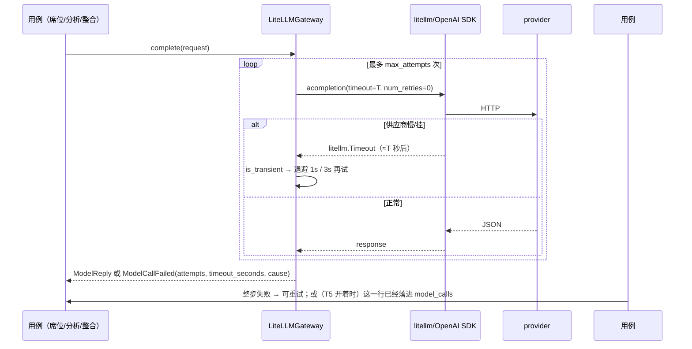
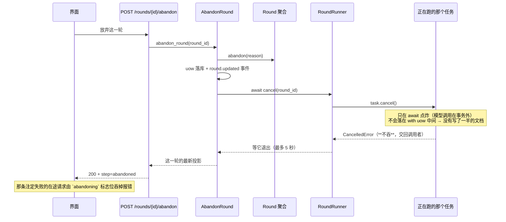
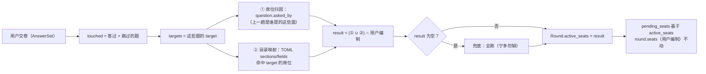

# P5c 执行计划 · 韧性 + 缩编（超时 / 放弃这一轮 / 模型留样 / 最小 eval / C8）

> **给执行的 agent：** 严格按任务顺序做，每个任务先写红测试、再实现、再跑绿、再提交。
> 除非测试本身写错（要说明错在哪），**不许改测试来迁就实现**。
> 上游方案：`docs/plans/2026-09-24-P5-方案-把项目补扎实.md` §5（韧性 + 缩编，已拍板）。
> 上游计划：`docs/plans/2026-09-24-P5a-*.md`、`docs/plans/2026-09-24-P5b-*.md`（都已完成）。

**Goal：** 让这一轮**卡不住**（模型慢/挂有超时、人能中途放弃）、**可复盘**（调用了什么、返回了什么）、
**不退化**（提示词改动有一组结构性断言盯着），并且答完一批问卷之后**不整批重跑席位**（C8 缩编）。

**Architecture：**
- **超时是配置 + 一个参数**：`PMSTUDIO_MODEL_TIMEOUT` 进 `Settings`，网关把它和 `num_retries=0`
  一起传给 LiteLLM。**关掉 SDK 自己的重试**是关键（实测：只传 `timeout=2` 实际跑 7.8 秒；
  加 `num_retries=0` 才是 2.0 秒）——重试只由我们自己那一圈负责，墙钟才算得出来。
- **放弃这一轮**：领域加 `Step.ABANDONED`（终点，不是 `failed` 的变体）；编排层记下"这一轮正在跑的那个
  asyncio 任务"，取消它；**先写状态、再取消**，取消异常**不吞**（交回调用者），前端用一个标志位
  吞掉那条注定会失败的在途请求。取消之所以安全：模型调用一律在事务外（`test_no_await_in_uow.py` 守着的
  那条），所以取消只可能落在 `await` 点，不会落在 `with uow:` 中间。
- **留样**：可开可关的 `model_calls` 表 + `LiteLLMGateway(recorder=…)`，只有 infrastructure 知道这张表。
- **缩编**：席位 TOML 补 `sections` / `fields`（`01` F16 本来就写着"负责章节、能产出什么"），
  答案回来后只请"与这批题有关的席位"，名单落进 `Round.active_seats`。

**Tech Stack：** Python 3.13 + FastAPI + SQLite + LiteLLM + LangGraph；React 18 + Vite + TS strict。

**Spec：** `.codex/docs/设计/01-规格.md` F15/F16、`02-编排与数据.md` §7/§7.1/§11、
`04-未决.md` C8/E3、`06-前端.md` §2.2/§5。

## Global Constraints

- 测试：`cd backend && PYTHONDONTWRITEBYTECODE=1 python3 -m pytest -p no:cacheprovider -o addopts=""`
  （`pyproject.toml` 已有 `addopts = "-q"`，再叠 `-q` 会吞掉统计行）
- Lint：`cd backend && python3 -m ruff check --no-cache .`
- 前端：`cd frontend && npx tsc --noEmit && npx vitest run`
- 结构守卫必须全绿：`tests/architecture/`（分层、写路径白名单只有 `committer.py`、无 fake、
  **UoW 里不许 await**、graph state 三键白名单、所有图节点 async）
- **唯一写路径**：`DocumentWriter` 只许 `domain/services/committer.py` 持有；本计划新增的
  留样表 / 取消 / 缩编都不持有文档写入能力。
- **模型调用一律在事务外**；**真模型相关的命令不进 CI**（`scripts/smoke.py`、`scripts/eval.py`）。
- 端点白名单冻结在 `tests/api/test_openapi_contract.py`（现 18 个，本计划加到 19 个）。
- 老 payload 兼容：新字段读回给默认值，老行不许炸。
- 不留生成物：跑完 `git status --short` 只能剩预期改动；见到 `__pycache__` / `*.db` 就清。
- 中文注释与提交信息，一次提交一个任务。

**基线（2026-09-28 实测）**：后端 `440 passed`、`ruff` All checks passed；前端 `tsc` 干净、
`97 passed`；端点 18 个；工作区干净，HEAD 是 P5b 的收尾提交。

---

## 0. 现状核对（对着代码，不对着印象）

| 设计里写的 | 代码里的事实 | 差在哪 |
|---|---|---|
| `02` §7：网关必须带超时 `PMSTUDIO_MODEL_TIMEOUT`（默认 120 秒） | `Settings` 只有 db/model/key/base 四项；`LiteLLMGateway.complete` 拼的 kwargs 里**没有 timeout**（`litellm_gateway.py:39-63`） | 一轮可以永远停在"正在跑"；P5a 的真模型验证就是被这条挡住的（8 分钟不返回） |
| `04` E3：整步失败仍可重试 | `RetryRound` 只处理 `Step.FAILED`；没有"人不想等了"的出口 | 卡住时用户只有"继续/重试"一条路——而那正是撞墙的那条 |
| `01` F15：失败与重试 | `Step` 六态，没有 `ABANDONED`；`RESUME_ROUTES` 有 `failed` 兜底 | 放弃与失败在界面与语义上是两件事，得分开 |
| `02` §5.3：模型留样（可开关） | 没有 `model_calls` 表、没有 recorder、`schema.sql` 只有四张表 | 出问题只能靠手抄日志，复现不了（P4 的 `O1` 是靠重放才定性的） |
| `02` §5.4：最小 eval | 没有 `backend/evals/`、没有 `scripts/eval.py` | 提示词一改就悄悄退化，只能靠人肉跑 `smoke.py` 看 |
| `01` F16：席位注册表（负责章节 / 能产出什么） | `SeatDefinition` 只有 `seat_id/title/focus/trigger_keywords/always_on`；TOML 里也没有这两项 | C8 缩编没有依据；席位一律读全文 |
| `04` C8 / `02` §7.1：答案轮缩编 | `SubmitAnswers` → `Round.submit_answers` → `_begin_seat_round()`，下一趟 `pending_seats` 仍是**全部编制**（`round.py:361-380`） | 每答一批成本翻一倍 |
| `02` §7.1：缩编名单落 `Round.active_seats` | 没有这个字段；`pending_seats` 直接基于 `seats` | 名单得有个家，且不能动"用户编制"（R7 与复述卡都要它不变） |
| `06` §2.2：`asked_by` 为空的题标"整合者提的" | 前端只显示"谁问的：X"（`QuestionnaireDrawer.tsx:157`），空的时候什么都不显示 | 少一句"这题是整合者自己提出的"，会让人以为是某个席位 |

### 0.1 三条实测（都是我自己跑出来的，不是推测）

**实测 1 · 不传 timeout 就是无限等。** 拿一个不可路由的地址（`http://10.255.255.1:81/v1`）
调 `litellm.acompletion`，不传 timeout：外圈 `asyncio.wait_for(…, 20)` 到点还在等 → 证实
"gateway 不传 timeout"就等于"这一轮永远在跑"，与 P5a 那次 8 分钟不返回是同一个现象。

**实测 2 · 只传 timeout 不够：SDK 会把墙钟放大数倍。**

| 调用 | 实测耗时 | 结论 |
|---|---|---|
| `timeout=2` | **7.8s** | litellm/OpenAI SDK 自己重试，`timeout` 不是墙钟上限 |
| `timeout=2, num_retries=0` | **2.0s** | 关掉内部重试后，`timeout` 才是墙钟上限 |
| `timeout=2, max_retries=0` | **2.0s** | 同上（两个参数在这里等价） |

⇒ **设计改一条**：网关必须同时传 `timeout` 与 `num_retries=0`，重试只由我们自己那一圈负责。
否则"120 秒超时"实际可能是 8 分钟，而我们会以为自己已经保护住了。

**实测 3 · litellm 的超时异常长得像这样。** 类型 `litellm.Timeout`，消息
`APITimeoutError - Request timed out.` → 现成的 `TRANSIENT_HINTS`（含 `timeout` / `timed out`）
已经能识别，**重试策略不用改**。

### 0.2 一次"超时了到底为啥"的排查，是我的活、不是新功能

作者把这件事单独交给我：**每次网关超时，我要自己查清楚为什么超时**（是 provider 慢、
是我们的提示词太大、是重试把时间堆起来了、还是网络根本不通），**不许把它做成项目里的功能**。
我的排查材料（都是既有或本计划要建的东西，不是新功能）：

1. `model_calls` 留样表（T5）：`purpose / round_id / model / prompt_sha / prompt_text / reply_text /
   usage_json / duration_ms / created_at`——能回答"哪一次调用慢、慢在哪一步、返回了什么"；
2. `ModelCallFailed.details`（T1）：`attempts / timeout_seconds / cause`——能回答"重试了几次、
   每次上限多少、供应商原话是什么"；
3. 后端日志（uvicorn）与 `scripts/smoke.py` 的分步输出——能回答"卡在哪一步"。

报告写在我的回复里（以及必要时记进 `.codex/docs/上下文/checkpoint.md` 的"诊断"小节），
**不写进产品代码、不加"超时诊断"功能**。

---

## 1. 执行范围

**做**

1. **网关超时**（T1）：`PMSTUDIO_MODEL_TIMEOUT`（默认 90s/次）+ `num_retries=0` +
   失败细节带 `attempts / timeout_seconds / cause`；本地静默服务端与假服务端两条离线测试钉住行为。
2. **放弃这一轮**（T2 域 / T3 编排 / T4 API+前端）：`Step.ABANDONED`、`Round.abandon(reason)`、
   `RoundCanceller` 端口 + `RoundRunner.cancel()`、`AbandonRound` 用例、`POST /rounds/{id}/abandon`、
   界面上的「放弃这一轮」。
3. **模型留样**（T5）：`model_calls` 表 + `PMSTUDIO_TRACE_MODEL` 开关 + 网关 recorder。
4. **最小 eval**（T6）：`backend/evals/cases/*.json` + `scripts/eval.py`（真模型、不进 CI）
   + 断言实现本身有离线测试。
5. **C8 缩编**（T7 域与目录 / T8 应用与前端）：席位 TOML 补 `sections` / `fields`、
   `Round.active_seats`、`narrow_seats()` 纯函数、界面照实说"这一趟只请了谁"。
6. **回写与统一验证**（T9）：设计真相源、checkpoint、真模型统一跑一遍（P5a+P5b+P5c）。

**不做（列出来，免得变成半成品）**

| 不做 | 理由 |
|---|---|
| `PMSTUDIO_ROUND_BUDGET_CALLS`（每轮调用预算） | **拍板点 1**：三条上限已经在（席位轮 3 次、问卷 2 批、整合重装 2 次），最坏 ≈ 28 次调用；再加一个预算就得回答"谁来记这一轮已经调了几次"（第二份真相源）。真需要时，`model_calls` 表按 `round_id` 数一下就行，不必进产品逻辑 |
| "从失败的那一次模型调用续跑" | `04` E3 已明确留到以后；现在的最小单位是"一个动作 = 一次 `ainvoke`" |
| 自动重试放弃 / 自动降级到别的模型 | 会引入"哪个模型算数"的语义，且与"失败必须是失败"冲突 |
| eval 进 CI | 真模型调用不能进 CI（慢、要 key、会抖） |
| 多项目 / 索引层 / 讨论区 / 工具层 | 仍然不做 |

---

## 2. 契约总表（改哪个文件、长什么样）

### 2.1 域（domain）

| 文件 | 变更 |
|---|---|
| `domain/round/step.py` | `Step.ABANDONED = "abandoned"`；`LEGAL_ADVANCES[ABANDONED] = frozenset()`（终点） |
| `domain/round/round.py` | `Round.abandon(reason)`（幂等、终点、不写 `failure`）；`Round.abandon_reason` 只读属性；`Round.active_seats` + `submit_answers(..., active_seats=...)`；`pending_seats` 改成基于 `active_seats`；`attest()` 校验改成"在 active 名单里" |

### 2.2 应用（application）

| 文件 | 变更 |
|---|---|
| `application/ports.py` | 新端口两个：`RoundCanceller`（`async def cancel(round_id) -> None`，T1 起就位）与 `ModelCallRecorder`（留样的旁路出口，T1 定义、T5 接实现）；`SeatDefinition` 加 `sections` / `fields` |
| `application/use_cases.py` | 新用例 `AbandonRound`；`SubmitAnswers` 调 `narrow_seats()` 后把名单交给 `Round.submit_answers(active_seats=…)`；`StartRound/RunSeatRound/IntegrateRound` 把 `round_id` 传进智能体（留样要用） |
| `application/narrowing.py`（新） | `narrow_seats(...)` 纯函数（规则见 T8） |
| `application/dto.py` | `RoundView.abandon_reason`、`RoundView.active_seats` |
| `application/agents/{analyzer,seat,integrator}.py` | 方法签名加 `round_id: RoundId \| None = None`，写进 `ModelRequest.metadata`（留样要用） |
| `application/errors.py` | 不用改（`ModelCallFailed` 已有 `details`） |

### 2.3 基础设施 / API

| 位置 | 变更 |
|---|---|
| `bootstrap/settings.py` | `PMSTUDIO_MODEL_TIMEOUT`（默认 90，秒，按次算）+ `PMSTUDIO_TRACE_MODEL`（默认关） |
| `infrastructure/llm/litellm_gateway.py` | 传 `timeout` + `num_retries=0`；`max_attempts` / `backoff` 进构造函数；失败细节带 `timeout_seconds`；可选 `recorder` |
| `infrastructure/sqlite/schema.sql` | `model_calls` 表（`CREATE TABLE IF NOT EXISTS`，零迁移） |
| `infrastructure/sqlite/model_calls.py`（新） | `SqliteModelCallRecorder`（只增，不参与业务） |
| `infrastructure/graph/graph.py` | `RoundRunner` 记当前任务：`_tasks[round_id] = asyncio.current_task()`；实现 `cancel()`；`RESUME_ROUTES` 加 `abandoned → END` |
| `api/routes.py` | 新增 `POST /rounds/{round_id}/abandon`（18 → 19） |
| `api/app.py` + `bootstrap/container.py` + `tests/support/harness.py` | 组装 `abandon_round` |
| `infrastructure/seats/definitions/*.toml`（10 个） | 每个席位补 `sections` / `fields` |
| `.env.example` + `scripts/dev.py` | 打印超时配置（不打印 key） |

### 2.4 前端（frontend）

| 文件 | 变更 |
|---|---|
| `api/types.ts` | `Step` 加 `"abandoned"`；`RoundView.abandon_reason` / `active_seats` |
| `api/client.ts` | `abandonRound(roundId)` |
| `api/payload.ts` | `AwaitingMode` 加 `"abandoned"`；`awaitingMode` 认 `abandoned` |
| `labels.ts` | `STEP_TEXT.abandoned`；`WAITING_TEXT` 不变 |
| `components/BottomStrip.tsx` | `accepting` 含 `abandoned`；`RightActions` 加一支"已放弃，可以开下一轮" |
| `components/RoundStatus.tsx` | 跑着的时候给「放弃这一轮」按钮；已放弃时显示原因 |
| `components/LoopPane.tsx` | 席位节点标题旁边一行"这一趟只请了 N 个席位（缩编）" |
| `components/QuestionnaireDrawer.tsx` | `asked_by` 为空 → "整合者提的" |
| `state/useWorkspaceData.ts` | `abandon(roundId)`；`abandoning` 标志位（吞掉被我们取消掉的那条在途请求的报错） |

---

## 3. 数据流与架构（动手前先看懂这三张图）

### 3.1 超时：一次调用的墙钟由谁决定



墙钟上界（写进 settings 注释，也是拍板点 1 的依据）：`max_attempts × timeout + 退避(1s+3s)`。

### 3.2 放弃这一轮：写状态在前，取消在后



### 3.3 缩编：答案回来之后请谁



---

## 4. 要你拍板的五件事

| # | 问题 | 我的建议 | 代价 / 反面 |
|---|---|---|---|
| 1 | 超时默认值 + 要不要"每轮调用预算"？ | **90 秒/次**（`PMSTUDIO_MODEL_TIMEOUT`），**不做**每轮调用预算 | 90s/次、最多 3 次 ⇒ 单次业务调用最坏 ≈ 4.6 分钟。预算会让"这一轮调了几次"变成第二份真相源；真要数，留样表按 `round_id` 数就行。若你觉得 90 秒偏长/偏短，就改这一个数 |
| 2 | 放弃的取消语义 | **先写 `abandoned` 再取消**；取消异常**不吞**（交回调用者），前端用 `abandoning` 标志位吞掉那条在途请求的报错 | 那条在途请求在浏览器里表现为一次网络错误（用户看不到，因为被标志位吞了）；换来的是后端不出现"自己取消自己还装作正常返回"的怪语义 |
| 3 | 留样存什么？ | **存提示词原文**（截断 20 000 字符）+ 回复原文 + `prompt_sha` + `duration_ms` + `usage`；默认**关**（`PMSTUDIO_TRACE_MODEL=0`） | 只存 sha 的话**复现不了**——复现要的是提示词原文；代价是库会长（每次调用几 KB～几十 KB，本地单用户可接受）。若你更在意库体积，就只存 sha（那时"复现"降级成"对比哈希"） |
| 4 | 席位 TOML 的 `sections` / `fields` 初稿 | 按 T7 表里的初稿（10 个席位逐个给），真跑之后再调 | 初稿一定有偏差；缩编兜底是"命中为空就全跑"，偏差只会让缩编更保守，不会漏面 |
| 5 | 缩编兜底 | **命中为空 → 全跑**（宁多勿缺）；常驻席位不再强制入选 | 偶尔会多请几个席位（多花一次并行调用），换"不许漏面" |

---

## 5. 任务分解（T1–T9，一步一提交）

依赖顺序：T1（超时，**先做**——它同时铺下 `ModelCallRecorder` 协议与 `_record()`）→ T2 → T3 → T4（放弃这条线）；
T5（留样）排在 T1 之后（实现 + 接线）；T6（eval）依赖 T1；T7 → T8（缩编）；T9 收尾。

### Task 1：网关超时（配置 + 传参 + 两条离线测试）

**Files:**
- Modify: `backend/src/pmstudio/bootstrap/settings.py`
- Modify: `backend/src/pmstudio/infrastructure/llm/litellm_gateway.py`
- Modify: `backend/.env.example`、`backend/scripts/dev.py`（打印超时，不打印 key）
- Test: `backend/tests/bootstrap/test_settings.py`
- Test: `backend/tests/infrastructure/test_llm.py`

**Interfaces:**
- Produces：`Settings.model_timeout: float`（默认 `90.0`，**按次**算）
- Produces：`LiteLLMGateway(model=, api_key=, api_base=, timeout=90.0, max_attempts=3, backoff=(1.0, 3.0))`
- Produces：`ModelCallFailed.details["timeout_seconds"]`

- [x] **Step 1：写红测试（配置）**

```python
# tests/bootstrap/test_settings.py（追加）
from pmstudio.bootstrap.settings import DEFAULT_MODEL_TIMEOUT


def test_settings_model_timeout_defaults_and_reads_env(tmp_path):
    """超时是配置项：不填有默认值，填了要生效，填错要当场报错（不做静默兜底）。"""

    base = {"PMSTUDIO_MODEL": "m", "PMSTUDIO_API_KEY": "k"}
    assert Settings.from_env(base, default_db=tmp_path / "d.db").model_timeout == (
        DEFAULT_MODEL_TIMEOUT
    )
    assert Settings.from_env(
        {**base, "PMSTUDIO_MODEL_TIMEOUT": "12.5"}, default_db=tmp_path / "d.db"
    ).model_timeout == 12.5
    with pytest.raises(ConfigError, match="PMSTUDIO_MODEL_TIMEOUT"):
        Settings.from_env(
            {**base, "PMSTUDIO_MODEL_TIMEOUT": "abc"}, default_db=tmp_path / "d.db"
        )
    with pytest.raises(ConfigError, match="PMSTUDIO_MODEL_TIMEOUT"):
        Settings.from_env(
            {**base, "PMSTUDIO_MODEL_TIMEOUT": "0"}, default_db=tmp_path / "d.db"
        )
```

- [x] **Step 2：跑测试确认红**

Run: `cd backend && PYTHONDONTWRITEBYTECODE=1 python3 -m pytest tests/bootstrap/test_settings.py -q -p no:cacheprovider`
Expected: FAIL —— `ImportError: cannot import name 'DEFAULT_MODEL_TIMEOUT'`

- [x] **Step 3：实现（配置）**

```python
# bootstrap/settings.py
TIMEOUT_ENV = "PMSTUDIO_MODEL_TIMEOUT"

#: 每次模型调用的墙钟上限（秒）。**按次算**，不是按一次业务动作算：
#: 一次业务调用最多 `MAX_ATTEMPTS` 次 ⇒ 最坏 3 × 90 + 退避(1+3) ≈ 4.6 分钟。
#: 为什么不是 120：P5c 实测（见计划 §0.1）只传 `timeout` 会被 SDK 的内部重试放大到约 4 倍；
#: 关掉内部重试（网关传 `num_retries=0`）之后墙钟才等于这个数，不必再留大余量。
DEFAULT_MODEL_TIMEOUT = 90.0


@dataclass(frozen=True, slots=True)
class Settings:
    db_path: Path
    model: str
    api_key: str | None
    api_base: str | None
    model_timeout: float = DEFAULT_MODEL_TIMEOUT

    # from_env 里加：
        raw_timeout = source.get(TIMEOUT_ENV, "").strip()
        try:
            model_timeout = float(raw_timeout) if raw_timeout else DEFAULT_MODEL_TIMEOUT
        except ValueError as error:
            raise ConfigError(f"{TIMEOUT_ENV} 要是秒数，现在是 {raw_timeout!r}") from error
        if model_timeout <= 0:
            raise ConfigError(f"{TIMEOUT_ENV} 必须大于 0，现在是 {model_timeout}")
    # return cls(..., model_timeout=model_timeout)
```

```dotenv
# .env.example（追加）
# 选填：每次模型调用的超时（秒）。按次算：一次业务动作最多重试 3 次。
# 90 秒是默认值；供应商慢就调大，调试期可以调小（如 10）。
PMSTUDIO_MODEL_TIMEOUT=90
```

（`scripts/dev.py` 的配置打印里加一行 `超时：{...} 秒/次`——不打印 key，这一条本来就守着的。）

- [x] **Step 4：写红测试（网关传参 + 墙钟）**

```python
# tests/infrastructure/test_llm.py（追加）
import asyncio
import time


async def test_gateway_passes_timeout_and_disables_sdk_retries(monkeypatch):
    """两条都必须传：只传 timeout 会被 SDK 的内部重试放大墙钟（P5c §0.1 实测 4 倍）。"""

    captured: dict = {}

    async def scripted(**kwargs):
        captured.update(kwargs)

        class _Message:
            content = "{}"

        class _Choice:
            message = _Message()

        class _Response:
            choices = [_Choice()]
            model = "m"
            usage = {}

        return _Response()

    monkeypatch.setattr("pmstudio.infrastructure.llm.litellm_gateway.acompletion", scripted)
    gateway = LiteLLMGateway(model="m", api_key="k", api_base=None, timeout=7.5)

    await gateway.complete(
        ModelRequest(
            purpose="claims",
            messages=(ModelMessage(role="user", content="x"),),
            schema_name="ClaimsPacket",
            response_schema={"type": "object"},
        )
    )

    assert captured["timeout"] == 7.5
    assert captured["num_retries"] == 0


async def _accept_and_hang(reader, writer):  # type: ignore[no-untyped-def]
    """静默服务端：接上就不说话，等客户端自己断开（超时后 httpx 会断）。"""

    try:
        await reader.read()
    finally:
        writer.close()


async def test_gateway_honours_the_timeout_against_a_silent_provider():
    """真 HTTP、真 litellm：0.5 秒的超时必须在 1.5 秒内抛出来，不许被放大。"""

    server = await asyncio.start_server(_accept_and_hang, "127.0.0.1", 0)
    port = server.sockets[0].getsockname()[1]
    gateway = LiteLLMGateway(
        model="openai/x",
        api_key="k",
        api_base=f"http://127.0.0.1:{port}/v1",
        timeout=0.5,
        max_attempts=1,
        backoff=(0.0,),
    )
    start = time.monotonic()
    try:
        with pytest.raises(ModelCallFailed) as exc:
            await gateway.complete(
                ModelRequest(
                    purpose="claims",
                    messages=(ModelMessage(role="user", content="x"),),
                    schema_name="ClaimsPacket",
                    response_schema={"type": "object"},
                )
            )
    finally:
        server.close()
        await server.wait_closed()

    assert time.monotonic() - start < 1.5
    assert exc.value.details["timeout_seconds"] == 0.5
    assert exc.value.details["purpose"] == "claims"
```

- [x] **Step 5：跑测试确认红**

Run: `cd backend && PYTHONDONTWRITEBYTECODE=1 python3 -m pytest tests/infrastructure/test_llm.py -q -p no:cacheprovider`
Expected: FAIL —— `captured` 里没有 `timeout` / `num_retries`；静默服务端那条会挂到 pytest 超时（没有超时保护）

- [x] **Step 6：实现（网关）**

```python
# infrastructure/llm/litellm_gateway.py
MAX_ATTEMPTS = 3
BACKOFF_SECONDS = (1.0, 3.0)
#: 默认每次调用的墙钟上限（秒）。真值由 `Settings.model_timeout` 传进来。
DEFAULT_TIMEOUT = 90.0


class LiteLLMGateway:
    def __init__(
        self,
        *,
        model: str,
        api_key: str | None = None,
        api_base: str | None = None,
        timeout: float = DEFAULT_TIMEOUT,
        max_attempts: int = MAX_ATTEMPTS,
        backoff: tuple[float, ...] = BACKOFF_SECONDS,
        recorder: "ModelCallRecorder | None" = None,
    ) -> None:
        self._model = model
        self._api_key = api_key
        self._api_base = api_base
        self._timeout = timeout
        self._max_attempts = max_attempts
        self._backoff = backoff
        self._recorder = recorder  # 留样（Task 5 才在容器里接上；没给就是 None，什么都不记）

    async def complete(self, request: ModelRequest) -> ModelReply:
        started = time.monotonic()
        kwargs: dict[str, object] = {
            "model": self._model,
            "messages": [...原样...],
            "response_format": {...原样...},
            # 包一层墙钟：**必须同时**关掉 SDK 自己的重试，否则 timeout 会被放大数倍
            # （P5c §0.1 实测：只传 timeout=2 实际 7.8 秒；加 num_retries=0 才是 2.0 秒）。
            "timeout": self._timeout,
            "num_retries": 0,
        }
        # （其余 kwargs 原样不动：api_key / api_base 那两段）
        for attempt in range(1, self._max_attempts + 1):
            try:
                response = await acompletion(**kwargs)
                break
            except Exception as error:  # noqa: BLE001
                if is_transient(error) and attempt < self._max_attempts:
                    await asyncio.sleep(self._backoff[attempt - 1])
                    continue
                # 失败的这一次也留样（reply_text 空串 + cause 里能看到供应商原话）：
                # 「为什么超时」要查的是**每一次**尝试，不只是最后成功的那次。
                self._record(
                    request,
                    reply_text="",
                    usage={},
                    duration_ms=int((time.monotonic() - started) * 1000),
                )
                raise ModelCallFailed(
                    f"模型调用失败：{type(error).__name__}"
                    + (f"（重试 {attempt - 1} 次后仍失败）" if attempt > 1 else ""),
                    purpose=request.purpose,
                    cause=str(error),
                    model=self._model,
                    attempts=attempt,
                    timeout_seconds=self._timeout,
                ) from error
        # （中间原样不动：取 content → 空内容报错 → strip_fence → 不是 JSON 报错）
        reply = ModelReply(
            text=text,
            model=getattr(response, "model", self._model),
            usage=dict(getattr(response, "usage", {}) or {}),
        )
        self._record(
            request,
            reply_text=reply.text,
            usage=reply.usage,
            duration_ms=int((time.monotonic() - started) * 1000),
        )
        return reply

    def _record(
        self,
        request: ModelRequest,
        *,
        reply_text: str,
        usage: Mapping[str, object],
        duration_ms: int,
    ) -> None:
        """旁路留样：没接 recorder 就什么都不做。

        提示词存**原文**（截断交给实现）而不是只存 sha——只存哈希复现不了，
        而复现是这张表唯一的目的（P4 的 `O1` 就是靠重放定性的）。
        """

        if self._recorder is None:
            return
        prompt = "\n".join(message.content for message in request.messages)
        self._recorder.record(
            round_id=request.metadata.get("round_id"),
            purpose=request.purpose,
            model=self._model,
            prompt_sha=hashlib.sha256(prompt.encode("utf-8")).hexdigest()[:16],
            prompt_text=prompt,
            reply_text=reply_text,
            usage=usage,
            duration_ms=duration_ms,
            created_at=datetime.now(UTC),
        )
```

（`ModelCallRecorder` 协议也在这个任务里写进 `application/ports.py`——它是应用层端口，
SQLite 实现留给 Task 5。要用的 import：`hashlib`、`time`、`datetime/UTC`、`Mapping`。）

- [x] **Step 7：跑测试确认绿 + 全量**

Run: `cd backend && PYTHONDONTWRITEBYTECODE=1 python3 -m pytest -q -p no:cacheprovider -o addopts="" && python3 -m ruff check --no-cache .`
Expected: PASS（440 + 新增），ruff 全绿

- [x] **Step 8：提交**

```bash
cd /home/linsir365/projects/ai-pm
git add backend/src/pmstudio/bootstrap/settings.py \
        backend/src/pmstudio/infrastructure/llm/litellm_gateway.py \
        backend/.env.example backend/scripts/dev.py \
        backend/tests/bootstrap/test_settings.py backend/tests/infrastructure/test_llm.py
git commit -m "feat(llm): 网关超时（timeout + num_retries=0）与可配上限（P5c Task 1）"
```

---

### Task 2：域 · 放弃这一轮（新步骤，不是失败的变体）

**Files:**
- Modify: `backend/src/pmstudio/domain/round/step.py`
- Modify: `backend/src/pmstudio/domain/round/round.py`
- Modify: `backend/src/pmstudio/infrastructure/sqlite/serialization.py`（`abandon_reason` 往返）
- Test: `backend/tests/domain/round/test_round.py`
- Test: `backend/tests/infrastructure/test_sqlite_repositories.py`

**Interfaces:**
- Produces：`Step.ABANDONED`
- Produces：`Round.abandon(reason: str) -> None`（幂等、终点）
- Produces：`Round.abandon_reason -> str | None`

- [x] **Step 1：写红测试**

```python
# tests/domain/round/test_round.py（追加）
def test_abandon_is_a_terminal_state_with_a_reason():
    """放弃是人主动不要了：终点、带原因、不进 failure（那会让人以为可以重试）。"""

    round_ = round_with_seats()
    round_.abandon("用户不想等了")

    assert round_.step is Step.ABANDONED
    assert round_.abandon_reason == "用户不想等了"
    assert round_.failure is None
    assert round_.waiting_on is WaitingOn.NONE


def test_abandon_is_idempotent():
    round_ = round_with_seats()
    round_.abandon("第一次")
    round_.abandon("第二次")

    assert round_.abandon_reason == "第一次"  # 第一次说的算


def test_abandon_rejects_after_done_or_failed():
    round_ = round_with_seats()
    round_.fail("系统炸了")
    round_.abandon("放弃")

    assert round_.step is Step.FAILED  # 已经失败就不改了：失败点只有一个
    assert round_.abandon_reason is None


def test_abandoned_round_refuses_every_other_action():
    round_ = round_with_seats()
    round_.abandon("不做了")

    with pytest.raises(IllegalStepTransition):
        round_.integrate(draft=make_draft())
    with pytest.raises(IllegalStepTransition):
        round_.submit_answers(AnswerSet(form_id=FormId("f1"), answers=(), answered_at=NOW, skipped=(QuestionId("q1"),)))


def test_abandon_requires_a_reason():
    with pytest.raises(ShapeError):
        round_with_seats().abandon("   ")
```

```python
# tests/infrastructure/test_sqlite_repositories.py（追加）
def test_abandon_reason_round_trips(repos):
    _, rounds, _, _, uow = repos
    round_ = make_round()
    round_.abandon("用户不想等了")
    with uow:
        rounds.save(round_)

    loaded = rounds.get(round_.round_id)
    assert loaded.step is Step.ABANDONED
    assert loaded.abandon_reason == "用户不想等了"


def test_round_payload_without_abandon_key_still_loads():
    payload = serialization.round_to_payload(make_round())
    payload.pop("abandon_reason")
    loaded = serialization.round_from_payload(
        payload, round_id=RoundId("r1"), project_id=ProjectId("p1"),
        created_at=NOW, step=Step.STARTED, waiting_on=WaitingOn.NONE,
    )
    assert loaded.abandon_reason is None
```

- [x] **Step 2：跑测试确认红**

Run: `cd backend && PYTHONDONTWRITEBYTECODE=1 python3 -m pytest tests/domain/round/test_round.py -q -p no:cacheprovider`
Expected: FAIL —— `AttributeError: 'Round' object has no attribute 'abandon'`

- [x] **Step 3：实现**

```python
# domain/round/step.py
class Step(StrEnum):
    STARTED = "started"
    CLAIMS_READY = "claims_ready"
    SEATS_RUNNING = "seats_running"
    AWAITING_ANSWERS = "awaiting_answers"
    AWAITING_CONFIRM = "awaiting_confirm"
    DONE = "done"
    FAILED = "failed"
    #: 人主动不要这一轮了（`02` §7）。与 FAILED 的区别：失败是"系统出问题、可重试"，
    #: 放弃是"人不想要了、别再跑"——所以它是终点，没有出口，也不写 failure。
    ABANDONED = "abandoned"


LEGAL_ADVANCES = {
    ...,  # 原有不变
    Step.ABANDONED: frozenset(),
}
```

```python
# domain/round/round.py
    def abandon(self, reason: str) -> None:
        """放弃这一轮：幂等、终点。**只记第一次**的原因。

        已经 done / failed / abandoned 的一轮：什么都不做（终态不可改）。
        空原因要报错——"为什么放弃"是这条记录唯一的用处。
        """

        if self._step in (Step.DONE, Step.FAILED, Step.ABANDONED):
            return
        if not reason.strip():
            raise ShapeError("放弃要写清原因")
        self._abandon_reason = reason.strip()
        self._waiting_on = WaitingOn.NONE
        self._step = Step.ABANDONED

    @property
    def abandon_reason(self) -> str | None:
        return self._abandon_reason
```

（`__init__` 加 `abandon_reason: str | None = None` 入参与 `self._abandon_reason`；
`serialization.round_to_payload` / `round_from_payload` 各加一行，读侧 `.get("abandon_reason")` 给默认 `None`。）

- [x] **Step 4：跑测试确认绿**

Run: `cd backend && PYTHONDONTWRITEBYTECODE=1 python3 -m pytest tests/domain tests/infrastructure -q -p no:cacheprovider`
Expected: PASS

- [x] **Step 5：提交**

```bash
cd /home/linsir365/projects/ai-pm
git add backend/src/pmstudio/domain/round/step.py \
        backend/src/pmstudio/domain/round/round.py \
        backend/src/pmstudio/infrastructure/sqlite/serialization.py \
        backend/tests/domain/round/test_round.py \
        backend/tests/infrastructure/test_sqlite_repositories.py
git commit -m "feat(round): Step.ABANDONED 与 Round.abandon（终点、带原因，P5c Task 2）"
```

---

### Task 3：编排 · 取消正在跑的那一轮 + `AbandonRound` 用例

**Files:**
- Modify: `backend/src/pmstudio/application/ports.py`（`RoundCanceller`）
- Modify: `backend/src/pmstudio/infrastructure/graph/graph.py`（记任务 + `cancel()` + `RESUME_ROUTES`）
- Modify: `backend/src/pmstudio/application/use_cases.py`（`AbandonRound`）
- Modify: `backend/tests/support/{doubles,harness}.py`
- Test: `backend/tests/application/test_abandon_round.py`（新建）
- Test: `backend/tests/infrastructure/test_graph.py`（路由表一行）

**Interfaces:**
- Produces：`RoundCanceller`（`async def cancel(round_id: RoundId) -> None`）
- Produces：`RoundRunner.cancel(round_id)`
- Produces：`AbandonRound.__call__(round_id=RoundId, reason: str = "用户放弃了这一轮") -> RoundView`

- [x] **Step 1：写红测试**

```python
# tests/support/doubles.py（追加；只活在测试里）
class HangingSeatGateway(ScriptedModelGateway):
    """claims 照常返回，席位调用**挂住**（测取消与超时用）。"""

    def __init__(self, *, replies, seat_replies) -> None:
        super().__init__(replies=replies, seat_replies=seat_replies)
        self.seat_calls = 0

    async def complete(self, request):  # type: ignore[no-untyped-def]
        if request.purpose == "seat_review":
            self.seat_calls += 1
            await asyncio.sleep(30)
        return await super().complete(request)
```

```python
# tests/application/test_abandon_round.py（新建")
"""放弃这一轮（`01` F15 / `02` §7）：先把状态写下来，再把正在跑的那个任务取消掉。

取消之所以安全：模型调用一律在事务外（`test_no_await_in_uow.py` 守着的那条），
所以 CancelledError 只可能落在 `await` 点，不会落在 `with uow:` 中间。
"""

import asyncio

from pmstudio.application.commands import RoundCommand
from pmstudio.domain.round.step import Step
from tests.support.builders import PROJECT, SEAT
from tests.support.doubles import HangingSeatGateway
from tests.support.harness import Harness

CLAIMS_REPLY = json.dumps(
    {
        "basis": "读了空文档",
        "claims": [
            {
                "text": "导出要快",
                "raw_span": "导出要快一点",
                "label": "constraint",
                "zone": "body",
                "section_id": "s8",
            }
        ],
        "seats": [{"seat_id": SEAT, "why": "导出要评估数据量与耗时"}],
    },
    ensure_ascii=False,
)


def hanging_harness() -> Harness:
    return Harness(
        replies={},
        seat_replies={},
        gateway=HangingSeatGateway(replies={"claims": CLAIMS_REPLY}, seat_replies={}),
    )


async def test_abandon_cancels_the_running_action_and_marks_the_round():
    harness = hanging_harness()
    harness.seed_project()
    start = harness.start_round()
    round_id = await start.create(project_id=PROJECT, user_input="导出要快一点")
    await start.analyze(round_id=round_id)

    runner = harness.runner()
    running = asyncio.create_task(
        runner.run(
            RoundCommand(kind="submit_opening", round_id=str(round_id), seats=(SEAT,))
        )
    )
    await asyncio.sleep(0.05)  # 让它跑到席位那次 await（挂住）

    view = await harness.abandon_round()(round_id=round_id)
    outcome = (await asyncio.gather(running, return_exceptions=True))[0]

    assert view.step == "abandoned"
    assert harness.rounds.get(round_id).step is Step.ABANDONED
    assert isinstance(outcome, asyncio.CancelledError)  # 取消**不吞**：交回调用者
    assert harness.uow.rollbacks == 0  # 没有写了一半的事务


async def test_abandon_works_when_nothing_is_running():
    """进程崩过、或停在等人：没有在跑的任务也要能放弃（不然那一轮永远占着）。"""

    harness = Harness(replies={}, seat_replies={})
    harness.seed_project()
    start = harness.start_round()
    round_id = await start.create(project_id=PROJECT, user_input="导出要快一点")

    view = await harness.abandon_round()(round_id=round_id)

    assert view.step == "abandoned"
    assert view.abandon_reason == "用户放弃了这一轮"


async def test_abandon_is_idempotent_and_blocks_further_actions():
    harness = Harness(replies={}, seat_replies={})
    harness.seed_project()
    start = harness.start_round()
    round_id = await start.create(project_id=PROJECT, user_input="导出要快一点")
    use_case = harness.abandon_round()

    first = await use_case(round_id=round_id, reason="不想等了")
    second = await use_case(round_id=round_id, reason="又说了一次")

    assert first.abandon_reason == "不想等了"
    assert second.abandon_reason == "不想等了"
    with pytest.raises(IllegalStepTransition):
        await start.analyze(round_id=round_id)
```

```python
# tests/infrastructure/test_graph.py（追加一行断言）
def test_resume_routes_cover_abandoned():
    """放弃是终点：路由表里要有它的出口，否则 retry 一个放弃的轮会 KeyError → 500。"""

    from pmstudio.infrastructure.graph.graph import RESUME_ROUTES

    assert RESUME_ROUTES[Step.ABANDONED.value] is END
```

- [x] **Step 2：跑测试确认红**

Run: `cd backend && PYTHONDONTWRITEBYTECODE=1 python3 -m pytest tests/application/test_abandon_round.py -q -p no:cacheprovider`
Expected: FAIL —— `'Harness' object has no attribute 'abandon_round'`

- [x] **Step 3：实现（端口 + 取消 + 用例）**

```python
# application/ports.py
@runtime_checkable
class RoundCanceller(Protocol):
    """把正在跑的那一轮停下来（实现是 infrastructure 里的 `RoundRunner`）。

    只有"放弃这一轮"用它。它不是写能力——取消只负责让正在等模型的那次调用停下来，
    磁盘上的状态由 `AbandonRound` 写（写法只有一处）。
    """

    async def cancel(self, round_id: RoundId) -> None: ...
```

```python
# infrastructure/graph/graph.py
CANCEL_WAIT_SECONDS = 5.0


class RoundRunner:
    def __init__(self, *, start_round, submit_opening, run_seat_round, integrate_round,
                 submit_answers, confirm_draft, retry_round, get_round) -> None:  # 与现状一致
        self._running_rounds: set[str] = set()
        self._tasks: dict[str, asyncio.Task[Any]] = {}

    async def run(self, command: RoundCommand) -> RoundView:
        key = command.round_id or ""
        if key and key in self._running_rounds:
            raise RoundBusy(round_id=key)
        if key:
            self._running_rounds.add(key)
            current = asyncio.current_task()
            if current is not None:
                self._tasks[key] = current  # 放弃这一轮要按 round_id 找到它
        try:
            final = await self._graph.ainvoke(...)
        except asyncio.CancelledError:
            # 取消**不吞**：谁取消的谁负责收尾（用例先写 abandoned 再调 cancel），
            # 吞掉会掩盖"进程正在关"这类外部取消。
            raise
        finally:
            if key:
                self._running_rounds.discard(key)
                self._tasks.pop(key, None)
        # （其余收尾原样不动：final.get("view") 与 get_round 兜底）

    async def cancel(self, round_id: RoundId) -> None:
        """取消这一轮正在跑的任务。没有在跑的就直接返回（它可能停在等人，或进程崩过）。"""

        task = self._tasks.get(str(round_id))
        if task is None or task.done():
            return
        task.cancel()
        # 等它退出（拿到 CancelledError 的收尾时间）。用 wait 不用 wait_for：
        # wait_for 超时会**再取消一次**，那不是在帮忙，是在添乱。
        await asyncio.wait({task}, timeout=CANCEL_WAIT_SECONDS)
```

```python
# RESUME_ROUTES 加一行
    Step.ABANDONED.value: END,
```

```python
# application/use_cases.py
class AbandonRound:
    """放弃这一轮（`01` F15）：先写状态，再取消正在跑的任务。

    顺序不能反：先取消的话，取消回来的那一刻状态还是"在跑"，界面会闪一下旧状态；
    而且**写法只有这一处**——取消本身不写任何业务状态，它只让模型调用停下来。
    """

    def __init__(
        self,
        *,
        rounds: RoundReader,
        round_writer: RoundWriter,
        uow: UnitOfWork,
        clock: Clock,
        events: EventPublisher,
        canceller: RoundCanceller,
    ) -> None:
        self._rounds = rounds
        self._round_writer = round_writer
        self._uow = uow
        self._clock = clock
        self._events = events
        self._canceller = canceller

    async def __call__(
        self, *, round_id: RoundId, reason: str = "用户放弃了这一轮"
    ) -> RoundView:
        with self._uow:
            round_ = self._rounds.get(round_id)
            round_.abandon(reason)
            self._round_writer.save(round_)
        _publish(self._events, self._clock, round_)

        # 写完了再取消：取消会把那个任务炸在 await 点，而它不会碰业务状态。
        await self._canceller.cancel(round_id)
        return round_view(self._rounds.get(round_id))
```

```python
# tests/support/harness.py
    def abandon_round(self):  # type: ignore[no-untyped-def]
        from pmstudio.application.use_cases import AbandonRound

        return AbandonRound(
            rounds=self.rounds,
            round_writer=self.rounds,
            uow=self.uow,
            clock=self.clock,
            events=self.events,
            canceller=self.runner(),
        )
```

⚠️ `harness.abandon_round()` 里 `self.runner()` 每次都是新实例——**测试里必须复用同一个 runner**
（`running = asyncio.create_task(runner.run(...))` 用的那个），否则取消找不到任务。
做法：`Harness` 加一个属性缓存 `self._runner`，`runner()` 与 `abandon_round()` 都用它。

- [x] **Step 4：跑测试确认绿**

Run: `cd backend && PYTHONDONTWRITEBYTECODE=1 python3 -m pytest tests/application/test_abandon_round.py tests/infrastructure/test_graph.py -q -p no:cacheprovider`
Expected: PASS

- [x] **Step 5：提交**

```bash
cd /home/linsir365/projects/ai-pm
git add backend/src/pmstudio/application/ports.py \
        backend/src/pmstudio/infrastructure/graph/graph.py \
        backend/src/pmstudio/application/use_cases.py \
        backend/tests/support/doubles.py backend/tests/support/harness.py \
        backend/tests/application/test_abandon_round.py backend/tests/infrastructure/test_graph.py
git commit -m "feat(round): 取消正在跑的任务 + AbandonRound 用例（P5c Task 3）"
```

---

### Task 4：API + 前端 · 「放弃这一轮」

**Files:**
- Modify: `backend/src/pmstudio/api/routes.py`、`api/app.py`、`bootstrap/container.py`、
  `tests/support/harness.py`、`tests/api/test_openapi_contract.py`
- Modify: `frontend/src/api/types.ts`、`api/client.ts`、`api/payload.ts`、`labels.ts`、
  `components/RoundStatus.tsx`、`components/BottomStrip.tsx`、`state/useWorkspaceData.ts`、`App.tsx`
- Test: `backend/tests/api/test_routes.py`（或新建 `test_abandon_api.py`）

**Interfaces:**
- Produces：`POST /api/rounds/{round_id}/abandon` → `RoundView`（18 → 19 个端点）
- Produces：`api.abandonRound(roundId)`、`data.abandon(roundId)`
- Produces：`AwaitingMode` 加 `"abandoned"`

- [x] **Step 1：写红测试（后端）**

```python
# tests/api/test_abandon_api.py（新建）
async def test_abandon_endpoint_marks_the_round(app):
    async with async_client(app) as client:
        created = await client.post("/api/projects", json={"title": "订单中台"})
        project_id = created.json()["project_id"]
        round_id = (
            await client.post(
                f"/api/projects/{project_id}/rounds", json={"input": "导出要快一点"}
            )
        ).json()["round_id"]   # 注意：真的 start 会调模型；这里用 Harness 的脚本化网关
        response = await client.post(f"/api/rounds/{round_id}/abandon")

    assert response.status_code == 200
    body = response.json()
    assert (body["step"], body["waiting_on"]) == ("abandoned", "none")
    assert body["abandon_reason"] == "用户放弃了这一轮"


async def test_abandon_unknown_round_is_404(app):
    async with async_client(app) as client:
        response = await client.post("/api/rounds/r-nope/abandon")
    assert response.status_code == 404
    assert response.json()["code"] == "unknown_round"
```

（夹具沿用 `tests/api/test_routes.py` 的写法：`Harness(replies={"claims": CLAIMS_REPLY}, ...)`
+ `create_app(harness.api_services(model_name="m"))`。）

```python
# tests/api/test_openapi_contract.py：白名单加一条
    "/api/rounds/{round_id}/abandon",
```

- [x] **Step 2：跑测试确认红**

Run: `cd backend && PYTHONDONTWRITEBYTECODE=1 python3 -m pytest tests/api -q -p no:cacheprovider`
Expected: FAIL —— 404（路由不存在）+ 契约测试报"路径集合对不上"

- [x] **Step 3：实现（后端）**

```python
# api/routes.py
@router.post("/rounds/{round_id}/abandon")
async def abandon_round(request: Request, round_id: str):  # type: ignore[no-untyped-def]
    """放弃这一轮：先记状态、再取消正在跑的模型调用（`02` §7）。"""

    view = await services_of(request).abandon_round(round_id=RoundId(round_id))
    return as_json(view)
```

```python
# api/app.py::ApiServices 加字段
    abandon_round: AbandonRound
# bootstrap/container.py：AbandonRound(rounds=..., round_writer=..., uow=..., clock=...,
#   events=bus, canceller=runner)  —— runner 变量本来就是同一个实例
# tests/support/harness.py::api_services 加 abandon_round=self.abandon_round()
```

- [x] **Step 4：跑测试确认绿（后端）**

Run: `cd backend && PYTHONDONTWRITEBYTECODE=1 python3 -m pytest -q -p no:cacheprovider -o addopts=""`
Expected: PASS（端点 19 个）

- [x] **Step 5：实现（前端）**

```ts
// api/types.ts
export type Step =
  | "started" | "claims_ready" | "seats_running" | "awaiting_answers"
  | "awaiting_confirm" | "done" | "failed" | "abandoned";
export interface RoundView {
  ...;
  abandon_reason: string | null;
  active_seats: string[];   // Task 8 用；这一趟实际要跑的名单
}

// api/client.ts
  abandonRound: (roundId: string) =>
    request<RoundView>(`/rounds/${roundId}/abandon`, { method: "POST", body: "{}" }),

// api/payload.ts
export type AwaitingMode = ... | "abandoned";
export function awaitingMode(round: RoundView | null): AwaitingMode {
  // （前面的分支原样不动）
  if (round.step === "abandoned") return "abandoned";   // 终点：明确，不是 loading
  // （后面的 waiting_on 分支原样不动）
}

// labels.ts
  abandoned: "这一轮已放弃",

// BottomStrip.tsx
  const accepting = mode === "input" || mode === "done" || mode === "failed" || mode === "abandoned";
  // （其余部分原样不动；RightActions 里加下面这一支）
  if (mode === "abandoned") {
    return (
      <div className="row">
        <span className="input__hint">这一轮已经放弃，不影响文档；想接着做就重新输入一轮。</span>
      </div>
    );
  }

// RoundStatus.tsx：跑着的时候给出口
  {(running || round.step === "seats_running" || round.step === "claims_ready") && (
    <button type="button" className="btn btn--sm btn--ghost" onClick={onAbandon} disabled={running === false && round.step === "started"}>
      放弃这一轮
    </button>
  )}
  {round.step === "abandoned" && (
    <span className="statusline__fail">已放弃：{round.abandon_reason}</span>
  )}
```

```ts
// state/useWorkspaceData.ts
  const abandoning = useRef(false);

  const abandon = useCallback(async (roundId: string) => {
    abandoning.current = true;   // 那一轮的在途请求注定会断，别把它当"网络错误"弹出来
    try {
      dispatch({ type: "round", round: await api.abandonRound(roundId) });
    } catch (error) {
      dispatch({ type: "error", message: describe(error) });
    } finally {
      abandoning.current = false;
    }
  }, []);

  // run() 的 catch 里：
  } catch (error) {
    if (abandoning.current) return;   // 是我们自己取消的，不弹错
    dispatch({ type: "error", message: describe(error) });
  }
```

- [x] **Step 6：跑前端检查**

Run: `cd frontend && npx tsc --noEmit && npx vitest run`
Expected: tsc 干净、97 passed（`awaitingMode` 若加了分支，补一条 `payload.test.ts` 的用例）

- [x] **Step 7：提交**

```bash
cd /home/linsir365/projects/ai-pm
git add backend/src/pmstudio/api backend/src/pmstudio/bootstrap/container.py \
        backend/tests/support/harness.py backend/tests/api frontend/src
git commit -m "feat: 放弃这一轮（端点 + 界面出口，P5c Task 4）"
```

---

### Task 5：模型留样（可开关，只给排查用）

**Files:**
- Modify: `backend/src/pmstudio/infrastructure/sqlite/schema.sql`、`bootstrap/settings.py`、
  `bootstrap/container.py`、`application/agents/{analyzer,seat,integrator}.py`（往 metadata 里放 round_id）
- Create: `backend/src/pmstudio/infrastructure/sqlite/model_calls.py`
- Test: `backend/tests/infrastructure/test_model_calls.py`（新建）、`tests/infrastructure/test_llm.py`（接入断言）

**Interfaces:**
- Consumes：`ModelCallRecorder` 协议与 `LiteLLMGateway._record()`（Task 1 已经写好，这里只提供实现与接线）
- Produces：`SqliteModelCallRecorder.record(*, round_id, purpose, model, prompt_sha, prompt_text, reply_text, usage, duration_ms, created_at)`
- Produces：`SqliteModelCallRecorder(connection)`、`.recent(round_id=None, limit=50) -> tuple[ModelCallRow, ...]`
- Consumes：`Settings.trace_model: bool`（`PMSTUDIO_TRACE_MODEL`，默认 `False`）

- [x] **Step 1：写红测试**

```python
# tests/infrastructure/test_model_calls.py（新建）
"""留样：出问题时能复现（P4 的 `O1` 就是靠重放才定性的）。

它**不参与业务**：写不进去也不许影响这一轮（记录是旁路），所以 recorder 失败只吞不抛。
"""


def test_recorder_writes_and_reads_back(tmp_path):
    connection = database.connect(tmp_path / "pm.db")
    recorder = SqliteModelCallRecorder(connection)
    recorder.record(
        round_id="r1", purpose="seat_review", model="m", prompt_sha="abc",
        prompt_text="提示词全文", reply_text="{}", usage={"total_tokens": 12},
        duration_ms=1234, created_at=NOW,
    )

    rows = recorder.recent(round_id="r1")
    assert [(row.purpose, row.model, row.prompt_sha, row.duration_ms) for row in rows] == [
        ("seat_review", "m", "abc", 1234)
    ]
    assert rows[0].prompt_text == "提示词全文"
    assert rows[0].usage == {"total_tokens": 12}


def test_recorder_survives_a_broken_write(tmp_path):
    """旁路就是旁路：记录失败不许把这一轮搞失败。"""

    connection = database.connect(tmp_path / "pm.db")
    connection.close()  # 连接按掉：写入必然失败
    recorder = SqliteModelCallRecorder(connection)

    recorder.record(...)  # 不抛


def test_schema_creates_the_table_on_an_old_db(tmp_path):
    """老库不用迁移：`connect()` 每次都跑 `schema.sql`（全是 CREATE TABLE IF NOT EXISTS）。"""

    path = tmp_path / "old.db"
    database.connect(path).close()
    connection = database.connect(path)
    names = {
        row["name"]
        for row in connection.execute("SELECT name FROM sqlite_master WHERE type='table'")
    }
    assert "model_calls" in names
```

```python
# tests/infrastructure/test_llm.py（追加）
class _RecordingRecorder:
    """测试替身：只记下被交上来的那一行。"""

    def __init__(self) -> None:
        self.rows: list[dict] = []

    def record(self, **row) -> None:  # type: ignore[no-untyped-def]
        self.rows.append(row)


async def test_gateway_records_the_call_when_a_recorder_is_given(monkeypatch):
    async def scripted(**kwargs):
        class _Message:
            content = '{"ok": true}'

        class _Choice:
            message = _Message()

        class _Response:
            choices = [_Choice()]
            model = "provider-model"
            usage = {"total_tokens": 7}

        return _Response()

    monkeypatch.setattr("pmstudio.infrastructure.llm.litellm_gateway.acompletion", scripted)
    recorder = _RecordingRecorder()
    gateway = LiteLLMGateway(model="m", api_key="k", recorder=recorder)

    await gateway.complete(
        ModelRequest(
            purpose="seat_review",
            messages=(ModelMessage(role="user", content="提示词"),),
            schema_name="SeatPacket",
            response_schema={"type": "object"},
            metadata={"round_id": "r1", "seat_id": "seat.data_scale"},
        )
    )

    assert len(recorder.rows) == 1
    row = recorder.rows[0]
    assert (row["round_id"], row["purpose"], row["model"]) == ("r1", "seat_review", "provider-model")
    assert row["reply_text"] == '{"ok": true}'
    assert row["prompt_text"] == "提示词"
    assert row["usage"] == {"total_tokens": 7}
    assert row["duration_ms"] >= 0
```

- [x] **Step 2：跑测试确认红**

Run: `cd backend && PYTHONDONTWRITEBYTECODE=1 python3 -m pytest tests/infrastructure/test_model_calls.py tests/infrastructure/test_llm.py -q -p no:cacheprovider`
Expected: FAIL —— `No module named 'pmstudio.infrastructure.sqlite.model_calls'`

- [x] **Step 3：实现**

```sql
-- infrastructure/sqlite/schema.sql（追加；零迁移：connect() 每次都跑这一段）
CREATE TABLE IF NOT EXISTS model_calls (
  id          INTEGER PRIMARY KEY AUTOINCREMENT,
  round_id    TEXT,
  purpose     TEXT NOT NULL,
  model       TEXT NOT NULL,
  prompt_sha  TEXT NOT NULL,
  prompt_text TEXT NOT NULL,
  reply_text  TEXT NOT NULL,
  usage_json  TEXT NOT NULL,
  duration_ms INTEGER NOT NULL,
  created_at  TEXT NOT NULL
);
CREATE INDEX IF NOT EXISTS idx_model_calls_round ON model_calls(round_id, id);
```

```python
# infrastructure/sqlite/model_calls.py（新建）
"""模型留样：只增、旁路、可开关。

写不进去也不许影响这一轮——记录是给人排查用的，不是业务事实（P4 的 `O1` 就是靠重放定性的）。
提示词**存原文**（截断 20 000 字符）：只存 sha 复现不了，而复现是这张表唯一的目的。
"""

PROMPT_LIMIT = 20_000


@dataclass(frozen=True, slots=True)
class ModelCallRow:
    round_id: str | None
    purpose: str
    model: str
    prompt_sha: str
    prompt_text: str
    reply_text: str
    usage: dict[str, object]
    duration_ms: int
    created_at: datetime


class SqliteModelCallRecorder:
    def __init__(self, connection: sqlite3.Connection) -> None:
        self._connection = connection

    def record(self, *, round_id, purpose, model, prompt_sha, prompt_text,
               reply_text, usage, duration_ms, created_at) -> None:
        try:
            self._connection.execute(
                "INSERT INTO model_calls (round_id, purpose, model, prompt_sha, prompt_text,"
                " reply_text, usage_json, duration_ms, created_at)"
                " VALUES (?, ?, ?, ?, ?, ?, ?, ?, ?)",
                (round_id, purpose, model, prompt_sha, prompt_text[:PROMPT_LIMIT],
                 reply_text, json.dumps(usage, ensure_ascii=False), duration_ms,
                 created_at.isoformat()),
            )
        except sqlite3.Error:
            return  # 旁路：记不上就算了，不许把这一轮搞失败

    def recent(self, *, round_id: str | None = None, limit: int = 50) -> tuple[ModelCallRow, ...]:
        rows = self._connection.execute(
            "SELECT * FROM model_calls"
            + (" WHERE round_id = ?" if round_id else "")
            + " ORDER BY id DESC LIMIT ?",
            ((round_id, limit) if round_id else (limit,)),
        ).fetchall()
        return tuple(
            ModelCallRow(
                round_id=row["round_id"], purpose=row["purpose"], model=row["model"],
                prompt_sha=row["prompt_sha"], prompt_text=row["prompt_text"],
                reply_text=row["reply_text"], usage=json.loads(row["usage_json"]),
                duration_ms=row["duration_ms"],
                created_at=datetime.fromisoformat(row["created_at"]),
            )
            for row in rows
        )
```

```python
# 网关那边一个字都不用改：`ModelCallRecorder` 协议与 `LiteLLMGateway._record()` 在 Task 1 就写好了
# （它一直在这个任务之前都是 `recorder=None` 的空转），这里只接上实现与开关：
#
# bootstrap/settings.py
TRACE_ENV = "PMSTUDIO_TRACE_MODEL"
    # from_env 里：trace_model = source.get(TRACE_ENV, "").strip() in {"1", "true", "yes"}
# bootstrap/container.py
    recorder = SqliteModelCallRecorder(connection) if settings.trace_model else None
    gateway = LiteLLMGateway(..., timeout=settings.model_timeout, recorder=recorder)
# 智能体侧：把 round_id 放进 metadata
#   analyzer.analyze(..., round_id=round_id) → ModelRequest(..., metadata={"round_id": str(round_id)})
#   seat.review(..., round_id=round_id)       → metadata={"round_id": ..., "seat_id": ...}
#   integrator.integrate(..., round_id=round_id) → metadata={"round_id": ...}
```

```dotenv
# .env.example（追加）
# 选填：把每次模型调用的提示词与回复存进 model_calls 表（默认关；本地排查用，库会长）。
PMSTUDIO_TRACE_MODEL=0
```

- [x] **Step 4：跑测试确认绿 + 全量**

Run: `cd backend && PYTHONDONTWRITEBYTECODE=1 python3 -m pytest -q -p no:cacheprovider -o addopts="" && python3 -m ruff check --no-cache .`
Expected: PASS

- [x] **Step 5：提交**

```bash
cd /home/linsir365/projects/ai-pm
git add backend/src backend/tests backend/.env.example
git commit -m "feat(trace): 模型留样（model_calls 表，默认关，P5c Task 5）"
```

---

### Task 6：最小 eval（真模型、不进 CI；断言本身有离线测试）

**Files:**
- Create: `backend/evals/__init__.py`、`backend/evals/assertions.py`、`backend/evals/cases/*.json`
- Create: `backend/scripts/eval.py`
- Test: `backend/tests/application/test_eval_assertions.py`（离线：拿手工造的 `RoundView` 断言）

**Interfaces:**
- Produces：`evals.assertions.check(assertion: dict, view: RoundView) -> str | None`（None = 通过）
- Produces：`scripts/eval.py`（读 `evals/cases/*.json`，逐条打印通过/失败，全通过退出码 0）

- [x] **Step 1：写红测试（离线断言）**

```python
# tests/application/test_eval_assertions.py（新建）
"""eval 的断言本身要能离线测：不然"提示词没退化"这个结论就站不住。"""

from evals.assertions import check
from pmstudio.application import dto
from pmstudio.domain.round.round import DropSource, DroppedItem
from pmstudio.domain.shared.ids import EvidenceId
from pmstudio.domain.shared.target import Target
from tests.support.builders import ROUND_ID, make_round


def view_of(round_):
    return dto.round_view(round_)


def question(question_id: str, *, target: Target, eids: tuple[str, ...] = ("E1",)):
    return Question(
        question_id=QuestionId(question_id),
        target=target,
        type=QuestionType.TEXT,
        title="这面怎么定？",
        why="缺一个只有你能给的信息",
        consequence_if_skipped="按默认处理",
        evidence_refs=tuple(EvidenceId(eid) for eid in eids),
    )


def round_with_questions(new_questions) -> Round:
    round_ = make_round()
    round_.integrate(
        questionnaire=Questionnaire(
            form_id=FormId("f1"),
            round_id=ROUND_ID,
            questions=tuple(new_questions[:5]),   # 问卷硬上限就是 5：超限那一条只能在 list_items
        )
    )
    return round_


def test_evidence_refs_must_be_eids():
    """题目与提案的编号都必须是 E 开头（P4 的坑：模型把 seat.x:O1 当编号写）。"""

    round_ = round_with_questions(
        [question("q1", target=Target.body("s8"), eids=("seat.data_scale:O1",))]
    )
    failure = check({"type": "evidence_refs_are_eids"}, view_of(round_))
    assert failure is not None and "seat.data_scale:O1" in failure


def test_questions_must_stay_within_the_batch_limit():
    """5 道题是问卷的硬上限；断言那条是给别的上限（比如"少于 3 道"）用的。"""

    round_ = round_with_questions(
        [question(f"q{index}", target=Target.body("s8")) for index in range(1, 6)]
    )
    assert check({"type": "questions_at_most", "count": 4}, view_of(round_)) is not None
    assert check({"type": "questions_at_most", "count": 5}, view_of(round_)) is None


def test_no_duplicate_questions_on_the_same_target():
    round_ = round_with_questions(
        [question("q1", target=Target.body("s8")), question("q2", target=Target.body("s8"))]
    )
    assert check({"type": "no_duplicate_questions"}, view_of(round_)) is not None


def test_dropped_items_must_have_a_reason():
    round_ = make_round()
    round_.integrate(
        questionnaire=Questionnaire(
            form_id=FormId("f1"),
            round_id=ROUND_ID,
            questions=(question("q1", target=Target.body("s8")),),
        ),
        dropped=(
            DroppedItem(
                handle="seat.a:O1", reason="有原因",
                source=DropSource.INTEGRATOR, seat_id="seat.a", pass_index=1,
            ),
        ),
    )

    assert check({"type": "dropped_items_are_explained"}, view_of(round_)) is None


def test_a_clean_round_passes_everything():
    """一条正常的题 + 一条正常的留痕 → 七条断言全过（否则断言本身有问题）。"""

    round_ = make_round()
    round_.integrate(
        questionnaire=Questionnaire(
            form_id=FormId("f1"),
            round_id=ROUND_ID,
            questions=(question("q1", target=Target.body("s8")),),
        ),
        dropped=(
            DroppedItem(
                handle="seat.a:O1", reason="与文档已有内容重复",
                source=DropSource.INTEGRATOR, seat_id="seat.a", pass_index=1,
            ),
        ),
    )
    view = view_of(round_)

    for assertion in EVAL_ASSERTIONS:
        assert check(assertion, view) is None
```

- [x] **Step 2：跑测试确认红**

Run: `cd backend && PYTHONDONTWRITEBYTECODE=1 python3 -m pytest tests/application/test_eval_assertions.py -q -p no:cacheprovider`
Expected: FAIL —— `ModuleNotFoundError: No module named 'evals'`

- [x] **Step 3：实现（断言）**

```python
# evals/assertions.py（新建）
"""结构性断言：不看文案，只看形状（`02` §5.4）。

它们全部是纯函数：`RoundView` 进，错误消息或 None 出。真模型那条路（scripts/eval.py）
只负责"把一轮跑出来"，判断在这里。
"""

EID = re.compile(r"^E\d+$")


def check(assertion: dict, view: RoundView) -> str | None:
    kind = assertion["type"]
    match kind:
        case "claims_at_least":
            return None if len(view.claims) >= assertion["count"] else f"主张只有 {len(view.claims)} 条"
        case "seats_at_most":
            return None if len(view.seats) <= assertion["count"] else f"席位 {len(view.seats)} 个，超了"
        case "questions_at_most":
            return None if len(view.questions) <= assertion["count"] else f"题 {len(view.questions)} 道，超了"
        case "evidence_refs_are_eids":
            bad = [
                eid
                for question in view.questions
                for eid in question.eids
                if not EID.match(eid)
            ] + [
                eid
                for proposal in (view.draft.proposals if view.draft else ())
                for eid in proposal.eids
                if not EID.match(eid)
            ]
            return None if not bad else f"这些不是出处编号：{'、'.join(sorted(set(bad)))}"
        case "every_proposal_has_evidence":
            bad = [
                proposal.proposal_id
                for proposal in (view.draft.proposals if view.draft else ())
                if not proposal.eids
            ]
            return None if not bad else f"这些提案没有依据：{'、'.join(bad)}"
        case "no_duplicate_questions":
            seen: dict[str, int] = {}
            for question in view.questions:
                seen[question.target_label] = seen.get(question.target_label, 0) + 1
            repeated = [target for target, count in seen.items() if count > 1]
            return None if not repeated else f"同一个去处问了两遍：{'、'.join(repeated)}"
        case "dropped_items_are_explained":
            bad = [item.handle for item in view.dropped if not item.reason.strip()]
            return None if not bad else f"这些留痕没写原因：{'、'.join(bad)}"
        case "no_unauthorized_features":
            # 未授权的新功能会被 ScopeGuard 标成 advisory，草案卡上本来就会写；
            # eval 里把它当失败：结构守卫这条不该在真模型下失守。
            return None if not view.advisories else f"跑出本轮去处：{'；'.join(view.advisories)}"
        case _:
            raise ValueError(f"未知断言：{kind}")
```

```python
# evals/cases/*.json（8 条；都用同一套断言）
[
  {"name": "case-a-orders", "input": "想做个订单导出的功能，运营每天都要用，最好能按时间筛选，数据量大概几万。另外登录页太丑了，顺便改一下，支持微信登录。月底必须上线。"},
  {"name": "case-b-login", "input": "登录要支持微信扫码，未绑定手机号的用户要引导绑定；另外运营希望登录日志能查。"},
  {"name": "real-round-p-edc2b350", "input": "<把作者那次真跑的输入原样贴进来>"},
  {"name": "edge-only-preference", "input": "登录页的按钮颜色我不喜欢，改成你们的默认就行。"},
  {"name": "edge-one-constraint", "input": "这个功能必须在月底前上线。"},
  {"name": "edge-contradiction", "input": "导出要支持 100 万行；另外导出必须在 3 秒内完成。"},
  {"name": "edge-vague", "input": "把那个东西优化一下。"},
  {"name": "edge-long", "input": "<一段 400 字以上、混了 3 件事的输入>"}
]
```

每条 case 的断言默认取这一组（可在 case 里覆盖）：

```python
EVAL_ASSERTIONS = [
    {"type": "evidence_refs_are_eids"},
    {"type": "every_proposal_has_evidence"},
    {"type": "questions_at_most", "count": 5},
    {"type": "seats_at_most", "count": 7},
    {"type": "no_duplicate_questions"},
    {"type": "dropped_items_are_explained"},
    {"type": "no_unauthorized_features"},
]
```

- [x] **Step 4：实现（脚本，真模型；不进 CI）**

```python
# scripts/eval.py（新建；结构照抄 scripts/smoke.py）
"""真模型 eval：把 evals/cases/*.json 逐条跑一遍，打印断言结果与通过率。

```bash
cd backend
uv run python scripts/eval.py                 # 全跑
uv run python scripts/eval.py --case case-a-orders
```

退出码 0 = 全通过。**不进 CI**：真模型慢、要 key、会抖。
"""

async def run_case(client, case) -> bool:
    project = await client.post("/api/projects", json={"title": f"eval · {case['name']}"})
    project_id = project.json()["project_id"]
    round_ = (await client.post(f"/api/projects/{project_id}/rounds",
                                json={"input": case["input"]})).json()
    round_id = round_["round_id"]
    # 复述卡：默认全选（提名谁就请谁），直接把这一轮走完
    await client.post(f"/api/rounds/{round_id}/opening",
                      json={"seats": [seat["seat_id"] for seat in round_["nominated_seats"]],
                            "claim_edits": []})
    view = (await client.get(f"/api/rounds/{round_id}")).json()
    while view["waiting_on"] == "questionnaire":   # 问卷：全跳过（题目本身也是断言对象）
        await client.post(f"/api/rounds/{round_id}/answers",
                          json={"form_id": view["form_id"], "answers": [],
                                "skipped": [q["question_id"] for q in view["questions"]]})
        view = (await client.get(f"/api/rounds/{round_id}")).json()
    return run_assertions(case, view)
```

- [x] **Step 5：跑离线测试确认绿；真模型那条手工跑一次**

Run: `cd backend && PYTHONDONTWRITEBYTECODE=1 python3 -m pytest tests/application/test_eval_assertions.py -q -p no:cacheprovider`
Expected: PASS

Run（真模型，手工）: `cd backend && uv run python scripts/eval.py`
Expected: 逐条打印 `PASS/FAIL`，最后一行 `通过 8/8`（不通过就是提示词要改，改完再跑）

- [x] **Step 6：提交**

```bash
cd /home/linsir365/projects/ai-pm
git add backend/evals backend/scripts/eval.py backend/tests/application/test_eval_assertions.py
git commit -m "feat(eval): 最小结构性 eval（8 条真模型用例 + 离线断言测试，P5c Task 6）"
```

---

### Task 7：域与目录 · 席位映射 + `Round.active_seats`

**Files:**
- Modify: `backend/src/pmstudio/application/ports.py`（`SeatDefinition.sections/fields`）
- Modify: `backend/src/pmstudio/infrastructure/seats/catalog.py`（读新字段）
- Modify: `backend/src/pmstudio/infrastructure/seats/definitions/*.toml`（10 个文件）
- Modify: `backend/src/pmstudio/domain/round/round.py`（`active_seats` / `pending_seats` / `attest`）
- Modify: `backend/src/pmstudio/infrastructure/sqlite/serialization.py`
- Modify: `backend/src/pmstudio/application/dto.py`（`RoundView.active_seats`）
- Test: `backend/tests/domain/round/test_round.py`、`tests/infrastructure/test_seat_catalog.py`

**Interfaces:**
- Produces：`SeatDefinition(sections: tuple[str, ...] = (), fields: tuple[str, ...] = ())`
- Produces：`Round.active_seats -> tuple[str, ...]`（用户编制里"这一趟真要跑的"那一批）
- Produces：`Round.submit_answers(answer_set, *, active_seats: Sequence[str] | None = None)`
- Produces：`RoundView.active_seats: tuple[str, ...]`

| 席位 | `sections` | `fields` |
|---|---|---|
| `seat.business_rules` 业务规则 | s5, s6, s9 | rules, exceptions |
| `seat.data_scale` 数据规模与性能 | s8, s10 | acceptance, io |
| `seat.frontend_interaction` 前端交互 | s5, s6 | main_flow, user_story |
| `seat.permissions` 权限与角色 | s3, s5, s7 | audience, exceptions |
| `seat.tech_approach` 技术方案 | s7, s9 | dependencies, rules |
| `seat.export_import` 导出与导入 | s5, s7 | io, acceptance |
| `seat.notification` 通知与触达 | s5, s6 | main_flow, rules |
| `seat.state_machine` 状态机与流转 | s5, s6 | rules, exceptions |
| `seat.integration` 第三方集成 | s7, s9 | dependencies, io |
| `seat.compliance` 合规与数据安全 | s7, s8 | exceptions, acceptance |

- [x] **Step 1：写红测试**

```python
# tests/infrastructure/test_seat_catalog.py（追加）
def test_catalog_reads_sections_and_fields(tmp_path):
    """席位 TOML 要能声明"负责哪几章 / 哪些功能字段"（`01` F16，缩编要用）。"""

    (tmp_path / "a.toml").write_text(
        'seat_id = "seat.a"\ntitle = "A"\nfocus = "x"\n'
        'sections = ["s5", "s8"]\nfields = ["acceptance"]\n',
        encoding="utf-8",
    )
    seat = TomlSeatCatalog(tmp_path).all()[0]
    assert (seat.sections, seat.fields) == (("s5", "s8"), ("acceptance",))


def test_real_seat_files_all_declare_their_sections():
    """10 个真实席位文件都要有两项，且章节 id 合法（防手滑写 s15）。"""

    catalog = TomlSeatCatalog(SEATS_DIR)
    from pmstudio.domain.shared.sections import SECTION_IDS

    assert len(catalog.all()) == 10
    for seat in catalog.all():
        assert seat.sections, seat.seat_id
        assert set(seat.sections) <= {str(item) for item in SECTION_IDS}
        assert seat.fields, seat.seat_id
```

```python
# tests/domain/round/test_round.py（追加）
def test_active_seats_default_to_the_full_roster():
    round_ = round_with_seats()
    assert round_.active_seats == round_.seats
    assert round_.pending_seats == round_.seats


def test_answer_round_can_narrow_the_active_seats():
    """C8：答完一批只请相关席位；用户编制（`seats`）不动，R7 与复述卡不受影响。"""

    round_ = make_round(seats=("seat.a", "seat.b", "seat.c"))
    round_.integrate(questionnaire=make_questionnaire())
    round_.submit_answers(answer_skip_first(), active_seats=("seat.b",))

    assert round_.seats == ("seat.a", "seat.b", "seat.c")  # 编制不变
    assert round_.active_seats == ("seat.b",)
    assert round_.pending_seats == ("seat.b",)


def test_attest_rejects_a_seat_that_is_not_active_this_pass():
    round_ = make_round(seats=("seat.a", "seat.b"))
    round_.integrate(questionnaire=make_questionnaire())
    round_.submit_answers(answer_skip_first(), active_seats=("seat.b",))

    with pytest.raises(UnknownSeat):
        round_.attest(SeatReview(seat_id="seat.a", basis="x", opinions=()))


def test_narrowed_seats_must_stay_inside_the_roster():
    round_ = make_round(seats=("seat.a",))
    round_.integrate(questionnaire=make_questionnaire())

    with pytest.raises(UnknownSeat):
        round_.submit_answers(answer_skip_first(), active_seats=("seat.z",))
```

- [x] **Step 2：跑测试确认红**

Run: `cd backend && PYTHONDONTWRITEBYTECODE=1 python3 -m pytest tests/domain/round/test_round.py tests/infrastructure/test_seat_catalog.py -q -p no:cacheprovider`
Expected: FAIL —— `TypeError: SeatDefinition.__init__() got an unexpected keyword argument 'sections'`

- [x] **Step 3：实现**

```python
# application/ports.py
@dataclass(frozen=True, slots=True)
class SeatDefinition:
    seat_id: str
    title: str
    focus: str
    trigger_keywords: tuple[str, ...] = ()
    always_on: bool = False
    #: 这个席位负责哪几章 / 哪些功能字段（`01` F16）。缩编与"这一趟请了谁"都用它。
    sections: tuple[str, ...] = ()
    fields: tuple[str, ...] = ()
```

```python
# infrastructure/seats/catalog.py
                SeatDefinition(
                    ...,
                    sections=tuple(data.get("sections", ())),
                    fields=tuple(data.get("fields", ())),
                )
```

```python
# domain/round/round.py
    @property
    def active_seats(self) -> tuple[str, ...]:
        """这一趟**实际要跑的**名单（开场卡确认时 = 用户编制；答案轮 = 缩编结果）。

        `seats`（用户编制）永远不动：R7 与复述卡要的是"这一轮请了谁"，不是"这一趟跑了谁"。
        """

        return self._active_seats or self._seats

    @property
    def pending_seats(self) -> tuple[str, ...]:
        done = {review.seat_id for review in self.current_reviews}
        return tuple(seat for seat in self.active_seats if seat not in done)

    def attest(self, review: SeatReview) -> None:
        self._require_step(Step.SEATS_RUNNING)
        if review.seat_id not in self.active_seats:
            raise UnknownSeat(seat_id=review.seat_id)
        # （其余原样不动：seat_reviews 追加 + pass_index）

    def submit_answers(
        self,
        answer_set: AnswerSet,
        *,
        active_seats: Sequence[str] | None = None,
    ) -> None:
        ...（原有校验不动）
        if active_seats is not None:
            narrowed = tuple(dict.fromkeys(active_seats))
            if not narrowed:
                raise ShapeError("缩编后的席位名单不能为空")
            outside = [seat for seat in narrowed if seat not in self._seats]
            if outside:
                raise UnknownSeat(seat_id=outside[0])
            self._active_seats = narrowed
        self._begin_seat_round()
        # （其余原样不动：answer_sets 追加 + 进入 SEATS_RUNNING）
```

（`Round.__init__` 加 `active_seats: tuple[str, ...] = ()` → `self._active_seats`；
`submit_opening` 里 `self._active_seats = unique_seats`；
序列化写 `active_seats`，读侧 `tuple(payload.get("active_seats") or payload["seats"])`。）

- [x] **Step 4：跑测试确认绿 + 全量**

Run: `cd backend && PYTHONDONTWRITEBYTECODE=1 python3 -m pytest -q -p no:cacheprovider -o addopts="" && python3 -m ruff check --no-cache .`
Expected: PASS

- [x] **Step 5：提交**

```bash
cd /home/linsir365/projects/ai-pm
git add backend/src backend/tests
git commit -m "feat(round): 席位映射 + Round.active_seats（C8 的地基，P5c Task 7）"
```

---

### Task 8：应用与前端 · 缩编规则（只请与这批题有关的席位）

**Files:**
- Create: `backend/src/pmstudio/application/narrowing.py`
- Modify: `backend/src/pmstudio/application/use_cases.py`（`SubmitAnswers`）
- Modify: `backend/tests/support/harness.py`（测试目录带上 `sections/fields`）
- Test: `backend/tests/application/test_narrowing.py`（新建）
- Modify: `frontend/src/components/LoopPane.tsx`、`components/QuestionnaireDrawer.tsx`

**Interfaces:**
- Produces：`narrow_seats(*, seats, catalog, questionnaire, touched) -> tuple[str, ...]`
- Consumes：`Round.active_seats`（T7）、`Question.asked_by`、`Question.target`、`SeatDefinition.sections/fields`

- [x] **Step 1：写红测试（规则）**

```python
# tests/application/test_narrowing.py（新建）
"""缩编规则（`04` C8 / `02` §7.1）：

    下一趟 = (① 上一趟提过这些面的席位 ∪ ② 目录映射命中这些面的席位) ∩ 用户编制
    ① 用 `question.asked_by`（席位意见本身没有 target，归因是装配层算在题上的）
    命中为空 → 全跑（宁多勿缺）
"""


def catalog_of(**seats) -> StaticSeatCatalog:
    """`a=("s8",)` → 逐个造成席位；键名当 seat_id 的后半（`a` → `seat.a`）。"""

    return StaticSeatCatalog(
        tuple(
            SeatDefinition(seat_id=f"seat.{name}", title=name, focus="", sections=tuple(value))
            for name, value in seats.items()
        )
    )


def questionnaire_with(
    *, asked_by: tuple[str, ...], target: Target, question_id: str = "q1"
) -> Questionnaire:
    return Questionnaire(
        form_id=FormId("f1"),
        round_id=ROUND_ID,
        questions=(
            Question(
                question_id=QuestionId(question_id),
                target=target,
                type=QuestionType.TEXT,
                title="这面怎么定？",
                why="缺一个只有你能给的信息",
                consequence_if_skipped="按默认处理",
                asked_by=asked_by,
            ),
        ),
    )


def test_seat_that_asked_the_question_stays():
    result = narrow_seats(
        seats=("seat.a", "seat.b"),
        catalog=catalog_of(a=(), b=()),
        questionnaire=questionnaire_with(asked_by=("seat.a",), target=Target.body("s8")),
        touched=(QuestionId("q1"),),
    )
    assert result == ("seat.a",)


def test_seat_whose_mapping_hits_the_target_joins_in():
    result = narrow_seats(
        seats=("seat.a", "seat.b"),
        catalog=catalog_of(a=(), b=("s8",)),
        questionnaire=questionnaire_with(asked_by=(), target=Target.body("s8")),
        touched=(QuestionId("q1"),),
    )
    assert result == ("seat.b",)


def test_field_mapping_hits_too():
    result = narrow_seats(
        seats=("seat.a",),
        catalog=StaticSeatCatalog(
            (
                SeatDefinition(seat_id="seat.a", title="A", focus="", sections=("s1",)),
                SeatDefinition(
                    seat_id="seat.c", title="C", focus="",
                    sections=("s5",), fields=("acceptance",),
                ),
            )
        ),
        questionnaire=questionnaire_with(
            asked_by=(), target=Target.feature_field("order-export", "acceptance")
        ),
        touched=(QuestionId("q1"),),
    )
    assert result == ("seat.c",)


def test_nothing_hits_falls_back_to_the_whole_roster():
    result = narrow_seats(
        seats=("seat.a", "seat.b"),
        catalog=catalog_of(a=(), b=()),
        questionnaire=questionnaire_with(asked_by=(), target=Target.body("s1")),
        touched=(QuestionId("q1"),),
    )
    assert result == ("seat.a", "seat.b")


def test_only_touched_questions_count():
    """没答也没跳过的题不算（比如问卷里用户只答了一半，剩下那些是这张问卷的一部分）。"""

    questionnaire = Questionnaire(
        form_id=FormId("f1"),
        round_id=ROUND_ID,
        questions=(
            Question(
                question_id=QuestionId("q1"), target=Target.body("s8"),
                type=QuestionType.TEXT, title="量级？", why="分界",
                consequence_if_skipped="按同步", asked_by=("seat.a",),
            ),
            Question(
                question_id=QuestionId("q2"), target=Target.body("s2"),
                type=QuestionType.TEXT, title="目标？", why="目标要能验证",
                consequence_if_skipped="留空", asked_by=("seat.b",),
            ),
        ),
    )

    result = narrow_seats(
        seats=("seat.a", "seat.b"),
        catalog=catalog_of(a=("s8",), b=("s2",)),
        questionnaire=questionnaire,
        touched=(QuestionId("q1"),),   # 只碰了 q1
    )

    assert result == ("seat.a",)       # q2 的席位不在名单里


def test_result_never_leaves_the_roster():
    result = narrow_seats(
        seats=("seat.a",),
        catalog=catalog_of(a=(), b=("s8",)),
        questionnaire=questionnaire_with(asked_by=("seat.b",), target=Target.body("s8")),
        touched=(QuestionId("q1"),),
    )
    assert result == ("seat.a",)  # seat.b 不在编制里，进不来
```

- [x] **Step 2：跑测试确认红**

Run: `cd backend && PYTHONDONTWRITEBYTECODE=1 python3 -m pytest tests/application/test_narrowing.py -q -p no:cacheprovider`
Expected: FAIL —— `No module named 'pmstudio.application.narrowing'`

- [x] **Step 3：实现**

```python
# application/narrowing.py（新建）
"""答案轮缩编：下一趟只请"与这批题有关"的席位（`04` C8）。

纯函数：不碰聚合、不碰 IO、不调模型。名单永远在用户编制之内（R7 不许破），
命中为空就全跑——**宁多勿缺**：多跑一个席位是钱，漏一个面是缺陷。
"""


def narrow_seats(
    *,
    seats: Sequence[str],
    catalog: SeatCatalog,
    questionnaire: Questionnaire,
    touched: Sequence[QuestionId],
) -> tuple[str, ...]:
    touched_set = set(touched)
    targets = [
        question.target
        for question in questionnaire.questions
        if question.question_id in touched_set
    ]
    if not targets:
        return tuple(seats)

    by_attribution = {
        seat
        for question in questionnaire.questions
        if question.question_id in touched_set
        for seat in question.asked_by
    }
    by_mapping = {
        seat.seat_id
        for seat in catalog.all()
        if any(_covers(seat, target) for target in targets)
    }
    narrowed = tuple(
        seat for seat in seats if seat in by_attribution or seat in by_mapping
    )
    return narrowed or tuple(seats)


def _covers(seat: SeatDefinition, target: Target) -> bool:
    if target.section_id is None:  # 偏好区：没有任何席位的映射管它
        return False
    if str(target.section_id) in seat.sections:
        return True
    return target.field is not None and target.field in seat.fields
```

```python
# application/use_cases.py::SubmitAnswers.__call__（在 round_.submit_answers 之前算名单）
            round_ = self._rounds.get(round_id)
            document = self._documents.get(round_.project_id)   # 已有：读文档做别的判断
            touched = tuple(item.question_id for item in answers) + tuple(skipped)
            active = narrow_seats(
                seats=round_.seats,
                catalog=self._catalog,
                questionnaire=round_.questionnaire,
                touched=touched,
            )
        with self._uow:
            round_ = self._rounds.get(round_id)
            round_.submit_answers(answer_set, active_seats=active)
            self._round_writer.save(round_)
        _publish(...)
```

（`SubmitAnswers.__init__` 需要多一个 `catalog: SeatCatalog`；`bootstrap/container.py` 与
`tests/support/harness.py` 两处组装跟着加。）

- [x] **Step 4：跑测试确认绿（含"只跑缩编后的席位"的用例级测试）**

```python
# tests/application/test_integrate_answers.py（追加）
async def test_second_pass_only_runs_the_narrowed_seats():
    """答完问卷之后：第二趟只调缩编名单里的席位（不看关键词、不看常驻）。"""

    harness = Harness(
        replies={"claims": CLAIMS_REPLY, "integration": [QUESTION_REPLY, DRAFT_REPLY]},
        seat_replies={SEAT: SEAT_REPLY, OTHER_SEAT: OTHER_SEAT_REPLY},
        # OTHER_SEAT 只映射 s1：这道题的 target 是 s8，所以映射不命中它，
        # 缩编名单只剩"提过这道题"的 SEAT（这就是 C8 要的效果）
        seats=(make_seat(SEAT), make_seat(OTHER_SEAT, sections=("s1",))),
    )
    harness.seed_project()
    start = harness.start_round()
    round_id = await start.create(project_id=PROJECT, user_input="导出要快一点")
    await start.analyze(round_id=round_id)
    await harness.submit_opening()(round_id=round_id, seats=(SEAT, OTHER_SEAT))
    await harness.run_seat_round()(round_id=round_id)      # 第一趟：两个席位都跑
    await harness.integrate_round()(round_id=round_id)     # 出一道题（QUESTION_REPLY）

    round_ = harness.rounds.get(round_id)
    assert round_.questionnaire is not None
    await harness.submit_answers()(
        round_id=round_id,
        form_id=str(round_.questionnaire.form_id),
        answers=(),
        skipped=(str(round_.questionnaire.questions[0].question_id),),
    )
    await harness.run_seat_round()(round_id=round_id)      # 第二趟：只跑缩编名单

    assert harness.gateway.purposes.count("seat_review") == 3   # 第一趟 2 + 第二趟 1
    assert harness.rounds.get(round_id).active_seats == (SEAT,)
```

（缩编命中的两条路各走一条：`SEAT` 靠"提过这道题"（`from_opinions` → `asked_by`），
`OTHER_SEAT` 两条都不满足 —— 规则见 Step 3。）

Run: `cd backend && PYTHONDONTWRITEBYTECODE=1 python3 -m pytest tests/application -q -p no:cacheprovider`
Expected: PASS

- [x] **Step 5：前端（两行照实说）**

```tsx
// LoopPane.tsx：席位节点标题旁边一行——只说明"这一趟请了谁"，不编理由
          meta={`第 ${Math.min(round.seat_round_count, MAX_SEAT_ROUNDS)} / ${MAX_SEAT_ROUNDS} 轮${
            round.active_seats.length < round.seats.length
              ? ` · 这一趟只请了 ${round.active_seats.length} 个（缩编：只请与本次答案相关的面）`
              : ""
          }`}

// QuestionnaireDrawer.tsx：谁问的那一行，空的时候说清楚
        {question.asked_by.length > 0
          ? ` · 谁问的：${question.asked_by.join("、")}`
          : " · 整合者提的（不是某个席位提的）"}
```

- [x] **Step 6：跑前端检查并提交**

Run: `cd frontend && npx tsc --noEmit && npx vitest run`
Expected: tsc 干净、97 passed

```bash
cd /home/linsir365/projects/ai-pm
git add backend/src backend/tests frontend/src
git commit -m "feat(round): 答案轮缩编（只请与本次答案相关的席位，P5c Task 8）"
```

---

### Task 9：回写真相源 + 统一真模型验证（P5a + P5b + P5c 一起跑）

**Files:**
- Modify: `.codex/docs/设计/01-规格.md`（F15/F16 标完成）、`02-编排与数据.md`（§7 超时/放弃/留样、§7.1 缩编落地口径）、
  `04-未决.md`（C8/E3 标完成 + 新增 P5c 拍板记录）、`06-前端.md`（放弃按钮、缩编提示）
- Modify: `.codex/docs/上下文/checkpoint.md`、`learnings.md`

- [x] **Step 1：全量核验**

```bash
cd /home/linsir365/projects/ai-pm/backend
PYTHONDONTWRITEBYTECODE=1 python3 -m pytest -q -p no:cacheprovider -o addopts="" | tail -3
python3 -m ruff check --no-cache .
cd ../frontend && npx tsc --noEmit && npx vitest run | tail -6
```

Expected: 后端 `N passed`（440 + 本计划新增）、ruff 全绿、前端 tsc 干净 + `M passed`

- [x] **Step 2：真模型统一验证（作者指定的收尾动作）**

```bash
cd /home/linsir365/projects/ai-pm/backend
uv run python scripts/smoke.py          # P2/P4 的主闭环：一轮走到底
PMSTUDIO_TRACE_MODEL=1 uv run python scripts/eval.py   # P5c：8 条结构性断言
```

Expected: `smoke.py` 退出码 0（每一步都打印出来）；`eval.py` 打印通过率。
**失败时的处置**：不修提示词以外的任何东西，先把失败原样汇报（哪条 case、哪条断言、返回了什么）。

- [x] **Step 3：超时诊断（这是我的活，不是产品功能）**

如果 `smoke.py` / `eval.py` 期间出现超时，按 §0.2 的材料写一份诊断，落到 checkpoint 的
"诊断"小节并在汇报里原样给出结论：**哪一步、第几次调用、`duration_ms`、提示词多大（字符数）、
供应商原话（`cause`）、重试了几次**，并给出判断（供应商慢 / 提示词太大 / 网络不通 / 我们自己的重试堆叠）。
**不新增"超时诊断"功能，不加代码里的分析逻辑。**

- [x] **Step 4：清生成物并提交**

```bash
cd /home/linsir365/projects/ai-pm
git status --short
find . -name '__pycache__' -not -path './frontend/node_modules/*' -not -path './backend/.venv/*' -print
git add -A && git commit -m "docs(设计): P5c 回写真相源与 unified 真模型验证记录"
```

---

## 6. 成功之后是什么样

### 场景 1 · 供应商卡住不再毁掉一轮

调 `qwen3.7-flash` 时如果 provider 又一次不返回：90 秒一次，最多 3 次（退避 1s / 3s）≈ 最坏 4.6 分钟，
然后整轮失败、可重试；期间界面上「放弃这一轮」一直在，随时能按。
失败信息里带着 `attempts` 与 `timeout_seconds`，不再是"卡住了不知道为啥"。

### 场景 2 · 点「放弃这一轮」

按下去 → 这一轮立刻显示"已放弃：用户放弃了这一轮" → 底部输入框解锁 →
可以直接写下一轮。**文档零改动**（放弃不写文档），已经交回的席位意见留着可查。

### 场景 3 · 出问题了能复现

开着 `PMSTUDIO_TRACE_MODEL=1` 跑一轮，`model_calls` 里躺着这条链路的每一次调用：
谁（purpose / seat）、哪一轮（round_id）、提示词（前 20 000 字）、回复、token 用量、耗时。
要复现时把提示词原样喂回去，就能定住"是提示词的问题还是模型的问题"（P4 的 `O1` 当初就是这么定的）。

### 场景 4 · 答完一批不再全量重跑

第一趟请了 5 个席位 → 出 2 道题（分别由数据规模、权限两个席位提出）→ 用户作答 →
**第二趟只请这 2 个席位（加上映射命中这两个面的席位）**，闭环区写一行
"这一趟只请了 2 个（缩编：只请与本次答案相关的面）"。用户编制（第一趟那 5 个）在复述卡上原样保留。

---

## 7. 风险与失败模式

| 风险 | 表现 | 兜底 |
|---|---|---|
| 超时给太短，误杀"其实正在写长文"的调用 | 90 秒到点就失败，重试还是失败 | 它是配置项（`PMSTUDIO_MODEL_TIMEOUT`）；留样里的 `duration_ms` 一眼看出"离超时还有多远"；真跑发现偏短就调大 |
| 取消回调里还有别的写操作 | 取消后文档出现半截写入 | 模型调用在事务外（守卫钉着）；`AbandonRound` 是**唯一**写 abandoned 的地方，取消本身不写业务状态；测试断言 `uow.rollbacks == 0` |
| 前端把"我们取消掉的那条请求"当网络错误弹出来 | 用户看到"连不上后端" | `abandoning` 标志位吞掉它（T4 Step 5） |
| 留样把库撑大 | `model_calls` 几万行、库几百 MB | 默认关；提示词截断 20 000 字符；要清就 `DELETE FROM model_calls`（它不参与业务，删了不影响任何东西） |
| 缩编漏掉一个本该被问到的专业面 | 某轮之后文档缺一个视角 | 兜底三条：命中为空全跑、`asked_by` 是装配层算的（不信模型）、整合者仍可出题（`from_opinions` 空是合法的） |
| 缩编名单把用户编制"改小"了 | 复述卡显示少了几个人 | `seats`（编制）与 `active_seats`（这一趟）分开；R7 仍按编制校验；有测试钉"编制不变" |
| eval 太松，退化了也全绿 | 提示词退化没人发现 | 断言只挑"结构上一定不能错"的七条；真发现某一类退化没被覆盖，就**加断言**（不是改断言） |
| eval 太严，天天红 | 没人看结果 | 它不进 CI；红了就是提示词的锅，改提示词而不是改断言 |

---

## 8. 本计划明确不做

- 不做每轮调用预算（拍板点 1）。
- 不做"从失败的那一次调用续跑"、不做自动换模型重试。
- 不做超时诊断功能（那是我的活；产品里只留材料）。
- 不做轮次浏览器 / 全局搜索 / 索引层。
- 不把 eval 接进 CI。

---

## 9. 自检清单（写计划的人自己过一遍，也请审查的人对着看）

1. **覆盖**：P5 方案 §5 的五条（超时 / 放弃 / 留样 / eval / 缩编）分别落到 T1 / T2–T4 / T5 / T6 / T7–T8；
   `01` F15（失败与重试）→ T1+T2–T4；`01` F16（席位注册表补齐）→ T7；`04` C8 → T7+T8；`04` E3 → T1+T2。
2. **实测支撑**：§0.1 的三条都是我自己跑出来的（不传 timeout 会一直等；只传 timeout 会被放大 4 倍；
   `num_retries=0` 才是墙钟），T1 的实现与测试都按这三条写。
3. **无占位**：没有 "TODO / 稍后补 / 类似 Task N"；每个代码步骤都有可落地的片段。
4. **名字一致**：`Round.cancel` 在端口里叫 `RoundCanceller.cancel`、在实现里叫 `RoundRunner.cancel`；
   `narrow_seats` 只在 T8 定义与使用；`ModelCallRecorder.record` 的九个关键字参数在协议、实现、
   测试三处同名；`active_seats` 在域、序列化、DTO、前端四处同名。
5. **老规矩没破**：唯一写路径（本计划不新增文档写入者）、模型调用在事务外、
   假实现只在测试里、端点白名单（T4 更新 18 → 19）、老 payload 兼容（新增字段都给默认值）。
6. **每步可验收**：每个任务最后一跑都是"后端全量 / 前端 tsc + vitest"里的至少一条，
   不允许"代码写了但没跑"的提交。
