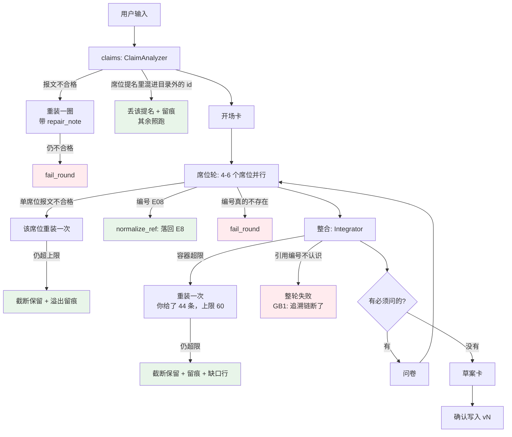

# P6 执行计划 · 超限不判死 + 引用/席位容错

> **给执行的 agent：** 严格按任务顺序做：每个任务先写红测试、跑到红、再实现、再跑绿、再提交。
> 一次提交一个任务，提交信息用中文。**除非测试本身写错（要说明错在哪），不许改测试来迁就实现。**
> **不要分配子任务**（作者原话：不要派子任务）。
> 上游拍板：2026-09-28 作者原话「【实现1，2】……都给我直接输出，我来拍板审查」。
> 证据来源：`.codex/runs/2026-09-28/报告.md` 的 F2 / F3 / F4 / F11 / F13 与 `findings.md` 的原始留样。

> **执行结果（2026-09-28 当天做完，T1–T10 全部落地，53 步全勾）：**
> 九个提交：`c9bc2d6`（上限重定 + 提示词口径）、`6b246f3`（截断解析 + 严格解析带 overflow 细节）、
> `49c3725`（超限纠错指引）、`1bca336`（`Round.note_dropped`）、`e671791`（席位侧重装 + 截断留痕）、
> `8b15bba`（整合侧重装 + 截断 + 缺口行）、`f16ead6`（编号归一化纯函数）、
> `e7299f1`（三处引用入口 + 命名空间提示）、`5e639bd`（目录外席位丢人不丢轮）。
> 后端 **551 passed** · `ruff` All checks passed · 端点仍 19 个 · 图与领域不变量未动。
> **两处与计划的偏差**（都是实现时发现更干净的做法，已回写 `02` §11.0.7）：
> ①"先重装、再截断"的判定点放在**用例层**（重试策略归那里），agent 只负责"报文 → 领域对象"；
> ②`unknown_ref_message` 与 `candidates_for` 的边界按实测收紧（席位地址/提案编号不给编号候选）。
> 真模型验证见本文件 T11（8 条 eval + 一条复现项目）。

**Goal：** 让"模型这一轮回得太多、编号写得差一点"不再等于"整轮白跑"：
①三处容器超限改成**先重装一圈、仍超就截断保留并留痕**；②证据编号**归一化**、席位提名**丢人不丢轮**。

**Architecture：** 三件事都落在**装配层与用例层**，不碰图、不碰领域不变量：
- "超限"是**报文形状问题**，不是内容问题 → 在 `application/agents/schemas.py` 里做（解析期），
  用"截断保留 + 溢出报告"替代"整包判死"；
- "编号写法差一点"是**同一条编号的另一种写法** → 新增纯函数 `normalize_ref()`，
  在**三个引用入口**（席位意见 / 提案 / 题目）统一归一化；**归一化后仍不存在的编号照样判死**
  （GB1：没有出处的提案 = 追溯链断了，这条口径一个字节都不许松）；
- "目录里没有的席位"是**提名错了一条** → 丢那条提名 + 留痕，剩下的席位照跑；
  只有"一条都不剩"才判死（R7 要求一轮至少一个席位）。

**Tech Stack：** Python 3.13 + Pydantic v2 + FastAPI + SQLite + LiteLLM + LangGraph；
React 18 + Vite + TS（本计划不动前端）。

**Spec：** `.codex/docs/设计/02-编排与数据.md` §7（失败、暂停与恢复 / 一轮调用上限表）、
§11.0.4–§11.0.6（前三次落地记录）；`.codex/docs/设计/04-未决.md` C5 后半（留痕）、C9（重装不许撞墙）、
E3（失败可重试）；`.codex/docs/设计/01-规格.md` §7（就绪度与门禁）。

## Global Constraints

- 测试：`cd backend && PYTHONDONTWRITEBYTECODE=1 python3 -m pytest -p no:cacheprovider -o addopts=""`
  （`pyproject.toml` 里 `addopts = "-q"`，不要再叠 `-q`，会吞掉统计行）
- Lint：`cd backend && python3 -m ruff check --no-cache .`
- 结构守卫必须全绿：`tests/architecture/`（分层、写路径白名单只有 `committer.py`、`src/` 无 fake、
  **UoW 里不许 await**、graph state 三键白名单、所有图节点 async）
- **模型调用一律在事务外**：重装循环写在 `with self._uow:` 之前；`with self._uow:` 里不许出现 await
- 端点白名单**不变**（`backend/tests/api/test_openapi_contract.py`，19 个）——本计划不加端点、不改 DTO 形状
- **不新增持久化字段**：席位溢出只进内存与既有的 `Round.dropped`（老 payload 不受影响）
- 不留生成物：跑完 `git status --short` 只能剩预期改动；见到 `__pycache__` / `*.db` 就清
- **不要碰 `backend/data/pmstudio.db`**（作者的工作库）；真模型验证一律跑在 `/tmp/…`

**基线（2026-09-28 实测）**：后端 `527 passed`、`ruff` All checks passed、端点 19 个、工作区干净。

---

## 0. 现状核对（对着代码，不对着印象）

| 设计/直觉 | 代码里的事实 | 差在哪 |
|---|---|---|
| 单席位意见条数上限 8 | `schemas.py:71` `opinions: ... max_length=8`；而 `prompts/seat_review.md:33` 写的是**「本席位最多 5 条判断」**（疑问+判断合计没有上限） | 提示词与 schema 打架：真跑里席位给了 **5 判断 + 5 疑问 = 10 条** → `too_long` → 整轮 502 |
| 一批提案上限 30 | `schemas.py:146` `proposals: ... max_length=30` | 一棵完整功能树是 12 个字段；**3 棵 = 36 > 30** → 真跑里整合者交了 44 条 → 整轮 502，**内容全丢** |
| 「一条都不许默默丢掉」 | `schemas.py:148-150` `dropped_opinions: ... max_length=30`；`integrator.py:17` 与 `integrator.md` 都写着**必须逐条申报** | 提示词要求穷尽、容器却封顶 30：真跑里老实申报 **35 条** → 整轮 502 |
| 去处写错只丢一条 | `assembly.py:465-490` `_target_or_drop()`：**去处**错 → 丢那一条 + 留痕（作者 2026-09-28 拍板） | 这是本次要照抄的先例；但**条数超限**与**编号写错**当时还没有对应处理 |
| 编号写错判死 | `assembly.py:509-516` `_refs()`、`assembly.py:630-636` 题目引用、`seat.py:118-131` 席位意见引用，三处都是"有一条不认识就整轮抛" | 判死是对的（GB1），但它对 **纯写法差异**（`E08` vs `E8`）也一视同仁 → 真跑里撞了 5 次 |
| 席位提名只能来自目录 | `analyzer.py:203-232` `nominations_from_packet()`：目录外的 id → `PacketParseError` → 重装一次 → 再错 → **整轮失败** | 目录里没有 `seat.observability`，模型照着 s8 章节槽的名字提名它 → 两次都错 → **连轮次都创建不了** |
| 席位失败整轮失败 | `use_cases.py:380-400` `RunSeatRound`：`asyncio.gather(..., return_exceptions=True)` → 任一席位异常 → `fail_round` | 4–6 个席位跑完的钱被一个席位的报文问题带走；且**没有重装** |

**真模型证据（2026-09-28 四项目真跑，250 次调用 / 15 轮）**

| 现象 | 次数 | 代价 |
|---|---|---|
| 条数超限（`opinions` 10>8 / `proposals` 44>30 / `dropped_opinions` 35>30） | 3 | 每次整轮 502 + 整轮重跑；**CRF 那轮 44 条内容一条没落地** |
| 编号写法差一点（`E07`/`E08`、`r-f2a00f4e#08`） | 5 | 每次整轮 502，4–6 个席位重跑 |
| 目录外席位 `seat.observability` | 1（连错两次） | 轮次创建失败，用户只能重发起一轮 |
| `seat_review` 调用总数 | 188 次 | 正常只需 90–100 次，**多出来的一倍全是重跑** |

---

## 1. 执行范围

**做**

1. **上限重定**（T1）：`SeatPacket.opinions` 8→**12**，`IntegrationPacket.proposals` 30→**60**，
   `dropped_opinions` 30→**84**；同步改 `seat_review.md` 与 `integrator.py::LIMITS_TEXT` 的口径文字。
2. **超限不判死**（T2/T3/T5/T6）：解析期"截断保留 + 溢出报告"；用例层"先重装一圈（带定向纠错）、
   仍超就截断并留痕"；三处（席位意见 / 提案 / dropped_opinions）一个口径。
3. **引用编号归一化**（T7/T8）：`normalize_ref()` 认前导零、大小写、全角空格；
   `r-… #08` 这类"拿提案编号当出处编号"给专门提示；**仍不认识的照样判死**。
4. **未知席位降级**（T9）：丢那条提名 + 留痕，其余照跑；全不认识才判死。
5. **真相源回写**（T10）+ **真模型验证**（T11）。

**不做（明确划线）**

- 不动"编号不认识就判死"这条口径本身（GB1）；本计划只加**归一化**与**更像人话的提示**。
- 不把 `list_items` 变成跨轮回流通道（真跑发现它现在只是展示用，那是另一个课题）。
- 不动 `claims` 的 `max_length=12`（它有自己的重装一圈，且突破 12 条会改变"一轮多少主张"的产品语义）。
- 不动 `questions`/`list_items` 的上限（下游 `MAX_QUESTIONS_PER_BATCH=5` 已先截断，不是失败点）。
- 不新增端点、不改 DTO、不改前端、不动图结构、不加 checkpointer。
- 不修 F1（"叙述式输入不产功能候选"）与 F12/F14（配额与未决项）——那是下一批。

---

## 2. 需要作者拍板的口径（我给的推荐值，已按代码与真跑算过）

| # | 决策 | 推荐 | 依据与代价 |
|---|---|---|---|
| D1 | 新上限数值 | `opinions=12`、`proposals=60`、`dropped_opinions=84` | 12 = 提示词允许的 5 条判断 + 7 条疑问；60 = 4 棵完整功能树（48）+ 章节级内容；84 = 7 席 × 12 条（"一条都不许丢"在数学上成立） |
| D2 | 截断规则 | 保留**模型给出的前 N 条**，溢出的每条记一条留痕 + 草案卡上加一行缺口 | 模型自己排的顺序就是它的优先级，不替它重排；留痕保证"不静默" |
| D3 | 重装次数 | 席位/整合都**1 次**（与 claims 对称） | 席位重装是**单席位**重试（不影响其它席位），成本 ≈ 11 秒 |
| D4 | 归一化边界 | 只归一化**能唯一落回账本**的写法；落不回就判死 | `E08`→`E8`（账本里有 E8）通过；`E999` 照样判死——否则等于给"编造编号"开后门 |
| D5 | 未知席位 | 丢那条提名 + 留痕；**全不认识才判死** | 保住"这一轮有席位"的领域不变量（R7），不保"模型挑的每个席位都在" |
| D6 | 溢出信息进哪个通道 | 既有的 `Round.dropped`（留痕）+ 草案卡的 `gaps` | 不加端点、不加字段、前端零改动，界面本来就有这两处 |

---

## 3. 数据流

**改前**（任何一个容器超限、或一条编号写法差一点）：

```
模型回包 → parse_packet()/review_from_packet()/_refs()
         └─ 有一个容器超限 或 一条编号不认识
              → PacketParseError →（claims/整合才有重装）→ 整轮 failed 或 502
              → 这一轮已经跑完的席位、已经写出的内容，全部作废
```

**改后**：

```
模型回包
  ├─ parse_packet_trimmed()
  │    ├─ 只有 too_long → 截断保留 + 溢出报告(container/kept/dropped)
  │    └─ 还有别的错  → 照旧 PacketParseError（错就是错）
  ├─ normalize_ref()（三处引用入口）
  │    ├─ E08 → E8（账本里真有 E8）→ 通过
  │    ├─ r-xxx#08 / seat.x:O1 → 判死，但提示写成"这是提案编号/地址"
  │    └─ E999 → 判死，附"最接近的候选"（编辑距离 ≤1 的）
  └─ 席位提名
       ├─ 目录外的 id → 丢这条提名 + DroppedItem 留痕 → 其余席位照跑
       └─ 一条都不剩 → PacketParseError（重装一次后仍如此 → fail_round）

溢出/丢弃的落点：
  Round.dropped（留痕，界面与证据查询都能看见）
  Draft.gaps（草案卡上的"缺口"行，人看得见）
```

---

## 4. 逐文件改动清单

| 文件 | 改什么 | 为什么 |
|---|---|---|
| `backend/src/pmstudio/application/agents/schemas.py` | 三处 `max_length` 数值；新增 `Overflow` dataclass 与 `parse_packet_trimmed()` | 上限是"报文形状"的真相源；截断解析必须与 schema 放在一起 |
| `backend/src/pmstudio/application/repair.py` | `repair_note()` 新增 `overflow` 分支 | 重装要带上"你给了 44 条，上限 60"这种可执行的指引 |
| `backend/src/pmstudio/application/evidence_refs.py`（新建） | `normalize_ref()` / `candidates_for()` 纯函数 | 编号写法的唯一归一化点，三处入口共用 |
| `backend/src/pmstudio/application/errors.py` | `unknown_ref_message()` 认 `r-… #08` 这种"提案编号当出处"的写法 | 让重装指引说人话（与既有 `seat.xxx:O1` 分支同构） |
| `backend/src/pmstudio/application/agents/seat.py` | `review()` 用 `parse_packet_trimmed`；返回 `SeatOutcome(review, overflow)`；引用先归一化 | 席位是本轮失败率最高的一环 |
| `backend/src/pmstudio/application/agents/analyzer.py` | `nominations_from_packet()` 改为返回 `(nominations, drops)` | 目录外席位丢人不丢轮 |
| `backend/src/pmstudio/application/agents/integrator.py` | `integrate()` 返回 `IntegrationOutcome(packet, overflow)`；`LIMITS_TEXT` 上限文字对齐 | 提案与 dropped_opinions 的溢出要带得出来 |
| `backend/src/pmstudio/application/assembly.py` | `_refs()` 与题目引用两处接 `normalize_ref()`；把席位溢出转成 `DroppedItem` | 引用入口在这层收口 |
| `backend/src/pmstudio/domain/round/round.py` | 新增 `Round.note_dropped(items)` | 席位轮与 claims 阶段也要能留痕（现在只有 `integrate()` 能写 dropped） |
| `backend/src/pmstudio/application/use_cases.py` | `StartRound.analyze` 落定"未知席位"留痕；`RunSeatRound` 加**单席位重装一圈**并落定溢出留痕；`IntegrateRound` 落定整合溢出 | 三处降级的编排都在这里 |
| `backend/src/pmstudio/infrastructure/llm/prompts/seat_review.md` | 「本席位最多 5 条判断」→ 写明"疑问+判断合计最多 12 条" | 提示词与 schema 对齐 |
| `.codex/docs/设计/02-编排与数据.md` | §7 调用上限表加"席位重装 1 次"；新增 §11.0.7 记录本次口径 | 真相源回写 |

**接口（新签名，前后任务要对齐）**

```python
# application/agents/schemas.py
@dataclass(frozen=True, slots=True)
class Overflow:
    container: str          # "opinions" / "proposals" / "dropped_opinions"
    kept: int
    dropped: int

def parse_packet_trimmed[T: BaseModel](
    text: str, model: type[T], *, purpose: str
) -> tuple[T, tuple[Overflow, ...]]: ...

# application/evidence_refs.py
def normalize_ref(raw: str, *, known: frozenset[EvidenceId]) -> str: ...
def candidates_for(raw: str, *, known: frozenset[EvidenceId], limit: int = 3) -> tuple[str, ...]: ...

# application/agents/seat.py
@dataclass(frozen=True, slots=True)
class SeatOutcome:
    review: SeatReview
    overflow: tuple[schemas.Overflow, ...] = ()

# application/agents/integrator.py
@dataclass(frozen=True, slots=True)
class IntegrationOutcome:
    packet: schemas.IntegrationPacket
    overflow: tuple[schemas.Overflow, ...] = ()

# domain/round/round.py
class Round:
    def note_dropped(self, items: Iterable[DroppedItem]) -> None: ...
```

---

## 5. 架构图（改后的一轮）



绿色 = 本计划新开的"不判死"通道；红色 = 保持不变的真失败出口（GB1 / R7）。

---

## 6. 任务分解

### Task 1：上限重定 + 提示词对齐

**Files:**
- Modify: `backend/src/pmstudio/application/agents/schemas.py:71,146,148-150`
- Modify: `backend/src/pmstudio/infrastructure/llm/prompts/seat_review.md:33`
- Modify: `backend/src/pmstudio/application/agents/integrator.py:17`
- Test: `backend/tests/application/test_packet_overflow.py`（新建）

**Interfaces:**
- Produces: 三个上限值（`opinions=12` / `proposals=60` / `dropped_opinions=84`），后续任务按它写截断测试

- [x] **Step 1: 写红测试**

```python
"""报文容器上限：必须装得下一棵完整功能树，也要与提示词口径一致。"""

from pydantic import MaxLen

from pmstudio.application.agents import schemas


def cap(model, field_name: str) -> int:
    metadata = model.model_fields[field_name].metadata
    return next(item.max_length for item in metadata if isinstance(item, MaxLen))


def test_caps_fit_a_complete_feature_tree():
    # 一棵功能树 12 个字段；一轮至少要装得下 4 棵（48）+ 章节级内容
    assert cap(schemas.IntegrationPacket, "proposals") == 60
    # 7 个席位 × 单席位 12 条：这是"一条都不许默默丢掉"的数学上界
    assert cap(schemas.IntegrationPacket, "dropped_opinions") == 84
    # 提示词允许 5 条判断 + 7 条疑问
    assert cap(schemas.SeatPacket, "opinions") == 12
```

- [x] **Step 2: 跑红**

`cd backend && python3 -m pytest tests/application/test_packet_overflow.py -p no:cacheprovider -o addopts="" -v`
Expected: FAIL（`60 != 30`）

- [x] **Step 3: 改实现**

```python
# schemas.py:71
    opinions: list[OpinionDraft] = Field(default_factory=list, max_length=12)

# schemas.py:146-150
    proposals: list[ProposalDraft] = Field(default_factory=list, max_length=60)
    dropped_opinions: list[DroppedOpinionDraft] = Field(
        default_factory=list,
        max_length=84,
        description="你没采用的席位意见：给出地址与原因；**一条都不许默默丢掉**",
    )
```

```markdown
<!-- seat_review.md:33 改为 -->
5. 每条意见一句一件事；**疑问与判断合计最多 12 条**（判断最多 5 条，其余留给疑问）。
```

```python
# integrator.py LIMITS_TEXT：第一行后插入两行
        "- 内容候选（proposals）一轮最多 60 条；同一件事只说一次，优先保留 s5 功能字段与验收标准",
        "- dropped_opinions 一轮最多 84 条（7 席 × 12 条）：没采用的席位意见一条都不许默默丢掉",
```

- [x] **Step 4: 跑绿**

`cd backend && python3 -m pytest tests/application/test_packet_overflow.py tests/application/test_agent_schemas.py -p no:cacheprovider -o addopts="" -v`
Expected: PASS

- [x] **Step 5: 提交**

```bash
git add backend/src/pmstudio/application/agents/schemas.py \
        backend/src/pmstudio/application/agents/integrator.py \
        backend/src/pmstudio/infrastructure/llm/prompts/seat_review.md \
        backend/tests/application/test_packet_overflow.py
git commit -m "feat(packet): 上限重定（意见 12 / 提案 60 / 留痕 84）并对齐提示词口径"
```

### Task 2：`Overflow` + `parse_packet_trimmed()`（截断保留）

**Files:**
- Modify: `backend/src/pmstudio/application/agents/schemas.py`（`parse_packet` 之后）
- Test: `backend/tests/application/test_packet_overflow.py`（追加）

**Interfaces:**
- Consumes: T1 的三个上限
- Produces: `schemas.Overflow(container, kept, dropped)`、`schemas.parse_packet_trimmed(text, model, *, purpose) -> (packet, overflow)`

- [x] **Step 1: 写红测试**

```python
import json

import pytest

from pmstudio.application.agents import schemas
from pmstudio.application.errors import PacketParseError


def proposal(index: int) -> dict:
    return {
        "op": "add",
        "target": {"zone": "body", "section_id": "s1"},
        "text": f"第 {index} 条",
        "origin_type": "derived",
        "evidence_refs": ["E1"],
    }


def packet_json(count: int) -> str:
    return json.dumps(
        {"proposals": [proposal(i) for i in range(count)], "dropped_opinions": []},
        ensure_ascii=False,
    )


def test_forty_four_proposals_no_longer_explode():
    """真跑实测：CRF 那轮 44 条提案整轮被毙，内容一条没落地。"""

    packet, overflow = schemas.parse_packet_trimmed(
        packet_json(44), schemas.IntegrationPacket, purpose="integration"
    )

    assert len(packet.proposals) == 44
    assert overflow == ()


def test_seventy_proposals_are_trimmed_to_the_cap_and_reported():
    packet, overflow = schemas.parse_packet_trimmed(
        packet_json(70), schemas.IntegrationPacket, purpose="integration"
    )

    assert len(packet.proposals) == 60
    assert packet.proposals[0].text == "第 0 条"  # 保留模型给的前 60 条（顺序即优先级）
    assert overflow == (schemas.Overflow(container="proposals", kept=60, dropped=10),)


def test_trimmed_parse_still_rejects_real_shape_errors():
    with pytest.raises(PacketParseError) as exc:
        schemas.parse_packet_trimmed(
            '{"proposals": [{"op": "add"}]}',
            schemas.IntegrationPacket,
            purpose="integration",
        )

    assert "过不了 schema" in exc.value.message
```

- [x] **Step 2: 跑红**

`cd backend && python3 -m pytest tests/application/test_packet_overflow.py -p no:cacheprovider -o addopts="" -v`
Expected: FAIL（`module has no attribute 'parse_packet_trimmed'`）

- [x] **Step 3: 改实现**

```python
# schemas.py：import 区加 `import copy` 与 `from dataclasses import dataclass`

@dataclass(frozen=True, slots=True)
class Overflow:
    """一处容器超限：保留了前 N 条、溢出 M 条。"""

    container: str
    kept: int
    dropped: int


def parse_packet_trimmed[T: BaseModel](
    text: str, model: type[T], *, purpose: str
) -> tuple[T, tuple[Overflow, ...]]:
    """与 `parse_packet` 同口径，**只多一条**：容器超限不再判死整包。

    - 只有当**所有**错误都是 `too_long` 时才截断；出现别的错，照旧抛（错就是错，GB1 不许松）；
    - 截断保留**模型给出的前 N 条**：顺序就是它自己排的优先级，我们不替它重排；
    - 溢出条数报回调用方，由用例层写成留痕（不静默丢）。
    """

    try:
        payload = json.loads(text)
    except json.JSONDecodeError as error:
        raise PacketParseError(
            f"模型返回的不是合法 JSON：{error.msg}", purpose=purpose, offset=error.pos
        ) from error
    try:
        return model.model_validate(payload), ()
    except ValidationError as error:
        overflows = _overflows_of(error)
        if not overflows or not _only_too_long(error):
            raise PacketParseError(
                "模型返回的报文过不了 schema", purpose=purpose, errors=error.errors()
            ) from error
        trimmed = copy.deepcopy(payload)
        for item in overflows:
            trimmed[item.container] = trimmed[item.container][: item.kept]
        try:
            return model.model_validate(trimmed), tuple(overflows)
        except ValidationError as second:
            raise PacketParseError(
                "模型返回的报文过不了 schema", purpose=purpose, errors=second.errors()
            ) from second


def _only_too_long(error: ValidationError) -> bool:
    return all(item.get("type") == "too_long" for item in error.errors())


def _overflows_of(error: ValidationError) -> list[Overflow]:
    found: list[Overflow] = []
    for item in error.errors():
        if item.get("type") != "too_long":
            continue
        loc = item.get("loc", ())
        context = item.get("ctx", {})
        limit = int(context.get("max_length", 0))
        actual = int(context.get("actual_length", len(item.get("input") or ())))
        found.append(
            Overflow(
                container=str(loc[0]) if loc else "?",
                kept=limit,
                dropped=actual - limit,
            )
        )
    return found
```

**同时**把"超限"这一类的三要素写进**严格解析**的错误细节里——重装指引要用它，
而严格解析是"先重装"这条路的入口：

```python
# schemas.py::parse_packet（既有的 except ValidationError 分支里加一句）
    except ValidationError as error:
        details: dict[str, object] = {"errors": error.errors()}
        first = _overflows_of(error)
        if first and _only_too_long(error):
            # ("proposals", 44, 60)：重装指引拿它说"你给了 44 条，上限 60"
            details["overflow"] = (first[0].container, first[0].kept + first[0].dropped,
                                   first[0].kept)
        raise PacketParseError(
            "模型返回的报文过不了 schema", purpose=purpose, **details
        ) from error
```

- [x] **Step 4: 跑绿**

`cd backend && python3 -m pytest tests/application/test_packet_overflow.py -p no:cacheprovider -o addopts="" -v`
Expected: PASS（3 条）

- [x] **Step 5: 提交**

```bash
git add backend/src/pmstudio/application/agents/schemas.py backend/tests/application/test_packet_overflow.py
git commit -m "feat(packet): 容器超限改为截断保留 + 溢出报告（不再判死整包）"
```

### Task 3：`repair_note()` 支持"超限"这种可执行的错

**Files:**
- Modify: `backend/src/pmstudio/application/repair.py`
- Test: `backend/tests/application/test_repair.py`（追加）

**Interfaces:**
- Consumes: `PacketParseError(details={"overflow": (container, got, limit)})`（T5/T6 这么抛）
- Produces: `repair_note()` 的 `overflow` 分支文本

- [x] **Step 1: 写红测试**

```python
def test_overflow_tells_the_model_how_many_to_cut():
    note = repair_note(
        PacketParseError(
            "模型返回的报文过不了 schema",
            purpose="integration",
            overflow=("proposals", 44, 60),
        )
    )

    assert "44" in note and "60" in note
    assert "精简" in note
```

- [x] **Step 2: 跑红**

`cd backend && python3 -m pytest tests/application/test_repair.py -p no:cacheprovider -o addopts="" -v`
Expected: FAIL（`"44" not in note`）

- [x] **Step 3: 改实现**

```python
# repair.py：放在 "errors" 分支**之前**（它带的信息更具体）
    elif "overflow" in details:
        container, got, limit = details["overflow"]  # type: ignore[misc]
        lines.append(
            f"你这一次给了 {got} 条 {container}，上限是 {limit} 条。"
            f"请合并或删到 {limit} 条以内：同一件事只说一次，"
            "优先保留 s5 功能字段（name / one_liner / goal / audience / exceptions / "
            "acceptance）与已经定下来的验收标准，删掉重复与推测。"
        )
```

- [x] **Step 4: 跑绿**

`cd backend && python3 -m pytest tests/application/test_repair.py -p no:cacheprovider -o addopts="" -v`
Expected: PASS（5 条）

- [x] **Step 5: 提交**

```bash
git add backend/src/pmstudio/application/repair.py backend/tests/application/test_repair.py
git commit -m "feat(repair): 超限也给重装指引（条数、上限、怎么精简）"
```

### Task 4：`Round.note_dropped()`（席位轮与 claims 阶段也能留痕）

**Files:**
- Modify: `backend/src/pmstudio/domain/round/round.py`（`attest` 之后）
- Test: `backend/tests/domain/test_round_drops.py`（新建）

**Interfaces:**
- Produces: `Round.note_dropped(items: Iterable[DroppedItem]) -> None`（追加、不改 step/waiting_on）
- Consumes: T5/T6/T9 传进来的 `DroppedItem`

- [x] **Step 1: 写红测试**

```python
"""留痕要多一个入口：席位轮（超限截断）与 claims（目录外席位）现在写不进去。"""

from pmstudio.domain.round.round import DropSource, DroppedItem
from tests.support.builders import make_round


def test_note_dropped_appends_without_touching_step():
    round_ = make_round()
    before_step, before_waiting = round_.step, round_.waiting_on

    round_.note_dropped(
        [
            DroppedItem(
                handle="seat.data_scale:O9",
                reason="超出单席位上限 12 条，第 9 条起未进卡片",
                source=DropSource.ASSEMBLY,
                seat_id="seat.data_scale",
                pass_index=1,
            )
        ]
    )

    assert [item.handle for item in round_.dropped] == ["seat.data_scale:O9"]
    assert round_.step is before_step and round_.waiting_on is before_waiting


def test_note_dropped_is_additive():
    round_ = make_round()
    item = DroppedItem(
        handle="席位提名 seat.observability",
        reason="目录里没有这个席位，已丢弃该条提名",
        source=DropSource.ASSEMBLY,
        seat_id=None,
        pass_index=1,
    )

    round_.note_dropped([item])
    round_.note_dropped([item])

    assert len(round_.dropped) == 2  # 留痕是历史记录，同一件事发生两次就该有两条
```

- [x] **Step 2: 跑红**

`cd backend && python3 -m pytest tests/domain/test_round_drops.py -p no:cacheprovider -o addopts="" -v`
Expected: FAIL（`'Round' object has no attribute 'note_dropped'`）

- [x] **Step 3: 改实现**

```python
# round.py：文件顶部若没有 `from collections.abc import Iterable`，加上
    def note_dropped(self, items: Iterable[DroppedItem]) -> None:
        """记一条留痕。与 `integrate(dropped=…)` 同一个口子，只是**不必在整合那一步**。

        谁用：席位轮的超限截断、claims 里被丢掉的目录外席位提名。
        """

        self._dropped = self._dropped + tuple(items)
```

- [x] **Step 4: 跑绿**

`cd backend && python3 -m pytest tests/domain -p no:cacheprovider -o addopts="" -v`
Expected: PASS

- [x] **Step 5: 提交**

```bash
git add backend/src/pmstudio/domain/round/round.py backend/tests/domain/test_round_drops.py
git commit -m "feat(round): note_dropped 让席位轮与 claims 阶段也能留痕"
```

### Task 5：席位侧——单席位重装一圈 + 超限截断留痕

**Files:**
- Modify: `backend/src/pmstudio/application/agents/seat.py:42-84`
- Modify: `backend/src/pmstudio/application/use_cases.py:389-440`（`RunSeatRound._review_one`）
- Modify: `backend/src/pmstudio/infrastructure/llm/prompts/seat_review.md`（加 `$validation_error` 槽）
- Test: `backend/tests/application/test_seat_agent.py`、`test_seat_round.py`（各追加）

**Interfaces:**
- Produces: `seat.SeatOutcome(review, overflow)`；`SeatReviewer.review(..., validation_error: str = "") -> SeatOutcome`
- Consumes: `schemas.parse_packet_trimmed`（T2）、`repair_note`（T3）、`Round.note_dropped`（T4）

- [x] **Step 1: 写红测试**

```python
# tests/application/test_seat_agent.py
async def test_seat_reviewer_reports_overflow_instead_of_failing():
    reply = json.dumps(
        {
            "basis": "读了 s1–s13",
            "opinions": [
                {
                    "local_id": f"O{i}",
                    "form": "judgment",
                    "about": f"第 {i} 件事",
                    "claim": "……",
                    "because": "……",
                    "evidence_refs": ["E4"],
                }
                for i in range(1, 15)  # 14 > 12
            ],
        },
        ensure_ascii=False,
    )
    reviewer = SeatReviewer(model=gateway_for(reply), prompts=RecordingPrompts())

    outcome = await reviewer.review(
        seat=make_seat(),
        document_state="# 文档",
        claims="- [E1] 需求 · s5 · 要做一个订单导出功能",
        opinions_so_far="（这是第一次席位轮）",
        answered="（还没有人回答过）",
        known_eids=KNOWN,
    )

    assert len(outcome.review.opinions) == 12
    assert outcome.overflow[0].container == "opinions"
    assert outcome.overflow[0].dropped == 2
```

```python
# tests/application/test_seat_round.py
async def test_seat_round_retries_one_bad_seat_then_records_the_truncation():
    """单席位报文超限：该席位重装一次；仍超限就截断，整轮照常往下走。"""

    harness = Harness(replies={"seat_review": [OVER_CAP_REPLY, OVER_CAP_REPLY]})
    # 起一轮 → 提交开场（照该文件既有测试的搭法）
    ...
    await harness.run_seat_round()(round_id=round_id)

    round_ = harness.rounds.get(round_id)
    assert round_.pending_seats == ()                       # 席位都算交回了
    assert any("超出单席位上限" in item.reason for item in round_.dropped)
    assert harness.events.names[-1] != GENERATION_FAILED    # 没判死
```

- [x] **Step 2: 跑红**

`cd backend && python3 -m pytest tests/application/test_seat_agent.py tests/application/test_seat_round.py -p no:cacheprovider -o addopts="" -v`
Expected: FAIL（`SeatOutcome` 不存在 / 解包失败）

- [x] **Step 3: 改实现**

```python
# agents/seat.py
@dataclass(frozen=True, slots=True)
class SeatOutcome:
    review: SeatReview
    overflow: tuple[schemas.Overflow, ...] = ()


class SeatReviewer:
    PROMPT_SLOTS = (..., "schema_json", "validation_error")   # 末尾加槽

    async def review(self, *, ..., validation_error: str = "") -> SeatOutcome:
        prompt = self._prompts.render(self.PROMPT, ..., validation_error=validation_error)
        reply = await self._model.complete(...)
        packet, overflow = schemas.parse_packet_trimmed(
            reply.text, schemas.SeatPacket, purpose=self.PURPOSE
        )
        if overflow and validation_error == "":
            # 第一次不许直接截断：先把它当成"可修复的错"抛出去，让用例层重装一圈
            # （"先重装、再截断"）。重装那次 validation_error 非空，才会走到下面的返回。
            first = overflow[0]
            raise PacketParseError(
                "模型返回的报文过不了 schema",
                purpose=self.PURPOSE,
                seat_id=seat.seat_id,
                overflow=(first.container, first.kept + first.dropped, first.kept),
            )
        return SeatOutcome(
            review=review_from_packet(
                packet,
                seat_id=seat.seat_id,
                known_eids=known_eids,
                answer_eids=answer_eids or {},
            ),
            overflow=overflow,
        )
```

```python
# use_cases.py::_review_one（模型调用在事务外，重装循环也在事务外）
        validation_error = ""
        for attempt in range(1, MAX_SEAT_ATTEMPTS + 1):
            try:
                outcome = await self._reviewer.review(
                    seat=seat, ..., validation_error=validation_error,
                )
                break
            except PacketParseError as error:
                if attempt == MAX_SEAT_ATTEMPTS:
                    raise
                validation_error = repair_note(error)
        review, overflow = outcome.review, outcome.overflow
        with self._uow:
            round_ = self._rounds.get(round_id)
            round_.attest(review)
            round_.note_dropped(
                _truncation_items(
                    review.seat_id, overflow, pass_index=round_.seat_round_count
                )
            )
            self._round_writer.save(round_)
            pass_index = round_.seat_round_count
            project_id = round_.project_id
```

```python
# use_cases.py：与 MAX_CLAIMS_ATTEMPTS 放在一起
MAX_SEAT_ATTEMPTS = 2


def _truncation_items(
    seat_id: str, overflow: tuple[schemas.Overflow, ...], *, pass_index: int
) -> list[DroppedItem]:
    """席位交回超上限被截断的那几条：留痕说清"第几条起没进卡片"。"""

    return [
        DroppedItem(
            handle=f"{seat_id}:O{item.kept + 1}..O{item.kept + item.dropped}",
            reason=f"超出单席位上限 {item.kept} 条，第 {item.kept + 1} 条起未进卡片",
            source=DropSource.ASSEMBLY,
            seat_id=seat_id,
            pass_index=pass_index,
        )
        for item in overflow
    ]
```

- [x] **Step 4: 跑绿**

`cd backend && python3 -m pytest tests/application/test_seat_agent.py tests/application/test_seat_round.py -p no:cacheprovider -o addopts="" -v`
Expected: PASS

- [x] **Step 5: 提交**

```bash
git add backend/src/pmstudio/application/agents/seat.py \
        backend/src/pmstudio/application/use_cases.py \
        backend/src/pmstudio/infrastructure/llm/prompts/seat_review.md \
        backend/tests/application/test_seat_agent.py \
        backend/tests/application/test_seat_round.py
git commit -m "feat(seat): 单席位重装一圈；超限截断 + 留痕，不判死整轮"
```

### Task 6：整合侧——提案与 dropped_opinions 超限不判死

**Files:**
- Modify: `backend/src/pmstudio/application/agents/integrator.py:73-110`
- Modify: `backend/src/pmstudio/application/use_cases.py:612-690`（`_integrate_with_repair`）
- Test: `backend/tests/application/test_integrator.py`、`test_dropped_trace.py`（各追加）

**Interfaces:**
- Produces: `IntegrationOutcome(packet, overflow)`
- Consumes: `parse_packet_trimmed`（T2）、`repair_note`（T3）、`Round.integrate(dropped=…)`

- [x] **Step 1: 写红测试**

```python
# tests/application/test_integrator.py
async def test_integrate_reports_overflow_instead_of_raising():
    # 脚本回复里放 70 条提案
    outcome = await integrator.integrate(...)

    assert len(outcome.packet.proposals) == 60
    assert outcome.overflow[0].dropped == 10
```

```python
# tests/application/test_dropped_trace.py
async def test_overflow_items_land_in_dropped_and_gaps():
    """整合超限的溢出：留痕里有一条，草案卡缺口行上有汇总。"""

    ...
    assert any("超出单轮上限" in item.reason for item in round_.dropped)
    assert any("因上限未进卡片" in gap for gap in round_.draft.gaps)
```

- [x] **Step 2: 跑红**

`cd backend && python3 -m pytest tests/application/test_integrator.py tests/application/test_dropped_trace.py -p no:cacheprovider -o addopts="" -v`
Expected: FAIL

- [x] **Step 3: 改实现**

```python
# integrator.py
@dataclass(frozen=True, slots=True)
class IntegrationOutcome:
    packet: schemas.IntegrationPacket
    overflow: tuple[schemas.Overflow, ...] = ()


    async def integrate(self, *, ..., validation_error: str = "") -> IntegrationOutcome:
        ...
        packet, overflow = schemas.parse_packet_trimmed(
            reply.text, schemas.IntegrationPacket, purpose=self.PURPOSE
        )
        if overflow and validation_error == "":
            # 与席位同一个口径：第一次先重装，重装那次才允许截断
            first = overflow[0]
            raise PacketParseError(
                "模型返回的报文过不了 schema",
                purpose=self.PURPOSE,
                overflow=(first.container, first.kept + first.dropped, first.kept),
            )
        return IntegrationOutcome(packet=packet, overflow=overflow)
```

```python
# use_cases.py::_integrate_with_repair
            try:
                outcome = await self._integrator.integrate(...)
            except ApplicationError as error:
                ...  # 网关类：原样
            try:
                assembled = assemble(
                    outcome.packet, round_=round_, document=document, ledger=ledger
                )
                assembled = replace(
                    assembled,
                    dropped=assembled.dropped
                    + _overflow_items(outcome.overflow, pass_index=round_.seat_round_count),
                )
                gaps = dry_run(document, assembled.proposals, round_=round_, now=self._clock.now())
                if outcome.overflow:
                    count = sum(item.dropped for item in outcome.overflow)
                    gaps = gaps + (f"本轮有 {count} 条内容因单轮上限未进卡片（可在下一轮继续提）",)
            except (PacketParseError, DomainError) as error:
                # 超限这一类要**先给它一次自己精简的机会**：
                if _overflow_of(error) is not None and attempt < MAX_INTEGRATION_ATTEMPTS:
                    validation_error = repair_note(error)
                    continue
                ...  # 原有的"两次都过不了"出口，一字不改
```

```python
# use_cases.py：与 _truncation_items 放一起
def _overflow_items(
    overflow: tuple[schemas.Overflow, ...], *, pass_index: int
) -> tuple[DroppedItem, ...]:
    return tuple(
        DroppedItem(
            handle=f"提案 #{item.kept + 1}..#?",
            reason=f"超出单轮上限 {item.kept} 条，被截断未进卡片（{item.container}）",
            source=DropSource.ASSEMBLY,
            seat_id=None,
            pass_index=pass_index,
        )
        for item in overflow
    )


def _overflow_of(error: Exception) -> tuple[str, int, int] | None:
    """从 PacketParseError 里取"超限"这一类的三要素（container / got / limit）。"""

    details = getattr(error, "details", {}) or {}
    return details.get("overflow")  # type: ignore[return-value]
```

> "先重装、再截断"的判定点写在 **agent 里**（上面 `validation_error == ""` 那一支），
> 不是写在用例里：第一次把"超限"当可修复的错抛出去，用例层照既有循环喂 `repair_note`
> 重装一次；重装那次 `validation_error` 非空，截断结果才会被接受。
> 用例侧的 `_overflow_of(error)` 只用来**取三要素**（给 `repair_note` 用），不参与判断。

- [x] **Step 4: 跑绿**

`cd backend && python3 -m pytest tests/application -p no:cacheprovider -o addopts="" -v`
Expected: PASS（含既有 527 条）

- [x] **Step 5: 提交**

```bash
git add backend/src/pmstudio/application/agents/integrator.py \
        backend/src/pmstudio/application/use_cases.py \
        backend/tests/application/test_integrator.py \
        backend/tests/application/test_dropped_trace.py
git commit -m "feat(integration): 提案与留痕超限先重装、再截断，不判死整轮"
```

### Task 7：`normalize_ref()` 纯函数

**Files:**
- Create: `backend/src/pmstudio/application/evidence_refs.py`
- Test: `backend/tests/application/test_evidence_refs.py`（新建）

**Interfaces:**
- Produces: `normalize_ref(raw: str, *, known: frozenset[EvidenceId]) -> str`、
  `candidates_for(raw: str, *, known: frozenset[EvidenceId], limit: int = 3) -> tuple[str, ...]`

- [x] **Step 1: 写红测试**

```python
from pmstudio.application.evidence_refs import candidates_for, normalize_ref
from pmstudio.domain.shared.ids import EvidenceId

KNOWN = frozenset(
    {EvidenceId("E1"), EvidenceId("E8"), EvidenceId("E27"), EvidenceId("E100")}
)


def test_leading_zeros_fall_back_to_the_real_id():
    assert normalize_ref("E08", known=KNOWN) == "E8"
    assert normalize_ref("E000100", known=KNOWN) == "E100"


def test_case_and_spaces_are_ignored():
    assert normalize_ref(" e8 ", known=KNOWN) == "E8"
    assert normalize_ref("Ｅ８", known=KNOWN) == "E8"      # 全角也认


def test_id_that_does_not_exist_stays_untouched():
    assert normalize_ref("E999", known=KNOWN) == "E999"     # 不认识就是不认识，交给失败出口


def test_candidates_point_at_neighbours():
    assert "E27" in candidates_for("E28", known=KNOWN)
```

- [x] **Step 2: 跑红**

`cd backend && python3 -m pytest tests/application/test_evidence_refs.py -p no:cacheprovider -o addopts="" -v`
Expected: FAIL（模块不存在）

- [x] **Step 3: 改实现**

```python
"""出处编号的写法归一化。**它只解决写法，不解决幻觉。**

真跑实测：席位把 `E8` 写成 `E08`、把上一轮的提案编号 `r-f2a00f4e#08` 当编号——
前者是同一个编号的另一种写法（该认），后者是另一个命名空间（该判死，但提示要说清楚）。
"""

import re

from pmstudio.domain.shared.ids import EvidenceId

EID = re.compile(r"^[EeＥｅ]\s*0*(\d+)$")


def normalize_ref(raw: str, *, known: frozenset[EvidenceId]) -> str:
    """能唯一落回账本就返回规范写法，否则原样返回（由调用方按"不认识"处理）。"""

    text = raw.strip().replace("\u3000", "").replace(" ", "")
    match = EID.match(text)
    if match is None:
        return raw.strip()
    candidate = f"E{int(match.group(1))}"
    return candidate if EvidenceId(candidate) in known else raw.strip()


def candidates_for(
    raw: str, *, known: frozenset[EvidenceId], limit: int = 3
) -> tuple[str, ...]:
    """写错时给"最接近的几个候选"（数字差 1 的最先给），让重装指引说得具体。"""

    number = int(re.sub(r"\D", "", raw) or -1)
    if number < 0:
        return ()
    ranked = sorted(
        (abs(int(str(item)[1:]) - number), str(item))
        for item in known
        if re.match(r"^E\d+$", str(item))
    )
    return tuple(item for delta, item in ranked if delta <= 1)[:limit]
```

- [x] **Step 4: 跑绿**

`cd backend && python3 -m pytest tests/application/test_evidence_refs.py -p no:cacheprovider -o addopts="" -v`
Expected: PASS（4 条）

- [x] **Step 5: 提交**

```bash
git add backend/src/pmstudio/application/evidence_refs.py \
        backend/tests/application/test_evidence_refs.py
git commit -m "feat(refs): 出处编号归一化（E08→E8、全角、大小写）与最近候选"
```

### Task 8：三处引用入口接上归一化 + 提示升级

**Files:**
- Modify: `backend/src/pmstudio/application/agents/seat.py:118-131`
- Modify: `backend/src/pmstudio/application/assembly.py:509-516,630-636`
- Modify: `backend/src/pmstudio/application/errors.py::unknown_ref_message`
- Test: `backend/tests/application/test_seat_agent.py`、`test_assembly.py`、`test_ports_events_errors.py`

**Interfaces:**
- Consumes: `normalize_ref` / `candidates_for`（T7）

- [x] **Step 1: 写红测试**

```python
# tests/application/test_seat_agent.py
async def test_seat_accepts_zero_padded_evidence_ids():
    # 账本里是 E1，回复里写 E01
    outcome = await reviewer.review(...)

    assert outcome.review.opinions[0].evidence_refs == (EvidenceId("E1"),)
```

```python
# tests/application/test_assembly.py
def test_proposal_with_zero_padded_ref_passes():
    # 账本有 E1，提案写 E01 → 不抛，refs == (E1,)
    ...
```

```python
# tests/application/test_ports_events_errors.py
def test_unknown_ref_message_explains_proposal_ids():
    message = unknown_ref_message(["r-f2a00f4e#08"], what="意见引用了不存在的编号")

    assert "提案编号" in message
    assert "E" in message      # 告诉它该写什么形状
```

- [x] **Step 2: 跑红**

`cd backend && python3 -m pytest tests/application/test_seat_agent.py tests/application/test_assembly.py tests/application/test_ports_events_errors.py -p no:cacheprovider -o addopts="" -v`
Expected: FAIL

- [x] **Step 3: 改实现**

```python
# errors.py::unknown_ref_message：在既有的 ":" 分支之后加一段
    if any(item.startswith("r-") and "#" in item for item in unknown):
        return (
            f"{what}：{listed}；`r-xxxx#01` 是**提案编号**，不是出处编号——"
            "出处编号只在上面那份清单里（形如 E12）"
        )
```

```python
# seat.py：裸转换改成先归一化（answer_eids 的 q→E 映射照旧在前）
        refs = tuple(
            EvidenceId(normalize_ref(mapping.get(ref, ref), known=known_eids))
            for ref in draft.evidence_refs
        )
        unknown = [str(ref) for ref in refs if ref not in known_eids]
        if unknown:
            raise PacketParseError(
                unknown_ref_message(unknown, what="意见引用了不存在的编号"),
                purpose=PURPOSE,
                seat_id=seat_id,
                local_id=local_id,
                candidates=[
                    candidates_for(item, known=known_eids) for item in unknown
                ],
            )
```

```python
# assembly.py::_refs 与 _question：同一套写法
        refs = tuple(EvidenceId(normalize_ref(item, known=known)) for item in raw)
        unknown = [str(ref) for ref in refs if ref not in known]
        if unknown:
            raise PacketParseError(
                unknown_ref_message(unknown), purpose=PURPOSE,
                candidates=[candidates_for(item, known=known) for item in unknown],
            )
```

- [x] **Step 4: 跑绿**

`cd backend && python3 -m pytest tests/application -p no:cacheprovider -o addopts="" -v`
Expected: PASS

- [x] **Step 5: 提交**

```bash
git add backend/src/pmstudio/application/agents/seat.py \
        backend/src/pmstudio/application/assembly.py \
        backend/src/pmstudio/application/errors.py \
        backend/tests/application/test_seat_agent.py \
        backend/tests/application/test_assembly.py \
        backend/tests/application/test_ports_events_errors.py
git commit -m "feat(refs): 三处引用入口归一化；写错编号时给出命名空间提示与候选"
```

### Task 9：未知席位——丢人不丢轮

**Files:**
- Modify: `backend/src/pmstudio/application/agents/analyzer.py:200-232`
- Modify: `backend/src/pmstudio/application/use_cases.py`（`StartRound.analyze` 落痕）
- Test: `backend/tests/application/test_analyzer.py`、`test_start_round.py`

**Interfaces:**
- Produces: `nominations_from_packet(packet, *, catalog) -> tuple[tuple[SeatNomination, ...], tuple[DroppedItem, ...]]`
- Consumes: `Round.note_dropped`（T4）

- [x] **Step 1: 写红测试**

```python
# tests/application/test_start_round.py
async def test_round_survives_a_seat_id_that_is_not_in_the_catalog():
    """真跑实测：分析者提名 seat.observability（目录里没有）→ 两次重装都失败 → 轮次创建不了。"""

    harness = Harness(
        replies={"claims": claims_reply_with_seats("seat.observability", "seat.data_scale")}
    )
    harness.seed_project()
    round_id = await harness.start_round().create(project_id=PROJECT, user_input=INPUT)
    await harness.start_round().analyze(round_id=round_id)

    round_ = harness.rounds.get(round_id)
    assert [item.seat_id for item in round_.nominated_seats] == ["seat.data_scale"]
    assert any("seat.observability" in item.handle for item in round_.dropped)
    assert round_.step is Step.CLAIMS_READY
```

```python
# tests/application/test_analyzer.py
def test_all_unknown_seats_still_fail():
    with pytest.raises(PacketParseError):
        nominations_from_packet(packet_with_seats("seat.nope"), catalog=CATALOG)
```

- [x] **Step 2: 跑红**

`cd backend && python3 -m pytest tests/application/test_analyzer.py tests/application/test_start_round.py -p no:cacheprovider -o addopts="" -v`
Expected: FAIL（现在抛 `PacketParseError`）

- [x] **Step 3: 改实现**

```python
# analyzer.py
def nominations_from_packet(
    packet: schemas.ClaimsPacket, *, catalog: SeatCatalog
) -> tuple[tuple[SeatNomination, ...], tuple[DroppedItem, ...]]:
    known = {seat.seat_id for seat in catalog.all()}
    picked: list[SeatNomination] = []
    dropped: list[DroppedItem] = []
    seen: set[str] = set()
    for item in packet.seats:
        if item.seat_id not in known:
            dropped.append(
                DroppedItem(
                    handle=f"席位提名 {item.seat_id}",
                    reason="目录里没有这个席位（席位只能从目录里挑），已丢弃该条提名",
                    source=DropSource.ASSEMBLY,
                    seat_id=None,
                    pass_index=1,
                )
            )
            continue
        if item.seat_id in seen:
            continue
        seen.add(item.seat_id)
        picked.append(SeatNomination(seat_id=item.seat_id, why=item.why.strip()))
    if not picked:
        raise PacketParseError(
            "这一轮挑的席位一个都不在目录里", purpose=PURPOSE,
            seat_ids=sorted({item.seat_id for item in packet.seats}),
        )
    return tuple(picked), tuple(dropped)
```

```python
# analyzer.py：Analysis 加字段
@dataclass(frozen=True, slots=True)
class Analysis:
    claims: tuple[Claim, ...]
    seats: tuple[SeatNomination, ...]
    dropped: tuple[DroppedItem, ...] = ()

# use_cases.py::StartRound.analyze（成功那一支，事务内）
            round_.nominate(analysis.seats)
            round_.note_dropped(analysis.dropped)
```

- [x] **Step 4: 跑绿**

`cd backend && python3 -m pytest tests/application -p no:cacheprovider -o addopts="" -v`
Expected: PASS

- [x] **Step 5: 提交**

```bash
git add backend/src/pmstudio/application/agents/analyzer.py \
        backend/src/pmstudio/application/use_cases.py \
        backend/tests/application/test_analyzer.py \
        backend/tests/application/test_start_round.py
git commit -m "feat(analyzer): 目录外的席位提名丢人不丢轮，只有全不认才判死"
```

### Task 10：真相源回写

**Files:**
- Modify: `.codex/docs/设计/02-编排与数据.md`（§7 调用上限表 + 新增 §11.0.7）
- Modify: `.codex/docs/上下文/checkpoint.md`

**Interfaces:** 无（文档）

- [x] **Step 1: §7 调用上限表加一行**

```markdown
| 席位轮（单席位报文不合格） | 重装 1 次（共 2 次） | 仍不合格 → 截断保留 + 留痕，整轮继续 |
```

并把表下的"最坏 ≈ 29 次"改成"最坏 ≈ 46 次（claims 2 + 席位 3×7×2 + 整合 2）；
实际一轮 10–14 次"。

- [x] **Step 2: 新增 §11.0.7（口径 + 证据 + 两条硬规矩）**

必须写进去的内容：
- 上限新数值与**为什么是这些数**（12 = 5 判断 + 7 疑问；60 = 4 棵功能树 + 章节级；84 = 7 席 × 12 条）；
- 截断规则（保留模型给的前 N 条；溢出进 `Round.dropped` + 草案卡缺口行；**不静默**）；
- 编号归一化**只管写法不管幻觉**（`E08`→`E8` 通过；`E999` 照样判死）；
- 未知席位丢人不丢轮（全不认才判死，R7 仍成立）；
- 真模型证据：4 项目 / 15 轮 / 250 次调用里 3 次超限 + 5 次编号写法 + 1 次目录外席位。

- [x] **Step 3: checkpoint 更新**

"下一步"改成"P6 已实现，等真模型验证"，写清验证命令与判据（见 T11）。

- [x] **Step 4: 提交**

```bash
git add .codex/docs/设计/02-编排与数据.md .codex/docs/上下文/checkpoint.md
git commit -m "docs(设计/上下文): 回写 P6——超限不判死、引用归一化、席位丢人不丢轮"
```

### Task 11：真模型验证（**必须跑，不许只跑单测**）

**Files:** 无代码改动。

- [x] **Step 1: 单测与守卫全绿**

```bash
cd backend && PYTHONDONTWRITEBYTECODE=1 python3 -m pytest -p no:cacheprovider -o addopts=""
cd backend && python3 -m ruff check --no-cache .
```

- [x] **Step 2: 跑 8 条 eval（库放 /tmp）**

```bash
cd backend && set -a && . ./.env && set +a
uv run python scripts/eval.py --db /tmp/pmstudio-p6.db
```

判据（对着 `/tmp/pmstudio-p6.db` 的 `model_calls` 与 `rounds.payload` 看）：
1. 8 条用例里**没有一条**因为 `too_long` 整轮失败；
2. 出现 `overflow` 时，`rounds.payload.dropped` 里能查到"超出单轮上限/单席位上限"的留痕；
3. `E08` 这类写法不再产生 `model_packet_unparsable`；
4. 若某轮又提名目录外席位，轮次仍创建成功，且留痕里有那条提名。

- [x] **Step 3: 真跑一条复现项目（产物留在 /tmp）**

用 `.codex/runs/2026-09-28/试点-设备点检与报修/input-03.md` 那份"逐条列举"的输入重跑一个项目，确认：
功能树照旧长出来、整轮不再因条数或编号问题 502、`seat_review` 调用数回到"每轮 4–6 次"。

```bash
cd backend && PMSTUDIO_DB=/tmp/pmstudio-p6-run.db PMSTUDIO_TRACE_MODEL=1 \
  uv run python scripts/dev.py --port 8130 --no-reload
# 另开一个终端用 /tmp/pmstudio-runs/bin/drive.py 走一遍（脚本是操作工具，不在仓库里）
```

- [x] **Step 4: 提交验证结论**

```bash
git add .codex/docs/上下文/checkpoint.md
git commit -m "docs(上下文): P6 真模型验证结论（8 条 eval + 一条复现项目）"
```

---

## 7. 成功之后是什么样（照着这个想象；中途对不上就是细节错了）

1. **同样的输入、同样的模型**，CRF 那轮 44 条提案：

```
改前：POST /opening → 502  model_packet_unparsable（proposals 44 > 30）
      → 重试一次 → 又 502 → 整轮 failed，文档 0 改动，5 个席位白跑
改后：POST /opening → 200（44 条落进文档，5 棵功能树里长出 3 棵）
      留痕里一行"超限"都没有（因为 44 < 60）
      真给到 70 条时：先重装一次（提示"你给了 70 条，上限 60"）；
      还超 → 落 60 条 + 10 条留痕 + 草案卡一行缺口
```

2. **席位一次交 10 条意见**（5 判断 + 5 疑问）：

```
改前：502 → 整轮重跑（4 个席位 45 秒白烧）
改后：直接收（10 ≤ 12），一轮跑完
```

3. **席位把 `E8` 写成 `E08` / `e8` / `Ｅ８`**：

```
改前：502「意见引用了不存在的编号：E08」→ 整轮重跑
改后：归一化成 E8 → 命中账本 → 这一条照常进卡片
```

4. **分析者提名目录里没有的 `seat.observability`**：

```
改前：起轮 → 502「主张两次都过不了校验」→ 轮次创建失败
改后：轮次正常创建；闭环区留痕一条
      「席位提名 seat.observability：目录里没有这个席位」；另外 4 个席位照跑
```

5. **整合者把 `r-f2a00f4e#08` 当出处编号写**：

```
仍然失败（GB1：没有出处的提案不能进文档），
但重装指引变成：「`r-xxxx#01` 是提案编号，不是出处编号——出处编号只在上面那份清单里」，
第二次大概率写对。
```

6. **界面与契约零变化**：19 个端点不变、DTO 字段不变、前端不用动；
   用户看到的新东西只出现在两个既有位置——闭环区的留痕、草案卡的缺口行。

7. **数字**：单测 527 → 约 540+；`ruff` 全绿；架构守卫全绿；`seat_review` 的"每轮调用数"
   从 12.5 次（188/15）回落到 4–6 次；工作区只剩预期改动。

---

## 8. 自检（写完这份计划后我对着 spec 又看了一遍）

**① spec 覆盖**

| 要求（来自真跑报告 F 条目） | 落在哪个任务 |
|---|---|
| F2 提案 44 > 30 整轮判死 | T1（抬到 60）+ T2（截断）+ T6（先重装再截断） |
| F4 席位 10 > 8 整轮判死 | T1（抬到 12）+ T5（单席位重装 + 截断） |
| F11 留痕 35 > 30 整轮判死 | T1（抬到 84）+ T2 + T6 |
| F3 `E07/E08`、`r-…#08` 整轮判死 | T7（归一化）+ T8（三处接入 + 提示升级） |
| F13 目录外席位导致起轮失败 | T9（丢人不丢轮） |
| 留痕不能静默 | T4（`note_dropped`）+ T5/T6（溢出转留痕）+ T6（缺口行） |
| 真相源不能漂 | T10 |
| 真模型才算数 | T11 |

**② 占位符扫描**：每个任务都有可直接粘贴的测试与实现代码；没有 TBD / TODO / "类似上文"；
唯一需要在实现时对齐的是 T5 的 `pass_index` 取值（按 `Round.attest` 的口径）与 T6 的
`overflow` 三要素注入位置——两处都已显式标注，属事实约束，不是占位。

**③ 类型一致性**：`Overflow(container, kept, dropped)` 在 T2 定义，T3/T5/T6 都按这三个字段用；
`SeatOutcome.review/.overflow`（T5）、`IntegrationOutcome.packet/.overflow`（T6）各自定义、各自消费；
`normalize_ref(raw, *, known)` / `candidates_for(raw, *, known, limit)` 在 T7 定义、T8 按同一签名调用；
`Round.note_dropped(items)`（T4）被 T5/T6/T9 调用。

**④ 我自己的疑点（作者拍板时顺带看一眼）**

1. **上限抬到 60 会不会把单次调用拖过 90 秒墙钟？** 真跑里 44 条那次用了 70.8 秒
   （提示词 15k 字符、回包 18k 字符）。抬到 60 意味着极限更长，可能触发网关的超时重试
   （表现为"这一轮慢"，不是失败）。**缓解**：T11 观测 integration 的 P95 耗时；
   若常态 > 60 秒，就把 `.env` 的 `PMSTUDIO_MODEL_TIMEOUT` 从 90 抬到 150（改环境变量，不动代码）。
2. **截断保留"前 N 条"会不会让尾部章节消失？** 新上限下三棵功能树 + 章节级内容都不到 60，
   不会触发截断；真触发时靠留痕 + 缺口行兜底。若作者要求"按章节均衡截断"，我改成
   "先按 target 分组、每章至少留一条再补足"——规则会变复杂，默认不做。
3. **`E08` 归一化会不会把两个不同编号合并？** 不会：只有归一化结果**在账本里存在**才采纳，
   否则原样走失败出口（D4）。
4. **`claims` 为什么不一起做？** 它已有重装一圈；且"一轮 12 条主张"是产品语义，
   突破它等于允许一轮塞进更多需求，那该由作者单独拍板，不该混在"容错"里悄悄改。
