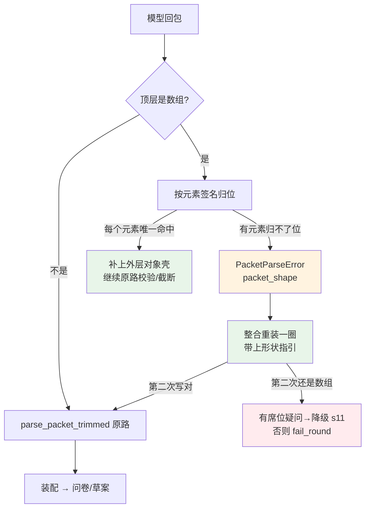

# P7 执行计划 · 整包回成数组：形状重建 + 整合重装

> **给执行的 agent：** 严格按任务顺序做：每个任务先写红测试、跑到红、再实现、再跑绿、再提交。
> 一次提交一个任务，提交信息用中文。**除非测试本身写错（要说明错在哪），不许改测试来迁就实现。**
> **不要分配子任务**（作者原话：不要派子任务）。
> 上游拍板：2026-09-28 作者原话「先做整包回成数组，记得按照前面的范式来生成计划，弄清具体细节等，然后再实施」。

> **执行结果（2026-09-28 当天做完，T1–T5 全部落地，勾选见下）：**
> 五个提交：`aed3a9d`（顶层数组形状重建）、`49eeab1`（整合解析错也重装）、
> `e618025`（形状纠错指引）、`2f6d429`（**验证时抓到：席位解析错没重装**，补上）、
> `73464e0`（**验证时抓到：提案编号撞号**，按最大编号续编）。
> 后端 **564 passed** · `ruff` All checks passed · 端点仍 19 个。
> 验证：留样回放（真跑那两份数组报文都重建成功）、`edge-contradiction` 1/1、**完整 eval 8/8**（98 次调用、0 失败）、
> 端到端真跑 17 次调用 0 次 502、**46 条提案落库 v2**（旧上限 30 下必死）。

**Goal：** 让"模型把整包回成一个数组"这一类形状错误不再整轮判死：
①能**无歧义**归位的数组按元素签名重建；②重建不了时，**整合也要有第二次机会**（现在它一次都不重装）。

**Architecture：** 两件事都落在 P6 已经建好的两条通道上，不新增通道：
- **形状重建**放在 `schemas.py` 的解析期（它是报文形状的唯一真相源），与 `parse_packet_trimmed` 同一入口；
  重建是**机械映射**，判据是"元素签名唯一命中一个容器"，**任何一处不唯一就不猜、照旧判死**；
- **重装**沿用 `_integrate_with_repair` 已有的循环与 `repair_note`；
  本计划只把"解析错"从"立刻判死"里拆出来（现在 `except ApplicationError` 把 `PacketParseError`
  一起当成网关失败），让 P6 的纠错指引真正有第二次机会。

**Tech Stack：** Python 3.13 + Pydantic v2 + FastAPI + SQLite + LiteLLM + LangGraph（前端不动）。

**Spec：** `.codex/docs/设计/02-编排与数据.md` §7（失败、暂停与恢复 / 一轮调用上限表）、
§11.0.7（P6 的口径：超限不判死 / 引用归一化 / 席位丢人不丢轮）；§11.0.5（重装的规矩：必须带纠错指引）。

## Global Constraints

- 测试：`cd backend && PYTHONDONTWRITEBYTECODE=1 python3 -m pytest -p no:cacheprovider -o addopts=""`
  （`pyproject.toml` 里 `addopts = "-q"`，不要再叠 `-q`，会吞掉统计行）
- Lint：`cd backend && python3 -m ruff check --no-cache .`
- 结构守卫必须全绿（分层 / 唯一写路径 / `src/` 无 fake / **UoW 里不许 await** / graph 三键 / 节点 async）
- **模型调用一律在事务外**：重装循环在 `with self._uow:` 之前（`_integrate_with_repair` 本来就是）
- 端点白名单**不变**（19 个）；**不加 DTO 字段、不改前端**
- **不新增持久化字段**：重建只发生在解析期，产物仍是既有的 packet
- **不许猜**：签名判据必须唯一；任一元素无法唯一归位 → 判死（走重装）
- 不留生成物：跑完 `git status --short` 只能剩预期改动；见到 `__pycache__` / `*.db` 就清
- **不要碰 `backend/data/pmstudio.db`**；真模型验证一律跑在 `/tmp/…`

**基线（2026-09-28 实测）**：后端 `551 passed` · `ruff` All checks passed · 端点 19 个 · 工作区只剩
`.gitignore`（作者的 `*.omx/` 行）与 `.codex/runs/`（上一轮真跑产物）。

---

## 0. 现场取证（对着留样，不对着印象）

**两次真实失败都长一个样：整包是一个数组。**

| 来源 | 轮次 | 报文 | 元素形状 |
|---|---|---|---|
| 端到端真跑（P6 验证） | `r-12353e02` 留样 15 | 顶层数组，5 个元素 | 每个元素都是 **QuestionDraft**（`title` / `why` / `consequence_if_skipped` / `target` …） |
| 完整 eval | `r-8d65170f` 留样 66 | 顶层数组，4 个元素 | 同上 |

**第二个缺陷（这次才看清）：整合的解析错一次都不重装。**

```
留样 15（数组）插入时间 13:15:20.199Z  ←  HTTP 502 也是 13:15:20
留样 16（对象）插入时间 13:16:15.305Z  ←  这是我手动点"重试"之后才发生的
```

代码事实（`use_cases.py::IntegrateRound._integrate_with_repair`）：

```python
            try:
                outcome = await self._integrator.integrate(...)
            except ApplicationError as error:      # ← PacketParseError 也是 ApplicationError
                fail_round(...); raise             # ← 于是"形状/结构错"直接判死，循环继续不了
```

而 claims 与席位都**已经**对 `PacketParseError` 重装（claims 见 P5d，席位见 P6 T5）。
也就是说：整合是唯一一个"给了纠错指引却没机会用"的地方——P6 写的 `repair_note` 对它从来没生效过
（`r-12353e02` 就是证据：第一次数组 → 立刻 502，没有第二次调用）。

---

## 1. 执行范围

**做**

1. **形状重建**（T1）：`parse_packet` / `parse_packet_trimmed` 遇到**顶层是数组**时，
   按"元素签名唯一命中一个容器"重建 `{container: [...]}`；任一元素无法唯一归位 → 判死。
   **只对 `IntegrationPacket` 开这个口子**——它的四个容器都有默认值，重建后不需要补任何字段；
   `ClaimsPacket`（必填 `basis` + 至少一个席位）与 `SeatPacket`（必填 `basis`）**不重建**：
   重建它们就得**凭空造必填字段**，那是编内容，不是修形状。
2. **整合的解析错也走重装**（T2）：`except ApplicationError` 拆成
   `ModelCallFailed`（立刻失败，网关类）与 `PacketParseError` / `DomainError`（可修复 → 重装）。
3. **纠错指引补形状分支**（T3）：`repair_note` 认出 `packet_shape`，说清"顶层要对象、允许哪些键"。
4. **真相源回写**（T4）+ **真模型/留样验证**（T5）。

**不做（明确划线）**

- 不重建 `ClaimsPacket` / `SeatPacket` 的数组（会凭空造必填字段）。
- 不做"数组里混着无法归类元素时猜一个"：判死 + 重装。
- 不动 P6 的三条口径（超限截断 / 引用归一化 / 席位丢人不丢轮）。
- 不动 DTO、端点、前端、图结构。
- 不修 F1（叙述式输入不产功能候选）与 F12/F14（配额、s11 只涨不消）。

---

## 2. 关键设计（要作者看一眼的两处判断）

**D1 · 只给 `IntegrationPacket` 重建，为什么**

| 报文 | 顶层数组能不能重建 | 原因 |
|---|---|---|
| `IntegrationPacket` | **能** | 四个容器（`questions` / `list_items` / `proposals` / `dropped_opinions`）全都有默认值；重建 = 只补一层壳 |
| `SeatPacket` | 不能 | `basis` 是必填；数组里没有 basis，补一个空串等于替模型填字段（且会让"空意见必须给理由"的守卫失去牙齿） |
| `ClaimsPacket` | 不能 | `basis` 必填 + `seats` 至少一个；补不了，补了就是编 |

**D2 · 签名表（元素 → 容器）是怎么做到"不猜"的**

四个容器的必填键彼此不重叠，判别顺序如下（**命中即停**）：

| 顺序 | 判据（元素里有这个键） | 归到 | 为什么唯一 |
|---|---|---|---|
| 1 | `handle` | `dropped_opinions` | 只有它要求 `handle` |
| 2 | `title` 或 `consequence_if_skipped` | `questions` | 只有它有题面/跳过后果 |
| 3 | `text` **且** `target` **且** `reason` | `list_items` | 只有它同时有 `text`+`reason`（proposal 没有 `reason`） |
| 4 | `evidence_refs` 或 `op` | `proposals` | 只剩它（题号在顺序 2 已经拦掉） |
| 5 | 都不命中 | **判死** | 无法唯一归位 → 不猜 |

顺序 2 在顺序 4 之前是必须的：`QuestionDraft` 也可能带 `evidence_refs`，
先看题面特征才能把它和 proposal 分开。这一条要有测试钉住（T1 的"签名互斥"测试）。

---

## 3. 数据流

```
模型回包（顶层是数组）
  └─ _normalize_payload(payload, model=IntegrationPacket)
       ├─ 每个元素按签名唯一归位 → {"questions": [...], "proposals": [...], ...}
       │     └─ 继续走已有的 parse_packet_trimmed（超限照旧截断 + 溢出报告）
       └─ 有元素归不了位 / 报文不是 IntegrationPacket
             └─ PacketParseError(packet_shape={"got": "array", "expected_keys": [...]})
                   └─ 整合：**现在会重装一次**（T2），带 repair_note 的形状分支
                         ├─ 第二次写对 → 整轮继续
                         └─ 第二次还是数组 → 与内容错同一个出口（有席位疑问→降级 s11；否则 fail_round）
```

---

## 4. 逐文件改动

| 文件 | 改什么 |
|---|---|
| `backend/src/pmstudio/application/agents/schemas.py` | 新增 `_normalize_payload()`（顶层数组 → 容器字典）、`_container_of_item()`（签名表）、`_top_level_keys()`；`parse_packet` 与 `parse_packet_trimmed` 在 `json.loads` 之后先过它；重建不了时抛 `PacketParseError(packet_shape=…)` |
| `backend/src/pmstudio/application/repair.py` | 新增 `packet_shape` 分支（在 `errors` 之前） |
| `backend/src/pmstudio/application/use_cases.py` | `IntegrateRound._integrate_with_repair`：把模型调用与 assemble 收进同一个 `try`，`ModelCallFailed` 立刻失败，`PacketParseError`/`DomainError` 走既有重装出口 |
| `.codex/docs/设计/02-编排与数据.md` | §7 表里"整合"那一行写清"解析错也重装"；新增 §11.0.8 |
| `.codex/docs/上下文/checkpoint.md` | P7 落地与验证结论 |

**接口（新签名）**

```python
# schemas.py
def _normalize_payload(payload: object, *, model: type[BaseModel], purpose: str) -> object: ...
def _container_of_item(item: Mapping[str, object], *, model: type[BaseModel]) -> str | None: ...
def _top_level_keys(model: type[BaseModel]) -> tuple[str, ...]: ...   # model.model_fields 的键
```

---

## 5. 架构图（改后）



绿色 = 本计划新开的恢复通道；橙色 = 判死前的最后一次机会；红色 = 既有失败出口。

---

## 6. 任务分解

### Task 1：顶层数组的形状重建（签名唯一才重建）

**Files:**
- Modify: `backend/src/pmstudio/application/agents/schemas.py`
- Test: `backend/tests/application/test_packet_overflow.py`（追加）

**Interfaces:**
- Consumes: 无（解析期自足）
- Produces: `_normalize_payload()` / `_container_of_item()` 与 `PacketParseError(details["packet_shape"])`

- [x] **Step 1: 写红测试**

```python
REAL_QUESTION = {
    "title": "三类通知的具体模板内容是什么？",
    "why": "通知模板决定接收方能执行的动作",
    "consequence_if_skipped": "通知内容无法实现",
    "target": {"zone": "body", "section_id": "s5", "feature_slug": "notification", "field": "io"},
    "type": "text",
    "kind": "gap",
    "evidence_refs": ["E11"],
    "from_opinions": ["seat.notification:O1"],
}

MINIMAL_ITEM = {
    "questions": {
        "title": "t", "why": "w", "consequence_if_skipped": "c",
        "target": {"zone": "body", "section_id": "s1"},
    },
    "list_items": {"text": "t", "target": {"zone": "body", "section_id": "s1"}, "reason": "r"},
    "proposals": {
        "op": "add", "target": {"zone": "body", "section_id": "s1"},
        "text": "t", "origin_type": "derived", "evidence_refs": ["E1"],
    },
    "dropped_opinions": {"handle": "seat.x:O1", "reason": "r"},
}


def test_signatures_are_mutually_exclusive():
    """四个容器的判别键必须两两不撞——否则就是猜。"""

    mapping = {
        name: schemas._container_of_item(item, model=schemas.IntegrationPacket)
        for name, item in MINIMAL_ITEM.items()
    }

    assert mapping == {name: name for name in MINIMAL_ITEM}


def test_top_level_array_of_questions_is_rebuilt():
    """真跑实测：模型把 5 道题直接当成整包回回来 → 整轮 502（报告 F15）。"""

    payload = json.dumps([REAL_QUESTION, REAL_QUESTION], ensure_ascii=False)
    packet, overflow = schemas.parse_packet_trimmed(
        payload, schemas.IntegrationPacket, purpose="integration"
    )

    assert len(packet.questions) == 2
    assert packet.proposals == [] and packet.list_items == [] and packet.dropped_opinions == []
    assert overflow == ()


def test_top_level_array_of_mixed_items_is_rebuilt_element_wise():
    payload = json.dumps(
        [MINIMAL_ITEM["questions"], MINIMAL_ITEM["proposals"], MINIMAL_ITEM["dropped_opinions"]],
        ensure_ascii=False,
    )
    packet, _ = schemas.parse_packet_trimmed(
        payload, schemas.IntegrationPacket, purpose="integration"
    )

    assert len(packet.questions) == 1
    assert len(packet.proposals) == 1
    assert len(packet.dropped_opinions) == 1


def test_array_with_an_unclassifiable_element_still_fails_with_a_shape_hint():
    payload = json.dumps([MINIMAL_ITEM["questions"], {"foo": "bar"}], ensure_ascii=False)

    with pytest.raises(PacketParseError) as exc:
        schemas.parse_packet_trimmed(payload, schemas.IntegrationPacket, purpose="integration")

    assert exc.value.details["packet_shape"] == {
        "got": "array",
        "expected_keys": ("questions", "list_items", "proposals", "dropped_opinions"),
    }


def test_claims_packet_array_is_not_guessed():
    """claims 必填 basis + 至少一个席位：重建就得凭空造字段，所以只判死（有重装兜）。"""

    with pytest.raises(PacketParseError) as exc:
        schemas.parse_packet(
            json.dumps([{"text": "t", "raw_span": "t", "label": "need"}]),
            schemas.ClaimsPacket,
            purpose="claims",
        )

    assert exc.value.details["packet_shape"]["expected_keys"] == ("basis", "claims", "seats")


def test_rebuilt_array_still_honours_the_cap():
    """重建之后照旧走截断：70 条提案的数组不该因为"换了个壳"就绕过上限。"""

    payload = json.dumps([MINIMAL_ITEM["proposals"]] * 70, ensure_ascii=False)
    packet, overflow = schemas.parse_packet_trimmed(
        payload, schemas.IntegrationPacket, purpose="integration"
    )

    assert len(packet.proposals) == 60
    assert overflow == (schemas.Overflow(container="proposals", kept=60, dropped=10),)
```

- [x] **Step 2: 跑红**

`cd backend && python3 -m pytest tests/application/test_packet_overflow.py -p no:cacheprovider -o addopts="" -v`
Expected: FAIL（`_container_of_item` 不存在；数组一律 `model_type` 错）

- [x] **Step 3: 改实现**

```python
# schemas.py（放在 parse_packet 之前）
from collections.abc import Mapping

#: 顶层数组的元素 → 容器：按判别键**顺序**匹配，命中即停（顺序本身是判据的一部分）
_SIGNATURES: dict[type[BaseModel], tuple[tuple[str, tuple[frozenset[str], ...]], ...]] = {
    IntegrationPacket: (
        ("dropped_opinions", (frozenset({"handle"}),)),
        ("questions", (frozenset({"title"}), frozenset({"consequence_if_skipped"}))),
        ("list_items", (frozenset({"text", "target", "reason"}),)),
        ("proposals", (frozenset({"evidence_refs"}), frozenset({"op"}))),
    ),
}


def _top_level_keys(model: type[BaseModel]) -> tuple[str, ...]:
    return tuple(model.model_fields)


def _container_of_item(item: Mapping[str, object], *, model: type[BaseModel]) -> str | None:
    """一个元素该归到哪个容器？命中不了任何签名就返回 None（调用方判死，不猜）。"""

    keys = set(item)
    for container, signatures in _SIGNATURES.get(model, ()):
        if any(signature <= keys for signature in signatures):
            return container
    return None


def _normalize_payload(payload: object, *, model: type[BaseModel], purpose: str) -> object:
    """顶层是数组时补上外层对象壳；补不了就抛"形状错"（带指引）。

    真跑实测（`02` §11.0.8）：模型会把整包回成一个数组（元素是 QuestionDraft），
    旧的写法直接 `model_type` 判死整轮。数组是**漏了外壳**，不是内容错——
    只要每个元素能用签名唯一归位，就机械补壳；有元素归不了位就照旧判死。
    """

    if not isinstance(payload, list) or not payload:
        return payload
    signature_known = model in _SIGNATURES
    buckets: dict[str, list[object]] = {}
    if signature_known:
        for item in payload:
            if not isinstance(item, dict):
                break
            container = _container_of_item(item, model=model)
            if container is None:
                break
            buckets.setdefault(container, []).append(item)
        else:
            return buckets
    raise PacketParseError(
        "模型把整包返回成了数组，无法唯一归位到任何一类内容",
        purpose=purpose,
        packet_shape={"got": "array", "expected_keys": _top_level_keys(model)},
    )


def parse_packet[T: BaseModel](text: str, model: type[T], *, purpose: str) -> T:
    try:
        payload = json.loads(text)
    except json.JSONDecodeError as error:
        raise PacketParseError(
            f"模型返回的不是合法 JSON：{error.msg}", purpose=purpose, offset=error.pos
        ) from error
    payload = _normalize_payload(payload, model=model, purpose=purpose)
    try:
        return model.model_validate(payload)
    except ValidationError as error:
        ...  # 原样（含 P6 加的 overflow 细节）


def parse_packet_trimmed[T: BaseModel](text, model, *, purpose):
    try:
        payload = json.loads(text)
    except json.JSONDecodeError as error:
        raise PacketParseError(...) from error
    payload = _normalize_payload(payload, model=model, purpose=purpose)   # 新增这一行
    try:
        return model.model_validate(payload), ()
    except ValidationError as error:
        ...  # 原样（含 P6 的截断逻辑）
```

- [x] **Step 4: 跑绿**

`cd backend && python3 -m pytest tests/application/test_packet_overflow.py tests/application/test_agent_schemas.py -p no:cacheprovider -o addopts="" -v`
Expected: PASS

- [x] **Step 5: 提交**

```bash
git add backend/src/pmstudio/application/agents/schemas.py \
        backend/tests/application/test_packet_overflow.py
git commit -m "feat(packet): 顶层数组按元素签名重建（唯一才重建，否则带形状提示判死）"
```

### Task 2：整合的解析错也要重装一圈

**Files:**
- Modify: `backend/src/pmstudio/application/use_cases.py`（`IntegrateRound._integrate_with_repair`）
- Test: `backend/tests/application/test_dropped_trace.py`（追加，用例层走真实闭环）

**Interfaces:**
- Consumes: T1 的 `PacketParseError(packet_shape=…)`、`repair_note`（P6）
- Produces: 整合的"解析错也重装"行为（与 claims / 席位对称）

- [x] **Step 1: 写红测试**

```python
async def test_integration_repacks_when_the_packet_is_an_array():
    """真跑实测：第一次回数组 → 立刻 502，**根本没有第二次调用**（留样 15/16 的时间戳）。

    修好之后：第一次数组（且无法重建时）→ 重装一次 → 第二次正常 → 整轮照走。
    """

    harness = Harness(
        replies={
            "claims": CLAIMS_REPLY,
            # 第一次：不是签名能归位的数组（元素是 {}）→ 判死前先重装
            # 第二次：正常对象
            "integration": ["[{}]", OVER_CAP_FREE_DRAFT_REPLY],
        },
        seat_replies={SEAT: SEAT_REPLY},
    )

    round_id = await run_to_integrated(harness)

    round_ = harness.rounds.get(round_id)
    assert round_.draft is not None                      # 没判死
    assert [request.purpose for request in harness.gateway.requests].count("integration") == 2
    assert "数组" in harness.prompts.calls[-1][1]["validation_error"]   # 重装带上了形状指引
```

```python
async def test_integration_still_fails_after_two_bad_shapes():
    harness = Harness(
        replies={"claims": CLAIMS_REPLY, "integration": ["[{}]", "[{}]"]},
        seat_replies={SEAT: SEAT_REPLY},
    )

    with pytest.raises(PacketParseError):
        await run_to_integrated(harness)

    round_ = ...
    assert round_.step is Step.FAILED
```

- [x] **Step 2: 跑红**

`cd backend && python3 -m pytest tests/application/test_dropped_trace.py -p no:cacheprovider -o addopts="" -v`
Expected: FAIL（`integration` 只被调了 1 次就判死）

- [x] **Step 3: 改实现**

```python
# use_cases.py::_integrate_with_repair —— 把模型调用与装配收进同一个 try
            try:
                outcome = await self._integrator.integrate(...)
                if outcome.overflow and attempt < MAX_INTEGRATION_ATTEMPTS:
                    ...  # P6 原样
                    continue
                assembled = assemble(
                    outcome.packet, round_=round_, document=document, ledger=ledger
                )
                assembled = replace(
                    assembled,
                    dropped=assembled.dropped
                    + _overflow_items(outcome.overflow, pass_index=round_.seat_round_count),
                )
                gaps = dry_run(
                    document, assembled.proposals, round_=round_, now=self._clock.now()
                )
                if outcome.overflow:
                    ...  # P6 原样：缺口行
            except ModelCallFailed as error:
                # 网关类：网关自己已经重试 3 次，重装帮不上忙 → 立刻失败
                fail_round(..., reason=error.message)
                raise
            except (PacketParseError, DomainError) as error:
                # 形状/结构/内容错都是**可修复的错**：给第二次机会（这正是 P5d/P6 的纠错指引的用处）
                message = getattr(error, "message", str(error))
                if attempt == MAX_INTEGRATION_ATTEMPTS:
                    ...  # 原有的"两次都过不了"出口：有席位疑问→降级 s11；否则 fail_round
                validation_error = (
                    repair_note(error)
                    if isinstance(error, PacketParseError)
                    else message          # 领域错的话术本身更具体，别用通用话盖掉
                )
                continue
            except ApplicationError as error:
                fail_round(..., reason=error.message)   # 兜底：与今天的行为一致
                raise
            return assembled, gaps
```

- [x] **Step 4: 跑绿**

`cd backend && python3 -m pytest tests/application -p no:cacheprovider -o addopts="" -v`
Expected: PASS（含既有 551 条）

- [x] **Step 5: 提交**

```bash
git add backend/src/pmstudio/application/use_cases.py backend/tests/application/test_dropped_trace.py
git commit -m "fix(integration): 解析错也要重装一圈（原来被当成网关失败直接判死）"
```

### Task 3：`repair_note` 的形状分支

**Files:**
- Modify: `backend/src/pmstudio/application/repair.py`
- Test: `backend/tests/application/test_repair.py`（追加）

**Interfaces:**
- Consumes: `PacketParseError(details={"packet_shape": {"got": "array", "expected_keys": (...)}})`（T1）
- Produces: `repair_note()` 的 `packet_shape` 分支

- [x] **Step 1: 写红测试**

```python
def test_packet_shape_tells_the_model_the_object_it_owes():
    note = repair_note(
        PacketParseError(
            "模型把整包返回成了数组，无法唯一归位到任何一类内容",
            purpose="integration",
            packet_shape={
                "got": "array",
                "expected_keys": ("questions", "list_items", "proposals", "dropped_opinions"),
            },
        )
    )

    assert "数组" in note and "对象" in note
    assert "questions" in note and "dropped_opinions" in note
```

- [x] **Step 2: 跑红**

`cd backend && python3 -m pytest tests/application/test_repair.py -p no:cacheprovider -o addopts="" -v`
Expected: FAIL

- [x] **Step 3: 改实现**

```python
# repair.py：放在 "errors" 分支之前（形状比字段路径更根本）
    elif "packet_shape" in details:
        shape = details["packet_shape"] or {}
        keys = "、".join(shape.get("expected_keys", ())) or "（见上面的 schema）"
        lines.append(
            f"你返回的是**{shape.get('got', '未知形状')}**，而我要的是一个**对象**："
            f"顶层只允许这些键——{keys}；每个键的值才是数组。"
            "例如：{\"questions\": [ ... ], \"proposals\": [ ... ]}。"
            "不要只输出里面那个数组。"
        )
```

- [x] **Step 4: 跑绿**

`cd backend && python3 -m pytest tests/application/test_repair.py -p no:cacheprovider -o addopts="" -v`
Expected: PASS（6 条）

- [x] **Step 5: 提交**

```bash
git add backend/src/pmstudio/application/repair.py backend/tests/application/test_repair.py
git commit -m "feat(repair): 形状错也给指引（顶层要对象、允许哪些键）"
```

### Task 4：真相源回写

**Files:**
- Modify: `.codex/docs/设计/02-编排与数据.md`
- Modify: `.codex/docs/上下文/checkpoint.md`

- [x] **Step 1: §7 调用上限表**：把"整合"那一行的"两次都失败怎么办"补上
  "解析错也重装"（与席位那一行对称）。

- [x] **Step 2: 新增 §11.0.8**，写清：来历（留样 15/16 的时间戳证据）、
  只给 `IntegrationPacket` 重建的理由、签名表（顺序即判据）、"不唯一就判死"、
  以及"整合的解析错过去从不重装"这个缺陷的修法。

- [x] **Step 3: checkpoint**：P7 落地 + 验证结论（引用 T5 的数字）。

- [x] **Step 4: 提交**

```bash
git add .codex/docs/设计/02-编排与数据.md .codex/docs/上下文/checkpoint.md
git commit -m "docs(设计/上下文): 回写 P7——顶层数组形状重建与整合重装"
```

### Task 5：验证（单测 + 留样回放 + 真模型）

- [x] **Step 1: 全量单测与 lint**

```bash
cd backend && PYTHONDONTWRITEBYTECODE=1 python3 -m pytest -p no:cacheprovider -o addopts=""
cd backend && python3 -m ruff check --no-cache .
```

- [x] **Step 2: 留样回放（改前死、改后过）**

```bash
cd backend && python3 - <<'PY'
import json, sqlite3, sys
sys.path.insert(0, "src")
from pmstudio.application.agents import schemas
for db, cid in (("/tmp/pmstudio-p6-run.db", 15), ("/tmp/pmstudio-p6.db", 66)):
    txt = sqlite3.connect(f"file:{db}?mode=ro", uri=True).execute(
        "SELECT reply_text FROM model_calls WHERE id=?", (cid,)).fetchone()[0]
    packet, overflow = schemas.parse_packet_trimmed(txt, schemas.IntegrationPacket, purpose="integration")
    print(db, cid, "→ questions:", len(packet.questions), "proposals:", len(packet.proposals), "overflow:", overflow)
PY
```

Expected：两条真跑的数组报文都重建成功（题数 = 5 / 4）。

- [x] **Step 3: 真模型复现**

```bash
cd backend && set -a && . ./.env && set +a && PMSTUDIO_TRACE_MODEL=1 uv run python scripts/eval.py --case edge-contradiction --db /tmp/pmstudio-p7.db
cd backend && set -a && . ./.env && set +a && PMSTUDIO_TRACE_MODEL=1 uv run python scripts/eval.py --db /tmp/pmstudio-p7-full.db
```

判据：①`edge-contradiction` 不再出现"整包数组"导致 `model_type` 硬失败；
②全量 8 条的通过率不低于 P6 的基线（P6 是 6/8，两个红单跑各 1/1 通过 = 抖动）。

- [x] **Step 4: 端到端真跑**（起 `dev.py` 到 `8130`，用 `/tmp/pmstudio-runs/bin/drive.py` 走一轮）

判据：整轮不再因为形状问题 502；若模型真回数组，`transcript.jsonl` 里应看到
"第一次 200（重建生效）"或"第一次 502→重装→200"（而不是 502 直接结束）。

- [x] **Step 5: 提交验证结论**

```bash
git add .codex/docs/上下文/checkpoint.md
git commit -m "docs(上下文): P7 验证结论（留样回放 + eval + 端到端）"
```

---

## 7. 成功之后是什么样

1. **模型把 5 道题当成整包回回来**（`r-12353e02` 那一幕）：

```
改前：POST /answers → 502（model_type: Input should be a valid dictionary …）
      → 我手动点重试才继续（留样 15 与 16 的插入时间差 55 秒就是证据）
改后：解析期补上 {"questions": [...]} → 200，问卷照常出（第一次就过，不需要重试）
```

2. **数组里有归不了位的元素**（模型自由发挥）：

```
改后：第一次 → PacketParseError(packet_shape) → 重装（指引："顶层要对象，键是
      questions / list_items / proposals / dropped_opinions，不要只输出里面那个数组"）
      → 第二次写对 → 整轮继续；第二次还错 → 与内容错同一个出口（降级或判死）
```

3. **claims / 席位的数组**（必填字段补不了）：

```
不重建（不凭空造 basis/seats），但**都有重装**：指引说清"顶层只允许 basis / claims / seats"，
第二次大概率写对。
```

4. **契约零变化**：19 个端点、DTO、前端、图结构、持久化字段全不动；
   用户看到的结果与"模型第一次就写对"完全一样。

5. **数字**：单测 551 → 约 **560+**；`ruff` 全绿；架构守卫全绿。

---

## 8. 自检

**① spec 覆盖**

| 要求 | 落在哪个任务 |
|---|---|
| 顶层数组 → 整轮判死（留样 15 / 66） | T1（重建）+ T2（重装）+ T3（指引） |
| "整包数组"这类形状错要能自愈 | T1（可归位时零成本恢复） |
| 整合的解析错一次都不重装（结构性缺陷） | T2 |
| 不许猜 | T1 的签名互斥测试 + "任一元素归不了位就判死" |
| 重建后仍受上限约束 | T1 的最后一条测试 |
| 真相源不漂 | T4 |
| 真模型才算数 | T5 |

**② 占位符扫描**：每个任务都有可直接粘贴的测试与实现代码；没有 TBD/TODO/"类似上文"。

**③ 类型一致性**：`_container_of_item(item, *, model)` / `_normalize_payload(payload, *, model, purpose)`
在 T1 定义、T1 内部消费；`packet_shape={"got", "expected_keys"}` 由 T1 抛、T3 读，键名一致；
T2 复用 P6 已有的 `repair_note` / `_overflow_items` / `MAX_INTEGRATION_ATTEMPTS`。

**④ 我自己的疑点（作者拍板时顺带看一眼）**

1. **重建要不要留痕？** 我倾向**不留**：它不丢内容（只是补了个外壳），
   而"模型回错过"这件事留样表里看得见（同一轮 integration 出现两次调用就是重装，
   一次调用但报文是数组就说明走了重建）。若作者要求在产品里显形，我加一条
   `Round.dropped`（"整合报文是数组，已按签名重建"）——但那会让"留痕=没进卡片"的语义变浑。
2. **`list_items` 的判据要不要更严？** 现在是 `text`+`target`+`reason` 三键都在才算；
   如果模型给 list_item 时漏写 `reason`，它会掉到"判死 + 重装"而不是"猜成 proposal"——我选判死。
3. **重建与"空数组"**：`[]` 不重建（`not payload`）——空数组对席位意味着"没意见也没理由"，
   按 L2 必须失败；对整合意味着"什么都没提"，交给装配层原有出口。这条要有测试钉住（T1 已含）。
