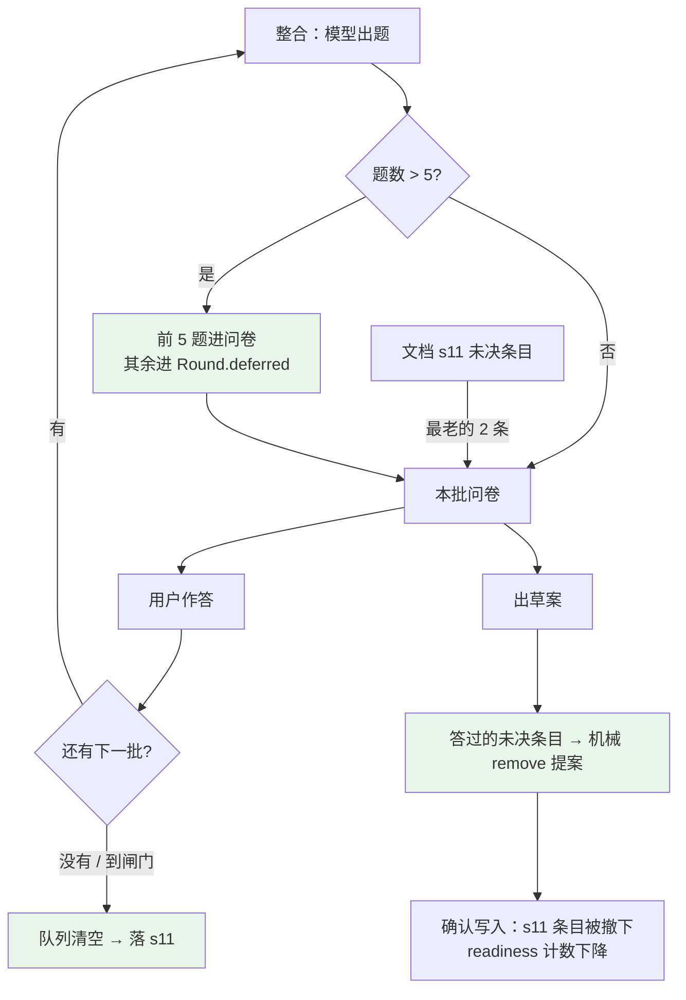

# P9 执行计划 · 未决队列：被挤掉的题有去向 + 排队消化

> **给执行的 agent：** 每个任务先写红测试、跑到红、再实现、再跑绿、再提交；一次一个提交（中文）。
> **除非测试本身写错（要说明错在哪），不许改测试来迁就实现。** **不要分配子任务。**
> 上游拍板：2026-09-28 作者原话「1. 被配额挤掉的题必须有去向（下一轮必问 / 进 s11 / 进 list_items）；
> 2. 未决项排队消化，否则永远 ready 不了」。

**Goal：** ①"本批只问 5 题，这条留到下一轮"这句承诺**变成真的**——挤掉的题进队列，下一批/下一轮优先问，
到闸门就落 s11；②s11 里的未决项**排队消化**：每轮挑最老的几条去问，**答过的机械撤下**，
让 s11 的阻塞数能降下来（现在只涨不消）。

**Architecture：** 队列只有**一份真相源**，分两层：
- **轮内队列**：`Round.deferred`（挂在轮次 payload 上，老行 `.get` 默认空 → 向后兼容）。
  它承接"这一轮被 5 题上限挤掉的题"，在同一轮的下一批优先问；出草案或问卷到顶时**清空并落 s11**。
- **跨轮队列**：**就是文档 s11 里的未决条目**（不新建表、不新增第二真相源）。
  每轮挑最老的 N 条变成"carried 题"；**只要它被回答了，装配层机械地生成一条 `remove` 撤下它**
  （模型不用配合也能消化）。

**Tech Stack：** Python 3.13 + Pydantic v2 + FastAPI + SQLite（前端不动）。

**Spec：** `.codex/docs/设计/02-编排与数据.md` §5（问卷与开放问题）、§7（失败与上限表）；
`.codex/docs/设计/01-规格.md` §7（就绪度：s11 不允许有阻塞型未决）；
`.codex/docs/设计/04-未决.md` C6（两批上限 → 剩余题落 s11）；`.codex/runs/2026-09-28/报告.md` F12/F14。

## Global Constraints

- 测试：`cd backend && PYTHONDONTWRITEBYTECODE=1 python3 -m pytest -p no:cacheprovider -o addopts=""`
- Lint：`cd backend && python3 -m ruff check --no-cache .`
- 结构守卫必须全绿（分层 / 唯一写路径 / `src/` 无 fake / **UoW 无 await** / graph 三键 / 节点 async）
- 端点白名单**不变**（19 个）；`RoundView` **不加字段**（队列的可见性走 s11 条目与既有 `list_items`）
- **模型调用一律在事务外**；`take_deferred` / `clear_deferred` 这类**写**必须发生在 `with self._uow:` 里
- 新持久化键只有一个（`rounds.payload.deferred_questions`），老行必须能读回来（`.get(..., ())`）
- 不留生成物；**不要碰 `backend/data/pmstudio.db`**

**基线（2026-09-28 实测）**：后端 `564 passed` · `ruff` All checks passed · 端点 19 个 · 完整 eval 8/8。

---

## 0. 现状（对着代码与真跑）

| 事实 | 证据 |
|---|---|
| 超 5 题的溢出**被写成 `list_items`**，理由写"这条留到下一轮" | `assembly.py:245-248` |
| `list_items` 只活在**当轮问卷**上：`RoundView.list_items` 从 `round_.questionnaire.list_items` 取 | `dto.py:307` |
| 问卷答完 → `Round.questionnaire` 被下一批覆盖（`_questionnaire = ...`）→ 上一批的清单项**消失** | `domain/round/round.py::integrate` |
| 到闸门（两批/席位轮上限）→ 剩余题落 s11 | `use_cases.py::__call__` 的 `downgraded_question_proposals` |
| s11 未决条目**没有任何消费/撤下机制**：readiness 只数条数 | `readiness.py::_open_questions` |
| 真跑里 s11 阻塞数**只涨不消**：3 → 9 → 11 → 11 → **13** | `.codex/runs/2026-09-28/报告.md` F14 |
| 真跑里同一件事被跨轮重复问（因为答案没落进文档，文档"既有结论"里没有它） | 报告 F6/F7 |

---

## 1. 执行范围

**P9-A · 轮内队列（确定性，无新表）**

1. `Round.deferred`（域）+ payload 一个键（T1）。
2. `assemble(..., carried=())` 返回 `Assembly.deferred`：**不再把溢出题伪装成 list_items**（T2）。
3. 用例层：本批被挤掉的题进队列；下一批把队列排在最前（占 5 题配额）（T3）。
4. 出草案或问卷到顶 → **队列清空并落 s11**（T4）。

**P9-B · 跨轮消化（把 s11 当队列）**

5. 每批从文档 s11 里挑**最老的 N 条**（`MAX_OPEN_ITEMS_PER_BATCH = 2`）变成 carried 题，
   记住它的 `entry_id`（`Question.from_entry`）（T5）。
6. **答过就撤下**：装配层机械生成 `remove` 提案（`origin=system_default` + 答案的 E 编号）（T6）。
7. 未决清单进整合提示词 + 一条硬规矩："本轮必须处理这些"（T7）。

**不做**

- 不新建"未决队列表"（s11 条目就是队列；新建第二真相源会漂）。
- 不把选项结构塞进 s11 条目文本（导出 markdown 会被脏数据污染）——carried 题按 `text` 型重出，
  选项由整合者在需要时重新生成。
- 不改 `MAX_QUESTIONS_PER_BATCH=5` / `MAX_QUESTIONNAIRES=2`（那是产品口径，不是本计划的事）。
- 不搬 `list_items` 的展示（前端不动）。

---

## 2. 口径（要作者拍板）

| # | 决策 | 推荐 | 依据 |
|---|---|---|---|
| D1 | 队列存哪 | 轮内 = `Round.deferred`（payload 新键）；跨轮 = **文档 s11 条目本身** | 单一真相源；老行 `.get` 兼容；不加表 |
| D2 | 轮内队列上限 | `MAX_DEFERRED = 10`（= 两批 × 5 题） | 再多也问不完，超出的直接落 s11（不是丢） |
| D3 | 每批拿几条 s11 未决项 | `MAX_OPEN_ITEMS_PER_BATCH = 2` | 真跑里每轮新增未决 2–4 条；每批 2 条 × 2 批 ≈ 打平，且不挤掉本轮新题 |
| D4 | "消化"的定义 | **被回答过** → 机械 `remove` 撤下；没答 → 留在 s11 等下一轮 | 只靠模型自觉不可靠（真跑里它连 drop 都漏填过），机械通道才可验收 |
| D5 | 撤下时机 | 出草案那一刻（同一事务里，与答案一起） | 答案进账本 + 撤下未决 = 同一次写入的两个事实，不能分家 |
| D6 | 未决条目的来源格式 | 用**我们自己写进去的标准文本**（`open_question_proposal` 的格式）正则解析 title/consequence；解析不了就跳过并在 gaps 里说明 | 格式是我们生成的、有测试钉住；不往条目里塞 JSON |

---

## 3. 数据流

```
改前：
  模型出 8 题 → 保留 5 题 → 溢出 3 题写进 list_items（理由"留到下一轮"）
      → 用户答完这批 → questionnaire 被覆盖 → 那 3 条**没了**
      → 到两批上限 → 剩余题落 s11 → s11 只涨

改后：
  模型出 8 题 → 保留 5 题 → 溢出 3 题进 Round.deferred
      → 下一批：carried = [s11 最老的 2 条] + [队列里的 3 条]（排在模型新题之前）
            仍超 5 题的继续留在队列（上限 10；超出部分直接落 s11）
      → 出草案 / 问卷到顶：队列清空 → 全部落 s11（阻塞型带〔未决·阻塞〕）
      → 其中被**回答过**的 s11 条目：机械 remove 撤下（下一版文档里就没了）
      → readiness 的 s11 计数随之下降
```

---

## 4. 逐文件改动

| 文件 | 改什么 |
|---|---|
| `backend/src/pmstudio/domain/round/round.py` | `Round` 加 `deferred` 字段与 `defer / peek_deferred / take_deferred / clear_deferred`；`Question` 加 `from_entry` |
| `backend/src/pmstudio/infrastructure/sqlite/serialization.py` | `round_to_payload` 写 `deferred_questions`（复用 `_question_to_json/_from_json`）；`_question_to_json` 写 `from_entry`，读侧 `.get` |
| `backend/src/pmstudio/application/assembly.py` | `assemble(..., carried=())`；`Assembly.deferred`；不再把溢出题写进 list_items；新增 `deferred_from_open_items(document, ledger, limit)`（把 s11 条目变成 carried 题） |
| `backend/src/pmstudio/application/assembling? …` → 实际落在 `assembly.py` 的可复用小函数 | 解析 s11 条目标准文本 → `(title, consequence, blocking, eid)` |
| `backend/src/pmstudio/application/use_cases.py` | `_integrate_with_repair`：peek 队列 + s11 未决项，构成 `carried` 传给 assemble；`__call__`：事务里 `take_deferred`；出草案/闸门时 `clear_deferred` + 落 s11；**回答过的未决项生成 remove 提案** |
| `backend/src/pmstudio/application/agents/integrator.py` + `prompts/integrator.md` | `$open_items` 槽（最老的 N 条未决项 + entry id）+ 硬规矩"本轮必须处理" |
| `.codex/docs/设计/02-编排与数据.md` | §11.0.10（队列口径）+ §7 表格补一句"队列只在轮内有活路，出草案必落 s11" |
| `.codex/docs/上下文/checkpoint.md` | P9 落地与验证结论 |

**接口**

```python
# domain/round/round.py
class Round:
    deferred: tuple[Question, ...] = ()
    def defer(self, questions: Sequence[Question]) -> None: ...          # 追加 + 去重（不含上限裁剪）
    def peek_deferred(self, limit: int) -> tuple[Question, ...]: ...    # 只读，模型调用前用
    def take_deferred(self, limit: int) -> tuple[Question, ...]: ...    # 取出并从队列移除
    def clear_deferred(self) -> tuple[Question, ...]: ...               # 清空并返回

class Question:
    from_entry: str | None = None   # 这条题来自哪条 s11 未决条目（用于答完撤下）

# application/assembly.py
def assemble(packet, *, round_, document, ledger, carried: Sequence[Question] = ()) -> Assembly: ...
def deferred_from_open_items(document, *, ledger, limit: int) -> tuple[Question, ...]: ...
def parse_open_item(text: str) -> tuple[str, str, bool] | None: ...      # (title, consequence, blocking)
```

---

## 5. 架构图



绿色 = 本计划新增的三条通道（进队列 / 落 s11 / 机械撤下）。

---

## 6. 任务分解

### Task 1：`Round.deferred` 与 `Question.from_entry`

**Files:**
- Modify: `backend/src/pmstudio/domain/round/round.py`、`domain/round/questionnaire.py`
- Modify: `backend/src/pmstudio/infrastructure/sqlite/serialization.py`
- Test: `backend/tests/domain/test_round_deferred.py`（新建）、`backend/tests/infrastructure/test_sqlite_repositories.py`（追加一条兼容性）

**Interfaces:**
- Produces: `defer / peek_deferred / take_deferred / clear_deferred`（FIFO、去重）；`Question.from_entry`

- [ ] **Step 1: 写红测试**

```python
def question(title: str = "导出要支持多大？") -> Question:
    return Question(
        question_id=QuestionId("q1"),
        target=Target.body("s8"),
        type=QuestionType.SINGLE,
        title=title,
        why="量级决定同步还是异步",
        consequence_if_skipped="按同步实现，超时风险由 PM 承担",
        options=(Option("a", "少于 1 万"), Option("b", "1 万–10 万")),
    )


def test_defer_then_take_is_fifo_and_idempotent():
    round_ = make_round()

    round_.defer([question("A"), question("B"), question("A")])   # 同题只留第一次
    taken = round_.take_deferred(2)

    assert [item.title for item in taken] == ["A", "B"]
    assert round_.deferred == ()                                  # 取走了


def test_peek_does_not_consume():
    round_ = make_round()
    round_.defer([question("A")])

    assert [item.title for item in round_.peek_deferred(5)] == ["A"]
    assert len(round_.deferred) == 1


def test_clear_deferred_returns_everything_left():
    round_ = make_round()
    round_.defer([question("A"), question("B")])

    assert [item.title for item in round_.clear_deferred()] == ["A", "B"]
    assert round_.deferred == ()


def test_question_from_entry_round_trips_through_payload():
    round_ = make_round()
    round_.defer([replace(question("A"), from_entry="r1#open01")])

    payload = round_to_payload(round_)
    back = round_from_payload(payload, round_id=ROUND_ID, project_id=PROJECT,
                              created_at=round_.created_at, step=round_.step,
                              waiting_on=round_.waiting_on)

    assert back.deferred[0].from_entry == "r1#open01"


def test_old_payload_without_deferred_reads_as_empty():
    payload = round_to_payload(make_round())
    payload.pop("deferred_questions")            # 模拟老行

    back = round_from_payload(payload, ...)

    assert back.deferred == ()
```

- [ ] **Step 2: 跑红**

`cd backend && python3 -m pytest tests/domain/test_round_deferred.py -p no:cacheprovider -o addopts="" -v`
Expected: FAIL（`Round` 没有 `defer`）

- [ ] **Step 3: 改实现**

```python
# questionnaire.py：Question 加一个字段（放在 blocking 之后，带默认值 → 老 payload 兼容）
    #: 这条题来自哪条 s11 未决条目（答完要机械撤下它）；新题一律 None
    from_entry: str | None = None

# round.py
    def defer(self, questions: Sequence[Question]) -> None:
        """把本批没问上的题存进轮内队列（去重：同一个去处 + 同一个问法只留第一次）。"""

        seen = {(item.target.label(), " ".join(item.title.split())) for item in self._deferred}
        fresh = [
            item
            for item in questions
            if (item.target.label(), " ".join(item.title.split())) not in seen
        ]
        self._deferred = self._deferred + tuple(fresh)

    def peek_deferred(self, limit: int) -> tuple[Question, ...]:
        return self._deferred[:limit]

    def take_deferred(self, limit: int) -> tuple[Question, ...]:
        taken, self._deferred = self._deferred[:limit], self._deferred[limit:]
        return taken

    def clear_deferred(self) -> tuple[Question, ...]:
        taken, self._deferred = self._deferred, ()
        return taken

# serialization.py
#: round_to_payload 里加
        "deferred_questions": [_question_to_json(item) for item in round_.deferred],
#: round_from_payload 里加（老行没有这个键）
        deferred=tuple(_question_from_json(item) for item in payload.get("deferred_questions", ())),
#: _question_to_json 加 "from_entry": question.from_entry
#: _question_from_json 加 from_entry=data.get("from_entry")
```

- [ ] **Step 4: 跑绿**

`cd backend && python3 -m pytest tests/domain tests/infrastructure -p no:cacheprovider -o addopts="" -v`
Expected: PASS

- [ ] **Step 5: 提交**

```bash
git add backend/src/pmstudio/domain/round/round.py \
        backend/src/pmstudio/domain/round/questionnaire.py \
        backend/src/pmstudio/infrastructure/sqlite/serialization.py \
        backend/tests/domain/test_round_deferred.py \
        backend/tests/infrastructure/test_sqlite_repositories.py
git commit -m "feat(round): 轮内未决队列（defer/peek/take/clear）与 Question.from_entry"
```

### Task 2：装配层——溢出题不再伪装成 list_items

**Files:**
- Modify: `backend/src/pmstudio/application/assembly.py`
- Test: `backend/tests/application/test_assembly.py`（追加）

**Interfaces:**
- Produces: `assemble(..., carried=())`、`Assembly.deferred`
- Consumes: T1 的 `Question`

- [ ] **Step 1: 写红测试**

```python
def test_overflow_questions_are_returned_as_deferred_not_list_items():
    """真跑实测：原来它们被写成 list_items（理由"留到下一轮"），但没人读（报告 F12）。"""

    result = assembly.assemble(
        packet(questions=[question_draft(f"第 {i} 题") for i in range(1, 8)]),  # 7 题
        round_=round_with_two_seats_attested(),
        document=make_document(),
        ledger=ledger_with_two_entries(),
    )

    assert len(result.questions) == 5
    assert [item.title for item in result.deferred] == ["第 6 题", "第 7 题"]
    assert result.list_items == ()          # 不是"清单项"，是"没问上的题"


def test_carried_questions_are_asked_before_the_new_ones():
    carried = [
        Question(question_id=QuestionId("qX"), target=Target.body("s8"),
                 type=QuestionType.TEXT, title="上一批没问上的题",
                 why="本批上限", consequence_if_skipped="继续留在队列")
    ]

    result = assembly.assemble(
        packet(questions=[question_draft("新题 A"), question_draft("新题 B")]),
        round_=round_with_two_seats_attested(),
        document=make_document(),
        ledger=ledger_with_two_entries(),
        carried=carried,
    )

    assert [item.title for item in result.questions] == ["上一批没问上的题", "新题 A", "新题 B"]
    assert [str(item.question_id) for item in result.questions] == ["q1", "q2", "q3"]  # 统一重编号


def test_a_carried_question_is_not_asked_twice_by_the_model():
    carried = [Question(...title="导出要支持多大？"...)]
    packet_again = packet(questions=[question_draft("导出要支持多大？")])

    result = assembly.assemble(packet_again, ..., carried=carried)

    assert [item.title for item in result.questions] == ["导出要支持多大？"]  # 只留 carried 那份
```

- [ ] **Step 2: 跑红**

`cd backend && python3 -m pytest tests/application/test_assembly.py -p no:cacheprovider -o addopts="" -v`
Expected: FAIL（`assemble() got an unexpected keyword argument 'carried'`）

- [ ] **Step 3: 改实现**

```python
# assembly.py
@dataclass(frozen=True, slots=True)
class Assembly:
    ...
    deferred: tuple[Question, ...] = ()   # 本批没问上的题（进轮内队列）


def _question_key(question: Question) -> tuple[str, str]:
    return (question.target.label(), " ".join(question.title.split()))


def assemble(packet, *, round_, document, ledger, carried: Sequence[Question] = ()) -> Assembly:
    ...
    ordered = list(carried)                                  # ← carried 排最前
    seen = {_question_key(item) for item in carried}
    for item in feature_questions:
        ordered.append(item)
        seen.add(_question_key(item))
    for index, item in enumerate(packet.questions, start=1):
        ...
        question = _question(...)
        if _question_key(question) in seen:                  # 模型又问了一遍 → 丢新的
            continue
        seen.add(_question_key(question))
        ordered.append(question)
    kept = [replace(item, question_id=QuestionId(f"q{i}")) for i, item in enumerate(ordered[:MAX_QUESTIONS_PER_BATCH], start=1)]
    deferred = tuple(ordered[MAX_QUESTIONS_PER_BATCH:])
    ...
    list_items = [...]                                       # 只留模型自己给的清单项
    return Assembly(questions=tuple(kept), deferred=deferred, list_items=tuple(list_items), ...)
```

- [ ] **Step 4: 跑绿**

`cd backend && python3 -m pytest tests/application/test_assembly.py -p no:cacheprovider -o addopts="" -v`
Expected: PASS（含既有 30 条）

- [ ] **Step 5: 提交**

```bash
git add backend/src/pmstudio/application/assembly.py backend/tests/application/test_assembly.py
git commit -m "feat(assembly): 超上限的题进 deferred（不再伪装成 list_items）；carried 题优先问"
```

### Task 3：用例层接上轮内队列（下一批优先问）

**Files:**
- Modify: `backend/src/pmstudio/application/use_cases.py`（`_integrate_with_repair` 与 `__call__`）
- Test: `backend/tests/application/test_integrate_answers.py`（追加）

**Interfaces:**
- Consumes: `Round.peek_deferred / take_deferred / defer`（T1）、`Assembly.deferred`（T2）
- Produces: 队列的读写时机（**peek 在模型调用前、take 在同一事务里**）

- [ ] **Step 1: 写红测试**

```python
async def test_questions_squeezed_out_by_the_batch_cap_come_back_next_batch():
    """真跑实测：第 6 题起原来被写成"留到下一轮"的 list_items，然后随问卷被覆盖而消失。"""

    harness = Harness(
        replies={
            "claims": CLAIMS_REPLY,
            "integration": [
                packet_with_questions(7),
                packet_with_questions(1, prefix="第二批"),
            ],
        },
        seat_replies={SEAT: SEAT_REPLY},
    )
    round_id = await round_in_seat_pass(harness)
    authorize_order_export(harness, round_id)

    await harness.integrate_round()(round_id=round_id)
    first = harness.rounds.get(round_id).questionnaire
    assert [q.title for q in first.questions] == [f"第 {i} 题" for i in range(1, 6)]
    assert len(harness.rounds.get(round_id).deferred) == 2  # 第 6、7 题进了队列

    await harness.submit_answers()(round_id=round_id, form_id="f1", answers=(), skipped=("q1",))
    await harness.run_seat_round()(round_id=round_id)
    await harness.integrate_round()(round_id=round_id)

    second = harness.rounds.get(round_id).questionnaire
    assert [q.title for q in second.questions] == ["第 6 题", "第 7 题", "第二批题"]
    assert harness.rounds.get(round_id).deferred == ()
```

- [ ] **Step 2: 跑红**

`cd backend && python3 -m pytest tests/application/test_integrate_answers.py -p no:cacheprovider -o addopts="" -v`
Expected: FAIL（队列恒空 / 第二批只有 1 题）

- [ ] **Step 3: 改实现**

```python
# use_cases.py::_integrate_with_repair —— 模型调用前**只读**地取候选（peek，不消费）
            carried = round_.peek_deferred(MAX_QUESTIONS_PER_BATCH)
            ...
            outcome = await self._integrator.integrate(...)
            ...
                assembled = assemble(
                    outcome.packet,
                    round_=round_,
                    document=document,
                    ledger=ledger,
                    carried=carried,
                )

# use_cases.py::__call__ —— 同一个事务里：把真被问出去的那几条从队列取走，本批新的溢出追加进来
        with self._uow:
            round_ = self._rounds.get(round_id)
            ...
            round_.take_deferred(len(carried))
            round_.defer(assembled.deferred)
```

> 实现说明：`carried` 必须从 `_integrate_with_repair` **带出来**（否则在 `__call__` 里重算一遍
> 会和模型看到的不一致）。做法：让 `_integrate_with_repair` 返回三元组
> `(assembled, gaps, carried)`，`__call__` 按同一个列表取走；**不要**在 `__call__` 里重新 peek。

- [ ] **Step 4: 跑绿**

`cd backend && python3 -m pytest tests/application -p no:cacheprovider -o addopts="" -v`
Expected: PASS

- [ ] **Step 5: 提交**

```bash
git add backend/src/pmstudio/application/use_cases.py backend/tests/application/test_integrate_answers.py
git commit -m "feat(round): 本批挤掉的题进队列、下一批优先问（peek 在模型调用前，take 在事务里）"
```

### Task 4：出草案 / 问卷到顶 → 队列清空落 s11

**Files:**
- Modify: `backend/src/pmstudio/application/use_cases.py`
- Test: `backend/tests/application/test_integrate_answers.py`（追加）

**Interfaces:**
- Consumes: `Round.clear_deferred`（T1）
- Produces: "队列只在轮内有活路"的确定性出口

- [ ] **Step 1: 写红测试**

```python
async def test_deferred_queue_is_flushed_to_s11_when_the_round_stops_asking():
    """两批上限到了：本批没问上的题 + 队列里的题，**全部**落 s11（一条都不许凭空消失）。"""

    harness = Harness(
        replies={
            "claims": CLAIMS_REPLY,
            "integration": [
                packet_with_questions(7),
                packet_with_questions(7, prefix="第二批"),
            ],
        },
        seat_replies={SEAT: SEAT_REPLY},
    )
    round_id = await round_in_seat_pass(harness)
    authorize_order_export(harness, round_id)
    await harness.integrate_round()(round_id=round_id)  # 7 题 → 5 问 + 2 进队列
    await harness.submit_answers()(round_id=round_id, form_id="f1", answers=(), skipped=("q1",))
    await harness.run_seat_round()(round_id=round_id)
    await harness.integrate_round()(round_id=round_id)  # 第二批也是 7 题 → 到顶

    round_ = harness.rounds.get(round_id)
    assert round_.draft is not None
    assert round_.deferred == ()
    s11 = [p.text for p in round_.draft.proposals if str(p.target.section_id) == "s11"]
    assert any("第 6 题" in text for text in s11)
    assert any("第二批第 6 题" in text for text in s11)


async def test_deferred_queue_is_flushed_even_when_this_batch_has_no_questions():
    """这一批模型没给题（直接出草案）——队列里的题也必须落 s11，不能留在队列里烂掉。"""

    harness = Harness(
        replies={"claims": CLAIMS_REPLY, "integration": [packet_with_questions(7), draft_packet()]},
        seat_replies={SEAT: SEAT_REPLY},
    )
    round_id = await round_in_seat_pass(harness)
    authorize_order_export(harness, round_id)
    await harness.integrate_round()(round_id=round_id)
    await harness.submit_answers()(round_id=round_id, form_id="f1", answers=(), skipped=("q1",))
    await harness.run_seat_round()(round_id=round_id)
    await harness.integrate_round()(round_id=round_id)

    round_ = harness.rounds.get(round_id)
    assert round_.deferred == ()
    s11 = [p.text for p in round_.draft.proposals if str(p.target.section_id) == "s11"]
    assert any("第 6 题" in text for text in s11)
```

- [ ] **Step 2: 跑红**

`cd backend && python3 -m pytest tests/application/test_integrate_answers.py -p no:cacheprovider -o addopts="" -v`
Expected: FAIL（队列还留着 / s11 里看不到它们）

- [ ] **Step 3: 改实现**

```python
# use_cases.py::__call__（同一个事务里，两处出口都要清）
            stop_reason = _stop_asking_reason(round_)
            if questions and stop_reason is not None:
                ...            # 既有：把 questions 降级成 s11
                questions = ()
            if not questions:  # ← 出草案这一支（含上面的降级支）
                leftover = round_.clear_deferred()
                if leftover:
                    system_defaults = _system_defaults(round_, ledger=ledger, now=now)
                    for item in leftover:
                        system_defaults[item.question_id] = ledger.record(
                            kind=EvidenceKind.SYSTEM_DEFAULT,
                            text=f"{item.title}（本批没排上，未决定）",
                            source=EvidenceSource(
                                round_id=round_id,
                                rationale="单批最多 5 题；这一轮结束时仍有没排上的题",
                            ),
                            now=now,
                        )
                    proposals += list(
                        downgraded_question_proposals(
                            leftover,
                            system_defaults=system_defaults,
                            start_index=_next_proposal_index(proposals),
                            round_id=round_id,
                            reason="本批没排上",
                        )
                    )
                    gaps += [f"未决（本批没排上）：{item.title}" for item in leftover]
```

- [ ] **Step 4: 跑绿**

`cd backend && python3 -m pytest tests/application -p no:cacheprovider -o addopts="" -v`
Expected: PASS

- [ ] **Step 5: 提交**

```bash
git add backend/src/pmstudio/application/use_cases.py backend/tests/application/test_integrate_answers.py
git commit -m "feat(round): 出草案/问卷到顶时清空轮内队列并落 s11（一条都不凭空消失）"
```

### Task 5：把 s11 未决条目变成"下一轮必问"的 carried 题

**Files:**
- Modify: `backend/src/pmstudio/application/assembly.py`（`parse_open_item` + `deferred_from_open_items`）
- Modify: `backend/src/pmstudio/application/use_cases.py`（并进 carried）
- Test: `backend/tests/application/test_assembly.py`（追加）

**Interfaces:**
- Produces: `parse_open_item(text) -> tuple[str, str, bool] | None`；
  `deferred_from_open_items(document, *, ledger, limit) -> tuple[Question, ...]`（带 `from_entry`）

- [ ] **Step 1: 写红测试**

```python
def test_parse_open_item_reads_our_own_format():
    text = "〔未决·阻塞〕点检完成率的统计口径（未决定，待决人：PM；跳过后果：报表口径不清）"

    title, consequence, blocking = parse_open_item(text)

    assert title == "点检完成率的统计口径"
    assert consequence == "报表口径不清"
    assert blocking is True


def test_parse_open_item_rejects_a_foreign_line():
    assert parse_open_item("这条是用户手写的普通条目") is None


def test_oldest_open_items_become_carried_questions_with_their_entry_id():
    document = document_with_open_items(
        [
            "r1#open01|〔未决·阻塞〕A（未决定，待决人：PM；跳过后果：后果A）",
            "r2#open01|B（未决定，待决人：PM；跳过后果：后果B）",
        ]
    )

    carried = deferred_from_open_items(document, ledger=ledger_with_two_entries(), limit=1)

    assert len(carried) == 1                      # 只取最老的一条
    assert carried[0].title == "A"
    assert carried[0].from_entry == "r1#open01"   # 记住来源：答完要撤下它
    assert carried[0].type is QuestionType.TEXT   # 结构已丢 → 按开放题重出（选项由整合者补）
    assert carried[0].blocking is True            # 阻塞标记跟着走


def test_unparsable_open_items_are_skipped_not_crashed():
    document = document_with_open_items(["r1#open01|用户手写的一行"])

    assert deferred_from_open_items(document, ledger=ledger_with_two_entries(), limit=5) == ()
```

- [ ] **Step 2: 跑红**

`cd backend && python3 -m pytest tests/application/test_assembly.py -p no:cacheprovider -o addopts="" -v`
Expected: FAIL（两个函数不存在）

- [ ] **Step 3: 改实现**

```python
# assembly.py
_OPEN_ITEM = re.compile(
    r"^(?:〔未决·阻塞〕)?(?P<title>.+?)（未决定，待决人：[^；]+；跳过后果：(?P<consequence>.*)）$"
)


def parse_open_item(text: str) -> tuple[str, str, bool] | None:
    """s11 未决条目的标准文本 → (标题, 跳过后果, 是否阻塞)。

    格式是 `open_question_proposal` 自己写的（有测试钉住）；解析不了返回 None，调用方跳过——
    **不猜**（用户手写的条目、老版本写的条目都可能长别的样子）。
    """

    stripped = text.strip()
    match = _OPEN_ITEM.match(stripped)
    if match is None:
        return None
    return (match.group("title"), match.group("consequence"), stripped.startswith(BLOCKING_MARK))


def deferred_from_open_items(
    document: Document, *, ledger: EvidenceLedger, limit: int
) -> tuple[Question, ...]:
    """文档 s11 里**最老的** N 条未决条目 → carried 题（跨轮队列就是这些条目本身）。"""

    view = document.view()
    section = next((item for item in view.sections if str(item.section_id) == OPEN_QUESTION_HOME), None)
    if section is None:
        return ()
    carried: list[Question] = []
    for block in section.blocks:
        for entry in block.entries:
            parsed = parse_open_item(entry.text)
            if parsed is None:
                continue
            title, consequence, blocking = parsed
            carried.append(
                Question(
                    question_id=QuestionId("q0"),  # 占位：assemble 统一重编号
                    target=Target.body(OPEN_QUESTION_HOME),
                    type=QuestionType.TEXT,
                    kind=QuestionKind.DECISION if blocking else QuestionKind.GAP,
                    title=title,
                    why="这是前几轮留下的未决项，这一轮把它定下来",
                    consequence_if_skipped=consequence,
                    blocking=blocking,
                    from_entry=str(entry.entry_id),
                )
            )
            if len(carried) >= limit:
                return tuple(carried)
    return tuple(carried)
```

```python
# use_cases.py::_integrate_with_repair（模型调用前，两个来源拼在一起）
            carried = deferred_from_open_items(
                document, ledger=ledger, limit=MAX_OPEN_ITEMS_PER_BATCH
            ) + round_.peek_deferred(MAX_QUESTIONS_PER_BATCH)
```

- [ ] **Step 4: 跑绿**

`cd backend && python3 -m pytest tests/application -p no:cacheprovider -o addopts="" -v`
Expected: PASS

- [ ] **Step 5: 提交**

```bash
git add backend/src/pmstudio/application/assembly.py \
        backend/src/pmstudio/application/use_cases.py \
        backend/tests/application/test_assembly.py
git commit -m "feat(assembly): s11 未决条目 → 下一轮必问（带来源 entry id，最老的优先）"
```

### Task 6：答过的未决项 → 机械撤下（remove）

**Files:**
- Modify: `backend/src/pmstudio/domain/round/round.py`（记住 carried 的来源）
- Modify: `backend/src/pmstudio/infrastructure/sqlite/serialization.py`（同上，payload 兼容）
- Modify: `backend/src/pmstudio/application/use_cases.py`（`_retire_answered_open_items`）
- Test: `backend/tests/domain/test_round_deferred.py`、`backend/tests/application/test_integrate_answers.py`

**Interfaces:**
- Produces: `Round.remember_carried(questions)` / `Round.carried_sources() -> dict[str, str]`（question_id → entry_id）；
  `_retire_answered_open_items(round_, *, ledger, start_index) -> tuple[Proposal, ...]`

- [ ] **Step 1: 写红测试**

```python
# tests/domain/test_round_deferred.py
def test_carried_sources_survive_the_questionnaire_being_replaced():
    """问卷下一批会被覆盖，但"这道题来自哪条未决条目"必须留着（撤下要用）。"""

    round_ = make_round()
    round_.remember_carried(
        [replace(question("A"), question_id=QuestionId("q1"), from_entry="r0#open01")]
    )
    round_.remember_carried(
        [replace(question("B"), question_id=QuestionId("q2"), from_entry="r0#open02")]
    )

    assert round_.carried_sources() == {"q1": "r0#open01", "q2": "r0#open02"}


# tests/application/test_integrate_answers.py
async def test_answering_an_open_item_retires_it_from_s11():
    """真跑实测：s11 只涨不消（3→13），ready 永远过不了（报告 F14）。"""

    harness = ...
    document = harness.documents.get(PROJECT)
    document.seed_open_item("r0#open01", "〔未决·阻塞〕点检完成率的统计口径（未决定，待决人：PM；跳过后果：报表口径不清）")
    ...
    await harness.integrate_round()(round_id=round_id)   # 这道题被 carried 进来
    question = harness.rounds.get(round_id).questionnaire.questions[0]
    assert question.from_entry == "r0#open01"

    await harness.submit_answers()(
        round_id=round_id, form_id="f1",
        answers=(AnswerInput(question_id=str(question.question_id), text="按设备台数算", selected=()),),
        skipped=(),
    )
    await harness.run_seat_round()(round_id=round_id)
    await harness.integrate_round()(round_id=round_id)

    removals = [p for p in harness.rounds.get(round_id).draft.proposals if str(p.op) == "remove"]
    assert [str(item.entry_id) for item in removals] == ["r0#open01"]
    assert "本轮已回答" in removals[0].text
    assert removals[0].origin.type is OriginType.SYSTEM_DEFAULT


async def test_skipping_an_open_item_does_not_retire_it():
    ...  # 全 skipped → 没有 remove（它还得留在 s11）
```

- [ ] **Step 2: 跑红**

`cd backend && python3 -m pytest tests/domain/test_round_deferred.py tests/application/test_integrate_answers.py -p no:cacheprovider -o addopts="" -v`
Expected: FAIL（`remember_carried` 不存在 / 没有 remove 提案）

- [ ] **Step 3: 改实现**

```python
# round.py：记住 carried 的来源（question_id → entry_id）。
# 为什么不用"历史问卷"：carried 记录只服务这一件事，改动面最小（见 §8 疑点 1）。
    def remember_carried(self, questions: Sequence[Question]) -> None:
        for item in questions:
            if item.from_entry is not None:
                self._carried_sources[str(item.question_id)] = item.from_entry

    def carried_sources(self) -> dict[str, str]:
        return dict(self._carried_sources)

# serialization.py：round_to_payload 加 "carried_sources": round_.carried_sources()；
#   round_from_payload 加 carried_sources=dict(payload.get("carried_sources") or {})

# use_cases.py（模块级纯函数）
def _retire_answered_open_items(
    round_: Round, *, ledger: EvidenceLedger, start_index: int
) -> tuple[Proposal, ...]:
    """这一轮**被回答过**、且来自 s11 未决条目的题 → 各出一条 remove（把未决项撤下）。

    机械做，不问模型：真跑里模型连"没采用的席位意见"都漏填，这种"记账"的活不能指望它。
    """

    answered = {
        str(answer.question_id)
        for answer_set in round_.answer_sets
        for answer in answer_set.answers
    }
    mapping = answer_eids(round_, ledger=ledger)
    sources = round_.carried_sources()
    proposals: list[Proposal] = []
    index = start_index
    for question_id in sorted(answered):
        entry_id = sources.get(question_id)
        eid = mapping.get(question_id)
        if entry_id is None or eid is None:
            continue
        proposals.append(
            Proposal(
                proposal_id=ProposalId(f"p{index:02d}"),
                entry_id=EntryId(entry_id),
                op=WriteOp.REMOVE,
                target=Target.body(OPEN_QUESTION_HOME),
                text="本轮已回答，撤下这条未决项",
                origin=Origin(OriginType.SYSTEM_DEFAULT, (EvidenceId(eid),)),
                kind=BlockKind.QUESTION,
            )
        )
        index += 1
    return tuple(proposals)

# use_cases.py::__call__（出草案那一支，跟 T4 的队列落 s11 挨着）
            proposals += list(
                _retire_answered_open_items(
                    round_, ledger=ledger, start_index=_next_proposal_index(proposals)
                )
            )
# use_cases.py::_integrate_with_repair（模型调用前）
            round_.remember_carried(carried)   # ← 注意：这是**写**，要挪进事务
```

> 实现注意：`remember_carried` 必须在 `with self._uow:` 里做（本仓库的守卫要求"模型调用在事务外"，
> 而任何**写**都要在事务里）。做法：`_integrate_with_repair` 把 `carried` 带出去（T3 已经这么做了），
> `__call__` 在同一个事务里 `round_.remember_carried(carried)`。

- [ ] **Step 4: 跑绿**

`cd backend && python3 -m pytest tests/domain tests/application -p no:cacheprovider -o addopts="" -v`
Expected: PASS

- [ ] **Step 5: 提交**

```bash
git add backend/src/pmstudio/domain/round/round.py \
        backend/src/pmstudio/infrastructure/sqlite/serialization.py \
        backend/src/pmstudio/application/use_cases.py \
        backend/tests/domain/test_round_deferred.py \
        backend/tests/application/test_integrate_answers.py
git commit -m "feat(round): 被回答过的未决项机械撤下（s11 从此可降，不再只涨）"
```

### Task 7：未决清单进整合提示词（让它有机会少问一次）

**Files:**
- Modify: `backend/src/pmstudio/application/agents/integrator.py`、`prompts/integrator.md`
- Modify: `backend/src/pmstudio/application/use_cases.py`
- Test: `backend/tests/application/test_integrator.py`（追加）

**Interfaces:**
- Produces: `Integrator.integrate(..., open_items: str = "")`

- [ ] **Step 1: 写红测试**

```python
def test_limits_tell_the_model_to_process_open_items():
    assert "未决" in LIMITS_TEXT
    assert "remove" in LIMITS_TEXT


async def test_open_items_are_rendered_for_the_integrator():
    # 项目里先放一条 s11 未决条目，再跑一次整合
    await harness.integrate_round()(round_id=round_id)

    slots = harness.prompts.calls[-1][1]
    assert "点检完成率的统计口径" in slots["open_items"]
    assert "r0#open01" in slots["open_items"]     # 带 entry id，模型才撤得对
```

- [ ] **Step 2: 跑红** → `Expected: FAIL`

- [ ] **Step 3: 改实现**

```python
# integrator.py：PROMPT_SLOTS 加 "open_items"；integrate(..., open_items: str = "")
# LIMITS_TEXT 加一条
        "- 上下文里列出的**未决项**本轮必须处理：能定的写内容，并出一条 "
        "{op: remove, entry_id: <那条未决项的 id>} 把它撤下；定不了的出成题（别原样再留一遍）",
```

```markdown
<!-- integrator.md：放在 $document_state 之后 -->
## 前几轮留下的未决项（本轮必须处理）
$open_items
```

```python
# use_cases.py::_integrate_with_repair
            open_items = "\n".join(
                f"- [{item.from_entry}] {item.title}（跳过后果：{item.consequence_if_skipped}）"
                for item in carried
                if item.from_entry is not None
            ) or "（没有未决项）"
```

- [ ] **Step 4: 跑绿** → `Expected: PASS`

- [ ] **Step 5: 提交**

```bash
git add backend/src/pmstudio/application/agents/integrator.py \
        backend/src/pmstudio/infrastructure/llm/prompts/integrator.md \
        backend/src/pmstudio/application/use_cases.py \
        backend/tests/application/test_integrator.py
git commit -m "feat(integrator): 未决项进提示词（能定的出 remove + 内容，定不了的出题）"
```

### Task 8：真相源回写 + 验证

**Files:**
- Modify: `.codex/docs/设计/02-编排与数据.md`、`.codex/docs/上下文/checkpoint.md`

- [ ] **Step 1: §11.0.10**：两层队列（轮内 `Round.deferred`，上限 10；跨轮 = s11 条目）、
  "队列只在轮内有活路，出草案必落 s11"、`MAX_OPEN_ITEMS_PER_BATCH=2` 的依据、
  "答过就机械撤下"、`Question.from_entry` 与 `carried_sources` 的来源关联。
- [ ] **Step 2: §7 表**：问卷那一行补"未排上的题 → 轮内队列 → 出草案落 s11"。
- [ ] **Step 3: 全量单测 + lint**（基线 564）。
- [ ] **Step 4: 真模型验证**

```bash
cd backend && set -a && . ./.env && set +a && PMSTUDIO_TRACE_MODEL=1 uv run python scripts/eval.py --db /tmp/pmstudio-p9-full.db
cd backend && PMSTUDIO_DB=/tmp/pmstudio-p9-run.db PMSTUDIO_TRACE_MODEL=1 uv run python scripts/dev.py --port 8140 --no-reload
```

判据：①完整 eval 不低于 **8/8**（抖动允许单条复跑确认）；
②同项目连跑 3 轮：第 2/3 轮的问卷里出现上一轮留下的未决项标题；
③版本 diff 里出现 `remove`（未决项被撤下），s11 条目**不再单调上涨**。
- [ ] **Step 5: 提交验证结论**

```bash
git add .codex/docs/设计/02-编排与数据.md .codex/docs/上下文/checkpoint.md
git commit -m "docs(设计/上下文): 回写 P9——未决队列与排队消化（含真跑验证）"
```

---

## 7. 成功之后是什么样

1. **模型一次给 8 题**：

```
改前：5 题进问卷、3 题写成 list_items（"留到下一轮"）→ 答完这批 → 那 3 条**消失了**
改后：5 题进问卷、3 题进 Round.deferred → 下一批问卷最前面就是它们 → 仍排不上 → 出草案时落 s11
```

2. **第 1 轮留 5 条未决，第 2 轮又新增 3 条**：

```
改前：s11 只涨（真跑实测 3 → 13），readiness 永远"未通过"
改后：第 2 轮先挑最老的 2 条去问 → 用户答了 → 出草案时这 2 条被 remove 撤下 →
      s11 净变化 = +3 − 2 = +1；连跑下去能收敛
```

3. **用户答了但模型忘了撤**：机械通道照样撤（不依赖模型自觉）。
4. **契约变化只有一个**：`rounds.payload` 多 `deferred_questions` 与 `carried_sources` 两个键
   （老行 `.get` 读回空）；端点、`RoundView`、前端、图结构都不动——未决项的可见性仍是 s11 条目本身。
5. **数字**：单测 564 → 约 **605+**；`ruff` 全绿；架构守卫全绿。

---

## 8. 自检

**① spec 覆盖**

| 要求（作者原话/报告条目） | 落在哪个任务 |
|---|---|
| 被配额挤掉的题必须有去向（下一轮必问 / 进 s11 / 进 list_items） | T2（进队列）+ T3（下一批必问）+ T4（出草案落 s11） |
| 未决项排队消化，否则永远 ready 不了 | T5（最老的 N 条必问）+ T6（答过就撤）+ T7（模型可少问一次） |
| 单一真相源 | D1：轮内 = Round 字段；跨轮 = s11 条目本身（不新建表） |
| 断点续传不丢状态 | T1 的 payload 往返测试 + T6 的 `carried_sources` 持久化 |
| 真模型才算数 | T8 |

**② 占位符扫描**：每段都是可粘贴的实现；两处"实现注意"（`carried` 要带出 `_integrate_with_repair`、
`remember_carried` 必须在事务里）是**本仓库的结构约束**，不是待定细节。

**③ 类型一致性**：`defer/peek_deferred/take_deferred/clear_deferred/remember_carried/carried_sources`
在 T1/T6 定义并自测；`Assembly.deferred`（T2）与 `carried`（T2/T3）同一批类型；
`Question.from_entry: str | None`（T1）由 T5 写、T6 读；`parse_open_item`（T5）返回三元组或 None。

**④ 我自己的疑点（拍板时定）**

1. **T6 的来源记住方式**：我用 `Round.carried_sources`（question_id → entry_id，只服务这件事）。
   另一条路是存一份"历史问卷"（更通用、更大）。我选了前者，若作者要通用版本，T1 的 payload 键
   换成 `questionnaire_history` 即可。
2. **每批 2 条未决项会不会挤掉本轮新题？** 会——这是**故意的**（老账优先）。若作者认为新题优先，
   把 `MAX_OPEN_ITEMS_PER_BATCH` 调成 1；调成 0 = 只落不消（回到今天的行为）。
3. **s11 里非标准格式的条目**（用户手写、早期版本写的）：解析不了就跳过，
   并在草案卡 gaps 里写一句"有 N 条未决条目格式不认识，本轮没排上"——**不猜、不崩**。
4. **`list_items` 还留不留？** 留（模型自己给的清单项仍然展示）；只是**不再**拿它当"被挤掉的题"的仓库。
