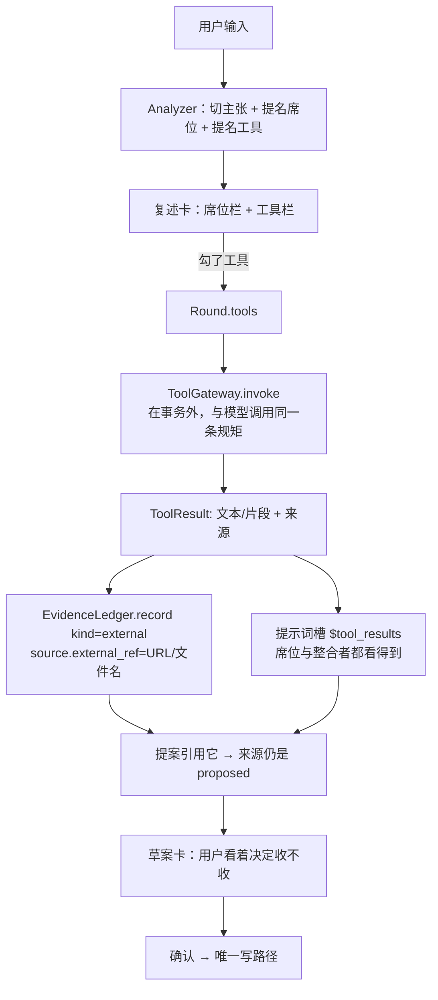
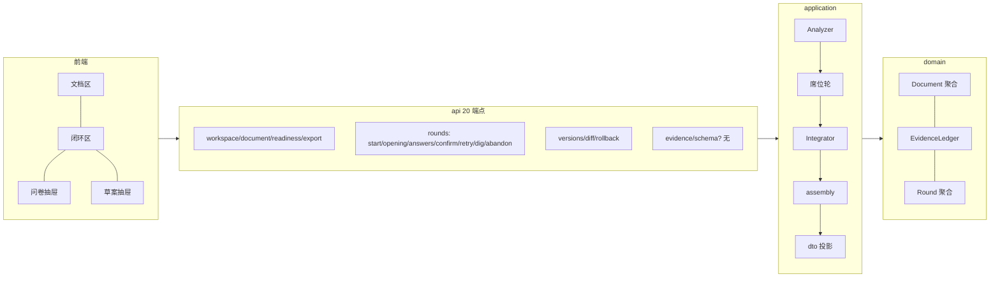
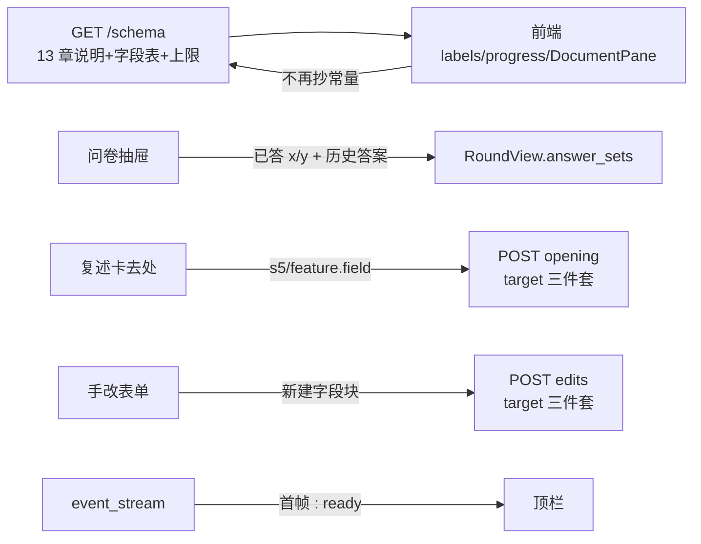
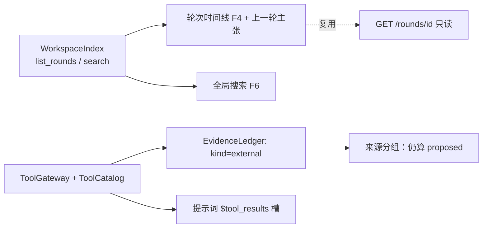

# P15 方案（待拍板）· 剩余核对 · 包 B 执行计划 · 包 C「整块能力」设计

> **状态**：方案，**未动一行代码**。作者拍板后再开工。
> **口径来源**：`01-规格.md`（要什么）· `02-编排与数据.md`（怎么跑）· `04-未决.md`（未决）·
> `05-DDD架构.md`（怎么实现）· `06-前端.md`（界面）。证据来源：`.codex/runs/2026-09-28/报告.md`、
> `.codex/runs/2026-09-29/{报告,P11验证,P12验证,P13验证,P14验证}.md`。
> **本文件替代** P14 计划里预告的 `docs/plans/2026-09-30-P15-卡片与文档可信度.md`
> ——范围从"包 B 全部"扩成"**剩余（包 B）+ 包 C 整块能力**"。

---

## 0. 核对结论

### 0.0 基线（今天实测，不是抄的）

| 项 | 值 | 怎么来的 |
|---|---|---|
| 分支 / HEAD | `new-branch` / `15eb4f6` | `git log --oneline` |
| 工作区 | 只有 `M .gitignore` | `git status --short` |
| 后端单测 | **741 passed**（19.81s） | `PYTHONDONTWRITEBYTECODE=1 python3 -m pytest -q -p no:cacheprovider -o addopts=""` |
| 前端 | **99 passed / 11 文件** + `tsc` 无输出 | `npx vitest run` / `npx tsc --noEmit` |
| 端点 | **20 个** | `tests/api/test_openapi_contract.py::EXPECTED_PATHS` |
| 结构守卫 | 22 条 | `tests/architecture/` |
| 工作库 | **没碰** `backend/data/pmstudio.db`；真跑库全在 `/tmp` | — |

### 0.1 包 A：已闭环，没有剩余

| 条 | 内容 | 落地 | 证据 |
|---|---|---|---|
| E3 | 续跑口径 | P13 T1–T3 | `Round.retry_hint`、`failure_at_step`/`retry_from`、走真图的钉子 |
| A2 | 清单项的去向 | P13 T5 | 出草案那一刻落 s11（不阻塞、带去处） |
| A3 | 未决队列先吃堵交付的 | P13 T6/T7 | 阻塞优先、`(去处, 归一化标题)` 判重 |
| C4 | 席位提议采用率 | P14 T1–T3 | `confirm(..., proposed_offered/accepted)`、`recent_rounds`、纯函数 streak |
| C6 | 继续深挖 | P14 T4–T6 | `Round.dig()` + `POST /rounds/{id}/dig` + 草案卡按钮 |

### 0.2 剩下的 = 包 B（5 条）——逐条对着代码核过

| # | 条目 | 现在什么样（代码证据） | 要动什么 | 体量 |
|---|---|---|---|---|
| **B1** | 章节说明 + 常量真相源 | `SectionSpec` 只有 `section_id/title/allows_features`（`domain/shared/sections.py:11`）——**13 句"这章是干什么的"根本不存在**；前端 `labels.ts:30` 抄了 12 个字段中文名、`state/progress.ts:15` 抄了 `MAX_SEAT_ROUNDS = 3`；没有 `GET /schema` | ① 新端点 `GET /schema`（13 章 + 说明 + 槽 + 字段表 + 上限常量）；② 前端改成从它取，拿不到回落 | 中 |
| **B2** | 问卷"已答 x/y"与历史答案 | `RoundView` 没有 `answer_sets`（`dto.py:131-157` 从头到尾没有答案）；`AnswerSet` 里有 `answers/skipped/form_id`（`domain/round/questionnaire.py:119`）——**数据有，只是没投影出去** | DTO 加一层只读投影 + 抽屉显示 | 小 |
| **B3** | 复述卡落到功能字段（F7）+ 手改补字段块（F8-①） | 复述卡 `<select>` 只有章节（`OpeningCard.tsx:89`），但**后端已经支持**：`ClaimEditRequest.target` 三件套齐全（`api/schemas.py:12-22`）、`routes.py:175` 已透传——缺的是前端把 `{feature_slug, field}` 拼出来；手改 `EditEntryRequest` 只有 `block_id`（`api/schemas.py:50-56`），`_resolve_manual_target` 只认"偏好区 / 已存在块 / 章节"（`use_cases.py:1603-1613`） | 后端放开 `{feature_slug, field}`；前端两个选择器 | 中 |
| **B4** | 组件级测试（F11） | `jsdom` + `@testing-library/*` 已装、11 个测试文件里只有 2 个 `.tsx`（`useRoundDrafts.test.tsx`、`DraftDrawer.test.tsx`） | 补 `QuestionnaireDrawer` + 补 `OpeningCard` | 小 |
| **界-2** | SSE 首帧要等 15 秒 | `api/sse.py:29-45`：只有 `TimeoutError` 才 `yield ": ping\n\n"`（第 37 行），**建流不发首字节** | 建流先发一行注释心跳 | 微 |

> 结论：**包 B 的边界是干净的**——B1 之后 B3 才有"字段中文名"可复用，其三条互不依赖；
> 只有一条既有测试会因为界-2 而需要改（见 §1·T7）。

### 0.3 包 C「整块能力」= 索引层 **或** 工具层

作者口径（2026-09-29）：*"索引层（连带 F4/F6/'上一轮的主张'）或工具层——这两块要单独设计，
不适合塞进一轮。"* 两块都**不在 P15 开工范围**，本文件只出**设计 + 分片 + 待拍板**。

| 块 | 它替谁收口 | 为什么不能塞进一轮 |
|---|---|---|
| **C-1 索引层** | `04` F4（历史轮次的席位发言）、F6（全局搜索）、`06` §5 的"上一轮的主张" | 它是**横切**能力：要给"跨轮读"定一条只读通道、定缓存与代价口径；塞进某一轮会把"这一轮"的契约撑变形 |
| **C-2 工具层** | `04` F9（附件 / 联网 / 检索） | 它一落地，`EvidenceKind.EXTERNAL`（`domain/shared/evidence_kind.py:16` 现在写着"v1 留位，暂无生产者"）就有了真实生产者——**得先回答"外部材料算不算权威"**，那是产品口径不是实现细节 |

### 0.4 `04-未决.md` §C 九条现状（作者要核的那一组）

| # | 条目 | 现状 | 证据 |
|---|---|---|---|
| C1 | 内置哪些领域席位 | **已定 + 已实现** | 10 份 `infrastructure/seats/definitions/*.toml`；Analyzer 同一次调用里挑 |
| C2 | 席位一次推导多少条 | **已定** | 提示词"最多 5 条"、报文上限 8；超限整轮失败（P5d 起改"重装一圈"） |
| C3 | 清单项默认值由谁定 | **已定** | 默认值必须来自席位推导；唯一硬编码是跳过的题落 s11 |
| C4 | "它提议的"没人勾怎么办 | **已做（P14）** | `02` §11.0.24 |
| C5 | Integrator 丢 finding 留痕 | **已定 + 全做完（P5b）** | `Round.dropped` 三来源（integrator / assembly / unaccounted） |
| C6 | 答案轮终止条件 | **已定 + 已做（P14）** | `MAX_QUESTIONNAIRES=2` + `dig` 额度；`02` §11.0.25 |
| C7 | 一轮最多几次席位轮 | **已定 + 已实现** | `MAX_SEAT_ROUNDS = 3`（`domain/round/step.py:39`），抽出 `Round.seat_round_limit` |
| C8 | 答案回来后缩编席位 | **已定 + 已实现（P5c）** | `narrow_seats()` 纯函数；名单落 `Round.active_seats` |
| C9 | 引用词表混用致整轮失败 | **已修（P4）** | 词表分离 + 归因通道 + 失败出口三条 |

> **结论：§C 没有任何剩余。** 若作者说的"C 包"另有所指，请见 §6 问题 1。

### 0.5 `04-未决.md` §E/§F 里所有还开着的口子 → 归谁

| 条 | 内容 | 归属 |
|---|---|---|
| F2 | 章节说明与"已完成 3/12" | **B1**（说明走 `/schema`；完整度 P5a 已做） |
| F3 | 问卷"已答 4/5"与历史答案 | **B2** |
| F4 | 历史轮次的席位发言 | **C-1**（`seat_packets` 只给"当前这趟"） |
| F6 | 全局搜索（文档 / 功能 / 席位 / 编号） | **C-1** |
| F7 | 复述卡改到功能字段 | **B3** |
| F8-① | 手改补"还不存在的字段块" | **B3**（domain 早已支持自动建块，`document.py:573`） |
| F8-② | 章节级追加每次都新开一段 | **暂不做**：`04` §4 已写"这条解掉一半"，另一半要等"块级 target"，属索引层之后 |
| F9 | 附件 / 联网 / 检索 | **C-2** |
| F10 | 讨论区 | 明确不做（E4） |
| F11 | 组件级测试 | **B4** |
| 界面侧-1 | 复述卡锁定两类标签 | 不改（后端 `Claim` 的规矩） |
| 界面侧-2 | SSE 首帧 15 秒 | **界-2** |
| 界面侧-3 | 两处有意保留的重复常量 | **B1** |
| `06` §5 | "上一轮的主张" | **C-1** |

### 0.6 09-28 报告 F1–F14 的收口账

| 报告条 | 收口在哪 | 现在还会不会犯 |
|---|---|---|
| F1 功能章会空 | P8（`dto.feature_coverage_advisory` + 提示词写明"已授权就要落功能字段"） | 已收；P10 真跑 advisories 只剩章节级 12 条 |
| F2 提案上限 30 | P6/P7（超限不判死 + 形状重建 + 重装） | 已收 |
| F3 编号格式差一点 | P6（归一化：去前导零/空白/大小写） | 已收 |
| F4 席位 10 条超 8 | P6（容器超限截断保留 + 溢出报告） | 已收 |
| F5 漏报未采用意见 | P5b + P12 T6（留痕带内容） | 已收（`unaccounted` 仍在，但目前**只提示不改判**） |
| F6 同一件事反复问 | P10（本轮跨批去重）+ P12/P13（题序、判重） | **本轮内**已收；**跨轮**仍是观察项（`02` §11.0.13 明写只覆盖本轮） |
| F7 矛盾题没标 conflict | P12 T7/T8（analyzer 报互斥对子 + 装配层机械盖章） | 已收 |
| F8 `list_items` 摇摆 | P12 T5（轮内累积 + 进下一批提示词） | 轮内已收；**跨轮不延续**（D5 决策，未做） |
| F9 advisory 自行扩章 | 拍板为**期望行为**（改在草案卡上标注） | 不是缺陷 |
| F10 功能字段缺一半 | P12 T4（`dry_run` 首项给补齐度） | 已收 |
| F11 `dropped_opinions` 封顶 30 | P6 | 已收 |
| F12 配额挤掉用户明确需求 | P12 T1（引用户主张的题排前）+ T3（配额 2→3） | 已收 |
| F13 目录外席位 | P6/P7（丢人不丢轮） | 已收 |
| F14 s11 单调上涨 | P12 T3 + P13（能降，降得慢） | **半收**：P10 实测"消化 4 / 新增 18"——方向对了，速度仍不够（观察项） |
| 网关超时诊断 | P5c + P13（我的活，不是功能） | 已收；`PMSTUDIO_MODEL_TIMEOUT=180` 是当前基线 |

---

## 1. 包 B 执行计划（P15）

**Goal**：把"界面上那些对不上后端的地方"收干净——**说明与常量回到后端这一份真相源**（B1）、
**问卷答了什么看得见**（B2）、**复述卡能落到功能字段、手改能补不存在的字段块**（B3）、
**关键组件有 jsdom 测试**（B4）、**SSE 首帧立刻到**（界-2）。

**Architecture**：两段——
① **后端先定形状**：`GET /schema`（纯函数用例，无 IO）→ 两个 DTO 投影（`answer_sets`、手改 target）；
② **前端再对齐**：常量改从 `/schema` 取、两个选择器、两处显示、两个组件测试。

**不做**：不动写入路径、不动 13 章骨架、不新增第二份真相源、不动任何上限值（只把它们**读出来**）。
**端点**：20 → **21**（只加 `/schema`）。

### 全局约束（与 P13/P14 同一套）

- 测试 `cd backend && PYTHONDONTWRITEBYTECODE=1 python3 -m pytest -p no:cacheprovider -o addopts=""`
- Lint `cd backend && python3 -m ruff check --no-cache .`
- 前端 `cd frontend && npx vitest run && npx tsc --noEmit`
- 结构守卫全绿；模型调用在事务外；**没有写入就不开事务**；新增持久化键老行必须能读回来
- 一任务一提交（中文）；**只有测试本身写错才改测试，且在回复里说明错在哪**

---

### T1 · 后端 `GET /schema`（端点 20 → 21）

**Files**

- 改 `backend/src/pmstudio/domain/shared/sections.py`（`SectionSpec` 加 `purpose`）
- 改 `backend/src/pmstudio/application/dto.py`（`SectionSchemaView` / `SlotSchemaView` / `FeatureFieldView` / `LimitsView` / `SchemaView` + `schema_view()`）
- 改 `backend/src/pmstudio/application/use_cases.py`（`GetSchema`）
- 改 `backend/src/pmstudio/api/app.py`（`ApiServices.get_schema`）、`api/routes.py`（`GET /schema`）
- 改 `backend/src/pmstudio/bootstrap/container.py`、`backend/tests/support/harness.py`（两处组装）
- 改 `backend/tests/api/test_openapi_contract.py`（`EXPECTED_PATHS` +1）、`backend/tests/domain/test_*sections*`、`backend/tests/application/test_dto.py`

**Interfaces**

```python
# domain/shared/sections.py
@dataclass(frozen=True, slots=True)
class SectionSpec:
    section_id: SectionId
    title: str
    purpose: str                 # 新增：这一章是干什么的（一句话，给界面用）
    allows_features: bool = False

# application/dto.py
@dataclass(frozen=True, slots=True)
class SlotSchemaView:
    name: str
    title: str
    kind: str

@dataclass(frozen=True, slots=True)
class SectionSchemaView:
    section_id: str
    title: str
    purpose: str
    allows_features: bool
    slots: tuple[SlotSchemaView, ...]

@dataclass(frozen=True, slots=True)
class FeatureFieldSchemaView:
    name: str
    title: str
    kind: str
    multiple: bool
    required: bool

@dataclass(frozen=True, slots=True)
class LimitsView:
    max_seat_rounds: int
    max_questionnaires: int
    max_open_items_per_batch: int

@dataclass(frozen=True, slots=True)
class SchemaView:
    sections: tuple[SectionSchemaView, ...]
    feature_fields: tuple[FeatureFieldSchemaView, ...]
    limits: LimitsView

def schema_view() -> SchemaView: ...      # 纯函数，读三张表 + 三个常量，无 IO

# application/use_cases.py
class GetSchema:
    """现行结构：13 章（含说明与槽）、功能字段表、上限常量。纯函数，无 IO、不开事务。"""
    async def __call__(self) -> SchemaView: ...
```

**13 句章节说明（草案，请作者审）**——从 `01-规格.md` §4 的合格标准提炼：

| 章 | `purpose`（草案） | 判据（后端算） |
|---|---|---|
| s1 背景与问题 | 为什么现在要做：现状有什么问题、不做会付出什么代价。 | ≥1 条非空 |
| s2 目标与非目标 | 要达成什么、明确不做什么；目标要能被验收。 | ≥2 条非空 |
| s3 用户与受众 | 给谁用：有哪些角色、各自在什么场景、痛点是什么。 | ≥1 条非空 |
| s4 范围与边界 | 本期做到哪、本期不做哪、边界情况谁来处理。 | ≥2 条非空 |
| s5 功能需求 | 每个功能一棵子树；必填 6 项：名称 / 一句话描述 / 服务的目标 / 面向角色 / 异常与边界 / 验收标准。 | 至少一棵功能子树，且必填字段非空 |
| s6 业务流程与交互 | 主流程与异常路径，按步骤写清谁在什么时候做什么。 | 有功能却没有任何步骤 → 提示 |
| s7 数据与接口 | 有哪些实体、和外部怎么对接。 | 有功能带依赖却没有实体/接口 → 提示 |
| s8 非功能需求 | 六项表态：性能 / 可用性 / 安全 / 兼容 / 可观测 / 成本，各要有内容。 | 六个槽各有非空条目 |
| s9 技术方案与约束 | 关键决策与备选，写清为什么这么选。 | 有技术约束却没有决策 → 提示 |
| s10 假设、约束与依赖 | 假设要写"错了会怎样"；依赖要写"失联怎么办"。 | ≥1 条非空 |
| s11 风险与开放问题 | 还没定的都放这儿；堵住交付的要标出来。 | 无阻塞型未决条目 |
| s12 上线、验收与迭代 | 怎么上线、怎么算验收通过、后续怎么迭代。 | ≥1 条验收标准 |
| s13 版本历史 | 不用手写，导出时由版本表生成。 | 不判 |

- [ ] **Step 1：写失败的测试**

```python
# tests/application/test_dto.py
def test_schema_view_freezes_the_shape():
    view = dto.schema_view()

    assert len(view.sections) == 13
    assert [item.section_id for item in view.sections] == [f"s{i}" for i in range(1, 14)]
    assert all(item.purpose.strip() for item in view.sections)      # 13 句说明一句都不能空
    assert len(view.feature_fields) == 12
    assert [item.name for item in view.feature_fields][:2] == ["name", "one_liner"]
    assert view.limits == LimitsView(max_seat_rounds=3, max_questionnaires=2, max_open_items_per_batch=3)
    s8 = next(item for item in view.sections if item.section_id == "s8")
    assert [slot.name for slot in s8.slots] == [
        "performance", "availability", "security", "compatibility", "observability", "cost",
    ]
    assert next(item for item in view.sections if item.section_id == "s5").allows_features is True


# tests/api/test_openapi_contract.py
    "/api/schema",     # ← EXPECTED_PATHS 显式加一条（契约变更，不是"多跑出来"）


# tests/api/test_routes.py
async def test_get_schema_returns_the_13_sections():
    payload = await call("GET", "/api/schema")
    assert len(payload["sections"]) == 13
    assert payload["sections"][0]["purpose"]      # 前端章节头就显示这一句
```

- [ ] **Step 2：跑红** `-k "schema"`
- [ ] **Step 3：实现**
  - `SectionSpec` 加字段（**13 条一起补**，`SECTIONS` 那一串是唯一改动点）；
  - `dto.schema_view()` 读 `SECTIONS` / `SECTION_SLOTS` / `FEATURE_FIELDS` /
    `step.MAX_SEAT_ROUNDS` / `questionnaire.MAX_QUESTIONNAIRES` / `use_cases.MAX_OPEN_ITEMS_PER_BATCH`；
  - `GetSchema` 用例（**不注入任何仓储**——这是它"不可能开事务"的结构性保证）；
  - `ApiServices.get_schema` + `GET /schema` + 两处组装。
- [ ] **Step 4：跑绿**（含 `EXPECTED_PATHS` 冻结测试）
- [ ] **Step 5：提交**

```bash
git commit -am "feat(api): GET /schema——13 章说明、功能字段表与上限常量回后端这一份（20→21）"
```

---

### T2 · 前端把两份常量换成从 `/schema` 取 + 章节头加说明

**Files**

- 新增 `frontend/src/state/schema.ts`（`SchemaView` 类型 + 小 store + 纯函数 `fieldTitle(schema, name)`）
- 改 `frontend/src/api/client.ts`（`api.schema()`）、`api/types.ts`（`SchemaView` 等）
- 改 `frontend/src/state/useWorkspaceData.ts`（启动时拉一次；失败不阻塞主流程）
- 改 `frontend/src/labels.ts`（`FIELD_TITLES` 降级成**离线回落**，不再当真相源）、`src/state/progress.ts`（`MAX_SEAT_ROUNDS` 从 schema 取）
- 改 `frontend/src/components/DocumentPane.tsx`（章节头加一行 `purpose`）
- 新增 `frontend/src/state/schema.test.ts`、改 `frontend/src/state/progress.test.ts`

**Interfaces**

```ts
export function fieldTitle(schema: SchemaView | null, field: string | null): string | null {
  if (field === null) return null;
  return schema?.feature_fields.find((item) => item.name === field)?.title
    ?? FIELD_TITLES[field]      // 离线回落：前端还能跑，只是说明与中文名可能旧
    ?? field;
}

export function roundProgress(round: RoundView | null, limits: LimitsView | null = null): ProgressStep[]
```

- [ ] **Step 1：写失败的测试**（有 schema 用它 / 拿不到回落旧默认值 / 章节头渲染 `purpose`）
- [ ] **Step 2：跑红** `cd frontend && npx vitest run src/state/schema.test.ts`
- [ ] **Step 3：实现** → **Step 4：跑绿**（`npx vitest run` + `npx tsc --noEmit`）
- [ ] **Step 5：提交**

```bash
git commit -am "feat(ui): 字段中文名/席位轮上限/章节说明改成读后端 /schema（抄的那两份降级为离线回落）"
```

---

### T3 · 问卷"已答 x/y"与历史答案（F3）

**Files**

- 改 `backend/src/pmstudio/application/dto.py`（`AnswerBatchView` + `RoundView.answer_sets` + **把 `_answer_text` 从 `use_cases.py` 搬进来**）
- 改 `backend/src/pmstudio/application/use_cases.py`（`_answer_text` 改成从 `dto` import——**不能反向**，`use_cases` 已经 import `dto`）
- 改 `backend/tests/application/test_dto.py`
- 改 `frontend/src/api/types.ts`、`src/components/QuestionnaireDrawer.tsx`（顶部一行 + 答过的题显示自己写的）
- 新增 `frontend/src/api/payload.test.ts` 里一条纯函数用例（计数）

**Interfaces**

```python
@dataclass(frozen=True, slots=True)
class AnswerBatchView:
    form_id: str
    answered: int
    skipped: int
    answers: tuple[str, ...]     # `_answer_text` 渲染过的文本，**不带选项 id**（与证据里的写法一致）

# RoundView 追加
    answer_sets: tuple[AnswerBatchView, ...]
```

- [ ] **Step 1：写失败的测试**

```python
def test_answer_sets_projection_counts_each_batch_and_keeps_the_text():
    """两批各自计数；跳过单独算；文本是"题目 → 选项；备注"那种人话，不是选项 id。"""

    round_ = round_with_two_answer_batches()   # 本文件新写的 helper
    view = dto.round_view(round_)

    assert [item.form_id for item in view.answer_sets] == ["f-1", "f-2"]
    assert (view.answer_sets[0].answered, view.answer_sets[0].skipped) == (2, 1)
    assert view.answer_sets[0].answers[0].startswith("存储选哪家 → ")
    assert view.answer_sets[1].answers == ()


def test_a_round_that_never_asked_has_no_answer_sets():
    assert dto.round_view(make_round()).answer_sets == ()
```

- [ ] **Step 2：跑红** → **Step 3：实现**（搬 `_answer_text` + 用 `round_.questionnaire_history` 按 `(form_id, question_id)` 找题面）
- [ ] **Step 4：跑绿** + **Step 5：提交**

```bash
git commit -am "feat(dto): 问卷批次投影（已答/跳过/答了什么）进 RoundView（F3）"
```

---

### T4 · 手改能新建"还不存在的字段块"（F8-①，后端）

**Files**

- 改 `backend/src/pmstudio/api/schemas.py`（`EditEntryRequest.target: TargetRequest | None`）
- 改 `backend/src/pmstudio/api/routes.py`（透传 `Target`）
- 改 `backend/src/pmstudio/application/use_cases.py`（`EditEntry.__call__` 加 `target`；`_resolve_manual_target` 认 `{feature_slug, field}` 与 `{section_id, field}`）
- 改 `backend/tests/application/test_edit_entry.py`

**Interfaces**

```python
async def __call__(self, *, project_id, op, entry_id=None, block_id=None, target: Target | None = None,
                   text: str = "") -> EditResult: ...

def _resolve_manual_target(document, *, op, entry_id, block_id, target: Target | None = None):
    if op is WriteOp.ADD and target is not None:
        if target.zone is Zone.PREFERENCE:
            return Target.preference(), None
        if target.feature_slug is not None and target.field is not None:
            return Target.feature_field(target.feature_slug, target.field), None
        if target.section_id is not None and target.field is not None:
            return Target.body(target.section_id, field=target.field), None
        if target.section_id is not None:
            return Target.body(target.section_id), None
        raise ShapeError("target 说不清要落到哪")
    ... # 原来的 block_id 三条路照旧
```

> **为什么这样就够**：`Document._parent_for_write` 找不到字段块会**自动建块**（`document.py:573-580`），
> `Target.feature_field` 已经存在（`domain/shared/target.py:68`），`Target.body(section, field=slot)`
> 也已经支持章节槽（`§4` 里为 s8 六槽做的）。**没有新写入路径**——还是 `apply_manual`。

- [ ] **Step 1：写失败的测试**

```python
async def test_manual_add_creates_a_field_block_that_does_not_exist_yet():
    """往"功能 A·验收标准"加一条——那块还不存在，domain 会建块；文档因此多一版。"""

    await harness.edit_entry()(
        project_id=PROJECT, op=WriteOp.ADD, text="并发 100 单不超时",
        target=Target.feature_field("order-export", "acceptance"),
    )

    document = harness.documents.get(PROJECT)
    block = next(b for b in document.blocks if b.field == "acceptance")
    assert [entry.text for entry in block.entries] == ["并发 100 单不超时"]
    assert document.current_version.version_no == 2


async def test_manual_add_to_an_unknown_feature_is_still_refused():
    """功能只能由用户在主张里点名授权（`FeatureRequiresUserNaming`）——手改不准凭空造一棵。"""

    with pytest.raises(FeatureRequiresUserNaming):
        await harness.edit_entry()(
            project_id=PROJECT, op=WriteOp.ADD, text="随便写",
            target=Target.feature_field("never-named", "name"),
        )
```

- [ ] **Step 2：跑红** → **Step 3：实现** → **Step 4：跑绿** + **Step 5：提交**

```bash
git commit -am "feat(edit): 手改可以补一个还不存在的字段块（F8-①；功能授权规矩不变）"
```

---

### T5 · 复述卡落到功能字段（F7）+ 手改表单（前端）

**Files**

- 改 `frontend/src/api/payload.ts`（`ClaimEdit` 从 `target_label: string` 扩成 `target: ClaimTarget`；`buildClaimEdits` 拼 `{section_id}` / `{feature_slug, field}` / `{zone: "preference"}`）
- 改 `frontend/src/components/OpeningCard.tsx`（去处 `<select>`：13 章 + 每个**已存在功能**的 12 个字段；选项分组）
- 改 `frontend/src/components/EditContext.tsx`、`EntryList.tsx`（"新建一个字段块"入口：选功能 + 字段 + 文本）
- 改 `frontend/src/api/client.ts`（`EditBody` 加 `target`）
- 新增 `frontend/src/api/payload.test.ts` 两条（去处选项生成 / 提交体形状）

**Interfaces**

```ts
export type ClaimTarget =
  | { zone: "preference" }
  | { zone: "body"; section_id: string; feature_slug?: never; field?: never }
  | { zone: "body"; section_id: "s5"; feature_slug: string; field: string };

/** 复述卡的一个去处选项 = 章节，或"某个功能 · 某个字段"。 */
export function targetOptions(doc: DocumentView | null, schema: SchemaView | null): TargetOption[]
```

- 文案用 `/schema` 的字段中文名（**B1 落地后才有**；拿不到就用 `FIELD_TITLES` 回落）
- [ ] **Step 1：写失败的测试**（选项里出现 `s5/order-export.acceptance`；提交体形状对；改回章节时 `feature_slug` 不残留）
- [ ] **Step 2：跑红** → **Step 3：实现** → **Step 4：跑绿**（`vitest run` + `tsc --noEmit`）+ **Step 5：提交**

```bash
git commit -am "feat(ui): 复述卡能落到功能字段，手改能新建字段块（F7 / F8-①）"
```

---

### T6 · 两个组件测试（F11）

**Files**：新增 `frontend/src/components/QuestionnaireDrawer.test.tsx`、改 `frontend/src/components/DraftDrawer.test.tsx`

写法照 `DraftDrawer.test.tsx` 的范式：文件头 `// @vitest-environment jsdom`、`afterEach(cleanup)`、
用 `EvidenceScope` 包起来、**不引 jest-dom**。

- `QuestionnaireDrawer`：勾选 → 提交体形状对；标"跳过" → `skipped` 里出现题号；
  **打字中途重渲染不丢字**（与 `useRoundDrafts.test.tsx` 同一条口径，这次钉在组件层）。
- `DraftDrawer`：默认只勾"你说过的"+"它替你判断的"两组；"全不勾"清空；"本批全接受"含提议组。

- [ ] **Step 1：写失败的测试** → **Step 2：跑红** → **Step 3~4：改到绿** → **Step 5：提交**

```bash
git commit -am "test(ui): 问卷抽屉与草案抽屉的组件级回归（F11）"
```

---

### T7 · 界-2 · SSE 首帧立刻到（**会改一条既有测试，先说清**）

**Files**：改 `backend/src/pmstudio/api/sse.py`（一行）、改 `backend/tests/api/test_sse.py`

```python
async def event_stream(stream, *, heartbeat_seconds=DEFAULT_HEARTBEAT_SECONDS):
    iterator = stream.subscribe()
    # 建流先发一行注释：`EventSource` 的 onopen 不必等 15 秒心跳（界-2）
    yield ": ready\n\n"
    while True:
        ...
```

> **要改的既有测试**：`test_event_stream_formats_named_sse_frames` 现在断言
> `chunks[0].startswith("event: packet.emitted")`。**它钉的就是"第一个 chunk 是业务事件"这条
> 我们正要改掉的旧契约**——不是被实现"带偏"，而是契约本身变了。改法：
> 那条断言改成 `chunks[1]`，并**新增**一条 `chunks[0] == ": ready\n\n"` 把新契约钉住。
> 请在 §6 问题 8 确认（这是本批唯一一处改既有测试的地方）。

- [ ] **Step 1~5**：红 → 实现 → 绿（`-k sse`）→ 提交

```bash
git commit -am "fix(sse): 建流先发一行注释，顶栏不用再等 15 秒心跳（界-2）"
```

---

### T8 · 回写真相源

**Files**：`.codex/docs/设计/02-编排与数据.md`（§11.2 端点表 20→21 + §11.0.26 包 B 口径）、
`.codex/docs/设计/04-未决.md`（F2/F3/F7/F8-①/F11 标已做；C 包改成"见 §2 设计"）、
`.codex/docs/设计/06-前端.md`（§5 的"两处有意保留的重复"删掉）、
`.codex/docs/上下文/checkpoint.md`（P15 一节）

- [ ] **Step 1~4** → 提交

```bash
git commit -am "docs(设计/上下文): 回写 P15（/schema 20→21 · F2/F3/F7/F8①/F11 收口）"
```

---

## 2. 包 C「整块能力」设计

> 本节**只出设计**，不开工。作者拍板后按 §2.2.5 / §2.3.5 的分片单独出计划。

### 2.1 为什么两块都要单独设计

它们都不是"某一轮的活儿"，而是**横切的通道**：

| | 索引层 | 工具层 |
|---|---|---|
| 它改变的是 | **读**的范围（从"当前这一轮"扩到"这个项目的全部历史"） | **输入**的来源（从"用户打的字 + 席位想的"扩到"外部材料"） |
| 一旦做错 | 出现第二份真相源 / 检索把旧结论当新结论 | `external` 出处把"网上的说法"抬成"用户确认过的需求" |
| 所以先要 | 定"只读投影、不建表、不缓存成真相源" | 定"外部材料算不算权威" |

### 2.2 C-1 · 索引层

#### 2.2.1 它是什么、不是什么

- **是**：`WorkspaceIndex` 这条**只读查询投影**的扩展（`application/ports.py:114` 现在已经有
  `summary` / `list_summaries` / `latest_round_id` / `recent_rounds` 四个方法，P14 刚加的那条就是这个形状）。
- **不是**：不是第二份真相源、不是新表、不是向量库、不是 `PROJECT.md` / 记忆层。
  `04-未决.md` E4 明写"记忆层/索引层等文档真长大再做"，`02` §11.0.10 明写"跨轮去重的真相源只有文档"。
- **关键事实（决定了它很便宜）**：**一轮的全部内容已经在 `rounds.payload` 里**，
  而"看某一轮"的渲染通道**早就建好了**——`frontend/src/state/useWorkspaceData.ts` 里的
  `historyRound`（点跨轮编号时"切过去看那一轮，只读 + 横幅"）就是给这件事准备的。
  所以 F4 / "上一轮的主张"缺的**只是一个轮次列表**，不是一整套读取设施。

#### 2.2.2 契约

```python
# application/ports.py —— WorkspaceIndex 追加
def list_rounds(self, project_id: ProjectId, *, limit: int = 20) -> tuple[RoundHeadView, ...]: ...
def search(self, project_id: ProjectId, *, query: str, limit: int = 50) -> tuple[SearchHitView, ...]: ...

# application/dto.py
@dataclass(frozen=True, slots=True)
class RoundHeadView:
    round_id: str
    created_at: datetime
    step: str
    user_input: str            # 时间线上一行摘要用（截断在 DTO 层）
    claims_count: int
    questions_count: int
    confirmed_version_no: int | None

@dataclass(frozen=True, slots=True)
class SearchHitView:
    kind: str                  # "entry" | "feature" | "evidence" | "opinion"
    label: str                 # 人去点的那一行
    ref: str                   # entry_id / block_id / eid / "r-x:O2"
    where: str                 # "s5/order-export.acceptance" / "第 3 轮"

# api/routes.py
GET /api/projects/{project_id}/rounds     # 轮次列表（F4 + 上一轮的主张）
GET /api/projects/{project_id}/search?q=  # 全局搜索（F6）
```

#### 2.2.3 数据流

```mermaid
flowchart LR
    U[用户点开"历史"] --> API[GET /projects/id/rounds]
    API --> IDX[WorkspaceIndex.list_rounds<br/>只读 rounds.payload 头部]
    IDX --> HEADS[RoundHeadView 20 条]
    HEADS --> UI[闭环区时间线：第 N 轮 / 输入摘要 / 主张 N / 问卷 N / 写入 v3]
    UI -->|点某一行| DET[GET /rounds/rid<br/>已有端点，一个字不改]
    DET --> RO[只读 + 横幅：那一轮的主张、席位包、问卷、草案]
    UI -.->|上一轮的主张| DET
    Q[用户搜索] --> SEARCH[GET /projects/id/search?q=]
    SEARCH --> DOC[文档聚合：块 / 条目 / 编号 —— 已在内存]
    SEARCH --> RND[最近 N 轮 payload：席位发言]
    DOC --> HITS[SearchHitView]
    RND --> HITS
```

#### 2.2.4 逐文件影响

| 文件 | 改什么 |
|---|---|
| `application/dto.py` | `RoundHeadView` / `SearchHitView`（纯投影） |
| `application/ports.py` | `WorkspaceIndex` 加两个方法 |
| `infrastructure/sqlite/repositories.py` | `SqliteWorkspaceIndex`：`SELECT payload ... ORDER BY created_at DESC LIMIT ?` → `json.loads` 头部几个键（**与 `recent_rounds` 同一个写法**，P14 已经论证过这条路） |
| `application/use_cases.py` | `ListRounds`、`Search` 两个只读用例（**不注入 `uow` 与任何写端口**——结构上不可能开事务） |
| `api/app.py` / `api/routes.py` / `bootstrap/container.py` / `tests/support/harness.py` | 两个新端点（21→22→23） |
| `frontend/src/components/LoopColumn.tsx` | 时间线：从"第 N 轮"变成"可点的轮次列表" |
| `frontend/src/state/useWorkspaceData.ts` | 复用已有的 `historyRound`（**不加第二套只读通道**） |
| `frontend/src/components/TopBar.tsx` | 搜索框（F6） |

#### 2.2.5 TDD 用例 + 分片

| 分片 | 内容 | 红测试（举例） | 依赖 |
|---|---|---|---|
| **C-1a** | 轮次列表 + 时间线 | `test_list_rounds_returns_newest_first_with_counts`（两轮：主张数/问卷数/写入版本）；前端"点第 2 轮切过去只读" | 无 |
| **C-1b** | 上一轮的主张 | 复用 C-1a 的列表 + 已有端点；前端在复述卡上显示"上一轮你定过 N 条" | C-1a |
| **C-1c** | 全局搜索 | `test_search_finds_entry_and_feature_by_text`、`test_search_returns_nothing_for_blank_query`（**空串不返回全量**） | C-1a |

**代价口径（必须写进设计，否则会变成第二份真相源）**：`list_rounds` / `search` 一律
**现查现算**，不做缓存、不落表、不参与就绪度；解析失败的行（老库）**跳过并计数**，不抛。

### 2.3 C-2 · 工具层

#### 2.3.1 必须先回答的四个问题（这是"单独设计"的原因）

| # | 问题 | 我的建议 | 为什么 |
|---|---|---|---|
| 1 | **外部材料算不算权威？** | **不算**。`external` 出处可以支撑提案，但来源分组一律按 §11.0.3 的账本规矩落到 `proposed`；`TERMINAL_KINDS` 不加 `external`（`domain/shared/evidence_kind.py:22` 不动） | 否则"某网页这么说"会被算成"用户确认过"，而那正是这份文档要防的事 |
| 2 | **谁选工具？** | **用户选**（复述卡上"席位"旁边一栏），模型只能**提名**——与席位同一套（`ToolCatalog` + TOML + 类别/权限） | 作者原话："用户不知道要用哪些"——所以 AI 提名、用户拍板，与 C1 同一口径 |
| 3 | **产出落在哪？** | 只产两样：账本里一条 `external` 出处 + 提示词里的 `$tool_results` 槽。**不写文档**（写入仍然只有确认那一条路） | 保住"AI 不写文档"这条不变量 |
| 4 | **开关与边界** | 单用户，但仍然是**逐轮显式授权**：没勾就不联网；上传只在本轮有效 | 免掉"它自己跑去联网"这类说不清的行为 |

#### 2.3.2 契约

```python
# application/ports.py
@runtime_checkable
class ToolCatalog(Protocol):        # 与 SeatCatalog 同形状
    def all(self) -> tuple[ToolDefinition, ...]: ...
    def nominate(self, *, user_input: str) -> tuple[ToolDefinition, ...]: ...

@runtime_checkable
class ToolGateway(Protocol):        # 实现在 infrastructure/tools/
    async def invoke(self, *, tool_id: str, request: ToolRequest, now: datetime) -> ToolResult: ...

# domain：只加两样
Round.tools: tuple[str, ...]                    # 这一轮用户勾了哪些（payload 键，老行回落空）
EvidenceSource.external_ref                     # 已经有了（domain/provenance/evidence.py:30）
```

```toml
# infrastructure/tools/definitions/upload_attachment.toml
tool_id = "tool.upload_attachment"
title = "上传一份材料（PDF / 文本）"
kind = "upload"                 # upload | web_search | retrieve
scopes = ["opening"]            # 哪些步骤能调（这一轮里）
evidence_kind = "external"
```

#### 2.3.3 数据流



#### 2.3.4 逐文件影响（预估）

| 层 | 文件 | 改什么 |
|---|---|---|
| domain | `round/round.py` | `tools` 字段 + `set_tools()`；工具结果**不进** `Round`（只进账本与上下文） |
| domain | `provenance/ledger.py` | `external` 的 `record` 分支（`EvidenceSource.external_ref` 已有） |
| domain | `authoring/…` | **不动**（不新增 block kind） |
| application | `ports.py` / `agents/*.py` / `assembly.py` / `context.py` | 两个端口；analyzer 报文加 `tools` 提名；提示词加 `$tool_results` 槽 |
| application | `use_cases.py` | 工具调用在**事务外**；失败只留痕（`Round.dropped` 第 4 个来源 `tool`） |
| infrastructure | `tools/catalog.py` + `definitions/*.toml` + 各 gateway | 新增一个包，形状照 `infrastructure/seats/` |
| api | `routes.py` / `app.py` | 工具提名随 `RoundView` 出；**不新增"直接调工具"端点** |
| frontend | `OpeningCard.tsx` | 席位栏旁边加工具栏（与席位同一套勾选交互） |

#### 2.3.5 TDD 用例 + 分片

| 分片 | 内容 | 红测试（举例） |
|---|---|---|
| **C-2a** | **上传附件**（无网络、无密钥，先把整条链走通） | `test_uploaded_material_becomes_external_evidence_with_ref`；`test_proposal_backed_only_by_external_is_grouped_as_proposed`；`test_tool_failure_leaves_a_trace_and_does_not_kill_the_round` |
| **C-2b** | **联网检索** | 同 C-2a 三条 + `test_tool_is_not_invoked_when_the_user_did_not_pick_it` + 超时/限流口径 |

> **为什么先做上传**：它不需要 provider、不需要密钥、不引入网络抖动，
> 却能把"`external` 出处 + 来源分组 + 失败留痕"这三条**最危险的口径**先钉死。

### 2.4 两块怎么排

**建议先 C-1（索引层）**：零外部依赖、复用已有 `HistoryRound` 通道、一次消掉
F4 / F6 / "上一轮的主张"三个口子；C-2 要等 §2.3.1 的四个口径拍板，且它会给提示词带来新内容源
（需要重跑 eval 校准）。两块**不互相阻塞**，但同批做会让"哪一处回归是谁引起的"说不清。

---

## 3. 架构图

### 3.1 现在（HEAD `15eb4f6`）



### 3.2 包 B 做完



### 3.3 包 C 做完



---

## 4. 成功之后长什么样（自检清单）

**包 B**：

1. `GET /api/schema` 返回 13 章（每章一句说明）、12 个功能字段、3 个上限；端点 **21** 个。
2. 前端 `labels.ts` / `progress.ts` 不再凭自己那份词说话；章节头有"这一章是干什么的"一行。
3. 问卷抽屉显示"已答 4/5（跳过 1）"，答过的题看得到自己写的答案。
4. 复述卡能把一条主张直接落到"某功能 · 验收标准"；手改能新建一个还不存在的字段块（并因此多一版）。
5. 三个关键组件有 jsdom 测试；SSE 首帧立刻到（顶栏不再显示 15 秒"推送连接中"）。
6. 后端 741 → **750±**；前端 99 → **105±**；`ruff` 全绿；结构守卫 22；完整 eval **8/8** 不掉。

**包 C**（做完才有）：

7. 闭环区能看到**这个项目的轮次列表**，点进去只读地看那一轮的主张 / 席位包 / 问卷 / 草案（F4 + 上一轮主张）。
8. 搜索框能搜到条目、功能、编号（F6），**空白查询不返回全量**、老库坏行不炸。
9. 勾了上传/检索之后：材料成 `external` 出处、在提示词里可见、**来源分组仍是 proposed**；失败留痕且不判死整轮。

---

## 5. 明确不做（写进 `04-未决.md` 备查）

- 不做 `PROJECT.md` / 记忆层 / 向量检索（E4；索引层只做"现查现算的只读投影"）
- 不做讨论区（F10）、不做陌生人读者（E2）
- 不做跨轮语义去重（`02` §11.0.13 只覆盖本轮；F14 的消化速度仍按观察项盯）
- 不做"复用上一次失败的报文"（P13 已写不做）
- 不让工具层直写文档；不把 `external` 加进 `TERMINAL_KINDS`
- 不动 `MAX_SEAT_ROUNDS` / `MAX_QUESTIONNAIRES` / `MAX_OPEN_ITEMS_PER_BATCH` 的**值**（只读出来）
- 不把清单项落 s11 的"量"改成"到顶折叠"（P13 已写"先观察"）

---

## 6. 待作者拍板

1. **"C 包"的定义**：我按"整块能力 = 索引层 **或** 工具层"落（§0.3 / §2）。仓库里此前**没有**包 C 的书面定义，
   只有包 A（闭环收尾）/ 包 B（卡片与文档可信度）。若你指的是别的（例如"`04-未决.md` §C 那一组"），
   叫我改口径——§0.4 已把 §C 九条逐个核了一遍，它们**没有剩余**。
2. **包 B 是否照 §1 开工**（T1→T2→T3→T4→T5→T6→T7→T8，端点 20→21）？
3. **13 句章节说明**：照 §1·T1 那份草案合，还是你先改？
4. **前端拿不到 `/schema` 时**：回落旧常量（我的建议，离线可用）还是直接显示字段英文名？
5. **`answer_sets` 只给文本、不给选项 id**——同意吗？（与证据里的写法一致）
6. **手改补字段块**：要不要顺带允许"手改新建一个功能"？我建议**不允许**（功能只能由用户在主张里点名授权）——同意吗？
7. **包 C 先做哪块**：我建议先 C-1 索引层（零外部依赖，一次收掉 F4/F6/上一轮主张三条）。
8. **界-2 会改一条既有测试**（`test_event_stream_formats_named_sse_frames` 的 `chunks[0]` → `chunks[1]`，
   并新增一条钉首帧注释）：这是**契约变更**而不是"迁就实现"——同意吗？
9. **工具层四个口径**（§2.3.1：外部材料不算权威 / 用户选、AI 提名 / 只产出处与提示词槽 / 逐轮显式授权）——按推荐来吗？
