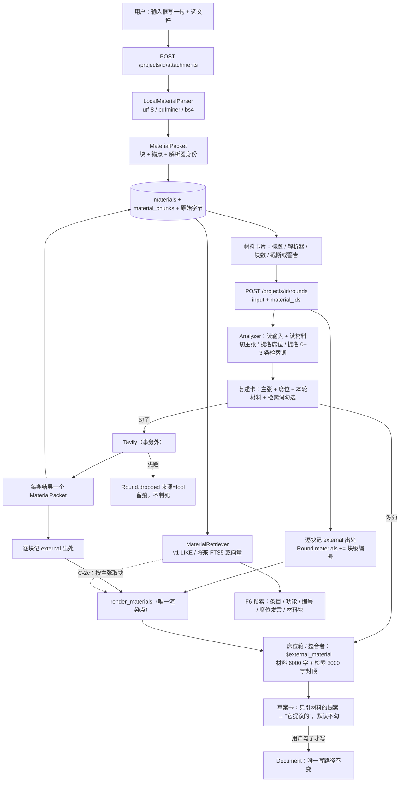

# P17 方案 v2（待拍板）· 包 C-2 工具层：材料信息包（解析/检索/联网皆可替换）

> **v2 修订（2026-09-30，作者要求）**——相对 v1（`/tmp/P17-v1.md`，v1 已提交过 `6819aaa`）三处结构性改动：
> ① **解析 / 检索 / 联网全部藏在可替换端口后面**：将来换 docling、换 FTS5/向量、换别的搜索源，
>    **只动组装点一行**，编排层与提示词一行不改；
> ② **材料一律封装成信息包**（`MaterialPacket`：结构化的块 + 锚点 + 元数据 + 解析器版本），
>    **底层只消费信息包，不消费纯自然语言**——自然语言只是"信息包的一种渲染结果"；
> ③ **原始字节必须存**：换解析器时要能**重解析**，不能让用户重传一遍。

> **状态**：方案，**未动一行业务代码**。作者拍板后再开工。
> **给执行的 agent：** 先写红测试 → 跑到红 → 再实现 → 再跑绿 → 再提交（中文）；
> **除非测试本身写错（要说明错在哪），不许改测试来迁就实现**。
> **生产路径里不许有假实现**：`src/` 的函数/类/参数名不得含 `fake|mock|stub|dummy`
> （`tests/architecture/guards.py:10` 的铁律，有守卫测试）。替身只活在 `tests/`。

**Goal：** 用户可以**把材料带进这一轮**（上传 PDF / 文本 / HTML，真解析），系统也能**去外面查**
（Tavily 搜索，用户拍板后才联网）；两者都产出**同一个东西——材料信息包**，
再由**唯一一处渲染器**把信息包变成提示词文本、变成界面上的一行、变成可检索的块。

**Architecture（三层，职责单一）：**

```
 采集层（可替换）        信息包层（契约，稳定）           消费层（只认信息包）
 LocalMaterialParser ─┐
 DoclingParser（将来）─┼─► MaterialPacket ─► MaterialStore（SQLite：字节+包+块）
 TavilySearchGateway ─┤        ▲                     │
 别的搜索源（将来）  ─┘        │                     ├─► MaterialRetriever（检索，可替换）
                        MaterialRenderer（唯一渲染点）└─► EvidenceLedger（块级编号）
                                                       └─► 提示词 / 界面 / F6 搜索
```

**Tech Stack：** Python 3.13 + FastAPI + Pydantic v2 + SQLite；前端 React 18 + Vite 6 + TS strict；
HTTP 用 **httpx**；v1 解析用 **pdfminer.six** + **beautifulsoup4** + **lxml**；
v1 联网用 **Tavily REST**（不加 SDK，直接 httpx POST）。

**Spec：** `04-未决.md` E4（工具层单独设计：先定"外部材料算不算权威"）+ F9；
`02-编排与数据.md` §11.0.3（来源分组按账本算）、§11.0.27（只读投影口径）；
`01-规格.md` §5（AI 不写文档）；`05-DDD架构.md`（分层与唯一写路径）。

## Global Constraints

- 测试：`cd backend && PYTHONDONTWRITEBYTECODE=1 python3 -m pytest -p no:cacheprovider -o addopts=""`
- Lint：`cd backend && python3 -m ruff check --no-cache .`；前端 `npx vitest run && npx tsc --noEmit`
- 结构守卫全绿（分层 / 唯一写路径 / `src/` 无 fake / UoW 无 await / graph 三键 / 节点 async）
- **端点契约冻结**：`tests/api/test_openapi_contract.py::EXPECTED_PATHS` 少一条多一条都要显式改
- **模型调用与工具调用一律在事务外**；写入必须在 `with self._uow:` 里；**没有写入就不开事务**
- 新增持久化键一次只加一个，老行必须能读回来（`.get` 回落）
- 真跑一律用 `/tmp` 库；**不要碰** `backend/data/pmstudio.db`；不留生成物

**基线（2026-09-30 P16 收口）**：后端 `761 passed` · `ruff` 全绿 · 守卫 22 · 端点 **22** ·
前端 `124 passed / 15 文件` · 完整 eval 8/8（真模型）。

---

## 0. 现状核对（对着代码，今天实测）

| 事 | 现状 | 对本方案的影响 |
|---|---|---|
| `EvidenceKind.EXTERNAL` | 已存在，注释写着"v1 留位，暂无生产者"（`domain/shared/evidence_kind.py:16`）；导出里已有中文名"外部材料"（`application/deliverable.py:33`） | 不用新增 kind，只补**生产者** |
| `EvidenceSource.external_ref` | 已存在（`domain/provenance/evidence.py:30`） | 存 `attachment:<文件>#c03` / URL |
| **材料算不算权威** | **两条不变量已经兜住**：`assembly._origin_type`（`assembly.py:1069`）"回溯不到用户输入 → 降级 `proposed`"；`committer._assert_traceable`（`committer.py:167`）"`user`/`derived` 必须回溯到 `USER_INPUT`/`CARD_ANSWER`/`MANUAL`" | **不改这两处**，只加测试钉住（本设计最重要的一条） |
| 提示词槽 | `FilePromptLibrary.render` 用 `Template.substitute`：**少给槽位当场报错**；三处渲染点 `agents/analyzer.py:174`、`agents/seat.py:70`、`agents/integrator.py:126` | 加 `$external_material` 必须**同时**改这三处 |
| 配置 | `settings.py` 只读环境变量（`PMSTUDIO_*`），缺模型配置直接报错 | 新增 `PMSTUDIO_TAVILY_API_KEY`（可缺省） |
| 依赖 | `pyproject.toml` 只声明 5 个；环境里**已装** httpx 0.28 / bs4 4.14 / lxml / pdfminer.six / python-multipart | 用它们，但要**补进 `[project] dependencies`** |
| SQLite | 本机 3.51.0；`fts5` + `tokenize='trigram'` 实测**可用** | 检索升级位是实的（§6） |
| PDF 抽取 | 实测：手写最小 PDF → `pdfminer.high_level.extract_text` 抽得出 `'Hello export\n\n\x0c'` | 测试 fixture 能**真造 PDF**，不需要 mock |
| HTML 抽取 | 实测 `BeautifulSoup(html, "lxml").get_text(" ", strip=True)` → `导出 权限`（script 剥掉） | 上传 html 与将来 web_fetch 共用一条 |
| 端点 | 22 个；前端 dev 代理 `/api` → 后端（`vite.config.ts`） | 上传走 multipart，代理不用改 |

---

## 1. 信息包：底层契约（v2 的核心）

### 1.1 为什么不能是"一段纯文本"

纯文本一旦成为底层形态，三件事立刻做不了：

1. **引用不精确**——只能说"这条内容来自那份 PDF"，说不出"来自第 3 页第 2 节"；
2. **换解析器等于换掉一切**——docling 将来给的是"章节树 + 表格结构 + 页码"，纯文本把它压平了，
   再想恢复就没有了；
3. **检索没有着力点**——没有"块"，只能整份 LIKE，长材料必然塞不进提示词。

所以底层形态是 `MaterialPacket`：**结构化的块 + 锚点 + 元数据 + 解析器身份**。
提示词里那段文字，只是"渲染器"对它的**一种**输出（界面、检索、导出各有一份渲染）。

### 1.2 `MaterialPacket`（v1 结构，`schema_version = 1`）

```python
# application/dto.py —— 与 ProjectSummaryView / RoundHeadView 同类：跨层传递的只读投影
@dataclass(frozen=True, slots=True)
class MaterialChunk:
    """材料里的一个块：检索、引用、渲染都以它为单位。"""

    chunk_id: str                 # f"{material_id}#c03"（稳定、可溯源）
    ordinal: int                  # 第几块（从 0 开始）
    text: str
    heading_path: tuple[str, ...] # ("2 目标", "2.1 非目标")；抽不出层级就是 ()
    anchor: str                   # 人话锚点："p.3 §2.1" / "第 2 节" / "第 120–180 行"
    char_start: int               # 在整份材料的纯文本里的位置（块级定位）
    char_end: int

@dataclass(frozen=True, slots=True)
class MaterialTable:
    """表格单独留位：docling 将来会给结构化的表；v1 抽不出就空。"""

    caption: str | None
    headers: tuple[str, ...]
    rows: tuple[tuple[str, ...], ...]
    anchor: str

@dataclass(frozen=True, slots=True)
class MaterialPacket:
    """一份材料的信息包——**底层唯一可消费的形态**。"""

    material_id: str
    project_id: str
    origin: str                   # "upload" | "web_search" | "web_fetch"
    title: str                    # 文件名 / 搜索结果的标题
    source_ref: str               # "attachment:需求.md" / URL
    media_type: str               # text/markdown / application/pdf / text/html / application/json
    bytes_len: int
    chunks: tuple[MaterialChunk, ...]
    tables: tuple[MaterialTable, ...] = ()
    #: 生产这份包的解析器（换 docling 之后靠它区分新旧、决定要不要重解析）
    parser_id: str = "unknown"    # "local-text" | "pdfminer" | "bs4-html" | "tavily" | "docling"
    parser_version: str = "unknown"
    schema_version: int = 1
    #: 抽取质量：截断 / 部分失败 —— 界面与提示词都照实说，不许假装完整
    truncated: bool = False
    warnings: tuple[str, ...] = ()
```

```python
@dataclass(frozen=True, slots=True)
class MaterialHit:
    """检索结果：块级，带来源与锚点（不是一段裸文本）。"""

    material_id: str
    chunk_id: str
    score: float
    excerpt: str
    anchor: str
    source_ref: str
```

### 1.3 三个可替换点（这是"解耦清楚"的落地形态）

| 端口（`application/ports.py`，全是 Protocol） | v1 实现（`infrastructure/tools/`） | 将来换成 | 换的时候动哪 |
|---|---|---|---|
| `MaterialParser.parse(*, filename, media_type, data) -> MaterialPacket` | `LocalMaterialParser`（utf-8 / pdfminer / bs4） | **docling**（章节树、表格、页码） | 只在 `bootstrap/container.py` 换一行；**重解析**见 §1.4 |
| `MaterialRetriever.search(*, project_id, query, limit) -> tuple[MaterialHit, ...]` | `SqliteLikeRetriever`（`LIKE` 子串，中文可靠） | `SqliteFtsRetriever`（`fts5(trigram)`，已实测可用）或向量检索 | 同上；**接口不变**——`MaterialHit` 已经带 `chunk_id/anchor/score` |
| `WebSearchGateway.search(*, query, limit) -> tuple[MaterialPacket, ...]` | `TavilySearchGateway`（httpx POST） | 别的搜索源 / 自建爬取 | 同上 |
| （C-2c）`WebFetcher.fetch(url) -> MaterialPacket` | bs4+lxml | 无头浏览器 / 更强的正文抽取 | 同上 |

**编排层只认信息包**：`StartRound` / `RunWebSearch` / 渲染器 / 账本，拿到的都是 `MaterialPacket`，
它们**不知道**背后是 pdfminer 还是 docling、是 LIKE 还是 FTS5。

### 1.4 版本与"重解析"（为什么原始字节一定要存）

- 每份材料记 `parser_id` + `parser_version` + `schema_version`；
- 原始字节（`content BLOB`）与解析结果**一起存**；
- 将来上了 docling，只要写一个 `reparse` 用例（C-2c）：`material_id` → 取原始字节 →
  新解析器 → 新信息包 → 覆盖包与块（**原始字节不动**）→ 账本里**旧编号作废、发新编号**（`supersedes` 已支持）。
- 因为原始字节在，用户**不用重传**——这就是 §0 里"依赖要写失败后果"的那类设计账。

### 1.5 编号策略（块级 vs 材料级）

| 方案 | 好处 | 代价 | 建议 |
|---|---|---|---|
| **材料级**：一份材料一个 `E` 编号 | 账本小、导出附录短 | 引用不精确（只能追到"那份 PDF"） | — |
| **块级**：一块一个 `E` 编号 | 引用精确（`E12` → "需求.md §2.1"）；与既有"点编号看原话"完全一致 | 账本多几倍行（一份 8k 字材料 ≈ 16 块） | **推荐** |

推荐块级，两个理由：① `Evidence` 的 `text` 就是块原文，界面里"点编号看原话"直接可用；
② 导出附录只列**被用到的**编号（`used_by`），没用到的块不会污染导出。

---

## 2. 口径（每条：建议 + 备选 + 为什么）

| # | 问题 | 建议 | 备选与代价 |
|---|---|---|---|
| 1 | 材料/检索能不能写文档？ | **不能**。只产出处 + 提示词里的渲染结果。写入仍然只有 `confirm` 一条路 | — |
| 2 | 外部材料算不算权威？ | **不算**，且**不用改代码**：只引材料的提案被 `assembly._origin_type` 降级成 `proposed`（"它提议的"，默认不勾）；硬标 `derived` 只引材料 → `confirm` 抛 `UntraceableContent(invariant:E4)` | 把 `external` 加进 `TERMINAL_KINDS`——**否决**，那等于"网上的说法 = 用户确认过" |
| 3 | 谁选工具？ | **AI 提名、用户拍板**（与席位同一套）：分析者给 0–3 条**检索词**（带"为什么"），复述卡上勾/改/删；**没勾就不联网** | 输入框一个总开关（省事，丢掉"该查什么"的判断） |
| 4 | 解析到什么程度？ | v1：`.txt/.md/.csv/.json/.log/.yaml`（UTF-8，坏字节替换）、`.pdf`（pdfminer）、`.html/.htm`（bs4+lxml）；**其它明确 4xx**，不静默、不假装成功 | docx/xlsx 要新依赖 → C-2c；**OCR 不做**，扫描件明说"没有可抽取的文字" |
| 5 | 底层形态是什么？ | **`MaterialPacket`（信息包）**：块 + 锚点 + 元数据 + 解析器身份；自然语言只是它的渲染 | 直接用字符串——引用不精确、换解析器要重做、检索没着力点（§1.1） |
| 6 | 原始文件存哪？ | **元数据 + 原始字节 + 信息包 + 块都进 SQLite**（`materials` + `material_chunks` 两张表） | 落磁盘：多一套路径/权限/GC，且换解析器时找不到原始字节 |
| 7 | 检索用什么？ | `MaterialRetriever` 端口 + v1 `SqliteLikeRetriever`（`LIKE` 子串，**中文可靠**）；材料同时接进 F6 搜索 | 直接上 FTS5——多一张索引表 + 迁移 + 中文切词要重验；**已在 §6 留好升级位** |
| 8 | 注入多少？ | 硬预算：**材料合计 6000 字 + 检索结果合计 3000 字**，超了截断并写明"（已截断）"；预算进 `/schema.limits` | 全文注入——integration 提示词已经 ~20k 字符、最慢单次 **201.2s** |
| 9 | 密钥怎么管？ | 只从 `PMSTUDIO_TAVILY_API_KEY` 读；**绝不进提示词、绝不进出处文本、绝不出现在返回体**；测试显式断言 | — |
| 10 | 没配密钥怎么办？ | 工具**不可用**：目录里 `requires=("tavily_api_key",)`，没密钥 `available()` 不含它，复述卡不出现这一栏。**这不是"无密钥降级分支"**——那条纪律管模型；工具缺配置就该说缺 | 静默假装搜过——最坏的一种 |
| 11 | 失败怎么表现？ | 检索失败（超时/401/非 JSON）**不判死整轮**：留痕（`Round.dropped` 新增来源 `tool`），席位轮照跑 | 整轮失败——502 的代价 09-28 报告吃过 |
| 12 | 解析部分失败怎么说？ | 写进信息包的 `warnings` + `truncated`，渲染器照实写进提示词，界面也照实显示 | 假装完整——将来人会拿着半份材料做决策 |

---

## 3. 分片

| 分片 | 内容 | 为什么这个顺序 |
|---|---|---|
| **C-2a** | 信息包与解析（T1 包+解析端口 → T2 存储 → T3 块级编号 → T4 渲染与注入 → T5 用例与端点 → T6 前端） | 零网络零密钥，却先把**契约（信息包）**与**最危险的三条口径**（出处 / 来源分组 / 诚实截断）钉死 |
| **C-2b** | 联网检索（T7 目录与配置 → T8 Tavily → 信息包 → T9 分析者提名+复述卡 → T10 执行与落出处） | 复用 C-2a 的包、存储、渲染；多出来的是"外部服务 + 密钥 + 用户拍板" |
| **C-2c（排后面）** | `web_fetch`、docx/xlsx、**docling 重解析**、附件删除、"按需取块" | 有了端口与信息包，这些都是**换实现**，不是改架构 |

---

## 4. C-2a · 信息包 + 上传材料

### T1 · 信息包结构 + 解析端口 + v1 解析实现

**Files**

- Modify: `backend/src/pmstudio/application/dto.py`（`MaterialChunk` / `MaterialTable` / `MaterialPacket` / `MaterialHit`）
- Create: `backend/src/pmstudio/infrastructure/tools/__init__.py`
- Create: `backend/src/pmstudio/infrastructure/tools/extract.py`（`LocalMaterialParser` + 切块）
- Modify: `backend/src/pmstudio/application/ports.py`（`MaterialParser` 协议）
- Modify: `backend/src/pmstudio/application/errors.py`（`UnsupportedMaterial`）
- Modify: `backend/pyproject.toml`（`pdfminer.six` / `beautifulsoup4` / `lxml` / `httpx` / `python-multipart` 进生产依赖）
- Create: `backend/tests/infrastructure/tools/test_extract.py`

**Interfaces**

```python
# application/ports.py
@runtime_checkable
class MaterialParser(Protocol):
    """把上传的字节变成**信息包**。抽不出文字抛 `UnsupportedMaterial`，不返回空包。"""

    def parse(self, *, filename: str, media_type: str, data: bytes) -> MaterialPacket: ...

# infrastructure/tools/extract.py
TEXT_SUFFIXES = (".txt", ".md", ".markdown", ".csv", ".json", ".log", ".yaml", ".yml")
HTML_SUFFIXES = (".html", ".htm")

#: 切块：按行累积到 ~500 字（中文按字算），遇到标题行就断开
CHUNK_CHARS = 500

class LocalMaterialParser:
    """真解析：文本按 UTF-8、PDF 走 pdfminer、HTML 走 bs4+lxml；切块 + 锚点 + 解析器身份。"""

    parser_id = "local-text"       # PDF 分支用 "pdfminer"、HTML 分支用 "bs4-html"
    parser_version = "…"           # 例：f"pdfminer.six {pdfminer.__version__}"

    def parse(self, *, filename: str, media_type: str, data: bytes) -> MaterialPacket: ...

def chunk_text(text: str, *, parser_id: str) -> tuple[MaterialChunk, ...]:
    """纯函数：按行累积切块，标题行（`#`/`1.`/`一、`）起新块；锚点用行号或页码。"""
```

- [ ] **Step 1：写失败的测试**

```python
# tests/infrastructure/tools/test_extract.py
from pmstudio.application.errors import UnsupportedMaterial
from pmstudio.infrastructure.tools.extract import LocalMaterialParser

parser = LocalMaterialParser()


def test_text_file_becomes_a_packet_with_chunks_and_anchors():
    packet = parser.parse(
        filename="需求.md",
        media_type="text/markdown",
        data="# 目标\n导出要有权限\n\n# 边界\n只给管理员".encode(),
    )

    assert packet.origin == "upload"
    assert packet.source_ref == "attachment:需求.md"
    assert packet.media_type == "text/markdown"
    assert packet.parser_id == "local-text"
    assert packet.schema_version == 1
    assert [chunk.ordinal for chunk in packet.chunks] == [0, 1]
    assert packet.chunks[0].text.startswith("# 目标")
    assert packet.chunks[0].anchor.startswith("第 1")        # 锚点是人话，不是裸偏移
    assert packet.chunks[1].chunk_id.endswith("#c01")
    assert packet.truncated is False


def test_bad_bytes_do_not_explode():
    packet = parser.parse(filename="a.txt", media_type="text/plain", data=b"\xff\xfe ok")
    assert "ok" in packet.chunks[0].text


def test_html_drops_script_and_style():
    html = b"<html><script>var x=1</script><p># \xe5\xaf\xbc\xe5\x87\xba</p></html>"
    packet = parser.parse(filename="p.html", media_type="text/html", data=html)
    assert "导出" in packet.chunks[0].text
    assert "var x" not in packet.chunks[0].text
    assert packet.parser_id == "bs4-html"


def test_pdf_is_extracted_with_page_anchors():
    """手写的最小 PDF（真字节，pdfminer 真读）——§0 已实测可抽。"""

    packet = parser.parse(filename="spec.pdf", media_type="application/pdf",
                          data=minimal_pdf("Hello export"))

    assert "Hello export" in packet.chunks[0].text
    assert packet.parser_id == "pdfminer"
    assert packet.chunks[0].anchor.startswith("第 1 页")


def test_unknown_type_is_refused_not_silently_empty():
    with pytest.raises(UnsupportedMaterial):
        parser.parse(filename="scan.jpg", media_type="image/jpeg", data=b"\x89PNG")


def test_a_pdf_without_text_says_so():
    with pytest.raises(UnsupportedMaterial) as error:
        parser.parse(filename="scan.pdf", media_type="application/pdf",
                     data=minimal_pdf("   "))
    assert "没有可抽取的文字" in str(error.value)


def test_a_very_long_material_is_marked_truncated_at_the_packet_level():
    packet = parser.parse(filename="big.txt", media_type="text/plain",
                          data=("字" * 5000).encode())
    assert packet.truncated is True
    assert any("截断" in warning for warning in packet.warnings)


def minimal_pdf(text: str) -> bytes:
    """手写最小 PDF（`/Contents` 流里放一行字）。"""
    ...  # 与 v1 §3·T1 里那段完全一致
```

- [ ] **Step 2：跑红** `-k "extract"`
- [ ] **Step 3：实现**
  - `LocalMaterialParser.parse`：后缀/媒体类型 → 分支（文本 / PDF / HTML）；分支各自
    `parser_id` 与 `parser_version`；抽出文本后调 `chunk_text`；
  - `chunk_text`：按行累积到 `CHUNK_CHARS`，标题行起新块；PDF 用 `\f`（pdfminer 的分页符）
    记页号写进 `anchor`；文本用行号写 `anchor`；
  - 空文本 → `UnsupportedMaterial("没有可抽取的文字")`；
  - 超过 `MAX_MATERIAL_CHARS`（默认 200_000）→ 截断 + `truncated=True` + `warnings`。
- [ ] **Step 4：跑绿** + **Step 5：提交**

```bash
git commit -am "feat(tools): 材料信息包 + 解析端口（pdfminer/bs4/文本，切块带锚点）"
```

### T2 · 存储：`materials` + `material_chunks`（原始字节一定要在）

**Files**

- Modify: `backend/src/pmstudio/infrastructure/sqlite/schema.sql`
- Create: `backend/src/pmstudio/infrastructure/sqlite/materials.py`
- Modify: `backend/src/pmstudio/application/ports.py`（`MaterialStore`）
- Create: `backend/tests/infrastructure/test_sqlite_materials.py`
- Modify: `backend/tests/support/doubles.py`（`InMemoryMaterialStore`）

**Interfaces**

```sql
CREATE TABLE IF NOT EXISTS materials (
  material_id     TEXT PRIMARY KEY,
  project_id      TEXT NOT NULL,
  origin          TEXT NOT NULL,
  title           TEXT NOT NULL,
  source_ref      TEXT NOT NULL,
  media_type      TEXT NOT NULL,
  bytes_len       INTEGER NOT NULL,
  sha256          TEXT NOT NULL,
  parser_id       TEXT NOT NULL,
  parser_version  TEXT NOT NULL,
  schema_version  INTEGER NOT NULL,
  truncated       INTEGER NOT NULL,
  warnings        TEXT NOT NULL,   -- JSON 数组
  content         BLOB NOT NULL,   -- 原始字节（换解析器时重解析用）
  created_at      TEXT NOT NULL
);
CREATE UNIQUE INDEX IF NOT EXISTS idx_materials_dedupe ON materials(project_id, sha256);
CREATE INDEX IF NOT EXISTS idx_materials_project ON materials(project_id, created_at);

CREATE TABLE IF NOT EXISTS material_chunks (
  chunk_id     TEXT PRIMARY KEY,
  material_id  TEXT NOT NULL REFERENCES materials(material_id) ON DELETE CASCADE,
  ordinal      INTEGER NOT NULL,
  text         TEXT NOT NULL,
  heading_path TEXT NOT NULL,     -- JSON 数组
  anchor       TEXT NOT NULL,
  char_start   INTEGER NOT NULL,
  char_end     INTEGER NOT NULL
);
CREATE INDEX IF NOT EXISTS idx_material_chunks_material ON material_chunks(material_id, ordinal);
```

```python
# application/ports.py
@runtime_checkable
class MaterialStore(Protocol):
    def put(self, *, project_id: ProjectId, packet: MaterialPacket, sha256: str,
            content: bytes, now: datetime) -> MaterialPacket: ...
    def get(self, material_id: str) -> MaterialPacket | None: ...
    def raw_bytes(self, material_id: str) -> bytes | None: ...      # 重解析要用
    def list_for_project(self, project_id: ProjectId) -> tuple[MaterialPacket, ...]: ...
    def delete(self, material_id: str) -> None: ...
```

- [ ] **Step 1：写失败的测试**

```python
# tests/infrastructure/test_sqlite_materials.py
def test_put_then_get_round_trips_the_whole_packet(tmp_path):
    store = SqliteMaterialStore(database.connect(tmp_path / "pm.db"))
    packet = make_packet(material_id="m1", chunks=(make_chunk("m1#c00", "目标：导出"),))

    store.put(project_id=PROJECT, packet=packet, sha256="a" * 64, content=b"raw", now=NOW)
    loaded = store.get("m1")

    assert loaded.title == packet.title
    assert loaded.parser_id == packet.parser_id
    assert [(c.chunk_id, c.anchor) for c in loaded.chunks] == [("m1#c00", "第 1 行")]
    assert store.raw_bytes("m1") == b"raw"          # 原始字节在，换解析器不用重传


def test_the_same_bytes_are_deduped_per_project(tmp_path):
    ...   # (project_id, sha256) 唯一 → 第二次 put 复用同一条 material_id


def test_a_packet_without_text_is_still_persisted_with_its_warning(tmp_path):
    """抽不出文字的包**也要存**（否则用户看不出"这份材料没读懂"）。"""
    ...
    assert loaded.truncated is True
    assert loaded.warnings == ("这份材料没有可抽取的文字",)
```

- [ ] **Step 2：跑红** → **Step 3：实现**（写包与块在**同一个事务**里；`content` 用 `sqlite3.Binary`）
  → **Step 4：跑绿** + **Step 5：提交**

```bash
git commit -am "feat(tools): 材料存储（包+块+原始字节，同项目内按 sha256 去重）"
```

### T3 · 块级编号：材料块进账本，`Round` 记住它们

**Files**

- Modify: `backend/src/pmstudio/domain/round/round.py`（`MaterialRef` + `Round.materials`）
- Modify: `backend/src/pmstudio/infrastructure/sqlite/serialization.py`（payload 键 `materials`）
- Modify: `backend/src/pmstudio/application/use_cases.py`（`StartRound` 里逐块记 `external` 出处）
- Create: `backend/tests/domain/test_round_materials.py`
- Modify: `backend/tests/application/test_materials.py`

**Interfaces**

```python
# domain/round/round.py
@dataclass(frozen=True, slots=True)
class MaterialRef:
    """这一轮用到的材料块：`chunk_id` / `material_id` / 账本里那条 external 出处的编号。"""

    material_id: str
    chunk_id: str
    eid: EvidenceId          # 块级编号（§1.5 推荐）
    anchor: str              # 冗余存锚点：渲染与界面不必回查库

# Round 新增（payload 键 `materials`，老行回落 ()）
    materials: tuple[MaterialRef, ...]
```

账本里的那条长这样：

```python
ledger.record(
    kind=EvidenceKind.EXTERNAL,
    text=chunk.text,                                   # 块原文（点编号看原话就是它）
    source=EvidenceSource(external_ref=f"{packet.source_ref}#{chunk.chunk_id.split('#')[-1]}"),
    now=now,
)
```

- [ ] **Step 1：写失败的测试**

```python
# tests/application/test_materials.py
async def test_every_chunk_of_a_material_gets_its_own_external_evidence():
    packet = make_packet(chunks=(make_chunk("m1#c00", "目标：导出"), make_chunk("m1#c01", "边界：只给管理员")))
    harness.materials.seed(packet)          # tests 里的内存 store

    view = await harness.start_round()(
        project_id=PROJECT, user_input="按这份材料写", material_ids=["m1"]
    )

    ledger = harness.evidences.get(PROJECT)
    externals = [item for item in ledger.evidences() if item.kind is EvidenceKind.EXTERNAL]
    assert [item.text for item in externals] == ["目标：导出", "边界：只给管理员"]
    assert externals[0].source.external_ref == "attachment:需求.md#c00"

    round_ = harness.rounds.get(RoundId(view.round_id))
    assert [ref.chunk_id for ref in round_.materials] == ["m1#c00", "m1#c01"]
    assert [str(ref.eid) for ref in round_.materials] == [str(item.eid) for item in externals]


def test_materials_round_trip_in_the_payload_and_old_rows_fall_back():
    ...   # round_to_payload → round_from_payload；删掉 `materials` 键 → ()，不抛


async def test_a_material_with_no_extractable_text_is_kept_but_records_no_evidence():
    """抽不出文字的包仍然进 `Round.materials`？——**不进**：没有块就没有可引用的东西。
    但界面要能看到"这份材料没读懂"（`warnings` 走材料列表，不走账本）。"""
```

- [ ] **Step 2：跑红** → **Step 3：实现** → **Step 4：跑绿** + **Step 5：提交**

```bash
git commit -am "feat(tools): 材料块级编号（每块一条 external 出处）+ Round.materials 落 payload"
```

### T4 · 唯一渲染点：信息包 → 提示词文本（预算 + 诚实截断）

**Files**

- Modify: `backend/src/pmstudio/application/context.py`
- Modify: `backend/src/pmstudio/application/agents/{analyzer,seat,integrator}.py`（三处 render 补槽）
- Modify: `backend/src/pmstudio/infrastructure/llm/prompts/{analyzer,seat_review,integrator}.md`
- Modify: `backend/src/pmstudio/application/dto.py`（`/schema.limits` 加预算）
- Modify: `backend/tests/application/test_context.py`

**Interfaces**

```python
# application/context.py —— 纯函数：IO 早已做完，这里只把信息包渲染成文本
MATERIAL_BUDGET = 6000     # 材料块合计（字）
WEB_BUDGET = 3000          # 检索结果合计（字）

@dataclass(frozen=True, slots=True)
class RenderedMaterial:
    """渲染结果：文本 + 是否截断 + 用掉了哪几块（界面/日志要能说清）。"""
    text: str
    truncated: bool
    used_chunk_ids: tuple[str, ...]

def render_materials(
    entries: Sequence[tuple[MaterialPacket, Mapping[str, EvidenceId]]],  # (包, {chunk_id: eid})
    *,
    budget: int = MATERIAL_BUDGET,
) -> RenderedMaterial:
    """一份材料一段：标题行（名字 / 类型 / 解析器 / 块数）+ 每块「编号 · 锚点」+ 原文。

    超预算就**停在块边界**，并写「（材料较长，只带了前 N 块 / 共 M 块）」。
    没有任何材料 → 返回「（这一轮没有外部材料）」。
    """
```

```markdown
<!-- analyzer.md / seat_review.md / integrator.md 各加一节（槽名统一 $external_material） -->
## 本轮的外部材料（**不是用户说的话**）

$external_material

规矩：材料能支撑你的判断，但**它不是用户确认过的需求**。
要引就引方括号里的编号（如 E12）；不要把材料写成"用户已经定了"。
材料是块级编号：一块一个号，引哪块就写哪个号。
```

- [ ] **Step 1：写失败的测试**

```python
# tests/application/test_context.py
def test_materials_render_with_number_anchor_and_parser_identity():
    packet = make_packet(title="需求.md", parser_id="pdfminer")
    eids = {"m1#c00": EvidenceId("E12"), "m1#c01": EvidenceId("E13")}

    rendered = context.render_materials([(packet, eids)])

    assert "需求.md" in rendered.text
    assert "pdfminer" in rendered.text            # 解析器身份也照实写
    assert "[E12]" in rendered.text and "第 1 行" in rendered.text
    assert rendered.truncated is False


def test_materials_over_budget_stop_at_a_chunk_boundary_and_say_so():
    packet = make_packet(chunks=tuple(make_chunk(f"m1#c{i:02d}", "字" * 500) for i in range(20)))
    eids = {chunk.chunk_id: EvidenceId(f"E{index + 10}") for index, chunk in enumerate(packet.chunks)}

    rendered = context.render_materials([(packet, eids)], budget=1200)

    assert rendered.truncated is True
    assert "只带了前" in rendered.text and "共 20 块" in rendered.text
    assert len(rendered.used_chunk_ids) <= 3


def test_no_materials_renders_a_plain_sentence():
    assert context.render_materials([]).text == "（这一轮没有外部材料）"
```

- [ ] **Step 2：跑红** → **Step 3：实现**（三处 render 调用补 `external_material=`）
  → **Step 4：跑绿** + **Step 5：提交**

```bash
git commit -am "feat(tools): 信息包渲染器（块级编号+锚点+解析器身份，预算截断照实说）"
```

### T5 · 上传/列出用例与端点（22 → 23 → 24）

**Files**

- Modify: `backend/src/pmstudio/application/use_cases.py`（`UploadMaterial` / `ListMaterials`）
- Modify: `backend/src/pmstudio/api/routes.py`、`api/app.py`、`bootstrap/container.py`、`tests/support/harness.py`
- Modify: `backend/tests/api/test_openapi_contract.py`（+2）、`tests/api/test_routes.py`

**Interfaces**

```python
class UploadMaterial:
    """上传一份材料：解析（事务外）→ 落库（事务内）→ 回信息包投影。**不碰文档。**"""

    def __init__(self, *, store: MaterialStore, parser: MaterialParser,
                 ids: IdGenerator, clock: Clock, uow: UnitOfWork) -> None: ...

    async def __call__(self, *, project_id: ProjectId, filename: str,
                       media_type: str, data: bytes) -> MaterialPacket: ...

# api/routes.py
POST /api/projects/{project_id}/attachments      # multipart: file
GET  /api/projects/{project_id}/attachments      # 列表（含 truncated / warnings / parser_id）

#: 常量（进 `/schema.limits`）
MAX_MATERIAL_BYTES = 20 * 1024 * 1024
MAX_MATERIALS_PER_PROJECT = 50
```

- [ ] **Step 1：写失败的测试**

```python
async def test_upload_parses_and_lists():
    saved = await harness.upload_material()(
        project_id=PROJECT, filename="需求.md", media_type="text/markdown",
        data="# 目标\n导出要有权限".encode(),
    )

    assert saved.parser_id == "local-text"
    assert saved.chunks[0].text.startswith("# 目标")
    assert [item.title for item in await harness.list_materials()(project_id=PROJECT)] == ["需求.md"]


async def test_oversize_is_refused():
    with pytest.raises(MaterialTooLarge):
        await harness.upload_material()(
            project_id=PROJECT, filename="大.pdf", media_type="application/pdf",
            data=b"x" * (MAX_MATERIAL_BYTES + 1),
        )


# tests/api/test_routes.py —— 真 multipart
async def test_upload_endpoint_accepts_multipart():
    app, _ = make_client()
    async with async_client(app) as client:
        created = await client.post("/api/projects", json={"title": "订单中台"})
        project_id = created.json()["project_id"]
        response = await client.post(
            f"/api/projects/{project_id}/attachments",
            files={"file": ("需求.md", "# 目标\n导出要有权限".encode(), "text/markdown")},
        )
        listed = await client.get(f"/api/projects/{project_id}/attachments")

    assert response.status_code == 201
    body = response.json()
    assert body["parser_id"] == "local-text"
    assert body["chunks"][0]["anchor"].startswith("第 1")
    assert [item["title"] for item in listed.json()] == ["需求.md"]


async def test_unsupported_type_is_4xx_with_a_code():
    ...   # 上传 .jpg → 4xx + code（不是 500、不是静默存空）
```

- [ ] **Step 2：跑红** → **Step 3：实现** → **Step 4：跑绿**（含契约冻结）+ **Step 5：提交**

```bash
git commit -am "feat(api): 上传/列出材料端点（信息包投影，22→23→24）"
```

### T6 · 前端：输入框上传 + 材料卡片 + 出处锚点

**Files**

- Modify: `frontend/src/api/client.ts`（`uploadMaterial` / `materials`）、`api/types.ts`
- Modify: `frontend/src/api/payload.ts`（`buildStart` 带 `material_ids`）
- Modify: `frontend/src/components/BottomStrip.tsx`、`components/OpeningCard.tsx`、`styles/app.css`
- Create: `frontend/src/components/MaterialCard.tsx`、`MaterialCard.test.tsx`

**Interfaces**

```ts
export interface MaterialChunkView {
  chunk_id: string; ordinal: number; text: string;
  heading_path: string[]; anchor: string;
}
export interface MaterialPacketView {
  material_id: string; origin: string; title: string; source_ref: string;
  media_type: string; bytes_len: number;
  parser_id: string; parser_version: string; schema_version: number;
  chunks: MaterialChunkView[]; truncated: boolean; warnings: string[];
}
export function buildStart(input: string, materials: MaterialPacketView[]): StartBody;
```

组件测试钉三件事：

```ts
it("选文件 → 调 onUpload（没上传成功就不进这一轮）", ...);
it("材料卡片说实话：解析器 / 块数 / 截断 / 警告", ...);
it("撤掉材料后 start 体里没有它", ...);
```

- [ ] **Step 1：写失败的测试** → **Step 2：跑红** → **Step 3：实现** →
  **Step 4：跑绿**（`npx vitest run` + `npx tsc --noEmit`）→ **Step 5：提交**

```bash
git commit -am "feat(ui): 输入框能带材料（上传/撤掉/随本轮发出去）+ 材料卡片（解析器/块数/截断）"
```

---

## 5. C-2b · 联网检索（Tavily）——产出同样是信息包

### T7 · 工具目录 + 配置

**Files**

- Create: `backend/src/pmstudio/infrastructure/tools/definitions/{attachment,web_search}.toml`
- Create: `backend/src/pmstudio/infrastructure/tools/catalog.py`
- Modify: `backend/src/pmstudio/application/ports.py`（`ToolCatalog` / `ToolDefinition`）
- Modify: `backend/src/pmstudio/bootstrap/settings.py`（`tavily_api_key`）、`bootstrap/container.py`
- Modify: `backend/tests/support/doubles.py`（`StaticToolCatalog`）
- Create: `backend/tests/infrastructure/tools/test_catalog.py`

**Interfaces**

```toml
# infrastructure/tools/definitions/attachment.toml
tool_id = "tool.attachment"
title = "上传的材料"
kind = "attachment"
requires = []

# infrastructure/tools/definitions/web_search.toml
tool_id = "tool.web_search"
title = "联网搜索（Tavily）"
kind = "web_search"
requires = ["tavily_api_key"]      # 没配密钥 → 不可用（不是假成功）
max_queries = 3
max_results = 5
```

```python
@dataclass(frozen=True, slots=True)
class ToolDefinition:
    tool_id: str
    title: str
    kind: str
    requires: tuple[str, ...] = ()
    max_queries: int = 0
    max_results: int = 0

@runtime_checkable
class ToolCatalog(Protocol):
    def all(self) -> tuple[ToolDefinition, ...]: ...
    def available(self, *, has: frozenset[str]) -> tuple[ToolDefinition, ...]: ...

# bootstrap/settings.py
TAVILY_ENV = "PMSTUDIO_TAVILY_API_KEY"
    tavily_api_key: str | None = None
```

- [ ] **Step 1：写失败的测试**

```python
def test_catalog_reads_toml_and_filters_by_required_keys():
    catalog = TomlToolCatalog(TOOLS_DIR)

    assert {item.tool_id for item in catalog.all()} == {"tool.attachment", "tool.web_search"}
    assert "tool.web_search" not in {item.tool_id for item in catalog.available(has=frozenset())}
    assert "tool.web_search" in {
        item.tool_id for item in catalog.available(has=frozenset({"tavily_api_key"}))
    }


def test_settings_reads_the_tavily_key_and_tolerates_its_absence():
    base = {"PMSTUDIO_MODEL": "openai/x", "PMSTUDIO_API_KEY": "k"}

    assert Settings.from_env(base).tavily_api_key is None
    assert Settings.from_env({**base, "PMSTUDIO_TAVILY_API_KEY": "tvly-x"}).tavily_api_key == "tvly-x"
```

- [ ] **Step 2：跑红** → **Step 3：实现** → **Step 4：跑绿** + **Step 5：提交**

```bash
git commit -am "feat(tools): 工具目录（TOML，按 requires 过滤）+ PMSTUDIO_TAVILY_API_KEY"
```

### T8 · Tavily 客户端（真 HTTP）→ **每条结果一个信息包**

**Files**

- Create: `backend/src/pmstudio/infrastructure/tools/tavily.py`
- Create: `backend/tests/infrastructure/tools/test_tavily.py`
- Modify: `backend/src/pmstudio/application/ports.py`（`WebSearchGateway`）
- Modify: `backend/src/pmstudio/application/errors.py`（`ToolCallFailed`）

**Interfaces**

```python
@runtime_checkable
class WebSearchGateway(Protocol):
    """一次查询 → 若干**信息包**（每条结果一个包，含 URL 与摘要块）。"""

    async def search(self, *, query: str, limit: int) -> tuple[MaterialPacket, ...]: ...

# infrastructure/tools/tavily.py
class TavilySearchGateway:
    ENDPOINT = "https://api.tavily.com/search"

    def __init__(self, *, api_key: str, timeout: float = 30.0,
                 client: httpx.AsyncClient | None = None) -> None: ...

    async def search(self, *, query: str, limit: int) -> tuple[MaterialPacket, ...]: ...
```

映射规矩（**这是"信息包"在联网侧的落地**）：

| Tavily 字段 | 信息包字段 |
|---|---|
| `title` | `MaterialPacket.title` |
| `url` | `MaterialPacket.source_ref`（`evidence.external_ref` 也用它） |
| `content`（Tavily 抽好的正文片段） | `chunks[0].text`，`anchor = "网页摘要"` |
| — | `origin="web_search"`、`media_type="text/html"`、`parser_id="tavily"`、`parser_version=<API 版本或"tavily-rest-v1">` |
| 查询词 | `warnings` 里记一句"来自检索：<query>"（**不记 key**） |

- [ ] **Step 1：写失败的测试**（`httpx.MockTransport` 跑真代码路径；替身只在测试里）

```python
async def test_search_returns_packets_and_never_leaks_the_key():
    seen: dict[str, object] = {}

    def handler(request: httpx.Request) -> httpx.Response:
        seen["body"] = json.loads(request.content)
        return httpx.Response(200, json={"results": [
            {"title": "导出方案", "url": "https://example.com/a", "content": "结论是……"},
        ]})

    gateway = TavilySearchGateway(
        api_key="tvly-secret",
        client=httpx.AsyncClient(transport=httpx.MockTransport(handler)),
    )
    packets = await gateway.search(query="订单导出", limit=5)

    assert packets[0].origin == "web_search"
    assert packets[0].source_ref == "https://example.com/a"
    assert packets[0].chunks[0].text == "结论是……"
    assert packets[0].parser_id == "tavily"
    assert seen["body"]["api_key"] == "tvly-secret"        # 真发出去了
    blob = json.dumps([asdict(packet) for packet in packets], default=str)
    assert "tvly-secret" not in blob                        # 结果里一个字节都没有


async def test_http_errors_timeouts_and_bad_json_are_tool_failures():
    ...   # 401 / 500 / 超时 / 非 JSON → 各抛 ToolCallFailed
```

- [ ] **Step 2：跑红** → **Step 3：实现** → **Step 4：跑绿** + **Step 5：提交**

```bash
git commit -am "feat(tools): Tavily 客户端（真 HTTP；每条结果一个信息包；失败抛 ToolCallFailed）"
```

### T9 · 分析者提名检索词 + 复述卡拍板（没勾不联网）

**Files**

- Modify: `backend/src/pmstudio/application/agents/schemas.py`（`ClaimsPacket.web_queries`）
- Modify: `backend/src/pmstudio/infrastructure/llm/prompts/analyzer.md`
- Modify: `backend/src/pmstudio/domain/round/round.py`（`web_queries` / `web_queries_chosen`）
- Modify: `backend/src/pmstudio/application/dto.py`（`RoundView.web_queries`）、`api/schemas.py`
- Modify: 前端 `components/OpeningCard.tsx`、`api/payload.ts`（`web_queries` 勾选）

**Interfaces**

```python
class WebQueryDraft(BaseModel):
    query: str = Field(description="要拿去搜的一句话（像人问的那样，别堆关键词）")
    why: str = Field(description="为什么这一轮需要外部事实")

# ClaimsPacket 追加
    web_queries: list[WebQueryDraft] = Field(
        default_factory=list, max_length=3,
        description="只在你真觉得需要外部事实时给；没有就给空数组",
    )

# Round 追加（payload 键，老行回落 ()）
    web_queries: tuple[WebQuery, ...]         # 分析者提的（带 why）
    web_queries_chosen: tuple[str, ...]       # 用户在复述卡上勾的（按 query 文本对）
```

- [ ] **Step 1：写失败的测试**

```python
async def test_no_query_selected_means_no_network_call_at_all():
    """没勾就不联网——作者定的口径，必须钉死。"""

    await harness.submit_opening()(round_id=round_id, seats=(SEAT,), web_queries=())
    await harness.run_seat_round()(round_id=round_id)

    assert harness.web_search.calls == []        # tests 里的记录替身


async def test_selected_queries_are_recorded():
    await harness.submit_opening()(round_id=round_id, seats=(SEAT,), web_queries=("订单导出 方案",))
    assert harness.rounds.get(round_id).web_queries_chosen == ("订单导出 方案",)
```

- [ ] **Step 2：跑红** → **Step 3：实现** → **Step 4：跑绿** + **Step 5：提交**

```bash
git commit -am "feat(tools): 分析者提名检索词（0–3 条带为什么）+ 复述卡勾选（没勾不联网）"
```

### T10 · 执行检索 → 信息包 → 出处 → 注入（失败留痕）

**Files**

- Modify: `backend/src/pmstudio/application/use_cases.py`（`SubmitOpening`：**工具在事务外、记账在事务内**）
- Modify: `backend/src/pmstudio/domain/round/round.py`（`DropSource.TOOL`）
- Modify: `backend/src/pmstudio/application/context.py`（`render_web_results`，`WEB_BUDGET`）
- Modify: `backend/tests/support/doubles.py`（`RecordingWebSearch`）、`tests/application/test_materials.py`

**Interfaces**

```python
def render_web_results(
    entries: Sequence[tuple[MaterialPacket, EvidenceId]],   # 每条结果一个包 + 它的块编号
    *,
    budget: int = WEB_BUDGET,
) -> RenderedMaterial:
    """检索结果：一条一段（编号 + 标题 + URL + 摘要）；超预算截断并明说。"""
```

流程（`SubmitOpening` 内部）：

```text
1. 事务内：应用复述卡（席位/标签/去处/勾中的检索词）→ Round.web_queries_chosen
2. 事务外：对每条勾中的 query 调 WebSearchGateway.search(limit=5) → 若干个信息包
3. 事务外：把每个包落进 MaterialStore（原始字节=响应体片段，sha256 去重）
4. 事务内：逐块记 external 出处 → Round.materials += …（与附件同一条路）
5. 工具抛错 → 事务内写一条 Round.dropped(source=TOOL, reason="检索失败：<人话>")，**继续跑**
```

- [ ] **Step 1：写失败的测试**

```python
async def test_chosen_queries_become_material_packets_and_chunk_evidence():
    """1 条查询 × 3 条结果 → 3 个包、3 条 external 出处，ref 是 URL。"""

    harness.web_search.returns = (
        make_packet(material_id="w1", origin="web_search", source_ref="https://a"),
        make_packet(material_id="w2", origin="web_search", source_ref="https://b"),
        make_packet(material_id="w3", origin="web_search", source_ref="https://c"),
    )

    await harness.submit_opening()(round_id=round_id, seats=(SEAT,), web_queries=("订单导出",))

    externals = [item for item in harness.evidences.get(PROJECT).evidences()
                 if item.kind is EvidenceKind.EXTERNAL]
    assert [item.source.external_ref for item in externals] == ["https://a", "https://b", "https://c"]
    assert "tvly" not in " ".join(item.text for item in externals)   # 密钥不进账本


async def test_a_failing_tool_leaves_a_trace_and_the_round_goes_on():
    harness.web_search.failure = ToolCallFailed("检索超时", status=504)

    view = await harness.submit_opening()(round_id=round_id, seats=(SEAT,), web_queries=("x",))

    round_ = harness.rounds.get(round_id)
    assert any(item.source is DropSource.TOOL for item in round_.dropped)
    assert view.step != "failed"


def test_web_results_are_budgeted():
    rendered = context.render_web_results([(make_packet(), EvidenceId("E9"))], budget=200)
    assert "（已截断）" in rendered.text or rendered.used_chunk_ids == ("w1#c00",)
```

- [ ] **Step 2：跑红** → **Step 3：实现** → **Step 4：跑绿** + **Step 5：提交**

```bash
git commit -am "feat(tools): 检索结果落成信息包与块级出处（失败留痕、预算截断、不判死整轮）"
```

### T11 · 真跑验证（**不是单测**）

作者给 `PMSTUDIO_TAVILY_API_KEY` 之后：拿一个真项目跑一轮，复述卡勾一条检索词。验收：

1. 留样（`PMSTUDIO_TRACE_MODEL=1`）里 `$external_material` 有检索结果与块编号，**没有 key**；
2. 导出的 Markdown 里能看到"外部材料"编号，点编号能看到原话（URL + 摘要）；
3. 只引检索结果的提案落在"它提议的"那组（默认不勾）。

---

## 6. 检索端口：v1 怎么实现、将来怎么换

```python
# application/ports.py
@runtime_checkable
class MaterialRetriever(Protocol):
    """在材料块里找东西。**块级**返回，带锚点与分数——调用方不看实现。"""

    def search(self, *, project_id: ProjectId, query: str, limit: int = 5
               ) -> tuple[MaterialHit, ...]: ...

# infrastructure/sqlite/materials.py（v1）
class SqliteLikeRetriever:
    """LIKE 子串 + 命中窗口：中文可靠、零索引、零迁移。

    分数口径（先说清楚，免得以后换实现时对不上）：命中次数 > 命中位置靠前 > 块更短。
    """

# 升级位（都在同一个协议后面，调用方一行不改）
class SqliteFtsRetriever:   # CREATE VIRTUAL TABLE material_fts USING fts5(text, tokenize='trigram')
    ...
class VectorRetriever:      # 真需要语义检索时再说：embedding 存哪、用什么模型、成本多少都要单独定
    ...
```

**谁用它**：

1. **F6 全局搜索**（真实用户可见）：`search_hits` 增加一个来源 `material`，命中返回
   "材料名 · 锚点 · 片段"，点了跳到材料卡片并滚到那一块；
2. **将来"按需取块"**（C-2c）：材料太长时不是"取前 N 块"，而是**按本轮主张去检索相关块**再注入——
   那时才真正需要 `limit`/`score`；接口已经长成这样，实现可以慢一点再补。

**为什么不现在就用它做注入**：v1 的预算策略（按序取块 + 明说截断）已经能跑通闭环，
而"按主张检索"要先把"中文查询怎么切词"想清楚（`LIKE` 用整句命中率低、FTS5 默认分词对中文不友好）。
这条我建议**单独一轮**做，做之前先拿 3 份真材料量一量命中率。

---

## 7. 数据流（做完之后）



---

## 8. 契约汇总

| 层 | 新增 |
|---|---|
| application 投影 | `MaterialPacket` / `MaterialChunk` / `MaterialTable` / `MaterialHit` / `RenderedMaterial` |
| application 端口 | `MaterialParser` / `MaterialStore` / `MaterialRetriever` / `WebSearchGateway` / `ToolCatalog`（全是 Protocol） |
| application 渲染 | `context.render_materials()` / `render_web_results()` —— **唯一渲染点**（提示词文本由信息包渲染而来） |
| domain | `round.MaterialRef{material_id, chunk_id, eid, anchor}`；`Round.materials` / `web_queries` / `web_queries_chosen`；`DropSource.TOOL` |
| SQLite | `materials`（含 `content BLOB` 与 `parser_id/version`）+ `material_chunks` |
| 端点 | `POST /projects/{id}/attachments`（23）、`GET /projects/{id}/attachments`（24）；C-2b **不新增端点** |
| 提示词 | 三份提示词各加 `$external_material` 槽（**三处 render 必须同时补**，否则 `Template.substitute` 当场报错） |
| 配置 | `PMSTUDIO_TAVILY_API_KEY`（可缺省；缺了 `tool.web_search` 不可用） |
| 依赖 | `httpx` / `pdfminer.six` / `beautifulsoup4` / `lxml` / `python-multipart` 提到生产依赖 |
| 事件 | **不加**事件（轮次视图本来就会刷新） |

**换实现时要动的唯一一行**（`bootstrap/container.py`）：

```python
# 今天是这个
parser: MaterialParser = LocalMaterialParser()
# 上了 docling 之后只改这一行（其余全不动）
parser: MaterialParser = DoclingMaterialParser()

# 检索同理
retriever: MaterialRetriever = SqliteLikeRetriever(connection)
# retriever: MaterialRetriever = SqliteFtsRetriever(connection)
```

---

## 9. 成功之后长什么样（自检）

1. 选一份 PDF → 界面显示"spec.pdf · pdfminer · 12 块"；起轮后席位与整合者**真读到了**它，
   提示词里每一块都带自己的编号与锚点（`[E12] 第 3 页 §2.1`）。
2. 材料超预算 → 提示词停在**块边界**并写"只带了前 N 块 / 共 M 块"；界面也是这句。
3. 勾一条检索词 → 每条结果一个信息包、每块一条 `external` 出处（`external_ref` 是 URL）；
   **不勾 → 一次网络调用都没有**（测试钉住）。
4. 只引材料的提案落在"它提议的"、**默认不勾**；硬说 `derived` 的会被 `confirm` 拒。
   这条**不改一行既有代码**，靠已经存在的两条不变量。
5. 检索失败（拔网线 / 坏 key）→ 轮次照跑完，闭环区能看到"检索失败：…"。
6. 密钥在任何返回体、出处文本、留样里**都搜不到**。
7. **换解析器只改一行**：把 `LocalMaterialParser()` 换成 `DoclingMaterialParser()`，
   其余代码与测试一行不改（信息包形状没变）。

---

## 10. 不做 / 排到 C-2c

- **不做 OCR**：扫描件抽不出字 → 明确报"没有可抽取的文字"，并把这条写进信息包 `warnings`
- **不做** docx/xlsx（要新依赖；有了 `MaterialParser` 端口，换成 docling 时可能一起解决）
- **不做** `web_fetch` 抓单页全文（C-2c；`WebFetcher` 端口已在 §1.3 留位，复用 bs4 分支）
- **不做**"按主张检索取块"（C-2c；先把中文查询切词量清楚，见 §6）
- **不做**向量检索 / embedding / 重排
- **不做**自动联网（没勾就不查）
- **不做**附件删除端点（C-2c；要先想清"已被引用的编号怎么办"）
- **不动** `TERMINAL_KINDS`、不动写入路径、不动席位目录、不动 13 章骨架

---

## 11. 待作者拍板

1. **编号粒度**：块级编号（我的建议，引用精确到"第 3 页 §2.1"）还是材料级（账本更小）？
2. **存储**：信息包 + 块 + 原始字节都进 SQLite（我的建议），还是原始字节落磁盘？
3. **检索**：v1 `SqliteLikeRetriever`（我的建议）还是直接上 `fts5(trigram)`？
4. **解析范围**：文本 + PDF + HTML 够不够？docx/xlsx 现在就要，还是等 docling？
5. **拍板点**：检索词在复述卡上勾（我的建议，与席位同一套）还是输入框一个总开关？
6. **预算**：材料 6000 字 + 检索 3000 字是否合适？
7. **`web_fetch` / 按主张取块**：都排 C-2c（我的建议）？
8. **Tavily 密钥**：给值我写进 `backend/.env`（不进 git），还是你自己配好、我只读环境变量？
