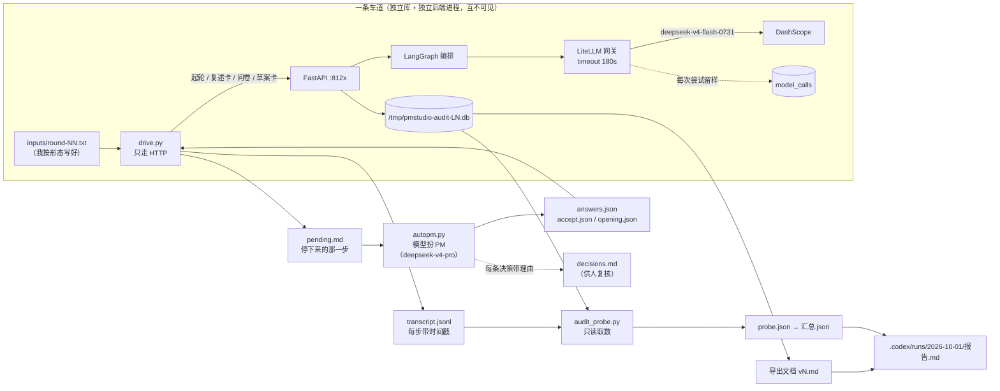

# P20 方案（待拍板）· 全量真跑审计：现在到底能不能交付

> **这份文档分析的是**：`docs/plans/2026-10-01-P19-C2c2-材料冻结口径.md` **§11** 那次
> "全量真跑审计"**怎么做**——逐条重审、补齐它没写死的部分、把取数口径和预算钉死。
> **状态**：方案。**一行产品代码没动、一次真模型没花**（只做过一次 1.4 秒的连通性探测）。
> **本文件取代 P19 方案 §11**（单一真相源；§11 的原话在下文被逐条引成"重审前"）。
> **给执行的 agent**：先写红 → 跑到红 → 再实现 → 再跑绿 → 一任务一提交（中文）；
> **除非测试本身写错（要说明错在哪），不许改测试迁就实现**；`src/` 里不许有假实现。

**基线（2026-10-01，P19 收口，本节数字都是今天实测的）**

| 项 | 值 | 怎么测的 |
|---|---|---|
| 后端单测 | **882 passed / 23.0s** | `PYTHONDONTWRITEBYTECODE=1 python3 -m pytest -q -p no:cacheprovider -o addopts=""` |
| 端点 | **25** | `tests/api/test_openapi_contract.py::EXPECTED_PATHS` 数出来 25 条 |
| 分支 / HEAD | `new-branch` @ `8ecb17a`（代码 `3ecc042`） | `git log --oneline` |
| 工作区 | 只有 `M .gitignore`（**作者自己改的，别动**） | `git status --short` |
| 模型 | `deepseek-v4-flash-0731` @ DashScope，HTTP 200 / **1.38s** | 一次 `max_tokens=16` 的直连探测 |
| `.env` | 超时 180s、`enable_thinking:false`、Tavily 密钥在 | 读 `backend/.env` |
| 端口 | 8100 / 8120 / 5173 **都没有进程在听** | `ss -ltnp` |
| 上次审计 | 09-28：250 次调用 / 15 轮 / 67 分钟 / 10 次 502 / 4 份导出 / **0 份可交付** | `.codex/runs/2026-09-28/报告.md` |

---

## 0. 先说结论：这次审计**不动产品代码**

§11 写着"不是新功能，是我的活"——这句话要变成一条**可核验的纪律**：

1. `backend/src/`、`frontend/src/`、`backend/tests/`、`.codex/docs/设计/` **审计期间一个字节都不改**；
2. 判据：`git diff --stat`（排除作者自己的 `.gitignore`）在**开跑前**与**收工后**都必须为空；
3. 真跑里发现 bug → **只记账，不修**（唯一的例外见第 11 节"阻塞到跑不动"那条）；
4. 一次审计 = 一次快照。跑完再改代码，结论才可比；边跑边改，09-28 那份报告的下场就重演（结论三天就过期）。

**新增的只有审计工具**，住在 `.codex/runs/2026-10-01/bin/`（`.gitignore:90` 已经把 `.codex/runs/` 整棵忽略）。
它们**不是产品代码**：导入 `pmstudio` 只用于只读取数，不注册进 `container`，不进任何守卫白名单。

---

## 1. §11 重审：八处要改

| # | §11 原话（重审前） | 问题（证据） | 改成 |
|---|---|---|---|
| ① | "照 09-28 那次的成熟做法" | 用的 `drive.py` 是 **09-28 的**（`/tmp/pmstudio-runs/bin/`）。P6→P19 之后契约变了很多：起轮多了 `material_ids`、复述卡多了 `web_queries`、`RoundView` 多了 `answer_sets`/`materials`/`web_queries`/`web_search_available`、失败出口多了 `abandon`/`dig`。**没验证过它还能不能走完三张卡** | 先跑一次**热身轮**（先红后绿），绿了才准花钱 |
| ② | "4 个形态：叙述式 / 逐条列举 / 补字段 / 加功能" | P16–P19 新增的**索引层与工具层**（搜索、材料冻结、联网）**一条都没进审计**。C-2 那一整块到现在只有"单功能真跑"，没有"进主闭环"的真证据 | 形态扩到 6 个：原 4 个 + **带材料** + **带联网**（见第 4 节） |
| ③ | "跑到导出" | **没有停止规则**。F14 说过 s11 会单调上涨 → 会永远跑不完 | 定死"三停"（收敛 / 达标 / 预算），见第 12 节 |
| ④ | "判据每条都要数字" | 没说**数字从哪儿取**。09-28 的报告里不少数字是手数的 | 每条判据钉一个端点或一条 SQL，见第 8 节 |
| ⑤ | "由模型扮 PM 机械推进（`autopm.py` 思路）" | 09-28 原文承认："**子智能体没跑起来**：反复只回'我准备好了'，收不到任务"。这次再派子智能体跑车道 = 重蹈覆辙 | 并行靠**进程**（每车道一个后端进程 + 一个驱动进程），监督靠主 agent 轮询；不派子智能体跑车道 |
| ⑥ | 只提"仍未修的前 3 条" | 09-28 有 F1–F14、09-29 有 F15。**不复盘 = 白跑一遍** | 报告必须有"逐条对账"一节（哪条修了 / 哪条没修 / 哪条复发） |
| ⑦ | 没提并发与库隔离 | 4 条车道共用一个库会撞写（SQLite 单进程，WAL 只解决读并发） | **一车道一库一端口**，最后合并报告 |
| ⑧ | "就绪度 0 阻塞" | 没定义什么算阻塞。**对着代码抄一遍**才能当判据用 | 第 9 节把四类 blocker 抄死 |

---

## 2. 现在要实现什么

**Goal**：拿**当前代码**（HEAD `8ecb17a`，代码 `3ecc042`）建 **4 个形态不同的复杂项目**，
各跑到"写进文档 + 能导出"，回答三件事，**每条都带数字和出处**：

1. **有没有一份文档达到"就绪度 0 阻塞"**？没有的话，卡在哪一类（按出现次数排序）？
2. **哪一段会坏**？——坏在哪个 step、哪个报文、哪条不变量，第一次出现在**哪一轮第几个调用**？
3. **代价多少**？——每轮墙钟、每类调用次数、失败率（`ok=0`）、重试率（`attempt>1`）、502 次数、token。

**为什么现在做**：09-28 的结论已经过期（之后 P6→P19 修了 14 条），而"能不能交付"现在**一张证据都没有**。
这是 C-2c-3/C-2c-4 之前必须先回答的问题：**先知道差多远，再决定往哪儿使劲**。

**边界**：不写新功能；不碰前端界面（只走 HTTP 层，界面另立一轮，见第 13 节）；
不改 schema、不加端点、不动提示词。

---

## 3. 现状核对（对着代码，逐条带证据）

| 事 | 现状（证据） | 对审计的含义 |
|---|---|---|
| 三张卡的名字没变 | `domain/round/step.py:21` `OPENING = "opening_card"`；`waiting_on` 仍是 `opening_card` / `questionnaire` / `draft_card` | 09-28 的 `drive.py` 状态机**骨架还对**，可以当起点改 |
| 起轮体向后兼容 | `api/schemas.py::StartRoundRequest`：`input` 必填、`material_ids` 默认空 | 老驱动**能**起轮；但要"带材料"就必须加字段 |
| 复述卡的联网栏是可选的 | `OpeningRequest.web_queries` 默认空；`RoundView.web_search_available` 由密钥决定 | 联网车道要显式勾，不然这一整块永远不会被跑到 |
| `RoundView` 只增字段 | `application/dto.py:189` 起：驱动要用的 `nominated_seats/claims/seat_packets/draft/dropped/questions/form_id/confirmed_version_no` **一个都没删**，新加的是 `answer_sets/materials/web_queries/web_search_available` | 兼容性风险在**流程分支**（新能力没人勾），不在字段 |
| 失败出口齐了 | 端点表 25 条里有 `/retry`、`/dig`、`/abandon`；`AbandonRound` 先写状态再取消任务 | 车道"卡住了"有正规出口，不必人工杀进程 |
| 留样够用 | `sqlite/schema.sql:78` `model_calls(round_id, purpose, model, prompt_sha, prompt_text, reply_text, usage_json, duration_ms, created_at, attempt, ok, error)` | 第 8 节的判据**大部分能直接从这张表取**，不用手数 |
| 真解析器只有三种 | `infrastructure/tools/extract.py`：文字 / HTML / PDF（`parser_id` 三档） | 材料车道用 `.md` + `.pdf` 各一份，别拿 docx 试（C-2c-4 才做） |
| 联网是真调用 | `infrastructure/tools/tavily.py`（与上传材料走同一套编号与存储路径） | 联网车道会真花钱，预算里要算上 |
| 09-28 的判死点已被修过 | F2/F4/F11（超限判死）→ P6/P7/P8；F3/F13（引用/席位容错）→ P6；F7（矛盾）→ P11/P12 | 这正是要**回归验证**的对象：不是"重跑一遍"，是"打勾或打叉" |

---

## 4. 四条车道（形态 · 打法 · 想压什么 · 判据）

主题**故意沿用 09-28 的四个**（设备点检 / 连锁健身 / 跨境内核 / 科研 CRF）：同一批输入、同一个模型，
只换代码版本 —— 这样 F1–F15 的"修没修"才是**可比**的。

| 车道 | 主题 | 形态 | 打法（逐轮） | 想压的东西 |
|---|---|---|---|---|
| **L1** | 中小制造：设备点检 / 报修 / 备件 | **叙述式** | ① 一整段自然语言（复刻 09-28 试点原文）→ ②③ 逐条补 | **F1 回归**：叙述式还出不出功能候选？P8 的置顶告警长什么样？ |
| **L2** | 连锁健身：会员 / 课程预约 / 私教提成 | **逐条列举 + 补字段** | ① 带编号的功能清单 → ② 点名 `s5/*.acceptance` 这类功能字段 → ③ 点名补 s8 六槽 | 最可能出"0 阻塞"的一条路；F10（补齐度）、s8 章节槽 |
| **L3** | 跨境电商：订单 / 库存 / 对账中台 | **带材料** | 上传 3 份真材料（`.md`×2 + `.pdf`×1，其中一份**长于 4000 字**）→ 起轮带材料 → 中途用 F6 搜一次 → 跑到收敛 | **C-2 首次进主闭环**：材料块有没有拿到编号、编号有没有进提示词、长材料截断、证据链能不能回跳到材料块 |
| **L4** | 医院科研 CRF 平台 | **联网 + 加功能** | ① 正常一轮 → ② 在**已有文档**上加一个新功能 + 复述卡勾一条检索词（真 Tavily）→ ③ 收口 | C-2b 进主闭环；"结合既有文档生长"；在路上的 s11 排队消化（F14） |

**为什么不是 6 条车道**：预算（第 12 节）。6 个形态压进 4 条车道（L1 兼顾叙述式、
L3 兼顾 3 份材料、L4 兼顾加功能）；如果 L2 提前收敛（0 阻塞），把省下的预算开一条 **L5 · 大项目**
（3 个模块、10+ 功能），单独立项。

**每轮输入谁写**：我（主 agent）按 `inputs/round-NN.txt` 逐轮写好，**人不实时参与**——
这样四条车道的输入是同一套口径，不被"临场发挥"污染。每份输入都留档进 run-dir。

---

## 5. 数据流（审计自己怎么流）

三条读法：

1. **模型只有两个出处**：产品自己的网关（`.env` → `deepseek-v4-flash-0731`）与"扮 PM"那条旁路
   （DashScope `deepseek-v4-pro`）。**没有第三方、没有 gpt。**
2. **取证只有两个出处**：库（`model_calls` + `rounds.payload`）与 `transcript.jsonl`。
   报告里不许出现"我记得""大概"。
3. **`audit_probe.py` 只读**：它连的是库文件（`sqlite3` `mode=ro`）与 HTTP `GET`，没有写权限，
   也就不可能"顺手修一下"。

---

## 6. 三份工具，逐文件

全部落在 `.codex/runs/2026-10-01/bin/`（gitignored）。**产品代码零改动。**

### 6.1 `bin/drive.py`（从 09-28 版升一版）

| 改哪 | 现在 | 改成 | 为什么 |
|---|---|---|---|
| 起轮 | `POST /rounds {"input": text}` | 多一个 `--materials m-1,m-2` → `material_ids` | L3 要带材料；老行为是默认（空） |
| 复述卡 | `{"seats":…, "claim_edits":…}` | 多一个 `--web-queries "…"` → `web_queries` | L4 要真联网 |
| 失败 | `retry` 一次 → 停下等人 | `retry` 一次 → 还失败就 `POST /abandon` → **记一条 F** → 回 `needs_input` | 车道要能自己往前走，人也别被单点卡死 |
| 计时 | 只记文本日志 | 每步追加一行 `transcript.jsonl`（`ts` / `step` / `waiting` / `round_id` / HTTP 码） | 第 8 节的"每轮墙钟"从这里取 |
| 上限 | `--max-steps 40` | 加 `--max-rounds`、`--max-calls`（超了自动停并写 `stopped_reason`） | 第 12 节的预算要能被脚本**强制**，不能靠人记得 |

### 6.2 `bin/autopm.py`（扮 PM，过卡）

| 改哪 | 现在 | 改成 | 为什么 |
|---|---|---|---|
| 答问卷 | 允许 skip | **只在"必须老板/法务/财务总监拍板"时 skip**；其余一律给具体答案 | 跳过的**阻塞题**会落成 s11 的 `〔未决·阻塞〕`——一跳就永远 ready 不了（第 9 节） |
| 开场 | 默认全选席位 | 按复述卡的建议**裁掉 1–2 席**（并在 `decisions.md` 写理由） | 席位裁剪是设计里的一条能力，09-28 从没真跑过 |
| 草案卡 | 全接受 | 真删减：每轮至少退掉 1 条"它提议的"（无依据那组，默认不勾选） | 验证"默认不勾选"这条口径在真跑里成立 |
| 统一模型 | `deepseek-v4-pro` | 不变（**DashScope 现有配置**，不是 gpt） | 作者要求 |
| 证据 | `decisions.md` | 不变，且每条决策带上"我引用了哪几个编号" | 报告要能复核"扮 PM 的选择有没有跑偏" |

### 6.3 `bin/audit_probe.py`（新，只读取数）

- 输入：`--lane L1 --db /tmp/pmstudio-audit-L1.db --base-url http://127.0.0.1:8121`
- 输出：`probe.json`（第 8 节那 8 组判据，全是数字/列表，没有一个形容词）
- `--selftest`：对热身项目断言"8 组判据都取到了数、且数字互相自洽"（例如
  `model_calls` 的行数 ≥ 轮次里出现过的调用数；导出字数 > 0；readiness 的 `items` 非空）
- 只读：`sqlite3.connect("file:...?mode=ro", uri=True)` + 只用 `GET`

---

## 7. 任务分解（先红 → 再绿 → 才花钱）

### W0 · 热身（**先红**）

拿 09-28 的 `drive.py` **原样**对现在的代码跑一轮，库 `/tmp/pmstudio-warmup.db`，端口 8121。
预期它会红——红的形态有三种，先记录是哪一种，**不改代码**：

1. 报错/卡死（契约真变了）；
2. 走得完但**跳过了新分支**（例如复述卡没勾联网栏、起轮没带材料）；
3. 走得完且正常（那就是"兼容"，记一笔）。

### W1 · 驱动升一版（**跑到绿**）

按 6.1 改到"三张卡全走过、版本 +1、导出成功"。**红转绿的判据就一句话**：
`rounds/{id}` 的 `step == "done"` 且 `confirmed_version_no` 是一个新号。

### W2 · 取数自检（**工具的契约测试**）

`audit_probe.py --selftest` 对 W1 那个项目断言 8 组判据都取到数。
**只有 W2 绿，才准开 4 条车道花真模型的预算。**

> 这三步就是这次改动里的 TDD：**热身轮是"红"，升完驱动是"绿"，`--selftest` 是"这条契约被钉住了"**。
> 没有测试用例要写——因为**没有产品代码要改**；可测的是工具自己的契约。

### L1–L4 · 四条车道（真跑）

每车道：起后端（独立端口 8121–8124、独立库）→ 交错起跑（错峰 90 秒）→ 逐轮推 → 到"三停"之一 → 导出 + `probe`。

### R · 汇总

`audit_probe.py --merge` → `汇总.json`；我写 `报告.md`（含逐条对账 + 仍未修的前 3 条）。

---

## 8. 判据清单：每条数字从哪儿取

| # | 判据 | 从哪儿取 | 红了说明什么 |
|---|---|---|---|
| 1 | **就绪度阻塞数 / 提示数 / 每条明细** | `GET /projects/{id}/readiness` | 卡交付。明细里的 `code` 直接给出是哪一类 |
| 2 | **导出文档**：字数、盖章行原文、空章数 | `GET /export/markdown` | 盖章行是"未通过"就还没到交付态 |
| 3 | **功能树**：棵数、每棵 6 个必填字段的填充率 | `GET /document`（`sections→s5→features`） | F1 复发（0 棵）／F10（填充率低） |
| 4 | **s11 走向**：每轮 blocking / 非 blocking 条数 | 逐轮 `GET /rounds/{id}` 快照 | F14：涨得比消得快 → 永远 ready 不了 |
| 5 | **每轮墙钟** | `transcript.jsonl`（每步 `ts` 差值） | 哪一步最慢，用不着猜 |
| 6 | **调用画像**：按 `purpose` 的 count / avg / max、`ok=0` 数、`attempt>1` 数 | SQL 打 `model_calls`（`ok`、`attempt` 是 P5c/P10 加的列） | 失败率、重试率、最慢调用 |
| 7 | **证据链抽查**：随机 20 个 `eid` → 能不能回到用户输入 / 问卷答案 / 材料块 | `GET /evidence/{eid}` + 账本 SQL | "编造证据"这类问题会在这儿露出来 |
| 8 | **版本与写入**：每轮 diff 的 added / removed | `GET /versions/{n}/diff?to=m` | "一轮什么都没写进去"或"把旧结论冲掉了" |

**报告里每个数字后面都要跟一个判据编号**；跟不上的数字不许进报告。

---

## 9. "就绪度 0 阻塞"到底要求什么（对着代码抄）

`domain/authoring/readiness.py` 里 `severity=blocker` 的**只有四类**：

| 类 | 判据 | 出处 |
|---|---|---|
| a | 章节最低条数：`s1≥1`、`s2≥2`、`s3≥1`、`s4≥2`、`s10≥1`、`s12≥1 条验收标准` | `SECTION_MIN_ENTRIES` |
| b | **s8 六个槽**（性能/可用性/安全/兼容/可观测/成本）**各至少一条** | `_nfr_slots` + `SECTION_SLOTS` |
| c | `s5`：至少有 1 个功能，且**每个功能**的 6 个必填字段（名称 / 一句话 / 服务的目标 / 面向角色 / 异常与边界 / 验收标准）都非空 | `_feature_gaps` + `FEATURE_FIELDS(required=True)` |
| d | `s11`：**没有任何** `〔未决·阻塞〕` 条目（跳过的阻塞题会变成它） | `_open_questions` |

推论（直接决定车道怎么打）：

- "0 阻塞"**不要求**填满 12 个字段，只要求那 6 个必填 —— 目标是够得着的；
- **跳过的题只要带 `blocking=true`，就必然堵死 ready** → 扮 PM 必须答，不能跳（6.2 第一条）；
- s8 六槽是**章节槽**，得让整合者按 `{section_id, field}` 写（P5c 修过这条通路）；
- s11 的非阻塞条目**只是 warn**，不挡交付。

---

## 10. 成功之后长什么样（自检）

1. `.codex/runs/2026-10-01/` 下：`报告.md`、`汇总.json`、`bin/`、`L1..L4/` 四个目录；
2. 每个车道目录里：`inputs/round-NN.txt`、`transcript.jsonl`、`pending.md`（最后一版）、
   `answers.json`、`decisions.md`、`rounds/*.json`（每步快照）、`probe.json`、**导出文档 `导出-vN.md`**；
3. `报告.md` 的结论句是**一句能拍板的话**，例如"4 份里 1 份 0 阻塞可交付，另 3 份各卡在哪一条"；
4. 缺陷清单里每条的格式是：**现象 → 复现（轮次 id / 调用留样 id / 报错原文）→ 次数 → 影响 → 建议**；
5. 有一节**逐条对账**：09-28 的 F1–F14 + 09-29 的 F15，每条打 ✅修了 / ❌没修 / ⚠️复发 / 🔁换了形态；
6. `git diff --stat`（除 `.gitignore`）**为空**；`backend/data/pmstudio.db` 的 mtime 没动过。

---

## 11. 失败模式

| 失败模式 | 怎么发现的 | 处理 | 会不会污染结论 |
|---|---|---|---|
| 模型抖动 / 超时（09-28 有过两次真抖动） | `model_calls.ok=0` 或 `attempt>1` | 记账；同一条红**必须**带留样行才算数 | 能排除 |
| 429 / 限流（并发惹的） | 同上，且**多条车道同时**出现 | 降并发、错峰、退避；标成"环境噪声"不进缺陷清单 | 能排除 |
| SQLite 写锁 | 后端日志 | 一车道一库，从设计上不可能发生 | 不可能 |
| 驱动自己的 bug | 与 `drive.py`/`autopm.py` 的行为对得上（例如传错字段） | 修工具（工具不在守卫范围），**该车道重跑** | 会，所以要"先热身再花钱" |
| 审计中手滑改了产品代码 | `git diff --stat` 非空 | **立刻停**，还原，重跑受影响的车道 | 会，所以第 0 节是纪律 |
| 阻塞到跑不动 | 车道连续两轮 `failed` 且 `abandon` 也救不回 | **停下来报告**（单独一条），要不要 TDD 修由作者拍板；不修就跳过该车道 | 报告里写明 |
| s11 永远涨 → 跑不到"达标" | 判据 #4 | 到预算上限停，**这就是结论**（F14 仍未修），不是失败 | 不算失败 |

**没有"无测试 + 无处理 + 静默"的 critical gap。**

---

## 12. 预算、时长、并发

**每车道三道闸**（脚本强制，超了自己停并写 `stopped_reason`）：

| 闸 | 阈值 | 依据 |
|---|---|---|
| 轮次 | ≤ **8 轮** | 09-28 试点 6 轮就长到 2.6 万字 |
| 墙钟 | ≤ **75 分钟** | 09-28 全程 67 分钟 / 15 轮 ≈ 4.5 分钟一轮 |
| 调用 | ≤ **600 次** | 09-28 平均 ~17 次/轮（含重试） |

**并发**：两波 × 两车道（L1+L2 先起，L3+L4 后起），错峰 90 秒。
理由：DashScope 并发上限未知；09-28 单线程串行都撞过 502，一上来开 4 条是给自己造噪声。

**粗估**：4 车道 × ~6 轮 ≈ 24 轮 × ~20 次调用 ≈ **500 次调用**；
墙钟两波 ≈ **1.5–2.5 小时**；token 量级按 09-28（integration 单次提示词 ~2 万字符 ≈ 1.2 万 token）
估 **400 万–1000 万 prompt token**。这是**上限不是预期**，闸门会把它切住。

**时间**：W0–W2 热身 15 分钟；四车道两波；汇总报告 20 分钟。**一次完整审计 = 半天以内**。

---

## 13. 明确不做

- **不动产品代码**（`src/`、`tests/`、设计文档）——这是本批次的第一条纪律；
- **不碰** `backend/data/pmstudio.db`（真跑一律 `/tmp`）；
- **不验前端界面**（文档区 / 闭环区 / 问卷弹窗 / 材料库面板的**眼睛检查**另立一轮：
  那需要浏览器与截图，跟"能不能交付"是两件事）；
- **不跑 eval 全量**（`scripts/eval.py` 8 条用例，一条 ~8 分钟；它是"提示词有没有退化"的
  另一条通道，等审计结论出来再按需补，见第 15 节的第 3 条）；
- **不派子智能体跑车道**（09-28 的实证：派出去只回"我准备好了"）；
- **不新增字段、不改 schema、不加端点、不动提示词**。

---

## 14. 回写清单（做完必须回写）

1. `.codex/runs/2026-10-01/报告.md` —— 审计报告本体（**不进真相源**，`.codex/runs/` 已忽略）；
2. `docs/plans/2026-10-01-P19-C2c2-材料冻结口径.md` §11 —— 改成一句"**审计已做，方法见
   `2026-10-01-P20-全量真跑审计.md`，结果见 `.codex/runs/2026-10-01/报告.md`**"，
   删掉已经搬走的方法细节（**避免两份方法**）；
3. `.codex/docs/设计/04-未决.md`：F1–F15 里"仍未修"的，按审计结果改写那一行（**只改状态，不夹带新口径**）；
4. `.codex/docs/上下文/checkpoint.md`：末尾加 P20 一节（结论 + 下一步）；
5. 如果审计发现**必须动契约**的问题 → **另起一份方案**，不在本批次里顺手改。

---

## 15. 待作者拍板

1. **车道编制**：按第 4 节走（L1 叙述式 / L2 逐条列举+补字段 / L3 带材料 / L4 联网+加功能），
   主题沿用 09-28 四个（可比）——还是换主题？要不要现在就把 **L5 大项目**一起排上（预算翻倍）？
2. **停止规则**：≤8 轮 / ≤75 分钟 / ≤600 调用 / "收敛即停"——接受吗？
3. **要不要顺带跑 `scripts/eval.py` 全量**（8 条真模型用例，约 1–1.5 小时）？
   它是"提示词退化"的另一条通道，与本次审计**不重叠**；我建议**先不跑**，等审计结论出来再决定。
4. **扮 PM 的模型**：`deepseek-v4-pro`（09-28 用的、DashScope 现有配置）——还是换成
   `.env` 里同一个 `deepseek-v4-flash-0731`（更便宜、与产品同源，但"扮 PM"的代表性弱一点）？
5. **发现 bug 的处置**：审计期间**只记账不修**（推荐）——还是遇到阻塞性缺陷当场 TDD 修、
   该车道重跑？（后者会让"4 份文档同源可比"这条属性打折扣）
