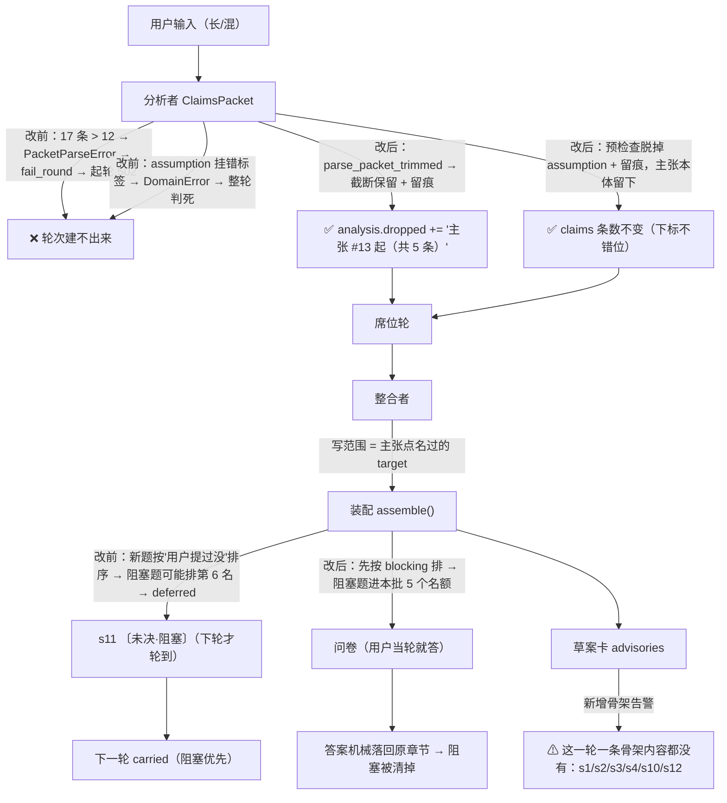

# P21 Implementation Plan · 起轮不判死 + 骨架填写度 + 未决消化

> **给执行的 agent**：按任务顺序做，一个任务一次提交；**先写红测试 → 跑到红 → 再实现 → 再跑绿**。
> **除非测试本身写错（要说明错在哪），不许改测试迁就实现。** 产品代码里不许有假实现。

**Goal**：把 2026-10-01 全量真跑审计里三件最挡交付的事做掉——
① **起轮不再判死**（长输入连轮次都建不出来）；② **骨架章节有人写**（背景/目标/受众/范围默认全空）；
③ **阻塞型未决题先问出去**（否则 ready 永远差一轮）。

**Architecture**：三处都在既有分层里改，不新增端口、不新增端点、不动 DDD 边界：
① 分析者（`application/agents/analyzer.py`）把"报文超限/字段写歪"从**判死**降成**修好 + 留痕**
（与 P6/P7 给席位、整合者做过的同一套）；② 归位规则进分析者提示词，卡片告警进**纯投影**（`application/dto.py`）；
③ 装配层（`application/assembly.py`）只改一个排序键，让 `is_blocking()` 算出来的阻塞题先拿配额。

**Tech Stack**：Python 3.13 · FastAPI · Pydantic v2 · LangGraph · pytest（`backend/tests/`）

**Spec**：`.codex/docs/设计/01-规格.md` §4/§7（13 章与就绪度）· `.codex/docs/设计/02-编排与数据.md`
§11.0.5（报文不合格重装）· §11.0.9（字段级容错）· §11.0.10/§11.0.18（未决队列）
· `.codex/runs/2026-10-01/报告.md`（F16/F18/F20 的现场证据）

## Global Constraints

- **不新增端点**（`tests/api/test_openapi_contract.py::EXPECTED_PATHS` 仍是 25 条）；
- **不改文档 schema**（13 章、功能 12 字段、`readiness.py` 的四类 blocker 一个字不动）；
- **`domain/` 不 import 任何外部包**（`tests/architecture` 守卫会拦）；
- **写入路径唯一**：只有确认端点能写文档，这三处都不碰写入；
- **一条都不许默默丢掉**：凡是"丢掉/截断/降级"都要落成 `Round.dropped` 或 `Draft.gaps`；
- 测试跑法：`cd backend && PYTHONDONTWRITEBYTECODE=1 python3 -m pytest -p no:cacheprovider -o addopts=""`；
  lint：`cd backend && python3 -m ruff check --no-cache .`；前端：`cd frontend && npx vitest run && npx tsc --noEmit`。

---

## 0. 一句话说清三条各要动什么

| 编号 | 根因锚点（对着代码） | 改法 | 契约变不变 |
|---|---|---|---|
| **F16-a** | `agents/schemas.py:88` `claims: max_length=12`；`ClaimAnalyzer.analyze` 用的是**严格**的 `parse_packet`（而 `parse_packet_trimmed` 早就有了，席位 `use_cases.py:743` 与整合 `:1369` 都在用） | 分析者也走 `parse_packet_trimmed`：超限**截断保留 + 留痕**，不判死；上限 12 → **20**（长输入装得下） | 报文的 JSON Schema 上限变了（模型看得见） |
| **F16-b** | `agents/analyzer.py:271` `claims_from_packet` 把 `DomainError` 一律变成 `PacketParseError` → 起轮 502；现场是 `domain/round/claim.py:57` 的 `只有猜测才带假设` | 构造前**预检查**：非 guess 标签带 `assumption` → **脱掉这个字段、保留主张本体** + 留痕；`raw_span 对不上`这类**仍然判死**（那是编造） | 无（报文形状没变） |
| **F18-a** | `infrastructure/llm/prompts/analyzer.md` §硬规矩 4 只说"功能相关落 s5"，于是 L1 第 1 轮 12 条主张里 **10 条**落进 `s5/*.user_story`，s1/s2/s3/s4 **零条** → 整合者的写范围里根本没有那几章 | 归位那条补一张对照：现状痛点→s1 / 目标→s2 / 角色→s3 / 范围与不做→s4 / 假设依赖→s10 / 上线验收→s12 / 量级时段合规成本→s8 槽；并加一句"一段话里既有现状又有功能，**各切一条**" | 无（只改提示词文字） |
| **F18-b** | `application/dto.py:829` 只有"零功能候选"置顶告警；草案卡上看不出"骨架章节这一轮没人写" | 加孪生纯函数 `skeleton_coverage_advisory(round_)`，挂进 `advisories` 首位 | 无（`RoundView.advisories` 已经存在） |
| **F20** | `application/assembly.py:471`：新题只按"用户提没提过"排序，**没有按阻塞排**；于是 `is_blocking()`（`:883`）算出来的阻塞题被普通题挤进 `deferred` → 出草案时落成 s11 的 `〔未决·阻塞〕` | 排序键前面加一级 **`0 if question.blocking else 1`** | 无（题号、配额都不动） |

**这一步明确不做**：不动 `MAX_OPEN_ITEMS_PER_BATCH`（3）、不动 `MAX_QUESTIONNAIRES`（2）、
不动写范围白名单——理由见 §8 拍板项 3。

---

## 1. 现状核对（对着代码与真跑痕迹）

| 事 | 现状（证据） | 影响 |
|---|---|---|
| **起轮判死是唯一一条"没有 `/retry`"的失败路** | `use_cases.py:307` `MAX_CLAIMS_ATTEMPTS = 2` → 两次都失败 → `fail_round` → `POST /rounds` 502。**此时还没有轮次**，`/retry` 无处可点 | 用户只能再点一次或把输入改短（L1 第 4 轮再点一次 11.7 秒就过了） |
| 两次失败的真实报文 | `model_calls` id=33：12 条主张，第 6 条带 `assumption` 但标签是 `constraint` → `只有猜测才带假设`；id=34：**17 条主张** → `List should have at most 12 items after validation, not 17` | 两个毛病只要有一个就整轮判死 |
| "超限不判死"**已经建好了**，只是分析者没用 | `schemas.parse_packet_trimmed`（`:388`）注释写明"只有当所有报错都是 `too_long` 时才截断"；`use_cases.py:743`（席位）与 `:1369`（整合）都在用；**分析者 `analyzer.py:203` 还在用严格的 `parse_packet`** | 一行之差 |
| 归位偏差是可复现的 | L1 第 1 轮主张去处：`s5/*` **10 条**（多数是 `user_story`）、`s8` 1 条、`s10` 1 条，**s1/s2/s3/s4/s12 零条**；同一轮问出去的 10 道题也只有 s5/s7/s8 | 整合者拿不到写 s1–s4 的授权 → 8 个阻塞 |
| 归位不是"模型不会" | L2 第 1 轮有 `s1`×1 / `s12`×1；L3（带材料）第 1 轮有 `s1`×1 / `s12`×1 / `s7`×1 | 有材料时反而归得更准——说明是**提示词没说清**，不是能力问题 |
| 提示词里其实带就绪度 | `analyze()` 调 `render_document_state(view, readiness=self._checker.check(view))`；`context.py:134` 渲染成 `## 本章还差什么…〔阻塞〕` | 光"告诉它缺什么"不够，还得**规定这段话该归哪一章** |
| 阻塞判定是规则算的，不看模型 | `assembly.py:883 is_blocking(target)`；`BLOCKING_SECTIONS = {s1,s2,s3,s4,s5,s8,s10,s12}`；`questionnaire.py:67` 注释"由装配层的规则算，不问模型" | 所以"阻塞题先问"只改一个排序键就够，不用动模型 |
| 被挤掉的题确实会变成阻塞 | L1 第 1 轮：`s11` 从 0 → **3 条阻塞**；第 3 轮 → 6 条。同一轮产出的阻塞题**没被问出去** | 这一条直接对应"ready 永远差一轮" |
| 老账是能还的 | `deferred_from_open_items(limit=MAX_OPEN_ITEMS_PER_BATCH)` 自己就 `collected.sort(key=lambda item: 0 if item.blocking else 1)`（`assembly.py:256`）——**老账里阻塞优先**，只是**新题里没优先** | 修好新题这一侧，两侧口径就一致了 |

---

## 2. 数据流（改前 → 改后）



---

## 3. 任务分解

### Task 1（F16-a）· 主张超限不再判死，上限 12 → 20

**Files:**
- Modify: `backend/src/pmstudio/application/agents/schemas.py:88`
- Modify: `backend/src/pmstudio/application/agents/analyzer.py:203`（`analyze` 里那一行）与 `:271` 起
- Test: `backend/tests/application/test_packet_overflow.py`

**Interfaces:**
- Consumes: `schemas.parse_packet_trimmed(text, model, *, purpose) -> tuple[T, tuple[Overflow, ...]]`（已有）
- Produces: `analyzer.claims_overflow_drops(overflows: Sequence[schemas.Overflow]) -> tuple[DroppedItem, ...]`（新增）

- [ ] **Step 1：写红测试**（追加到 `tests/application/test_packet_overflow.py`）

```python
def claims_packet_json(count: int) -> str:
    return json.dumps(
        {
            "basis": "读了文档与本轮输入",
            "claims": [
                {
                    "text": f"第 {index} 件事",
                    "raw_span": "用户原话",
                    "label": "need",
                    "zone": "body",
                    "section_id": "s1",
                }
                for index in range(1, count + 1)
            ],
            "seats": [{"seat_id": "seat.rules", "why": "要有人表态"}],
        },
        ensure_ascii=False,
    )


def test_claims_cap_fits_a_long_input():
    # 真跑实测：一份"把前面几章补齐"的长输入让模型切出 17 条主张，12 条上限把整轮判死。
    assert cap(schemas.ClaimsPacket, "claims") == 20


def test_seventeen_claims_are_trimmed_not_fatal():
    packet, overflows = schemas.parse_packet_trimmed(
        claims_packet_json(17), schemas.ClaimsPacket, purpose="claims"
    )

    assert len(packet.claims) == 17  # 20 条上限装得下 17 条：不截断
    assert overflows == ()


def test_twenty_five_claims_keep_the_first_twenty_and_report_the_overflow():
    packet, overflows = schemas.parse_packet_trimmed(
        claims_packet_json(25), schemas.ClaimsPacket, purpose="claims"
    )

    assert len(packet.claims) == 20
    assert [(item.container, item.kept, item.dropped) for item in overflows] == [
        ("claims", 20, 5)
    ]


def test_claims_parse_error_is_still_fatal_for_other_reasons():
    """'超限不判死'只对 too_long 生效：别的毛病照旧抛（不许放松）。"""

    broken = json.dumps(
        {"basis": "读了文档", "claims": [{"text": "少了必填字段"}], "seats": []},
        ensure_ascii=False,
    )

    with pytest.raises(PacketParseError):
        schemas.parse_packet_trimmed(broken, schemas.ClaimsPacket, purpose="claims")
```

> `cap(model, field)` 是本文件已有的辅助函数；`test_forty_four_proposals_no_longer_explode` 是它的用法样板。

- [ ] **Step 2：跑到红**

Run: `cd backend && python3 -m pytest tests/application/test_packet_overflow.py -q -p no:cacheprovider -o addopts=""`
Expected: FAIL —— `assert 12 == 20`。

- [ ] **Step 3：改 schema 上限**

```python
    #: 12 → 20（P21 F16-a）：真跑里一份"把前面几章补齐"的长输入被切出 17 条主张，
    #: 12 条上限直接把整轮判死（用户连轮次都建不出来）。20 条装得下长输入；
    #: 再超就是模型失准，走 `parse_packet_trimmed` 截断 + 留痕，一样不判死。
    claims: list[ClaimDraft] = Field(min_length=1, max_length=20)
```

- [ ] **Step 4：分析者改用 `parse_packet_trimmed` 并把溢出写成留痕**

`analyzer.py` 顶部 import 补 `from collections.abc import Sequence`（已有）与 `DropSource`（已 import）。

```python
def claims_overflow_drops(overflows: Sequence[schemas.Overflow]) -> tuple[DroppedItem, ...]:
    """主张被截断的留痕（`04-未决.md` C5 后半：一条都不许默默丢掉）。

    与席位（`use_cases.py:929`）、整合（`:948`）同一个口径：说清"从第几条起、共几条"，
    不说内容——留给用户的是"这里少了东西"，不是把我们丢掉的话再抄一遍。
    """

    return tuple(
        DroppedItem(
            handle=f"主张 #{item.kept + 1} 起（共 {item.dropped} 条）",
            reason=f"超出上限 {item.kept} 条：保留了它自己排的前 {item.kept} 条，其余没切进来",
            source=DropSource.ASSEMBLY,
            seat_id=None,
            pass_index=1,
        )
        for item in overflows
    )
```

`ClaimAnalyzer.analyze` 里那一行：

```python
        packet, overflow = schemas.parse_packet_trimmed(
            reply.text, schemas.ClaimsPacket, purpose=self.PURPOSE
        )
```

并把返回值拼进 `dropped`（**顺序：席位 → 主张 → 互斥对子 → 检索词**，与界面分组一致）：

```python
        seats, dropped = nominations_from_packet(packet, catalog=self._catalog)
        claims, claim_drops = claims_from_packet(packet, user_input=user_input)
        contradictions, contradiction_drops = contradictions_from_packet(packet, claims=claims)
        web_queries, query_drops = web_queries_from_packet(packet)
        return Analysis(
            claims=claims,
            seats=seats,
            dropped=(
                dropped
                + claims_overflow_drops(overflow)
                + claim_drops
                + contradiction_drops
                + query_drops
            ),
            ...
        )
```

- [ ] **Step 5：跑到绿**

Run: `cd backend && python3 -m pytest tests/application/test_packet_overflow.py tests/application/test_analyzer.py -q -p no:cacheprovider -o addopts=""`
Expected: PASS（`ClaimsPacket` 的 schema 断言在别处若写死 12，一并改——那是**契约变更**，要在提交信息里写明）。

- [ ] **Step 6：提交**

```bash
cd backend && git add src/pmstudio/application/agents/schemas.py src/pmstudio/application/agents/analyzer.py tests/application/test_packet_overflow.py
git commit -m "fix(analyzer): 主张超限不再判死（上限 12→20，超了截断+留痕）——起轮 502 的一半根因"
```

---

### Task 2（F16-b）· 假设挂错标签：脱字段，不丢主张

**Files:**
- Modify: `backend/src/pmstudio/application/agents/analyzer.py:271`（`claims_from_packet`）
- Test: `backend/tests/application/test_analyzer.py`

**Interfaces:**
- Produces: `analyzer.claims_from_packet(packet, *, user_input) -> tuple[tuple[Claim, ...], tuple[DroppedItem, ...]]`
  （**签名变了**：多返回一份留痕；调用方只有 `analyze` 与测试）
- 不变量：**返回的 claims 条数与 `packet.claims` 一一对位**（下标不许错位）——
  `contradictions_from_packet` 用第几条来指认主张。

- [ ] **Step 1：写红测试**

`test_analyzer.py` 顶部补一个 import：`from pmstudio.domain.round.round import DropSource, SeatNomination`
（`SeatNomination` 原本就在，加 `DropSource`）。

```python
async def test_assumption_on_a_non_guess_claim_is_stripped_not_fatal():
    """真跑：第 6 条主张带 assumption 但标签是 constraint → 整轮判死。

    口径与 P8 的字段级容错一致：**丢字段、不丢主张**（主张是用户原话的落点，
    丢了它等于把用户说过的一句从证据链里挖掉）。
    """

    reply = json.dumps(
        {
            "basis": "读了文档与本轮输入",
            "claims": [
                {
                    "text": "点检记录不许改",
                    "raw_span": "点检记录不能改",
                    "label": "constraint",
                    "zone": "body",
                    "section_id": "s5",
                    "assumption": {"failure_consequence": "改不了会出事", "verification": "看日志"},
                }
            ],
            "seats": [{"seat_id": SEAT, "why": "涉及留痕"}],
        },
        ensure_ascii=False,
    )
    gateway = ScriptedModelGateway(replies={"claims": reply})
    analyzer = make_analyzer(gateway, RecordingPrompts())

    analysis = await analyzer.analyze(
        user_input="点检记录不能改，出了事故要能查是谁点的。",
        document_state="# 文档",
    )

    assert len(analysis.claims) == 1
    assert analysis.claims[0].assumption is None
    assert [item.reason for item in analysis.dropped] == [
        "只有猜测才带假设：这条主张标的是 constraint，假设字段已丢掉；主张本身保留"
    ]
    assert analysis.dropped[0].source is DropSource.ASSEMBLY


async def test_fabricated_raw_span_is_still_fatal():
    """编造原话照旧判死（`04-未决.md` 的可追溯不变式不许放松）。"""

    reply = json.dumps(
        {
            "basis": "读了文档",
            "claims": [
                {
                    "text": "要做订单导出",
                    "raw_span": "帮我搞个导出吧",
                    "label": "need",
                    "zone": "body",
                    "section_id": "s5",
                }
            ],
            "seats": [{"seat_id": SEAT, "why": "你说到了数据量"}],
        },
        ensure_ascii=False,
    )
    analyzer = make_analyzer(ScriptedModelGateway(replies={"claims": reply}), RecordingPrompts())

    with pytest.raises(PacketParseError):
        await analyzer.analyze(user_input=INPUT, document_state="# 文档")
```

- [ ] **Step 2：跑到红**

Run: `cd backend && python3 -m pytest tests/application/test_analyzer.py -q -p no:cacheprovider -o addopts=""`
Expected: FAIL —— 第一条报 `PacketParseError`（`主张 c1 过不了领域校验：只有猜测才带假设`），
第二条（编造 raw_span）现在 PASS，改完必须仍然 PASS。

- [ ] **Step 3：实现——构造前预检查，不靠异常兜底**

```python
def claims_from_packet(
    packet: schemas.ClaimsPacket, *, user_input: str
) -> tuple[tuple[Claim, ...], tuple[DroppedItem, ...]]:
    """报文 → 主张；**能就地修的字段毛病只丢字段、不丢主张**（P21 F16-b）。

    为什么要"丢字段"而不是"丢主张"：主张是用户原话在文档里的落点（`c{i}` 还挂着
    互斥对子与席位的指认），丢一条会让后面所有序号整体错位。字段写歪则是模型的笔误，
    修好它、把这次修正留痕，比把一条用户说过的话从证据链里挖掉好。

    仍然判死的只有两类：**原话在输入里找不到**（编造）、以及主张本文过不了领域校验
    （空文本 / 猜测不带假设 / 决定不给拍板人）——那些不是"修一下"能解决的。
    """

    claims: list[Claim] = []
    dropped: list[DroppedItem] = []
    for index, draft in enumerate(packet.claims, start=1):
        claim_id = f"c{index}"
        span = grounded_span(draft.raw_span, user_input)
        if span is None:
            raise PacketParseError(
                "主张里的原话片段在用户输入里找不到（复述必须能跳回原文）",
                purpose=PURPOSE,
                claim_id=claim_id,
                position=index,
                raw_span=draft.raw_span,
            )
        assumption = draft.assumption
        if assumption is not None and draft.label.strip().lower() != ClaimLabel.GUESS.value:
            dropped.append(
                DroppedItem(
                    handle=f"主张 {claim_id} 的假设",
                    reason=(
                        f"只有猜测才带假设：这条主张标的是 {draft.label}，"
                        "假设字段已丢掉；主张本身保留"
                    ),
                    source=DropSource.ASSEMBLY,
                    seat_id=None,
                    pass_index=1,
                )
            )
            assumption = None
        try:
            claims.append(
                Claim(
                    claim_id=claim_id,
                    text=draft.text.strip(),
                    label=ClaimLabel(draft.label),
                    target=schemas.normalize_claim_target(draft, label=draft.label),
                    raw_span=span,
                    assumption=(
                        Assumption(
                            failure_consequence=assumption.failure_consequence,
                            verification=assumption.verification,
                        )
                        if assumption is not None
                        else None
                    ),
                    decided_by=draft.decided_by,
                )
            )
        except DomainError as error:
            raise PacketParseError(  # 剩下的照旧判死（重装一次是有意义的）
                f"主张 {claim_id} 过不了领域校验：{error.message}",
                purpose=PURPOSE,
                claim_id=claim_id,
                domain_code=error.code,
            ) from error
    return tuple(claims), tuple(dropped)
```

> `packet.claims` 里剩下的 `guess` 分支没变：**猜测不带假设**照旧抛（模型该补的是 `assumption`，
> 不是我们能替它编的）。

- [ ] **Step 4：跑到绿**

Run: `cd backend && python3 -m pytest tests/application -q -p no:cacheprovider -o addopts=""`
Expected: PASS。**已经核过**：`tests/` 里没有直接调 `claims_from_packet(...)` 的用例，
现有那十条 `analysis.dropped` 断言（`test_analyzer.py:455/495/507/520/548/584/604`）在"没有溢出、
没有错挂假设"的输入下顺序不变（新增的两个来源都是空元组）——**它们不该需要改**，改了就是改错了。

- [ ] **Step 5：提交**

```bash
git add src/pmstudio/application/agents/analyzer.py tests/application/test_analyzer.py
git commit -m "fix(analyzer): 非猜测带 assumption 改成脱字段+留痕，不再判死整轮——起轮 502 的另一半根因"
```

---

### Task 3（F18-a）· 分析者归位：这段话属于哪一章

**Files:**
- Modify: `backend/src/pmstudio/infrastructure/llm/prompts/analyzer.md`（§硬规矩 第 4 条）
- Test: `backend/tests/application/test_analyzer.py`（提示词内容断言）

**Interfaces:**
- 无代码接口变化；`ClaimAnalyzer.PROMPT_SLOTS` 不变（还是那十个槽）。

- [ ] **Step 1：写红测试**

```python
def test_analyzer_prompt_routes_backbone_sentences_to_their_chapters():
    """真跑实测（报告 F18）：一份叙述式输入里 12 条主张有 10 条落进 `s5/*.user_story`，
    s1/s2/s3/s4 零条 → 整合者拿不到写那几章的授权 → 8 个阻塞。

    修的是提示词本身（模型每轮都看得见的那份），所以这里直接钉文案。
    """

    body = (PROMPTS_DIR / "analyzer.md").read_text(encoding="utf-8")

    assert "现状、痛点、不做的代价" in body
    assert "要达成什么、成功标准" in body
    assert "谁在用、什么角色" in body
    assert "本期做什么、本期**不做**什么" in body
    assert "假设、依赖、外部系统" in body
    assert "什么时候上线、怎么验收" in body
    assert "各切一条" in body
    # 六章都得在这张表里出现（只认表，不认散落在别处的字样）
    table = body[body.index("4bis.") :]
    for chapter in ("**s1**", "**s2**", "**s3**", "**s4**", "**s10**", "**s12**"):
        assert chapter in table


async def test_analyzer_still_sends_the_section_table_to_the_model():
    """归位规则改了，槽没变：`sections` 照旧要进上下文（防止改提示词时把槽删掉）。"""

    prompts = RecordingPrompts()
    analyzer = make_analyzer(ScriptedModelGateway(replies={"claims": CLAIMS_REPLY}), prompts)

    await analyzer.analyze(user_input=INPUT, document_state="# 文档")

    assert "s5 功能需求" in prompts.calls[0][1]["sections"]
```

> `PROMPTS_DIR` 加在 `test_analyzer.py` 顶部：
> `PROMPTS_DIR = Path(__file__).resolve().parents[2] / "src/pmstudio/infrastructure/llm/prompts"`
> （`Path` 与 `PROMPTS_DIR` 之外只用一个断言——**不新增依赖、不新造工具**）。

- [ ] **Step 2：跑到红**

Run: `cd backend && python3 -m pytest tests/application/test_analyzer.py::test_analyzer_prompt_routes_backbone_sentences_to_their_chapters -q -p no:cacheprovider -o addopts=""`
Expected: FAIL —— `assert '现状、痛点、不做的代价' in body`。

- [ ] **Step 3：改提示词**（`analyzer.md` §硬规矩 第 4 条，**在原文后面追加**，前三条原样不动）

```markdown
4bis. **先按"这段话讲的是哪一章"归位，再想落到哪个字段**。同一段输入里常常混着好几类内容，
   要**各切一条**，别都塞进 s5：

   | 这段话在说什么 | 归哪 | 写法 |
   |---|---|---|
   | 现状、痛点、不做的代价 | **s1** | 只给 section_id |
   | 要达成什么、成功标准 | **s2** | 只给 section_id |
   | 谁在用、什么角色、什么场景 | **s3** | 只给 section_id |
   | 本期做什么、本期**不做**什么、边界 | **s4** | 只给 section_id |
   | 假设、依赖、外部系统、失联怎么办 | **s10** | 只给 section_id |
   | 什么时候上线、怎么验收 | **s12** | 只给 section_id |
   | 量级、时限、合规、成本、监控 | **s8** | section_id + field（性能/可用性/安全/兼容/可观测/成本） |
   | 功能本身的做法（主流程、规则、异常、验收…） | **s5** | section_id + feature_slug（+ field） |

   一句话里既有现状又有功能时（"现在是纸单子，想做个系统……"），**切成两条**：
   现状那条去 s1，功能那条去 s5。**别把背景、目标、受众整段都当成功能说明。**
```

- [ ] **Step 4：跑到绿 + 抽样核验**

Run: `cd backend && python3 -m pytest tests/application -q -p no:cacheprovider -o addopts=""`
Expected: PASS。

再花一次真模型做**单轮抽样**（不是全量，约 2 分钟）：

```bash
cd backend && PMSTUDIO_DB=/tmp/pmstudio-p21-route.db PYTHONPATH=src python3 scripts/smoke.py
```
Expected: 打印的每条 claim 里，**s1/s2/s3/s4 至少各出现一次**（这份冒烟输入里四类内容都有）。
若仍然全落 s5，说明提示词位置不够显眼——**停下来报告，不要继续往下做**。

- [ ] **Step 5：提交**

```bash
git add src/pmstudio/infrastructure/llm/prompts/analyzer.md tests/application/test_analyzer.py
git commit -m "fix(prompt): 分析者归位对照表——现状/目标/受众/范围/假设/验收各归各章，别都塞 s5"
```

---

### Task 4（F18-b）· 草案卡置顶告警：这一轮骨架一条都没写

**Files:**
- Modify: `backend/src/pmstudio/application/dto.py`（`feature_coverage_advisory` 旁边加孪生函数；`round_view` 的 `advisories` 组装处）
- Test: `backend/tests/application/test_dto.py`

**Interfaces:**
- Produces: `dto.skeleton_coverage_advisory(round_: Round) -> str | None`（纯投影，只读 round，不写文档、不调模型）
- Consumes: `round_.claims` / `round_.draft` / `round_.questionnaire` / `round_.deferred`（都已在 `Round` 上）

- [ ] **Step 1：写红测试**

```python
def test_skeleton_advisory_fires_when_nothing_landed_on_the_backbone():
    """真跑 L1 第 1 轮：12 条主张 10 条落 s5，s1–s4 零条，草案也没有 → 8 个阻塞却没人提醒。"""

    round_ = round_for_coverage(
        claim_target=Target.feature_field(FeatureSlug("order-export"), "one_liner"),
        proposal_target=Target.feature_field(FeatureSlug("order-export"), "goal"),
    )

    advisory = dto.skeleton_coverage_advisory(round_)

    assert advisory is not None
    assert "骨架" in advisory
    assert "s1" in advisory and "s12" in advisory


def test_skeleton_advisory_is_silent_when_one_backbone_chapter_got_content():
    """碰过**任何**一章就不吵（宁可漏报，不许骚扰）。"""

    round_ = round_for_coverage(
        claim_target=Target.body("s5"), proposal_target=Target.body("s1")
    )

    assert dto.skeleton_coverage_advisory(round_) is None


def test_skeleton_advisory_is_silent_before_there_is_a_draft():
    assert dto.skeleton_coverage_advisory(make_round()) is None
```

> `round_for_coverage(*, claim_target, proposal_target)` 是本文件**已经有**的构造器（零功能候选告警
> 那批用例建的），直接复用——**不要新造一套**。
> 另外两条路径（`questionnaire_history` 里的题目、`deferred` 队列）也进 `touched`，
> 但**不用单测钉**：造一个"既有历史问卷又有草案"的轮次要跑完"起轮→问卷→作答→席位→整合"整条链，
> 成本远大于收益；`round_view` 的集成用例已经覆盖那条链。

- [ ] **Step 2：跑到红**

Run: `cd backend && python3 -m pytest tests/application/test_dto.py -q -p no:cacheprovider -o addopts=""`
Expected: FAIL —— `AttributeError: module 'pmstudio.application.dto' has no attribute 'skeleton_coverage_advisory'`。

- [ ] **Step 3：实现**

```python
#: 骨架章节：就绪度里"不写就没有交付物"、而真跑里又最常被整章漏掉的那几章（报告 F18）
BACKBONE_SECTIONS = ("s1", "s2", "s3", "s4", "s10", "s12")


def skeleton_coverage_advisory(round_: Round) -> str | None:
    """这一轮**一条骨架内容都没碰**时的置顶告警（报告 F18）。

    判据刻意保守（与 `feature_coverage_advisory` 同一个脾气）：
    - 只在**已经有草案**的这一轮报（还没到出草案那一步，说了也白说）；
    - 主张、提案、题目**三处都不沾** s1/s2/s3/s4/s10/s12 才报；
    - 只认章节级 target（功能字段都在 s5，与骨架无关）。
    """

    if round_.draft is None:
        return None
    touched = {
        str(claim.target.section_id) for claim in round_.claims if claim.target.section_id
    }
    touched |= {
        str(proposal.target.section_id)
        for proposal in round_.draft.proposals
        if proposal.target.section_id
    }
    forms = list(round_.questionnaire_history)
    if round_.questionnaire is not None and round_.questionnaire not in forms:
        forms.append(round_.questionnaire)
    touched |= {
        str(question.target.section_id)
        for form in forms
        for question in form.questions
        if question.target.section_id
    }
    touched |= {
        str(item.target.section_id) for item in round_.deferred if item.target.section_id
    }
    missing = [item for item in BACKBONE_SECTIONS if item not in touched]
    if len(missing) != len(BACKBONE_SECTIONS):
        return None  # 碰过任何一章就不吵
    return (
        "⚠ 这一轮一条骨架内容都没有：「背景与问题 / 目标与非目标 / 用户与受众 / 范围与边界 / "
        "假设、约束与依赖 / 上线、验收与迭代」这六章一个字都没落地，题也没问到。"
        "补一轮把它们说清（现状与不做的代价、要达成什么、谁在用、本期做与不做、"
        "假设与依赖、上线时间与验收标准），否则导出的文档永远是「未通过」。"
    )
```

`round_view` 里那一段（`:927` 附近）改成置顶两条：

```python
        advisories = (
            ((coverage,) if coverage else ())
            + ((skeleton,) if skeleton else ())
            + ignore_hint
            + tuple(f"{item.target.label()}：{item.message}" for item in violations)
        )
```

其中 `skeleton = skeleton_coverage_advisory(round_)` 与 `coverage = feature_coverage_advisory(round_)` 并列算。

- [ ] **Step 4：跑到绿**

Run: `cd backend && python3 -m pytest tests/application/test_dto.py tests/api -q -p no:cacheprovider -o addopts=""`
Expected: PASS（`RoundView.advisories` 的既有断言若按位置取第 0 条，检查一下顺序断言还成不成立）。

- [ ] **Step 5：提交**

```bash
git add src/pmstudio/application/dto.py tests/application/test_dto.py
git commit -m "feat(dto): 草案卡置顶告警——这一轮骨架六章一条都没写（报告 F18）"
```

---

### Task 5（F20）· 阻塞题先拿配额

**Files:**
- Modify: `backend/src/pmstudio/application/assembly.py`（`assemble()` 里 `ordered.extend(sorted(fresh, ...))` 那一段，约 `:471`）
- Test: `backend/tests/application/test_assembly.py`

**Interfaces:**
- 无签名变化；`Question.blocking` 仍由 `is_blocking(target)` 算（`:1152`），模型说什么都不算。

- [ ] **Step 1：写红测试**

```python
def test_blocking_questions_get_the_quota_before_optional_ones():
    """真跑 L1 第 1 轮：一轮产出的阻塞题没被问出去，直接落成 s11 的〔未决·阻塞〕，
    于是"永远差一轮"（报告 F20）。配额只有 5 个名额，先给挡交付的那几道。
    """

    packet_ = packet(
        questions=[
            question_draft(title="普通题一？", target={"zone": "body", "section_id": "s7"}),
            question_draft(title="普通题二？", target={"zone": "body", "section_id": "s7"}),
            question_draft(title="普通题三？", target={"zone": "body", "section_id": "s7"}),
            question_draft(title="阻塞题一？", target={"zone": "body", "section_id": "s1"}),
            question_draft(title="阻塞题二？", target={"zone": "body", "section_id": "s3"}),
            question_draft(title="阻塞题三？", target={"zone": "body", "section_id": "s4"}),
        ]
    )

    result = assembly.assemble(
        packet_,
        round_=make_round(),
        document=document_with_feature(),
        ledger=ledger_with_two_entries(),
    )

    asked = [item.title for item in result.questions]
    assert len(asked) == 5
    assert sum(1 for item in result.questions if item.blocking) == 3
    assert {"阻塞题一？", "阻塞题二？", "阻塞题三？"} <= set(asked)


def test_blocking_first_does_not_reorder_within_the_same_priority():
    """同级保持模型给的顺序（`sorted` 稳定）——别把"先阻塞"做成"乱序"。"""

    packet_ = packet(
        questions=[
            question_draft(title="阻塞一？", target={"zone": "body", "section_id": "s1"}),
            question_draft(title="阻塞二？", target={"zone": "body", "section_id": "s2"}),
        ]
    )

    result = assembly.assemble(
        packet_,
        round_=make_round(),
        document=document_with_feature(),
        ledger=ledger_with_two_entries(),
    )

    assert [item.title for item in result.questions] == ["阻塞一？", "阻塞二？"]
```

> `question_draft(**overrides)` 是 `test_assembly.py` 里**现有的**构造器，已经收 `**overrides`，
> 直接传 `target=` 即可——**不用改它**。`s7` 不在 `BLOCKING_SECTIONS` 里，所以是"普通题"；
> `s1/s3/s4` 在，所以是"阻塞题"（`assembly.py:58`）。

- [ ] **Step 2：跑到红**

Run: `cd backend && python3 -m pytest tests/application/test_assembly.py -q -p no:cacheprovider -o addopts=""`
Expected: FAIL —— 第一个用例里阻塞题只有 2 道进了本批（5 个名额被 3 道普通题占掉）。

- [ ] **Step 3：实现（一个排序键）**

```python
    # 排序三级（`sorted` 稳定 → 同级保持模型给的顺序）：
    #   ① **阻塞题先问**：只有它挡交付，被挤进 `deferred` 就变成 s11 的〔未决·阻塞〕（报告 F20）；
    #   ② 引了**用户自己说过的话**的题次之（F12：用户明确提的需求不该被模型自出的题挤掉）；
    #   ③ 其余按模型给的顺序。
    ordered.extend(
        sorted(
            fresh,
            key=lambda question: (
                0 if question.blocking else 1,
                0 if _asks_user_something(question.evidence_refs, ledger=ledger) else 1,
            ),
        )
    )
```

- [ ] **Step 4：跑到绿**

Run: `cd backend && python3 -m pytest tests/application -q -p no:cacheprovider -o addopts=""`
Expected: PASS。

- [ ] **Step 5：提交**

```bash
git add src/pmstudio/application/assembly.py tests/application/test_assembly.py
git commit -m "fix(assembly): 阻塞题先拿配额——不再被普通题挤进 s11（报告 F20）"
```

---

### Task 6 · 收口核验（真跑一轮，不是单测）

**Files:** 无代码改动；产物落 `.codex/runs/<日期>/`（gitignored）

- [ ] **Step 1：三条一起验**

```bash
cd backend && PYTHONDONTWRITEBYTECODE=1 python3 -m pytest -q -p no:cacheprovider -o addopts=""
python3 -m ruff check --no-cache .
python3 -m pytest tests/architecture -q -p no:cacheprovider -o addopts=""
```
Expected: 全绿；端点仍是 25。

- [ ] **Step 2：拿审计里**失败过的那份输入**重跑一次**（这就是回归判据）

```bash
PMSTUDIO_DB=/tmp/pmstudio-p21.db PMSTUDIO_PORT=8130 PMSTUDIO_TRACE_MODEL=1 \
python3 scripts/dev.py --port 8130 --no-reload
# 另一个终端：
PMSTUDIO_BASE=http://127.0.0.1:8130 python3 .codex/runs/2026-10-01/bin/drive.py \
  --run-dir /tmp/p21 --project <新项目> init --title "P21-回归"
PMSTUDIO_BASE=http://127.0.0.1:8130 python3 .codex/runs/2026-10-01/bin/drive.py --run-dir /tmp/p21 \
  round --input-file ".codex/runs/2026-10-01/L1/inputs/round-03-原始（起轮502，留证）.txt"
```
Expected: **不再 502**（那份输入上次是两次都过不了）；`step` 走到 `claims_ready`，
且 `GET /rounds/{id}` 的 `dropped` 里能看到"主张 #… 起（共 N 条）"或"只有猜测才带假设"的留痕。

- [ ] **Step 3：写验证报告**

`.codex/runs/<日期>/P21验证.md`：单测数 / lint / 端点 / 那份输入的真实结果（原文贴回来）/
归位抽样（s1–s4 有没有出现）/ 阻塞题有没有当轮问出去。**没有真模型证据不算完成。**

---

## 4. 成功之后长什么样（自检）

1. 那份"起轮 502"的输入**能起轮**（102 字以内说清：不 502、有留痕）；
2. 一份叙述式输入的第 1 轮里，**s1/s2/s3/s4 至少各有一条主张或一道题**；
3. 草案卡顶上，如果这一轮骨架六章一条没碰，能看到那行 ⚠；
4. 一轮里**产出的阻塞题全部被问出去**（除非超过 5 道），`s11` 的新增阻塞从"每轮 3 条"降到 0；
5. 上面四条都有**真模型证据**，且 `git diff --stat` 只剩预期的文件。

---

## 5. 失败模式

| 失败模式 | 表现在哪 | 处理 |
|---|---|---|
| 截断主张把用户的话弄丢 | `dropped` 里出现"主张 #21 起" | 上限 20 已经留了余量；真出现说明输入超长，报告里记一笔（不做语义合并） |
| 归位提示词写了但模型不买账 | 冒烟抽样 s1–s4 仍全空 | **停下来报告**（Task 3 Step 4 的红线），不要靠继续加提示词硬堆 |
| 骨架告警变成噪音 | 每轮都弹 | 判据是"六章**全**没碰"，碰一章就闭嘴；真吵说明模型整轮跑偏，那是另一个问题 |
| 阻塞题挤掉本该问的新题 | 新题被大量 defer | 阻塞题本来就少（真跑每轮 0–3 道）；若某轮阻塞题 >5，剩下的进 s11 且下一轮优先 |
| 改了 `advisories` 顺序打挂前端 | 前端 `DraftDrawer` 渲染错位 | 前端只按数组顺序渲染，不改结构；`npx vitest run` 兜底 |

---

## 6. 明确不做

- **不动 `MAX_OPEN_ITEMS_PER_BATCH`（3）与 `MAX_QUESTIONNAIRES`（2）**：那是作者拍过板的口径
  （`questionnaire.py:21` 的注释写着"把未决清单当成随交付物一起给用户的东西，比假装能清零诚实"）；
- **不动写范围白名单**：让整合者"想写哪章就写哪章"会重演 09-28 的 F9（advisory 把本轮去处架空）；
- **不做语义去重 / 相似度合并**（s11 里换句话说的同一件事照旧各占一行）；
- **不动文档 schema、不加字段、不加端点**；
- **不做前端**：这次只改后端与提示词，卡片上多一行 ⚠ 由现有组件渲染。

---

## 7. 回写清单

1. `.codex/docs/设计/02-编排与数据.md`：新增三条口径 —— §11.0.32「主张超限不判死（上限 20 + 截断留痕）」、
   §11.0.33「归位对照表（骨架六章）」、§11.0.34「阻塞题先拿配额」；
2. `.codex/docs/设计/04-未决.md` G4：F16/F18/F20 三行改成"已做（P21）"，并指向本文件；
3. `.codex/docs/上下文/checkpoint.md`：加 P21 一节（含真跑回归结果）；
4. `.codex/runs/<日期>/P21验证.md`：验证报告（不进真相源）。

---

## 8. 待作者拍板

> **2026-10-01 回写（P22 开工前核验）**：下面四条里 **1、2、4 已决并落地，只有第 3 条还开着**。

| §8 | 现状 |
|---|---|
| 1 主张上限 12 → 20 | **已做**（commit `ca56000`；`02` §11.0.32） |
| 2 归位规则写进 `analyzer.md` 硬规矩 | **已做**（commit `5c5bf4e`；`02` §11.0.33） |
| 3 `MAX_OPEN_ITEMS_PER_BATCH` 3 → 5 | **仍开着；P22 结论：建议不动**。`ordered = carried + 结构题 + 新题`、`kept = ordered[:5]`——carried 与新题**共享**这 5 个名额：把 carried 从 3 提到 5，每批就少问 2 道新题，而审计的算术恰恰是「产出 12–15 题、只问 10 题」。要加速消化应改 `MAX_QUESTIONNAIRES`（2 → 3）或用已有的 `dig` |
| 4 验证跑多深 | **已选**单轮抽样（`.codex/runs/2026-10-01/P21验证.md`）；多轮真跑并进下一次全量审计 |

（下面四条是计划写就时的原始措辞，保留不改。）

1. **主张上限 12 → 20**（推荐）：装得下长输入且不改下游提示词量级。
   备选：保持 12、照旧截断——代价是长输入一次少切 5–8 条用户原话。
2. **归位规则的落点**：写进 `analyzer.md` 硬规矩（推荐，模型每轮都看得见）
   ——还是只在"上次报错"里提？后者不生效（第一次没有错误可看）。
3. **要不要顺手放大消化额度**（`MAX_OPEN_ITEMS_PER_BATCH` 3 → 5，每轮多消化 4 条老账）：
   本轮**不动**（Task 5 只改排序）。要动的话是独立一条，会改 `/schema` 的 limits 与两处契约断言
   （`tests/application/test_dto.py:718`、`tests/api/test_routes.py:349`）以及前端回落常量
   （`frontend/src/state/schema.ts:33`）—— 一并改，单独提交。
4. **验证要跑多深**：`scripts/smoke.py` 单轮抽样（约 2 分钟，推荐）
   —— 还是用审计那套 `drive.py` 把 L1 那条车道重跑 2–3 轮（约 40 分钟，证据更硬）？
