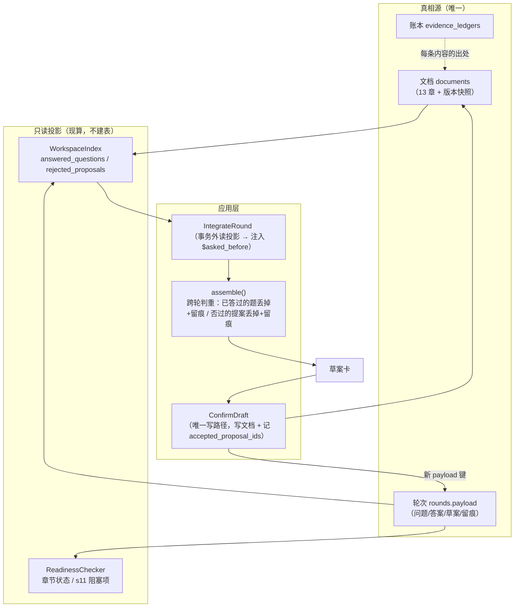

# P28 方案（待拍板）· 跨轮记忆（A 组：跨轮事实层 / B 组：记忆本体）

> **状态**：方案，**未动一行代码**。作者拍板后再开工。
> **口径来源**：`01-规格.md`（F22 记忆维护）· `02-编排与数据.md` §11.0.10（跨轮真相源只有文档与轮次）、
> §11.0.13（去重只覆盖本轮）、§11.0.19（清单项）· `04-未决.md` E4/F8 · `05-DDD架构.md`（三个上下文、
> 唯一写路径）· `06-前端.md` · `.codex/docs/过程记录/记忆层与门禁条款.md`（原设计：PROJECT.md /
> Memory Curator / 逐条确认 / 引用计数）· 真跑报告 `.codex/runs/{2026-09-28,2026-09-29,2026-10-01}/`。
> **给执行的 agent**：先写红测试 → 跑到红 → 再实现 → 再跑绿 → 再提交（中文）；
> **除非测试本身写错（要说明错在哪），不许改测试迁就实现**。`src/` 里不许有 `fake|mock|stub|dummy`。

> **2026-10-02 执行结果（按 T0 的判据走完了）**：① 跨轮重问 **0**、② 被拒回流 **0**、
> ③ s11 答案蒸发 **9** → **只做 T5 + T4′**，**T1–T3 不做**（判据与脚本：`.codex/runs/2026-10-02/P28-T0测量.md`）；
> **B 组未开工**。T4′ = `26c688e`；T5 = 本节口径二（落 `〔已定〕…` + 就绪度不把它算未决）。
> 验证：`P28验证.md`（9/9 回放落地）· 口径回写 `02` §11.0.39。

**Goal：** 把"跨轮"这件事讲清楚并补齐——**用户上一轮问过、答过、否过的东西，这一轮不许当没发生过**。
本批先做**只读事实层**（零新真相源）；记忆本体（教训 / Curator / 记忆卡）单独立一批。

---

## 0. 现状核对（对着代码与真数据，含**两处纠正**）

基线：后端 **992 passed** · `ruff` 全绿 · 端点 **26** · 结构守卫 22 · 前端 **151 passed** + `tsc` 干净。

### 0.1 纠正我上一轮的两处判断

| 我上一轮说的 | 事实 | 证据 |
|---|---|---|
| "`list_items` 不跨轮，是缺口" | **已经收口**：出草案那一刻，没人处理的清单项会**落 s11**（带去处、**非阻塞**、去重、缺口行说明） | `use_cases._unhandled_list_items()`（`use_cases.py:1113`）→ `known_open_items` 去重 → 机械提案（`use_cases.py:1333`）；P13 A2 已交付 |
| "近义重复问没管" | **本轮内已经管了**：`question_key = (去处, 归一化问法)` 的种子含"本轮所有问过的题（含跳过）"，另有"同去处的近义新题给 carried 让位" | `assembly.question_key()`（`assembly.py:152`）、种子（`assembly.py:510-518`）、让位（`assembly.py:541-570`） |

我误读的是 `02` §11.0.19 那句"口径：**不跨轮**——`Round` 一结束就没了"。它讲的是
`_render_list_items()` 这个**提示词渲染**的轮内口径，实质归宿早就在 s11 里了。
→ **顺手要改的一句文档措辞**（T6 里的文档回写），免得下次又按字面误读。

### 0.2 跨轮这件事，到底还缺什么（三条，逐条对着代码核过）

| # | 缺什么 | 代码证据 | 后果 |
|---|---|---|---|
| **①** | **被拒提案的身份没落库**：只记了**两个数字**（给了几条 / 收了几条），没记"用户否掉的是哪几条" | `Round.proposed_offered/proposed_accepted`（`round.py:161-162`）；`ProposalCommitter.commit` 里 `offered`/`taken` 都是**当场算的**（`committer.py:87-92`），不落 payload | 下一轮无从知道"这条你否过" → 模型可能原样再提；也没有任何地方能复盘"用户到底否了什么" |
| **②** | **s11 目标题的答案没有落点**：答案的机械落地的例外是"target 落在 s11 的题不落地"（那里的结论由机械 `remove` + 队列处理） | `use_cases.py:1320` 注释 + `landed_answer_proposals()` | 用户答了、条目撤下了，**知识只活在轮次 payload 里** → 下一轮 `document_state` 里看不见 → 可能再问一遍 |
| **③** | **跨轮没有判据**：判重的种子只有"本轮问过的 + 本轮 carried" | `assembly.py:510-518` | 第 3 轮用另一种说法问第 1 轮答过的事，系统挡不住 |

### 0.3 但这三条**没有一条有实测数**

P20 审计只验了"**本轮内**题面重复 0"（F6 ✅ 修了）。跨轮重复问、被拒回流、s11 答案蒸发，
三件事**都没量过**——真跑报告里没有数字。

**所以本批第一个任务不是写代码，是测量（T0，零模型成本）。** 这是这个项目的老规矩：
C-2c-3（按主张取块）就是先测量、量完发现收益为 0 而否决的（`.codex/runs/2026-10-01/P22验证.md` §四）。

---

## 1. 范围：三个方案

| 方案 | 做什么 | 体量 | 风险 |
|---|---|---|---|
| **A · 跨轮事实层**（推荐先做） | ① 被拒提案落库 ② 两条只读投影（**已答过** / **已拒过**）③ 注入整合者提示词 ④ 装配层机械判重 + 留痕 ⑤ s11 答案落点 | **1 批（5 个任务）** | **低**：全是只读投影与既有通道，**零新聚合、零新表** |
| **B · 记忆本体** | `ProjectMemory` 聚合（教训 / 口径 / 已否）+ Memory Curator 智能体 + 记忆卡 + 三处提示词注入 | 1 批（5–6 个任务） | **中**：新表 + 新智能体 + 新端点；踩"第二真相源"这条铁律的边缘；每轮 +1 次模型调用 |
| C · A + B 一起 | 上面全部 | 2 批量 | 同上，且 B 的价值目前**没有证据** |

**推荐：本批做 A，B 等 A 的真跑证据再拍。** 两个理由：

1. **A 是 B 的地基**：Curator 要判断"这条教训值不值得记"，先得看得见"这一轮问过什么、答了什么、
   否了什么"。让 Curator 自己维护一份 → 那份就是第二真相源（`02` §11.0.10 明令禁止）。
2. **B 的价值没有被测量过**：原设计（PROJECT.md / 教训区）要解决的是"别重复犯旧错"，
   但真跑里**没有一条证据**说"因为缺教训而犯了旧错"。A 的 T0 会把这类证据一并量出来。

---

## 2. 口径（每条：建议 + 备选 + 为什么）

1. **记忆不是文档的第二真相源**：机械能算的一律**现算**（照 P16 索引层的做法：不建表、不缓存、
   坏行跳过），只有"**模型判断出来的 + 用户逐条确认过的**"才存。这是本方案最重要的边界。
2. **机械可算的四样**（都不存）：① 章节状态（`ReadinessChecker` 已有）② s11 阻塞项（文档里就有）
   ③ 最近几轮**问过/答过**什么（`rounds.payload` 里就有）④ 每条记忆最近被谁引用（扫最近 N 轮即可）。
3. **存什么（B 组）**：三类条目——`lesson`（教训）/ `decision`（已经定过的口径）/ `rejected`（明确否掉的）。
   每条**必须带出处编号**（≥1 个账本里存在的 `E`），每条 ≤2 行、总条目 ≤60；超上限时 Curator 的提议里
   **必须**带 merge/delete，否则用例拒收（`ShapeError`）。
4. **没确认的不许注入**：提议（`pending`）与已确认（`entries`）分开；只有后者进提示词。
   理由：等于"模型不许自己改记忆"（原设计的 `write_document: false` 精神）。
5. **跨轮判重只挡"同一问法"，且只挡已答过的**：键仍然是 `(去处, 归一化问法)`；
   **跳过的不挡**（它还欠着，靠 s11 carried 问回来）。近义措辞**挡不住**，本批不做相似度判断——
   但要**留痕说清**"这条跟第 N 轮那道像"（人来拍）。
6. **被拒提案回流**：命中的新提案**丢掉 + 留痕**（卡片上单独一行"这 2 条你上一轮否过，这次没再提"），
   **不写进文档**、也不自动生成"永远别再提"的规则（那是记忆本体 B 的事）。
   备选：照出但在卡片上标一句"你上次否过"——打扰更大，且与"AI 不许替人下结论"的口径相反。
7. **注入限量**：只给**最近 3 轮**、每题一行、总共 ≤20 行、只带 `E` 编号不带正文。
   为什么：P10 真跑里已经出现"20 行提示词超过 20000 字符"的现场（`P10 报告` §二·3）。
8. **出草案那一刻才注入，不注入分析者**：出题的人是整合者（席位出的是意见，不是题）。
   备选：也给席位/分析者——多两处提示词、收益不明（T0 会量"席位疑问里的跨轮重复"）。

---

## 3. 任务（A 组 5 个 + B 组 5 个，分两批）

全局约束（与历次同一套）：测试 `PYTHONDONTWRITEBYTECODE=1 python3 -m pytest -q -p no:cacheprovider -o addopts=""`；
lint `python3 -m ruff check --no-cache .`；前端 `npx vitest run && npx tsc --noEmit`；结构守卫全绿；
**模型调用与工具调用一律在事务外**、**没有写入就不开事务**；新增 payload 键**老行必须读得回来**；
端点白名单少一条多一条都要显式改；真跑一律 `/tmp` 库，**不碰** `backend/data/pmstudio.db`。

### T0 · 测量（零模型成本，决定后面做多少）

**Files**：新增 `.codex/runs/2026-10-02/bin/measure_cross_round.py`（**不进仓库**）+ 报告
`.codex/runs/2026-10-02/P28-T0测量.md`（**不进真相源**）。产品代码一行不改。

**量三个数**（扫四个审计库 `L1–L4` + P22–P27 真跑库的 `rounds.payload`，只读）：

1. **跨轮重问**：每轮的题目（`questionnaire_history[].questions[]`）与前几轮**已答**的题按
   `(target.label(), normalize(title))` 比对 → 命中数；再用"关键词集合重合度 ≥ 0.6"给一个**上界估计**
   （只作参考，不当判据——相似度不是真相）。
2. **被拒提案回流**：每轮草案里没被勾的提案（从 `draft.proposals` 与 `proposed_accepted` 推）
   → 下一轮有没有同样的 `(target.label(), normalize(text))` 提案。
3. **s11 答案蒸发**：target 落在 s11 的题、答案 eid 在文档里搜不到、也没进任何 `用户已定：` 条目 → 数一条。

**判据（先写死，免得事后找理由）**：

| 量出来的 | 就做什么 |
|---|---|
| ① ≥3 条/项目 **或** ② ≥2 条/项目 | 做 T1–T4（A 组主体） |
| ③ > 0 | 加做 T5（s11 答案落点） |
| 三条都 ≈0 | **A 组不做**：转去补审计里另外两条没做到的（完整 eval / 前端眼睛检查），或直接拍 B |

另外人工核 **5 条**"疑似跨轮重复"的样本（逐条读题面），确认机械判据没把"两件不同的事"算成重复。

### T1 · 被拒提案落库（跨轮"别再提"的数据基础）

**Files**：改 `domain/round/round.py`（`confirm()` 多记一个集合）、`domain/services/committer.py`
（把 `taken` 传下去）、`infrastructure/sqlite/serialization.py`（payload 键）、
`application/dto.py`（`RoundView` 需要时加只读投影）、`tests/domain/test_round_confirm.py`、
`tests/infrastructure/test_sqlite_repositories.py`（老行往返）。

**Interfaces**

```python
# domain/round/round.py —— payload 新键（老行没有 → 空）
@property
def accepted_proposal_ids(self) -> frozenset[str]: ...

def confirm(
    self, version_no: int, *, now: datetime,
    offered: int = 0, accepted: int = 0,
    accepted_ids: Sequence[str] = (),      # 新增：用户勾了哪些（身份，不只是数量）
) -> None: ...
```

**红测试**：① 确认后 payload 里能读回 `accepted_proposal_ids`；② 老 payload（没这个键）读回来是空集、
不炸；③ `proposed_accepted` 与 `accepted_proposal_ids` 的**条数对得上**（同一时刻算，不许两处漂移）。

**提交**：`feat(round): 记下用户勾了哪些提案（跨轮"别再提"的数据基础）`

### T2 · 两条只读投影（已答过 / 已拒过）

**Files**：改 `application/ports.py`（`WorkspaceIndex` 两个方法）、`infrastructure/sqlite/repositories.py`
（实现：扫 `rounds.payload`，坏行跳过、不建表）、`application/dto.py`（两个 View）、
`tests/infrastructure/test_workspace_index.py`（新）、`tests/support/fakes.py`/`harness.py`（替身同步）。

**Interfaces**

```python
@dataclass(frozen=True, slots=True)
class AskedQuestionView:
    round_id: str
    title: str
    target_label: str      # 与 question_key 同一形态
    answered: bool         # 跳过/没答的 False（那种要**继续问**，不挡）
    answer_eid: str | None

@dataclass(frozen=True, slots=True)
class RejectedProposalView:
    round_id: str
    target_label: str
    text: str

class WorkspaceIndex(Protocol):
    def answered_questions(self, project_id: ProjectId, *, rounds: int = 10) -> tuple[AskedQuestionView, ...]: ...
    def rejected_proposals(self, project_id: ProjectId, *, rounds: int = 10) -> tuple[RejectedProposalView, ...]: ...
```

**红测试**：① 两轮里答过的题各出现一次、跳过的 `answered=False`；② 拒过的提案进 `rejected_proposals`，
勾过的不进；③ 只读最近 N 轮；④ 坏行（payload 不是 JSON / 缺键）跳过不炸；⑤ 老库（没有新键）不炸。

**提交**：`feat(索引): 跨轮只读投影——问过/答过、拒过什么（不建表、现算）`

### T3 · 整合者提示词多一节"这些已经问过 / 否过"

**Files**：改 `infrastructure/llm/prompts/integrator.md`（新槽 `$asked_before`）、
`application/agents/integrator.py`（`PROMPT_SLOTS` + 渲染）、`application/context.py`（`render_asked_before`）、
`tests/infrastructure/test_llm.py`（槽位机械比对，自动覆盖）、`tests/application/test_context.py`（新用例）。

**口径**：限量最近 3 轮、每题一行、≤20 行；**已答的**写"已答：用户选了什么"，
**跳过的**写"还欠着（优先问）"，**否过的提案**写"上一轮否过"。
末尾一句硬规矩：**"这些不要换个说法再问；真要再问，在 `list_items` 里说清为什么这是新的一件。"**

**红测试**：① 渲染里有选项答案与"否过"两类；② 超 20 行会截断并写明"只带了前 N 条"；
③ 什么历史都没有时写"（前面几轮没有问过）"，**不留空节**；④ 老库（投影为空）渲染成同一句。

**提交**：`feat(提示词): 整合者看得见"前面几轮问过/答过/否过什么"`

### T4 · 装配层机械判重 + 留痕

**Files**：改 `application/assembly.py`（`assemble(..., answered_before=…, rejected_before=…)`）、
`application/use_cases.py`（`IntegrateRound` 从投影取，**事务外**读）、
`tests/application/test_assembly.py`、`tests/application/test_integrate_round.py`。

**口径**：

- 新题命中 `answered_before`（**已答过**）→ **丢掉 + 留痕**（`题目 #2`，"第 1 轮已经问过并答过：…"）；
  命中**跳过过的** → 照问（它就是欠账）；
- `op=add` 的提案命中 `rejected_before` → **丢掉 + 留痕**（`提案 #3`，"你上一轮否过"）；
  `replace`/`remove` **不判**（那是在改既有内容，与 P26 同一条边界）；
- 判重键与 `question_key` **同一个函数**（一处实现，别写第二份）。

**红测试**：① 已答过的题重出 → 不进草案、留痕里有；② 跳过的题重出 → **照进**；
③ 否过的提案重出 → 不进草案、留痕里有；④ 同一去处的**新的事**（不同问法）照进（不许按去处粗判）；
⑤ 投影为空时行为与今天**逐字节相同**（回归保护）。

**提交**：`feat(装配): 跨轮判重——已答过的题不再问、否过的提案不再提（丢掉+留痕）`

### T5 · s11 答案落点（**只在 T0 的 ③ > 0 时做**）

**Files**：改 `application/assembly.py`（`landed_answer_proposals` 的例外收窄）、
`tests/application/test_answer_landing.py`、`tests/application/test_assembly.py`。

**口径**：target 落在 s11 的题，答案**也机械落地**（落成 s11 里一条"已定：…"，同时撤下原未决条目）——
两条机制互补，不再二选一。老行为（老库里的 s11 条目）不变。

**红测试**：① 答过的 s11 题 → 文档里出现"用户已定：…"且原条目被撤下；② 跳过的不落地（继续欠着）；
③ 去处认不出来的回落 `s11` 时行为与今天一致。

**提交**：`fix(装配): s11 目标题的答案也落地——不再"撤下即蒸发"`

### B 组（**下一批**，等 A 的真跑证据；本次只列设计，不动手）

| 任务 | 内容 | 关键口径 |
|---|---|---|
| T6 | `ProjectMemory` 聚合 + 表 `project_memory` + DTO | 条目三类（lesson/decision/rejected）、每条 ≥1 `E`、≤60 条、只增的 `revisions` |
| T7 | `memory_curator.md` + `MemoryCurator`（新 purpose `memory_curation`） | 输入=现有记忆 + 本轮 digest；输出=变更指令集（add/update/merge/delete，上限 5 条，超了截断+留痕）；**不许直接改记忆** |
| T8 | `ProposeMemory` / `ConfirmMemory` 用例 | 提议落 `pending`；确认才进 `entries`；两条都走事务边界纪律 |
| T9 | 三处 `$project_memory` 注入（analyzer / seat_review / integrator） | 只注入已确认的；与文档冲突时**以文档为准**并在卡片上说一句 |
| T10 | 端点 `GET /projects/{id}/memory`、`POST /rounds/{id}/memory`（26 → **28**） | 确认返回刷新后的 `MemoryView` |
| T11 | 前端：记忆抽屉（看/删）+ 闭环区一行"这一轮攒下 N 条记忆" | **不新增人机中断点**（`05` §7 写着"只有三处"）——不弹卡，放闭环区 |

---

## 4. 数据流（改后）



文字版（一轮里的两处新增）：

```
起轮/席位轮（不变）
  └─ 整合（IntegrateRound）
       ① 事务外：读两条投影（最近 3 轮问过/答过/否过）→ 渲染 $asked_before 注入整合者
       ② 事务外：模型出报文（含题目与提案）
       ③ 装配 assemble()：跨轮判重 —— 已答过的题丢掉（留痕）/ 跳过的照问 / 否过的 add 提案丢掉（留痕）
       ④ 事务内：落草案 + 留痕（其余一切不变）
确认（ConfirmDraft，唯一写路径，不变）
  └─ 写完文档后多记一个集合：accepted_proposal_ids（下一轮的"否过"由此推出）
```

**没有任何一条新链路进写入路径**：跨轮判重发生在装配（出卡之前），写文档仍然只有 `confirm` 一条路。

---

## 5. 数据契约（谁赋值 → 谁消费）

| 项 | 谁赋值 | 谁消费 | 备注 |
|---|---|---|---|
| `Round.accepted_proposal_ids`（**新 payload 键**） | `ProposalCommitter.commit` → `Round.confirm` | `WorkspaceIndex.rejected_proposals` | 老行没有该键 → **空集**（不是 None，别让下游到处判空） |
| `AskedQuestionView{round_id,title,target_label,answered,answer_eid}` | 索引投影（现算） | `render_asked_before` / `assemble` | 只读，不落库 |
| `RejectedProposalView{round_id,target_label,text}` | 索引投影（现算） | 同上 | 由"草案里的提案 − accepted_proposal_ids"推出 |
| `$asked_before`（新提示词槽） | `context.render_asked_before` | 整合者提示词 | 限量 3 轮 / ≤20 行；无历史时写一句实话、不留空节 |
| 留痕 `questions_already_answered` / `proposals_rejected_before`（新增两条 reason） | `assemble` | 草案卡 + 闭环区（既有 `Round.dropped` 通道） | **不新增 DTO 字段**：沿用 `DroppedItem` |
| 端点 | 本批 **不新增**（仍是 26）；B 组才加到 28 | — | A 组**零端点变更** |

**新表 0 张、新 DTO 字段 0 个（`RoundView` 不动）、新智能体 0 个。** A 组只加两条只读投影 + 一个 payload 键。

---

## 6. 成功之后长什么样（自检，逐条可验）

1. 第 1 轮问过并答过的"量级是多少"，第 3 轮模型换个说法再问 → **不进草案卡**，闭环区留一行
   "题目 #2 没出：第 1 轮已经问过并答过（E7）"。
2. 第 1 轮**跳过**的题，第 2 轮**照问**（它欠着）——判重不许把欠账也挡掉。
3. 第 1 轮用户否掉的"导出记录保留 30 天"，第 2 轮模型又提 → **不进草案卡**，闭环区一行
   "提案 #3 没出：你上一轮否过"。
4. 同一去处上的**另一件事**（不同问法）照问——`02` P6 的口径不许被这条新规则踩坏。
5. 投影为空（老库、第一轮）时，行为与今天**逐字节相同**（回归测试钉住）。
6. `POST /rounds/{id}/confirm` 之后，`rounds.payload` 里能查到"这一轮勾了哪几条提案"；
   老库读回来不炸。
7. 提示词长度**没有明显上涨**：新增那一节 ≤20 行，且只在有历史时出现。
8. T0 若量出 ③ > 0：答过的 s11 目标题，答案落进 s11（"用户已定：…"）且原条目撤下。

---

## 7. 待作者拍板（5 条）

1. **范围**：本批只做 **A 组（T0–T5）**（推荐），还是 A+B 一起（记忆本体紧跟上）？
2. **T0 的判据阈值**：按我写死的（跨轮重问 ≥3 条/项目 **或** 被拒回流 ≥2 条/项目 → 做 A；
   三条都 ≈0 → 不做）——接受吗？
3. **被拒提案回流的处置**：**丢掉 + 留痕**（推荐）还是"照出 + 卡片上标一句你上次否过"？
4. **B 组的触发方式**（若要）：确认草案后**同一次请求**里再调一次 Curator（+1 次调用/轮，约 +15%），
   还是记忆抽屉里一个**手动"整理一下"**按钮（零打扰、零意外成本）？
5. **载体名字**：`Project Memory`（推荐，指向"用户确认过的跨轮记忆"），还是沿用原设计的
   `PROJECT.md`（容易被当成"文档的第二份摘要"）？

---

## 8. 自审：这份方案自己的核验（6 处）

| # | 我核到的事 / 差点写错的 | 处置 |
|---|---|---|
| 1 | 我上一轮把 `list_items` 跨轮说成缺口——**是误读**：P13 A2 早把它落进 s11 了 | §0.1 纠正 + T6 顺手改掉 `02` §11.0.19 那句会引起误读的措辞 |
| 2 | **被拒提案的身份根本没落库**（只有两个数字）——写方案时才发现，不是"顺手能推出来" | 提前成 T1，且做成"同一时刻算、两处不许漂移"（有测试钉） |
| 3 | `question_key` 只挡"同问法"：**近义仍漏**；T0 的关键词重合度只能算**上界估计**，不能当判据 | T0 里人工核 5 条样本；口径 §2·5 明说"本批不做相似度判断" |
| 4 | 注入会撑长提示词（P10 现场：20 行已超 20000 字符） | 限量（3 轮 / 20 行 / 只给编号）+ 用例钉住"截断要写明" |
| 5 | 两条投影是"扫 payload 现算"，**不是索引**：单项目 20 轮以内毫秒级，轮数多了会线性变慢 | 投影里只取最近 N 轮（默认 10/3）；写清"不建表、不缓存"，与 P16 同一口径 |
| 6 | 原设计的"引用计数"（连续 5 轮未命中 → 删除候选）**不该存计数器**：命中与否能现算（条目的 ref eid 在最近 N 轮里被引用过） | 归到 B 组 T6 的口径里，**不建计数字段** |

**边界确认**：不动写入路径（`confirm` 仍是唯一写文档的路）；不动 `TERMINAL_KINDS`；不动 13 章骨架；
不建第二真相源（机械可算的一律现算）；不新增人机中断点；A 组零端点变更。
**风险最高的一处**：跨轮判重**误杀**（把"同一去处的另一件事"当成重复）——
所以 T4 的红测试里专门有"同一去处的新事照进"，并且判重键与 `question_key` **共用同一个函数**。
