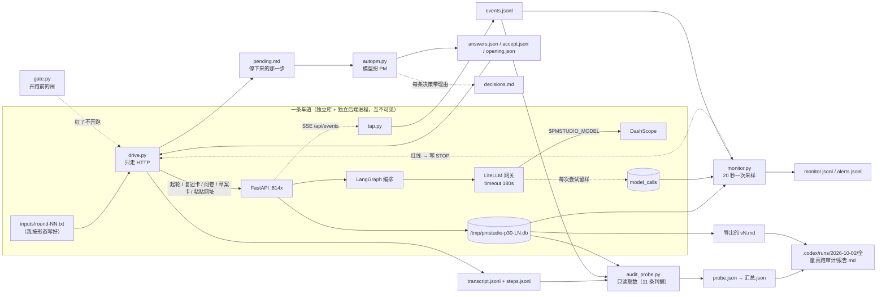

# P30 方案（待拍板）· 全量真跑审计 + 运行时接管与监控

> **这份文档分析的是**：拿**当前代码**（HEAD `a6354c1`）再跑一次"全量真跑审计"，
> 并且这一次把**运行时流量接过来自己管、全程盯着跑**。
> **状态**：方案。**一行产品代码没动**；本轮只做了只读探查 + 三次便宜的真模型探测（合计约 40 秒）。
> **口径来源**：`01-规格`/`02-编排与数据`/`03-案例与验收`/`04-未决`（G4–G9）/`05-DDD架构`/`06-前端` §8.1 ·
> P20 的方案与报告（`docs/plans/2026-10-01-P20-全量真跑审计.md` + `.codex/runs/2026-10-01/报告.md`）·
> P21–P29 的执行记录（`.codex/docs/上下文/checkpoint.md`）。
> **它是 P20 审计的续集**：P20 那份结论（"0/4 可交付"）已经被 P21–P26 改过一遍、
> P27–P29 又加了三个能力，现在**当期证据为零**。
> **给执行的 agent**：先写红 → 跑到红 → 再实现 → 再跑绿 → 一任务一提交（中文）；
> **除非测试本身写错（要说明错在哪），不许改测试迁就实现**；`src/` 里不许有假实现。

> **2026-10-02 执行结果**：**已交付**。拍板是「可以，按照推荐的来」——
> 5 条车道（含 L5「跑到交付态」）、主审计用当前 `.env`（`qwen3.8-27b`）、扮 PM 用 `deepseek-v4-pro`、
> **只记账不修**、eval 跟本批一起跑、监控 20 秒一次、不做 D 组截图。
>
> **结论**：五条车道里 **两条到了「就绪度 0 阻塞」可交付**（L1 v4 · L5 v3），
> 另三条差 **2 / 1 / 8** 项；189 次调用 / 232 条事件 / 合计 145.8 分钟墙钟。
> 报告 `.codex/runs/2026-10-02/全量真跑审计/报告.md`；新缺陷 F28–F31 记进 `04` G10；
> 上下文见 `checkpoint.md` 的 P30 一节。
>
> **三处与这份方案不同的地方**（说清为什么）：
> ① **L1 / L5 提前停了**——它们一到 0 阻塞就写 `ready.json`、扮 PM 随即收手（§8 的"三停"之一），
> 所以 L1 没跑第 4 轮、L5 只跑 2 轮；这是**达标**，不是跑不动。
> ② **L4 的第 3 轮没写进去**——`POST /confirm` 422（同一批里两次 `remove` 同一条目，F28），
> 它的 8 个阻塞是"没机会补"而不是"补不上"。
> ③ **联网那条没跑到**——分析者一条检索词都没提名（F31），复述卡自然没得勾。
>
> **纪律**：`bin/` 与报告都在 `.codex/runs/`（不进仓库）；工作库 mtime 仍是 2026-09-28 14:31。
> **已知边界**：本次全部跑在 `a6354c1` 上；作者的 P31 改动落在 20:50–20:52，**在所有车道收工之后**，
> 所以本次横向可比性没被破坏——但 P31 之后要重跑才算数（见报告 §十一）。

---

## 0. 现状核对（今天实测，带证据）

### 0.1 基线

| 项 | 值 | 怎么测的 |
|---|---|---|
| 后端单测 | **996 passed / 21.45s** | `PYTHONDONTWRITEBYTECODE=1 python3 -m pytest -q -p no:cacheprovider -o addopts=""` |
| lint | **All checks passed** | `python3 -m ruff check --no-cache .` |
| 端点 | **26** | `tests/api/test_openapi_contract.py::EXPECTED_PATHS` |
| 端口 | 8100 / 8120-8125 / 8131-8139 / 5173-5179 **全部空闲** | `ss -ltnp` |
| 工作库 | `backend/data/pmstudio.db` mtime **2026-09-28 14:31**（没动过） | `ls -la` |
| 分支 / HEAD | `new-branch` @ `a6354c1` | `git log --oneline` |
| 机器 | 4 核 / 7G 内存（可用 ~3G）/ `/tmp` 剩 831G | `nproc` / `free` / `df` |

### 0.2 运行时配置：**一次真实的配置事故，就发生在写这份方案的同时**

`backend/.env` 在过去一小时里被改过（mtime 实测）：

- 19:07 之前：`PMSTUDIO_MODEL=openai/glm-5.3`；
- 19:07:15 之后：`PMSTUDIO_MODEL=openai/qwen3.8-27b`，其余不变（timeout 180 / `enable_thinking:false` / Tavily key 在）。

**为什么这件事必须进方案**：同一份 `.env` 里的
`PMSTUDIO_MODEL_PARAMS='{"extra_body": {"enable_thinking": false}}'` 与 `glm-5.3` **互斥**。
今天三次真探测（DashScope，走产品自己的 `LiteLLMGateway`）：

| 组合 | 结果 |
|---|---|
| `glm-5.3` + `enable_thinking:false`（= 当时 `.env` 的原样） | **失败**，0.0–8.6s，`ModelCallFailed: BadRequestError` |
| 直连原文 | `InvalidParameter: The value of the enable_thinking parameter is restricted to True`（HTTP 400） |
| `glm-5.3`（不带那个参数） | **OK 2.96s** |
| `glm-5.3` + `thinking:{"type":"disabled"}` | **HTTP 400** 同上 |
| `qwen3.8-27b` + `enable_thinking:false`（= 现在 `.env` 的原样） | **OK** 0.45–8.43s，合法 JSON，`reasoning_tokens=None`（思考确实关了） |

结论：**换 glm-5.3 而不同时删掉那行参数，产品连第一次模型调用都发不出去**——
症状是一个 502 + `BadRequestError`，看起来像供应商的问题，其实是配置的问题。
这条不在任何设计文档里，是本轮探到的。**它是 §4.1 那道闸存在的理由。**

### 0.3 三个候选模型的可用性（今天实测）

| 模型 | 结果 | 用途 |
|---|---|---|
| `openai/qwen3.8-27b` | OK 1.3s，内容正常，支持 `json_schema` | **当前 `.env`**，主审计的产品侧模型 |
| `deepseek-v4-pro` | OK 9.3s，内容正常 | 扮 PM（`autopm.py`）现用 |
| `deepseek-v4-flash-0731` | **内容为空**（124 tokens 全花在思考上） | 不能直接拿来扮 PM |

### 0.4 现有审计工具（P20 留下，在 `.codex/runs/2026-10-01/bin/`）

| 文件 | 行数 | 现在还缺什么 |
|---|---|---|
| `drive.py` | 770 | 走不了 P27 的"粘贴网址"；没有"跑到 0 阻塞就停"；没有把每步快照落成机器可读的一行 |
| `autopm.py` | 417 | 缺口同上；而且它自己会 skip 一部分题 |
| `audit_probe.py` | 482 | 八条判据还在，但**没有"能力覆盖"**（docx/xlsx/网址进了没），也没有事件账 |
| （无） | — | **没有事件账**：SSE 那一路流量**从没被记过一次** |
| （无） | — | **没有实时监控**：P20 是跑完才取数，卡死只能事后知道 |

### 0.5 现有设计 vs 目前

| | 设计文档怎么写的 | 目前实现 |
|---|---|---|
| 事件 | `02` §12：事件只做通知与投影，"摘掉全部订阅者照样跑完" | 4 个事件、SSE 一个端点；**这条流从来没被任何人记下来过** |
| 失败出口 | `04` E3 + `02` §11.0.21 | `retry/dig/abandon` 都在；投影里有 `failure_at_step/retry_from`（P29 已接到界面） |
| 留样 | `02` §5.3 | `model_calls` 每次尝试一行（`ok/attempt/error`），`PMSTUDIO_TRACE_MODEL=1` 开 |
| 材料 | `02` §11.0.38（P27） | docx / xlsx / 按网址抓都在；**从没进过主闭环真跑**（P27 只做了单功能真跑） |
| 跨轮记忆 | `02` §11.0.39（P28） | 判重键剥标点 + s11 答案落 `〔已定〕`；**没有多轮真跑验过总量会不会降** |
| 监控 | — | **设计里没有这一块**；本批新建的是**审计侧**的，不是产品侧的（见 §3 边界） |

---

## 1. 现在要实现什么

**Goal**：拿当前代码（HEAD `a6354c1`）跑一次**完整**的真跑审计，回答五件事，每条都带数字和出处：

1. **能不能交付**：有没有一份文档真的到"就绪度 0 阻塞"？（P20 是 0/4，最近的一条差 1 项）
2. **哪一段会坏**：坏在哪个 step / 哪个报文 / 哪条不变量，第一次出现在哪一轮第几个调用？
3. **代价多少**：每轮墙钟、按用途的调用分布、失败率（`ok=0`）、重试率（`attempt>1`）、502、token。
4. **修过的还复发吗**：F16–F20 + F22 那几条，在同形态输入下逐条对账（P20 报告的直接续集）。
5. **新交付的能力进主闭环了吗**：P27（docx / xlsx / 网址抓取）、P28（跨轮的 s11 口径）、
   P29（界面）——它们到现在只有"单功能真跑"，没有"进主闭环"的证据。

**为什么现在做**：P20 的结论已经过期——它之后的 P21–P26 把当时留下的 F16–F20 全改过一遍，
P27–P29 又加了三个能力。"能不能交付"现在**一张当期证据都没有**。
另外提示词在 P17/P21/P22–P26/P27/P28 全改过，而**完整 eval 自 P16 之后没再跑过**。

**边界**：不写新功能、不改 schema、不加端点、不动提示词、不动前端。

---

## 2. "接管运行时流量 + 监控"是什么意思（这一批的新东西）

P20 是**跑完才取数**：四条车道各跑各的，事后拿 `audit_probe.py` 去读。
它有两个洞：**没人看着跑**（一条车道静悄悄卡死 20 分钟，事后才知道）、
**事件那一路流量一条都没记**（SSE 从没被旁听过）。

这一批把运行时**接过来自己管**——四个流量面，四个出处：

| 流量面 | 谁产生 | 谁接管 | 落到哪 |
|---|---|---|---|
| ① 驱动 ↔ 后端（HTTP） | `drive.py` | 驱动自己 | `transcript.jsonl` + `steps.jsonl` + `rounds/*.json` |
| ② 后端 → 界面（SSE） | 产品的事件总线 | **新增 `tap.py`**（长连 `/api/events`） | `events.jsonl` |
| ③ 后端 ↔ 模型（每一次尝试） | LiteLLM 网关 | 产品自己的留样 | `model_calls` 表 |
| ④ 后端 ↔ 库（写） | 用例 + UoW | 只读打开看 | `monitor.jsonl` |

**接管的三条硬规矩**：

1. **只读外挂**：`tap.py` / `monitor.py` / `audit_probe.py` 一律只用 `GET` + `sqlite3 mode=ro`，
   谁都不许往产品库里写；它们只能往自己 run-dir 里写文件。
2. **可叫停**：监控发现红线（工作库被碰 / 后端掉了 / 供应商连续失败 / 配置被改）→ 写 `STOP`；
   驱动与扮 PM 每一步先看这个文件，看到就体面收手（`abandon` 当前轮 + 退出）。
3. **一条车道一个进程一个库一个端口**：互不可见；合并只发生在报告里。

---

## 3. 执行范围（四组）

| 组 | 内容 | 体量 | 动产品代码吗 |
|---|---|---|---|
| **A · 工具升级**（必做） | 配置闸门 + 驱动/扮 PM 升版 + SSE 接管 + 实时监控 + 取数器扩三项 | 5 个脚本（约 1200 行） | **不动** |
| **B · 真跑**（必做） | 5 条车道（4 条与 P20 同形态可比 + 1 条"跑到交付态"） | 约 3 小时机器时间 | **不动** |
| **C · 完整 eval**（推荐做） | `scripts/eval.py` 8 条（P16 之后一直欠着） | 约 1 小时 | **不动** |
| **D · 汇总**（必做） | 逐条对账 + 报告 + 回写 | 约 40 分钟 | 只改文档 |

**明确不做**：

- 产品侧的监控面板（把 `model_calls` / 事件做成**产品里能看的界面**）——那是**新功能**，属于另一批。
  本批的"监控"是审计自己用的外挂。**如果你要的是前者，说一声，范围与这份完全不同。**
- 讨论区（`04` F10）、记忆本体（P28 已测量否决）、C-2c-3 按主张取块（P22 已测量否决）；
- 前端改动（P29 刚收口）；不跑 P29 的取景工具（除 §12 第 7 条那个可选项）。

---

## 4. 逐文件：A 组怎么改（每一步）

全部落在 `.codex/runs/2026-10-02/全量真跑审计/bin/`（`.codex/runs/` 整棵 gitignore）。
工具**不注册进 container**，只 import 只读的东西（`Settings` 用来按产品口径读 `.env`）。

### 4.1 `bin/gate.py`（**新** · 配置闸门，开跑前第一件事）

它回答一句话：**现在这套 `.env`，能不能真的跑**。花 1 次探测调用。

| 步 | 做什么 | 判据 |
|---|---|---|
| 1 | `Settings.from_env()` 读 `.env`（用产品自己的解析，不自己抄一份） | 缺 key / 模型名 → 红 |
| 2 | 发一次 `max_tokens=64` + `response_format: json_schema` 的探测——**走 `LiteLLMGateway`，不是裸 HTTP** | 非 200 / 回包不是合法 JSON → 红 |
| 3 | 红了就**再发一次不带 `model_params` 的对照** | 对照成功 → 话术是"**参数**不兼容"；对照也失败 → "模型 / 密钥不行" |
| 4 | 绿：把 `model / params / 探测耗时 / 回包模型名 / usage` 写进 `gate.json` | — |

**这四步不是空想**：今天就是靠这套口径把"`glm-5.3` + `enable_thinking:false` → 400"钉下来的（§0.2）。
`gate.py` 只是把它变成每次开工都要走的一道闸。

### 4.2 `bin/drive.py`（升一版）

| 改哪 | 现在 | 改成 | 为什么 |
|---|---|---|---|
| 新子命令 `fetch-url --url U` | 无 | `POST /projects/{id}/attachments/fetch`，把 `material_id` 记进 `state.json` | P27 的能力进主闭环 |
| `upload` 认扩展名 | 一律按二进制传 | `.docx` / `.xlsx` / `.md` / `.pdf` / `.html` 传对 content-type，并记下回包的 `parser_id` | C-2c-4 那三种材料要能进提示词 |
| 每步一行 `steps.jsonl` | 只有文本日志 + `transcript.jsonl` | 追加 `{ts, step, waiting_on, round_id, http, secs, blocking_questions, s11_total, version_no}` | 监控与取数**同一个源**，不两边各抄一份 |
| `--stop-when-ready` | 无 | 一轮结束就查 `GET /readiness`；`blockers==0` → 写 `ready.json` 并以 0 退出 | 新问题 1 要靠它 |
| `--stop-file` | 无 | 每一步先看 `STOP` 文件；在就 `abandon` + 退出码 13 | 接管要能叫停 |
| 失败策略 | 重试 1 次 → 还失败就 `abandon` + 记 `incidents.jsonl` | **不变** | P20 真跑验证过好使，别动已经对的东西 |

### 4.3 `bin/autopm.py`（升一版 · 扮 PM 过卡口）

| 改哪 | 现在 | 改成 | 为什么 |
|---|---|---|---|
| 扮 PM 的模型 | 硬编码 `deepseek-v4-pro` | `--pm-model`，默认还是 `deepseek-v4-pro`（今天实测 OK 9.3s） | 换模型做对照时不用改代码 |
| 空回包 | 已有重试 | 保留，并把"内容为空"**单独记一条** `incidents.jsonl` | `deepseek-v4-flash-0731` 今天实测就空回（§0.3）——这种失败要一眼认出来 |
| 问卷 | "只在必须拍板时才 skip" | 加 `--no-skip`：`--stop-when-ready` 那条车道**一题都不跳** | 跳过的阻塞题 = 永远 ready 不了（就绪度第 4 类阻塞） |
| 卡口 | 已有 12 次上限 | 加 `--stop-file` 同款叫停 | 同上 |
| 决策留痕 | `decisions.md` | 每条决策**带上引用了哪几个编号**，外加"这轮答了几题、跳了几题" | 报告要能复核"假 PM 有没有跑偏" |

### 4.4 `bin/tap.py`（**新** · SSE 流量接管）

- 长连 `GET /api/events`（`text/event-stream`），逐行解析 `event:` / `data:`，
  按收到顺序追加 `events.jsonl`：`{recv_ts, name, seq, round_id, project_id, payload}`。
- **断线必须留痕**：重连计数进 `gaps`；下一次事件的 `seq` 与前一条**不连续**时也记一笔
  （`seq` 是总线盖的，所以不连续 = 真的漏了）。**不许假装连续**——这是这个项目一贯的口径。
- 每 60 秒打一行"收到 N 条 / 最后一条是什么"，给监控器和人看。
- 它证明两件事：① 事件流在真跑里**真的在发**（P20 从没验过）；
  ② 事件数与库里的变化**对得上**（`doc.changed` 条数 vs 版本增量；`round.updated` 条数 vs 轮次状态迁移数）。

### 4.5 `bin/monitor.py`（**新** · 实时监控，本批核心）

单进程盯全部车道，`--every 20s` 采一次样：

| 采什么 | 怎么采 | 用来发现 |
|---|---|---|
| 后端活着吗 | `GET /api/health` | 进程死 / 端口被占 |
| 走到哪一步 | `GET /api/rounds/{当前轮}` → `step / waiting_on / seat_round_count` | **卡死**（同一步不动） |
| 调用账 | `model_calls` 只读：`count / max(created_at) / sum(ok=0) / sum(attempt>1)` | 供应商抖动、限流、重试 |
| 事件账 | `events.jsonl` 最后一条的时间 + `gaps` | 接管漏了 |
| 进程 | 驱动 / 后端 pid 还在不在 | 静默退出 |
| 工作库 | `backend/data/pmstudio.db` 的 mtime + size | **被碰了就叫停全部** |
| 配置 | `backend/.env` 的 md5 | **跑着跑着有人改配置**（今天真发生过） |

每次采样写一行 `monitor.jsonl`；越线才写 `alerts.jsonl`；屏幕上留一行状态给人看。

**告警规则（默认值，都可配）**：

| 规则 | 阈值 | 话术 |
|---|---|---|
| `stalled_step` | 同一步 > 8 分钟、期间没有新调用也没有新事件 | "L3 卡在 integration 8 分钟没动静" |
| `backend_down` | `/health` 连续 3 次失败 | 后端掉线 |
| `call_fail_streak` | 连续 3 次 `ok=0` | 供应商侧断了 |
| `rate_limited` | 60 秒内 ≥2 条含 `429`/`rate limit` 的 error | 撞限流 → 降并发 |
| `round_too_slow` | 单轮墙钟 > 25 分钟 | 这一轮不正常地慢 |
| `config_drift` | `.env` 的 md5 变了 | **有人改了配置**（结论作废，该车道重跑） |
| `working_db_touched` | 工作库 mtime ≠ 基线 | **立刻写 STOP** |
| `event_gap` | 库里在变但事件流 3 分钟没动 | 接管漏了 |

`--selftest`：喂两份 fixture（`fixtures/stalled.jsonl` / `fixtures/healthy.jsonl`）+ **假时钟**，
断言前者报 `stalled_step`、后者**零告警**（防误报，这条同样重要）。

### 4.6 `bin/audit_probe.py`（升一版）

P20 的八条判据全留（就绪度 / 导出 / 功能树 / s11 走向 / 墙钟 / 调用画像 / 证据链 / 版本 diff），**加三条**：

| # | 新增判据 | 从哪儿取 |
|---|---|---|
| 9 | **能力覆盖**：这轮带了哪几种材料（`md/pdf/html/docx/xlsx/url`）、检索词勾了没、s11 里 `〔已定〕` 几条 | `GET /attachments` + `GET /rounds/{id}` + 文档正文 |
| 10 | **事件账**：事件条数 / 按 name 的分布 / `doc.changed` 与版本增量对不对得上 / `gaps` | `events.jsonl` + `GET /versions` |
| 11 | **到达交付态**：`ready.json` 有没有、第几轮到的、导出盖章行原文 | `ready.json` + `GET /export/markdown` |

`--merge` 把这十一节合成 `汇总.json`。

### 4.7 `bin/run_audit.sh`（**新** · 一把起）

```
run_audit.sh up   L1 [L2 …]    # 每条车道：起后端(8141+) + tap + autopm；再起一个 monitor 盯全部
run_audit.sh stop L1|all
run_audit.sh status
```

- 后端：`--no-reload`、`PMSTUDIO_TRACE_MODEL=1`、`PMSTUDIO_DB=/tmp/pmstudio-p30-<lane>.db`、端口 **8141+**；
- **明确避开** 8100（作者自己的）/ 8120-8125（P20）/ 8131-8139（P29 取景）；
- 起之前先跑 `gate.py`，红了不起。

---

## 5. 数据流（审计自己怎么流）



三条读法：

1. **模型只有两个出处**：产品自己的网关（`.env` → 当前是 `qwen3.8-27b`）与"扮 PM"那条旁路
   （DashScope `deepseek-v4-pro`）。**没有第三方。**
2. **取证只有四个出处**：库（`model_calls` + `rounds.payload` + `versions`）、`transcript.jsonl` /
   `steps.jsonl`、`events.jsonl`、`monitor.jsonl`。报告里不许出现"我记得""大概"。
3. **三件外挂都只读**：`tap.py` / `monitor.py` / `audit_probe.py` 连库用 `mode=ro`、HTTP 只发 `GET`，
   没有写权限，也就不可能"顺手修一下"。

---

## 6. TDD：先红 → 再绿（测试就在工具上）

因为**产品代码零改动**，可测的是工具自己的契约。七个任务，每条都写清"红是什么样"。

| # | 任务 | 红（先证明它会失败） | 绿（判据） |
|---|---|---|---|
| **T1** | `gate.py` | 用 `--model openai/glm-5.3`（保留 `.env` 的 params）跑：**必须判红**，话术是"参数不兼容"，并给出不带 params 的对照成功结果（今天实测这条就是真红） | 用当前 `.env` 跑 → 退出码 0 + `gate.json` 三个字段齐 |
| **T2** | `monitor.py --selftest` | 先写 fixture + 断言，`monitor.py` 还不存在 → 红 | `stalled.jsonl` 报 `stalled_step`；`healthy.jsonl` **零告警**；`config_drift` 用例认得出来 |
| **T3** | `tap.py` | 拿一份合成事件序列（手工造 + 从库里轮次变化反推）→ 断言 `seq` 单调、字段齐、能算出 gap | 同一份序列重放两次，除 `recv_ts` 外逐字节一致 |
| **T4** | `drive.py fetch-url` / `upload docx` | 先打 `fetch-url`（还没实现）→ argparse 报错；再用旧版 drive 传真 `.docx` → 断言"材料没进去" | 真传 `sample.docx` + `sample.xlsx` + `https://example.com` → `GET /attachments` 三条都在、`parser_id` 分别是 docx / xlsx / html |
| **T5** | `audit_probe.py --selftest` | 对一个**没跑过的空库**跑 → 必须自报"取不到数"（不是默默给 0） | 热身轮那个库上，11 组判据全取到、且互相自洽 |
| **T6** | **热身轮**（真跑一次） | 拿 P20 版 drive 原样打现在的代码 → 记录它是"报错 / 跳过新分支 / 正常"三种里哪一种 | 三张卡走完 + 版本 +1 + 导出非空 + `events.jsonl` 里 4 类事件都出现过 |
| **T7** | `--stop-when-ready` | 拿 P20 的 L3 导出库回放 `readiness` → 断言它认得出"差 1 项"（不许说 0） | 热身库上要么给出 `ready.json`，要么给出明确的 `blockers>0` |

**铁律照旧**：红了先看是**实现错**还是**测试错**；测试错要说明错在哪才准改。
`src/` 与 `tests/` 一个字节都不改（判据：`git diff --stat` 除作者自己的 `.gitignore` 外必须为空）。

---

## 7. 车道编制与输入

主审计 **5 条**。前 4 条与 P20 **同主题同形态**（可比：同一批输入、只换代码版本），第 5 条是新问题。

| 车道 | 主题 | 形态 | 打法（逐轮） | 压什么 |
|---|---|---|---|---|
| **L1** | 中小制造：设备点检 / 报修 / 备件 | 叙述式 | ① 一整段自然语言 → ②③ 逐条补 | **F1/F18 回归**：叙述式第 1 轮还空不空前四章 |
| **L2** | 连锁健身：会员 / 课程预约 / 私教提成 | 逐条列举 + 补字段 | ① 编号功能清单 → ② 点名 `s5/*.acceptance` → ③ 点名补 s8 六槽 | 功能字段填充率（F10/F18 那条） |
| **L3** | 跨境电商：订单 / 库存 / 对账中台 | **带材料（升级）** | 上传 **`.docx` + `.xlsx` + 粘贴一个网址**（P27 三条路第一次进主闭环）→ 起轮带材料 → 跑到收敛 | **C-2c-4 进主闭环**；材料块有没有编号、能不能回跳 |
| **L4** | 医院科研 CRF 平台 | 联网 + 加功能 | ① 正常一轮 → ② 在已有文档上加新功能 + 复述卡**真勾**一条检索词 → ③ 收口 | C-2b 进主闭环；"在既有文档上生长" |
| **L5** | **窄而完整**（新主题；输入自带背景 / 目标 / 受众 / 范围 / 验收五件套） | 一次给全 + **跑到 0 阻塞**（`--stop-when-ready`、`--no-skip`） | 一轮一轮补，直到 `blockers==0` 或撞闸门 | **新问题 1**：到底有没有一条路能到"可交付" |

**每轮输入谁写**：我按 `inputs/round-NN.txt` 预先写死、留档进 run-dir，人不实时参与（同 P20）。
**L5 的闸门放宽到 ≤10 轮**（它回答的就是"要几轮才够"），别的车道仍是 8。

---

## 8. 判据、预算、三停

判据见 §4.6 的十一条，每条一个出处；**报告里每个数字后面必须跟判据编号**。

每车道三道闸（脚本强制，超了自己停并写 `stopped_reason`），沿用 P20 的数值：

| 闸 | 阈值（L5 单独一档） | 依据 |
|---|---|---|
| 轮次 | ≤8（L5 ≤10） | 09-28 试点 6 轮长到 2.6 万字 |
| 墙钟 | ≤75 分钟（L5 ≤100） | 09-28 全程 67 分钟 / 15 轮 |
| 调用 | ≤600（L5 ≤800） | P20 平均 ~16 次/轮 |

外加三条**停**：`ready`（0 阻塞）/ `abandon`（连续两轮失败）/ `STOP`（监控红线）。

**预算估算**：5 车道 × ~6 轮 × ~20 次 ≈ **600 次调用**；加 eval 8 条（每条 ~8 分钟、~20 次）≈ 160 次；
加探测与热身 ≈ 20 次。**合计约 800 次调用 / 4–5 小时机器时间。**

**并发**（4 核 / 7G）：**两波 × 两车道**（L1+L2 先起，L3+L4 后起，L5 最后单独跑），错峰 90 秒；
监控全程盯 `rate_limited`，一响就降到单车道。**L5 单独跑**——它最慢，不该被别的车道拖。

---

## 9. 成功之后长什么样（自检）

1. `.codex/runs/2026-10-02/全量真跑审计/` 下：`报告.md`、`汇总.json`、`bin/`、`L1..L5/`、`eval/`；
2. 每条车道里：`inputs/round-NN.txt`、`transcript.jsonl`、`steps.jsonl`、`events.jsonl`、
   `monitor.jsonl`、`alerts.jsonl`（可以是空的，但必须存在）、`gate.json`、`probe.json`、
   `导出的 vN.md`，以及（L5 若达标）`ready.json`；
3. `报告.md` 第一句是**一句能拍板的话**，形如"5 份里 N 份 0 阻塞可交付；另 M 份各卡在哪一条"；
4. 缺陷清单每条：**现象 → 复现（轮次 / 留样 id / 报错原文）→ 次数 → 影响 → 建议**；
5. 有一节**逐条对账**：F16/F17/F18/F19/F20/F22 + 09-28 的 F1–F15，每条 ✅/❌/⚠️/🔁；
6. 有一节**能力覆盖**：docx / xlsx / 网址 / 联网 / 跨轮 `〔已定〕` 各自的真跑证据；
7. 有一节**监控账**：跑了多久、采样多少次、报过几次警、每次警是不是真警（一次都没报也要写）；
8. `git diff --stat`（除 `.gitignore`）为空；工作库 mtime 仍是 `2026-09-28 14:31`；
   `tests/architecture` 仍是 22 passed。

---

## 10. 失败模式

| 失败模式 | 怎么发现 | 处置 | 会不会污染结论 |
|---|---|---|---|
| 模型抖动 / 超时 | `model_calls.ok=0` / `attempt>1` | 记账；同一条红必须带留样行 | 能排除 |
| 限流（429） | `rate_limited` 告警 | 降并发、错峰、退避；标"环境噪声"不进缺陷清单 | 能排除 |
| 供应商参数不兼容（今天 glm 那种） | `gate.py` 红 | **不开跑**；先改配置再谈审计 | 能排除 |
| 跑着跑着有人改 `.env` | `config_drift` | 记一笔 → 该车道**重跑**（结论不可比） | 能排除 |
| 驱动自己的 bug | 与 `drive.py`/`autopm.py` 行为对得上 | 修工具（不在守卫范围）→ 该车道重跑 | 会，所以 T1–T7 先热身 |
| 审计中手滑改了产品代码 | `git diff --stat` 非空 | 立刻停、还原、重跑受影响车道 | 会，所以 §6 那条判据是硬闸 |
| 阻塞到跑不动 | 连续两轮 `failed` 且 `abandon` 也救不回 | 停那条车道、单独报告；要不要 TDD 修由作者拍板 | 报告里写明 |
| s11 永远涨 → 到不了 ready | 判据 #4 + L5 的 `ready.json` 始终不出现 | 到闸门停，**这就是结论**（不是失败） | 不算失败 |

---

## 11. 回写清单（做完必须做）

1. `.codex/runs/2026-10-02/全量真跑审计/报告.md`（不进真相源，`.codex/runs/` 已忽略）；
2. `.codex/docs/设计/04-未决.md`：新发现的按 F 编号收口；P20 那几条"仍未修"按结果改写状态；
3. `.codex/docs/设计/02-编排与数据.md`：**只有在动过口径时才写**（本批预计不写）；
4. `.codex/docs/上下文/checkpoint.md`：加 P30 一节（结论 + 下一步）；
5. 发现**必须动契约**的问题 → **另起一份方案**，不在本批顺手改。

---

## 12. 待作者拍板

1. **车道编制**：5 条（L1–L4 可比 + L5 跑到交付态）——还是砍成 4 条（去掉 L5，省约 1 小时）？
2. **模型**：主审计用当前 `.env`（`qwen3.8-27b`）吗？**要不要顺带做 glm-5.3 对照**（P29 下一步①）——
   注意它必须先删掉 `enable_thinking` 那一行，否则一次调用都发不出去（§0.2）。
3. **扮 PM 的模型**：`deepseek-v4-pro`（今天实测可用，P20 同款）还是换成产品同源的 `qwen3.8-27b`？
4. **发现 bug 的处置**：审计期间**只记账不修**（推荐，P20 的纪律）——还是阻塞性的当场 TDD 修、该车道重跑？
5. **eval 什么时候跑**：跟着这次一起（+1 小时）还是等审计结论出来再定？
6. **监控的力度**：默认 20 秒采一次 + 屏幕一行状态够不够？要不要再加一份"每 5 分钟刷新"的
   `监控面板.md`（给人看的现货）？
7. **要不要 D 组**（可选）：每条车道跑完，拿 P29 的 CDP 工具给最终文档截 1 张图，
   证明"审计跑出来的东西界面能渲染"？默认**不做**。

---

## 13. 自审：这份方案哪里可能错

| 疑点 | 我的核验 | 结论 |
|---|---|---|
| P20 的工具还能不能打现在的代码？ | 26 条端点里 drive 用到的都还在（`/attachments` 仍在，`/attachments/fetch` 是新增不是替换）；但**没真跑过** | 所以 T6 热身轮排在最前，红了先修工具 |
| 5 条车道会不会撞限流？ | P20 两波并行没撞；但**换过模型**，限流参数未知 | 先单车道热身测延迟，再两波；`rate_limited` 一响就降 |
| `TRACE_MODEL=1` 的库会不会太大？ | P20 同口径跑过；`/tmp` 还剩 831G | 不是问题 |
| "0 阻塞"到底够不够得着？ | L5 就是为这个问题设的；够不着**也是答案** | 到闸门停，写进报告 |
| 扮 PM 的口味会不会又污染结论？ | P20 踩过（"为了退而退"退掉 35 条，四章正文全空） | 保留 P20 那条"按来源判"的口径 + `decisions.md` 留痕 |
| 监控会不会自己拖慢产品？ | 采样只有 `GET` + 只读 SQL，20 秒一次；`tap.py` 只订阅不阻塞（总线队列满丢最旧，设计如此） | 可忽略 |
| 同一台机器上还有别的项目在跑（8100 / Graduation） | 端口表明确避开 8100 与 P20/P29 用过的段 | 不冲突 |
