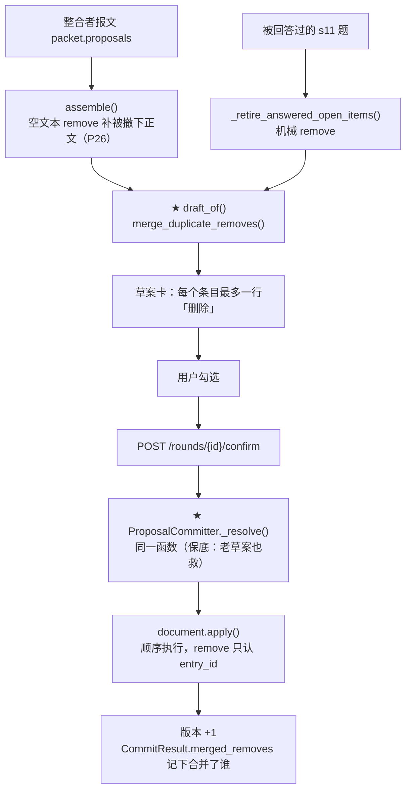

# P32 方案（待拍板）· M1：确认写入的重复 `remove`

> **这份文档分析的是**：里程碑 `2026-10-02-里程碑-M1到M4-审计遗留四条.md` 的 **M1**——
> P30 审计挖到的 **F28**：同一批确认里对同一条 `entry_id` 提了两次 `remove`，
> 结果 `POST /confirm` 422、**接受的几十条一条都没写进文档**。
> **状态**：方案，**一行产品代码没动**（只做过只读代码走查 + 从 P30 的现场里取字段级证据）。
> **口径来源**：`02-编排与数据.md`（§3 写范围 · §11.0.2 / §11.0.2a 的去处与 `remove` 口径）·
> `05-DDD架构.md`（写入路径唯一 · 上下文边界）· `04-未决.md` G6（P25/P26 那两条"要改的条目不存在"）·
> P30 报告 `.codex/runs/2026-10-02/全量真跑审计/报告.md` §三 F28。
> **给执行的 agent**：先写红 → 跑到红 → 再实现 → 再跑绿 → 一任务一提交（中文）；
> **除非测试本身写错（要说明错在哪），不许改测试迁就实现**；`src/` 里不许有假实现。

---

## 0. 现场与代码走查（对着代码，逐条带证据）

### 0.1 现场（P30 的 L4 第 3 轮，真跑）

| 事 | 证据 |
|---|---|
| `POST /api/rounds/r-1526d157/confirm` → **422** | `{'code':'shape_error','message':'找不到条目 r-a80daa26#open23','details':{'entry_id':'r-a80daa26#open23'}}`（`L4/driver.log`、`L4/probe.json` 的 `timing.non_2xx`） |
| 接受的 45 条**一条都没写** | 那一轮之后版本仍停在 v3（`L4/probe.json` 的 `versions.version_count = 3`） |
| 草案里有**两族**指向同一批条目的 `remove` | `L4/rounds/r-1526d157.json`：`p14`–`p21`（text = 被撤下条目的正文）与 `p34`–`p39`（text = `本轮已回答，撤下这条未决项`）指向同一批 `r-a80daa26#open23/24/25/26/27/32/33/35` |
| **两条都被接受了** | `L4/accept.json` 里 `p14` 与 `p34` 都在那 45 条里 |

### 0.2 这两族是从哪来的（两条独立的路，语义相同）

| 来源 | 代码 | 产出什么 |
|---|---|---|
| **整合者那条路** | `application/assembly.py:443 assemble()` 收 `packet.proposals`；`remove` 文本为空时由 `assembly.py:497` 用**被撤下那条的正文**补上（P26 口径） | p01…pNN（先编号） |
| **机械清理那条路** | `application/use_cases.py:875 _retire_answered_open_items()`：这一轮**被回答过**、且来自 s11 未决条目的题 → 各出一条 `remove`，文本固定为"本轮已回答，撤下这条未决项" | 接在整合者那批后面编号（`use_cases.py:1314`） |

两族都遵守"一条答案要么被引用、要么机械落地"，各自都**没错**——错的是**没人发现它们说的是同一件事**。

### 0.3 422 是怎么抛出来的（四步，全部走查过）

1. `domain/services/committer.py:64 commit()` → `_resolve()` 拿到**全部**被接受的提案（含两条重复）；
2. 同一函数 `:78` 把每条翻成 `WriteInstruction`，交给 `document.apply(...)`；
3. `domain/authoring/document.py:250` **按顺序**跑 `working.apply(instruction)`；
4. 第一条 `remove` 把条目摘掉 → 第二条走 `_apply_remove`（`:546`）→ `_locate_entry`（`:629`）
   找不到 → **`UnknownEntry`（`ShapeError`，code=`shape_error`）** → 事务回滚 → **什么都没写**。

`_apply_remove` 保持报错是**对的**：`POST /edits` 的手改路径正靠它把"你要删的这条不存在"告诉用户
（同一句文案也在 `use_cases.py:2224`）。**所以修法不能在 domain 的 apply 里容错**，得在"进入 apply 之前"。

### 0.4 现有设计 vs 目前

| | 设计怎么写的 | 目前实现 |
|---|---|---|
| `remove` 的语义 | `02` §11.0.2a：`remove` 撤下哪一条由 `entry_id` 决定，文本只是展示 | 对——`_apply_remove` 只认 `entry_id`，**文本不入库**（快照记的是结果文档） |
| 重复指令 | 没写过 | **没定义**。P25 那条"要改的条目不存在就丢那一条"拦不住它：装配时两条都合法 |
| 写入路径 | `05`：只有 `ConfirmDraft` 能写 | 对——修法也要落在这条路径上（或它的上游） |
| 丢东西必须留痕 | `04` C5 / `02` §11.0.2 | 本批合并的是**重复指令**，没有内容被丢（条目照样被撤下）——这一点要在代码注释里写清 |

---

## 1. 现在要实现什么

**Goal**：**同一批确认里，对同一个 `entry_id` 的多条 `remove` 只算一条**——
① 新的草案卡上不再出现两行一模一样的"删除"；② **修好之前存下来的老草案**也能确认写入成功。

**为什么是"合并"而不是"报错"**：这两条本来就是同一条指令（`remove` 只看 `entry_id`），
报错等于把"模型与机械各说了一遍同一件事"的代价转嫁给用户；而用户**看不出**这两行有什么区别。

**边界**：

- 不动 `document._apply_remove` 的报错语义（手改路径依赖它）；
- **不动 `replace` 的顺序语义**（同一条目两条 `replace` = 后一条覆盖前一条，是合法的）；
- 不动端点 / schema / 前端 / 提示词 / 就绪度判据；
- 不改"一条答案要么被引用、要么机械落地"这条口径本身。

---

## 2. 执行范围

| 组 | 内容 | 体量 |
|---|---|---|
| **A · 领域层** | `domain/round/draft.py` 加一条纯函数；`domain/services/committer.py` 用它 + 把"合并了哪几条"报出来 | 小 |
| **B · 装配层** | `application/assembly.py::draft_of()` 用它——**卡片上不再重复** | 极小 |
| **C · 测试** | 领域纯函数 5 条 + 写入端 3 条 + 装配端 1 条 + 端到端 1 条 | 中 |
| **D · 真跑复验** | 同形态输入一轮，确认不再 422 | 小（但要真模型） |

**产品代码改动** = 2 个文件各几行 + 1 个文件加一条函数；`CommitResult` 加一个**带默认值的字段**，
API 因此**零变化**（`/confirm` 只回 `{"version_no", "round"}`，不暴露 `CommitResult`）。

---

## 3. 逐文件：怎么改（每一步）

### 3.1 `domain/round/draft.py`（**加一条纯函数**，规则的唯一出处）

放在 `Proposal` / `Draft` 旁边，因为它说的就是"草案里的提案"这件事的语义。

```python
def merge_duplicate_removes(
    proposals: Sequence[Proposal],
) -> tuple[tuple[Proposal, ...], tuple[ProposalId, ...]]:
    """同一 `entry_id` 的多条 `remove` 是**同一条指令**：留第一条，其余合并。

    为什么要合并：`remove` 撤下哪一条**只由 `entry_id` 决定**（`02` §11.0.2a），
    文本只是卡片上的展示、不入库。所以两条 `remove` 指向同一条目时，
    第二条执行时那条目已经没了——真跑里它直接把整批确认打成 422（P30 · F28）。

    为什么只合并 `remove`：
    - `replace` 两条是**顺序语义**（后一条覆盖前一条），合并会把用户勾的第二条改法吃掉；
    - `add` 每条都有新编号（`{round_id}#{index:02d}`），天然不会撞。

    保留哪一条 = 参数序列里**最先出现的**那条。两个调用点各按自己的顺序传：
    装配层传草案顺序（整合者那批在前，它的文本是"被撤下那条的正文"，卡片上更好看）；
    写入端传**用户接受的顺序**（改它超出本批范围）。
    """
    kept: list[Proposal] = []
    merged: list[ProposalId] = []
    removed_entries: set[EntryId] = set()
    for proposal in proposals:
        if proposal.op is WriteOp.REMOVE:
            if proposal.entry_id in removed_entries:
                merged.append(proposal.proposal_id)
                continue
            removed_entries.add(proposal.entry_id)
        kept.append(proposal)
    return tuple(kept), tuple(merged)
```

> **不新建留痕通道的理由**（写进注释，免得下次有人来加）：被合并掉的那条**不是内容**，
> 是同一件事的第二次陈述；条目照样被撤下。`unaccounted` / `dropped` 两条通道说的都是
> "内容没进文档"，塞进来只会污染它们。**要可断言的地方在写入端**（见 3.3 的 `merged_removes`）。

### 3.2 `application/assembly.py::draft_of()`（**装配层收口**，卡片不再重复）

`draft_of`（`:661`）是**新草案唯一的构造点**（`Draft(...)` 在 `src/` 里只出现在这里与
`serialization.py` 的读库路径）。在它里面合并，所有装配路径一次受益：

```python
def draft_of(round_id, draft_id, proposals, gaps) -> Draft | None:
    if not proposals:
        return None
    proposals, _merged = merge_duplicate_removes(proposals)   # ← 新增这一行
    return Draft(draft_id=draft_id, round_id=round_id,
                 proposals=tuple(proposals), gaps=tuple(gaps))
```

- **合并不可能把它变空**（只减不增），所以判空仍放在前面；
- **不加 `DroppedItem`**：理由同 3.1；
- 被合并掉的那条**不再出现在卡片上**——用户不会勾重，扮 PM 也不会。

### 3.3 `domain/services/committer.py`（**写入端保底**，老草案也能救）

两处：

一是在 `_resolve()`（`:154`）返回前合并，并**把结果带出来**：

```python
def _resolve(self, round_, accepted) -> tuple[tuple[Proposal, ...], tuple[ProposalId, ...]]:
    ...
    resolved = tuple(by_id[pid] for pid in accepted)
    return merge_duplicate_removes(resolved)      # (生效的, 被合并掉的 id)
```

二是在 `commit()` 里：

```python
proposals, merged = self._resolve(round_, accepted)
...
taken = set(accepted)          # ← 注意：用**用户接受的 id**，不是合并后的
...
return CommitResult(version=version, written_block_ids=..., advisories=advisories,
                    merged_removes=merged)
```

`CommitResult`（`:36`）加一个**带默认值**的字段，手改与回退两条构造点因此不用改：

```python
merged_removes: tuple[ProposalId, ...] = ()
```

> **`taken` 那行是必须同步改的**：现在是 `taken = {p.proposal_id for p in proposals}`，
> 合并之后会少算一条——而 `proposed_accepted` 是 C4"连续三轮全不勾就提示"的输入。
> 被合并掉的若恰好是 `proposed` 来源，计数就会偏小。**这是最容易漏掉的连带改动。**

### 3.4 明确**不改**的地方

| 地方 | 为什么不动 |
|---|---|
| `document._apply_remove` / `_locate_entry` | 手改路径（`POST /edits`）靠它把"删的这条不存在"报给用户；容错会掩盖真错 |
| `use_cases.py:875 _retire_answered_open_items` | 它本身没错（"被回答过的未决项要撤下"）；重复是在**汇合处**产生的，收口放 `draft_of` |
| `use_cases.py:2224` 的 `_resolve_manual_target` | 手改路径，与 F28 无关 |
| `serialization.py:497` | 读老库要**原样读出来**（含重复），由写入端兜底 |
| 提示词 | 整合者不需要知道这条；这是机械收口（`02` §11.0.10 的思路） |
| 前端 / DTO / 端点 | `/confirm` 只回 `version_no` + `round`，`CommitResult` 不出网 |

---

## 4. 数据流（只画这一条链路）



两条读法：

1. **两个 ★ 是同一个函数**（`domain/round/draft.py` 里那一条）——规则只有一份；
2. 上层的 ★ 让卡片干净，下层的 ★ 保证"接口不炸"：老草案今天确认会 422，修完之后照样写得进去。

---

## 5. TDD：用例清单（先红 → 再绿）

### T1 · 纯函数（新文件 `tests/domain/round/test_merge_duplicate_removes.py`）

| 用例 | 断言 |
|---|---|
| 同 entry 两条 remove | 只留第一条；返回被合并的第二条 id；**顺序不变** |
| 同 entry 两条 replace | **原样返回**（不合并、`merged` 空） |
| 不同 entry 的 remove | 原样返回 |
| 一条 / 空 | 原样返回 |
| 同 entry 的 remove + replace | 只合并 remove 那条，replace 留在原位 |

### T2 · 写入端（`tests/domain/services/test_committer.py` 加用例，用现成的 `Fixture`）

| 用例 | 红是什么样 | 绿是什么样 |
|---|---|---|
| **同一条目的两条 remove 都接受** | 今天：`UnknownEntry`（= 真跑那个 422 的领域形态） | `commit` 成功、版本 +1、那条条目没了、`result.merged_removes == (p2,)` |
| 只接受被合并的那一条 | — | 也成功（它自己就是一条合法 remove） |
| **`proposed_accepted` 不因合并少算** | — | 造一条 `origin=PROPOSED` 的 remove 被合并掉 → 计数仍是 1 |

### T3 · 装配端（新文件 `tests/application/test_duplicate_removes.py`，照着 `test_answer_landing.py` 的搭法）

造一轮：s11 里有一条未决条目 + 一道来自它的 carried 题**已答** + 整合者报文**也**提了一条
`remove` 指向同一条目 → 装配后 `draft.proposals` 里对该 `entry_id` **只有一条** `remove`，
且它的文本是**被撤下那条的正文**（不是"本轮已回答…"）。

### T4 · 端到端（`tests/e2e/test_closed_loop.py` 照 `:300` 那条加一个兄弟用例）

`accepted` 里带两条同 entry 的 remove → `POST /rounds/{id}/confirm` **200**、
`version_no` 是 +1 的那个、`round.step == "done"`。

### T5 · 真跑复验（不是单测，是这一批的"绿"）

L4 同形态（科研 CRF 那份输入）跑一轮，判据两条：
① `POST /confirm` 不再 422；② 版本 +1、s11 里那批条目真的被撤下。
**库放 `.codex/runs/2026-10-02/全量真跑审计/`（P30 的教训：`/tmp` 被环境清空过一次）。**

**测试纪律**：T1–T4 是新增用例，不改任何既有断言；**如果哪条写错了（比如断言写反），
要说明错在哪才准改**。

---

## 6. 成功之后长什么样（自检）

1. 草案卡上，**每个 s11 条目最多一行"删除"**；
2. 老草案（`serialization.py` 读回来的、带重复 remove 的）确认写入**成功**；
3. 写入端能报出"合并了哪几条"（`CommitResult.merged_removes`，domain 层可断言、不出网）；
4. `proposed_accepted` 的计数**与合并前一致**（C4 那条提示不被带偏）；
5. 真跑复验那一轮：不再 422、版本 +1、s11 条目真的少了两条；
6. `git diff --stat` 只碰这三个文件 + 测试；端点表 **26 条不变**；`ruff` 全绿、后端全绿。

---

## 7. 失败模式

| 失败模式 | 怎么发现 | 处置 |
|---|---|---|
| 合并把不该合的两条合了 | T1 的 `replace` 用例 | 红 → 修；所以那条用例必须存在 |
| 合并后草案变成空的 | `Draft.__post_init__` 会抛"草案至少一条提案" | 不可能（只减不增）；T1 覆盖 |
| `taken` 忘了改 → C4 计数偏小 | T2 第三条用例 | 红 → 修；所以那条用例是**必须**的 |
| 老草案走了别的路径（没经过 `_resolve`） | 走查：`commit()` 是唯一入口（`ConfirmDraft` 只调它） | — |
| 真跑复验时那条输入**这一次没产生重复** | 手工核对 `rounds/*.json` 里有没有同 entry 的两条 remove | 没有就回放 P30 的 `r-1526d157` 草案（`L4/rounds/*.json` 还在） |

---

## 8. 回写清单（做完必须做）

1. `.codex/docs/设计/04-未决.md`：G10 里 F28 那一行从"待办"改成"已修"，写清口径
   （同 entry 同 op 的 remove 合并、replace 不动、可断言的地方在 `merged_removes`）；
2. `.codex/docs/设计/02-编排与数据.md` §11.0.2a 后面**补一段**：`remove` 的重复语义
   （这是**口径**，必须进 `02`）；
3. `.codex/docs/上下文/checkpoint.md`：加 P32 一节；
4. 真跑复验的证据放 `.codex/runs/2026-10-02/M1验证.md`（不进真相源）。

---

## 9. 待作者拍板

1. **合并口径**：同 entry 同 `op` 的 `remove` 合并——**留第一条**（装配按草案顺序、写入端按用户勾选顺序），
   可以吗？还是要改成"留 `origin` 更靠用户的那条"（USER > DERIVED > PROPOSED > SYSTEM_DEFAULT）？
2. **两层都做**（装配收口 + 写入端保底）还是只做一层？
   *推荐两层*——只做装配层救不了老草案；只做写入端则卡片上仍然摆着两行一样的删除。
3. **要不要让用户看见"合并了几条"**？*推荐不看*（他看不见重复，正文也没丢东西）；
   真要看见，加的是草案卡的 advisory 或确认后的提示，代价是前端改动。
4. **真跑复验的输入**：复用 L4 那份科研 CRF 输入，还是回放 P30 的 `r-1526d157` 草案？
   *推荐前者*（能看到端到端效果），后者作为"老草案"的兜底证据。

---

## 10. 自审：这份方案哪里可能错

| 疑点 | 我的核验 | 结论 |
|---|---|---|
| 会不会误合两种**不同意图**的删除？ | `remove` 撤哪一条**只看 `entry_id`**（`_apply_remove` 里文本不入库，快照记结果） | 同 entry 的两条 remove **语义完全等价**，合并无副作用 |
| `replace` 两条真的合法吗？ | `_apply_replace` 同样按 `entry_id` 覆盖 | 合法且是顺序语义；**所以只合并 remove** |
| 为什么不在 `_apply_remove` 里容错？ | 手改路径（`use_cases.py:2224`）与 `test_edit_entry.py` 依赖它报错 | 容错会把"你删的这条不存在"变成静默，**不做** |
| 装配层合并会不会让"机械清理"失效？ | 机械清理是为了"被回答过的未决项要撤下"；整合者已提同 entry 的 remove 时，撤销**照样发生** | 没失效；没有内容被丢 |
| 老草案的 id 会错位吗？ | 只删不改 id | 不会 |
| 会不会连带影响 C4 计数？ | `taken` 现在从**合并后**的 proposals 算 | **会**——所以 3.3 明确要求改成用 `accepted` |
| 这一步做了，F28 就算完吗？ | 真跑复验 + 老草案兜底 + 计数不变 | 三条判据都在 §6 |

