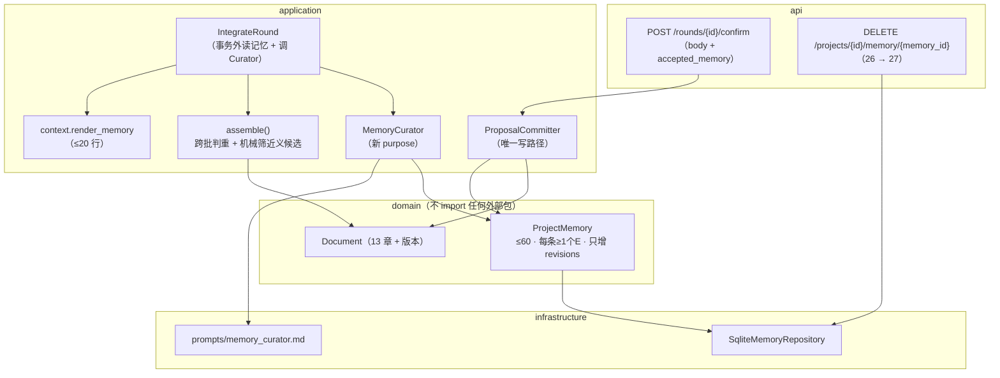

# M6 方案（待拍板）· 跨轮记忆本体：PROJECT.md / Memory Curator 的现行版

> **状态**：方案。**一行产品代码没动**；本轮只做只读取数（`.codex/runs/2026-10-03/M6调研/`）。
> **上游**：`04` E4（"记忆维护"是 v1 之后的大件）· `04` G8（P28：先测量 → **仍不做**）·
> `02` §11.0.10 / §11.0.12 / §11.0.13 / §11.0.16 / §11.0.19 / §11.0.39 · `01` F22 ·
> `05`（三个上下文、唯一写路径、**只有三处人机中断点**）·
> `.codex/docs/过程记录/记忆层与门禁条款.md`（原设计全文，2026-09-21）。
> **给执行的 agent**：先写红 → 跑到红 → 再实现 → 再跑绿 → 提交（中文消息）；
> **除非测试本身写错（要说明错在哪），不许改测试迁就实现**；`src/` 里不许有 `fake|mock|stub|dummy`。

---

## 0. 先摆事实：这条"推荐"与真相源上现行的口径打架

`04` G8 与 `02` §11.0.39 写得明白：**记忆本体仍不做**，触发条件是
"量到跨轮重问 ≥3 条/项目 或 被拒提案回流 ≥2 条/项目 再开工"。所以本方案第一件事是把这条判据重测一遍。

**T0′（只读、零模型成本，27 个库，含两条两轮车道）**：`:codex-annotation{index="4"}`

| 量 | P28（11 库 / 31 轮） | T0′（27 库） | 判据 |
|---|---|---|---|
| 跨轮重问（前轮**已答**） | 0 | **0** | ≥3 条/项目 → 做机械判重 |
| 跨轮重问（前轮**跳过**＝欠账） | 2 | 37 | 不挡（欠账就该重问） |
| 近义上界（同去处 + 三字组 ≥0.6） | 1 | **1** | 无 |
| 被拒提案回流（代理） | 0 | **0** | ≥2 条/项目 → 做机械判重 |
| s11 目标题被答（答案蒸发） | 13 | **0** | P28 口径二已修 |

**那 1 条我逐轮读过，是真的**（`.codex/runs/2026-10-02/M1验证/m1.db`，M1＝P32 的验证库 · 两轮）：
第 1 轮问过并**答过**「数据提交后冻结与录入纠错的矛盾如何调和？」（`s5/data-entry-verification.rules`），
第 2 轮又问一遍「数据提交后冻结与录入纠错的调和机制」——同一去处、同一件事、换了说法。
`question_key = (去处, 归一问法)` 抓不到它；同一份 payload 里还有 **4 对同轮近义重复的 s11 清单项**
（敏感字段清洗 ×2、PDF 进度反馈 ×2、电子签名要素 ×2、看板实时性 ×2）。
证据：`.codex/runs/2026-10-03/M6调研/T0-跨轮测量.md`。

**所以这条活的性质要先说清**：它不是缺陷修复（触发条件没到），是**能力投入**——
原设计 F22 的整块，加上 `02` §11.0.16 早指定给"记忆本体那批"的那半（真·近义判重）。
方案照出，做不做由你拍（§13 第 1 问）；不拍板就照现口径继续挂着（替代清单见 §10.3）。

**顺带把同批被点到的三条旧账核了（都已有结论，不是缺口）**：

| 被点到的 | 事实 | 出处 |
|---|---|---|
| **F17**（席位报文占位符整轮判死）+ 剩下那半边（整合者非对象元素） | **两半都已交付**：席位/主张走"先重装、再丢 + 留痕"，整合者补上了留痕出口（`Round.dropped` + `Draft.gaps`），另加"全占位符的包走降级不判死" | `04` G5 两行；`application/agents/integrator.py::IntegrationOutcome.discarded` `:codex-annotation{index="1"}` |
| **F19**（`unaccounted` 留痕不降） | **已收口**：P23 试过"点名重装整包"（模型肯补、又漏别的）→ P24 定型为"小调用只问去向、不重写 + 没进展就收手 + 小调用失败不判死"；同车道两轮 **34 → 0**，P30 全量里 14 个写过的轮次 3 轮共 25 条 | `04` G5/G6/G10；`02` §11.0.37 |
| **C-2c-3**（按主张取块） | **已测量否决**（不是"还没做"）：四车道真数据里材料预算**从未触顶**（最大 2424 字 / 上限 4000），三种选块策略选出的块**完全一样**；只有把预算人为压到 1000 字以下才看得出收益。触发条件与将来的做法记在 `P22验证.md` §四 | `04` G5/G7 `:codex-annotation{index="2"}` |
| **P21 §8 待拍板项** | 四条里 **1、2、4 已决并落地**，**只剩第 3 条**：`MAX_OPEN_ITEMS_PER_BATCH` 3 → 5。P22 的结论是**建议不动**（carried 与新题共享这 5 个名额，提上去等于每批少问 2 道新题；真要加速消化，杠杆是 `MAX_QUESTIONNAIRES` 或用已有的 `dig`） | `P21` §8 `:codex-annotation{index="3"}` |

这三条**不并进本批**：两条已是"已交付 / 已否决"的旧账，一条是独立小项且现结论是"不动"。
若你要的是它们而不是记忆本体，说一声我立刻切（F19 若要的是"清零"而不是"收敛"，那是新目标，得单独定判据）。

---

## 1. 现在要实现的内容（一句话）

把**"已经定过的口径 / 明确否掉的东西 / 这一轮攒下的教训"**做成一份**用户逐条确认过、只读注入**的
项目记忆（原设计的 `PROJECT.md`）：**Memory Curator** 每轮出**变更指令集**，
你在**草案卡**上逐条勾，确认后与文档写入**同一个事务**落库，之后注入**席位**与**整合者**。

## 2. 结论先行（5 条决定）

1. **载体不是文件**：`ProjectMemory` 聚合落在 SQLite（与文档同库），**不是**文档旁边的一份 `.md`。
   机械能算的一律**现算**（章节状态表、s11 阻塞项、这一轮问过什么），只有"模型判断 + 用户确认"的才存。
2. **就绪度一个字不动**：记忆**不进就绪度**——它不是交付物的一部分，多一条记忆不许让任何车道变红
   （与 P37/P38 "不升必填" 同一条纪律）。
3. **谁写**：只有**你的确认**能写。Curator 只出**变更指令集**（`add/update/merge/delete`，≤5 条/轮）。
4. **确认搭车，不新增中断点**：记忆提议落在**草案卡**上（单独一档，**默认不勾**），
   走**同一次** `POST /rounds/{id}/confirm`（body 加一个字段）、**同一个事务**。
   `05` §7 那句"只有三处人机中断点"不动。
5. **成本明码**：每轮 **+1 次模型调用**（Curator，出草案那一刻；本轮 190 次量级 → 191）；
   提示词 **+≤20 行 × 2 处**（席位 / 整合者）。这两条进真跑阈值，超了就回退。

## 3. 现有设计 vs 现在实现（差在哪儿，逐块）

原设计（`.codex/docs/过程记录/记忆层与门禁条款.md`）说 PROJECT.md 有五块；对着代码核一遍，
**五块里只有一块真的缺**：

| 原设计的一块 | 现在谁承担 | 本方案 |
|---|---|---|
| 章节状态表（13 行，机械） | `domain/authoring/readiness.py::ReadinessChecker` **现算**，`/readiness` + 导出附录 C 都在用 | **不存**（存了就是第二真相源，`02` §11.0.10 明令禁止） |
| 阻塞项（未清的开放问题） | 已经落在 **s11**（§11.0.10 / §11.0.16），且**同时**进就绪度 blocker | **不存**（本是现算） |
| 铁律 | 已进提示词与 `readiness` 的硬规矩（`LIMITS_TEXT` / `READER_RULES`） | **不存** |
| **教训 / 已定口径 / 明确否掉** | **无**——跨轮只认"文档"，轮次里问过答过的东西下一轮看不见 | **本方案要补的，唯一新增的一块** |
| 引用计数（连续 5 轮未命中 → 删除候选） | 无 | **不存计数器**：命中与否**现算**（记忆条目的 `refs` 在最近 N 轮 payload 里有没有被引用），与 P16 索引层同一口径 |

**现在的实现（对着代码）**：真相源只有三处——`documents`（13 章 + 版本快照）、`rounds.payload`、
`evidence_ledgers`；跨轮能力只有三件——§11.0.10（文档为准、不建第二真相源）、
§11.0.12（答案的机械落点）、§11.0.13/§11.0.16（**轮内**判重 + 标点归一）。
**跨轮没有任何一处能让"上一轮定过的结论"回到这一轮的提示词里**——这就是缺口。

## 4. 执行范围

**做**（三个里程碑，见 §10）：

1. `ProjectMemory` 聚合 + 落库（1 张新表）+ 只读投影 + DTO；
2. `MemoryCurator` 智能体（新 purpose `memory_curation` + 新提示词）+ 提议落在**草案卡**；
3. 确认路径接进**唯一写路径**（`ProposalCommitter.commit` 的同一个事务）；
4. 注入**席位**与**整合者**（限量、只注入已确认的、与文档冲突以文档为准）；
5. 前端：草案卡多一档 + 一个"记忆"抽屉（看 / 删）；
6. 轮内近义重复的收口（**机械先筛 + Curator 只做确认**，见 §5·9）——它是 §0 那 4 对现场的对症招，
   和记忆本体共用同一次 Curator 调用，**不额外加调用**。

**不做**（明确）：

| 不做的事 | 为什么 |
|---|---|
| 机械跨轮判重 + 注入（P28 的 T1–T4） | 触发条件没到（§0 表：0 条 / 0 条）；本批只做**语义侧** |
| 章节状态表落库、阻塞项落库、铁律落库 | 机械可算的现算；存了就是第二真相源 |
| 引用计数**计数器** | 现算（扫最近 N 轮 payload），不建计数字段 |
| 归档区（"历史教训"附录）+ 席位检索归档 | 原设计有、v1 不做；等真跑证明"记忆被删完还想找回"再说 |
| 讨论区（`04` F10）· OCR/pptx · docling | 与本批无关 |
| F17 / F19 / C-2c-3 / P21 §8-3 | 见 §0；各有结论，别混进来 |
| M5（功能字段水位）那五问 | **它还是"待拍板"状态**（`docs/plans/2026-10-03-M5-*.md` §9）。那是小件、方案已写好，你点头我另开一批跑；本批不并 |

## 5. 口径（每条：建议 + 备选 + 为什么）

1. **载体**：`ProjectMemory` 聚合 + 一张表 `project_memory`（`project_id` 主键，payload 里两段：
   `entries` 与 `revisions`，**照 `evidence_ledgers` 的范式**）。
   备选：单独一个 `PROJECT.md` 文件放磁盘。**不选**——文档已经是"项目的事实"，再放一份文件就是
   "第二真相源 + 双写一致性"（`02` §11.0.10 那条铁律的由来）。*
2. **三类条目**：`lesson`（教训）/ `decision`（已定口径）/ `rejected`（明确否掉的）。
   每条 **≤2 行**、**必须带 ≥1 个账本里存在的 `E` 编号**（否则整条丢 + 留痕）。
   备选：只存 `decision` 一类。**不选**——教训与"否过"是原设计要解决的两件事，缺一条这套就白做。
3. **容量 60 条**（与"教训区 ≤60 行"对齐）。到顶时 Curator 的提议里**必须**带 `merge` 或 `delete`，
   否则该批**整批拒收 + 留痕**（不静默截断、也不无脑追加）。
4. **谁写**：Curator 只出**变更指令集**，`write_document: false` 的精神不变——它连记忆也不能直接改。
5. **确认载体**：草案卡上一档"这一轮攒下的记忆"（N 条，**默认不勾**，每条一个勾 + kind 标签 + 出处 chip）。
   为什么默认不勾：记忆写错的代价是**污染以后每一轮**（原设计 §二 原话），所以比草案提案更保守。
6. **注入两处**：**席位**与**整合者**。**第一版不注入分析者**——它是唯一一条没有 `/retry` 可点的路，
   且它读的是"用户原话 + 文档现状"，缺记忆不会误导归位；真跑有证据再扩。
7. **与文档冲突以文档为准**：渲染出来的记忆节末尾带一句硬规矩（"与正文冲突时以正文为准，
   并在 rationale 里说一句"）。备选：让模型自己判谁新谁旧。**不选**——那是让它替人下结论。
8. **失败与空态**：Curator 失败（超时 / 包不合格）**不判死整轮**——草案照出，`Round.dropped` 留一行
   `memory_curation_failed`；没有值得记的 → 返回空数组（**不强制每轮出条目**）；
   没有记忆时渲染成**一句实话**（"（这个项目还没有确认过的记忆）"），**不留空节**。
9. **轮内近义重复的收口**（对 §0 那 4 对现场）：装配层先按**机械条件**筛出候选
   （同一个去处 + 题目/清单项文本三字组重合 ≥0.5），把候选交给**同一次 Curator 调用**做确认
   （它本来就要读这一轮的 digest）→ 被确认的那条**丢掉 + 留痕**（`DroppedItem`，reason 写清"跟哪一条是同一件事"）。
   **不许只凭模型一句话就丢**：机械先筛是护栏，模型只做二次确认（与 P11 的"机械盖章"同一个方向）。
   备选：照出、只在卡片上标一句"跟第 1 轮那道像是同一件事"（人来拍）。**留作回退档**——
   真跑若出现误杀，就退到"标记而不是丢"。
10. **机械可算的一律现算**（重复一遍，因为它是本方案的边界）：章节状态、s11 阻塞项、
   "最近 N 轮问过/答过什么"——**全部现算**，不落库、不缓存。

## 6. 逐文件：每个文件改什么、每一步做什么

### 6.1 领域层（`backend/src/pmstudio/domain/memory/`，新增包）

| # | 文件 | 改动 |
|---|---|---|
| 1 | `domain/memory/__init__.py`（新） | 导出 `MemoryEntry` / `MemoryChange` / `ProjectMemory` |
| 2 | `domain/memory/memory.py`（新） | 三个类型 + 聚合的不变量：① `entries ≤ 60`；② 每条 `refs` 非空且**都在账本里**（`E` 编号由调用方校验存在性，与 `TraceabilityChecker` 同口径）；③ `update/merge/delete` 必须点名**已存在的** `memory_id`；④ 到顶时必须带 `merge/delete`；⑤ `apply()` 是**唯一**的改动入口，每次 apply 追加一条 `revision`（含 changes 摘要 + round_id + 时间），**只增不改**；⑥ `to_payload/from_payload`（老 payload 缺键 → 空） |

```python
# domain/memory/memory.py —— 形状（名字定死，后面几层照这个写）
class MemoryKind(StrEnum):
    LESSON = "lesson"; DECISION = "decision"; REJECTED = "rejected"

@dataclass(frozen=True, slots=True)
class MemoryEntry:
    memory_id: str; kind: MemoryKind; text: str
    refs: tuple[EvidenceId, ...]; round_id: str
    created_at: datetime; updated_at: datetime

@dataclass(frozen=True, slots=True)
class MemoryChange:            # Curator 的一条指令（提议，不是事实）
    op: Literal["add", "update", "merge", "delete"]; kind: MemoryKind
    text: str; refs: tuple[str, ...] = (); target_id: str | None = None; reason: str = ""

@dataclass(frozen=True, slots=True)
class MemoryRevision:          # 每次确认一条，只增不改（审计用，不注入提示词）
    revision_no: int; round_id: str; changes: tuple[MemoryChange, ...]
    created_at: datetime

class ProjectMemory:
    @classmethod
    def empty(cls, project_id: ProjectId) -> "ProjectMemory": ...
    @property
    def entries(self) -> tuple[MemoryEntry, ...]: ...
    @property
    def revisions(self) -> tuple[MemoryRevision, ...]: ...
    def apply(self, changes: Sequence[MemoryChange], *, ledger: EvidenceLedger,
              round_id: RoundId, now: datetime, ids: IdGenerator) -> "MemoryRevision": ...
```

### 6.2 应用层

| # | 文件 | 改动 | 每一步 |
|---|---|---|---|
| 3 | `application/ports.py` | 加 `MemoryReader`（`get(project_id) -> ProjectMemory`）与 `MemoryWriter`（`save(memory)`）两个协议 | 与 `DocumentReader/DocumentWriter` 同形状；`WriteCapability` 守卫要显式加白名单（见 6.5） |
| 4 | `application/agents/memory_curator.py`（新） | `MemoryCurator`：`PURPOSE = "memory_curation"`、`PROMPT = "memory_curator"`、`PROMPT_SLOTS = ("memory_state", "round_digest", "near_candidates", "schema_json", "validation_error")`；`async def propose(...) -> CuratorOutcome(packet, overflow, discarded)` | 复用既有的 `schemas.parse_packet_lenient` / `parse_packet_trimmed`：**超限与丢弃都走留痕**，与席位/整合者同一条路 |
| 5 | `application/agents/schemas.py` | 加 `MemoryPacket`（`changes[]`、`duplicate_candidates[]`）+ JSON schema | 每条 change 的字段与 `MemoryChange` 一一对应；`duplicate_candidates[] = {candidate_id, same_as, why}` |
| 6 | `application/context.py` | 加 `render_memory(entries)`：按 kind 分组、每题一行、**≤20 行**、`refs` 只给编号；截断时**写明**"只带了前 N 条"；空 → 一句实话。另加 `render_near_candidates(...)` | 与 `render_open_items` / `render_materials` 的既有限量写法同一形状 |
| 7 | `application/use_cases.py::IntegrateRound` | 出草案那一刻：**事务外**读记忆（`MemoryReader`）→ 调 `MemoryCurator` → 提议落 `Round`（新 payload 键 `memory_proposals`）→ 装配层按 `duplicate_candidates` 丢重复（机械先筛 + 留痕） | 顺序：`assemble()` → `Curator` → `note_dropped` → **事务内**落草案。Curator 抛错 → `round_.note_dropped([DroppedItem(handle="memory", reason="memory_curation_failed: …", source=DropSource.ASSEMBLY)])`，**不 fail 整轮** |
| 8 | `domain/round/round.py` | 新 payload 键 `memory_proposals`（提议，`RoundView` 用它）、`accepted_memory_ids`（确认时记下勾了哪些，与 `accepted_proposal_ids` 对称）；`confirm(...)` 多收一个参数 | 老 payload 缺键 → 空（**不是 None**，别让下游到处判空） |
| 9 | `domain/services/committer.py::commit` | 多收 `accepted_memory`，**同一个事务里**：`memory.apply(...)` → `memory_writer.save(...)` → 再 `round_.confirm(...)` | 事务边界纪律不变：**没有写入就不开事务**；记忆写入与文档写入要么一起成、要么一起回滚 |
| 10 | `application/use_cases.py::ConfirmDraft` | 把 `accepted_memory` 透下去 | 端点不变 |
| 11 | `application/dto.py` | `RoundView.memory_proposals`（`MemoryProposalView{proposal_id, op, kind, text, refs, reason}`）、`WorkspaceView.memory`（`MemoryEntryView{memory_id, kind, text, refs, round_id, updated_at}`） | 老 payload 缺键 → 空元组（两条既有用例钉住的同一口径） |
| 12 | `domain/authoring/readiness.py` | **一个字不动**（记忆不进就绪度） | 加一条**护栏用例**钉住（§9·G2） |

### 6.3 基础设施层

| # | 文件 | 改动 |
|---|---|---|
| 13 | `infrastructure/sqlite/schema.sql` | 新表 `project_memory(project_id TEXT PRIMARY KEY, payload TEXT NOT NULL, updated_at TEXT NOT NULL)`（`CREATE TABLE IF NOT EXISTS` → 老库自动补） |
| 14 | `infrastructure/sqlite/database.py` | `USER_VERSION` 2 → 3（只是把形状变更记在库里；不需要 `ALTER`，因为是新表） |
| 15 | `infrastructure/sqlite/repositories.py` | `SqliteMemoryRepository(reader + writer)`：`get`（坏行/缺表 → 空记忆，**不炸**）、`save`（整份 payload 覆写，WAL 下与文档同库同事务） |
| 16 | `infrastructure/sqlite/serialization.py` | `memory_to_payload` / `memory_from_payload`（老 payload 缺键 → 空；`kind` 认不出来 → 跳过该条并留痕，不炸） |
| 17 | `infrastructure/llm/prompts/memory_curator.md`（新） | 提示词：输入是"已确认记忆 + 本轮 digest + 机械筛出的近义候选"，输出是**变更指令集**；硬规矩：**没东西可记就返回空**、每条必须带 E 编号、到顶必须 merge/delete、不许写下功能细节与过程记录、只做确认不重写 |
| 18 | `infrastructure/llm/prompts/seat_review.md` / `integrator.md` | 各加一节 `$project_memory`（含"与正文冲突以正文为准"那句硬规矩） |
| 19 | `bootstrap/container.py` | 组装 `SqliteMemoryRepository` + `MemoryCurator`；把它注进 `IntegrateRound`（读）与 `ProposalCommitter`（写） | 

### 6.4 接口层与前端

| # | 文件 | 改动 |
|---|---|---|
| 20 | `api/schemas.py::ConfirmRequest` | 加 `accepted_memory: list[str] = Field(default_factory=list)`（**老客户端不传 → 空**，行为不变） |
| 21 | `api/routes.py` | 新增 `DELETE /api/projects/{project_id}/memory/{memory_id}`（用户手动删一条）；`/confirm` 透传 `accepted_memory` |
| 22 | `tests/api/test_openapi_contract.py` | `EXPECTED_PATHS` **26 → 27**（显式改，评审时一眼可见） |
| 23 | `frontend/src/api/types.ts` | `WorkspaceView.memory` / `RoundView.memory_proposals` / `ConfirmRequest.accepted_memory` |
| 24 | `frontend/src/components/DraftDrawer.tsx` | 草案卡底多一档"这一轮攒下的记忆"：kind 标签 + 出处 chip + **默认不勾** + 一句"勾了才会记，记忆会影响以后每一轮" |
| 25 | `frontend/src/components/MemoryDrawer.tsx`（新）+ `App.tsx` | 记忆抽屉：按 kind 分组、出处 chip 可跳转、每条一个删除按钮（调 21 那个端点） |
| 26 | `frontend/src/state/workspace.ts` | payload 多一个 `memory` 字段（老 payload 没有 → 空数组，不炸） |

### 6.5 架构守卫（不许绕过）

| # | 文件 | 改动 |
|---|---|---|
| 27 | `tests/architecture/test_write_path.py` | `WRITE_CAPABILITY = "DocumentWriter"` 那条不动；**另加**一条同形状的守卫：`MemoryWriter` 只许出现在 `domain/services/committer.py`（白名单从空白开始，每加一个都要评审） |
| 28 | `tests/architecture/test_no_fakes_in_production.py` | 不动（自动生效） |

## 7. 数据流（改后）

```
用户原话
  │
  ▼
[Analyzer] ← 不注入记忆（第一版）；输出主张 + 提名
  │
  ▼
[席位 ×N] ← 注入 $project_memory（≤20 行，只含已确认条目）
  │            没有记忆 → "（这个项目还没有确认过的记忆）"
  ▼
[整合者] ← 同一份 $project_memory + 硬规矩"与正文冲突以正文为准"
  │  ① 事务外：读记忆 + 读 digest（主张/意见/答案/上一批清单项）
  │  ② 模型出报文（题目 + 提案）
  │  ③ assemble()：跨批/跨轮判重（既有）+ **机械筛出近义候选**
  ▼
[MemoryCurator]（一次小调用，purpose=memory_curation）
  │  输入：已确认记忆 + 本轮 digest + 近义候选
  │  输出：变更指令集（≤5 条）+ 候选确认（哪几条是同一件事）
  │  失败 → 留痕一行，草案照出
  ▼
草案卡
  ├─ 内容候选（≤60）
  ├─ 题目（≤5/批）
  └─ 【新】这一轮攒下的记忆 N 条（默认不勾）
  ▼
POST /rounds/{id}/confirm  { accepted: [...], accepted_memory: [...] }
  ▼
[ProposalCommitter.commit] —— 唯一写路径，**同一个事务**
  ├─ document.apply(proposals) → save → 版本快照
  └─ 【新】memory.apply(勾选的变更) → save（≥1 个 E 编号 → 校验 → 追加 revision）
  ▼
下一轮：已确认的记忆进 $project_memory（席位 + 整合者）
```

**架构图（分层，依赖方向不变）**



文字版（一轮里的两处新增，就这两处，别的都不动）：

1. **出草案那一刻多一次调用**：读已确认记忆（只读）→ Curator 出提议 + 近义确认 → 提议落 `Round`，草案卡多一档。
2. **确认那一刻多一次写入**：`/confirm` 的 body 多一个字段 → 同一个事务里文档写 + 记忆写。

## 8. 数据契约（谁赋值 → 谁消费）

| 项 | 谁赋值 | 谁消费 | 老行回落 |
|---|---|---|---|
| `ProjectMemory.entries`（新表 `project_memory.payload`） | 只有 `ProposalCommitter.commit`（经 `ProjectMemory.apply`） | `render_memory`、`WorkspaceView.memory` | 表不存在/坏 payload → **空记忆** |
| `ProjectMemory.revisions` | 同上（每次确认追加一条） | 审计与排查（不注入） | 同上 |
| `Round.memory_proposals`（新 payload 键） | `IntegrateRound`（Curator 的产出） | `RoundView.memory_proposals` → 草案卡 | 缺键 → 空元组 |
| `Round.accepted_memory_ids`（新 payload 键） | `Round.confirm`（用户在草卡上勾了哪些） | 下一轮的 Curator（"上轮攒了什么"）+ 审计 | 缺键 → 空集（**不是 None**） |
| `Round.dropped` 的新 reason `memory_curation_failed` / `duplicate_near_same` | `IntegrateRound` / `assemble` | 草案卡的留痕行、闭环区 | 无（沿用既有通道，**不新增 DTO 字段**） |
| `$project_memory`（新提示词槽，两处） | `context.render_memory` | `seat_review.md` / `integrator.md` | 无 |
| `POST /rounds/{id}/confirm` 的 `accepted_memory` | 前端草案卡 | `ConfirmDraft` → `ProposalCommitter` | 不传 → 空 → 行为与今天一致 |
| `DELETE /projects/{id}/memory/{memory_id}` | 前端记忆抽屉 | `SqliteMemoryRepository`（经用例） | — |
| `GET /projects/{id}/workspace` 的 payload | `GetWorkspace` | 前端（`state.workspace.memory`） | 老 payload 无此键 → 空数组 |

**新表 1 张、新智能体 1 个、新端点 +1（26 → 27）、`/schema` 一个字不动、13 章骨架不动、
唯一写路径不变（只是多写一个聚合）。**

## 9. TDD 用例（先红 → 再实现 → 再绿）

**领域（`tests/domain/memory/test_memory.py`，新）**

| # | 用例 | 期望 |
|---|---|---|
| D1 | `test_a_memory_entry_must_carry_at_least_one_existing_e_ref` | 缺 refs 或 refs 里有账本外的编号 → 整条丢 + 留痕，其余照落 |
| D2 | `test_memory_capacity_is_sixty_and_overflow_needs_a_merge_or_delete` | 第 61 条且提议里没有 merge/delete → **整批拒收 + 留痕**，记忆不变 |
| D3 | `test_update_and_delete_must_name_an_existing_entry` | 点名不存在的 id → 拒该条 + 留痕 |
| D4 | `test_only_applied_changes_move_entries` | 提议（未确认）不进 `entries`；只有 `apply` 能改 |
| D5 | `test_revisions_are_append_only_and_carry_the_changes` | 每次 apply 追一条，含 op 摘要 + round_id，旧 revision 不被改写 |
| D6 | `test_old_payload_without_memory_keys_reads_back_empty` | 老 payload / 缺键 → 空记忆，不炸 |

**应用层**

| # | 用例（文件） | 期望 |
|---|---|---|
| A1 | `test_curator_proposals_land_on_the_draft_card_and_default_to_unchecked`（`test_integrate_round.py`） | 草案卡上出现记忆那一档；`RoundView.memory_proposals` 有 N 条；勾选状态默认 **false** |
| A2 | `test_curator_failure_does_not_break_the_round`（同文件） | Curator 抛错 → 草案照出，`Round.dropped` 里一行 `memory_curation_failed`，**没有**记忆提议 |
| A3 | `test_confirm_writes_document_and_memory_in_one_transaction`（`test_commit_and_queries.py`） | 文档写 + 记忆写同时成功；**人为让记忆校验失败 → 文档也不许写进去**（同一个事务） |
| A4 | `test_unconfirmed_memory_is_never_injected`（`test_context.py`） | 只把**已确认**的渲染进 `$project_memory`；`pending` 一条都不出现 |
| A5 | `test_memory_render_is_capped_and_says_it_was_capped`（同文件） | 61 条 → 只渲 20 行 + 一句"只带了前 20 条"（限量与"截断要写明"照 `_render_open_items` / `select_chunks` 的既有写法） |
| A6 | `test_no_memory_renders_a_plain_sentence_and_no_empty_section`（同文件） | 空记忆 → 一句实话，**不留空节**（与 `render_materials` 的 `NO_MATERIAL_TEXT` 同一形状） |
| A7 | `test_memory_section_carries_the_document_wins_rule`（`test_llm.py`） | 席位与整合者两处提示词都能看到那句硬规矩 |
| A8 | `test_near_duplicates_are_screened_mechanically_before_the_model`（`test_assembly.py`） | 机械条件不满足的候选**不许**被模型一句话丢掉；满足条件的候选被确认 → 丢掉 + 留痕（reason 写清跟哪条重合） |
| A9 | `test_section_state_is_never_stored_in_memory`（`test_readiness.py` 邻近） | 文档改了、记忆一个字不动；章节状态永远现算（第二真相源的反向用例） |

**基础设施**

| # | 用例（文件） | 期望 |
|---|---|---|
| I1 | `test_old_db_gets_the_memory_table_and_old_rows_still_read`（`test_sqlite_repositories.py`） | 老库（USER_VERSION 2）打开 → 建表、幂等、老轮次照读 |
| I2 | `test_broken_memory_payload_is_skipped_not_raised`（同文件） | payload 不是 JSON / `kind` 认不出来 → 跳过该条，不炸 |
| I3 | `test_memory_writer_is_not_reachable_outside_the_committer`（`test_write_path.py`） | `MemoryWriter` 只许出现在 committer（白名单空白，加一个都要评审） |
| I4 | `test_memory_curator_prompt_slots_are_all_used`（`test_llm.py`） | 新提示词的槽位与 `PROMPT_SLOTS` 机械比对（既有那套断言） |

**接口 / 前端**

| # | 用例 | 期望 |
|---|---|---|
| P1 | `test_openapi_paths_are_frozen`（`test_openapi_contract.py`） | 26 → **27**，显式改这一条 |
| P2 | `test_confirm_accepts_accepted_memory`（`test_routes.py`） | 传了 → 记忆落库、返回刷新后的 `RoundView`；没传 → 老行为逐字节一致 |
| P3 | `DraftDrawer.test.tsx` | 记忆那一档渲染、默认不勾、勾上随确认一起提交、kind 标签与出处 chip |
| P4 | `MemoryDrawer.test.tsx` | 分组、chip 可跳、删除按钮打 DELETE；老 payload 无 `memory` → 空态文案 |

**护栏（G）**

| # | 用例 | 期望 |
|---|---|---|
| G1 | `test_a_project_without_memory_produces_the_same_draft_shape` | 老库（无记忆）跑一轮：题目/提案/留痕的**集合**与今天一致（脚本化网关钉住） |
| G2 | `test_memory_never_becomes_a_blocker` | 记忆里塞 60 条 → `readiness` 的 blocker 数不变（0 阻塞车道仍 0） |
| G3 | `test_schema_endpoint_does_not_expose_memory` | `/schema` 契约一个字不动 |

## 10. 里程碑与验收阈值

### 10.1 三个里程碑（一次一个变量，每批一个提交）

| 批次 | 内容 | 边界 | 交付判据 |
|---|---|---|---|
| **M6a · 地基**（零模型、零提示词） | `ProjectMemory` 聚合 + 表 + 序列化 + 仓储 + DTO + 架构守卫（D1–D6 / I1–I3 / G2–G3） | 不注入、不出提议、不改提示词、**端点不动** | 全测试绿 + 老库照跑；产品行为**一个字不变** |
| **M6b · Curator 与确认闭环** | 提示词 + 智能体 + `IntegrateRound` 接线 + 草案卡一档 + `/confirm` 同事务 + `DELETE /memory/{id}` + 前端两处（A1–A3 / I4 / P1–P4） | 还**不注入**（记忆只存不用） | 一轮真跑能在草卡上看到"这一轮攒下 N 条"，勾了才落库；不勾 → 记忆不变 |
| **M6c · 注入与真跑** | 席位 + 整合者注入、限量、冲突口径、近义收口（A4–A8 / G1）+ L1/L2 两轮 + 整轮 eval | 注入是本批唯一动"模型输入"的地方 | 见下阈值 |

### 10.2 阈值（先写死，免得事后找理由）

| 指标 | 阈值 | 超了怎么办 |
|---|---|---|
| 每轮模型调用数 | 190 量级 → **≤ +2**（Curator 1 次；多出来的一次只能是重试） | 查是不是提示词太长导致重试 |
| 整合耗时中位 | 不上涨 **> 10%** | 先砍注入（20 行 → 10 行），再谈回退 |
| 提示词新增 | **≤20 行 × 2 处** | 超了就是渲染限量没生效，先修限量 |
| 记忆条目数 | **≤60**（到顶必须 merge/delete，有用例钉） | — |
| 整轮 eval | **10/10 不回退** | 回退 M6c（保留 M6a/M6b） |
| 阻塞数 | **不回退**（0 阻塞车道仍 0） | 同上 |
| 观测量（前后对比） | 跨轮/同轮近义重复条数（机械 0.3–0.6 档 + 人工核 5 条） | 只作观测，不当验收门槛 |

### 10.3 若不拍板做（替代清单）

照 `02` §11.0.39 的触发条件继续挂着，把力气放到证据更硬的地方（按我看到的优先级排）：
① 输出侧那个"60 条 + `max_tokens`"的联合阀门（P37 留的触发条件已接近）；
② 前端"眼睛检查"再收一轮（P29 之后没再跑）；
③ 讨论区（`04` F10，唯一没落的整块产品能力）；
④ P21 §8-3（消化额度）——现结论是不动。

## 11. 成功之后是什么样（终局想象，逐条可验）

1. 第 1 轮你答过"导出保留期 30 天（E7）"→ 第 3 轮不管谁换个说法问"保留多久"，**不会再出题**：
   整合者看到记忆里那条 `decision`（带 E7），在 rationale 里写一句"沿用第 1 轮已定口径"。
2. 你上轮**跳过**的问题照样问回来（它是欠账，`§11.0.13` 的口径不许被这条新规则踩坏）。
3. 你**否掉**过的提案，下一轮不会再冒出来；真冒出来 → 卡片上一行"你否过"（如果它进了 `rejected` 记忆）。
4. 草案卡底部多一档：`记忆（本轮的收获）　□ 教训：席位给出的口径必须带 E 编号，否则整合者不要采纳〔E12〕`——
   **默认不勾**，你勾了才写。
5. 记忆抽屉里能看见 60 条以内的全部条目，按 kind 分组，每条带出处 chip（点了跳账本），
   不想要的那条点"删"就没了（下一轮提示词立刻不带它）。
6. 一轮里**同一件事**的清单项不再出两份（§0 那 4 对现场）。
7. 老项目（没有记忆）跑起来**没有任何差别**；`/schema`、13 章骨架、就绪度、导出格式一个字没变。
8. 每轮多一次小调用（Curator），如果它超时，你只会看到闭环区一行"这一轮没能整理记忆"，**这一轮照样出草案**。

## 12. 自审（我核过的坑 / 还没底的地方）

| # | 我核到的事 | 处置 |
|---|---|---|
| 1 | **这条活与 `04` G8 的现行口径打架**（"仍不做"） | §0 摆证据（T0′：触发条件仍未满足），把它做成 §13 第 1 问，**不默认开工** |
| 2 | 差点把 F17/F19/C-2c-3/P21§8 当成"还没修" | 逐条查了 `04` G5/G6/G7/G10 与 P21 §8：三条已有结论、一条只剩第 3 条且现结论是"不动"（§0 表） |
| 3 | 原设计的"章节状态表 / 阻塞项 / 铁律"三块**已经有人承担** | 明确**不落库**（§3 表），否则就是第二真相源 |
| 4 | "引用计数"最容易做成一个计数器字段 | 改成**现算**（扫最近 N 轮 payload），不建字段（`P28` §8·6 同一结论） |
| 5 | 记忆注入会不会撑长提示词（P10 现场：20 行已超 20000 字符） | 限量 ≤20 行 + 只给编号 + 截断写明（A5 用例钉住） |
| 6 | 确认写记忆会不会破坏"唯一写路径" | 走**同一事务**、同一个 `ProposalCommitter`，并加 `MemoryWriter` 白名单守卫（I3） |
| 7 | Curator 失败会不会把整轮打掉 | **不判死**：留痕一行、草案照出（A2）；与 P17 工具层、P24 小调用同一纪律 |
| 8 | 近义"丢掉"最可能**误杀**（把同一去处的另一件事当成重复） | 机械先筛（同去处 + 三字组 ≥0.5）+ 模型只做确认；**回退档**是"只标记不丢"（§5·9） |
| 9 | 我**没有**证据证明记忆能提升文档质量 | 说清楚：这是**能力投入**，不是缺陷修复；观测量进 §10.2，不吹成验收 |
| 10 | 老库 / 老 payload | 新表 `IF NOT EXISTS`、缺键一律回落空集（I1、D6、P2 三处钉住） |

**边界确认**：不新增人机中断点；不动写入路径的单向性；不动 13 章骨架与 `/schema`；
不建第二真相源（机械可算的现算）；不移 `.codex/docs/设计/` 里的任何现行口径——
**本批若开工，要新增 `02` §11.0.44 与 `04` G11 两节，并把 G8 那行"仍不做"改成"已开工（M6）"**。

## 13. 等拍板

| # | 问题 | 我的建议 |
|---|---|---|
| 1 | **做不做**：T0′ 显示 `04` G8 的触发条件仍未满足（跨轮重问 0、被拒回流 0）。记忆本体是"整块能力投入"，要不要现在开工？ | **做**（分三步走 M6a→M6c，每步可停）；但你要知道代价：每轮 +1 调用、提示词 +≤20 行 ×2，且**没有"文档质量变好"的直接证据** |
| 2 | 载体：SQLite 聚合（`project_memory`）还是磁盘上的 `PROJECT.md`？ | **SQLite 聚合**（不要第二真相源） |
| 3 | 确认载体：搭草案卡（默认不勾）还是新开一张"记忆卡"（第四次中断）？ | **搭草案卡 + 默认不勾**（不新增中断点） |
| 4 | 删除：加一个 `DELETE /memory/{id}`（端点 26 → 27），还是删除只走 Curator 提议？ | **加**（看不见也删不掉的记忆不该上线；只多这一条端点） |
| 5 | 注入面：席位 + 整合者（推荐），还是连分析者也注入？ | **先两处**；分析者是唯一没有 `/retry` 的路，等证据 |
| 6 | 近义重复：**丢掉 + 留痕**（推荐）还是**只标记不丢**？ | **丢掉**（机械先筛 + 模型确认）；出现误杀就退到"只标记" |
| 7 | 顺序：M5（功能字段水位，方案已就绪、小件）先跑，还是 M6a 先跑？ | 你定；两条不冲突（M5 只动提示词与字段规格，M6a 只加聚合与表） |
