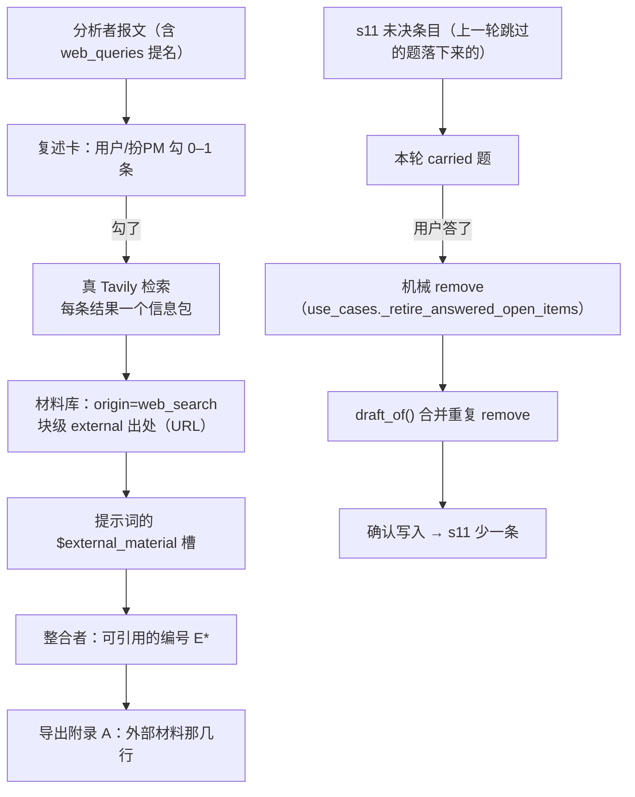

# P33 方案（待拍板）· P32 的两条补验证（+ 一个挡路的坑）

> **这份文档分析的是**：P32（M1）收尾时我**如实写下的两条"没做到"**——
> ① live 上没看到"s11 条目被真的撤下"的收尾；② 联网那条能力在 live 上仍然没被跑到。
> 外加今天早上新冒出来的一个**挡路坑**（M0）。
> **状态**：方案，**一行产品代码没动**；本轮只做了只读走查 + 几次便宜的真模型探测。
> **口径来源**：`02` §11.0.7/§11.0.29（联网两道闸门）· `01` §7（交付）· P30 报告 F31 ·
> P32 的 checkpoint 与 `.codex/runs/2026-10-02/M1验证/`。
> **给执行的 agent**：先写红 → 跑到红 → 再实现 → 再跑绿 → 一任务一提交（中文）；
> **除非测试本身写错（要说明错在哪），不许改测试迁就实现**；`src/` 里不许有假实现。

---

## 0. 先说一件事：我碰了工作库（已复原，可复查）

**我做错了什么**：写 T0 探测脚本（`probe_web_query.py`）时，我以为
`Settings.from_env(default_db=…)` 会给它一个 `/tmp` 的库。**不会**——它只读 `PMSTUDIO_DB`，
`.env` 里那行是**相对路径** `data/pmstudio.db`，而 `Settings.from_env` **不解析相对路径**
（只有 `scripts/dev.py` 会按 `backend/` 解析）。脚本的 CWD 是 `backend/`，于是它
**打开了工作库**（`scripts/eval.py` 是用 `replace(settings, db_path=…)` 显式覆盖才躲开的）。

**现场与复原（都留了证）**：

| 时刻 | 事 |
|---|---|
| 08:08:47 | 探针打开工作库；**主库文件本身没变**（mtime 仍是 `2026-09-28 14:31`、md5 未变），但 SQLite 建了 `-wal` / `-shm`，我的写入落在 WAL 里 |
| 08:11 | 停进程；把三个文件备份到 `.codex/runs/2026-10-03/P32补验证/working-db-forensics/` |
| 08:11 | 对比"含 WAL"与"只有主库"：**WAL 里只有我那一个项目**（`p-c920152b` / "T0 · 联网提名探测"），作者原来的 `p-edc2b350` / "产品文档工作台" 完整地在主库里 |
| 08:12 | 把 `-wal` / `-shm` **移走**（不是删）→ 工作库回到探针前状态；核验：只剩 `pmstudio.db`、只有作者那一个项目、1 个版本 |
| 08:12 | 我又用**只读**打开核验了一次——SQLite 给 WAL 库建 `-shm` 与 0 字节 `-wal`（读操作也会建）。于是再移一次，目录回到只有 `pmstudio.db` |

**结论**：**没有数据损失**，主库 mtime 与内容都没变过；两个侧车文件都在
`working-db-forensics/` 里可复查。**教训写进脚本**：探针改用 `replace(settings, db_path=…)`
并加一道"**拒绝工作库**"的闸（照抄 `eval.py` 的 `resolve_eval_db`）。

---

## 1. M0（挡路坑）：供应商间歇性拒收 `json_schema`

**现象**：今天 08:15 起，`response_format: {"type":"json_schema"}` 被 DashScope 用 **400** 拒掉：
`InternalError.Algo.InvalidParameter: This response_format type is unavailable now`。

**它不是"关停"，是抖动**（时间线，都是实测）：

| 时刻 | 结果 |
|---|---|
| 08:15 | 闸门探测：带参数 400、**不带参数也 400** → 闸门判红且判成"不是参数的事" |
| 08:15 | 直连四种组合：`json_schema` **400**；`json_object` **OK**；不带 `response_format` OK（但内容为空）；带 `enable_thinking:false` OK |
| 08:17 | 四个模型（qwen3.8-27b / qwen3.8-flash / deepseek-v4-pro / glm-5.3）**全都 OK** |
| 08:20 | 同一组合连打 **8 次全过** |
| 08:24 | **又打到一次真实调用**：探针的 `analyze` 200 → `BadRequestError` → **整轮失败** |

**为什么这会挡住 ①②**：网关的 `is_transient()` 只认"连接/超时/限流/5xx"这几类，
`invalid_parameter` 归**不可重试**——所以一次两分钟的抖动 = **一次调用直接判死**
（真跑里就是整轮 502/降级）。今天早上十分钟内命中三次。

**处置（推荐）**：往 `TRANSIENT_HINTS` 加**一条很窄的**标记：
`"response_format type is unavailable"`（按供应商自己的措辞——它写的是 "now"，本来就是"暂时"）。
于是那三次尝试会把这段抖动**骑过去**，而不是当场判死；仍然不改"三次都失败就失败"的语义。

- **不做**：不改成"降级到 `json_object`"——那会动"输出必须过 schema"的契约外壳（虽然我们自己
  每包都校验，但那是另一件事，要单独拍板）；也不放宽 `invalid_parameter` 这个大类。
- **TDD**：`is_transient` 的纯函数用例（真报错原文当 fixture）+ 一次真跑复验。

---

## 2. ① live 收尾：s11 条目被真的撤下

**缺口**：P32 的三层确定性用例都绿（纯函数 / 写入端 / 装配 / 接口），
但**真跑里没看到**"被回答过的 s11 条目在确认写入后真的从文档里消失"这个收尾——
昨天那条车道跑到第 2 轮一半被环境打断（机器夜里休眠，`answers` 那一步墙钟记成 23652 秒）。

**好消息：那条车道可以接着跑，不用从零再来**（都在 `.codex/runs/` 里，没被 `/tmp` 清掉）：

```
项目 p-39c6769a
轮 1 r-727033e1 → done（已确认写入 v2，s11 因此有未决条目）
轮 2 r-a95b58ea → seats_running（`state.json` 里 current_round_id 就是它）
```

**做法**：把 8146 后端按同一个库重新起起来，再用**同一个 run-dir** 跑 `autopm.py`
（它看到 `current_round_id` 会走"续跑"分支 → `advance`，不会把同一份输入当新一轮重跑）。
第 2 轮走到草案卡时，**判据三条**：

1. 草案里出现**机械 `remove`**，且它的 `entry_id` ∈ 轮 1 结束时 s11 的条目 id；
2. `POST /confirm` → 200（不再 422）；
3. 确认之后 **s11 里那批 id 真的没了**（`GET /document` 的 s11 条目 + 导出里那一行都消失）。

**断点**：同一条车道本身就是可续的；万一再被打断，重跑同一命令即可（幂等：有 `current_round_id`
就续、没有就起新一轮）。**库放 `.codex/runs/`**（`/tmp` 被清过一次）。
**兜底**：要是第 2 轮的问卷里压根没出现 carried 题（那就没有可撤的条目），
就补跑第 3 轮（同输入），**如实记"第几轮才触发"**——那本身也是有用的数字。

---

## 3. ② 联网：把那条能力在 live 上跑出来

**缺口**：P30 五条车道 `web_queries` 全空（F31）；昨天 M1 验证那轮也全空。

**先分清"该不该提"**（提示词口径是三层阶梯）：

1. 文档/材料里已有的 → 别提；
2. 用户能回答的（业务口径、取舍、偏好）→ 那是**问他**；
3. **只有外部客观事实**（法规、标准、第三方接口既有做法）才提名；
   并且明确写着"**一条都不需要就给空数组——这是常态**"。

对照两次现场：**同一份 L4 输入**，P20 提名了 1 条（`21 CFR Part 11 …`，`why` 写得像模像样），
P30 提名 0 条。所以这不是"功能坏了"，是**分析者在这份输入上变保守了**（换过模型）。

**做法（两步，先测后跑）**：

- **T0 测量（1 次调用）**：拿一份**明确依赖外部事实**的输入（"电子病历分级评价四级对排班/权限
  的硬性条款"+"国家医保局结算接口的既有规范"）问一次分析者，看它提名不提名。
  *（今天早上试了两回，都被 M0 那段抖动打断；M0 修好后重跑。）*
- **live 取证（1 轮）**：T0 若提名 → 起一条车道，**复述卡上把那一条勾上**
  （`autopm --web` 已经会勾最多 1 条）→ 真 Tavily 去查 → 断言三件事：
  ① 材料库里多出 `origin=web_search` 的材料；② 它的块拿到 `external` 编号；
  ③ 导出里真的引用了它们（附录 A 的"外部材料"那几行）。

**T0 若不提名**：判定属于"提示词太保守"（第 3 层判据该更明确），**另立一批**去改提示词——
它和 M3（矛盾判据退化）是同一个通道（都是"该说的没说"），一起做更省事。**这一批不碰提示词。**

---

## 4. 执行范围

| 组 | 内容 | 动不动产品代码 |
|---|---|---|
| **A · M0** | `litellm_gateway.py` 的 `TRANSIENT_HINTS` 加一条 + 单测 | **动**（一行 + 用例） |
| **B · ①** | 续跑那条被打断的车道 + 一个断言脚本 | 不动 |
| **C · ②** | T0 测量 + 一轮 live 取证 | 不动（除非 T0 判"该提没提"，那时另立） |
| **D · 回写** | checkpoint + 必要时 `04` | 只改文档 |

---

## 5. 逐文件

| 文件 | 改动 |
|---|---|
| `backend/src/pmstudio/infrastructure/llm/litellm_gateway.py` | `TRANSIENT_HINTS` 加 `"response_format type is unavailable"`（**只加这一条**，不放宽 `invalid_parameter` 大类） |
| `backend/tests/infrastructure/llm/test_litellm_gateway.py`（或既有同名文件） | 加用例：**那条真报错原文** → `is_transient` 为真；`invalid_parameter` 的**其它**形态（如"字段名不认识"）仍为假 |
| `.codex/runs/2026-10-03/P32补验证/bin/verify_settled_removal.py` | 新：读那条车道的 `rounds/*.json` + `GET /document`，断言三条判据，输出 `settled.json` |
| `.codex/runs/2026-10-03/P32补验证/probe_web_query.py` | 已有；M0 修好后重跑，结果记进 `probe.log` |

**不动的**：提示词、端点、schema、前端、`Document` 的 `remove` 语义、`replace` 的顺序语义。

---

## 6. 数据流



---

## 7. TDD

| # | 任务 | 红 | 绿 |
|---|---|---|---|
| **T1** | M0：`is_transient` 认那条抖动 | 用真报错原文写用例 → 今天为假（红） | 加 hint 后为真；**其它** `invalid_parameter` 仍为假 |
| **T2** | ① 断言脚本 | 对**昨天的现场**（轮 2 未确认）跑 → 报"还没收尾" | 续跑完 → 三条判据全绿 |
| **T3** | ② T0 测量 | 不作红绿——它是**测量**，输出是数字（提名几条） | 有提名 → 进 live；零提名 → 转"另立提示词批" |
| **T4** | ② live 取证 | 同上，输出是三条断言 | 三条全绿 |

---

## 8. 成功之后长什么样

1. `settled.json`：轮 2 草案里有 `remove`（带 `entry_id`）、confirm 200、s11 少了一条；
2. `probe.log`：分析者对那份输入提名了 N 条（附 `why`）；
3. 那一轮的导出里出现"外部材料"引用，材料库里有 `origin=web_search` 的记录；
4. `is_transient` 的新用例绿、全量测试与 `ruff` 全绿；
5. 工作库 mtime 仍是 `2026-09-28 14:31`（**这一条这次要格外盯**）。

---

## 9. 失败模式

| 失败模式 | 怎么发现 | 处置 |
|---|---|---|
| 断点续跑把同一份输入当新一轮跑 | `autopm` 的 `run_input` 只看 `state.json.current_round_id` | 已经验过它的续跑分支（P28 起就在用） |
| 第 2 轮没有 carried 题 | 轮 2 草案里没有指向 s11 的 `remove` | 补第 3 轮；如实记"第几轮才触发" |
| 联网又被抖断 | 又是那条 `unavailable now` | M0 修好之后它会自己重试 |
| 真跑把工作库碰了 | 收工 `ls` 工作库 mtime | **立刻停**、照 §0 的取证与复原流程走 |
| T0 零提名 | `probe.log` 写着 0 | 不硬凑：转提示词批（与 M3 一起） |

---

## 10. 回写清单

1. `.codex/docs/上下文/checkpoint.md`：加 P33 一节（含 §0 那次事故**如实记**）；
2. `.codex/docs/设计/04-未决.md`：M0 那条若修了，写进 G10 的同一节（"供应商抖动 → 窄口径重试"）；
3. ② 若拿到 live 证据，`04` G10 的 F31 从"没跑到"改成"已跑到（附输入与轮次）"；
4. 报告放 `.codex/runs/2026-10-03/P32补验证/报告.md`。

---

## 11. 待作者拍板

1. **M0 怎么处理**：加一条**窄**的 `TRANSIENT_HINTS`（推荐）／还是降级到 `json_object`（动契约，另案）／
   还是"先不动，等供应商自己好"（那 ①② 今天就别想跑稳）？
2. **①**：接着那条被打断的车道续跑（推荐，最省）——还是另开一条新车道从零跑？
3. **②**：T0 如果判定"该提没提"，是**本批顺手改提示词**，还是**另立一批与 M3 一起**？
   （我推荐后者：提示词是同一通道，混在两批里不好归因。）
4. **顺序**：M0 → ① → ② 可以吗？（M0 是另外两条的前置）

---

## 12. 自审：这份方案哪里可能错

| 疑点 | 核验 | 结论 |
|---|---|---|
| 那条 `400` 到底是"抖动"还是"变更"？ | 08:15 失败、08:17 四个模型全通、08:20 连打 8/8 过 | **抖动**（供应商自己写的是 "unavailable **now**"）；但 08:24 又命中一次，所以**频率不低** |
| 加 hint 会不会把真参数错也重试掉？ | 只加 `"response_format type is unavailable"` 这一串，不放宽 `invalid_parameter` | 不会；另写用例钉"其它 invalid_parameter 仍为假" |
| 续跑会不会把轮 2 跑成第三轮？ | `autopm.run_input`：有 `current_round_id` 就 `advance` | 不会 |
| s11 的条目 id 从哪读？ | 轮 1 快照 `rounds/*.json` 的 s11 提案 + `GET /document` 的 s11 条目 | 两处都有，互相印证 |
| 联网那条 live 一定要 PM 勾吗？ | `submit_opening(web_queries_chosen=…)` 是唯一入口；`autopm --web` 会勾最多 1 条 | 是，必须勾 |
| 工作库那条怎么保证不再犯？ | 探针已改成 `replace(db_path=…)` + 拒绝工作库的闸；跑前跑后都 `ls` 工作库 | 见 §9 的失败模式一条 |

