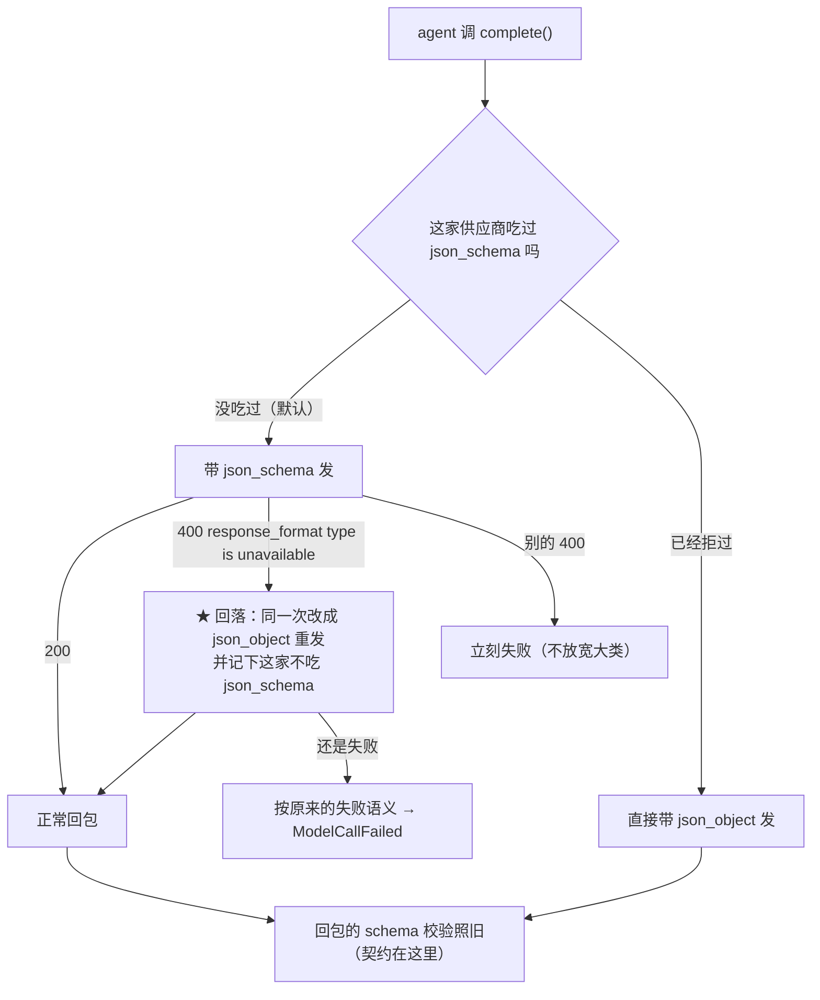

# P34 方案（待拍板）· M2：模型层（抬超时 · `json_schema` 回落 · 整合瘦身**先调研**）

> **这份文档分析的是**：里程碑 `2026-10-02-里程碑-M1到M4-审计遗留四条.md` 的 **M2**。
> 作者拍板：**抬超时**；**M2b 走回落**；**整合瘦身要我先自己调研、做实验，再决定瘦不瘦**。
> **状态**：方案，**一行产品代码没动**；本轮做的是只读走查 + 从真跑库里取数（量已经跑完，见 §4）。
> **口径来源**：`02` §5（模型与留样）·`05`（网关是唯一碰网络的地方）·`04` E3 · P30 报告 §三 F30 ·
> P33 报告（`deepseek-v4.1-flash` 稳定拒收 `json_schema`）。
> **给执行的 agent**：先写红 → 跑到红 → 再实现 → 再跑绿 → 一任务一提交（中文）；
> **除非测试本身写错（要说明错在哪），不许改测试迁就实现**；`src/` 里不许有假实现。

---

## 0. 现状核对（对着代码与真跑数据，逐条带证据）

### 0.1 三个数字（都在一处，改动很小）

| 事 | 现在 | 证据 |
|---|---|---|
| 每次模型调用的墙钟 | `.env`：`PMSTUDIO_MODEL_TIMEOUT=180` | `backend/.env:10` |
| 代码里的默认 | `DEFAULT_MODEL_TIMEOUT = 90.0` | `bootstrap/settings.py:22` |
| 一次业务动作最多几次尝试 | 3 次（退避 1s / 3s） | `litellm_gateway.py::MAX_ATTEMPTS` / `BACKOFF_SECONDS` |

### 0.2 180 秒这道墙今天撞了多少次（真跑数据，`M1验证/m1.db`）

| 类型 | 尝试数 | 平均 | 最慢 | 超时失败 |
|---|---|---|---|---|
| `integration` | 16 | 148.1s | **545.3s** | **7** |
| `seat_review` | 25 | 35.8s | **196.4s** | **1**（181.0s 那条） |
| `claims` | 3 | 29.1s | 55.7s | 0 |
| `opinion_dispositions` | 2 | 1.7s | 2.0s | 0 |

> 读法：`545.3s` 那条是**成功**的，但它的 `duration_ms` 从"整个动作开始"算起——
> 也就是"先超时两次（各 180s）+ 退避，第 3 次才回来"。所以**一次 integration 最坏要等 9 分钟**。
> **注意 `seat_review` 也撞了一次**（181.0s）——它不是只有整合才慢。

### 0.3 慢在哪：**输入几乎恒定，输出决定耗时**

把每一次 integration 的输入/输出/耗时并排（同一轮的四次整合）：

| 输入字符 | 输出字符 | 单次耗时 |
|---|---|---|
| 20,016 | 8,973 | **59.4s** |
| 20,016 | 10,188 | 60.6s |
| 20,016 | 11,489 | 73.2s |
| 20,016 | 13,443 | 82.3s |
| 20,016 | 25,096 | **144.8s** |

**输入稳定在 ~20k 字符，耗时随输出从 9k→25k 从 59s 涨到 145s。**
这一条直接决定 §4 的调研怎么做：**先别急着砍输入**。

### 0.4 输入那 20k 字符是谁占的（拆最大的一份，20,016 字符）

| 段 | 字符 | 占比 | 在哪 |
|---|---|---|---|
| 本次席位轮交回的意见 | 5,805 | 29.0% | **真内容**（席位意见原文） |
| **输出 JSON Schema** | **4,170** | **20.8%** | `integrator.py:171` 的 `json.dumps(schema)` |
| **硬规矩 `$limits`** | **2,669** | **13.3%** | `integrator.py:47` 的 `LIMITS_TEXT`（代码里的字符串表） |
| 本轮主张 | 2,385 | 11.9% | 真内容 |
| 用户已答 | 1,775 | 8.9% | 真内容 |
| 章节槽 / 清单项 / 矛盾 / 本章还差什么 / 功能字段表 | 2,334 | 11.7% | 大多是**固定文案** |
| 其余（文档状态、材料、跳过…） | ~900 | 4.5% | 视轮次而定 |

**能瘦的只有"固定文案"那两块（schema 4.2k + limits 2.7k ≈ 6.8k，占 34%）**；
席位意见/主张/答案是真内容，砍它就是砍信息。

### 0.5 `json_schema` 那条：**能力差异，不是抖动**（P33 已定案）

| 模型 | `response_format: json_schema` | `json_object` |
|---|---|---|
| `openai/deepseek-v4.1-flash`（作者现在用的） | **400 ×2（稳定拒）** `This response_format type is unavailable now` | OK |
| `openai/qwen3.8-27b` | OK（08:15 只拒过一次，随后 8/8 通过） | OK |

产品**每次调用都带 `json_schema`** → 用 v4.1-flash 时**一次都发不出去**。
（P33 已把"短暂拒收"按抖动重试，那条保留；这一批补的是**稳定拒收时的回落**。）

---

## 1. 现在要实现什么

| 组 | Goal | 是不是本批做 |
|---|---|---|
| **M2a** | 把"一次调用的墙钟"从 180 抬到 **300**，让 148–196s 那一档不再撞墙 | **做**（配置 + 模板说明） |
| **M2b** | `json_schema` 被**稳定拒收**时，**回落到 `json_object`** 继续跑，而不是整轮死掉 | **做**（产品改动 + TDD） |
| **M2c** | 整合瘦身：**先调研 + 做实验**，再决定瘦不瘦 | **只做调研**（本批不改提示词） |

**边界**：不碰席位/主张/答案这三块真内容；不改"输出必须过 schema"的契约（校验一直是我们自己的）；
不改 `num_retries=0`（P5c 特意关掉 SDK 内部重试换来的墙钟准确性）；不动前端。

---

## 2. M2a · 抬超时（配置 + 模板说明）

| 改哪 | 现在 | 改成 | 为什么 |
|---|---|---|---|
| `backend/.env`（**作者的文件，本地**） | `PMSTUDIO_MODEL_TIMEOUT=180` | `300` | 实测 integration 单次最慢 148s、`seat_review` 撞过 181s；180 太贴 |
| `backend/.env.example`（进库的模板） | 注释写"90 会撞墙钟，所以本地用 180" | 改成 300，并写清**依据**（上面那张表） | 免得下一个人再拍脑袋 |
| `bootstrap/settings.py` 的 `DEFAULT_MODEL_TIMEOUT` | `90.0` | **不动** | 它是"没配时的兜底"；配置本来就是必填项（缺 key 就起不来）。动它等于悄悄改别人的默认 |

**代价（要说清）**：最坏一次动作 = 3 × 300 + 退避 4 ≈ **15 分钟**才报失败（现在是 9 分钟）。
这是"赌它只是慢、不是死掉"的代价，接受它是因为**实测 545s 那次最后是成功的**。

**退出条件（可测）**：同车道两轮真跑里，`model_calls` 里 **没有 `at 180s` 的那类超时**；
`integration` 的 `max_secs` 落在 300 以内（若仍 >300，说明 300 也不够，回来再谈）。

---

## 3. M2b · `json_schema` 稳定拒收时的回落（产品改动）

### 3.1 逐文件

| 文件 | 改动 |
|---|---|
| `infrastructure/llm/litellm_gateway.py` | ① 把"怎么拼 `response_format`"抽成一个**纯函数** `structured_output_kwargs(schema_name, schema, mode)`；② `complete()` 里捕获那条**明确**的拒收（`"response_format type is unavailable"`），把这一次**改成 `{"type": "json_object"}` 重发**；③ 记住"这家供应商不吃 json_schema"，**同一个网关实例后续调用直接用 `json_object`**（省掉每次先撞一次 400） |
| 不改 | `ModelRequest` / `ModelReply` / `model_calls` 表结构 / 各 agent 的解析与校验 |

**为什么回落不改契约**：`LLM 契约`（`AGENTS.md`）要的是"**输出必须过 schema**"——
那由我们自己的解析与校验强制（`_is_json` + 各 agent 的 pydantic 校验 + 失败重试都在）。
`response_format: json_schema` 只是**让模型少犯错**的助攻，不是契约本身。

### 3.2 数据流（改完之后一次调用长什么样）

### 3.3 TDD（先红 → 再绿）

| # | 用例 | 红是什么样 |
|---|---|---|
| T1 | 供应商回那条 400 → 网关**用 `json_object` 重发并成功**；断言第二次请求的 `response_format.type == "json_object"` | 今天：直接 `ModelCallFailed`，永远到不了第二次 |
| T2 | **别的** 400（如 `enable_thinking` 互斥、`field foo not allowed`）→ **不回落**、立刻失败 | 今天已经是对的（防回归） |
| T3 | 拒过一次之后，**后续调用直接带 `json_object`**（不再先撞 400） | 今天没有这个记忆 |
| T4 | 留样口径不变：回落那一次的第一条是 `ok=0` + 原 error，第二条 `ok=1` | 今天到不了第二条 |

**测试手法**：`monkeypatch` 掉 `acompletion`，把每次收到的 `kwargs["response_format"]` 记下来断言——
不改任何既有断言。

### 3.4 退出条件

`PMSTUDIO_MODEL=openai/deepseek-v4.1-flash` 时，**真跑一轮能走到草案卡**；
且 `qwen3.8-27b`（支持 json_schema 的那个）**行为一个字不变**（它不会触发回落）。

---

## 4. M2c · 整合瘦身：**先调研，不急着改**

### 4.1 已经量到的两件事（就是调研的前半）

1. **耗时跟输出走，不跟输入走**（§0.3）：输入恒定 ~20k，输出 9k→25k 时耗时 59s→145s。
2. **能瘦的只有固定文案**（§0.4）：schema 4.2k + limits 2.7k ≈ 输入的三分之一；
   剩下的三分之二是席位意见/主张/答案是**真内容**，砍不得。

**推论（要被实验证伪）**：瘦输入最多省掉"预填"那一小段；真正的大头是**decode 25k 字符的输出**。

### 4.2 实验设计（一次跑完，约 20 分钟）

| 步 | 做什么 | 判据 |
|---|---|---|
| **E1** | 同一份输入、同一模型，**连跑 3 次现在的提示词**（基线） | 拿到 3 个 (输入, 输出, 耗时) |
| **E2** | 把 `$schema_json` 换成一个**紧凑渲染**（只留字段名 + 类型 + 一句说明），`$limits` 去掉**与 schema 重复**的那几条（比如 `remove` 的 text 可以留空），重跑同样的输入 3 次 | 输入字符应降 ~4–5k |
| **E3** | 比三件事：**耗时**（E2 比 E1 快多少）、**输出长度**、**质量**（proposals 条数 / 引用编号数 / 有没有漏掉必答的互斥题） | 耗时降 <15% 或质量掉 → **不瘦** |

**"质量"的尺子**（不靠印象）：proposals 条数、`evidence_refs` 非空的提案占比、
矛盾题有没有出、`dropped_opinions` 有没有把没采用的都交代。

### 4.3 如果真要动输出那一侧（**本批只记，不拍**）

`LIMITS_TEXT` 里那条"**内容候选一轮最多 60 条**"是输出的闸门。真跑里见过
**25,096 字符**的回包——那是 60 条量级的产物。把它降下来（比如 30）会直接压耗时，
但**那是产品口径**（一轮少写点、多跑一轮），要单独拍板，**不在本批**。

### 4.4 明确不做

- 不为了"快"删掉任何一条**被真跑打出来过**的规矩（P4/P5b/P11/P19/P22–P26 的坑都在那些 bullet 里）；
- 不动 schema 的**语义**（回落与瘦身都不许松校验）；
- 不为了省 token 去砍席位意见——那是内容。

---

## 5. 成功之后长什么样（自检）

1. `.env` 的超时是 300，`.env.example` 的说明与真跑数据对得上；
2. `deepseek-v4.1-flash` 上能跑完一轮（回落生效），`qwen3.8-27b` 上行为不变；
3. 单测覆盖 T1–T4；全量测试与 `ruff` 全绿；
4. 一张**调研结论**：瘦输入值不值（含 E1/E2/E3 的数字）——**值就另立一批，不值就关掉这条**；
5. 工作库 mtime 不动；真跑的库在 `.codex/runs/`。

---

## 6. 失败模式

| 失败模式 | 怎么发现 | 处置 |
|---|---|---|
| 回落把**别的**参数错也吞了 | T2 用例 | 红 → 收紧（只认那一句原文） |
| 回落之后模型吐空（`json_object` 下更容易空回） | 真跑里 `ModelCallFailed: 模型返回了空内容` | 那是既有的失败语义，照旧重试/失败；报告里如实写 |
| 抬到 300 还是撞墙 | `model_calls` 里出现 `at 300s` 的超时 | 回来再拍：换模型 or 压输出 |
| 瘦身把质量弄掉 | E3 的三把尺子 | 不瘦 |
| 又碰工作库 | 跑前跑后 `ls` | 立刻停 + 照 P33 §0 的取证/复原流程走（探针类脚本一律 `replace(db_path=…)` + 拒绝工作库的闸） |

---

## 7. 回写清单

1. `04-未决.md`：M2a 的 180→300（写进 §7 调用上限那一段附近）+ M2b 的回落口径（写进 §5 模型那一带）；
2. `02-编排与数据.md` §5：补一句"供应商不吃 `json_schema` 时回落 `json_object`，契约由本地校验守"；
3. `checkpoint.md`：加 P34 一节（含调研结论）；
4. 调研证据放 `.codex/runs/2026-10-03/M2调研/`。

---

## 8. 待作者拍板

1. **M2a**：`DEFAULT_MODEL_TIMEOUT` 保持 90 不动（推荐）——还是也抬到 300？
2. **M2b**：回落之后**记住这家供应商**（推荐，省掉每次一次 400）——还是每次都先试 `json_schema`？
3. **M2c 的判据**：耗时降幅没到 **15%** 就不瘦（推荐）——还是你另有阈值？

---

## 9. 自审：这份方案哪里可能错

| 疑点 | 核验 | 结论 |
|---|---|---|
| 抬超时会不会把"真死掉"的调用拖成 15 分钟才失败？ | 实测 545.3s 那次**最后成功了**；`num_retries=0` 保证墙钟准确 | 接受这个代价；失败模式里盯"300 仍撞墙" |
| 回落会不会让模型更容易吐空？ | v4.1-flash 的 `json_object` 探测里见过一次空回（那是**没关思考**的裸探测；产品侧带 `enable_thinking:false`） | 真跑里看；空回是既有失败语义，不是新掩盖 |
| 瘦 schema 会不会让模型少输出字段？ | 紧凑版只删**描述**、不删字段名与类型，且校验仍在 | E3 的"质量三把尺"会验 |
| 为什么不直接砍 `$limits`？ | 那些 bullet 每条都对应真跑踩过的坑（P4/P5b/P11/P19/P22–P26） | 只删**与 schema 重复**的，删一条要能指出"这条已被别处兜住" |
| 这次调研会不会白做？ | 若结论是"不值"，那**也是结论**（省下后面几轮改提示词 + 真跑验证的时间） | 不算白做 |
