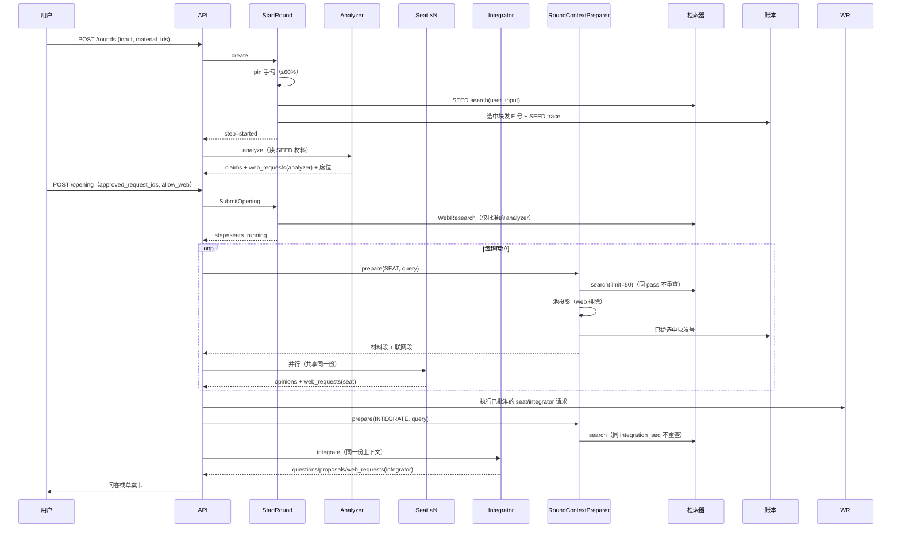
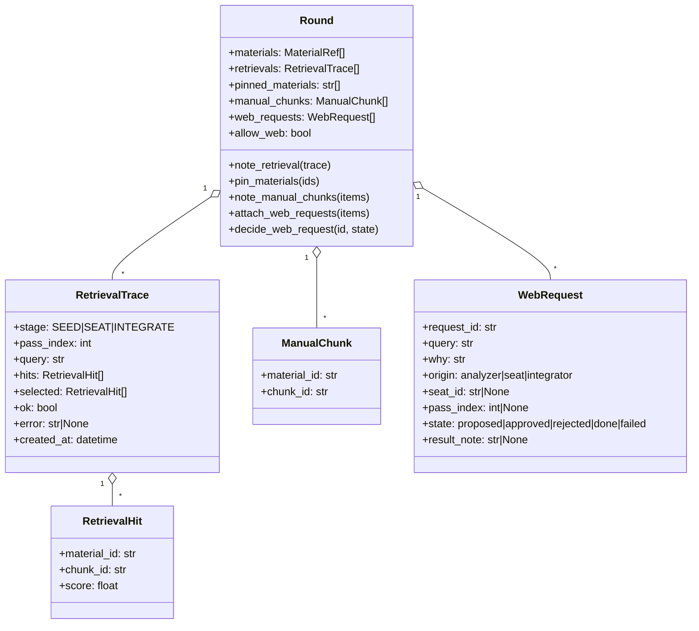

# 检索重构实施计划 v2（P0–P4）· TDD + RIPR

> 2026-10-24 · 上游：`docs/plans/2026-10-24-检索重构-上下文工程.md`
> v2 依据两路独立审查（设计审查 + 契约可行性核对）重写；§11 逐条列出 10 个 Critical 的处置。
> 作者拍板后按 P0→P1/P2（同一发布）→P3a→P3b→P4 执行，一步一提交。

**Goal:** 检索从"搜索框 + 开轮一次"改成"证据池 + 每步投影"；联网从"开轮勾一次"改成"三方申请、人授权、有界研究"；指标从"检索命中"改成"上下文利用率 + 产出采纳"。

**Architecture:** Round 增字段（`retrievals`/`pinned_materials`/`manual_chunks`/`web_requests`/`allow_web`）；新增 `domain/round/retrieval.py`、`domain/round/web.py`、`application/context_pool.py`、`application/round_context.py`、`application/web_research.py`、`infrastructure/tools/research.py`。不新增 DB 表、不新增 SSE 事件名。

**Tech Stack:** Python 3.13 / FastAPI / SQLite / LangGraph / LiteLLM / React 18 + TS strict。

**Spec:** `01` F4/F6/F9/F10/F11；`02` §2/§3/§4.4/§7/§11.0.28/§11.0.29/§11.0.30/§11.0.90/§11.0.91；`03` 主闭环验收；`05` §8/§9；`06` §3/§5；`07` §2/§3。

## Global Constraints

- **E 号在投影时发**：`ledger.record` 只对"本步选中并会进提示词"的块调用；`Round.materials` 仍是"已进过上下文的块"。
- **trace 与材料同事务**：`RetrievalTrace.selected`、`Round.materials`、ledger 一次 UoW 写完。
- **预算**：`MATERIAL_BUDGET=4000`、`SECTION_OVERHEAD`（按新固定行实测重算）、`PINNED_BUDGET_SHARE=0.6`、`MAX_ROUND_RETRIEVALS=3`、`MAX_MANUAL_CHUNKS=10`、`PROJECTION_SLOTS_PER_MATERIAL=2`。新常量必须进 `02 §11.0.90`（表里浮点写 `0.6`，与 `str(0.6)` 一致）。
- **60% 是全局的**：一手勾来源的块（manual/pinned/hits/pool）**合计**不超过 `PINNED_BUDGET_SHARE × usable`；自动段至少 40%。
- **web 材料永不进材料投影**：`origin == "web_search"` 在池、选块、`StartRound.material_ids` 三处都排除；它只走 `render_web_results` + `WEB_BUDGET`。
- **不新增**：图节点（`attach_materials`/`decide_web_request`/`start_research` 三个薄命令除外）、SSE 事件名、DB 表、`DropSource` 枚举值（复用 `MATERIAL_AUTO`/`TOOL`）。
- **测试默认不接线**：新依赖默认 `None`；生产由 `container.py` 接线。
- **老 payload 可读**：新键读侧默认；不写迁移脚本。
- **新文件必须同步 `05-DDD架构.md` §8 目录图**（`test_doc_directory_map.py` 双向守卫）。

---

## 0. 最终形态

```
建轮：pin 手勾材料；手勾来源合计 ≤60% 预算，自动检索拿 ≥40%。
      → Analyzer 看到"手勾 + 自动"的混合上下文（E 号已发）。
复述卡：改主张/席位；勾 Analyzer 的联网申请（= 逐条批准）+ [本轮允许联网] 开关。
每趟席位：
      query = 待跑席位 sections/fields + 阻塞题 + readiness 缺口
      → 检索命中 K 块（只记 trace）
      → 从池投影：manual 硬保 → 手勾 ≤60% → 本步命中 → 其余 2-gram
      → 只给选中块发 E 号；材料段 + 联网段拼成一份上下文
      → 所有席位共享同一份（并行只读）
整合前：同一机制再取一次缺口证据；E 号只在选中时发。
联网：  Analyzer/席位/整合都能申请；allow_web 开 → 下一模型步前自动执行；
      没开 → 闭环区非阻塞卡，点了才查；决策/研究都走同一把轮锁。
搜索框：关键词找人；材料命中「带进本轮」→ pin + manual；下一步投影时发号。
研究：  「研究这个」→ 有界 agentic（search/fetch ≤6 轮/12 调用/5 来源）
      → 来源入库 → 结构化 findings 带 E 号 → 结果视图。
指标：  每步"命中/带进/被引用"从 Round 直接算；bench 的 r5 只做检索器回归。
```

**走样判据（出现任一条即方案错）**：E 号入池时发；席位各查各的；联网变成第 4 次阻塞中断；搜索框又接回 hybrid；web 材料进材料投影。

---

## 1. 架构与数据流

### 1.1 组件图

```mermaid
graph TD
    subgraph API
        R[routes.py<br/>POST /rounds/{id}/materials<br/>POST /rounds/{id}/web-requests/{rid}/decision<br/>POST /rounds/{id}/research]
    end
    subgraph Application
        UC[use_cases.py]
        RC[round_context.py 新<br/>RoundContextPreparer]
        CP[context_pool.py 新<br/>build_stage_query / select_projection]
        WR[web_research.py 新<br/>search_many / execute / research]
        ASM[assembly.py]
    end
    subgraph Domain
        RD[round/round.py<br/>+ retrievals/pinned/manual/web_requests]
        RT[round/retrieval.py 新]
        RW[round/web.py 新]
        LG[provenance/ledger.py]
    end
    subgraph Infrastructure
        SR[SqliteHybridRetriever<br/>只给轮内]
        KR[SqliteFtsRetriever<br/>给 SearchProject]
        TB[ResearchToolbox 新<br/>ToolInvoker]
        TV[Tavily / fetch / parser]
        DB[(SQLite)]
    end
    R --> UC
    UC --> RC
    RC --> CP
    RC --> SR
    RC --> LG
    UC --> WR
    WR --> TB
    TB --> TV
    WR --> DB
    UC --> RD
    RD --> RT
    RD --> RW
    R --> KR
```

### 1.2 一轮时序



### 1.3 Round 增量



---

## 2. P0 · 契约与兼容层（不改行为）

> P0 **只加 3 个字段**（`retrievals`/`pinned_materials`/`manual_chunks`）。`web_requests`/`allow_web` 到 P3a 再加（避免 P0 引用未定义类型）。

### Task 0.1：值对象

**Files:**
- Create: `backend/src/pmstudio/domain/round/retrieval.py`
- Test: `backend/tests/domain/test_round_retrieval.py`

**Produces:** `RetrievalStage`（`SEED|SEAT|INTEGRATE`）、`RetrievalHit`、`ManualChunk`、`RetrievalTrace`。

- [ ] Step 1（R）：写失败测试

```python
def test_a_trace_rejects_duplicate_hits():
    with pytest.raises(ShapeError):
        RetrievalTrace(stage=RetrievalStage.SEAT, pass_index=1, query="q",
                       hits=(hit("m1", "m1#c00"), hit("m1", "m1#c00")), selected=(),
                       ok=True, error=None, created_at=NOW)

def test_selected_may_include_chunks_outside_this_turns_hits():
    # manual 块、上一趟已投影的块都可能被本步选中，但不在本趟 hits 里。
    trace = RetrievalTrace(stage=RetrievalStage.SEAT, pass_index=1, query="q",
                           hits=(), selected=(hit("m1", "m1#c03"),),
                           ok=True, error=None, created_at=NOW)
    assert trace.selected[0].chunk_id == "m1#c03"

def test_a_zero_hit_trace_is_legal():
    assert RetrievalTrace(stage=RetrievalStage.SEAT, pass_index=1, query="q",
                          hits=(), selected=(), ok=True, error=None,
                          created_at=NOW).ok is True

def test_a_manual_chunk_keeps_material_identity():
    item = ManualChunk(material_id="m1", chunk_id="m1#c03")
    assert (item.material_id, item.chunk_id) == ("m1", "m1#c03")
```

- [ ] Step 2：跑红。
- [ ] Step 3：实现 `frozen=True, slots=True`；`stage` 必须是枚举；`pass_index >= 0`；`hits`/`selected` 各自 chunk_id 唯一；`error` 非空 → `ok=False`；`RetrievalHit.score` 对非命中块用 **`0.0` 哨兵**（写进 docstring）。
- [ ] Step 4：跑绿；`ruff`。
- [ ] Step 5：提交 `feat(round): 检索 trace 与手动带料值对象`。

### Task 0.2：Round 字段 + 序列化

**Files:**
- Modify: `backend/src/pmstudio/domain/round/round.py`（`__init__` 约 211-310、属性/方法区）
- Modify: `backend/src/pmstudio/infrastructure/sqlite/serialization.py:657-893`
- Test: `backend/tests/domain/test_round_retrieval.py`、`backend/tests/infrastructure/test_sqlite_repositories.py`

**Produces:** `Round.retrievals/pinned_materials/manual_chunks`；`note_retrieval/has_retrieval/pin_materials/note_manual_chunks`。

- [ ] Step 1（R）：老 payload 兼容 + 往返

```python
def test_an_old_payload_without_new_keys_still_loads(old_payload):
    r = round_from_payload(old_payload, ...)
    assert r.retrievals == () and r.pinned_materials == () and r.manual_chunks == ()

def test_new_fields_round_trip(round_with_traces):
    again = round_from_payload(round_to_payload(round_with_traces), ...)
    assert again.retrievals == round_with_traces.retrievals
    assert again.pinned_materials == round_with_traces.pinned_materials
    assert again.manual_chunks == round_with_traces.manual_chunks
```

- [ ] Step 2（I）：幂等与顺序

```python
def test_pin_materials_dedupes_and_preserves_order():
    r.pin_materials(["m2", "m1", "m2"])
    assert r.pinned_materials == ("m2", "m1")

def test_note_manual_chunks_dedupes_by_pair():
    r.note_manual_chunks([ManualChunk("m1", "m1#c03")] * 2)
    assert len(r.manual_chunks) == 1

def test_has_retrieval_matches_stage_and_pass():
    assert r.has_retrieval(RetrievalStage.SEAT, 1) is True
    assert r.has_retrieval(RetrievalStage.SEAT, 2) is False
```

- [ ] Step 3：实现字段默认空；序列化写 3 键、读侧 `.get(...) or ()`；`note_retrieval` 只追加。
- [ ] Step 4：跑绿；跑 `test_round_materials.py` + `test_sqlite_repositories.py`。
- [ ] Step 5：提交 `feat(round): 证据池/手勾/手动带料字段`。

### Task 0.3：DTO 投影

**Files:**
- Modify: `backend/src/pmstudio/application/dto.py`（`RoundView` 构造处、`SearchHitView` 约 546-564）
- Test: `backend/tests/application/test_dto.py`

**Produces:** `RetrievalView`（`stage/pass_index/query/hit_count/selected_count/chunk_ids/ok/error/created_at`）、`RoundView.retrievals`、`RoundView.pinned_materials`、`SearchHitView.material_id/chunk_id`。

- [ ] Step 1（R）：老 Round 投影为空；`created_at` 有值；材料命中带身份。
- [ ] Step 2：实现 `retrieval_view(trace)` 纯函数。
- [ ] Step 3：跑绿；OpenAPI 不红（全部可选）。
- [ ] Step 4：提交 `feat(dto): 检索投影`。

### Task 0.4：观测（日志）

**Files:**
- Modify: `backend/src/pmstudio/application/use_cases.py`（`_pick_materials` 检索后）
- Modify: `backend/src/pmstudio/application/use_cases.py`（`SearchProject` 检索后）
- Modify: `backend/scripts/collect_search_samples.py:33-83`
- Test: `backend/tests/application/test_search_observation.py`（**Create**）

**关键**：`tests/application/test_search_materials.py:78-88` 现在断言"SearchProject 不许打 `material_search` 日志"。本任务**有意改这条契约**：SearchProject 打 `caller=search stage=lookup`，用例层与检索器各记一行但**不重复分解**（分解仍只在 hybrid）。

- [ ] Step 1（R）：旧行（无 caller）与新行都能解析；去重键 `(project, query, caller, stage, seat)`。
- [ ] Step 2（I）：`_pick_materials` 打 `caller=round stage=seed`；`SearchProject` 打 `caller=search stage=lookup`；失败时 `ok=False`。
- [ ] Step 3：改 `test_search_materials.py` 的旧断言为"必须有 caller=search，且不得出现 fts/vec 分解"。
- [ ] Step 4：跑绿。
- [ ] Step 5：提交 `feat(obs): 检索调用带 caller/stage`。

### Task 0.5：文档纠偏

- [ ] 修 `02 §11.0.89`（零命中观测位置）、§11.0.91 末两条"不做"；修 `materials.py:649-650` 过期注释；同步 `04` R8。
- [ ] 提交 `docs: 检索观测与设计口径纠偏`。

---

## 3. P1 · 搜索去 RAG + 带进本轮

> **发布口径**：P1 的"带进本轮"按钮在 P2 投影上线前**不暴露**（前端 feature flag `attachToRound`）。P1 单独可交付的是"搜索不再走 RAG"；按钮与 P2 同一发布，否则用户点了不会进提示词。

### Task 1.1：SearchProject 换关键词检索

**Files:**
- Modify: `backend/src/pmstudio/bootstrap/container.py:739-741`
- Modify: `backend/src/pmstudio/application/ports.py:189-207`（只改 docstring）
- Test: `backend/tests/infrastructure/test_sqlite_material_search_fts.py`、`backend/tests/application/test_search_materials.py`

**为什么只改接线**：`SqliteFtsRetriever` 已实现同一协议（`materials.py:412-468`），无 embedding/融合。

- [ ] Step 1（R）：直接对 `SqliteFtsRetriever` 写隔离测试：注入一个 `embed_many` 必抛的假 embedder，搜索仍返回词面命中。

```python
def test_fts_only_search_never_touches_embeddings(connection):
    retriever = SqliteFtsRetriever(connection)  # 构造里没有 embedder
    hits = retriever.search(project_id=PROJECT, query="导出", owner=OWNER)
    assert hits and hits[0].score >= hits[-1].score
```

- [ ] Step 2（I）：`search_lookup = SqliteFtsRetriever(connection)`；`SearchProject(materials=search_lookup)`；`StartRound` 仍拿 `material_search`。
- [ ] Step 3（P）：真 SQLite + 真 FTS 索引 + 真上传；`GET /search` 命中标题/正文。
- [ ] Step 4（R2）：5 类结果顺序不变；材料最多 2 行。
- [ ] Step 5：提交 `refactor(search): 全局搜索改关键词，不再走 RAG`。

### Task 1.2：搜索结果带身份

- [ ] `SearchHitView.material_id/chunk_id`（`chunk_id` 与 `ref` 同值；注释写明 `ref` 是旧名、计划删除版本）。
- [ ] 测试：只有材料命中非空。
- [ ] 提交 `feat(search): 材料命中带身份`。

### Task 1.3：AttachMaterials

**Files:**
- Modify: `domain/round/round.py`（方法已在 0.2）
- Modify: `application/use_cases.py`（新增 `AttachMaterials`）
- Modify: `application/commands.py`（`material_id: str = ""`、`chunk_ids: tuple[str,...] = ()`、`kind="attach_materials"`）
- Modify: `infrastructure/graph/graph.py`（`COMMAND_ROUTES`、`RoundRunner.__init__`、`node_attach_materials`、`build_graph`）
- Modify: `api/routes.py`、`api/schemas.py`、`api/app.py`（`ApiServices`）、`bootstrap/container.py`
- Modify: `application/errors.py` + `api/errors.py`（`RoundNotAttachable` → 409；`web_material_not_attachable` → 422）
- Modify: `tests/architecture/test_graph_state.py`（`RoundCommand` 字段是精确集合）
- Modify: `tests/support/harness.py`（`attach_materials` 辅助）
- Test: `backend/tests/application/test_attach_materials.py`（Create）、`backend/tests/api/test_routes.py`

**契约：**
- `POST /api/rounds/{round_id}/materials` body `{material_id: str, chunk_ids: [str]}` → `RoundView`。
- 只接受 `step ∈ {started, claims_ready, seats_running, awaiting_answers}`；其余 409。
- 材料存在、同项目、同 owner、`origin != web_search`；空/越界/超 10 块 → 422。
- 已在 `materials` 或 `manual_chunks` → 幂等。
- **不发 E 号**；只 pin + `manual_chunks`。
- 与 `RoundRunner` 同锁：跑动中 → 409 `round_busy`。

- [ ] Step 1（R）：API 形状 + 409/422 + 幂等。
- [ ] Step 2（I）：pin + manual + 不发号。
- [ ] Step 3（P）：真 SQLite；`RoundView.pinned_materials/manual_chunks` 可见；下一次 prepare 发号（P2 用例）。
- [ ] Step 4（R2）：`StartRound` 行为不变；`sim_inquiry` 路由不变。
- [ ] Step 5：提交 `feat(round): 带进本轮`。

### Task 1.4：前端搜索行（feature flag）

**Files:**
- Modify: `frontend/src/api/types.ts:628-639`、`api/client.ts:419-423`、`api/payload.ts:345-356`
- Modify: `frontend/src/components/SearchBox.tsx:85-101`、`TopBar.tsx:66-72,140`、`App.tsx:259-301,514-524`
- Modify: `frontend/src/state/useWorkspaceData.ts:648-674,930-970`
- Test: `payload.test.ts:510-529`、`SearchBox.test.tsx`

**纯函数契约：**

```ts
export type SearchHitAction =
  | { visible: false }
  | { visible: true; enabled: false; label: string; reason: string }
  | { visible: true; enabled: true; label: "带进本轮" };

export function searchHitAction(
  hit: SearchHitView, round: RoundView | null, historical: boolean,
  featureEnabled: boolean,
): SearchHitAction
```

规则：非材料/无当前轮/历史轮/flag 关 → hidden；`awaiting_confirm|done|failed|abandoned` → disabled；已在 `materials` 或 `manual_chunks` → disabled "已在本轮"；`web_search` → disabled "请用研究入口"；否则 enabled。

- [ ] Step 1：纯函数用例逐条。
- [ ] Step 2：`SearchBox` 行结构 `<li><button role="option" 主/><button 次/></li>`；主按钮保留 `aria-activedescendant`/Enter/Esc，次按钮是普通 Tab 焦点（不参与 listbox 的 option 计数）；测试键盘。
- [ ] Step 3：`App.addSearchHitToRound`；成功靠返回的 RoundView 刷新。
- [ ] Step 4：`tsc + vitest`。
- [ ] Step 5：提交 `feat(ui): 搜索命中带进本轮（flag）`。

### Task 1.5：端点契约

- [ ] `EXPECTED_PATHS` 加 `/api/rounds/{round_id}/materials`（P3 再加 decision/research）。
- [ ] `test_route_identity.py`：新路由必须带 `CurrentUser`。
- [ ] 文档：`02 §11.0.27`、`06 §5`。
- [ ] 提交 `docs+test: 搜索与带料契约`。

---

## 4. P2 · 证据池 + 每步投影（核心）

### Task 2.0：删/重解析守卫纳入 pin/manual

**Files:**
- Modify: `backend/src/pmstudio/infrastructure/sqlite/repositories.py:626-663`（`material_references`）
- Test: `backend/tests/infrastructure/test_material_references.py`（Create/扩展）

**为什么**：`material_references` 只扫 `rounds.payload.materials[]`；一个 attach 了但还没投影的块没有 E 号 → 用户能删/就地重解析它，下一次投影拿到缺失包/旧 chunk_id。

- [ ] Step 1（R）：pin 了但未投影的材料，`material_references` 返回"被引用"（用一个哨兵，如 `("pinned",)`；或返回空但另加 `pinned_refs`——**选哨兵**，调用方只判"非空"）。
- [ ] Step 2（I）：`manual_chunks` 同样计入。
- [ ] Step 3（P）：真 SQLite + 真 `DeleteMaterial` → 409；`ReparseMaterial` → 409。
- [ ] Step 4：提交 `fix(materials): pin/manual 也算引用`。

### Task 2.1：stage query 构造

**Files:** Create `backend/src/pmstudio/application/context_pool.py`；Test `tests/application/test_context_pool.py`。

**Produces:** `build_stage_query(stage, *, round_, seats, readiness) -> str`。

- `SEAT`：`pending_seats` 的 `focus/sections/fields` + `blocking` 题 `title/target.label()` + readiness `title/detail`；去重、按出现顺序、截 300 字。
- `INTEGRATE`：readiness（blocker 优先）+ `deferred` 题面 + `contradictions.why` + **未被本趟席位意见引用**的 claim 文本（用 `round_.current_reviews`，不是"未被提案引用"——提案这时还不存在）。
- 空输入 → `""`。

- [ ] Step 1（R）：返回 str；空输入 `""`；同输入两次逐字相同。
- [ ] Step 2（I）：SEAT 含"权限"与阻塞题关键词；INTEGRATE 含 readiness detail；不含 `user_input` 全文。
- [ ] Step 3：提交 `feat(context): stage query 构造`。

### Task 2.2：投影选择

**Files:** Modify `context_pool.py`；Test `test_context_pool.py`。

**Produces:**

```python
@dataclass(frozen=True, slots=True)
class Selection:
    chunks: tuple[tuple[str, MaterialChunk], ...]
    hit_count: int
    used: int
    skipped_manual: tuple[str, ...]

def select_projection(
    *, packets: Mapping[str, MaterialPacket],
    pool: Mapping[str, frozenset[str]],
    pinned: frozenset[str],
    manual: Sequence[ManualChunk],
    stage_hits: Sequence[RetrievalHit],
    query: str,
    budget: int = MATERIAL_BUDGET,
    section_overhead: int = SECTION_OVERHEAD,
    pinned_share: float = PINNED_BUDGET_SHARE,
) -> Selection
```

选块顺序：
1. **manual**：先装；装不下 → `skipped_manual`。
2. **pinned**：按 query 的 2-gram 排序。
3. **stage_hits**：按 score 降序；每材料最多 `PROJECTION_SLOTS_PER_MATERIAL`。
4. **pool rest**：按 2-gram；每材料同槽上限。
- **60% 是全局的**：任何 `material_id ∈ pinned` 的块（无论从哪一步被选中）都计入 `pinned_used`；超过 `pinned_share × usable` 就跳过。这样"手勾在 hits/pool 阶段再吃回来"被堵住。
- 成本用 `material_block_cost(..., first_of_material=...)`；`used` 是预估值，**最终以渲染后 `len(text)` 断言 ≤ budget**。
- `PROJECTION_SLOTS_PER_MATERIAL=2` 定义在 **application**（`context_pool.py` 或 `context.py`），不 import infrastructure 的 `_MATERIAL_SLOTS`；两者概念不同（检索结果多样性 vs 每步上下文深度），各自登记。

- [ ] Step 1（R）：返回 `Selection`；确定性。
- [ ] Step 2（I）：`test_pinned_total_never_exceeds_share`（含 hits/pool 阶段选中的 pinned 块）、`test_manual_is_first`、`test_stage_hits_before_pool_rest`、`test_duplicate_chunks_once`、`test_pdf_parent_cost`、`test_rendered_text_is_under_budget`（渲染后断言）、`test_skipped_manual_is_reported`。
- [ ] Step 3（P）：真 PDF 同页兄弟块 → 渲染字数 ≤ 4000。
- [ ] Step 4：提交 `feat(context): 投影选块（全局 60% + manual 硬保）`。

### Task 2.3：RoundContextPreparer

**Files:** Create `backend/src/pmstudio/application/round_context.py`；Test `tests/application/test_round_context.py`（Create）。

**Produces:**

```python
@dataclass(frozen=True, slots=True)
class PreparedContext:
    text: str
    hit_count: int
    selected_count: int
    pool_count: int
    skipped_manual: tuple[str, ...]

class RoundContextPreparer:
    def __init__(self, *, rounds, round_writer, evidence, evidence_writer,
                 materials, retriever, uow, clock): ...
    def prepare(self, *, round_id: RoundId, stage: RetrievalStage,
                query: str) -> PreparedContext: ...
```

行为：
1. 读 round；`pass_index = seat_round_count`（SEAT）/ `integration_seq`（INTEGRATE）。
2. 若 `has_retrieval(stage, pass_index)` → 用 trace.selected 渲染（不重查、不发新号）。
3. 否则：若本轮非 SEED trace 数 ≥ `MAX_ROUND_RETRIEVALS` → **不检索**，只从池投影（trace 记 `ok=True, hits=(), error="已达本轮检索上限"`? 不——零命中不写假 trace；直接不新增 trace，日志说明）。
4. `hits = retriever.search(limit=SEARCH_LIMIT)`（query 空 → `()`；异常 → `ok=False`，仍从池投影）。
5. 建池：所有 trace hits ∪ materials ∪ manual ∪ **所有 pinned 材料的全部块**；**排除 `origin == web_search`**（加载 packet 后过滤）。
6. `select_projection`；对 selected 中不在 materials 的块 `ledger.record`；一个 UoW 写 `Round.materials` + `note_retrieval(selected=...)` + ledger。
7. 渲染：`render_materials(只含选中块)` + **`render_web_results`（本轮的 web 材料，原样）**；两段拼接，各自预算。`PreparedContext.text` 含材料段的"本步 K / 池 N"头。
8. `skipped_manual` → `Round.dropped`（`TOOL`，reason="手动带进的块因预算没进本步"）。
9. 材料缺失 → skip + `Round.dropped`，不抛。

- [ ] Step 1（R）：返回形状；trace 落库；`created_at` 有值。
- [ ] Step 2（I）：同 stage/pass 不重查；零命中写 trace；E 号只给 selected；已有材料复用 E 号；检索失败回退 + ok=False；manual 先选；超 3 次不检索；web 永不进材料投影；missing 材料留痕。
- [ ] Step 3（P）：真 SQLite + 真 hybrid + 真 ledger；第二次 prepare 零新增 E 号；web 段仍出现。
- [ ] Step 4（R2）：老轮无 trace 时从 materials 投影；sim agents 不受影响。
- [ ] Step 5：提交 `feat(context): 每步投影与发号（幂等）`。

### Task 2.4：SEED 的 60% + trace + pin

**Files:** Modify `use_cases.py:435-640`；Test `test_round_materials_convergence.py`、`test_web_search_round.py`。

- [ ] Step 1（R）：`_Picked` 加 `hits` + `error`；`create` 写 SEED trace（`selected` 用 `RetrievalHit`，score 用命中分；手勾块若无命中分则 `0.0`）；`round_.pin_materials(material_ids)`。
- [ ] Step 2（I）：第一段预算 `int(MATERIAL_BUDGET * PINNED_BUDGET_SHARE)`；`remaining` 仍 4000-used-overhead；长材料自动段 ≥1000；短材料照旧；web_search 仍排除；`missed` 只数手勾；检索失败 trace `ok=False`。
- [ ] Step 3（P）：真 SQLite + 真检索器；SEED trace 有 hits；E 号只覆盖 selected。
- [ ] Step 4（R2）：更新 `test_round_material_convergence.py`、`test_web_search_round.py` 的**精确材料/E 号断言**（列在任务里，不留给执行者猜）。
- [ ] Step 5：提交 `fix(retrieval): 手勾最多 60%，自动段不再饿死`。

### Task 2.5：席位轮接入

**Files:** Modify `use_cases.py:1254-1360`、`container.py:414-423`、`tests/support/harness.py:672-691`；Test `test_round_context.py`、`tests/e2e/test_round_context_pool_e2e.py`（Create）。

接线：
- `RunSeatRound.__init__` 加 `preparer: RoundContextPreparer | None = None`。
- `__call__`：算出 `pending` 后，若 `preparer and pending`：
  ```python
  prepared = self._preparer.prepare(round_id=round_id, stage=RetrievalStage.SEAT,
                                    query=build_stage_query(...))
  round_ = self._rounds.get(round_id)
  ledger = self._evidence.get(round_.project_id)   # ← 必须重读：新 E 号在刚写的账本里
  external_material = prepared.text
  # known_eids 用新 ledger 重算
  ```
- `pending` 空 → 不检索，沿用 `external_material_text`。

- [ ] Step 1（I）：一趟一次；pending 空不查；同 pass 重入不查；所有席位同一份文本；**prepare 后新 E 号在 `known_eids` 里**（反例：不重读 ledger 会被过滤）。
- [ ] Step 2（P）：真 SQLite + 真 hybrid + 真 harness；`len(retrievals)` +1；预算不红。
- [ ] Step 3（R2）：`preparer=None` 时逐字与改前相同。
- [ ] Step 4：提交 `feat(seat): 每趟席位轮按需取证据`。

### Task 2.6：整合接入

**Files:** Modify `use_cases.py:2069-2140, 2517-2635`、`container.py:431-451`；Test `test_round_context.py`、`tests/e2e/test_integrate_retrieval.py`（Create）。

- [ ] `IntegrateRound.__init__` 加 `preparer`；`_integrate_with_repair` 在 `while` 前调用一次；`while` 内重试用同一份；`integration_seq` 幂等；prepare 后重读 ledger。
- [ ] 测试：一次整合一次；重装/补交代不重查；e2e 失败→重试 trace 仍 1 条。
- [ ] 提交 `feat(integrate): 整合前按缺口取证据`。

### Task 2.7：提示词、K/N 头、预算表

**Files:** `harness/prompts/seat_review.md:40-42`、`integrator.md:101-103`、`application/context_pool.py`（K/N 头）、`02 §11.0.90`；Test `test_limits.py`、`test_prompt_slot_order.py`。

- [ ] 材料节标题：`## 本轮的外部材料（本步从证据池带了 K 块 / 共 N 块；不是用户说的话）`；K/N 来自 `PreparedContext`。
- [ ] `SECTION_OVERHEAD` 按新固定行**实测重算**（不拍脑袋）；测试渲染后 len ≤ 4000。
- [ ] 登记表加 `PINNED_BUDGET_SHARE=0.6`、`MAX_ROUND_RETRIEVALS=3`、`MAX_MANUAL_CHUNKS=10`、`PROJECTION_SLOTS_PER_MATERIAL=2`；**不新增 `MAX_WEB_REQUESTS`**（复用 `MAX_WEB_QUERIES`）。
- [ ] 提交 `feat(prompt): 材料节写清本步带了哪几块`。

### Task 2.7b：模拟 agent 的材料节预算安全

**为什么**：主链路改投影后 `Round.materials` 跨步增长；`external_material_text` 目前把全部 materials 交给 `render_materials`，无预算。`sim_inquiry/sim_review` 的提示词会涨。

- [ ] `external_material_text(round_, store=..., query="")`：传 query 时先按 `round_.materials` 过滤 packet，再 `select_chunks` 到 `MATERIAL_BUDGET`；不传时逐字不变。
- [ ] sim 两个用例传自己的 topic。
- [ ] 测试：渲染 ≤4000；不传 query 的旧行为不变。
- [ ] 提交 `fix(context): 模拟 agent 材料节有预算`。

### Task 2.8：前端显示本步检索

**Files:** Create `components/RoundRetrieval.tsx`；Modify `types.ts:75-87,178-238`、`LoopPane.tsx:89-186`、`SeatPacketCard.tsx:60-66`、`RoundMaterials.tsx:15-43`；Test 新增/扩展。

- [ ] `RetrievalView` 渲染 stage/query/命中/带进/失败；`chunk_ids` 可跳。
- [ ] 纯函数：`retrievalForPacket(round, packet)`（按 `seat_id`/`pass_index` 找本包那一条）+ 单测；组件不过滤。
- [ ] `RoundMaterials` 徽标：用 `retrievals.selected` 与 `RoundView.pinned_materials` 算 manual/auto/pinned；纯函数 + 单测。
- [ ] `round.updated` **直接置 `roundStale: true`**，不新增 `retrieval_seq`/`web_request_seq`（避免事件契约与 `useEvents.test.ts` 的 payload 守卫）。
- [ ] `tsc + vitest`；提交 `feat(ui): 闭环区显示本步检索`。

### Task 2.9：e2e + 文档

- [ ] e2e 真 SQLite + 真 hybrid + 真用例：seed 60%、seat 1 条、integrate 1 条、E 号只给 selected、渲染 p100 ≤4000、恢复不重查、web 段仍在。
- [ ] `02` 新增 §11.0.92；`03` 加验收；`05` 目录图加 3 个新文件（**本 phase 就加，不等到最后**）。
- [ ] 提交 `test(e2e)+docs: 证据池与每步投影`。

---

## 5. P3a · 统一联网申请

> 三方统一。**`WebRequest` 在 P3a 才引入**；P0 不提前。

### Task 3.1：WebRequest + Round

**Files:** Create `domain/round/web.py`；Modify `round.py`、`serialization.py`、`dto.py`；Test `tests/domain/test_round_web_requests.py`（Create）。

- [ ] 字段/状态机；`request_id` 由**用例层**生成（`w{seq}`），不让模型填。
- [ ] 老 payload：`web_queries` + `web_queries_chosen` → `WebRequest(origin=analyzer)`；**只有存在 web 材料时才标 `done`，否则 `proposed`**（不谎报成功）。
- [ ] `attach_web_requests` 去重（同 query）+ 上限 `MAX_WEB_QUERIES=3`（复用，不新增常量）；超出丢条 + `Round.dropped`（`TOOL`）。
- [ ] `Round.submit_opening(..., allow_web: bool = False, approved_request_ids: tuple[str,...] = ())`。
- [ ] `RoundView.web_queries` 保留为派生字段（从 analyzer 请求投影），前端切完再删（另起一刀）。
- [ ] 提交 `feat(round): 统一联网申请`。

### Task 3.2：三方报文与穿透

**Files:** `agents/schemas.py`（`SeatPacket.web_requests`、`IntegrationPacket.web_requests`；复用 `WebQueryDraft`）、`agents/seat.py`（`SeatOutcome.web_requests`）、`agents/integrator.py`（`IntegrationOutcome.web_requests`）、`agents/analyzer.py`（`Analysis.web_requests`）、`use_cases.py:803,1594,1683,2116,2584`、**提示词** `analyzer.md:66`/`seat_review.md`/`integrator.md`（教模型何时申请）；Test `test_agent_schemas.py`。

- [ ] 链路：`schema → outcome → Round.attach_web_requests`，每一站都有字段；**只加 schema 会静默丢**。
- [ ] 席位：`_review_one` 的 UoW 里 `round_.attach_web_requests(...)`（与 `attest` 同事务）。
- [ ] 整合：`IntegrationResult.web_requests` → `IntegrateRound.__call__` 最终 UoW。
- [ ] Analyzer：`Analysis.web_requests` → `StartRound.analyze` 的 UoW。
- [ ] 测试：三方各一条真报文；字段不漏；提示词含"什么时候申请"。
- [ ] 提交 `feat(agents): 三方都能申请联网`。

### Task 3.3：执行与授权

**Files:** Create `application/web_research.py`（搬 `SubmitOpening._search/_search_one/_keep/_checked_queries/_record_tool_call`）；Modify `use_cases.py`、`api/routes.py`、`api/schemas.py`、`api/app.py`、`commands.py`、`graph.py`、`container.py`；Test `test_web_requests_flow.py`（Create）。

执行点（写死）：
- Analyzer：`SubmitOpening` 执行 `approved_request_ids`（老 `web_queries` 字符串按 query 匹配）。
- 席位/整合：`IntegrateRound` 在 `prepare(INTEGRATE)` **之前**执行所有 `state=approved` 的请求（不分 origin）；`allow_web=True` 时，`state=proposed` 的 seat/integrator 请求先自动批准再执行。
- 整合者**本轮**提的请求不执行（它刚提）；下一趟整合/下一轮生效。
- 用户决策：`POST /rounds/{id}/web-requests/{rid}/decision`，**走 `RoundRunner`**（新命令 `decide_web_request`），网络在 UoW 外、落库一次 UoW。
- 失败：`state=failed` + `result_note`，`Round.dropped`（`TOOL`），不判死整轮。
- 上限：`MAX_WEB_QUERIES=3`/轮（analyzer + seat + integrator 共享；超出丢条留痕）。

- [ ] Step 1（R）：端点/命令字段/状态机；老载荷兼容；`allow_web`/`approved_request_ids` 从 `OpeningRequest` → `RoundCommand` → `node_opening` → `submit_opening` 全链通。
- [ ] Step 2（I）：未授权不执行；超 3 条截断；一条结果一个 E 号；失败留痕；integrator 的请求在下一趟能执行。
- [ ] Step 3（P）：真 SQLite + 替身 Tavily；`RoundView` 反映状态；下一步投影能看到。
- [ ] Step 4（R2）：`SubmitOpening` 既有联网测试全绿（搬家不改行为）。
- [ ] Step 5：提交 `feat(web): 申请-授权-执行`。

### Task 3.4：前端

**Files:** `OpeningCard.tsx:199-241`、新建 `WebRequestCard.tsx`、`LoopPane.tsx`、`progress.ts`、`types.ts`、`client.ts`、`payload.ts`；Test `OpeningCard.test.tsx`、`WebRequestCard.test.tsx`、`progress.test.ts`、`useEvents.test.ts`。

- [ ] 复述卡：逐条勾 = `approved_request_ids`；`allow_web` 开关（默认关）。
- [ ] 闭环区：seat/integrator 的 proposed 请求卡；纯函数 `webRequestAction(request, round, busy)`；不新增 `waiting_on`，不加 `canResume` 分支。
- [ ] `round.updated` 只推进进度 + 置 stale；**不加 seq**。
- [ ] `tsc + vitest`；提交 `feat(ui): 联网申请与授权`。

---

## 6. P3b · 有界 agentic 研究

### Task 4.1：研究工具

**Files:** Create `infrastructure/tools/research.py`；Test `tests/infrastructure/test_research_tools.py`（Create）。

**Produces:** `ResearchToolbox(search, fetcher, parser)` 实现 `ToolInvoker`；`ToolSpec`：`web_search(query, max_results)`、`fetch_url(url)`；`invoke` 返回字符串，**同时**把 `(url, title, text)` 记进 `toolbox.sources`。

约束：
- **每次研究新建** toolbox（单例会跨轮累积）；`sources` 只记成功、URL 去重。
- `fetch_url` 注入 `MaterialParser`（`Fetcher` 只给 bytes）；正文按 `MAX_MATERIAL_CHARS` 截断并写明。
- 第 6 个来源在 `invoke` 层直接 `ToolCallFailed("来源已达上限")`，不等 loop 结束再截（模型能看见）。

- [ ] Step 1（R）：工具名/schema；未知工具失败；per-run 生命周期。
- [ ] Step 2（I）：search 调 Tavily；fetch 解析文本；URL 去重；≤5；超限报错；正文截断。
- [ ] Step 3（P）：真 Tavily/本地 HTTP 夹具。
- [ ] Step 4：提交 `feat(research): 研究工具`。

### Task 4.2：研究用例 + 综合

**Files:** Modify `application/web_research.py`（**不新建 `research.py`**，避免两个名字）；Create `harness/prompts/research_synthesis.md`；Modify `agents/schemas.py`（`ResearchPacket`）、`agents/definitions.py`、`use_cases.py`（`StartWebResearch`）、`domain/exploration/exploration.py`（`ExplorationKind.WEB_RESEARCH` + `findings`/`sources`）、`serialization.py`、`dto.py`、`api/routes.py`/`schemas.py`；Test `test_web_research.py`（Create）。

**应用层不得 import infrastructure**：定义 `ResearchInvoker` 协议（`invoke` + `sources`）在 `application/ports.py`；`ResearchToolbox` 在 container 构造并注入。

流程（写死）：
1. `run_tool_loop(gateway, invoker, specs, messages, purpose="web_research")`。
2. 读 `invoker.sources`；URL 去重；≤5。
3. **先在内存账本上 `ledger.record`**（不 save）；拿到 E 号 → 来源清单 `[E12] 标题 URL`。
4. 结构化综合：`ResearchPacket{findings:[{text, refs:[EID]}], open_questions:[str]}`；refs 机械过滤到本次来源 E 集合；空 findings 合法。
5. **一个 UoW**：保存 materials + ledger + `Exploration(kind=web_research, findings, sources)`；失败则丢弃内存账本，来源材料可留在材料库但**没有 E 号**，exploration 记 failed。
6. 当前轮若开放（`step ∈ {started, claims_ready, seats_running, awaiting_answers}`），把来源挂进当前轮（web 材料，一条一个 E 号）；否则只进材料库。

- [ ] Step 1（R）：`ResearchPacket` 形状；refs 只能来自来源；空 findings 合法。
- [ ] Step 2（I）：≤6 轮/≤12 调用/≤5 来源；每条来源一个 E 号；finding refs 必须在集合内；失败无半 E 号；当前轮状态决定挂不挂。
- [ ] Step 3（P）：真模型 + 真 Tavily；一轮研究可复现（记录 model/prompt sha）。
- [ ] Step 4（R2）：M8 `inquiry` 不变。
- [ ] Step 5：提交 `feat(research): 有界 agentic 研究`。

### Task 4.3：研究入口 UI

**Files:** Modify `ResearchDrawer.tsx`（它是**发起卡**，不是结果卡）或新建 `ResearchResult.tsx`；Modify `App.tsx`、`types.ts`、`progress.ts`；Test 新增。

- [ ] "研究这个"输入 topic → 运行态 → 结果视图（findings + E 号 + 来源）；**不复用 `KeepCandidate`**（research 不是 hypothesis/blind_spot）。
- [ ] `POST /rounds/{id}/research` 走 `RoundRunner`（新命令 `start_research`），网络在 UoW 外。
- [ ] 提交 `feat(ui): 研究入口与结果`。

---

## 7. P4 · 量化验收

| 阶段 | 脚本 | 指标 | 判据 |
|---|---|---|---|
| Q0 | `scripts/context_utilization.py`（Create，只读） | 注入 E vs 被引用 E（按 stage/origin）；**老轮只能按 materials 估算，不能算分步** | 如实记 |
| Q1 | 同脚本 + 搜索日志 | 关键词 vs 混合（同一批词面查询） | 零倒退 |
| Q2 | `scripts/context_pool_bench.py`（Create） | Context Precision / Utilization / 预算效率 / 充分率（一次性 vs 分步） | 分步三项不劣 |
| Q3 | 复用 ablation 骨架 | 答案覆盖率 + 采纳率 | 非劣下界 ≥−5 点；跨块子集 ≥+5 点；按文档聚类 |
| Q4 | 研究漏斗 | 申请→批准→执行→引用→采纳 | 如实记；`WebRequest.result_note` 记来源 E 集合，否则只做到执行级 |

---

## 8. 影响面总表

| 文件/对象 | 动作 | 说明 |
|---|---|---|
| `SearchProject` hybrid 接线 | 改 | 换 `SqliteFtsRetriever` |
| `SqliteHybridRetriever` | 保留 | 只给轮内 |
| `SubmitOpening` 联网执行 | 搬迁 | → `web_research.py` |
| `external_material_text` | 改 | 主链路用投影；sim 传 query 预算安全 |
| `_pick_materials` | 改 | 60% + SEED trace + pin + error |
| `web_queries` | 改/兼容 | 统一 `WebRequest`；派生字段过渡 |
| `Round` | 增 | 5 字段 + 方法 |
| `serialization.py` | 增 | 5 键；读侧默认 |
| `dto.py` | 增 | `RetrievalView`/`WebRequestView`/`SearchHit` 身份 |
| `routes.py`/`schemas.py`/`app.py` | 增 | 3 端点 + `ApiServices` |
| `graph.py` | 增 | 3 个薄命令/节点 |
| `container.py` | 改 | 搜索接线 + preparer + research |
| `prompts` | 改 | K/N；三方联网申请；research_synthesis |
| `agents/*` | 改 | `web_requests` 穿透 |
| `repositories.py` | 改 | pin/manual 计入引用 |
| 前端 | 改 | 带料/检索/联网/研究 |
| `05` 目录图 | 改 | 每个 phase 同步 |
| 新表 / 新 SSE / 新 DropSource | 不做 | 见 §9 |

---

## 9. 明确不做

1. 不在 P2 改 `StartRound.create` 的检索结构（只改预算比例 + trace + pin）。
2. 不做每席位检索（一趟一次共享）。
3. 不新增第 4 次中断（联网是非阻塞卡）。
4. 不新增 `retrieval_calls` 表。
5. 不把本地检索记进 `tool_calls`。
6. 不删 FTS/hybrid/MCP。
7. 不做 rerank/cross-encoder。
8. 不改导出/版本/记忆/讨论区/模板。
9. 不新增 `MAX_WEB_REQUESTS_PER_ROUND`（复用 `MAX_WEB_QUERIES`）。
10. 不新增 `retrieval_seq`/`web_request_seq`（`round.updated` 直接置 stale）。
11. 不保留 OPENING stage（见 §11-C10）。
12. 不复用 `KeepCandidate` 收 research（research 不是 hypothesis/blind_spot）。

---

## 10. 子任务审查方案

### 10.1 每任务四道门

| 门 | 判据 |
|---|---|
| G1 契约 | 新字段/端点/状态机有测试；老 payload/老调用不红 |
| G2 行为 | 正例 + 反例（预算、幂等、失败降级、边界状态） |
| G3 生产 | 至少一条真 SQLite/真检索器/真账本 |
| G4 回归 | 相关既有测试 + `ruff` + `tsc` + `vitest` |

### 10.2 审查子任务提示词（固定）

```text
只读审查 <phase diff>。Critical/Nit/Optional，每条带 file:line。
检查：四条红线；第二真相源；静默降级；预算硬上限（渲染后字数）；老 payload；
前端是否在组件里做判断；测试是否只测假实现；新文件是否进 05 目录图。
不要改代码。
```

### 10.3 Phase 验收与回滚

| Phase | 验收 | 回滚 |
|---|---|---|
| P0 | 老库能开；零行为变化 | revert |
| P1 | 搜索不碰 embedding；带料幂等；flag 关时不暴露 | 搜索线单独 revert |
| P2 | 长文自动段不再 0；渲染 ≤4000；恢复不重查 | `preparer=None` + `PINNED_BUDGET_SHARE=1.0` |
| P3a | 三方申请；未授权不执行；≤3 | 关 `allow_web` + 隐藏卡 |
| P3b | ≤6 轮/≤12 调用/≤5 来源；findings 全带 E 号 | 隐藏入口 |
| P4 | Q0 可算；Q2/Q3 预注册 | 只记录 |

---

## 11. 审查发现与处置（v2 相对 v1）

| # | 审查发现（Critical） | 处置 |
|---|---|---|
| C1 | `WebRequest`/`ManualChunk` 在 P0 被引用但未定义；`manual_chunks` 类型矛盾 | `ManualChunk` 移入 Task 0.1；`WebRequest` 移到 P3a；`manual_chunks` 全链统一 `tuple[ManualChunk,...]`，DTO 投影成 `{material_id, chunk_id}` |
| C2 | 席位 prepare 后不重读 ledger，新 E 号被 `known_eids` 过滤 | Task 2.5 明确 `prepare` 后重读 `self._evidence.get(...)` 并重算 `known_eids`/`answer_refs` |
| C3 | 用 `prepared.text` 替换 `external_material_text` 会让联网段消失 | Task 2.3 明确 `PreparedContext.text = 材料投影 + render_web_results`；web EID 计入 `known_eids` |
| C4 | web 材料进池 → 一块一个号，破红线 | 池、`select_projection`、`StartRound.material_ids` 三处排除 `origin=web_search`；加真 SQLite 反例 |
| C5 | 60% 只约束 pinned 阶段；p100≤4000 不成立；`_MATERIAL_SLOTS` 不能 import | 60% 改为**全局 pinned-origin 合计**；预算按**渲染后 len** 断言；application 定义 `PROJECTION_SLOTS_PER_MATERIAL`，不 import infrastructure |
| C6 | pin/manual 未计入 `material_references`，可删/重解析 | 新增 Task 2.0：`material_references` 纳入 pin/manual；删/重解析 409 用例 |
| C7 | P3a 请求生命周期不闭合（SeatReview/IntegrationResult/执行过滤/授权链路） | Task 3.2/3.3 补齐：schema→outcome→Round；`IntegrationResult.web_requests`；执行所有 approved；`allow_web`/`approved_request_ids` 全链；request_id 用例层生成 |
| C8 | decision/research 绕过轮锁与事务边界 | 两者都走 `RoundRunner` 新命令；网络在 UoW 外；跑动中 409 |
| C9 | 研究半成品；`ExplorationKind` 无 web_research；KeepCandidate 不匹配 | 加 `WEB_RESEARCH` + findings/sources；内存账本→成功后一次 UoW；失败无 E 号；不复用 KeepCandidate |
| C10 | OPENING 阶段上游有、详细计划无 | **正式删除 OPENING**：opening→seat 之间没有模型调用，首趟 SEAT 已用 claims；同步上游 §2.3/§7.2 与 Q2 |
| N1 | `RetrievalView.created_at` 无数据源 | trace 加 `created_at` |
| N2 | 前端徽标缺数据 | `RetrievalView.chunk_ids` + `RoundView.pinned_materials` |
| N3 | `round.updated` 的 seq 会红事件守卫 | 删 seq；`round.updated` 直接置 stale |
| N4 | INTEGRATE query 的"未被提案引用"不可算 | 改成"未被本趟席位意见引用"（`current_reviews`） |
| N5 | `MAX_ROUND_RETRIEVALS` 无执行点 | Task 2.3 明确：非 SEED trace ≥3 时不再检索，只投影 |
| N6 | `MAX_WEB_REQUESTS` 与 `MAX_WEB_QUERIES` 重复 | 复用 `MAX_WEB_QUERIES=3`，不新增 |
| N7 | SEED 检索失败被记 `ok=True` | `_Picked` 加 `error`；trace `ok=False` |
| N8 | sim 的 `external_material_text` 会选到无 E 号块 | 先按 `round_.materials` 过滤 packet 再选 |
| N9 | `NO_MATERIAL_TEXT` 会说谎 | `PreparedContext` 覆盖为"本步没选中；池里有 N 块" |
| N10 | `skipped_manual` 不留痕 | Task 2.3 写 `Round.dropped` |
| N11 | P1 独立交付承诺不成立；sim 改动与"不改 sim"矛盾 | P1 按钮加 flag、与 P2 同发布；删 §9 的"不改 sim" |
| N12 | 契约/守卫漏项 | 3 个端点全进 `EXPECTED_PATHS`；`test_graph_state` 同步；`ApiServices`/harness 同步 |
| N13 | 前端组件做判断 | 加 `webRequestAction`/`retrievalForPacket`/`materialBadge` 纯函数 + 单测 |
| N14 | SearchBox 主/次按钮 ARIA | 明确主按钮是 option，次按钮普通焦点；加键盘测试 |
| N15 | toolbox 侧信道无生命周期/无 parser | 每次研究新建；`MaterialParser` 注入；≤5 在 invoke 层；正文截断 |
| N16 | `RetrievalHit.score` 对 manual 未定义 | `0.0` 哨兵写进 docstring |
| N17 | 老 `web_queries_chosen → done` 会谎报 | 只有存在 web 材料才 done，否则 proposed |
| N18 | 测试文件引用失真/不存在 | 新建的写 Create；统一 `test_round_retrieval.py`；`test_integrate_retrieval.py`/`test_search_observation.py` 标 Create |
| N19 | `05` 目录图只在 P2.9 补 | 每个 phase 结束时同步 |
| N20 | `container.embedder`/`container.services` 测试不存在 | 改成 `app.state.services` 或直接测 `SqliteFtsRetriever`；给出正确测试骨架 |

---

## 12. 自我核验

| 检查 | 结论 |
|---|---|
| 四条红线 | E 号投影时发；trace 不存 eid；模型调用在事务外；写入仍只走 confirm |
| 第二真相源 | 池来自 traces+materials；E 号只在 materials；DTO 只读 Round |
| 无消费者契约 | `MAX_WEB_REQUESTS` 删除；`MANUAL` stage 删除；`origin=user` 删除；`assigned` 删除；`retrieval_seq` 删除 |
| 最小化 | SEED 只改预算+trace+pin；不做每席位；不重写 StartRound；sim 只做预算安全 |
| 三点覆盖 | 搜索=关键词+带料；轮内=池+每步投影；联网=三方申请+授权+有界研究 |
| 可回滚 | `preparer=None` + `PINNED_BUDGET_SHARE=1.0` 回旧行为；P1 搜索线独立 |
| 审查闭环 | 10 个 Critical 全部有处置；20 个 Nit 有落点 |
